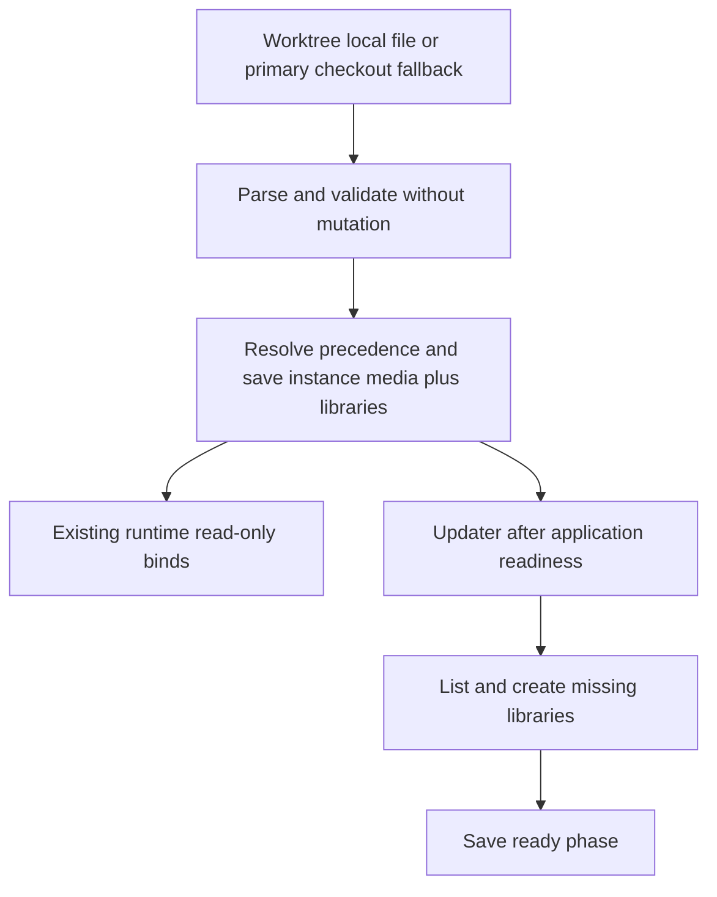
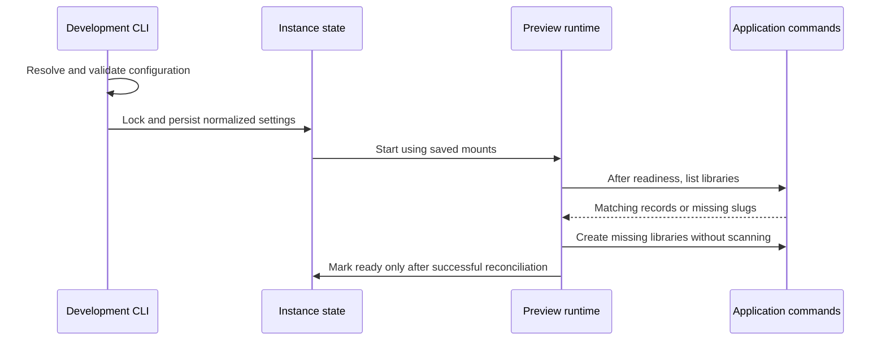

# Configurable Development Libraries - Plan

## Goal Capsule

- **Objective:** The developer can open the preview and find a Movies library backed by their local video directory, ready for a manual scan.
- **Means:** Local development configuration feeds the existing mount and library command paths (KTD1–KTD4).
- **Authority:** The user authorized implementation and library creation; scans remain user-initiated. This contract records that scope; repository instructions govern implementation and verification.
- **Execution profile:** Bounded tooling change on `feat/configurable-development-libraries`; the lead integrates, verifies, commits locally and configures the working preview. Push only when requested.
- **Stop conditions:** Do not reset local data, delete catalog libraries or scan media automatically. Report a conflicting existing library rather than rewriting its catalog identity.

## Product Contract

### Summary

Add an editable `dev.local.json` for development library directories. Starting a configured preview mounts those directories and creates missing application libraries. The user starts scans manually.

### Problem Frame

The preview has no movie library connected to the developer's video directory. Existing media mounts require CLI options and do not create application library records, so mounting a directory alone leaves the desired library absent.

### Requirements

**Local configuration**

- R1. Read development library definitions from `dev.local.json`, with a tracked example documenting the supported fields.
- R2. Each definition supplies `slug`, `name`, `type` and a host `path`; the current setup uses Movies, slug `movies`, type `movie`, and the user's video directory.
- R3. A linked worktree of the same Git repository uses its own configuration when present and otherwise uses the primary checkout's configuration, resolved from the actual Git layout.
- R4. Reject malformed or unusable configuration before creating state directories, saving instance state or generating secrets.

**Preview behavior**

- R5. Starting a configured preview creates missing application libraries and leaves existing matching libraries intact.
- R6. Media scanning remains manual; creation and verification enqueue no scan.
- R7. Host mount changes require a stopped existing instance, and changing a host path preserves the stable application library path.
- R8. Removing a configured library never deletes its application library or catalog data.

**Privacy and delivery**

- R9. Keep the local configuration out of version control, Docker build contexts and source snapshots, even if accidentally tracked.
- R10. Deliver the working preview with the requested Movies directory mounted and its library visible, preserving existing local data.

### Key Decisions

- **Create libraries:** Create application records as well as mounts (session-settled: user-directed — chosen over mounts alone: the user selected CREATE LIBRARIES). Governs R5.
- **Scan manually:** Leave indexing to the user (session-settled: user-directed — chosen over automatic scanning: the user selected SCAN MANUALLY). Governs R6.

### Scope Boundaries

No application domain, database schema, UI or PHP/Swoole runtime changes are needed. No path-update command, catalog deletion, automatic scanning or data reset is included. A generic configuration framework and directory watcher are unnecessary for this bounded development workflow; broader configuration needs would justify revisiting that choice.

### Success Criteria

The preview reports the Movies library at its stable container path, the mounted directory is readable, and the library is visible through the existing administration view without a scan having run. Repeating startup creates no duplicate library.

## Planning Contract

### Key Technical Decisions

- KTD1. **Resolve one local file.** Prefer the worktree root's file. For a linked worktree of the same Git repository, use the actual primary checkout when that file is absent. Resolve Git worktree metadata and the common Git directory without assuming its parent is the checkout; separate Git directories must work. Do not merge files, search parent directories or copy configuration into images. This makes the main checkout practical to edit while preserving a local override (R1, R3, R9).
- KTD2. **Normalize before mutation.** Require a JSON object; when `libraries` is present, require an array of objects. Reject unknown fields, missing or empty strings, duplicate slugs, unsupported application library types, invalid slug syntax, and host paths that are not absolute or do not resolve to readable existing directories. Derive each container target as `/media/<slug>`, validate mount overlaps using existing rules, and persist normalized library definitions with instance state (R2, R4, R7).
- KTD3. **Keep configuration precedence explicit.** A missing file or omitted `libraries` preserves saved configuration and the existing new-preview inheritance behavior. An explicit empty array clears configured library provisioning and its mounts, subject to the stopped-instance gate, while retaining unrelated manual mounts. Configured targets coexist with `--media`; an explicit CLI mapping for the same target wins the host source for that invocation and saved state. Persist the resulting normalized definitions so controller copies and automatic updates need no local file (R7, R8).
- KTD4. **Reconcile through existing application commands.** After application readiness in `Updater::startRelease`, before saving phase `ready`, list libraries in JSON and create missing slugs using the derived target. A matching slug must agree on name, type, filesystem type and path. Drift or command failures fail visibly, using the updater's existing failure handling. This hook covers existing databases and repeated starts; fresh-bootstrap-only provisioning would not (R5, R6).
- KTD5. **Reuse mount and snapshot boundaries.** Feed normalized mounts into `instance.media`, keeping read-only binds and `create_host_path: false`. Add a root-file exclusion to `Build/Source`, `.gitignore` and `.dockerignore`, without changing the source snapshot's private outer directory and readable internal files (R9).

### High-Level Technical Design

### Assumptions

The local file is a small development-only contract rather than a new public configuration API. No external research is needed: existing runtime binds, startup sequencing and application library commands establish the implementation boundaries. The fallback applies to linked worktrees of the same Git repository, including user-created worktrees, and never searches unrelated checkouts.

### Deferred Implementation Details

Final helper names and collaborator injection points may follow the existing tooling tests. Verify Docker's host access to the user's directory during the authorized runtime setup; a failed bind or application readability check must remain an actionable failure rather than creating the directory. No planning blocker remains.

## Implementation Units

### U1. Load and persist development library configuration

**Goal:** Make local configuration produce validated saved mounts and library definitions.

**Requirements:** R1–R4, R7, R8; KTD1–KTD3.

**Dependencies:** None.

**Files:** `packages/baander-tooling/src/Development/LocalConfiguration.php` (new), `packages/baander-tooling/src/Development/Cli.php`, `scripts/tests/php/DevelopmentLocalConfigurationTest.php` (new), `scripts/tests/php/DevelopmentCliTest.php`.

**Approach:** Keep reading and normalization separate from state mutation. Extend `Cli::configure` at its current media resolution boundary and preserve its existing repository and mount checks.

**Test scenarios:** Local override beats primary checkout fallback; user-created linked worktrees and separate Git directories resolve the correct primary checkout; an ordinary checkout does not search unrelated locations; malformed JSON and invalid definitions create no state directories or secrets; duplicate slugs and conflicting targets fail; absent versus empty configuration follows KTD3; CLI target precedence is deterministic; changing a saved mount while running fails without saving; a stopped host-path change retains the derived target.

**Verification:** Configuration and CLI tests prove precedence, validation ordering and saved-state behavior.

### U2. Ensure configured libraries after readiness

**Goal:** Create missing configured library records on every applicable startup.

**Requirements:** R5, R6, R8; KTD4.

**Dependencies:** U1.

**Files:** `packages/baander-tooling/src/Development/Libraries.php` (new), `packages/baander-tooling/src/Development/Updater.php`, `scripts/tests/php/DevelopmentLibrariesTest.php` (new), `scripts/tests/php/DevelopmentActivationTest.php`, `scripts/tests/php/DevelopmentUpdatesTest.php`.

**Approach:** Reuse `Runner` and the runtime's existing application command execution path. Keep reconciliation testable with fake command results and integrate at `Updater::startRelease` after readiness.

**Test scenarios:** Empty settings run no library commands; a missing slug is created once; a second start leaves matching records unchanged; existing-database startup provisions missing records; drift fails clearly; failed list/create commands are not swallowed; readiness is not saved after reconciliation failure; no branch runs a scan command; persisted settings support copied-controller startup without the local file.

**Verification:** Focused reconciliation tests and lifecycle integration prove idempotence and failure propagation.

### U3. Protect local configuration and document delivery

**Goal:** Keep host configuration private and make the workflow reproducible.

**Requirements:** R1, R9, R10; KTD5.

**Dependencies:** U1, U2.

**Files:** `.gitignore`, `.dockerignore`, `dev.local.example.json` (new), `packages/baander-tooling/src/Development/Build/Source.php`, `scripts/tests/php/DevelopmentBuildTest.php`, `docs-book/part-2-developer-guide/development-environment.md`, `ROADMAP.md`; ignored local `dev.local.json` during setup.

**Approach:** Document file selection, fields, precedence, stopped-instance changes and manual scanning. Keep machine-specific paths in ignored configuration. Configure the existing managed preview through its normal lifecycle and record delivered scope and verification counts in the roadmap.

**Test scenarios:** An accidentally tracked root `dev.local.json` is excluded from the snapshot and digest; changing its contents leaves the source digest unchanged; the example remains included; readable copied source permissions remain intact; local runtime setup exposes the requested Movies directory and one matching library without scanning.

**Verification:** Build privacy tests, tooling gates and the actual preview checkpoint pass.

## Verification Contract

Use the tracked tooling configuration and the authoritative CI image described in `docs-book/part-2-developer-guide/testing.md`. Run `composer test:tooling`, `composer analyse:tooling` and `composer check:tooling-format`; apply the scoped formatter when needed. Keep logs bounded and report suite counts and any unavailable gate precisely.

Refresh the managed preview with `make preview-up` and obtain its isolated URL through `make preview-url`. Confirm `app:library:list --json` reports Movies with its derived path and `app:library:validate-path <path> --json` confirms readability. Verify the existing administration library view at that explicit preview URL; browser checks receive it as `E2E_BASE_URL`. Record that no scan command ran and leave scanning to the user.

## Definition of Done

The configuration, mount and reconciliation behavior meets R1–R10, the tooling checks pass, and the Movies library is visible and readable in the existing preview. Documentation and the example match the delivered behavior. The roadmap records each delivered unit and its verification checkpoint. Existing local data and unrelated user edits remain intact, and abandoned implementation experiments are removed. All commits stay local.

## Appendix

### Sources

Planning uses the authorizing user request and the user's CREATE LIBRARIES / SCAN MANUALLY answers, carried in the implementation handoff. Repository evidence: `Cli::configure`, `Runtime::bind`, `Updater::startRelease`, `Build/Source::snapshotWorktree`, the application library list/create/validate-path commands, and the development/testing guides. No matching development-library solution was found in `docs/solutions/`. Existing vocabulary in `CONCEPTS.md` covers worktree previews and library behavior; no new domain concept is introduced.
