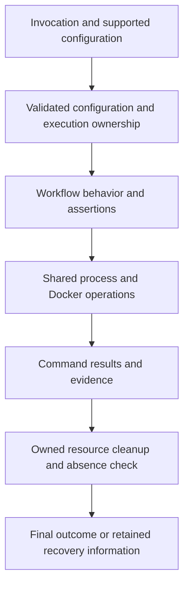
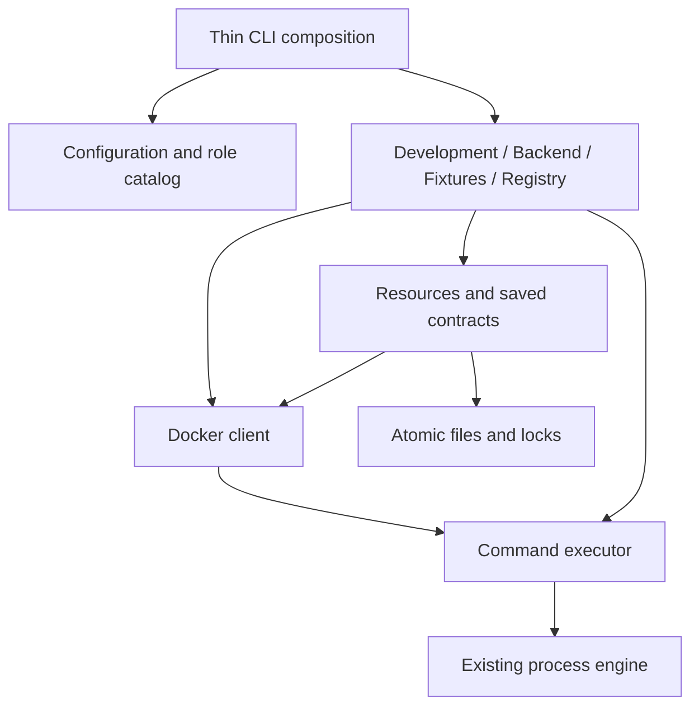
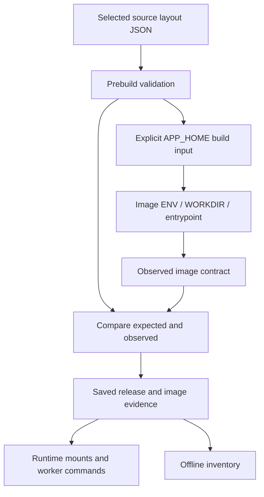
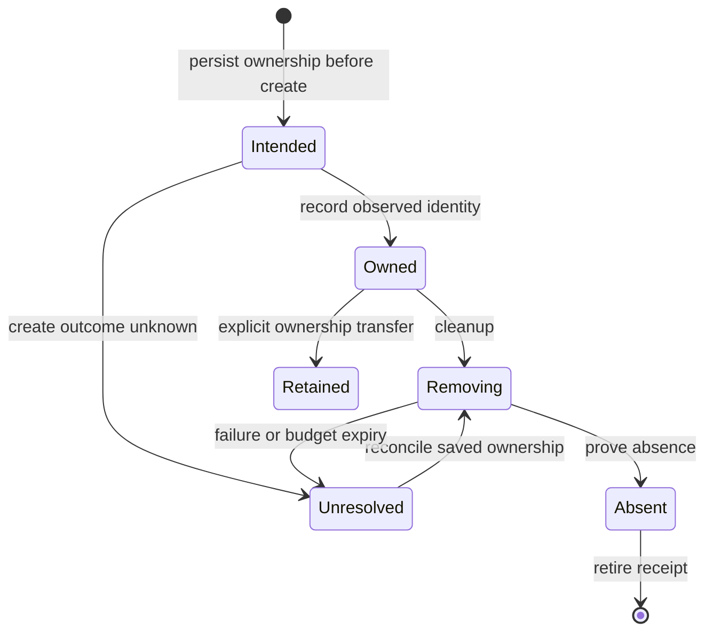
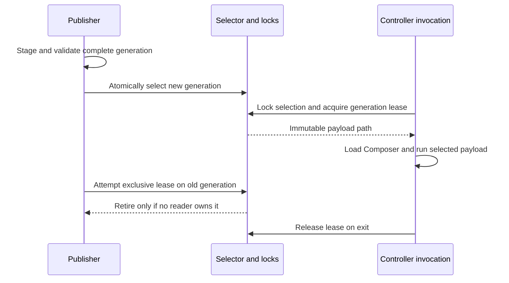

# Cohesive Project Tooling - Plan

## Goal Capsule

- **Objective:** Developers and CI can run Baander's testing and development workflows reliably, with predictable configuration, trustworthy results and recoverable failures.
- **Means:** Shared configuration, execution, Docker and resource contracts with coordinated consumer migrations (KTD1–KTD11).
- **Product authority:** The user confirmed the package-wide remediation scope after the in-depth review of `packages/baander-tooling`; this Product Contract records that scope.
- **Execution profile:** Implement on `refactor/cohesive-project-tooling` in local units; the lead integrates shared configuration, serializes expensive checks and records evidence in `ROADMAP.md`. Push only when requested.
- **Authority:** Product behavior follows the Requirements; Key Technical Decisions govern implementation within those constraints, and units override neither.
- **Stop conditions:** Stop an affected operation on uncertain resource ownership or a retained-state conversion that cannot preserve R24; preserve inspection and cleanup access.

---

## Product Contract

### Summary

Give Baander's testing and development tooling consistent configuration, image/layout, Docker execution, process and resource-ownership contracts.
Fix the verified behavioral defects and update affected callers and build inputs so those contracts hold across workflows.

### Problem Frame

The package shares a process engine and Docker adapter, but callers independently decide target selection, completion semantics, image references and cleanup outcomes.
A browser checkpoint can address a different daemon from its coordinator, a timed-out command can pass, and failed cleanup can erase the information needed to remove a leftover resource.
Repeated application paths also couple an image-layout change to provisioning, worker commands, mount safety checks and inventory classification.

The audit covered all 92 PHP source files and four package metadata/resource files, with targeted inspection of callers and tests.
Independent verification confirmed its 14 core factual claims.
These findings establish both behavioral defects and architectural ownership gaps; image/path duplication alone does not prove that the current default environment fails.

### Key Decisions

- **Remediate shared contracts across the package.** The review demonstrated that literal replacement alone leaves execution and cleanup defects intact; governs R1–R3 and R10–R18 (session-settled: user-approved — chosen over isolated literal cleanup: verified failures arise from duplicated policies).
- **Keep configuration and image layout under distinct ownership.** Configuration selects an image and supported overrides; the image layout supplies its application paths, per R4–R8.
- **Preserve useful existing foundations.** The process engine, atomic filesystem helpers and stronger cleanup implementations remain candidates for reuse under R2–R3; the audit does not require every class to be rewritten.
- **Correct false success deliberately.** Existing tests that accept failed cleanup are changed with the behavior under R17–R18; preserving an assertion is not sufficient evidence of a correct contract.
- **Allow breaking changes with coordinated consumer migration.** R27 permits changes to commands, configuration and interfaces while R24 protects local data (session-settled: user-directed — chosen over preserving existing contract signatures: updating consumers permits the intended design).

### Requirements

**Scope and dependency ownership**

- R1. Remediate every retained behavioral finding and ownership gap in the package audit, including necessary changes to consuming scripts, Docker inputs, templates, Composer wiring, CI and tests.
- R2. Workflow code must use shared owners for process-completion policy, Docker operations, configuration, image selection, application layout and resource lifecycle; specialized execution behavior must have an explicit contract.
- R3. Package services must declare their dependencies through Composer or explicit composition boundaries, without depending on incidental entrypoint loading or calling back into CLI files as reusable implementation.

**Configuration, images and paths**

- R4. Resolve supported configuration once before execution with documented precedence: explicit invocation settings, machine-local overrides, then repository defaults.
- R5. Normalize empty optional environment overrides as absent and reject malformed nonempty values before side effects.
- R6. Each image role must have one repository-owned selection policy supporting documented overrides, compatibility checks and a recorded resolved identity for the run; retained development data-service identities must not change implicitly.
- R7. Application paths must follow one image-layout contract shared by tooling and its build/template consumers, with dependent paths derived consistently and incompatible images rejected before provisioning.
- R8. A supported mirror, repository or version change must not require edits to workflow PHP, including the browser checkpoint's Playwright image selection.
- R9. Validate the complete effective mount model before state writes or resource creation, including reserved destinations, normalized overlaps and source-path representability in every downstream operation.

**Docker and process execution**

- R10. Resolve the Docker executable, connection target and daemon identity for the workflow, and carry that ownership through nested commands, browser hooks, evidence collection and recovery.
- R11. Validate the capabilities and topology actually required by the workflow before mutation; Docker-only checks must not require Compose, and unsupported connectivity must fail explicitly.
- R12. Checked process completion must reject timeout or cancellation independently of exit status, including when a terminated child exits zero.
- R13. Bounded qualifications must have finite documented execution budgets and cancellation behavior; managed long-lived services and operations bounded by an owning scope retain their explicit lifetimes.
- R14. Execution sessions must release completed process ownership and historical captured output while continuing to service active children and independent output streams.
- R15. Process environment changes must remain command-scoped or restore the caller's previous values on success and failure.
- R16. Machine-readable stdout must remain separate from diagnostics across real process boundaries, including application logging used by tooling consumers.

**Resources and verification evidence**

- R17. An otherwise successful disposable workflow must fail when it cannot prove its owned resources absent; cleanup failures must remain visible alongside the original failure and its status.
- R18. Failed cleanup must retain sufficient resource and daemon ownership information for a targeted retry, without deleting unrelated resources or losing the recovery record.
- R19. Final evidence consumers must reject corrupt complete records, and may tolerate an incomplete trailing write only in an explicitly supported live-reading mode.
- R20. Archive processing must account for every accepted entry in the inventory; unsupported entry types must fail explicitly without unsafe creation or opening of special files.
- R21. Validated mode and checkpoint selection must govern both preparation and execution, with competing nonempty exclusive checkpoints rejected before side effects.

**Regression prevention and retained behavior**

- R22. Automated architecture checks must enforce the agreed tooling dependency and execution boundaries, including Docker bypasses and duplicated image/application-layout policy outside their approved owners.
- R23. Regression tests must exercise the observed failure boundaries and actual consumers, including controlled timeout output after child readiness and real structured-output producers where mocks remove the affected behavior.
- R24. Existing instance identities, libraries and user data must survive the remediation; verification must use disposable resources and isolated previews without resetting the persistent instance.
- R25. Preserve supported target capabilities, source-transfer guarantees, independent application and registry inventory responsibilities, self-contained registry build contexts and specialized process containment while consolidating their shared policies.
- R26. Keep Composer loading and the PHP 8.5+ with Swoole host baseline, using formatted modern PHP and pipe chains where they clarify sequential transformations; Bash remains secondary and test/dev workflows do not regain Python implementations.
- R27. Tooling contracts may change when every affected consumer migrates in the same delivery, including commands, flags, configuration formats, package interfaces, fixtures, CI, installed controllers and retained-state readers; obsolete interfaces must be removed after migration rather than kept as speculative compatibility layers.

The conceptual sequence below illustrates R4, R9–R19; it defines responsibilities, not a proposed class hierarchy.

### Acceptance Examples

- AE1. **Covers R2, R10–R11, R18.** With an explicit Docker endpoint differing from ambient selection, setup, browser hooks, checks and cleanup use the selected target; a retargeted daemon fails ownership validation before destructive cleanup and leaves retry information intact.
- AE2. **Covers R4–R6, R8.** A supported local mirror override selects the intended browser or service image without PHP edits, and the run records its resolved identity; an incompatible browser package/image combination fails before resource creation.
- AE3. **Covers R6, R24.** Changing a source image override does not silently replace an existing development database/Redis identity or reset its data during stop/resume.
- AE4. **Covers R7, R22.** A controlled application-layout change updates generated mounts, workdirs, worker commands, autoload probes, frontend paths and inventory classification through their contract, or the consistency gate fails before those workflows run.
- AE5. **Covers R12, R23.** A real child receives termination after its deadline, handles it and exits zero; the qualification still fails as a timeout and does not launch the next gate.
- AE6. **Covers R17–R18.** Container removal returns nonzero after a successful check; the workflow fails, identifies remaining owned resources and retains a retry record that disappears only after successful cleanup.
- AE7. **Covers R12, R17–R18.** A failed, timed-out or interrupted workflow also encounters cleanup failure; both causes remain visible, the original failure status is preserved, and unrelated resources survive.
- AE8. **Covers R14.** Repeated completed commands each emit one MiB, then their callers discard the results; active ownership returns to zero and retained memory does not grow with the history of captured output.
- AE9. **Covers R11, R13.** A DNS/proxy check runs with Docker available and Compose absent; a stalled messaging dependency command reaches its finite budget and proceeds through owned cleanup.
- AE10. **Covers R9.** An explicit media mount overlaps the conversion destination, or a host path cannot be represented by a required consumer; startup rejects it before state, secrets, builds or containers are changed.
- AE11. **Covers R5, R21.** An empty control-capacity checkpoint plus a valid autoscaling checkpoint selects autoscaling consistently; two nonempty exclusive checkpoints fail preflight.
- AE12. **Covers R19, R23.** A corrupt complete record between valid measurement rows makes the actual autoscaling and capacity verifiers fail; an in-progress trailing write is tolerated only by the supported live-reading contract.
- AE13. **Covers R20.** An archive contains a FIFO or device entry; processing cannot return a successful inventory that silently omits the accepted entry, and does not open the special file.
- AE14. **Covers R3, R15.** Declared Composer loading and explicit composition suffice for the supported package service surface, and a failing static qualification leaves the caller's compiler environment unchanged.
- AE15. **Covers R16, R23.** A real JSON-producing application command emits diagnostic activity in the relevant runtime configuration; complete stdout remains parseable and diagnostics are captured separately.
- AE16. **Covers R23–R26.** The supported preview lifecycle and affected qualification families pass after integration, existing Movies/Music library identities and paths remain intact, and no automatic media scan or reset is introduced.
- AE17. **Covers R1, R24, R27.** A command, setting or package interface is replaced; every tracked caller, generated or installed controller consumer, test and relevant guide uses the replacement, retained local state remains usable, and no active consumer depends on the removed contract.

### Success Criteria

- The implementation review maps every retained audit finding to its correction and verification evidence; any rejected finding has source-backed justification rather than disappearing from scope.
- Tooling PHPUnit, PHPStan, formatting and the new architecture gates pass in the authoritative CI environment, with suite counts and legitimate skip reasons recorded in `ROADMAP.md`.
- Affected development, backend, browser, HTTP, web, messaging, worker, registry and inventory workflows have a reviewed verification matrix covering their changed boundaries and necessary disposable integration checks.
- At least one configuration variation for image selection, Docker target and application layout demonstrates that the common contracts reach their consumers.

### Scope Boundaries

The active scope is the package and the necessary consumers identified by R1.
Product features, application domain redesign and database schema work are outside this remediation.
The shipped registry backup and enrollment Python programs remain outside the testing/development language scope established by R26.

Arbitrary relocation of third-party image internals, a new general workflow framework and unrestricted support for new Docker topologies are not requirements.
Scratch directories, protocol paths and independent assertions of published image contracts may remain explicit where R7's application-layout ownership does not apply.
Reachable legacy qualifications are not removed solely because their names contain `Legacy`.

### Dependencies and Assumptions

The existing process engine, filesystem helpers, Docker adapter and stronger cleanup implementations provide reusable foundations; planning must assess their interfaces against R2 rather than assume their current placement is authoritative.
The current browser image matches the UI's locked Playwright 1.60.0 package, so its present issue is selection ownership and compatibility enforcement.
The host-only audit reproductions establish the named failure cases; they do not substitute for the CI and integration acceptance above.

### Sources and Research

- Audit baseline: commit `2ecd9b3cd9236d87bced36ec25fad55a03034b3f`.
- Local audit: `var/tooling-audit/2026-10-29/review.md`, its three detailed reports, reproductions and `claim-verification.md`; these ignored artifacts are machine-local supporting evidence, and this contract plus the source references below remains usable without them.
- Docker and image selection: `packages/baander-tooling/src/Development/Acceptance/BrowserCheckpoint.php`, `packages/baander-tooling/src/Development/Build/Builder.php`, `packages/baander-tooling/src/Fixtures/Worker/OperatorCommands.php` and `packages/baander-tooling/src/Fixtures/Http/Drill.php`.
- Layout and mount ownership: `Dockerfile`, `docker/dev/frontend.conf.template`, `packages/baander-tooling/src/Development/Runtime.php`, `packages/baander-tooling/src/Development/Cli.php`, `packages/baander-tooling/src/Development/Workers.php` and `packages/baander-tooling/src/Inventory/ApplicationInventory.php`.
- Process and cleanup findings: `packages/baander-tooling/src/Registry/ContainerQualification.php`, `packages/baander-tooling/src/Registry/QualificationRunner.php`, `packages/baander-tooling/src/Inventory/Collector.php`, `packages/baander-tooling/src/Backend/StaticCheck.php`, `packages/baander-tooling/src/Fixtures/Runtime.php`, `packages/baander-tooling/src/Fixtures/Web/RuntimeWorkflow.php` and `packages/baander-tooling/src/Fixtures/Messaging/Qualification.php`.
- Evidence and dependency findings: `packages/baander-tooling/src/Fixtures/Worker/Reports.php`, `packages/baander-tooling/src/Fixtures/Worker/OperatorConfiguration.php`, `packages/baander-tooling/src/Fixtures/Worker/OperatorQualification.php`, `packages/baander-tooling/src/Inventory/SafeTar.php`, `packages/baander-tooling/src/Registry/StaticQualification.php` and `packages/baander-tooling/composer.json`.
- Existing boundary lesson: `docs/solutions/runtime-errors/console-json-output-needs-real-logging-handlers.md`.
- Prior workflow designs and guides: `docs/plans/2026-10-27-1812-refactor-php-first-development-tooling-plan.md`, `docs/plans/2026-10-29-1726-feat-configurable-development-libraries-plan.md`, `packages/baander-tooling/README.md`, `docs-book/part-2-developer-guide/testing.md` and `docs-book/part-2-developer-guide/development-environment.md`.

---

## Planning Contract

Product Contract unchanged in scope: R1–R27 and AE1–AE17 are preserved; the former planning questions are resolved by the decisions below.

### Key Technical Decisions

- KTD1. **Use neutral infrastructure modules and explicit composition.** Introduce `Configuration`, `Docker` and `Resources` beside the existing `Process`, `Filesystem` and `Inventory` modules in `packages/baander-tooling/src/`.
  Workflow families depend on those modules, which never depend on `Development`, `Backend`, `Fixtures`, registry test support or script entrypoints.
  Replace inherited runner APIs and untyped cross-component state bags with small typed configuration/result/ownership objects and constructor dependencies; retain scenario-specific state inside its coordinator.
  Composer remains the only autoloader, and CLI entrypoints assemble dependencies rather than provide reusable implementation (R2–R3, R26–R27).

- KTD2. **Resolve configuration at the invocation boundary.** Add package resources `tooling-defaults.json` and `application-layout.json`, with strict versioned readers under `Configuration`.
  The defaults file owns role image references, declared capabilities and workflow budgets; the layout file owns the application root and layout version.
  Extend `dev.local.json` with an optional `tooling` object for supported image, Docker and budget overrides, preserving `libraries` and its existing worktree-file/primary-checkout fallback.
  Within a selected local file, maps override defaults by known leaf key; arrays such as libraries replace their whole value.
  Existing invocation flags override their corresponding environment settings, which override machine-local settings and then tracked defaults; unknown keys, invalid types and nonpositive/nonfinite budgets fail preflight.
  Optional empty environment values follow R5, while explicit empty flags and JSON values are errors.
  Resolve once to immutable configuration and record non-secret effective values; consumers do not call `getenv()` or reread JSON independently (R4–R6, R9, R15, R21).

- KTD3. **Select images by role and pin the selected identity.** Move current approved defaults into the catalog without incidental version upgrades, including application, PostgreSQL, Redis, nginx, proxy, browser and operator-helper roles.
  Preserve distinctions such as development Redis versus a fixture Redis Stack image.
  Explicit role overrides accept full references, including alternate registries and digests; selection resolves once to an immutable ID on the selected daemon.
  Browser role metadata declares the compatible Playwright package version, which is checked against the actual installed `ui/web` package before browser creation; an arbitrary custom reference must supply its compatible version rather than rely on tag guessing.
  Persist references, resolved IDs and declared role capabilities with run/release evidence, without registry credentials.
  Retained data-service pins take precedence over a new source preference during ordinary resume; report that distinction without replacing the retained service (R6, R8, R24).

- KTD4. **Pass the canonical application layout into builds.** Every root-Dockerfile build supplies `APP_HOME` from `application-layout.json`; the Dockerfile has no second default and its runtime stages derive `ENV`, `WORKDIR`, aliases and entrypoints from that input.
  A new thin `scripts/build-application.php` command composes the shared builder for CI and documented local builds.
  Replace the legacy direct Compose build path with the supported build entrypoint and generated image reference, updating its consumers under R27.
  The bootstrapped caller reads the selected source contract as data: a persistent revision can be read from Git before materialization, and a preview uses its chosen worktree.
  Prepared snapshots omit vendor directories, so never bootstrap their scripts to read the contract.
  Check that the subsequently materialized source has the validated contract, and validate image metadata against it before provisioning.
  Save layout metadata with image evidence for offline inventory and historical releases; do not infer an old image's paths from the current checkout.
  Scratch roots and third-party image paths remain separate explicit protocols (R7, R9, R25).

- KTD5. **Keep the process engine and share completion policy above it.** Retain `ProcessRunner`, `RunningProcess`, `SignalScope` and process-group containment.
  Add a `CommandExecutor` interface, an engine-backed executor, immutable execution context and completion policy under `Process`.
  The same policy handles synchronous and asynchronous completion; permitted nonzero exits do not waive timeout/cancellation checks.
  A deliberate stop/drain operation returns observed termination separately from successful gate completion.
  Normalize timeout to status 124 and interruption to 128 plus the recorded signal; preserve other command failure statuses and their diagnostics.
  Keep only active handles, stream large diagnostics to files, and release completed results after ownership ends.
  Cleanup gets an independent bounded execution context, so an expired ordinary deadline does not prevent cleanup (R12–R17).

- KTD6. **Move Docker discovery and operations out of Development.** `Docker\TargetResolver`, `Target` and `Client` own executable selection, exactly one host/context selector, daemon identity and all Docker argv construction, including asynchronous commands and Compose operations.
  Explicit target inputs win over ambient selection; conflicting explicit host/context inputs fail.
  Capture the selected connection in a private, run-owned immutable transport snapshot, including the connection material needed by Docker; keep the original context name as provenance only.
  Later operations must remain bound to that snapshot even if the user switches or edits the original named context.
  Nested helpers receive a serialized target contract and an explicit transport description for any operator-container socket mapping.
  Validate identity at initial connection and recovery boundaries, and use the captured transport thereafter; a mismatch never falls back to another daemon.
  Docker availability, Compose availability and host-local published-port access are separate capabilities, so unsupported host-local topology fails before provisioning (R10–R11, R18, R25).

- KTD7. **Give disposable resources one durable ownership ledger and outcome rule.** `Resources` owns a versioned receipt, cleanup report and final outcome, using `Filesystem\AtomicFile` and existing private-directory/lock primitives.
  Record a run-specific name/label and target before creation, enrich with the returned immutable ID, then reconcile uncertain creation by saved ownership on recovery.
  Delete a receipt only after confirmed absence; transport or authorization failure is unresolved, not absence.
  Cleanup attempts other independent owned resources after one removal fails, within a shared total budget.
  Preserve the primary failure status and append cleanup diagnostics; an otherwise successful run becomes nonzero on unproved cleanup.
  Persistent instance data and deliberately retained operator pairs have explicit retain/transfer ownership, not the disposable absence postcondition.
  Keep specialized worker namespace checks while sharing the ledger and outcome mechanism (R17–R18, R24–R25).

- KTD8. **Persist the resolved release contract and separate recovery from new-run preflight.** Save schema version, layout, target, image identities, relevant effective configuration and generated-input identity with a prepared release before provisioning.
  Existing-instance status, down and cleanup use saved ownership, not current image defaults or library-path validation; invalid current `dev.local.json` must not block them.
  Blocked activation recovery uses its saved contract and validates retained artifacts before resuming.
  For actual existing records, convert under the instance lock using saved image identities and observed metadata, retaining the original record and checkpoints until the atomic replacement succeeds.
  Unknown or inconsistent records block activation with actionable diagnostics while leaving inspection and cleanup available.
  This is a bounded conversion for real local state, not a permanent old-schema reader or speculative compatibility framework (R9–R11, R18, R24, R27).

- KTD9. **Publish complete controller generations.** Replace copy-over installation with private immutable payload generations containing the package, Composer loader, resources, templates and entrypoints.
  A small stable launcher selects a generation through an atomically replaced selector; it holds a generation lease until the invocation ends.
  Select and acquire the lease under a publication lock so retirement cannot race a new reader; delete obsolete generations only after an exclusive nonblocking lease proves they are unused.
  The launcher must acquire the selected payload's lease before loading its classes, and publication/instance locks use one documented acquisition order.
  Keep absolute PHP selection, systemd quoting, approved Composer symlink handling, secret exclusions and updater enable intent.
  Incompatible retained-state conversion requires the relevant old controller invocation to finish before the new writer proceeds (R24, R27).
  Never hold an instance lock while waiting for an old-generation lease: let existing readers finish, then take the instance lock and recheck the record before conversion.

- KTD10. **Keep inventory and registry boundaries explicit.** Replace Inventory's calls back into repository scripts with a package-owned inventory worker entrypoint and an explicit Composer-loader input supplied by composition.
  Run that child with the required memory policy to preserve large-inventory behavior without changing the caller's PHP configuration.
  Account for accepted FIFO/device entries as metadata without creating or opening special files, preserving the separate application and registry inventory responsibilities.
  Move static-analysis Pins/Diagnostics into the tooling package, removing manual requires and test-runtime helpers.
  Move relay bounded-storage support into a non-test relay qualification namespace and inject its validation capability into the package qualification runner.
  Update relay Composer and qualification-image copies inside the existing `relay/` context; do not make those images depend on the root package (R3, R15, R20, R25, R27).

- KTD11. **Make artifact finality and architecture enforceable.** Give measurement readers explicit live and completed modes: live mode ignores only an unterminated trailing fragment, and both modes reject malformed complete records.
  Completed verification follows successful producer join, output drain and atomic publication; aborted collection cannot publish successful final evidence.
  Intentional live operator checkpoints use the live mode explicitly.
  Add `deptrac-tooling.yaml` plus a focused tooling source-policy check for raw process/Docker access and image/layout literals outside their owners.
  Narrow documented exceptions cover specialized containment and independent test assertions; new violations cannot enter a baseline.
  Gate tests contain negative controls that introduce representative violations (R19, R22–R23).

### Configuration and Execution Boundaries

| Input or operation | Resolution and ownership |
| --- | --- |
| New qualification, preview startup or update | Complete configuration and mount validation before state/build/container mutation; KTD2–KTD4. |
| Local file selection | Worktree-local file wins as a whole file; primary-checkout fallback applies only when absent, preserving the current library contract. |
| CI invocation | Explicit flags/environment and tracked defaults; no dependency on a developer's ignored local file. |
| Application root | Tracked source layout contract only; excluded from machine-local overrides. |
| Status, down and cleanup retry | Saved target/resource/release contract; no image pull or fresh library validation, per KTD8. |
| Browser compatibility | Installed package version versus declared image-role compatibility; runtime launch remains an integration proof of the chosen image. |
| Workflow environment | Captured at composition and overlaid per command; no process-wide compiler mutation. |

Initial finite budgets live in the catalog, not PHP constants: preserve existing finite family limits, replace messaging's `PHP_FLOAT_MAX` with 600 seconds, and use a default 120-second total cleanup budget with each operation clamped to the remaining time.
Existing longer registry cadence gates retain their named budgets, and backend qualification retains its current 3,600-second default.
Development builds remain cancellable managed operations with their explicit lifetime; this change does not invent an arbitrary build deadline.
Budget overrides remain positive and finite, and a cleanup receipt survives budget exhaustion (KTD2, KTD5, KTD7).

### High-Level Technical Design

The module graph keeps workflow policy above shared infrastructure (KTD1).

Build and runtime paths share one source, including offline consumers (KTD4).

Resource recovery distinguishes uncertainty from absence (KTD7).

Controller publication protects readers already using a generation (KTD9).

### Alternatives and Constraints

Extending `Development\Runner` and `Docker` in place would keep fixtures and registry tooling coupled to a development CLI policy; KTD1/KTD6 instead extract their reusable responsibilities.
Replacing the process engine or adopting a general workflow framework adds no needed capability and would discard existing real-child containment evidence; KTD5 keeps that engine.
Reading layout only from an image cannot validate a fresh source configuration before the image exists, so KTD4 supplies build-time authority and uses inspection as a consistency check.
These alternatives are settled by current callers and bootstrap constraints; developing competing implementations would not resolve an outstanding mechanism question.

No application-domain or database redesign is planned.
No universal retry engine, external Docker platform support or compatibility facade is added.
Cleanup retries operate on saved ownership only; uncertain identity is never repaired by broader deletion.
Direct root-Dockerfile and legacy Compose callers change together with the new build contract, as authorized by R27.

### Sequencing and Integration

The first three units establish shared contracts and prove vertical failure cases; later units migrate consumers by workflow family.
Existing implementations may remain reachable during staged migration until their consumers move, but no compatibility shim is added and U11 removes obsolete owners before delivery.
The lead owns shared configuration, Composer files, Docker/CI inputs, architecture gates, integration and authoritative verification.
Workers may own disjoint workflow families after agreeing the shared contracts; expensive Docker suites and persistent-state fixtures run serially.
Every unit adds the failure-oriented tests that distinguish the new behavior before moving its consumers, and phase boundaries receive simplification review.

### Risks and Implementation-Time Checks

- A selected source revision and installed controller may differ: validate source contract support before materialization, and persist the chosen contract through recovery (KTD4, KTD8).
- A controller may still execute deleted class names: exercise generation leases and old-reader/state-conversion ordering before removing installed payloads (KTD9).
- Docker-client cancellation does not prove a container-side process exited: retain specialized namespace/PID 1 checks and resource teardown (KTD5–KTD7).
- The browser compatibility declaration cannot prove a custom image was built honestly: validate the declaration early and require an actual browser launch in integration acceptance (KTD3).
- Exact runtime timings and peak-memory thresholds remain execution measurements; test readiness and historical retention rather than startup-speed assumptions.
- The authoritative CI image may lack a host tool or loader permission seen locally: use its documented gates and record real prerequisites instead of treating the audit's host run as acceptance.

Planning used the current code and verified local audit; no external dependency or new framework was selected.
The shutdown constraints in `docs/solutions/runtime-errors/swoole-sigterm-waits-for-master-timers-and-closes-connections-before-workers-stop.md` and the real-logging evidence lesson in the Product Contract govern integration verification.

---

## Implementation Units

| Unit | Outcome | Primary files | Depends on |
| --- | --- | --- | --- |
| U1 | Validated configuration, image and layout models | Package Configuration/resources; local config reader | None |
| U2 | Shared checked execution and Docker target | Package Process/Docker; exec command | U1 |
| U3 | Durable cleanup and inventory ownership | Package Resources/Inventory; Backend StaticCheck | U2 |
| U4 | One build/layout contract | Dockerfile; builder command; CI/templates | U1–U3 |
| U5 | Coherent installed controller publication | Development Supervisor/ControllerPayload; launcher | U1–U2 |
| U6 | Development lifecycle and retained-state migration | Development coordinators and saved contracts | U3–U5 |
| U7 | Acceptance, HTTP, web and messaging migration | Acceptance and fixture families | U3–U4 |
| U8 | Worker orchestration and evidence migration | Worker fixtures and verifiers | U3–U4, U7 |
| U9 | Explicit registry dependencies and execution | Registry tooling; relay qualification helpers | U2–U4 |
| U10 | Backend coordinator migration | Backend Runtime/Coordinator and tests | U2–U4 |
| U11 | Enforced boundaries and integrated delivery | Gates, caller cleanup, docs, CI, roadmap | U1–U10 |

### U1. Define validated configuration and image/layout contracts

**Goal:** Give workflows one typed input model and one source for role defaults and application layout.
**Requirements:** R1–R9, R15, R21, R26–R27; KTD1–KTD4.
**Files:** New `packages/baander-tooling/src/Configuration/` and `packages/baander-tooling/resources/tooling-defaults.json`, `packages/baander-tooling/resources/application-layout.json`; `packages/baander-tooling/src/Development/LocalConfiguration.php`, `dev.local.example.json`; new `scripts/tests/php/ToolingConfigurationTest.php`, `scripts/tests/php/ImageCatalogTest.php`, `scripts/tests/php/ApplicationLayoutTest.php`; existing `scripts/tests/php/DevelopmentLocalConfigurationTest.php`.
**Approach:** Separate local-file discovery from library parsing, compose typed settings and retain source provenance; expose the catalog/layout to later units without adding independent fallback literals.
**Test scenarios:**
- Covers AE2. Resolve flags, environment, local settings and defaults in order; verify alternate registry/digest selection and empty optional environment handling.
- Covers AE11. Resolve one checkpoint consistently and reject competing nonempty values before side effects.
- Preserve current missing-file, empty-library-list, worktree fallback and malformed-file behavior.
- Reject unknown keys, unsafe layout roots and invalid budget values; prevent local application-root overrides.
**Verification:** Focused configuration tests and tooling static/format gates pass; the example remains free of machine-specific private data.

### U2. Centralize checked execution and Docker targeting

**Goal:** Make process outcomes and daemon ownership consistent for new consumers.
**Requirements:** R2–R3, R10–R16, R26–R27; KTD5–KTD6.
**Dependencies:** U1.
**Files:** New executor/context/policy types under `packages/baander-tooling/src/Process/`, new `packages/baander-tooling/src/Docker/`; `scripts/exec-command.php`; new `scripts/tests/php/CommandExecutorTest.php`, `scripts/tests/php/DockerClientTest.php`; existing `scripts/tests/php/ProcessRunnerTest.php` and its process fixtures.
**Approach:** Preserve raw engine semantics and move checked-result decisions into the executor; define serializable target and transport contracts before workflow migrations.
**Test scenarios:**
- Covers AE5. Real synchronous and asynchronous children time out, handle termination and exit zero; checked completion still fails.
- Expected normal nonzero exits remain observable, while interruption cannot become success.
- Covers AE8. Completed capture commands leave no historical handles/output; active observers still stream during another wait.
- Covers AE1. Explicit host/context wins over ambient selection; daemon mismatch refuses mutation and a Docker-only connection does not invoke Compose.
- Retarget the original named context after initial validation; subsequent ordinary operations and nested helpers use the captured connection or refuse mutation, and recovery retains the original daemon ownership.
- Explicit deliberate stop preserves its observed result without treating cancellation as a successful gate.
**Verification:** Engine-backed policy tests pass without weakening existing argv, process-group, signal, stream and descendant-cleanup tests.

### U3. Establish durable resource outcomes and repair inventory/static cleanup

**Goal:** Prove cleanup failure, retry and archive accounting through complete vertical callers.
**Requirements:** R3, R17–R18, R20, R23, R25, R27; KTD7, KTD10.
**Dependencies:** U2.
**Files:** New `packages/baander-tooling/src/Resources/`; `packages/baander-tooling/src/Inventory/`, `packages/baander-tooling/src/Backend/StaticCheck.php`; new `packages/baander-tooling/bin/inventory-worker.php`; `scripts/packaged_inventory.php`, `scripts/collect-packaged-inventory.sh`; new `scripts/tests/php/ResourceLedgerTest.php`; existing `scripts/tests/php/ApplicationInventoryTest.php`, `scripts/tests/php/BackendStaticCheckTest.php` and their Docker fakes.
**Approach:** Adopt the ledger/outcome contract at these callers, keep inventory processing in the package-owned child and preserve independent offline image evidence.
**Test scenarios:**
- Covers AE6–AE7. Successful body plus failed removal fails and retains a retry record; a failing body preserves its original status alongside cleanup failure.
- Interrupt between intended-create publication and observed-ID save; retry reconciles only resources matching saved ownership.
- Current configuration becomes invalid or a context is retargeted before retry; cleanup uses saved ownership and refuses the wrong daemon.
- Covers AE13. FIFO/device metadata remains accounted for without opening special files; preserve traversal, symlink and hardlink defenses.
- Preserve the large-inventory child memory contract and detect mismatched layout evidence during offline verification.
**Verification:** Resource, inventory and static-check suites pass with failed-removal and uncertain-create controls; no source service invokes a repository CLI as its implementation.

### U4. Propagate the canonical layout through builds and images

**Goal:** Make source layout, image metadata and generated runtime inputs agree.
**Requirements:** R6–R9, R22–R23, R25, R27; KTD3–KTD4.
**Dependencies:** U1–U3.
**Files:** `Dockerfile`, `docker-compose.yml`, `docker/general/`, `docker/dev/frontend.conf.template`, `docker/runner/tooling-test.Dockerfile`, `.forgejo/workflows/ci.yaml`; new `scripts/build-application.php`; `packages/baander-tooling/src/Development/Build/`, affected fixture image builders, `packages/baander-tooling/src/Fixtures/DockerContext.php`, `scripts/test-docker-context.php`; existing `scripts/tests/php/DevelopmentBuildTest.php`, `scripts/tests/php/DevelopmentImagePinsTest.php`, `scripts/tests/php/DevelopmentTopologyTest.php`; new `scripts/tests/php/ApplicationBuildContractTest.php`.
**Approach:** Route root-image builds through the shared contract, update direct/Compose callers and templates together, and replace fixed JSON entrypoint paths with an environment-aware executable that preserves process replacement.
**Test scenarios:**
- Covers AE4. A controlled alternate root reaches build args, image ENV/WORKDIR, startup/worker entrypoints, templates and inventory evidence.
- Missing/invalid layout fails before state/build mutation; missing APP_HOME on direct runtime-image builds fails with the supported invocation named.
- A prepared snapshot without vendor uses its caller's reader and its own selected contract, not another checkout's defaults.
- Covers AE3. New image source preferences leave retained database/Redis pins unchanged.
- Root image targets retain required PID 1, no-debug and production dependency constraints; the new resources remain in Docker build contexts.
**Verification:** Build-contract tests and affected image qualifications pass for default and alternate layout; source and image evidence agree.

### U5. Publish complete controller generations

**Goal:** Make installed controller refresh coherent for concurrent readers and removed classes.
**Requirements:** R3, R24–R27; KTD8–KTD9.
**Dependencies:** U1–U2.
**Files:** `packages/baander-tooling/src/Development/Supervisor.php`; new `packages/baander-tooling/src/Development/ControllerPayload.php` and package-owned controller launcher; `packages/baander-tooling/src/Filesystem/FileLock.php` if lease modes require extension; `docker/dev/systemd/`; `scripts/tests/php/DevelopmentSupervisorTest.php`, `scripts/tests/php/AtomicFileTest.php` and new `scripts/tests/php/ControllerPayloadTest.php`.
**Approach:** Stage whole generations and publish through the selector/lease protocol; update the existing service entrypoint and preserve timer intent without touching application data.
**Test scenarios:**
- Covers AE17. Removed classes are absent in the new generation, while a running old generation keeps a coherent loader until it exits.
- Failed staging/publication leaves the previous generation runnable; retirement cannot race a newly selecting reader.
- The installed controller runs after the source checkout is unavailable and includes catalog/layout resources.
- Preserve absolute PHP, quoted systemd arguments, secret exclusions, approved Composer links and rejection of arbitrary symlinks.
**Verification:** Disposable filesystem/systemd fixtures prove publication, concurrent lease ownership and rollback; no user persistent service is changed by qualification.

### U6. Migrate development lifecycle and retained release state

**Goal:** Apply shared contracts throughout preview/update/recovery while protecting existing data.
**Requirements:** R4–R18, R24–R27; KTD2–KTD9.
**Dependencies:** U3–U5.
**Files:** `packages/baander-tooling/src/Development/` lifecycle, host, state, runtime, database, worker and library coordinators; `scripts/dev-environment.php`, `scripts/test-dev-environment-host.php`, `scripts/test-dev-database-container.php`; `scripts/tests/php/DevelopmentCliTest.php`, `scripts/tests/php/DevelopmentRuntimeTest.php`, `scripts/tests/php/DevelopmentWorkersTest.php`, `scripts/tests/php/DevelopmentStateTest.php`, `scripts/tests/php/DevelopmentUpdatesTest.php`, `scripts/tests/php/DevelopmentActivationTest.php`, `scripts/tests/php/DevelopmentLibrariesTest.php` and associated runner fakes.
**Approach:** Use typed resolved configuration and mount models, persist prepared contracts and migrate actual saved records under the instance lock; replace Development runner/Docker construction at composition points.
**Test scenarios:**
- Covers AE10. Reserved conversion targets, normalized overlaps and unrepresentable source paths fail before any state/secret/build/container mutation.
- Covers AE16. Repeated preview startup preserves Movies/Music identities and mount paths without a scan.
- Invalid current local config or missing source media does not prevent status/down/targeted cleanup of existing ownership.
- A prepared release made under an earlier catalog/layout resumes using its saved contract; inconsistent records retain checkpoints and expose a clear block.
- Covers AE15. Real console/logging integration preserves complete JSON stdout and independent diagnostics.
- Covers AE17. Actual pre-change state converts atomically; unsupported state or a running incompatible old controller cannot be overwritten.
**Verification:** Development suites and isolated preview refresh/recovery pass, with retained identity/data evidence and no persistent-instance reset.

### U7. Migrate acceptance, HTTP, web and messaging workflows

**Goal:** Remove independent Docker/process/cleanup policy from these workflow families.
**Requirements:** R1–R2, R6–R8, R10–R18, R23, R25–R27; KTD1–KTD7.
**Dependencies:** U3–U4.
**Files:** `packages/baander-tooling/src/Development/Acceptance/`, `packages/baander-tooling/src/Fixtures/Runtime.php`, `packages/baander-tooling/src/Fixtures/Http/`, `packages/baander-tooling/src/Fixtures/Web/`, `packages/baander-tooling/src/Fixtures/Messaging/`; affected browser Bash launchers and PHP wrappers; `scripts/tests/php/DevelopmentBrowserCleanupTest.php`, `scripts/tests/php/DevelopmentAcceptanceLogTest.php`, `scripts/tests/php/HttpFixtureTest.php`, `scripts/tests/php/WebRuntimeWorkflowTest.php`, `scripts/tests/php/WebWorkflowTest.php`, `scripts/tests/php/MessagingWorkflowTest.php` and command fakes.
**Approach:** Route browser markers through target-bearing receipts, share executor/ledger outcomes and migrate family defaults to catalog roles; keep specialized orphan/daemonized containment explicit.
**Test scenarios:**
- Covers AE1–AE2. Browser phases and nested hooks use the selected executable/daemon/image and reject declared Playwright mismatch before creating the browser.
- Covers AE6–AE9. Cleanup failure changes successful web status, independent cleanup survives cancellation, and messaging expires within its configured total budget.
- DNS/proxy works without Compose; unsupported host-local reachability fails preflight.
- Separate JSON/diagnostic output, browser evidence and special nginx/subreaper ownership remain intact.
**Verification:** Focused suites plus affected disposable HTTP/web/messaging/browser qualifications pass, including real shutdown behavior.

### U8. Migrate worker orchestration and evidence verification

**Goal:** Give worker scenarios typed orchestration and strict evidence while retaining lifecycle semantics.
**Requirements:** R2, R6–R8, R10–R14, R17–R19, R21–R23, R25–R27; KTD1–KTD7, KTD11.
**Dependencies:** U3–U4, U7.
**Files:** `packages/baander-tooling/src/Fixtures/Worker/`, affected `scripts/test-worker-*.php` and `tests/Fixtures/Worker/` launchers; `scripts/tests/php/WorkerDrillTest.php`, `scripts/tests/php/WorkerFixtureTest.php`, `scripts/tests/php/WorkerCleanupTest.php`, `scripts/tests/php/WorkerResourceTest.php`, `scripts/tests/php/WorkerSamplerTest.php`, `scripts/tests/php/WorkerOperatorNetworkTest.php` and their fakes.
**Approach:** Separate OperatorQualification's configuration, provisioning, scenario and cleanup responsibilities into collaborators using typed run/resource/topology state; migrate checkpoint configuration and evidence producers/consumers together.
**Test scenarios:**
- Covers AE8, AE11. Sampling releases historical captures, and empty/conflicting checkpoint inputs produce the validated scenario selection.
- Covers AE12. Actual autoscaling/capacity verifiers reject corrupted complete records and distinguish live trailing writes from completed output.
- Producer failure or truncated final drain cannot publish successful evidence; intentional live checkpoints retain their explicit mode.
- Retained operator pairs and unrelated resources survive disposable cleanup, while failure evidence remains available.
- Preserve PID 1, drain, containment, autoscaling and lifecycle behavior under explicit Docker targets.
**Verification:** Worker suites and affected real qualifications pass with independent corruption and cleanup negative controls.

### U9. Repair registry dependency direction and qualification outcomes

**Goal:** Make registry tooling load through declared dependencies and use shared execution policy.
**Requirements:** R2–R3, R10–R13, R15–R18, R25–R27; KTD5–KTD7, KTD10.
**Dependencies:** U2–U4.
**Files:** `packages/baander-tooling/src/Registry/`, new package static-analysis helpers and storage-validation interface; `scripts/test-registry.php`, `scripts/test-registry-static.php`, `scripts/test-registry-container.php`; `relay/tools/qualification/`, `relay/tests/Support/BoundedStorage.php` consumers, `relay/composer.json`, `relay/composer.lock`, `relay/docker/qualification.Dockerfile`; `scripts/tests/php/RegistryStaticTest.php`, `scripts/tests/php/RegistryQualificationTest.php`, `scripts/tests/php/RegistryContainerWorkflowTest.php`, `scripts/tests/php/RegistryCleanupTest.php`.
**Approach:** Move reusable relay validation into a non-test owner and compose its adapter explicitly; preserve self-contained relay image contexts while removing package imports of test support and global compiler changes.
**Test scenarios:**
- Covers AE5, AE14. Timeout plus zero exit fails gates; expected diagnostic statuses remain valid and caller CC/CXX is unchanged after failure.
- Package Composer loading plus explicit injected validation works without manually requiring relay test classes.
- Preserve dedicated storage-root, symlink, device and size safety checks through the namespace move.
- Cleanup failure retains target-owned state and the primary gate outcome.
- The relay-only Docker context contains required qualification helpers without depending on root package paths.
**Verification:** Registry tooling and cleanup suites pass; affected relay image qualification runs within its existing long gate budgets.

### U10. Migrate backend coordination and repair the timing-sensitive test

**Goal:** Use the same execution/target contracts for backend lanes without weakening test-run evidence.
**Requirements:** R2, R7, R10–R18, R23, R25–R27; KTD4–KTD7.
**Dependencies:** U2–U4.
**Files:** `packages/baander-tooling/src/Backend/`, `scripts/test-backend-container.php`, `scripts/check-backend-container.php`; `scripts/tests/php/BackendCoordinatorTest.php`, `scripts/tests/php/BackendComparisonTest.php`, `scripts/tests/php/BackendCoverageTest.php`, `scripts/tests/php/BackendStaticCheckTest.php`, `scripts/tests/php/Fixtures/backend-docker.php` and affected engine fixtures.
**Approach:** Replace inherited execution with composition, retain asynchronous lane ownership and serialized evidence checks, and bind image/workdir/source transfer to the shared contract.
**Test scenarios:**
- Covers AE5. Later lanes do not start after timeout/cancellation even when the terminated process exits zero.
- Synchronize a child readiness/output handshake before controlled interruption; verify emitted logs survive independently of configured PHP startup speed.
- Preserve ordinary/native/service lane isolation, no-Swoole probes, coverage identity/count checks and artifact publication.
- Covers AE4, AE7. Alternate layout and target propagate through archive provisioning, while cleanup failures retain primary status and ownership.
**Verification:** Backend coordinator/static/coverage/comparison suites and affected container lanes pass without relaxing evidence consistency checks.

### U11. Enforce boundaries and qualify the integrated delivery

**Goal:** Remove obsolete owners and prove the final consumer graph uses the new contracts.
**Requirements:** R1–R27; KTD1–KTD11.
**Dependencies:** U1–U10.
**Files:** New `deptrac-tooling.yaml` and tooling source-policy gate; `composer.json`, `scripts/composer.json`, affected Composer locks/loaders, `phpstan-tooling.neon`, `.php-cs-fixer.tooling.php`, `.forgejo/workflows/ci.yaml`; new `scripts/tests/php/ToolingArchitectureTest.php`; affected guides and examples, `packages/baander-tooling/README.md`, `ROADMAP.md`.
**Approach:** Delete unused old Runner/Docker and duplicated policy helpers after the last consumer migrates; wire gates and update active documented commands, generated payloads and CI together.
**Test scenarios:**
- Covers AE17. Searches and dependency checks find no active old imports, manual loaders, stale generated consumers or root-build calls lacking the contract.
- Gate negative controls reject raw Docker/process bypass, reverse CLI dependencies and new image/layout literals outside approved owners.
- The standalone scripts loader and installed controller work without application vendor/kernel assumptions.
- Covers AE2, AE4, AE16. Integrated image/target/layout variations and preview lifecycle retain data and produce trustworthy evidence.
**Verification:** All Verification Contract gates pass; independent code review findings are resolved, obsolete/experimental code is removed and ROADMAP records actual counts and limits.

---

## Verification Contract

| Boundary | Required evidence |
| --- | --- |
| Tooling unit/contract suites | `composer test:tooling` in the authoritative CI image, plus relevant subject gates where registry harness consumers changed; no silent removal of existing negative controls. |
| Static and style gates | `composer analyse:tooling`, `composer check:tooling-format`, new tooling dependency/source-policy gates and unchanged relevant application gates. |
| Process execution | Real disposable children for timeout/zero-exit, cancellation, expected nonzero, concurrent streaming, log readiness and memory ownership; no live Docker needed for these cases. |
| Docker ownership | Recorded CLI doubles for selector/identity propagation, then disposable daemon-backed checks for cleanup absence and nested browser/operator transport. |
| Build/layout | Default and controlled alternate-root runtime images, required metadata/entrypoint checks, Docker-context qualification and offline inventory against retained image evidence. |
| Development | `make preview-up`, explicit URL from `make preview-url`, saved library IDs/paths, repeated startup and blocked-recovery controls in the isolated worktree preview; preserve data per R24. |
| Browser and HTTP/web/messaging | Affected existing qualification entrypoints, including browser launch, DNS/proxy without Compose, finite messaging expiry and web shutdown/PID 1 behavior. |
| Worker and backend | Affected lifecycle, containment, operator, capacity/media/autoscaling and backend lane qualifications, selected from the changed boundaries and recorded in a concrete implementation checkpoint matrix. |
| Registry | Focused host qualification tests plus affected relay-only container qualification; retained storage safety and explicit Python-subject boundary remain covered. |
| Installed controller and state | Disposable old-payload/old-record fixtures, concurrent generation publication, operation without original checkout, conversion interruption and cleanup despite invalid current config. |
| Documentation and delivery | Source-path/caller checks, prose preservation audit, whitespace checks and ROADMAP evidence; no push until requested. |

The audit's host result of 238 tests, 1,073 assertions, one startup-assumption failure and one missing-tool skip is a baseline, not a passing remediation gate.
CI-image and live qualification results must come from the implemented tree.
Run expensive or shared-state checks serially, retain logs under `var/`, and repeat only after changes, failures or unresolved concerns warrant it.
This plan changes no skills or plugin releases; skill behavioral evaluation and a plugin release-validation gate are not applicable.

---

## Definition of Done

- All implementation units satisfy their stated tests and verification outcomes, with R/AE traceability retained through any unit split.
- Every retained audit finding has a correction and evidence, or a source-backed disposition reviewed against the Product Contract.
- Configuration, image/layout, process, Docker and resource policies have one enforced owner; migrated consumers no longer bypass them.
- Coordinated breaking changes have updated tracked, generated, installed and documented consumers, while existing instance/library data and retained recovery material remain usable.
- Required CI and integration gates pass on the final tree, with actual counts, skip reasons and limits in ROADMAP.
- Simplification and independent code review are complete, justified findings are applied, and obsolete or abandoned experimental code is removed.
- The lead has checked the final diff, preserved unrelated user changes and left the work locally committed for review; publishing remains separately authorized.
