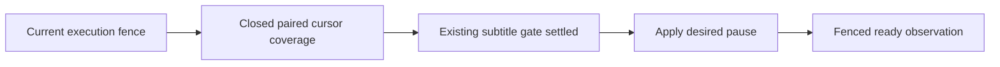
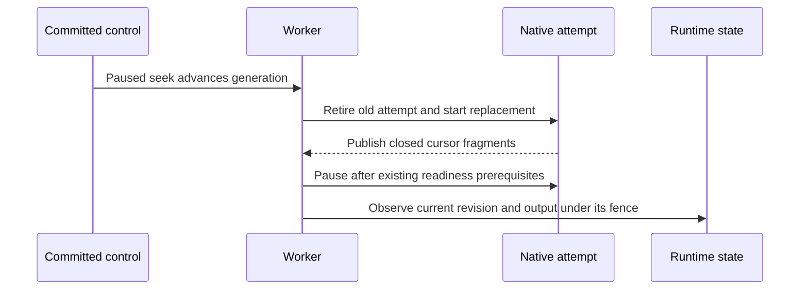

# Paused Seek Readiness - Plan

## Goal Capsule

**Objective:** A user seeking a paused movie can view the requested position promptly and resume from it.

**Means:** Apply the current progressive-movie playback contract to paused worker readiness (KTD1).

**Authority:** The Product Contract governs behavior; the Planning Contract governs the correction. Repository rules and the existing media qualification remain authoritative verification inputs.

**Execution profile:** One focused implementation unit on `fix/paused-seek-readiness`, based on merged tooling commit `5fc3f9017cd0434666c6b895fe9fc11f2ce6a7ac`. The lead owns integration, serialized runtime checks, roadmap checkpoints and commits. Keep this application correction local until a further push request.

**Stop conditions:** Stop for evidence that the proposed readiness rule violates current player behavior, publication completeness or execution ownership. Report a failed qualification rather than weakening its limits.

---

## Product Contract

### Summary

Make paused seeks ready once the current generation publishes the requested cursor. Keep the existing delivery, subtitle and execution-ownership guarantees.

### Problem Frame

The worker delays paused acknowledgement until it has encoded an additional playback buffer beyond the requested cursor. In the retained v25 run, a seek to source position 30 starts encoding at source position 12, so the worker waits for local position 39: seven roughly six-second segments. Readiness arrives 30.582 seconds after replacement encoding starts, after the qualification has already timed out.

This delay comes from a server assumption about a player's live holdback. The current movie HLS attachment disables live-edge correction and starts at an explicit local cursor. The worker still waits for that older holdback assumption, leaving the latest control revision unacknowledged and its output unavailable to delivery.

### Requirements

| ID | Required behavior |
|---|---|
| R1 | Paused-seek delivery passes the existing 30-second readiness watchdog under the documented media-control CPU-pressure qualification. |
| R2 | Readiness requires closed current-generation fragments covering the requested cursor for video and, when present, canonical audio; retain existing exact-end and silent-tail rules. |
| R3 | A paused seek preserves its requested source position and paused state; subsequent resume continues the replacement attempt and cancellation remains terminal. |
| R4 | Preserve generation retirement, ownership leases, control-revision fences and rejection of stale controls and retired output. |
| R5 | Preserve the existing subtitle extraction completion/deadline behavior before readiness. |
| R6 | Preserve running playback's existing buffer throttling and the qualification's admission, CPU, memory and process limits. |
| R7 | HLS and DASH output must still pass paired-media decoding, signed-resource rejection and current movie-player clock tests. |
| R8 | Preserve local instance identities and user data throughout verification. |

### Acceptance Examples

- AE1. Covers R1–R3. A paused movie seeks to source position 30 while its replacement starts at source position 12. Once both tracks cover local position 18 and the subtitle gate settles, readiness can acknowledge the seek without requiring publication through local position 39.
- AE2. Covers R2, R4. Video alone, an unfinished cursor fragment or output from an earlier generation cannot acknowledge the seek.
- AE3. Covers R3, R6. Resuming a ready paused replacement sends the existing resume operation without launching a duplicate encoder; ordinary running throttling retains its behavior.

### Scope Boundaries

Change the worker's paused readiness policy and its direct regression tests. Existing media-control, HLS/DASH and player tests supply acceptance evidence.

No new endpoint, configuration setting, schema, dependency, encoder profile or frontend behavior is needed. Do not change preroll math or qualification timing. A configurable lookahead policy was considered and is not planned: the established movie cursor contract already supplies the necessary readiness rule.

---

## Planning Contract

### Key Technical Decisions

- KTD1. Remove the extra future-coverage condition from paused readiness and pause application, using R2 instead. Both copies of the paused predicate in `TranscodeSessionSubscriber` must agree. The existing HLS adapter disables its latency controller, and its installed-hls.js regression proves that movie cursors must not follow the growing live edge. No alternative mechanism needs development: the current publication coverage check already expresses the required boundary.
- KTD2. Retain the current ownership and publication path. Use `PublishedPresentation::covers`, the existing subtitle gate and fenced `observe` operation; do not introduce another readiness abstraction or alter persistence contracts. This implements R2, R4 and R5.
- KTD3. Keep native generation handoff, preroll and running throttle calculations intact while changing the paused policy. Existing pause/resume and completion tests guard R3 and R6.

### High-Level Technical Design

These sketches describe the intended boundaries, not implementation code.

### Assumptions and Research

The progressive movie cursor, rather than a growing live edge, is the playback target. This is established by `ui/web/src/features/catalog/hooks/hls-playback.ts`, `ui/web/tests/features/catalog/hooks/hls-playback-progressive.test.ts` and source-to-local cursor handling in `useBaanderPlayer.ts`. No frontend implementation change is proposed.

The current worker test helper `assertPausedCursorPreroll` explicitly waits for a player's holdback after publishing the cursor fragment. Replace that obsolete expectation with R2, while keeping its unfinished-fragment and exact-end protections. Other relevant tests already cover missing audio, silent audio tails, resume, ownership loss and revision races.

The single-pass behavior trace is: a committed seek advances the generation and clears its output; the live worker retires the old attempt, publishes the replacement and checks coverage; fenced ready observation writes the observed revision and output directory; signing and delivery then admit that generation. The v25 timeout occurs before the last step, independently of HTTP retrieval or certification overhead.

Local source and tests settle this policy correction; no external technology choice or external research is needed. `CONCEPTS.md` already defines the terms used here, so no glossary addition is required. Preserve coroutine cleanup and pool-release boundaries described by `docs/solutions/runtime-errors/swoole-callbacks-outside-the-bundle-leak-pooled-services.md`.

---

## Implementation Units

### U1. Align paused readiness with current cursor publication

**Goal:** Deliver the Product Contract through the existing worker loop.

**Requirements:** R1–R8; AE1–AE3; KTD1–KTD3.

**Dependencies:** The merged tooling baseline and its corrected delivery measurement and concurrent HTTP retrieval are already present.

**Files:**

- Modify `src/Transcode/Infrastructure/Swoole/TranscodeSessionSubscriber.php`.
- Strengthen `tests/Unit/Transcode/Infrastructure/Swoole/TranscodeWorkerExecutionTest.php`.
- Use the unchanged verification consumers listed below; do not broaden this into unrelated refactoring.

**Approach:** Update both paused predicates together under KTD1. Keep the existing publication reader, subtitle completion path, fenced observation and native lifecycle under KTD2 and KTD3. Preserve coroutine ownership and cleanup even on failed publication or cancelled controls.

**Execution note:** First strengthen the existing controlled-publication worker regression so that it fails because closed paired cursor output is held behind extra future coverage. Do not make a timing-only test the primary proof.

**Test scenarios:**

1. Covers AE1. For source position 30 and generation source start 12, publish only the paired fragments covering local position 18. With subtitle work settled, assert pause and a current-revision ready observation before any extra future fragments are supplied.
2. Covers AE2. Keep the cursor fragment temporary or publish video without its required audio coverage; neither case can pause or acknowledge readiness.
3. Keep readiness pending while subtitle extraction is active, preserving existing deadline/failure behavior when that work settles.
4. Covers AE3. Resume the newly ready paused attempt, then cancel it; assert ordered native signals, no duplicate encoder and release of claims and admission allocation.
5. Preserve exact EOF, shorter completed audio tail, silent-tail coverage, changed control revision and lost ownership cases in the existing suite.
6. Preserve running buffer-throttle pause/resume behavior independently of the paused policy.

**Verification:** The strengthened regression demonstrates the old failure and corrected behavior. The direct worker suite and the existing revision, publication, delivery and player suites retain their contracts. Complete the serialized live qualification under the Verification Contract before declaring R1 met.

---

## Verification Contract

Use the current runners in `docs-book/part-2-developer-guide/testing.md`; the lead serializes builds and shared-state checks.

- Run the focused `TranscodeWorkerExecutionTest` suite through the real PHP 8.5 worker-execution path in the CI image. Retain the red/green evidence for U1.
- Run `TranscodeControlRevisionTest`, `PublishedPresentationReaderTest`, `SubtitleExtractionTest` and the existing paired HLS/DASH publication tests relevant to the changed gate. These verify R2–R7 without changing their contracts.
- Run the existing `hls-playback.test.ts`, `hls-playback-progressive.test.ts` and source-position player tests as consumer checks; frontend changes are not part of this unit.
- Run scoped PHPStan, formatting and application dependency-boundary checks for the changed application files.
- Rebuild the worker from the final source and rerun the unchanged media-control qualification alone, with its decoding, signature, subtitle, occupancy and control checks intact. Retain its readiness receipt under R1 and identity-verified cleanup result.
- Refresh the worktree preview with `make preview-up` after worker changes and use its explicit `make preview-url` URL for any browser confirmation. This is a data-preserving lifecycle operation under R8.

The tooling aggregate, inventory and unrelated live qualification families passed at the baseline. Repeat them only if implementation evidence identifies an affected contract. The lead records delivered scope and suite/static/live results in `ROADMAP.md`.

## Definition of Done

U1 has test-first evidence, scoped CI/static checks and the live readiness result required by R1. R2–R8 remain verified by their existing consumers. Cleanup is confirmed, user data is retained, and abandoned experiments are absent from the final diff. The lead reviews and commits the correction locally; no further push is implied.

## Sources

- `src/Transcode/Infrastructure/Swoole/TranscodeSessionSubscriber.php`: generation restart, paired coverage, paused gate, subtitle polling and running throttle.
- `src/Transcode/Infrastructure/Doctrine/TranscodeRuntimeState.php`: generation/revision fencing and ready observation.
- `src/Transcode/Infrastructure/Packaging/PublishedPresentation.php` and `PublishedPresentationReader.php`: current-generation closed publication coverage.
- `tests/Unit/Transcode/Infrastructure/Swoole/TranscodeWorkerExecutionTest.php`: cursor publication, pause/resume, audio, EOF and ownership proofs.
- `tests/Integration/TranscodeControlRevisionTest.php`: committed paused-seek intent and stale-observation refusal.
- `ui/web/src/features/catalog/hooks/hls-playback.ts`, `useBaanderPlayer.ts` and their named tests: movie cursor ownership and disabled live-edge correction.
- `docs-book/part-1-operator-guide/transcoding.md`, `docs-book/part-2-developer-guide/testing.md`, `CONCEPTS.md` and the cited runtime learning: established behavior and verification vocabulary.
- Retained local evidence `var/test-runs/media-control-1793325242-2126320/`: acknowledgement stderr, control log and bounded publication diagnostic. These ignored artifacts are best-effort research evidence; the recorded failure and Product Contract remain usable if the run directory is absent.
