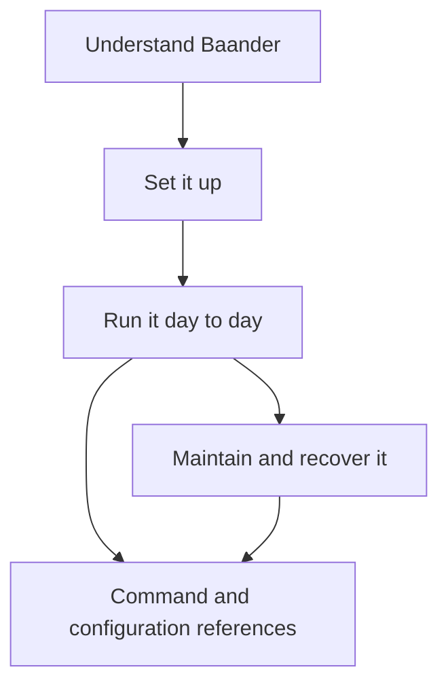
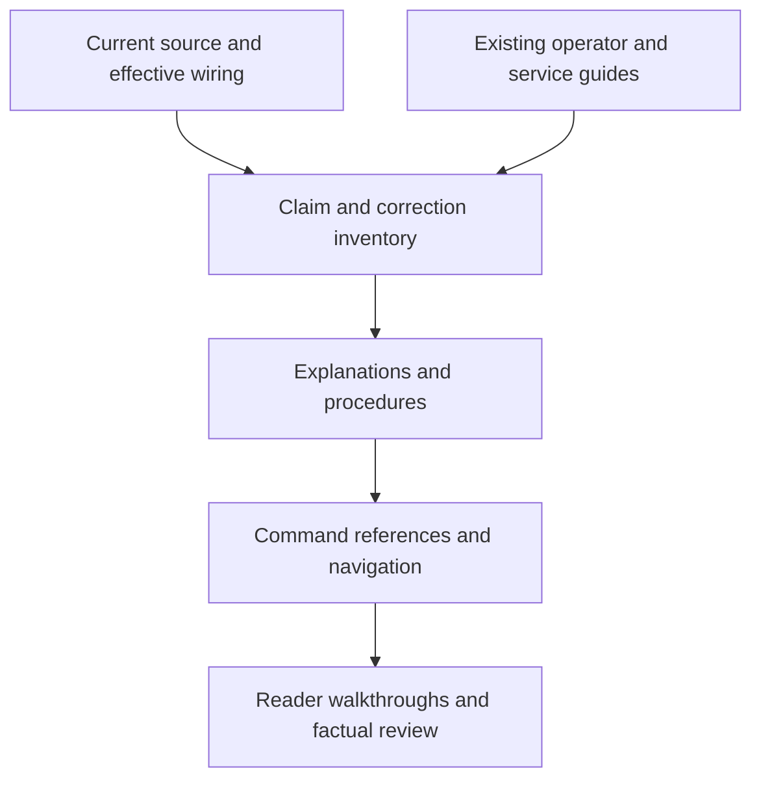

# Cohesive Operator Manual - Plan

## Goal Capsule

**Objective:** Operators can understand, set up, run and recover Baander using one easy-to-follow manual.

**Means:** Expand and reorganize the existing operator book, verify its explanations against the implementation, and edit its prose with `prose-fix`.

**Product authority:** The user confirmed a cohesive operator manual covering understanding, setup, daily operation, maintenance and recovery.
The Product Contract below governs that documentation work.

**Open blockers:** None.

**Execution profile:** Documentation changes on `docs/cohesive-operator-manual`, delivered as one integrated change with local commits by unit.
The lead owns navigation, integration, review and verification; chapter work can be delegated after the shared conventions are established.
Publishing requires a separate request.

**Stop conditions:** Report a software defect or unsupported operating procedure rather than changing runtime behavior to make the manual's instructions work.
Preserve existing instance data and unrelated working-tree changes.

---

## Product Contract

### Summary

Turn the existing operator book into a connected manual with a clear reading order and useful entry points for returning readers.
Explain how Baander's parts work together, then connect those explanations to procedures and command references.

### Problem Frame

The user finds the current documentation insufficient for understanding how the project operates.
Operational information exists across operator chapters, CLI references, developer explanations and service-specific documentation.
The reader must connect those accounts to understand the system as a whole.
The intended reader runs or maintains an instance and should not need familiarity with the source code to follow routine operating instructions.

### Key Decisions

- **Improve the existing book.** A single manual gives readers one starting point and lets useful existing passages remain in place. Governs R1–R3.
- **Organize around the operator's work.** Introduce the system before its setup and operating procedures, with detailed reference material available when needed. Governs R1, R4–R8.
- **Establish facts before polishing prose.** Editing must not make an uncertain or obsolete description sound authoritative. Governs R9–R11.

### Requirements

**Reading and navigation**

- R1. Provide a reading path through understanding Baander, setup, daily operation, and maintenance and recovery.
- R2. Let returning readers find a task, symptom or component directly, with links to its explanation, procedure and relevant reference material.
- R3. Keep operator explanations self-contained and introduce project terms before relying on them, using the meanings in `CONCEPTS.md`.

**Operational coverage**

- R4. Cover the operator responsibilities of the application, web serving, data and storage services, background workers, media processing, external integrations and the separately operated registry, identifying which parts apply to each deployment.
- R5. Explain each covered component's purpose, dependencies, work triggers, responsibilities and observable lifecycle at the depth an operator needs.
- R6. Explain where source media, persistent state and temporary or derived data live, including the configuration and lifecycle actions that affect them.
- R7. Provide connected procedures for setup, configuration, libraries and scanning, metadata, playback, user administration, monitoring, upgrades, backups and recovery, with prerequisites, execution context and expected results.
- R8. Connect documented symptoms and status signals to the responsible component, diagnostic steps and supported recovery actions, including the effects of actions that interrupt work or change data.

**Accuracy and prose**

- R9. Verify operational claims and command examples against current implementation and supported workflows, distinguishing verified behavior from limitations and unresolved evidence.
- R10. Apply `.agents/skills/prose-fix/SKILL.md` and its house style to new and revised prose, preserving technical facts, conditions and the strength of claims.
- R11. Reconcile contradictions and redundant explanations across touched chapters and references, retaining one authoritative account of each operating rule and working navigation to it.

### Reading Model

The main reading path follows R1.
R2 also permits direct entry into an operating or recovery task; readers can follow links back to the explanation they need.
This is the manual's conceptual structure, not a prescribed set of chapter titles.

### Acceptance Examples

- AE1. **First installation.** Covers R1, R3–R7. A new operator can identify the required services, understand their roles, follow the applicable setup procedure and recognize the documented ready state without consulting source code.
- AE2. **Scan and background work.** Covers R2, R5, R7–R9. An operator can follow what happens after a scan is requested, find the relevant progress and failure signals, and distinguish accepted or queued work from completed work.
- AE3. **Playback or worker failure.** Covers R2, R5, R8–R9. An operator can find the relevant component's diagnostics and supported recovery procedure, understand its effect on active work, and recognize any documented limit on what the evidence proves.
- AE4. **Deployment-specific maintenance.** Covers R4, R6–R9. An operator can tell whether a maintenance or backup procedure applies to the application, worker deployment or registry, and identify its prerequisites and affected data before acting.
- AE5. **Reading across chapters.** Covers R2–R3, R10–R11. Following a task into its explanation and command reference preserves the same terminology, operating assumptions and command behavior, with no conflicting instructions or broken links.

### Scope Boundaries

The work covers the existing operator book and the adjacent documentation needed to make it coherent under R1–R11.
Existing accurate material can be retained, reorganized or linked; expansion is driven by missing operator understanding rather than a target page count.

Application behavior, deployment architecture and tooling contracts are outside this change.
A contradiction that requires a software change is reported separately rather than disguised as a prose correction.
Developer architecture documentation remains a separate audience, except where an operator needs a plain explanation of a mechanism.
This work does not introduce a documentation website, publishing platform or new documentation tooling.

### Dependencies and Assumptions

The audience is someone responsible for a Baander instance who understands basic host administration but need not know PHP, Symfony or the internal source layout.
The repository's pre-release policy remains in effect; documentation must not imply production qualification merely because a procedure or feature exists.

### Sources

- `docs-book/README.md` and `docs-book/part-1-operator-guide/README.md`: existing audience split and operator navigation.
- `docs-book/part-1-operator-guide/commands/app-worker.md` and `docs-book/part-2-developer-guide/cqrs-and-messaging.md`: worker explanations spread across reference and developer material.
- `relay/README.md` and `docs-book/part-2-developer-guide/registry-threat-model.md`: the standalone registry and its distinction from PHP Discovery.
- `CONCEPTS.md`: existing terms for lifecycle, media availability and asynchronous execution.
- `.agents/skills/prose-fix/references/project-house-style.md`: explanatory, procedural and reference registers for the manual.

---

## Planning Contract

**Product Contract preservation:** R1–R11 and AE1–AE5 are unchanged. The two deferred planning questions are resolved by the chapter map and KTD1–KTD5 below.

### Key Technical Decisions

- KTD1. **Keep repository Markdown canonical.** Retain existing chapter paths and add a small set of explanatory chapters under `docs-book/part-1-operator-guide/`; use indexes and cross-links to establish the reading path. This implements R1–R3 and R11 without introducing a publishing system or changing the documentation generator.
- KTD2. **Establish execution context before editing commands.** Use the source-installation `dc` context defined by `getting-started.md` for installed-container examples, plain console commands only inside an explicitly identified application container, and host commands for the worker controller. Keep development Make examples clearly labelled and linked to the development guide. This implements R7–R9: `make exec` and `make logs` currently select a worktree preview, and `INSTANCE=persistent` selects another development instance rather than the source installation.
- KTD3. **Give operating facts a named home.** The chapter map below assigns responsibility for component explanations, configuration, data, lifecycle, health and recovery. Other chapters introduce only the context their task needs and link to that account. This implements R2, R5 and R11 while preserving useful standalone task explanations.
- KTD4. **Separate factual correction from prose editing.** Before rewriting a chapter, record its material claims, effective source, intended corrections and evidence limits in a working inventory outside the manual. Read complete command definitions and invoked services when their effects matter; use effective wiring and tests to resolve stale comments. Then apply `prose-fix` with a before-edit baseline and explain intentional factual or structural audit deltas. Governs R9–R11.
- KTD5. **Verify documentation without rehearsing destructive operations.** Use source checks, existing command coverage, local link and anchor checks, prose audits and reader walkthroughs. Optional runtime evidence is limited to read-only commands in an existing isolated preview or disposable fixtures. Do not reset data, scan user libraries, rotate keys, flush queues, retire deployments or perform restores merely to check wording. Unavailable runtime qualification remains an explicit limit under R9, not an implied pass.
- KTD6. **Maintain command references through their existing contract.** Use `.agents/skills/documentation-maintainer/references/commands.md` for command discovery and behavioral checks, with KTD2's installed-versus-development distinction taking precedence over its generic Make example. Preserve family-page mappings and index categories; update references actually affected by the manual rewrite rather than regenerating every page. Governs R7, R9 and R11.

### Chapter Map

All operator filenames in this table are relative to `docs-book/part-1-operator-guide/`.
New pages are explicitly marked; existing pages keep their destinations.

| Reader need | Chapter ownership | Work |
|---|---|---|
| Understand the system | New `understanding-baander.md` | Component responsibilities, request and background-work paths, deployment applicability, terminology and links to deeper explanations. |
| Understand data | New `storage-and-data.md` | PostgreSQL state, Redis uses and queued work, media mounts, derived output, configuration/secrets and worker control history; distinguish authority, writers and replaceability. |
| Set up an instance | `getting-started.md`, `configuration.md` | Preserve verified installation detail; explain prerequisites, configuration precedence, execution contexts, readiness and change effects. |
| Operate background work | New `background-work.md` | Control/execution pair, queues, outbox, scheduler, admission and native work; explain ownership, observation and supported lifecycle actions. |
| Manage media | `library-management.md`, `external-apis.md`, `transcoding.md`, `watch-parties.md` | Connect discovery, ingestion, enrichment, source availability and playback; distinguish supported workflows from accepted values or API-only surfaces. |
| Administer users and delivery | `user-management.md`, `security.md`, `notifications.md` | Privilege and credential effects, account/session operations, delivery dependencies and failure observations. |
| Observe and diagnose | `monitoring.md`, `troubleshooting.md` | Component-to-signal map, signal limitations, symptom-driven diagnosis, action effects and recheck points. |
| Maintain and recover | `upgrading.md`, new `backup-and-recovery.md` | Upgrade preflight, pending work, drain versus reload, compatible rollback, data inventory and supported recovery procedures. |
| Operate a registry | New `registry.md` | Explain the separate service and applicability; connect deployment, health and encrypted backup/recovery guidance while preserving its qualification limits. |
| Find exact commands | `commands/README.md` and affected command pages | Keep signatures, options and examples source-derived; cross-link explanations and procedures without duplicating lifecycle policy. |

`docs-book/README.md` and the operator index provide the reading path plus task, component and symptom entry points.
Operator-essential registry explanations belong in the new in-book chapter; detailed service contracts can remain in `relay/README.md` and `relay/backup/README.md` with clear cross-links.

### Writing and Evidence Pattern

An explanation starts with the operator's situation, follows the work in execution order, and identifies what the reader can observe.
A procedure names its target, prerequisites, actions, expected results and relevant failure or stop conditions under R7–R8.
Reference tables retain precise names, defaults and option semantics.
These are editing patterns, not mandatory repeated headings for every page.

The working inventory maps each existing narrative chapter and each material changed claim to its source, retained or revised destination, execution context and verification method.
Store it with implementation evidence under `var/`, not in the operator reading path.
The lead uses it to distinguish documented runtime limitations from incomplete documentation work.

### Source Anchors and Known Corrections

These findings identify mandatory review targets; they do not authorize runtime changes.

| Area | Evidence to follow | Consequence for writing |
|---|---|---|
| Command target | `Makefile`, `scripts/dev-environment.php`, `getting-started.md` installation context and `upgrading.md` | Apply KTD2 across daily tasks, monitoring, troubleshooting and command references. Do not replace all examples with persistent-development commands. |
| Discovery and ingestion | `src/Library/Application/CommandHandler/ScanLibraryHandler.php`, `src/Catalog/Application/CommandHandler/FilesDiscoveredHandler.php`, effective Messenger configuration | Distinguish accepted directories, subsequent ingestion and catalog visibility. The ingestion handler currently supports music/movie; do not promise complete workflows for every accepted library type. |
| Filesystem watching | `src/Filesystem/Command/WatchFilesCommand.php`, its `FileWatcher` implementation | Watching prints events; it is not automatic catalog synchronization. Check the no-path failure before retaining the current-directory example. |
| Health and lifecycle | `src/Shared/Infrastructure/Health/HealthCheckService.php`, `MessengerWorkerHealth.php`, worker operator sources and `CONCEPTS.md` | Separate web readiness, worker heartbeats, relay progress and controller status. A successful controller status does not establish application readiness. |
| Credential recovery | Current auth token persistence, secret readers, revocation handlers and `security.md` | Resolve the blanket claim that APP_SECRET rotation and Redis flushing invalidate all OAuth tokens; preserve each credential's actual revocation and data-loss consequences. |
| Registry | `relay/README.md`, `relay/backup/README.md`, `relay/docker/`, backup implementation and qualification contracts | Keep registry separate from PHP Discovery. Preserve real-destination, recovery-time and capacity limitations instead of treating local tests as deployment qualification. |
| Reference coverage | `tests/Unit/Docs/CommandDocsCoverageTest.php`, `tests/Support/Console/ProjectCommands.php`, `CommandDocsLocator.php` | Existing coverage detects missing/stale command pages and index rows; it does not prove command semantics or general link correctness. |

Read the relevant captured learnings before editing lifecycle, health, JSON or scan explanations:

- `docs/solutions/architecture-patterns/health-checks-run-in-a-messenger-consumer-cannot-see-outages-that-stop-it.md`
- `docs/solutions/runtime-errors/swoole-sigterm-waits-for-master-timers-and-closes-connections-before-workers-stop.md`
- `docs/solutions/runtime-errors/console-json-output-needs-real-logging-handlers.md`
- `docs/solutions/architecture-patterns/state-set-when-work-is-queued-on-swoole-task-must-expire.md`
- `docs/solutions/runtime-errors/inline-messenger-run-must-name-the-routed-transport.md`

Historical descriptions in those learnings must be checked against current wiring under KTD4.
In particular, old web task-worker routing is not a current deployment specification.

### Execution Constraints and Remaining Uncertainty

The existing Markdown converter does not render Mermaid and strips repository links outside `docs-book` from its generated output.
Its generator deletes the selected output directory before writing.
Repository Markdown is the acceptance surface under KTD1; a generated-site inspection is optional, uses a fresh temporary output directory, and reports inherited rendering limits without expanding into generator work.

Precise command flags, configuration defaults and recovery guarantees remain source-validation work within each unit, not opportunities to invent a policy.
If no supported full recovery procedure can be established, explain the available steps and the missing guarantee at the decision point and record the runtime gap separately.
No live recovery qualification or changes to host PHP, container images, deployment recipes or application configuration are included.

---

## Implementation Units

Each unit follows KTD4–KTD5 and uses `prose-fix` on its owned prose.
No new application tests are required for documentation-only changes; the verification cases below are document checks and reader walkthroughs.
The lead retains ownership of shared indexes and final integration.

### U1. Establish the system explanation and data model for operators

**Goal:** Give subsequent chapters a shared explanation of components, deployment contexts and data ownership.
**Requirements:** R1–R6, R9–R11; AE1, AE4–AE5; KTD1–KTD4.
**Dependencies:** None.
**Files:** New `docs-book/part-1-operator-guide/understanding-baander.md` and `storage-and-data.md`; working evidence inventory under `var/`.
**Approach:** Inventory the twelve existing narrative chapters and their reference handoffs, establish KTD2's command-context convention, then write the system and data explanations from source. Preserve the distinction between web serving, worker execution and separate registry operation.
**Verification cases:** An operator can identify which component owns web requests, queued work, native encoding and registry state; each documented storage location identifies its writers and whether it is authoritative, derived or transient. Covers AE1, AE4 and AE5.
**Verification:** Source-backed component/data inventory is complete enough for U2–U5, and a cold read introduces terms before using them.

### U2. Connect installation, configuration and worker operation

**Goal:** Make setup and background-work instructions follow the shared operating model.
**Requirements:** R3–R9, R11; AE1, AE3–AE4; KTD2–KTD6.
**Dependencies:** U1.
**Files:** `docs-book/part-1-operator-guide/getting-started.md`, `configuration.md`; new `background-work.md`.
**Approach:** Retain the source-installation path, explain configuration scope and change effects, and introduce the control/execution pair and its observation/recovery boundaries. Draw lifecycle explanations from the existing worker reference and current operator implementation; U6 reconciles duplicated reference prose afterward.
**Verification cases:** Follow setup through web readiness and separately established worker readiness; distinguish a committed controller operation from readiness not checked; preserve target and path namespace when moving to routine commands. Covers AE1 and AE3.
**Verification:** Setup has explicit prerequisites and checkpoints, and worker actions retain their existing admission, uncertainty and retirement conditions.

### U3. Explain the media journey

**Goal:** Connect library administration to discovery, ingestion, enrichment and playback.
**Requirements:** R2–R9, R11; AE2–AE3, AE5; KTD2–KTD4.
**Dependencies:** U1–U2.
**Files:** `docs-book/part-1-operator-guide/library-management.md`, `external-apis.md`, `transcoding.md`, `watch-parties.md`.
**Approach:** Trace console and administrator scan paths separately, then explain their shared catalog outcome and optional enrichment. Correct library-type and watcher claims. Describe original and derived playback, worker/storage dependencies, and supported watch-party entry points without promising an unavailable UI or recovery mechanism.
**Verification cases:** A finished discovery run with ingestion still pending is not described as complete catalog delivery; event watching is not described as scanning; unsupported ingestion types and unavailable source media have explicit limits; web restart is not presented as restarting encoders. Covers AE2, AE3 and AE5.
**Verification:** Each stage has an observable result or a clearly named observation limit, with links to diagnostics and the appropriate command reference.

### U4. Reconcile administration, credentials and notifications

**Goal:** Explain user and credential actions and delivery failures without hiding their prerequisites or effects.
**Requirements:** R2–R3, R5–R11; AE3–AE5; KTD2–KTD5.
**Dependencies:** U1–U2.
**Files:** `docs-book/part-1-operator-guide/user-management.md`, `security.md`, `notifications.md`.
**Approach:** Verify authority and session effects from handlers, token stores and effective configuration; distinguish signing secrets, OAuth credentials, open connections and external delivery credentials. Resolve conflicting breach-recovery prose and replace broad restart/flush advice with the actual supported conditions and consequences. Link health policy to monitoring rather than maintaining a second account.
**Verification cases:** Account disabling, token revocation and signing-key rotation are not described as interchangeable; every destructive example identifies the data it affects; a notification accepted for delivery is not presented as delivered. Covers AE3–AE5.
**Verification:** Security and notification claims trace to current behavior, and no secret values or real user data enter examples or evidence.

### U5. Connect monitoring, maintenance and recovery

**Goal:** Turn symptoms and maintenance needs into evidence-led operating procedures.
**Requirements:** R2–R11; AE3–AE5; KTD2–KTD5.
**Dependencies:** U1–U4.
**Files:** `docs-book/part-1-operator-guide/monitoring.md`, `troubleshooting.md`, `upgrading.md`; new `backup-and-recovery.md` and `registry.md`; `relay/README.md` and `relay/backup/README.md` only for affected factual corrections and navigation.
**Approach:** Build a component-to-signal map, link symptoms to the responsible stage, and connect upgrade preflight to data preservation and compatible rollback. Write the backup/recovery account from the data inventory and verified mechanisms. Bring registry operator essentials into the book while keeping detailed service contracts in their existing home.
**Verification cases:** Healthy web with unavailable workers does not read as healthy background execution; a fresh heartbeat does not prove outbox progress; code rollback is not database rollback; uncertain worker termination does not authorize replacement; unavailable registry destination qualification is visible before recovery steps. Covers AE3 and AE4.
**Verification:** Each recovery path names its target, prerequisites, action effects, expected evidence and stop conditions; no unsupported guarantee is substituted for a missing procedure.

### U6. Reconcile command references and related explanations

**Goal:** Make detailed references agree with the rewritten manual.
**Requirements:** R2–R3, R7–R11; AE1–AE5; KTD2–KTD6.
**Dependencies:** U2–U5.
**Files:** `docs-book/part-1-operator-guide/commands/README.md` and affected pages in that directory; source read-only inputs include `tests/Unit/Docs/CommandDocsCoverageTest.php` and its console support classes.
**Approach:** Discover actual command declarations, compare the index and pages, and verify the full definitions/services of commands used by revised procedures. Replace long duplicated lifecycle explanations with contextual summaries and links. Preserve referenced family sections and review inbound links before changing any heading or destination.
**Verification cases:** The index names existing commands, every command retains its page or family section, touched options/defaults/exit outcomes match source, and examples preserve KTD2's target through a task-to-reference hop. Covers AE5.
**Verification:** Existing command coverage passes in the authoritative CI image; signature, behavior and link audits cover the affected references. No command side effects are executed to establish documentation coverage.

### U7. Integrate navigation and verify the manual as a whole

**Goal:** Deliver one coherent manual that passes its five reader examples.
**Requirements:** R1–R11; AE1–AE5; KTD1–KTD6.
**Dependencies:** U1–U6.
**Files:** `docs-book/README.md`, `docs-book/part-1-operator-guide/README.md`, affected documentation-entry links in `README.md`, `ROADMAP.md`; narrowly affected links or duplicate operational passages in `docs-book/part-2-developer-guide/cqrs-and-messaging.md`, `registry-threat-model.md` and `contributing.md`.
**Approach:** Assemble the reading path and task/component/symptom navigation after destinations exist. Reconcile developer/service handoffs without rewriting their architecture content. Perform the final prose pass, five manual-only walkthroughs and independent review; record counts and limits in ROADMAP.
**Verification cases:** Enter each acceptance example from the index and again directly from its task or symptom; all required context, valid links and expected outcomes are reachable without reading source. Existing URLs and fragment references remain usable or their inbound references are updated. Covers AE1–AE5.
**Verification:** Every requirement has delivered chapter coverage and evidence; no dangling navigation, contradictory operating rule or unexplained verification limit remains.

---

## Verification Contract

| Check | Evidence and completion condition |
|---|---|
| Factual coverage | Working inventory covers all twelve existing narrative chapters, new chapters and affected references. Material changed claims link to effective code/configuration or a named evidence limit; known corrections above have a disposition. |
| Execution context | Audit operational command blocks for host/container, installed/development target, paths and authority. No unlabeled switch to a worktree preview or fixed container name remains in a rewritten procedure. |
| Command coverage | Run the existing `tests/Unit/Docs/CommandDocsCoverageTest.php` through `bash scripts/test-backend-container.sh` using the current authoritative CI image and a checkout containing the final documentation. Record actual test/assertion/skip counts. Do not add tests that merely copy the prose. |
| Links and anchors | Check local Markdown destinations and heading fragments across touched files and inbound references to changed headings. Use a bounded scratch check or manual enumeration; no existing general link checker is assumed. |
| Prose preservation | Run `php .agents/skills/prose-fix/scripts/audit_rewrite.php` against each before-edit baseline and its edited file. Account for all intentional factual and structural deltas, inspect code fences and links directly, and apply the house register appropriate to each section. The audit's exit code alone is not a pass. |
| Reader acceptance | Independently walk AE1–AE5 using the manual alone. Record entry point, target context, explanations, commands, expected evidence and any disclosed limit; link existence alone does not satisfy this check. |
| Diff and scope | `git diff --check` passes. The final diff contains only the agreed documentation and roadmap work; no generated site, temporary inventory, application changes or unrelated user edits are included. |
| Review | Run simplification and independent review appropriate to documentation, apply justified findings, and record the final coverage and unresolved runtime qualifications separately. No full backend/media/browser qualification matrix is required for prose-only changes. |

---

## Definition of Done

- R1–R11 and AE1–AE5 have chapter-level coverage and passing documentation verification.
- Operators can follow the reading path and enter tasks directly without losing deployment context or needing source code for routine instructions.
- Factual corrections, prose audits, command coverage and reader walkthroughs are recorded with their actual results in ROADMAP.
- Runtime limitations remain explicit where they affect operator decisions; no documentation wording claims a missing feature or unperformed qualification.
- Existing useful material and technical references remain accessible, with no abandoned drafts, generated output or broken in-scope links in the delivered diff.
- The lead completes review and local commits on the named branch while preserving unrelated changes. No push or deployment is implied.
