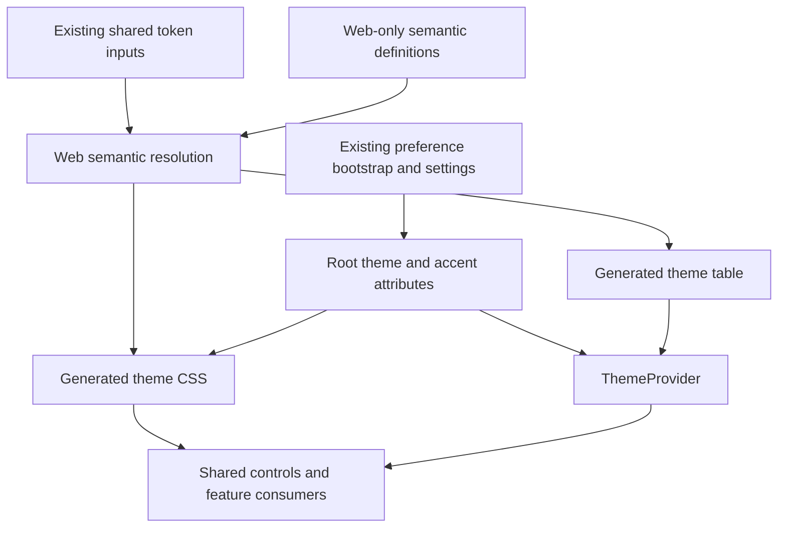

# Cohesive Web Styling - Plan

## Goal Capsule

**Objective:** People can read and operate Baander's web interface without overflowing controls, unreadable color combinations or inconsistent styling.

**Means:** Repair shared styling foundations and their consumers, using Playwright to inspect the rendered interface and verify the results.

**Product authority:** The user confirmed a web-wide styling repair covering shared controls, forms, navigation, menus and dialogs, retaining the current themes and accents.
The Product Contract below governs this work.

**Open blockers:** None.

**Execution profile:** One integrated change on `fix/cohesive-web-styling`, with local commits by implementation unit.
Establish the shared token and control contracts before assigning consumer groups in parallel.
The lead owns shared configuration, integration, review and verification under `AGENTS.md`; publishing waits for a user request.

**Stop conditions:** Preserve unrelated working-tree edits and local instance data.
Record unrelated backend failures separately; do not change authentication, preference conflict resolution or media processing to make a styling check pass.

---

## Product Contract

### Summary

Make Baander's existing web interface visually consistent and usable across its supported appearance choices and responsive layouts.
Correct shared control sizing, color pairing and state styling, then repair affected screens according to the project design guidelines.

### Problem Frame

Playwright inspection reproduced overflowing login inputs: each rendered 406 pixels wide inside a 384-pixel container, with computed `content-box` sizing.
At a 390-pixel viewport, the same fields rendered 364 pixels wide inside 342-pixel containers.
The sidebar search also visibly extended beyond its panel.
In the dark theme, outline actions and theme-picker labels rendered black text against near-black surfaces.
These failures affect repeated controls rather than one isolated page.

Source inspection found a second color problem: accent selection replaces the primary background while retaining the theme's primary foreground.
For the violet accent in light themes, those token pairs have approximately 2.46–2.51:1 contrast.
The rendered login button uses those same pairs in all three light themes.
Shared input and button radii also resolve to 12 pixels where the design guide calls for 8 pixels.

Browser inspection covered login, the empty music home and settings, including all four theme palettes with the violet accent and login at 1280- and 390-pixel viewport widths.
It did not qualify every route, accent or interaction state.

### Key Decisions

- **Repair the existing visual system.** The confirmed scope addresses shared defects and their consumers while preserving Baander's visual identity. Governs R1, R2, R7.
- **Retain appearance choice.** Removing a theme or accent would hide failures in a supported user preference. Governs R4, R5.
- **Use rendered evidence.** Source-level consistency alone did not prevent the observed overflow and unreadable labels. Governs R8, R9.

### Requirements

**Design authority and coverage**

- R1. Follow `ui/DESIGN.md` and `.agents/rules/frontend.md`, using the user-specified Apple HIG 2008–2014 baseline with Baander's documented modernization; this earlier period takes precedence over the design guide's broader historical reference.
- R2. Review shared controls and their consumers throughout the web interface, correcting styling defects in authentication, the application shell, library browsing, playback, settings and administration.

**Sizing and layout**

- R3. Keep inputs, search fields, selectors and their labels within their intended containers as available width changes, without clipping interactive content or causing unintended page-level horizontal scrolling.

**Color and interaction states**

- R4. Preserve the four existing themes and eight accent choices, including their current selection and persistence behavior.
- R5. Provide readable foreground/background pairs for every supported theme and accent combination, meeting WCAG AA contrast for applicable text and interface components.
- R6. Make default, hover, pressed, selected, focused, disabled and invalid states distinguishable wherever those states apply, with visible keyboard focus and status cues that do not depend on color alone.

**Consistency and verification**

- R7. Apply the shared design rules for typography, spacing, radii, borders, surfaces and motion consistently, correcting feature-level overrides that violate those rules.
- R8. Use Playwright against this worktree's isolated preview to verify representative real screens, forms, menus and dialogs at desktop and narrow widths, recording before/after screenshots and layout measurements.
- R9. Verify all 32 theme/accent combinations for shared color roles and representative controls, with browser checks for the states in R6 and targeted regression coverage for the reproduced defects.

### Key Flows

- F1. **Use a form.** A person opens a login, settings or administration form, tabs through its fields, enters text and encounters validation where applicable. Fields remain aligned with their labels and actions, and focus and errors remain visible. Covers R2, R3, R5, R6.
- F2. **Change appearance.** A person chooses a theme and accent in settings, then navigates to another screen and opens a menu or dialog. The chosen appearance remains coherent across page content and overlays. Covers R4–R7.
- F3. **Resize the interface.** A person narrows the window while browsing or editing a form. The existing responsive layout adapts, and controls remain inside their allotted regions. Covers R3, R7, R8.

The existing shell keeps its navigation, main-content and optional context regions.
This work corrects how content fits those regions; it does not introduce a new screen composition.

### Acceptance Examples

- AE1. **Login containment.** At desktop and narrow widths, the email and password fields fit their parent content area instead of extending beyond it. Covers R3, R8, R9.
- AE2. **Dark controls.** In dark/violet appearance, settings actions and theme-picker labels are readable before hover, and keyboard focus remains visible as the person moves through them. Covers R5, R6, R8.
- AE3. **Light appearance with accents.** With warm, cool or balanced appearance and any supported accent, primary actions and accent-colored text satisfy R5 on their actual rendered surfaces, including applicable hover and focus states. Covers R4–R6, R9.
- AE4. **Menus and dialogs.** After changing appearance, a person opens a menu and a form dialog. Their surfaces, text, fields, focus indicators and validation messages follow the same rules as the surrounding screen, including at narrow widths. Covers R3–R8.
- AE5. **Browse and playback controls.** Search, navigation selection, library actions and player controls retain readable, distinguishable states, with sizing and typography consistent with equivalent controls in settings and administration. Covers R2, R5–R9.

### Scope Boundaries

- This work covers `ui/web` styling and the documentation or regression checks needed to support it; native and TV interfaces are outside this repair.
- Keep the current information architecture and feature behavior. New features, a new visual identity and a replacement navigation design are outside scope.
- Backend and data-model defects discovered during browser inspection are recorded separately unless a styling repair directly requires a consumer adjustment.
- Use disposable fixtures where populated content is needed. Inspecting the interface does not authorize scanning or resetting the user's media libraries.

### Sources / Research

Repository paths below are relative to the repository root.

- `ui/DESIGN.md`: project visual and interaction rules, including shared primitives, appearance tokens and control radii.
- `.agents/rules/frontend.md`: web implementation and browser verification rules.
- `ui/web/src/shared/theme/GlobalStyles.tsx` and `ui/web/src/shared/components/ui/input.tsx`: global styles and the input sizing implicated in the measured overflow.
- `ui/web/src/shared/components/ui/button.tsx`: outline and ghost variants omit a resting foreground color.
- `ui/web/src/features/settings/components/AppearanceSection.tsx`: theme-picker labels omit a foreground color.
- `ui/web/src/shared/theme/resolve-theme.ts` and `ui/web/src/shared/theme/theme.types.ts`: palette composition, radius values and supported appearance choices.
- [Supplied HIG archive](https://martin-juul.github.io/aslice/library/apple-macos-hig-2018/index.html#470c81114d39cd61d4ec2d2af0c4aa565d70ee758c5b4b6dff3be78c84700e2c.html): the archive identifies itself as Mojave/2018, so it is supplementary evidence rather than a verified 2014 edition.
- [Archived text-field guidance](https://martin-juul.github.io/aslice/library/apple-macos-hig-2018/resources/f22ad3391db0930095d4a88f2104b8ce2a7e42891281c4c4a0cee689a373a8a4.html) and [archived color guidance](https://martin-juul.github.io/aslice/library/apple-macos-hig-2018/resources/ab06739576ee34c53d858eb811562d70ec6f297d7045adcb895483c9c99d0749.html): consistent field layout, logical focus order, semantic color use and sufficient contrast support R3, R5 and R6.

---

## Planning Contract

**Product Contract preservation:** Requirements, decisions, flows and acceptance examples are unchanged. The two planning-only questions are resolved by the decisions and verification matrix below.

### Key Technical Decisions

- KTD1. **Generate web CSS and runtime theme data from one resolved table.** Extend `ui/design-tokens/build.mjs` to combine the existing token inputs with web-specific semantic definitions under `ui/design-tokens/tokens/web/`. Generate `build/web/theme.css` and `build/web/theme.ts` from the same four-by-eight table. Load the CSS through `ui/web/src/index.css`; make `resolve-theme.ts` select the generated data instead of maintaining another palette. Remove theme-variable emission from `GlobalStyles.tsx`, which retains global element styles. Generate the public variable names actually used by consumers, including chart names. This makes initial-page and React-rendered styles agree. Governs R4, R5, R7.
- KTD2. **Separate color identity from semantic use.** Keep the eight accent identities, but resolve distinct filled-action, on-fill, text/icon and focus roles for each mood. Define opaque hover/pressed action roles and semantic status/control-border roles rather than relying on transparency to produce an accessible result. Check normal text at 4.5:1 and applicable non-text indicators at 3:1 against their actual adjacent surfaces, following the WCAG sources below; inactive controls and decorative content retain the standard's exemptions. Neutral accent choices may use darker neutral text and focus indicators on light surfaces. Governs R4–R6.
- KTD3. **Keep the shared/native token inputs stable.** Web-specific semantic corrections and generation consume existing shared tokens without changing RN generation or its output. Appearance previews and runtime types consume the generated web data. Retire redundant generated web artifacts only after checking their consumers. Add a reproducibility check that fails on stale generated output, and include `ui/design-tokens/**` in the frontend workflow's path filters. Governs R2, R4, R7.
- KTD4. **Use a minimal global sizing and inheritance baseline.** Apply border-box sizing to elements and pseudo-elements, inherit typography and foreground where native controls otherwise diverge, and set the appropriate color scheme for native controls. Correct flex/grid intrinsic sizing and wrapping locally where needed. Avoid blanket appearance removal, margin resets or overflow hiding; those would conceal defects or change unrelated native behavior. Governs R3, R6, R7.
- KTD5. **Assign the existing radius scale by component purpose.** Retain the current numerical scale and use its 8-pixel value for inputs/buttons, 12-pixel value for cards, 16-pixel value for overlays and 6-pixel value for menus. Preserve intentionally circular controls. Consolidate focus, validation and transition behavior through the shared primitives and mixins, with motion governed by `ui/DESIGN.md`. Governs R1, R6, R7.
- KTD6. **Repair semantic consumers rather than adding obsolete aliases.** Replace undefined color/RGB variables and hardcoded interface colors with the roles established by KTD2. Review gradients, elevation, typography and spacing against R1. Treat artwork, media scrims, charts and palette samples according to their purpose rather than mechanically replacing every literal. Route artwork-derived accent text through a contrast-safe role against the actual surface, and reconcile its sampling behavior with the existing design rule. Governs R2, R5, R7.
- KTD7. **Use real routes for acceptance and deterministic fixtures for content.** Authenticate through the preview login form, wait for `/music`, and assert the destination and page identity before checking styles. Repair the existing navigation helpers and remove conditional assertions that silently skip expected controls in the selected suites. Supply deterministic catalog/media read responses where content is needed; do not scan local libraries or fabricate credentials in stores. Use a small local media fixture for active player states. Governs R8, R9.
- KTD8. **Separate palette coverage from persistence coverage.** The 32-combination render matrix may set root theme attributes through the test helper, but a separate scenario must change appearance through the actual settings controls and verify navigation/reload persistence. Restore changed preferences after that scenario. Keep normal, hover, keyboard-focus, pressed, selected, invalid and disabled checks explicit. Screenshots supplement computed geometry, contrast and semantic-state assertions. Governs R4, R6, R8, R9.

### High-Level Technical Design

Generated CSS owns public theme variables, including defaults before React mounts.
The generated TypeScript table supplies the same values to styled-components consumers.
The existing preference flow continues to choose the root attributes; styling does not acquire a second preference store.

The combination matrix has two distinct verification paths; neither substitutes for the other.

| Path | Input | Evidence |
|---|---|---|
| Palette rendering | Four moods × eight accents via the root attributes | CSS/runtime agreement, color-role contrast and representative control states |
| User preference flow | Actual settings controls and subsequent navigation/reload | Selected controls and rendered appearance remain consistent with the saved choice |

### Research and Integration Constraints

`index.css` currently imports generated token CSS while `GlobalStyles.tsx` writes the same variables from a separately maintained TypeScript palette.
`AppearanceSection.tsx` maintains a third set of preview values.
KTD1 removes the competing definitions rather than depending on style injection order.

The existing Playwright fixture waits for `/`, and the characterization suite names legacy routes such as `/albums`.
Those routes redirect in `features/layout/routes.tsx`; tests must assert the current destination rather than treating any rendered page as success.
The fixture's claim that authentication is exclusively in memory is also stale: the application has an IndexedDB/DPoP lifecycle.
Repair test assumptions without redesigning that lifecycle.

The preference bootstrap may render its conflict dialog outside the current styled-components provider boundary.
Global CSS variables still reach that dialog.
Preserve that coverage when changing shared controls: include the dialog in verification, and move the theme provider around the preference UI if necessary for direct theme consumers, without changing preference synchronization semantics.

### Risks and Scope Controls

- Border-box sizing changes outer heights as well as widths. Verify text baselines, native selects, input groups, player sliders and nested cards after KTD4; compensate in the owning component rather than restoring content-box globally.
- Empty libraries conceal rows, context menus and active playback states. The fixtures in KTD7 must cover both empty and populated content.
- A passing token pair does not prove a passing rendered control. Alpha overlays, disabled opacity, artwork and hover layers require checks on their actual surfaces under KTD2 and KTD8.
- Screenshot output varies with browser, fonts and operating system. Capture and compare baselines in the same pinned Playwright environment, review each intentional change, and retain geometry/state assertions as the portable checks.
- The route inventory extends beyond music to movies, TV, podcasts, concerts and ebooks. Inspect shared-shell and feature-level styling on those existing routes; do not implement missing media features or redesign visualizer artwork.

### Supporting Sources

- `ui/design-tokens/build.mjs`, `ui/design-tokens/tokens/`, `ui/web/src/index.css` and `ui/web/src/shared/theme/`: the existing generation/runtime split addressed by KTD1–KTD3.
- `ui/web/tests/e2e/fixtures.ts`, `helpers/theme-utils.ts`, `characterization/visual-baseline.spec.ts`, `layout/layout.spec.ts` and `settings/preferences.spec.ts`: current browser patterns and stale assumptions addressed by KTD7 and KTD8. Paths after the first entry are relative to `ui/web/tests/e2e/`.
- `docs/solutions/runtime-errors/console-json-output-needs-real-logging-handlers.md`: adjacent evidence that mocked boundaries cannot qualify preview behavior; supports using the real rendered boundary in KTD7.
- [WCAG text contrast](https://www.w3.org/WAI/WCAG22/Understanding/contrast-minimum.html) and [non-text contrast](https://www.w3.org/WAI/WCAG22/Understanding/non-text-contrast.html): thresholds, adjacent-surface interpretation and exemptions used by KTD2.
- [CSS box sizing](https://www.w3.org/TR/css-sizing-3/#box-sizing) and [CSS inheritance](https://www.w3.org/TR/css-cascade-5/#inheriting): sizing and cascade behavior underlying KTD4.
- [styled-components global styles](https://styled-components.com/docs/api#createGlobalStyle): the existing global-style mechanism remains suitable; no framework migration is required.
- [Playwright visual comparisons](https://playwright.dev/docs/test-snapshots) and [retrying assertions](https://playwright.dev/docs/test-assertions): stable capture conditions and state/geometry checks used by KTD8.

---

## Implementation Units

### U1. Establish reliable browser entry points and defect evidence

**Goal:** Make the selected browser checks reach and identify the current screens reliably.

**Requirements:** R8, R9; F1–F3; AE1–AE5.

**Dependencies:** None.

**Files:** `ui/web/tests/e2e/fixtures.ts`, `ui/web/tests/e2e/selectors.ts`, `ui/web/tests/e2e/helpers/theme-utils.ts`, `ui/web/tests/e2e/characterization/visual-baseline.spec.ts`, `ui/web/tests/e2e/layout/layout.spec.ts`, `ui/web/tests/e2e/settings/preferences.spec.ts`, and new `ui/web/tests/e2e/styling/fixtures.ts`.

**Approach:** Apply KTD7 and KTD8 to authentication, route identity and test fixtures. Reuse existing Playwright configuration and the isolated preview guard. Capture the currently failing visual/geometry cases before changing shared styles; do not bless their screenshots as the desired result. Keep fixture cleanup local to resources the tests own.

**Patterns to follow:** Existing real-login fixture, current route definitions and frontend testing guide.

**Test scenarios:**

1. A successful login reaches `/music` and the expected page heading; a redirected or unrelated screen cannot satisfy a route test.
2. The theme helper applies a selected pair, waits for the resulting style state and removes temporary transition markers.
3. Empty and populated fixture states expose the controls required by AE4 and AE5 without using local media scans.

**Verification:** Browser setup succeeds on the ready preview, expected controls are asserted rather than conditionally skipped, and before-change evidence names its route, viewport and appearance.

### U2. Establish one web token authority and accessible color roles

**Goal:** Produce coherent CSS and runtime theme values for every supported appearance.

**Requirements:** R1, R4, R5, R7, R9; F2; AE2, AE3.

**Dependencies:** U1 for browser evidence.

**Files:** `ui/design-tokens/build.mjs`, `ui/design-tokens/package.json`, new `ui/design-tokens/tokens/web/semantic-colors.json`, new `ui/design-tokens/tests/web-theme.test.mjs`, generated `ui/design-tokens/build/web/theme.css` and `theme.ts`, affected obsolete web outputs, `ui/web/src/index.css`, `ui/web/src/shared/theme/{theme.types.ts,resolve-theme.ts,GlobalStyles.tsx}`, new `ui/web/src/shared/theme/__tests__/resolve-theme.test.ts`, and `.forgejo/workflows/frontend.yaml`.

**Approach:** Implement KTD1–KTD3. Add token-package test and generated-output check scripts, and run those checks before frontend compilation in CI. Provide defaults for missing root attributes and preserve current preference identifiers. Keep consumers working while explicit text/focus roles are adopted by later units.

**Test scenarios:**

1. Every mood/accent pair resolves a complete table; generated CSS and TypeScript express the same roles.
2. Action text, accent text, muted text, status indicators and focus/control boundaries meet KTD2 on their applicable page, card, popover and sidebar surfaces, including action hover/pressed roles.
3. Neutral accents remain usable on light surfaces, and defaults work before the provider mounts.
4. Repeated generation is identical, stale artifacts fail the check, and RN artifacts remain byte-identical.

**Verification:** Generation and focused token/runtime tests pass; the browser's computed roles match the selected table without competing global declarations.

### U3. Repair shared sizing, controls and overlays

**Goal:** Make shared components conform to their intended dimensions and interaction states.

**Requirements:** R1, R3, R5–R9; F1, F3; AE1–AE4.

**Dependencies:** U2.

**Files:** `ui/web/src/shared/theme/{GlobalStyles.tsx,mixins.ts}`, `ui/web/src/shared/components/ui/{input.tsx,textarea.tsx,button.tsx,select.tsx,input-group.tsx,card.tsx,context-menu.tsx,dropdown-menu.tsx,dialog.tsx,sheet.tsx,tabs.tsx,switch.tsx,badge.tsx,tooltip.tsx,sonner.tsx}`, related shared controls found by the same audit, `ui/web/src/App.tsx` if provider coverage requires it, and new `ui/web/tests/e2e/styling/controls.spec.ts`.

**Approach:** Apply KTD4 and KTD5, then adopt KTD2 roles for resting and interactive states. Inspect portal content and native form controls as well as page content. Preserve Radix semantics, focus return, keyboard handling and native input behavior. Avoid per-page compensation for shared defects.

**Test scenarios:**

1. Covers AE1. Login inputs fit their parents at both captured widths, with readable text and intended outer control height.
2. Covers AE2. Outline/ghost actions, select triggers and theme labels have readable resting text before hover.
3. Covers AE4. Dialog/menu content fits the viewport; keyboard focus is visible and returns to the trigger on close.
4. Invalid fields expose both the existing validation message and a visible state; disabled controls remain distinguishable and inoperable.
5. Cards, controls, menus and overlays use their intended radii while circular sliders/switches retain their shape.

**Verification:** The selected browser cases pass geometry, state and contrast checks. Screenshots show no clipping introduced by the global sizing change.

### U4. Reconcile navigation, catalog and playback consumers

**Goal:** Apply the shared visual contract to browsing and listening surfaces.

**Requirements:** R1–R3, R5–R9; F2, F3; AE5.

**Dependencies:** U3.

**Files:** `ui/web/src/features/layout/components/`, `features/catalog/`, `features/library/`, `features/radio/`, `features/player/`, `features/equalizer/`, `features/visualizer/`, `features/movies/`, `features/tv/`, `features/podcasts/`, `features/concerts/`, `features/ebooks/`, `features/playlist/`, `ui/web/src/shared/utils/blurhash.ts` and its accent hook/consumers, new `ui/web/tests/e2e/styling/browsing-playback.spec.ts`, and focused accent tests beside the shared utility. Feature paths in this list are relative to `ui/web/src/`.

**Approach:** Apply KTD6 to the bounded feature inventory. Start with sidebar search and selection, library cards/dialogs, artwork-derived track-list accents and equalizer controls using undefined RGB variables. Correct remaining feature-level violations of R1 and record their verification coverage. Keep the existing responsive shell composition and playback state transitions.

**Test scenarios:**

1. Covers AE5. Sidebar search stays inside its panel, navigation selection remains legible, and long titles do not push adjacent actions offscreen.
2. Covers AE5. Populated album/song/playlist views expose selectable rows and context menus with readable selected and focused states.
3. Bright, dark, neutral and absent artwork produce usable derived-accent text and a consistent fallback on light and dark surfaces.
4. Covers AE5. A local audio fixture exposes active transport, progress, volume, queue and equalizer controls; their enabled/disabled states remain legible and their behavior is preserved.
5. Existing non-music routes preserve usable shell and feature controls at the matrix widths; placeholder pages are checked as placeholders.

**Verification:** All inspected violations in these consumer groups are repaired or explicitly identified as outside the agreed styling scope. Populated and empty screenshots, measured containment and active-control checks pass.

### U5. Reconcile authentication, settings and administration consumers

**Goal:** Make forms and operational screens use the same controls, roles and layout rules.

**Requirements:** R1–R9; F1–F3; AE1–AE4.

**Dependencies:** U3; can proceed alongside U4 with separate file ownership.

**Files:** `ui/web/src/features/auth/`, `features/settings/`, `features/admin/`, `features/notification/`, `ui/web/src/shared/components/stat-card.tsx`, `ui/web/src/shared/components/status-dot.tsx`, new `ui/web/tests/e2e/styling/forms-admin.spec.ts`, and `ui/web/tests/e2e/settings/preferences.spec.ts` after U1. Feature paths are relative to `ui/web/src/`.

**Approach:** Replace duplicate appearance previews with U2 data. Correct the undefined settings toggle color, duplicated status palettes, narrow form layouts and notification/admin state colors under KTD6. Cover the preference conflict dialog without changing conflict resolution. Make real settings persistence checks follow KTD8.

**Test scenarios:**

1. Covers AE1 and AE4. Authentication and administrative form fields, long labels, validation messages and dialog actions fit the viewport without losing keyboard access.
2. Covers F2 and AE3. Changing each mood and representative accents through settings updates selected controls, navigation and a reopened page consistently; failed preference persistence retains the existing local behavior.
3. Covers AE4. A deterministic preference-conflict fixture displays readable choices with working focus and the same theme as the surrounding app.
4. Status badges, warnings, role labels and notifications remain legible in all moods and retain text/icon cues independent of hue.

**Verification:** Form, settings and administration browser cases pass. Appearance tests restore their changed preferences, and no destructive admin actions or media scans are used for visual checks.

### U6. Complete the appearance matrix and document the styling contract

**Goal:** Qualify the integrated repair and leave reproducible maintenance checks.

**Requirements:** R1–R9; F1–F3; AE1–AE5.

**Dependencies:** U4, U5.

**Files:** New `ui/web/tests/e2e/styling/appearance-matrix.spec.ts` and `helpers.ts`, the styling specs from U3–U5, relevant characterization snapshots, `ui/web/tests/e2e/README.md`, `ui/DESIGN.md`, `docs-book/part-2-developer-guide/testing.md`, and `ROADMAP.md`.

**Approach:** Execute the verification contract below. Replace obsolete characterization coverage with the explicit matrix, retaining useful current-route coverage rather than stacking duplicate screenshots. Review baseline changes against R1 before accepting them. Document token ownership, semantic roles, browser prerequisites and coverage limits; clarify the historical HIG reference while preserving Baander's design rules. Apply the required simplification, code review and prose workflows.

**Test scenarios:**

1. Covers AE2 and AE3. All 32 combinations pass the shared-role and representative-control checks, including foregrounds on hovered/pressed action fills.
2. Covers AE1, AE4 and AE5. The route/viewport matrix passes without unexpected horizontal overflow or clipped interactive content.
3. Covers F1 and F2. Keyboard focus, selection, invalid, disabled and preference-persistence scenarios remain explicit assertions rather than screenshot-only claims.
4. Reduced-motion mode suppresses decorative transitions without hiding focus or state changes.

**Verification:** Required checks pass with counts and any qualification limits recorded in the roadmap. Generated artifacts are reproducible, RN outputs are unchanged, and every retained screenshot has been visually reviewed.

---

## Verification Contract

### Browser Coverage

Use `make preview-up` and the URL returned by `make preview-url`, supplied explicitly as `E2E_BASE_URL`.
The settings-persistence scenario uses the real login and preference boundary; fixture-backed content checks identify which responses they replace.
A skipped or missing expected control is a failure, not a successful check.

| Surface | Routes and states | Widths |
|---|---|---|
| Authentication | `/login`, `/register`, reset/validation forms; normal, focused, invalid, disabled | 390, 768, 1280 pixels |
| Shell and catalog | `/music`, `/music/albums`, `/music/songs`, `/music/playlists`, `/search`; empty/populated, long labels, selected rows, context menus | 390, 768, 1280, 1920 pixels |
| Settings and overlays | `/settings`; real appearance selection, account form dialog, preference conflict, command palette, notification popover | 390, 768, 1280 pixels |
| Administration | `/admin`, `/admin/library`, `/admin/security`, `/admin/settings`; library/user form dialogs and status displays | 390, 768, 1280 pixels |
| Playback | Active local-audio player, queue and `/equalizer`; keyboard controls, active/disabled states | 390, 768, 1280 pixels |
| Other existing media pages | `/movies`, `/tv`, `/podcasts`, `/concerts`, `/ebooks`; current empty/populated/placeholder behavior as applicable | 390, 1280 pixels |

Run the full 32-combination matrix on representative login, settings controls and one form overlay at 1280 pixels.
For the broader route/width matrix, cover every mood with violet plus neutral-accent spot checks on light surfaces.
Unit-level role tests cover all combinations independently of that route sampling.
Exercise each applicable state in R6 at least once per shared control family, with contrast assertions on the state actually rendered.
Include a 600-pixel-high viewport and resize an open form across the existing 1280-pixel context-panel breakpoint; fields, focus and actions must remain reachable through intentional local scrolling.

Chromium is the primary screenshot environment.
Run focused containment, native-control, theme-switching and portal smoke checks in Firefox and WebKit as well; these do not require a second complete screenshot matrix.
Record the Playwright/browser versions and platform used for baseline comparisons.

### Commands and Completion Evidence

Commands below name verification entry points, not results from this planning run.
Run expensive/shared-state checks serially and follow the CI-image policy in `AGENTS.md`.

| Gate | Entry point | Completion evidence |
|---|---|---|
| Token generation | `yarn build`, `yarn test`, `yarn build:check` from `ui/design-tokens` | U2 adds the latter two scripts; all combinations pass, generation is repeatable, RN outputs have no diff |
| Static frontend checks | `yarn typecheck`, `yarn lint` from `ui/web` | Pass in the repository-supported environment, including the worker TypeScript configuration |
| Frontend unit tests | `yarn test` from `ui/web` | Focused token/accent tests and the affected suite pass, with actual counts recorded |
| Browser repair suite | `yarn exec playwright test -c tests/e2e/playwright.config.ts tests/e2e/styling tests/e2e/settings/preferences.spec.ts tests/e2e/layout/layout.spec.ts` from `ui/web` | Explicit preview URL; no skipped required states; screenshots, geometry and contrast evidence retained |
| Browser-engine smoke | Selected styling specs through Playwright's Firefox/WebKit browser option | Containment, native controls and overlays checked; missing engine prerequisites reported explicitly |
| Production build | `yarn build` and `node scripts/verify-build.mjs` from `ui/web` | Frontend build and asset verification pass |
| Repository checks | `git diff --check`, required code review, documentation prose audit | No unresolved justified review findings; only intended generated/source/documentation changes |

### Execution-Time Decisions

Determine final semantic color values from the contrast checks and visual review under KTD2.
Resolve the exact consumer corrections exposed by the global reset during U4 and U5; this discovery does not authorize dropping a feature group from R2.
If a backend failure blocks one real-screen check, report the blocker and distinguish any fixture-backed evidence instead of silently claiming full acceptance.

---

## Definition of Done

- U1–U6 deliver the confirmed Product Contract, with each unit's evidence recorded in `ROADMAP.md`.
- The reproduced overflow and color defects are absent, and AE1–AE5 pass the verification matrix.
- Web tokens have one generated authority, semantic consumers use defined roles, and native token output remains unchanged.
- Required checks pass; any unverified environment or runtime boundary remains explicit rather than being counted as success.
- Documentation reflects the implemented ownership and workflow, and the required review findings have been resolved.
