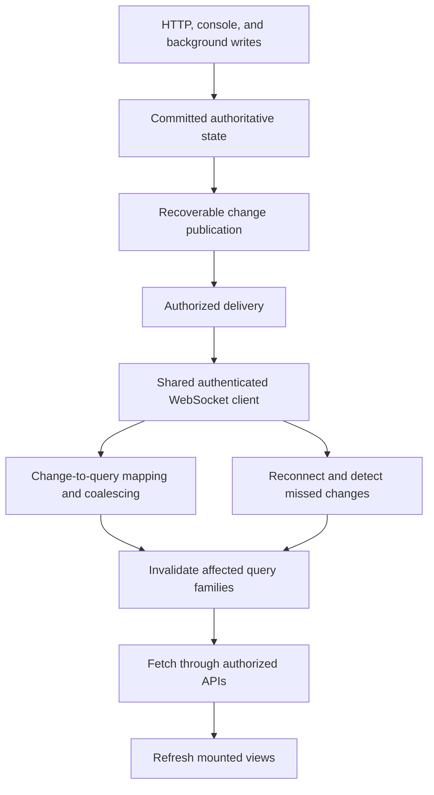
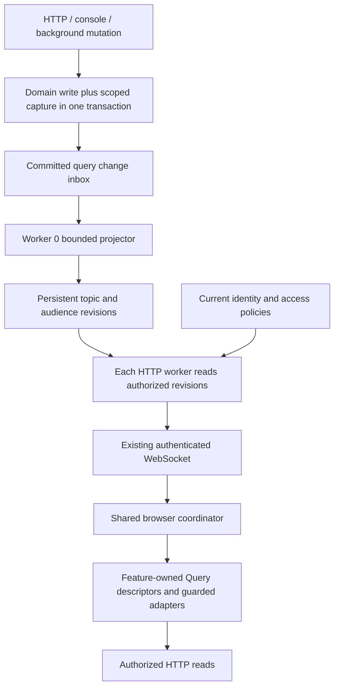
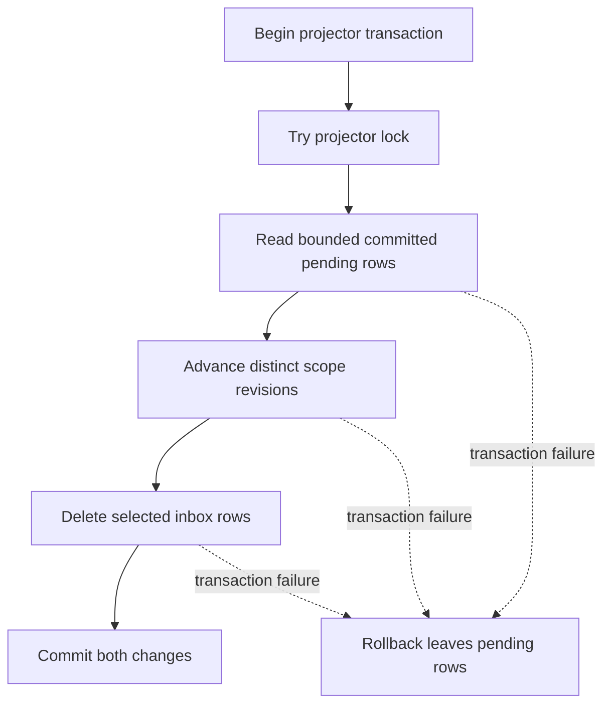
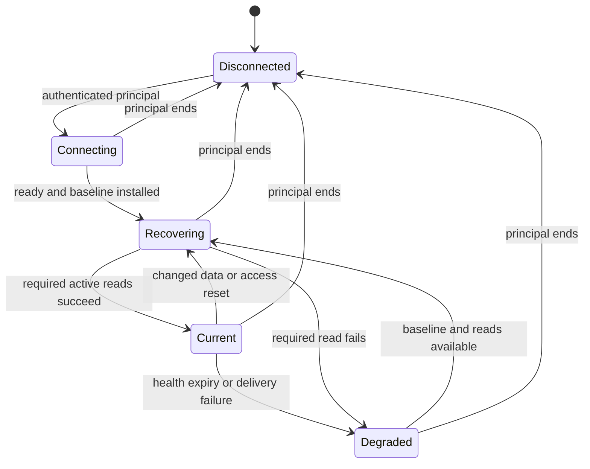
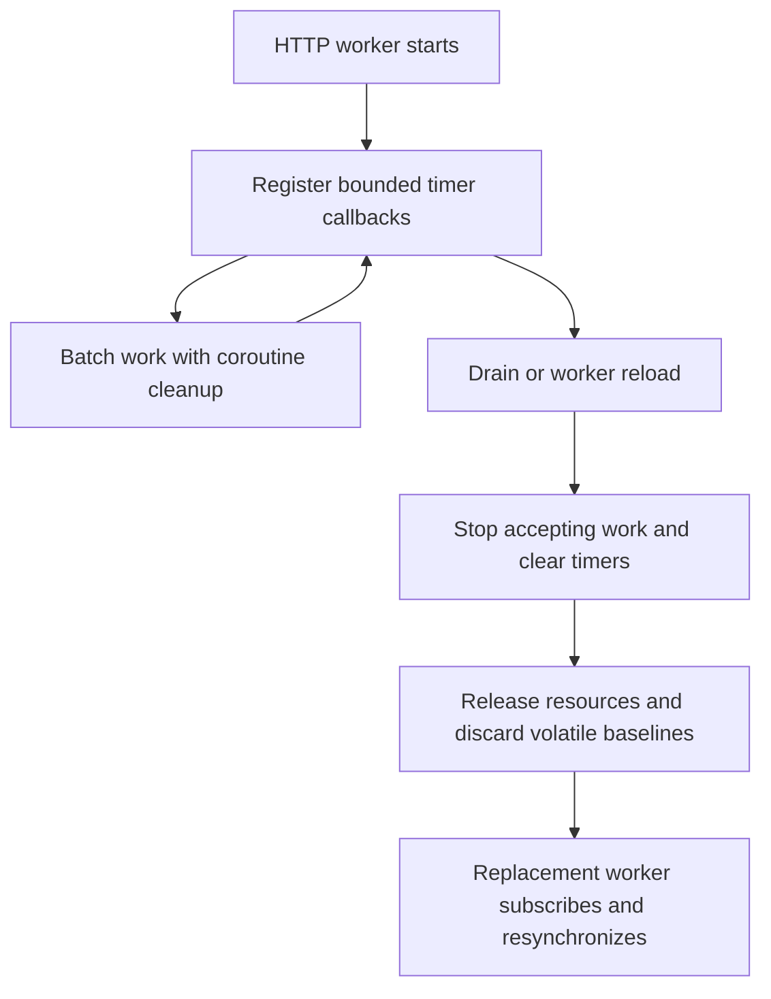

# Cohesive Live Updates - Plan

## Goal Capsule

- **Objective:** Listeners and administrators see current server data throughout Baander without refreshing the page or navigating away.
- **Product authority:** The user identified stale sidebar Recents, expanded the scope to all React Query consumers, and confirmed a shared WebSocket-backed freshness system with recovery, authorization, and protection for edits and playback.
- **Means:** Transactional change capture, scoped revisions, shared authenticated WebSocket delivery, and guarded query refresh (KTD2–KTD9).
- **Execution profile:** Three dependent review groups, with local commits on `feat/cohesive-live-updates`; the implementation owner integrates all units and verification before requesting publication. Follow `AGENTS.md` for reviews and shipping.
- **Open blockers:** None. Implementation-time runtime evidence is required in the owning units; failed authorization, data-preservation, or capacity gates block completion.
- **Authority:** Product requirements govern behavior; KTDs govern the implementation within those requirements; units do not override either.

---

## Product Contract

### Summary

Give the web application one coordinated system for keeping server data current.
Changes from users and background work reach authorized clients through WebSocket notifications, then refresh the affected queries.
Bring Recents into that system and recover automatically when delivery is interrupted.

### Problem Frame

Sidebar Recents loads through a local-state hook on mount and filter changes, so recording a play does not update the mounted view.
Elsewhere, freshness depends on individual mutation handlers, query stale times, and feature-specific polling.
A stale time determines when cached data becomes stale; it does not itself schedule a refresh.
Users can therefore see different versions of the same server state across views and tabs.

The existing WebSocket frontend consumer handles listening-session messages, while the backend also supports party messages and user-directed pushes.
That transport is not currently connected to a general query-refresh system.
Session reconnection fetches session state, but generic pushes have no replay contract.
Changing the transport alone would leave missing publication and missing consumers unresolved.

### Actors

- A1. **Listener:** Browses and plays media, manages playlists and preferences, and reads notifications across their signed-in tabs or devices.
- A2. **Administrator:** Manages libraries and users and watches jobs, scans, and server status within their permissions.
- A3. **Background producer:** Commits changes through scans, jobs, console commands, or other asynchronous work that affects a visible query.

### Requirements

**Coverage and visible behavior**

- R1. Inventory every React Query query family and consumer, recording its change sources, affected views, refresh policy, and verification coverage; immutable data must have an explicit reason for needing no live updates.
- R2. Move Recents and other server-state readers needed by the covered workflows onto the shared freshness path, including readers that currently keep fetched data only in component state.
- R3. Refresh affected active views after relevant committed changes from the current tab, other authorized clients, and background producers without requiring navigation or a page reload.
- R4. Mark affected inactive cached queries stale so that opening their views obtains current data, including filtered, paginated, infinite, detail, and aggregate variants.
- R5. Reflect confirmed local mutations promptly through the same query ownership rules without waiting for the originating client's WebSocket notification.

**Publication and client integration**

- R6. Use one shared authenticated WebSocket connection lifecycle per running web client for change subscriptions while preserving existing session and party behavior.
- R7. Publish change notifications only for committed state, with recovery for a failure between persistence and delivery; rolled-back writes must not become visible changes.
- R8. Define typed change contracts and an explicit mapping from changes to affected query families so that feature components do not maintain separate socket or invalidation protocols.
- R9. Obtain authoritative resources through their normal authorized query APIs; notifications carry the minimum change information needed to refresh them.
- R10. Coalesce repeated changes and bound delivery, buffering, and refetch work so that scan bursts and slow clients cannot produce unbounded queues or request storms.

**Recovery and isolation**

- R11. Recover current authorized state automatically after disconnection, browser sleep, or server restart, using an authoritative resynchronization whenever missed changes cannot be recovered.
- R12. Make duplicate, reordered, and overlapping notifications and query responses converge to current state without replaying user actions or restoring older data.
- R13. Restrict subscriptions and notifications to the recipient's current account and resource permissions, with no client-selected subscription bypass.
- R14. End obsolete subscriptions and remove inaccessible cached data when logout, account changes, or access revocation makes that data unauthorized.
- R15. Keep existing readable data during a transient delivery outage and make loss of freshness discoverable without blocking ordinary navigation or interrupting playback.

**Interaction and operation**

- R16. Preserve unsaved form input, valid selection, scroll position, and active playback during refresh; deletion or conflicting edits must use an explicit unavailable or conflict state rather than silently overwriting user work.
- R17. Give sampled values such as server statistics an explicit bounded refresh cadence within the shared policy, rather than requiring an event for every sample.
- R18. Document how developers add a change producer and query consumer, and give operators diagnostics that distinguish publication, delivery, authorization, and client-refresh failures.
- R19. Verify the coverage inventory through automated tests and representative real-browser flows, including cross-client changes, background work, interrupted delivery, and access revocation.

### Key Decisions

- **One freshness contract across the web application.** The user expanded the scope beyond the reported Recents bug to all React Query consumers. Per-feature fixes alone would leave the same failure pattern elsewhere. Governs R1–R5. (session-settled: user-approved — chosen over feature-by-feature invalidation and polling: shared delivery and recovery must cover every expected live view.)
- **Extend WebSockets.** The confirmed approach builds on the existing transport instead of introducing a parallel general-purpose event channel. The shared lifecycle must not cause ordinary query subscribers to claim playback ownership. Governs R6.
- **Use notifications to refresh authoritative data.** Query invalidation avoids maintaining a second client-side implementation of server filtering, pagination, and access rules. Local mutation responses may still update their owned caches under R5; they do not replace R9.
- **Separate reliable publication from browser history.** Recovery under R7 and R11 requires a way to discover missed state, but does not require permanent browser event history or exactly-once delivery. Retention and cursor design remain planning decisions.
- **Keep refresh work proportional to the change.** Targeted invalidation and coalescing serve R8 and R10. A whole-cache refetch is a recovery measure for an uncertain scope, not the normal response to each event.
- **Retain device-specific interaction behavior.** This work updates server-backed state; it does not add remote playback commands or synchronize browser-local drafts and navigation. Governs R16 and the scope boundaries below.

The conceptual responsibilities are:



The diagram assigns responsibilities under R6–R13; it does not prescribe services, tables, or deployment processes.
Publication must reach clients connected to any relevant web worker, including when a separate worker process commits the change.
The concrete runtime design must honor the existing domain, application, and infrastructure boundaries.

### Coverage Inventory

The inventory in R1 is the acceptance boundary, not a list limited to these initial examples.
Each query family needs an owner, change sources, dependent query variants, authorization scope, recovery behavior, and a test or explicit immutable-data justification.

| Area | Representative changes | Views whose agreement matters |
|---|---|---|
| Activity and Recents | Playback recorded, activity updated | Sidebar Recents, home activity, media-type landing views |
| Catalog and libraries | Scan results, metadata changes, removal, availability | Lists, details, counts, filters, library status |
| Playlists | Creation, rename, membership and item changes, deletion | Sidebar entries, playlist lists and details |
| Notifications | Creation, read state, deletion | Notification list and unread count |
| Preferences and user resources | Saved settings, device or account changes | Relevant settings views and persisted-state consumers |
| Administration and jobs | Job transitions, scan progress, access changes, sampled statistics | Authorized dashboards, lists, details, and progress displays |

### Acceptance Examples

- AE1. **Recents without remounting. Covers R2, R3, R5.** With the sidebar already mounted, a successful playback record makes the relevant Recents views show the current server ordering without navigating away.
- AE2. **Two clients. Covers R3, R4, R8, R13.** A playlist edit in one client updates an authorized second client's open list and details; a cached inactive playlist view fetches current data when opened.
- AE3. **Background work. Covers R3, R7, R10, R17.** A scan started from a console updates authorized library status and affected catalog views; a burst of results causes bounded refresh work and eventually displays the final state.
- AE4. **Missed delivery. Covers R11, R15.** A client disconnects while another client changes data, then reconnects after any retained event window has expired; it obtains the current state automatically and clears the stale-connection indication after recovery.
- AE5. **Commit failure and publication failure. Covers R7.** A rolled-back mutation produces no visible change; a committed mutation whose initial delivery fails is recovered without the user repeating the mutation.
- AE6. **Duplicate and racing updates. Covers R10, R12.** Duplicate notifications arrive while an older query is still in flight; the view converges to the newest server state without duplicate rows, repeated user actions, or an unbounded refetch loop.
- AE7. **Authorization changes. Covers R13, R14.** A client cannot subscribe to another user's private changes, and revoking access removes the affected data and subscriptions from an already-open client.
- AE8. **Editing during refresh. Covers R16.** A user has an unsaved metadata form when another client changes or deletes the record; their draft remains available and the conflict or deletion is explicit, while unrelated playback continues.
- AE9. **Notification agreement. Covers R3, R4, R8.** A newly created notification and a read-state change update the mounted list and unread count consistently, including changes made in another tab.
- AE10. **Lifecycle and local mutation. Covers R5, R6, R11, R14.** Repeated feature mounts do not accumulate sockets or listeners; a local successful mutation updates its views during a temporary socket outage, and an account switch cannot reuse the previous account's cached state.

### Scope Boundaries

- Coverage includes every existing React Query family in the web application; the inventory cannot silently omit a feature because it currently polls or uses unusual query keys.
- The related non-Query readers in R2 are included where needed for the same workflows; this is not a rewrite of all browser-local state.
- Existing session and party functionality remains supported under R6, but new playback handoff, remote-control, and collaborative-editing features are outside this work.
- New native or TV clients, a general offline-write engine, permanent event-history browsing, and unrelated backend context redesigns are outside this work.
- Ordinary live delivery uses the confirmed WebSocket approach; bounded polling or authoritative refetch may serve recovery and sampled data under R11 and R17.

### Dependencies and Assumptions

The existing authentication, DPoP, single-use WebSocket ticket, session revocation, and server drain contracts remain authoritative.
The architecture must use public IDs in client-facing messages as defined in `CONCEPTS.md`.
Internal change publication and browser delivery are distinct from administrative control of the running web server; the restrictions in `.agents/rules/admin-cli-parity.md` still apply.

The existing notification outbox projection is evidence of durable processing, not evidence that every affected write already publishes an event.
Planning must trace producers as well as consumers and identify transaction boundaries before selecting reusable components.
The initial runtime target is Baander's current deployment, including its separate background workers and multiple web workers; support for hypothetical deployment topologies is not assumed.

### Planning Resolutions

The previously deferred engineering questions are resolved by the Planning Contract: producer coverage by KTD1–KTD3, cross-worker delivery and recovery by KTD4–KTD6, session separation by KTD6, query mapping by KTD1 and KTD7, bounded work by KTD9, and conflict/status behavior by KTD8.
Exact SQL, native-send limits, and capacity measurements remain implementation evidence assigned to U2, U3, and U9; they do not leave product behavior undecided.

### Sources and Research

- `ui/web/src/features/layout/hooks/use-recent-items.ts`: local-state fetch lifecycle; query invalidation alone cannot refresh this hook.
- `ui/web/src/features/player/services/activity-service.ts` and `src/Activity/Application/CommandHandler/RecordPlayHandler.php`: playback recording path.
- `ui/web/src/App.tsx`: five-minute query stale-time default.
- `ui/web/src/features/session/services/SessionSyncBus.ts`: existing socket connection, reconnection, and session message handling.
- `src/Shared/Interface/Controller/WebSocketController.php`, `src/Shared/Interface/WebSocket/WebSocketRoomPolicy.php`, and `src/Shared/Infrastructure/Swoole/WebSocketPusher.php`: server routing, room authorization, and best-effort pushes.
- `ui/web/src/features/playlist/lib/playlist-queries.ts`: existing feature-owned list/detail invalidation.
- `ui/web/src/features/notification/hooks/use-notifications.ts`: notification queries; their stale times are not polling intervals.
- `ui/web/src/features/admin/hooks/use-server-stats.ts` and `ui/web/src/features/library/pages/LibrariesPage.tsx`: representative polling consumers.
- `src/Notification/Infrastructure/Event/NotificationBridgeSubscriber.php` and `src/Shared/Infrastructure/Event/OutboxEventDispatcher.php`: durable notification projection, distinct from generic socket delivery.
- `.agents/rules/frontend.md`, `.agents/rules/architecture-rules.md`, `.agents/rules/admin-cli-parity.md`, and `ui/DESIGN.md`: binding state, layering, runtime-control, and interaction constraints.
- `docs/solutions/runtime-errors/swoole-callbacks-outside-the-bundle-leak-pooled-services.md`: callback resource-release requirements relevant to long-lived delivery workers and timers.

---

## Planning Contract

### Key Technical Decisions

- KTD1. **Declare coverage at query-family and storage boundaries.** Under R1, R2, R8 and R19, maintain one reviewed inventory connecting actual frontend query consumers to stored or sampled sources, authorization scopes, dependent families, and tests. Feature modules own their descriptors; the application composition root registers them with a transport-independent coordinator. Generated endpoint exports without callers are not features, and handwritten API readers are not automatically exempt. A TypeScript AST coverage check rejects an unclassified consuming hook or direct persistent reader. A backend coverage check verifies every declared table/operation against installed capture definitions, including relation tables and bulk writes. These checks establish inventory completeness, not the correctness of each declared dependency.

- KTD2. **Capture persisted changes transactionally at the database boundary.** Under R7 and R13, migration-owned PostgreSQL triggers append minimal affected-topic and audience identifiers to a new `query_change_inbox` table in the writer's transaction. This covers ORM flushes, bulk DQL/DBAL, console work, and background projections without requiring each caller to remember an after-commit send. Use explicit table/column mappings, statement transition tables for bulk writes where supported, and distinct old/new affected scopes. Capture deletion dependencies before their relationships disappear. Exclude secret values, row snapshots, file paths, heartbeat-only changes, and freshness infrastructure itself. This is infrastructure change detection, not a new domain-event system; existing domain outbox semantics stay intact. Capture failures roll back the affected write rather than silently losing freshness.

- KTD3. **Fold an inbox into durable scoped revisions, with no browser replay log.** Under R7, R10–R12, add `query_scope_revision`, keyed by topic and audience scope. A bounded projector takes a transaction-scoped advisory lock, selects committed pending inbox rows, coalesces their scopes, advances revision rows in a deterministic order, and deletes exactly the selected inbox rows in the same transaction. Inbox identity values are addresses only: never use `id > last_seen` or a timestamp high-water mark, because an earlier ID may commit later. A failed transaction leaves both capture and prior revisions intact. Producers only append; they do not acquire shared revision-row locks. Revisions are positive bigint values encoded as decimal strings at transport boundaries, not entity versions or counts of business operations. Retain revision tombstones; never expire unprocessed inbox rows or reset a surviving scope's counter.

- KTD4. **Read durable revisions from the current Swoole runtime.** Under R6, R10 and R11, HTTP worker 0 runs the projector even when no browser is connected; every HTTP worker reconciles only its owned connections, batching work by authenticated principal. Both are bounded timer callbacks with overlap guards, `CoWrapper` cleanup, and existing drain/worker-stop integration. Database revision comparison is the cross-process bridge; no Redis Pub/Sub, PostgreSQL listener, extra daemon, or new broker is needed. A worker reload discards volatile baselines and re-establishes subscriptions. Failures leave baselines unacknowledged and freshness degraded. Publication diagnostics include oldest inbox age, projection errors, successful reconciliation age, and dropped/closed slow connections; WebSocket ping alone does not prove the pipeline is healthy.

- KTD5. **Derive audiences from current server authorization.** Under R13 and R14, infrastructure audience providers call the owning contexts' application ports for user, library, playlist, and administrative visibility. They use current database roles and membership rather than client-supplied room names or cached UI roles. Read membership and relevant revision vectors consistently in a short read-only transaction. User-private topics cannot produce hints for other users. Shared resource changes use authorized library/playlist scopes, including old scopes on moves and deletes. The wire carries a fixed family vocabulary and opaque authorization fingerprint, not the full membership list, raw internal IDs, or arbitrary query keys. If access changes, send a permission reset before ordinary invalidations and fence all requests started under the old authorization generation. Conservatively purge whole affected query families and store mirrors when a filtered aggregate cannot be safely separated; fresh authorized reads restore the allowed contents. Existing signed media URL expiry and refresh-token-chain revocation contracts remain unchanged.

- KTD6. **Use one authenticated client with an ordered resynchronization handshake.** Under R6, R11 and R15, extract ticket, socket, retry, and connection-generation ownership from `SessionSyncBus` into shared infrastructure mounted at the authenticated application boundary. Session handling becomes a subscriber that retains its current join, device ownership, and restore guards; opening a freshness connection never joins or claims a listening session. A `live.subscribe` message establishes server observation and a revision baseline before `live.ready` allows recovery reads. Changes arriving during those reads remain pending. `live.changed`, `live.reset`, and `live.health` have a versioned, bounded envelope carrying subscription identity, authorization generation, and permitted family changes. Reconnect always reconciles authoritative state; there is no browser replay cursor. A session token rotation preserves principal ownership, while logout or principal replacement stops the socket and rejects all old callbacks.

- KTD7. **Make freshness a query-scheduling concern.** Under R4, R5, R8–R12, route remote hints and successful local mutations through the same family descriptors. Mark all affected variants stale but refetch only active eligible observers. Maintain a monotonically increasing local dirty generation per query; a successful read can clear only the generation at which it started. If a newer hint arrived during an initial or background request, schedule another read. Failed, offline, disabled, or deliberately draft-protected queries retain dirty work until they can reconcile. Consume AbortSignal in generated and handwritten fetchers. Coordinate optimistic mutations and pagination with the same scheduler so an older response cannot roll back a confirmed result. Replace incorrect handwritten invalidation keys and duplicate device key families. These choices address the initial-fetch reuse behavior in TanStack Query 5.100.14, not just its documented active-refetch default. [QueryClient reference](https://tanstack.com/query/v5/docs/reference/QueryClient), [versioned fetch implementation](https://github.com/TanStack/query/blob/%40tanstack/query-core%405.100.14/packages/query-core/src/query.ts#L400).

- KTD8. **Separate server snapshots from drafts and playback.** Under R14 and R16, isolate QueryClient ownership by authenticated principal without remounting the player on token rotation or a same-account permission refresh. Cancel and clear old account queries and mutation caches, invalidate request epochs, and clear notification/sidebar/profile mirrors. Keep server snapshots, local dirty fields, pending saves, and remote-change indicators distinct. A changed baseline pauses affected autosave until the user resolves the conflict; remote deletion disables saving while retaining user-authored draft text for recovery. Save completion clears only edits included in that save. Reuse existing preference versions and conflict handling, suppress remote-application feedback writes, and defer remote preference application while local edits or saves are pending. Profile-list refresh does not apply an EQ preset. Query refresh never dispatches playback restore, changes track, seeks, or claims a session. This work does not claim to add atomic compare-and-swap semantics to every metadata endpoint.

- KTD9. **Bound work without dropping required state.** Under R10, R15 and R17, apply the engineering budgets below to projection, socket work, and HTTP refresh. Coalesce overflow to family dirtiness instead of discarding it. Preserve loaded infinite-query pages and visible anchors; their sequential reads share the HTTP budget with other refreshes. Do not introduce `maxPages` merely to hide cost. Serialize Timeline's complete read and retain its dirty generation, so a burst cannot launch overlapping catalog walks. Disabled queries get an explicit re-enable policy; mutable data cannot use `staleTime: 'static'`. Runtime gauges use one active-and-visible sampling policy per family. [Infinite-query behavior](https://tanstack.com/query/v5/docs/framework/react/guides/infinite-queries).

- KTD10. **Keep the extension points narrow and enforceable.** Under R18 and R19, put generic DTOs, coordination, and ports in Shared Application; put DBAL, capture migrations, Swoole timers, and context audience adapters in Infrastructure. WebSocket and recovery HTTP controllers call application ports rather than repositories. Feature query descriptors live with their features and are composed at the application root. Document adding a producer, a query family, and an audience provider together with their verification obligations. Do not copy the existing outbox repository's Domain-layer placement or broaden Deptrac baselines. Use PHP 8.5 syntax, existing formatting, and the project's Composer-based tooling conventions.

### High-Level Technical Design

KTD2–KTD5 separate business writes, durable projection, authorization, and transient delivery:



KTD3's commit behavior avoids both loss and cross-producer counter locking:



KTD5–KTD7 govern connection and read ordering:

```mermaid
sequenceDiagram
  participant B as Browser coordinator
  participant W as Owning web worker
  participant D as Database
  B->>W: Authenticated live.subscribe
  W->>D: Current access and revision snapshot
  W->>W: Install observation baseline
  W-->>B: live.ready and authorization fingerprint
  B->>B: Purge lost access; mark recovery work dirty
  B->>D: Authorized HTTP reads through existing API
  D-->>W: Later committed revisions on reconciliation
  W-->>B: live.changed
  B->>B: Retain newer dirty generation during reads
  B->>D: Follow-up reads where required
  B->>B: Current only after successful reconciliation
```

KTD6–KTD9 define client freshness independently from player state:



Worker lifecycle under KTD4 uses the existing drain vocabulary and hooks:



The recovery HTTP route is an authenticated, DPoP-protected view of the same current audience/freshness application service used by WebSocket subscription.
It returns protocol version, allowed family categories, authorization fingerprint, and pipeline health; it does not grant resource access or return arbitrary user-selected scopes.
While WebSocket delivery is unavailable, active clients use it for permission reconciliation before scheduled authoritative reads.
A changed fingerprint purges protected cache families and derived mirrors before rendering replacement data.
An opaque fingerprint is an equality token, not an access credential or a browser event cursor.

The server computes audience membership before selecting revision rows.
Large authorized scope sets are joined or processed in bounded database batches; their identifiers are not serialized into one oversized browser frame.
Changes are collapsed to affected frontend families after authorization.
Notification projection writes are captured when the notification itself commits, even if the source domain event was processed earlier.
Backend response caches on covered queries must be invalidated or bypassed correctly before a refresh is acknowledged as current.

### Engineering Budgets and Health

These are initial implementation limits and acceptance targets, not measurements of the current application.
The final capacity checkpoint must measure them in the CI runtime; a failed target is unresolved acceptance, not permission to weaken scope or hide a stale view.

| Work | Initial limit or target | Failure behavior |
|---|---|---|
| Projector | 250 ms tick, at most 1,000 inbox rows per batch, one batch per tick, 250 ms transaction timeout | Roll back, retain pending rows, record error and oldest age; no overlapping tick |
| Worker reconciliation | 1 second cadence, at most 32 distinct principals per batch, fair rotation, no overlapping batch | Keep old baselines, mark delivery degraded and continue bounded batches |
| Subscription/health | Ready deadline 10 seconds; health report every 5 seconds; browser health expires after 15 seconds | Enter degraded state, retry with jitter; ready is not proof that HTTP reads succeeded |
| Freshness frames | At most 64 KiB per frame and one pending coalesced family set per connection | Collapse to reset; close a non-reading/overloaded peer with existing overload semantics instead of growing a queue |
| Query scheduling | 100 ms coalescing; at most one refresh start per family per 500 ms; at most 256 pending identities | Collapse excess identities to family dirtiness without losing the final refresh |
| Background HTTP work | At most four in-flight refresh requests per client; 20 starts per second, including pages | Fair queue; user-initiated work keeps priority, dirty work remains pending |
| Retry/recovery | Jittered exponential retry from 1 to 30 seconds; visible-client HTTP recovery every 30 seconds during socket failure | Preserve authorized readable data, retain failed generations, and expose degraded freshness |
| Samples | Stats/workers/coroutines/transcodes/rate-limit counters: 5 seconds; spans: 10 seconds; analytics: 30 seconds | Sample only while observed and visible; one policy per family |
| Ordinary latency | p95 committed change to rendered eligible view within 3 seconds for 32 principals when source reads complete within 1 second | Report measured component delays and remedy failed targets |
| Burst convergence | 10,000 capture rows over 10 seconds, then final eligible view within 5 seconds after the burst on the same fixture | No pending-state loss, no growing memory queue; report durable backlog drain time |

For infinite lists and Timeline, measure a populated view with at least 10 retained pages and a 10,000-item catalog separately.
Their completion time includes the bounded sequential page reads and is reported explicitly; the ordinary single-read target is not misrepresented as a guarantee for a full-catalog walk.
Keep existing loaded content and selection during the walk, and show recovery until all required dirty reads complete.
Projector backlog older than 5 seconds, or a failed revision read, makes pipeline health degraded even if the socket still answers.
Expose publication and reconciliation failures through existing diagnostics and metrics, without adding user IDs or resource IDs as unbounded metric labels.

The pinned Swoole runtime must prove that a suspended send to a slow peer cannot stall healthy peers or leak a coroutine.
Prefer existing buffer-limit handling; any necessary bundle/configuration addition stays local to bounded delivery and must preserve media response behavior.
Do not assume an OpenSwoole option or a later Swoole release fixes the pinned runtime.

### Coverage and Ownership Map

The following groups seed KTD1's complete inventory; each has a feature-owned descriptor, local-mutation mapping, and producer or sampled-source mapping.
Parameters, filters, library selection, pagination, and detail IDs remain variants within a group, not exemptions.

| Group | Current consumer anchors | Change sources and policy | Unit |
|---|---|---|---|
| Music catalog and search | Catalog pages, `use-song-list`, `use-grid-view-model`, `use-column-browser`, SearchResults, SpotlightOverlay, panels | Catalog tables and relationships, metadata, artwork, availability; authorized library-scoped capture | U6 |
| Movies | MoviesBrowsePage, MovieDetailPage | Movie/video/collection writes and library membership; capture | U6 |
| Activity and Recents | HomePage, `use-activity-view-model`, `use-recent-items`, media-type home pages | Committed media activity; current-user capture and local record-play hint | U6 |
| Timeline | `use-timeline-view-model` | Album-dependent query adapter; serialized whole-catalog reads | U6 |
| Catalog recommendations | `use-discover-view-model`, `use-for-you-view-model` | Result projection and relevant source changes; capture after results commit | U6 |
| Playlists and duplicate groups | Playlist pages/dialogs, `playlist-queries`, MergeAlbumsDialog, admin duplicates | Playlist metadata/items/collaborators/statistics, merge results, old/new audiences; capture | U7 |
| Lyrics | LyricsDialog, LyricsTab, LyricsFullscreenOverlay | Lyrics save/select/offset/sync capture; external search remains input-scoped demand-driven lookup | U6 |
| Libraries | `use-libraries`, `use-library`, `use-library-stats`, LibrariesPage | Library CRUD/access/scan state and catalog counts; capture, excluding lease heartbeat-only writes | U6 |
| Notifications and alerts | `use-notifications`, `use-notification-actions`, admin notifications, AlertHistory | Notification projection/read/delete; list/count capture and guarded store mirror | U7, U8 |
| Preferences and sidebar | `use-user-settings`, PreferenceHistory, preference bootstrap/sync, sidebar config/editor | Versioned preferences, history, theme/accent, sidebar schemas; principal-scoped adapters with draft guards | U7 |
| EQ profiles | ProfileSelector and profile store/editor | Profile CRUD; refresh list without applying selected sound settings | U7 |
| Current user and security | Current-user refresh, passkeys, OAuthConsent | Identity/role/passkey/client state; access resets and demand-driven consent revalidation | U4, U7 |
| Session and devices | `use-session`, DevicePicker, DeviceManagement | Device CRUD/session lifecycle; consolidate keys while retaining separate playback protocol | U4, U7 |
| Admin users/settings/OAuth | `use-users`, LibraryAccessDialog, system settings, OAuth clients | User/access/settings/client writes; admin capture, no secret broadcast | U8 |
| Scheduler and job monitoring | Scheduler hooks, job list/detail/status, dashboard summary | Job/occurrence/queue state persisted changes; sampled transport gauges | U8 |
| Diagnostics and analytics | Server/debug stats, analytics, config check, rate limiters, login blocks | Shared active-visible sampling for gauges/expiry, capture for persisted transitions | U8 |
| Admin metadata/lyrics/recommendations | Respective admin hooks and job/coverage views | Projection completion, effective provider settings, lifecycle state; capture or declared sampling | U8 |
| Radio | Radio hooks, CountryPicker, StarredStations, catalog starred, admin radio | Imported stations/countries and personal subscriptions/stars; shared and user-scoped capture | U7, U8 |
| Admin transcode/media | `use-transcode-admin`, `use-media-admin` | Lifecycle and storage changes; sampled occupancy/progress, demand-driven missing-media check | U8 |
| Deployment-fixed definitions | Settings definitions, scheduler commands | Explicit immutable-for-deployment classification; refresh after server incarnation or software-version change | U5, U8 |

Source research found 68 application caller/query-owning files; this is a starting census, not a ceiling on R1.
Library lists currently mix type and ID in handwritten keys, devices have generated and handwritten keys, and some cover/playlist invalidations do not match their actual generated keys.
The adoption units repair those consumers rather than preserving obsolete aliases.
The backend inventory must name the actual queried tables, relationship dependencies, Redis/runtime sources, and response caches for every row.
It must not install triggers on secret-only or unused tables merely because they appear in the schema.

### Alternatives Considered

- Extending only domain events would leave Activity, bulk SQL, and several post-save event dispatch gaps. KTD2 is chosen because the user requested complete query-state coverage, while existing semantic events serve narrower purposes.
- Direct revision increments in producer transactions would be simpler but introduce shared counter locks, mixed-scope deadlocks, and import contention. KTD3 keeps those locks in a separate short transaction.
- A retained event feed with browser cursors would add sequencing, retention, and replay machinery without changing the required outcome. KTD3 and KTD6 recover current data instead.
- Redis Pub/Sub or PostgreSQL NOTIFY could reduce wake-up latency but would still require durable recovery. KTD4 meets the initial cadence without another delivery path. Add wakeups only if measured polling cost or latency justifies them.
- A new universal optimistic-concurrency API for metadata is not required to preserve drafts. KTD8 protects edits and surfaces remote changes without claiming to solve every pre-existing simultaneous-write race.

These mechanisms were concrete enough to compare from the current transaction and runtime paths; further competing prototypes would not resolve the remaining capacity measurements before implementation.

### Implementation Constraints and Deferred Evidence

Preserve the Product Contract's R-IDs and acceptance examples as the authority on behavior.
Use the current PostgreSQL 18 CI environment and installed Doctrine DBAL 4.4.3 / ORM 3.6.6 contracts; confirm the actual runtime version in execution before migration qualification.
Add forward migrations and preserve local data rather than rewriting the installed schema or resetting the preview.
Mark inbox/revision tables explicitly in Doctrine's unmanaged-table policy, and test trigger definitions separately from ORM schema validation.

The exact old/new scope SQL, cascade behavior, bounded native send mechanism, and burst capacity require implementation-time tests in their owning units.
They are required acceptance work, not optional follow-up tasks.
A scope mapping that cannot safely identify affected audiences blocks activation of that query family until corrected.
No new production PostgreSQL extension is planned.

### Research That Shapes the Design

- `src/Activity/Application/CommandHandler/RecordPlayHandler.php`, `src/Playlist/Application/CommandHandler/CreatePlaylistHandler.php`, and `src/Shared/Infrastructure/Messenger/JobMonitorService.php` demonstrate missing, post-commit, and bulk-write event paths behind KTD2.
- `src/Shared/Domain/Event/Outbox/OutboxRepository.php` and `src/Shared/Infrastructure/Event/OutboxEventDispatcher.php` establish that existing relay IDs and notification receipts are not a universal browser-change cursor.
- `src/Auth/Infrastructure/Swoole/RevokedSocketReconciler.php`, `src/Shared/Infrastructure/Swoole/WebSocketConnectionRegistry.php`, and `src/Shared/Infrastructure/Swoole/SwooleWorkerEventSubscriber.php` provide runtime lifecycle and ownership patterns for KTD4–KTD6.
- `ui/web/src/features/catalog/components/metadata/InfoPanel.tsx` and `ui/web/src/features/settings/hooks/use-preference-sync.ts` establish the draft-reset and preference-application boundaries addressed by KTD8.
- The Swoole callback, drain, task-durability, table-capacity, and health-monitor learnings in `docs/solutions/` govern timer cleanup, bounded admission, and recovery observation.
- [PostgreSQL transaction isolation](https://www.postgresql.org/docs/18/transaction-iso.html) and [trigger behavior](https://www.postgresql.org/docs/18/trigger-definition.html) govern KTD2–KTD5's visibility and capture tests.
- [Redis Pub/Sub delivery semantics](https://redis.io/docs/latest/develop/pubsub/) support the decision not to treat transient internal messaging as durable state.
- [WebSocket security guidance](https://cheatsheetseries.owasp.org/cheatsheets/WebSocket_Security_Cheat_Sheet.html) supports continued authorization and bounded messages; Baander's existing ticket, Origin, DPoP, and revocation contracts remain the implementation authority.

---

## Implementation Units

### PR 1: Committed change capture and authorized delivery

No general frontend freshness subscription is enabled in this group.
The backend protocol ships only with its authorization, admission limits, recovery route, and runtime lifecycle guards.

### U1. Establish the query and change coverage contract

- **Goal:** Give every covered view an explicit source, audience, refresh policy, and verification owner.
- **Requirements:** R1, R2, R8, R18, R19; KTD1, KTD10.
- **Dependencies:** None.
- **Files:** New protocol DTOs and topic definitions under `src/Shared/Application/LiveUpdates/`; corresponding client protocol and registration contracts under `ui/web/src/shared/live/`; new `docs-book/part-2-developer-guide/live-updates.md`; coverage fixtures under `tests/Fixtures/LiveUpdates/`; frontend coverage test under `ui/web/tests/live-updates/`; backend mapping contract tests under `tests/Unit/Shared/LiveUpdates/`.
- **Approach:** Complete the coverage map above against callers, underlying query sources, and response caches. Declare scope derivation and dependent families, with explicit immutable, sampled, and demand-driven classifications. Create shared protocol fixtures and vocabulary consistency checks without activating delivery.
- **Test scenarios:**
  - An application query with an unregistered family fails the coverage check; an unused generated endpoint does not.
  - A family covering notification list/count or a filtered/infinite catalog key includes all of its actual variants.
  - Server and client validators accept the same versioned fixtures and reject arbitrary families or malformed generations.
- **Verification:** The complete current consumer inventory and capture-source map are reviewable, with no unclassified active reader.

### U2. Capture committed changes and project scoped revisions

- **Goal:** Make every persisted mapped change discoverable after crashes, without coupling producer transactions through revision locks.
- **Requirements:** R3, R7, R10–R12; KTD2, KTD3.
- **Dependencies:** U1.
- **Files:** New forward migration under `migrations/`; new DBAL stores/projector under `src/Shared/Infrastructure/LiveUpdates/`; application ports under `src/Shared/Application/LiveUpdates/`; `config/packages/doctrine.yaml`; integration fixtures and tests under `tests/Integration/LiveUpdates/`.
- **Approach:** Implement the two-table model and explicit capture mappings, including old/new ownership, parent cascades, bulk updates, delayed notification projections, and no-op field exclusions. Preserve the existing domain outbox and its consumer receipts. Apply the PostgreSQL remediation skill to the scoped schema and transaction work.
- **Execution note:** Establish separate-connection transaction and commit-order tests before wiring live delivery.
- **Test scenarios:**
  - Covers AE5. A write rolled back on another connection leaves no visible inbox/revision change; a committed write survives death before projection.
  - An earlier allocated inbox ID commits after a later one has been projected and is still processed.
  - Projector failure before commit retains selected rows; retry advances all required scopes without data loss.
  - Covers AE3. ORM flush, bulk DQL, DBAL, console, and scanner writes all populate declared scopes; heartbeat-only updates do not.
  - Deletes, cascades, ownership moves, collaborator removal, and denied preference CAS attempts produce precisely the required old/new scope effects.
  - Notification projection commits later than its source event and causes a separate notification-list/count revision.
- **Verification:** Migration, trigger catalog coverage, rollback/crash behavior, and bounded projection pass on disposable PostgreSQL with existing data preserved.

### U3. Deliver authorized revisions through the web runtime

- **Goal:** Reach every relevant web worker and expose recovery without granting access through subscriptions.
- **Requirements:** R6, R10–R15, R18; KTD4–KTD6, KTD9, KTD10.
- **Dependencies:** U1, U2.
- **Files:** New Swoole runtime adapters under `src/Shared/Infrastructure/LiveUpdates/`; new audience adapters in the owning Auth, Library, Playlist, and other contexts; `src/Shared/Interface/Controller/WebSocketController.php`; `src/Shared/Interface/WebSocket/WebSocketRoomPolicy.php`; new recovery controller/resource; runtime service configuration; relevant WebSocket, revocation, and drain tests; new `tests/Integration/LiveUpdates/` and `tests/Unit/Shared/LiveUpdates/` probes.
- **Approach:** Add application-port dispatch for the freshness protocol, projector and reconciliation timer lifecycles, authorized snapshots, and health diagnostics. Use existing server-control paths for lifecycle operations. Verify response-cache behavior for covered resources; invalidate through owning contexts where needed.
- **Test scenarios:**
  - Covers AE2, AE7. Two worker-owned sockets receive authorized changes; another user's private changes and forged subscriptions reveal nothing.
  - A background process commits while a socket stays open; reconciliation delivers the change without any direct pusher in that process.
  - Access removal while disconnected produces a reset on recovery, and role loss blocks administrative delivery.
  - Covers AE4. Restart/reload and failed revision reads force resynchronization instead of accepting an empty baseline.
  - A non-reading peer cannot block healthy delivery; repeated timer batches release pools, and drain closes/reconnects clients within existing deadlines.
  - A stalled projector with an open socket reports degraded health; recovery HTTP uses the same identity and authorization rules.
- **Verification:** Real Swoole process-mode probes establish multi-worker, slow-peer, resource-lifetime, and drain behavior; protocol/security tests and generated HTTP contract checks pass.

### PR 2: Shared client and complete view adoption

Depends on PR 1.
General freshness delivery is activated only after U4–U8 are integrated, so draft and cache safeguards precede live refetching in the merged application.

### U4. Share the authenticated socket and isolate client ownership

- **Goal:** Connect authenticated users before playback starts while preserving session behavior and preventing old-account data reuse.
- **Requirements:** R6, R11, R13–R16; KTD5, KTD6, KTD8.
- **Dependencies:** U1, U3.
- **Files:** New shared client/provider/recovery modules under `ui/web/src/shared/live/`; `ui/web/src/App.tsx`; authentication lifecycle and store modules; `ui/web/src/features/session/services/SessionSyncBus.ts`; `ui/web/src/features/session/hooks/use-session.ts`; existing session/auth tests and new `ui/web/tests/live-updates/client-lifecycle.test.tsx`.
- **Approach:** Extract transport ownership and retain a feature-owned session adapter. Implement principal and authorization generations, cancellation, cache/mirror removal, and guarded late callbacks. Integrate quiet connecting/recovering/degraded status using existing shell primitives.
- **Test scenarios:**
  - Covers AE10. StrictMode and feature remounts leave one socket and no orphan listeners; a user with no session still connects.
  - Session reconnect preserves existing active-device restore rules, and token rotation does not claim or restart playback.
  - Account switch during a pending query, mutation, or ticket cannot populate the new cache or dispatch old-session actions.
  - Covers AE7. Same-account access loss removes inactive protected caches and mirrors, and late requests cannot restore them.
- **Verification:** Existing session/auth suites and new ownership tests pass with no playback regression.

### U5. Coordinate query freshness and bounded recovery

- **Goal:** Make remote and local changes converge through one query scheduler.
- **Requirements:** R4, R5, R8–R12, R15, R17; KTD1, KTD7, KTD9.
- **Dependencies:** U1, U4.
- **Files:** Shared coordinator/sampling/status modules under `ui/web/src/shared/live/`; application descriptor registration; fetcher signal handling where required; new `ui/web/tests/live-updates/query-coordinator.test.ts` and `ui/web/tests/live-updates/pagination-recovery.test.ts`.
- **Approach:** Implement family matching, dirty generations, optimistic-mutation coordination, fair bounded HTTP scheduling, recovery ordering, and inactive/hidden/disabled observer behavior. Keep feature selection and playback state outside the coordinator.
- **Test scenarios:**
  - Covers AE6. A hint during an initial request requires a later read even if Query clears its own invalidation flag.
  - A 503 followed by no further event retains dirty state and eventually recovers; disabled queries recover on re-enable.
  - Covers AE4. Baseline installation precedes recovery reads, and a change during those reads cannot be acknowledged early.
  - Scan bursts and identity overflow collapse to family dirtiness while respecting concurrency and page-start limits.
  - Infinite next-page loading and refresh converge without duplicate rows, lost pages, or a stale final cursor chain.
- **Verification:** Tests use a real QueryClient and controlled transport/clock to establish the scheduler and recovery guarantees; no scope is marked current merely because a socket opened.

### U6. Adopt catalog, library, activity, and related readers

- **Goal:** Keep browsing and Recents current without resetting edits or navigation.
- **Requirements:** R1–R5, R8, R16; KTD1, KTD7–KTD9.
- **Dependencies:** U5.
- **Files:** Catalog/library hooks, pages, search, panels, metadata forms, lyrics views, and corresponding tests; `ui/web/src/features/layout/hooks/use-recent-items.ts`; `ui/web/src/features/player/services/activity-service.ts`; catalog Timeline adapter; library polling hook; catalog/library feature descriptors; new `ui/web/tests/live-updates/catalog-library.test.tsx` and `ui/web/tests/live-updates/draft-preservation.test.tsx`.
- **Approach:** Adopt every corresponding coverage-map row, including movies, recommendations and non-Query views. Isolate metadata drafts and pending autosaves before connecting descriptors. Remove redundant event-covered polling after producer proof; retain the declared recovery policy.
- **Test scenarios:**
  - Covers AE1. A successful record-play call refreshes mounted Recents and history, including during a socket outage.
  - Covers AE3. A console-origin scan updates library state, filtered catalog rows and counts; inactive filters refresh when opened.
  - Covers AE8. A remote metadata update or deletion preserves dirty text and newer edits made during save, with explicit conflict/unavailable handling.
  - Refresh preserves loaded Timeline/list selection and scroll anchors; lyrics/artwork/availability changes reach their dependent views.
- **Verification:** Each owned inventory row has producer-to-consumer evidence and relevant DOM/browser coverage; no playing media is restarted by data replacement.

### U7. Adopt personal collections, notifications, and preferences

- **Goal:** Keep account-scoped views consistent while protecting local preference edits and audio state.
- **Requirements:** R1–R5, R13, R14, R16; KTD1, KTD5, KTD7, KTD8.
- **Dependencies:** U5; share the draft primitives introduced in U6.
- **Files:** Playlist, notification, radio, settings, equalizer/profile, sidebar, device and consent consumers named in the coverage map; their feature descriptors and tests; existing preference sync and bootstrap modules; new `ui/web/tests/live-updates/personal-state.test.tsx` and `ui/web/tests/live-updates/preferences.test.tsx`.
- **Approach:** Consolidate query keys and local mutation invalidation. Move persistent readers into Query or guarded refresh adapters. Reuse preference versions and remote-application ownership; clear account-derived mirrors under U4's lifecycle.
- **Test scenarios:**
  - Covers AE2. Playlist rename, song changes, collaboration removal and deletion update all permitted list/detail consumers.
  - Covers AE9. Delayed notification creation and cross-tab read/delete keep list and unread count consistent without feedback loops.
  - A remote preference arrives before, during, and after a pending local save; it never silently replaces local edits or writes itself back.
  - Sidebar and EQ profile refresh retain their editors and current audio settings; radio imports/stars refresh both radio and catalog consumers.
  - Device rename/revoke and consent revalidation do not replay user commands or expose mutation-only secrets.
- **Verification:** Every owned family and store mirror has scoped refresh and eviction evidence; existing preference/session behavior remains intact.

### U8. Adopt administrative views and shared sampling

- **Goal:** Keep administrative state current through durable transitions and one bounded sampling policy.
- **Requirements:** R1, R3–R5, R10, R13–R17; KTD1, KTD5, KTD7–KTD9.
- **Dependencies:** U5; use U6/U7's shared draft and ownership behavior where applicable.
- **Files:** All admin hooks/pages in the coverage map, their descriptors/tests, library-access editing, and the final application registration/activation point; new `ui/web/tests/live-updates/admin-sampling.test.tsx` and `ui/web/tests/live-updates/admin-access.test.tsx`.
- **Approach:** Connect persisted job, user, settings, scheduler, metadata, recommendation, media and radio state. Replace conflicting observer polling intervals with shared sampling for volatile sources. Classify expiry-driven/login-block and external-source values explicitly. Activate general subscriptions only after all adoption and safety tests pass.
- **Test scenarios:**
  - Job state changed by a worker or console updates filtered lists, details and overview without a user action.
  - Two dashboard observers share one sampling policy; hidden views stop sampling and reconcile on return.
  - Administrator role loss clears admin caches and stops sampling, including during an in-flight request.
  - Library-access edits and settings forms retain drafts during incoming changes; OAuth secret rotation stays mutation-result-only.
  - Deployment-fixed command/definition queries refresh after server incarnation changes, and config/provider changes are not misclassified as immutable.
- **Verification:** All administrative inventory rows have event, sampling, or justified demand-driven/immutable coverage, with no per-feature socket and no redundant polling.

### PR 3: Full-system qualification and operating guidance

Depends on PR 2.
This group closes the acceptance matrix and documents the implemented system; it does not defer authorization, draft protection, or runtime guards from earlier groups.

### U9. Qualify recovery, capacity, and the complete coverage matrix

- **Goal:** Demonstrate that the complete system meets its contract under normal work and failures.
- **Requirements:** R1–R19; KTD1–KTD10; AE1–AE10.
- **Dependencies:** U2–U8.
- **Files:** New live-update browser suite under `ui/web/tests/e2e/live-updates/`; integration/runtime fixtures under `tests/Integration/LiveUpdates/` and `tests/Fixtures/LiveUpdates/`; `docs-book/part-2-developer-guide/live-updates.md`; testing guide; operator troubleshooting guidance; `ROADMAP.md`.
- **Approach:** Exercise real authenticated clients against the worktree preview, serialize shared-state tests, measure the budgets, and reconcile every inventory row with actual evidence. Extend existing CI/runtime lanes rather than introducing unmanaged shell or Python runners. Record precise residual limits and actual counts.
- **Test scenarios:**
  - Two authorized clients and a third unauthorized identity cover same-tab, cross-tab, background-worker, and console changes across representative families.
  - Disconnection, sleep, open-socket projector failure, server restart, worker reload, duplicate delivery, and read failures recover automatically.
  - Revocation during outage and pending fetch removes protected cache/store data before subsequent rendering.
  - A playing track, a dirty editor, and a multi-page list survive unrelated live refresh and reconnect.
  - The KTD9 burst and populated-view workloads produce measured latency, backlog, query/request counts, memory and pool baselines with no silent loss.
- **Verification:** The complete acceptance matrix, capacity limits, architecture/static gates, and independent review close without suppressions or unclassified consumers.

---

## Verification Contract

No application test execution is part of writing this plan.
During implementation, use the testing guide's current CI-image runners and record actual results in ROADMAP.

| Gate | Required evidence |
|---|---|
| Coverage contracts | Actual consumer AST census, generated/handwritten key variants, producer/storage mapping, installed trigger definitions, and authorization categories agree; exceptions are named and justified |
| PostgreSQL integration | Separate-connection visibility, rollback, late lower-ID commit, crash/retry, cascade/old-scope mapping, migration over existing data, and bounded batch behavior |
| Backend static/functional | Relevant PHP unit/integration/functional lanes, PHPStan, Deptrac, PHP formatting, container wiring, public-ID and OpenAPI resource checks; no new baseline exemptions |
| Swoole runtime | Existing process-mode CI probes extended for multiple workers, slow peers, pool release, reload, drain and stalled projector detection; the current shutdown drill remains passing |
| Frontend correctness | Relevant Vitest feature suites plus real QueryClient lifecycle/scheduler tests, both TypeScript configurations, scoped ESLint and frontend build |
| HTTP contract generation | Export OpenAPI and regenerate/check Orval for the recovery endpoint and any changed resources; no hand-edited generated client |
| Browser integration | Worktree preview from `make preview-up` and `make preview-url`, explicit `E2E_BASE_URL`, real authentication, isolated fixture users/libraries, two clients and a denied observer |
| Capacity | KTD9 targets measured in the actual CI runtime, including requests per page and Timeline amplification; failures remain open acceptance |
| Documentation and review | Prose-fix and whitespace checks, current extension/capture instructions, operator diagnosis, simplification at phase boundaries, independent code review with justified findings resolved |

Use existing `scripts/test-*-container.sh` entry points for their corresponding backend lanes and `ui/web/package.json` tasks for typecheck, lint, tests, build, and client generation.
Do not copy stale test counts from previous work into this change's evidence.
No new release packaging is proposed; existing release validation becomes required only if execution changes packaging or its declared gate inputs.
Use `baander.app` fixtures except for the explicitly routed `.test` preview workflow, preserve local user data, and mock or isolate external provider traffic.

---

## Definition of Done

- Every R-ID and acceptance example is covered by completed implementation units and recorded verification.
- The inventory covers all current query consumers and related persistent readers, with no silent exclusions or placeholders.
- Publication, authorization, recovery, query scheduling, and draft/cache protection satisfy their failure cases in the real runtime as well as isolated tests.
- All three delivery groups leave their default behavior safe, and the final application uses the shared system throughout the confirmed scope.
- KTD9 capacity evidence, documentation, static gates, and independent review have no unresolved required work.
- Work is saved as local commits on the plan's feature branch; pushing, merging, and publishing require the user's separate instruction.
