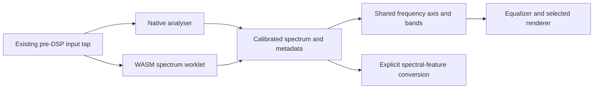

# Calibrate Equalizer Visualizations - Plan

## Goal Capsule

**Objective:** Make all seven Equalizer visualization modes show a readable,
calibrated account of the actual input signal across supported sample rates.

**Means:** One documented analysis contract, shared frequency mapping and corrected
renderer lifecycle (KTD1–KTD4).

**Authority:** The requirements below preserve the confirmed scope;
`ui/DESIGN.md`, `.agents/rules/frontend.md` and the DSP qualification contract
govern implementation and verification.

**Execution profile:** Three dependent units in one change set. The lead owns
integration, local commits and shipping under `AGENTS.md`. Stop for a conflict
with the preserved audio graph or normalization behavior in R6. Routine numeric
and display choices are resolved through the deterministic checks below.

## Product Contract

### Summary

Calibrate the analysis data consumed by Equalizer and its visualization engine,
then make every selectable mode render that data visibly and consistently.
Preserve the existing interface, audio processing and playback behavior.

### Problem Frame

Native analyser bytes encode a logarithmic range, while the Hann-windowed WASM
FFT emits quantized linear magnitudes. Confirmed sine amplitudes 1, 0.1, 0.01
and 0.001 produce WASM values 127, 13, 1 and 0. The shared interface carries no
sample rate, FFT size or scale. Several renderers sample 64 isolated bins from
1024 and reject a global mean below 25, hiding narrowband signals. The Equalizer
response uses a logarithmic 20–80,000 Hz axis while bars use linear indexing.

A live input with RMS 0.130 and a 445.3125 Hz peak still produced blank Enhanced
and Spectrogram views: the 1024-bin payload peaked at byte 12 with 15 nonzero bins.
The 936×192 canvas used 0.2 opacity. Evidence is retained in
`/tmp/visualizer-investigation`.

The Equalizer also selects compact rendering at 0.2 opacity and silently maps
Particles to Enhanced. Async initialization can reinstall an obsolete renderer;
pause can leave old readings, and animation/geometry depend on frame timing and
pixel density. These are calibration and lifecycle defects, not a request to
redesign the Equalizer.

### Requirements

- R1. Native and WASM analysis expose the same documented dB/frequency contract,
  including actual sample rate, FFT size, dB bounds, bin interpretation and
  signal validity.
- R2. Spectrum views and the EQ response share a logarithmic frequency mapping
  bounded by the actual Nyquist limit, with aggregated bands that retain
  narrowband signals rather than skipping bins or applying a global-mean gate.
- R3. All seven selected modes—Spectrum, Meters, Phase, Enhanced, Circular,
  Spectrogram and Particles—remain distinct, visible and readable in every mood.
- R4. Meter labels distinguish amplitude, dBFS, loudness and frequency units;
  estimated values must not imply a measurement they do not perform.
- R5. Switching, resizing, pausing, resuming and teardown cannot revive stale
  renderers or readings; animation time and geometry remain consistent across
  frame intervals and device-pixel ratios.
- R6. Keep analysis on the existing pre-DSP input tap and label it as input
  analysis; preserve normalization, DSP output, playback and existing mode choices.

### Scope Boundaries

Change the analysis contract and its consumers, FFT/worklet outputs, visualization
mapping/lifecycle and Equalizer integration. Rebuild affected shipped artifacts
through the existing DSP workflow. Do not move the analysis tap, redesign audio
routing or UI layout, introduce auto-gain that hides signal levels, or add modes.
Changing presentation units does not authorize changing normalization behavior.

## Planning Contract

### Key Technical Decisions

- KTD1. Encode display spectrum bytes over −100 to 0 dB with `sampleRate`,
  `fftSize`, `minDecibels` and `maxDecibels` metadata. Match Web Audio's periodic
  Blackman window and 1/N FFT scaling, with native analyser smoothing set to zero.
  Label this windowed input-spectrum magnitude: a full-scale bin-centred sine
  peaks near −13.56 dB, not 0 dBFS. Add a display-specific FFT export sharing
  internals; preserve the existing linear `process_spectrum` API and its DFT
  tests. Governs R1 and R6.
- KTD2. Use one pure logarithmic-axis and peak-band helper for spectrum
  consumers and EQ-overlay placement, from 20 Hz to the lower of 20 kHz and
  Nyquist. Take the peak magnitude among covered bins so narrow tones remain
  visible; exclude DC and out-of-range bins and never average encoded dB bytes.
  Define empty low-frequency bands explicitly when FFT resolution cannot resolve
  them. Governs R2.
- KTD3. Decode display dB values to linear floats for a new float-input
  `spectral_features` entrypoint; do not feed or sum encoded dB bytes as
  magnitudes. Keep RMS and normalization inputs intact. Label channel meters as
  RMS dBFS after converting their current 0–100 RMS percentage. Expose loudness
  availability and show unavailable when only the fallback RMS estimate exists,
  rather than labeling that estimate LUFS. Label the tap as input analysis and
  the EQ overlay as configured response, not measured post-EQ output.
  Keep the native spectrum's mono downmix, including cancellation of opposite-phase
  channels; phase and stereo meters remain independent. Governs R4 and R6.
- KTD4. Give each host initialization its own ownership token and cleanup path;
  late completion destroys its resources instead of becoming current. Clear or
  decay readings according to the documented inactive state, using elapsed time
  rather than per-frame constants. Treat CSS dimensions and backing pixels
  consistently during resize. Governs R5.
- KTD5. Render the actual selected mode at full Equalizer visibility, preserving
  the compact substitution only for genuinely compact callers. Use existing theme
  roles for readable traces, labels and meters. Governs R3 and R6.

### Data Flow

### Grounding and Risks

`audio-processor.ts` owns the analysis result and native fallback;
`packages/dsp/fft2048/` owns WASM magnitude generation and the worklet message.
`EqualizerAnalyzer.tsx` duplicates spectrum mapping and requests compact engine
rendering. `VisualizerHost.tsx` assigns async results without checking ownership.
Existing loop, spectral, lifecycle and DSP reference tests are the starting points.

Windowing and smoothing differ between analysis paths, so calibration must compare
known signals after settling and distinguish bin-centred from off-bin tones.
Reference tolerances must follow the declared window and quantization error, not
be widened to hide scale differences. An analysis-message change must update every
reader and all shipped worklet/WASM copies together. Particle/WebGL cleanup must
also cover rejected initialization and rapid mode replacement.

The [Web Audio analyser specification](https://www.w3.org/TR/webaudio-1.1/#fft-windowing-and-smoothing-over-time)
documents the native windowing, smoothing and dB conversion that calibration must
account for. The existing `packages/dsp/README.md` and
`scripts/test-dsp-analysis.sh` define reproducibility and artifact parity checks.

## Implementation Units

### U1. Define and calibrate the analysis contract

**Goal:** Establish R1, R4 and R6 through KTD1 and KTD3 before changing renderers.

**Dependencies:** None; retain the existing audio graph and analysis tap.

**Files:** `ui/web/src/features/player/services/audio-processor.ts`,
`wasm-types.ts` in that directory, `packages/dsp/fft2048/fft2048.cpp`,
`wasm-spectrum.js`, `wasm-spectrum.d.ts` and `README.md` in that package,
`packages/dsp/spectral_features/` and its affected declarations/adapters,
`packages/dsp/tests/fft-reference.test.mjs`, new
`packages/dsp/tests/display-spectrum.test.mjs`,
`packages/dsp/tests/spectrum-worklet.test.mjs`,
`ui/web/tests/features/player/services/audio-processor-spectral.test.ts` and
`audio-processor-lifecycle.test.ts`, plus affected generated DSP/worklet copies.
Preserve the existing linear FFT entrypoint and tests while adding the display
contract and float-input spectral-feature coverage.

**Approach:** Document the numeric contract before adapting both producers and
all consumers. Preserve independent level data used by normalization and meters.
Rebuild artifacts with the pinned toolchain rather than hand-editing binaries.

**Test scenarios:**

1. Actual WASM and native analysis of amplitudes 1, 0.1, 0.01 and 0.001 retain
   the expected 20 dB separation at 44.1 and 48 kHz; the full-scale bin-centred
   reference peaks near −13.56 dB and silence maps to the −100 dB floor.
2. Bin-centred and off-bin tones at low, middle and near-Nyquist frequencies
   have the expected frequency and level within justified numeric tolerances.
3. Ready, unavailable, paused, resumed and destroyed states carry correct
   metadata and no stale signal; malformed worklet payloads cannot enter the contract.
4. Existing linear FFT/DFT, stereo, RMS and normalization regressions retain
   their meaning without moving the tap or changing output audio. Float-input
   spectral features and unavailable-versus-measured loudness are explicit tests.

**Verification:** Numeric tests use actual WASM and native analysis, not two
implementations sharing the same expected-value helper. DSP rebuild/parity gates
and focused frontend service tests pass.

### U2. Unify render mapping and renderer ownership

**Goal:** Implement R2, R3 and R5 through KTD2, KTD4 and KTD5.

**Dependencies:** U1's analysis contract.

**Files:** `ui/web/src/features/visualizer/types.ts`,
`components/VisualizerHost.tsx`, `hooks/use-visualizer-loop.ts`, `renderers/`,
`register-visualizer-renderers.ts` and a shared spectrum helper under `utils/`;
new `utils/__tests__/spectrum.test.ts` and
`components/__tests__/VisualizerHost.test.tsx`, plus existing
`hooks/__tests__/use-visualizer-loop.test.tsx` in that feature.

**Approach:** Migrate every renderer to the common analysis and axis contract.
Remove narrowband blanking, preserve each mode's identity, and make ownership,
reset, elapsed-time smoothing and pixel scaling explicit.

**Test scenarios:**

1. Narrowband tones between formerly sampled bins remain visible; shared bands
   and axis positions agree at 44.1/48 kHz and end at the lower of 20 kHz and Nyquist.
2. Silence/pause clears or predictably decays current readings without presenting
   old values as live; resume starts from fresh signal data.
3. Deferred initialization resolving or rejecting after switch/unmount never
   replaces the current renderer; owned resources are destroyed once.
4. Equal elapsed time at different frame intervals gives equivalent decay/motion;
   DPR 1 and 2 retain equivalent CSS geometry and frequency placement.

**Verification:** Helper and lifecycle tests pass, all renderer consumers use the
contract, and no Equalizer mode silently resolves to another mode.

### U3. Integrate Equalizer and verify the seven modes

**Goal:** Deliver R1–R6 in the real Equalizer without changing its overall layout.

**Dependencies:** U1–U2.

**Files:** `ui/web/src/features/equalizer/components/EqualizerAnalyzer.tsx`,
`AudioSystemPanel.tsx` in that directory,
`ui/web/tests/features/equalizer/components/EqualizerAnalyzer-phase.test.tsx`,
new `ui/web/tests/e2e/styling/visualizer-calibration.spec.ts` for the authenticated
UI, `ui/web/tests/e2e/audio-graph/native-spectrum-calibration.spec.ts` for offline
native/WASM comparisons, and their local fixtures, `ui/web/tests/e2e/audio-graph/README.md`,
`docs-book/part-2-developer-guide/testing.md` and `ROADMAP.md`.

**Approach:** Align overlay and bars, expose actual selected renderers and clear
input/measurement labels, then qualify the integrated output with known local
signals. Use the disposable audio-graph harness for native comparisons and the
isolated preview's real login/catalog fixture for UI checks; keep system output
muted.

**Test scenarios:**

1. Every selectable mode renders a known signal visibly across all four moods;
   Particles exercises its actual renderer. Spectrum peaks and overlay markers
   agree on the shared frequency axis.
2. At 44.1/48 kHz, known low/mid/high tones and low amplitudes reach the expected
   display region; quiet single tones do not disappear behind a global gate.
3. Pause/resume, repeated mode switches, resize and DPR changes preserve current
   ownership and remove stale readings, with no page errors or leaked loops.
4. Meter/analysis labels match actual units and input-tap provenance. Existing
   normalization and playback checks remain green.

**Verification:** Actual native/WASM signal and browser output evidence pass;
screenshots are visually reviewed and paired with numeric/state assertions.

## Verification Contract

Run `scripts/test-dsp-analysis.sh` with its pinned Emscripten 6.0.3 toolchain,
including actual WASM reference tests, two-build reproducibility and shipped-copy
parity. The host's default Emscripten cache is unwritable; use the verified
`EM_CACHE=/tmp/baander-visualizer-emcache` for that gate. Run affected frontend helper, processor, renderer and Equalizer tests;
then CI-image lint, both TypeScript configurations, production build and asset
verification. Keep existing normalization/audio-graph regression checks in scope.

Run the known-signal browser tests headlessly against disposable local fixtures,
with system output muted and no production traffic. Exercise native fallback and
WASM paths; record any unavailable browser prerequisites as gaps. Review all seven
modes under each mood, plus pause/switch/resize behavior. The browser fixture may
control its signal and select a backend but must not fabricate analysis results.

Apply the required simplification, independent code review, documentation prose
audits and whitespace check. Record actual counts, artifact parity, numeric
error/tolerances, browser versions and remaining limits in `ROADMAP.md`.

## Definition of Done

All seven modes display calibrated live input data under R1–R6. Actual-signal
numeric and browser checks pass, generated artifacts match source, and the
preserved DSP/output/normalization behavior remains verified. No unresolved
review finding or undisclosed verification gap remains. Physical loudspeaker
calibration, hardware frequency response and new post-DSP analysis are outside
this delivery.
