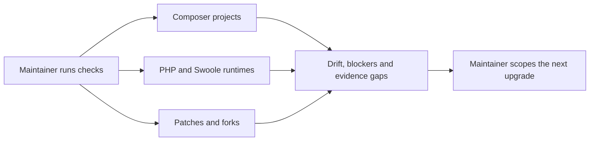
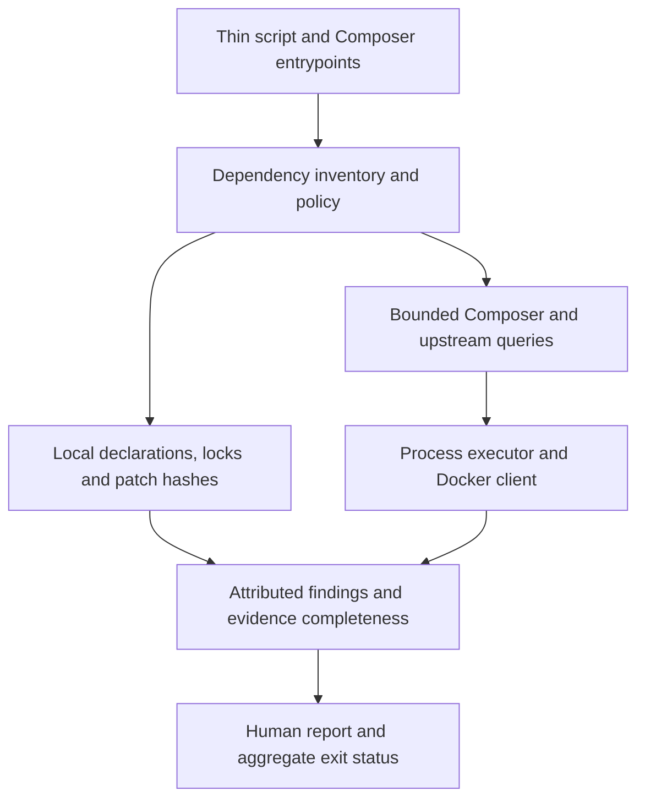
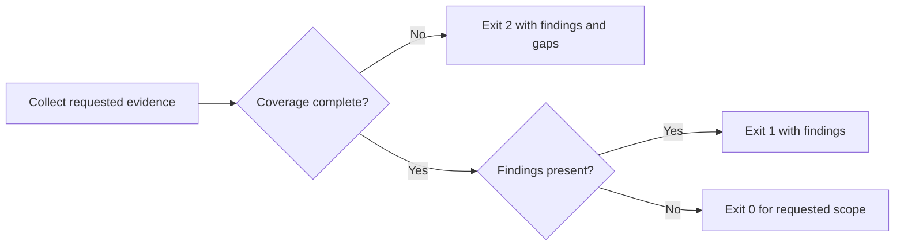

# PHP Dependency and Runtime Refresh - Plan

## Goal Capsule

**Objective:** Baander runs on a current, tested PHP stack, and maintainers can identify dependency drift and obsolete local fixes through repeatable checks.

**Means:** A coordinated runtime and Composer refresh with selective fork reconciliation and standalone maintenance checks (KTD1–KTD5).

**Product authority:** The user confirmed the scope below, including the runtime floor and maintenance approach recorded in Key Decisions.

**Authority:** The Product Contract governs scope; the Planning Contract governs implementation within it. Project instructions govern execution and publication.

**Execution profile:** Deep software work delivered as one reviewable change, with six dependency-ordered local implementation units. Work uses a plan-named branch; pushing and merging require the user's instruction.

**Completion owner:** The implementing lead integrates the units, records actual verification in `ROADMAP.md`, and completes simplification and code review before requesting publication.

**Stop conditions:** Stop affected work if a required local behavior cannot survive the upgrade, a required source cannot be verified, or qualification would require resetting local data. Record the blocker rather than weakening a regression or silently changing scope.

**Open blockers:** None prevents starting implementation. Solver results, clean patch application and native compatibility remain execution-time checks.

---

## Product Contract

### Summary

Refresh Baander's PHP dependencies, Docker runtimes, patches and dependency forks as one tested change.
Provide repeatable checks that let maintainers assess the next upgrade from the same evidence.

### Problem Frame

The application and several qualification recipes still select PHP 8.5.2 and Swoole 6.2.0.
Root Composer requirements constrain core Symfony components to 8.0, while selected dependencies use development branches or local forks.
These surfaces can drift independently, so a successful lockfile update alone does not establish runtime compatibility.

Two Composer patches change PHP/ZTS initialization and delayed-message recovery.
The local Swoole bundle also carries runtime behavior that a replacement could lose.
Neither patch obsolescence nor the bundle's exact upstream baseline has been established.

### Key Decisions

- **Use the available stable PHP release as the floor.** Governs R3. (session-settled: user-directed — chosen over strictly newer than 8.5.12: the user accepted 8.5.12 or newer stable, allowing the current release.)
- **Deliver repeatable maintenance checks.** Governs R10, R11. (session-settled: user-directed — chosen over scheduled update pull requests: the user selected an upgrade with repeatable checks.)
- **Qualify the stack as one change.** Governs R1, R4, R6, R7, R8. The confirmed scope couples dependency resolution with runtime and fork behavior; updating version declarations alone cannot establish acceptance.

### Requirements

**Dependency coverage**

- R1. Upgrade production and development dependencies across every repository-owned Composer project, including constraint changes and consumer fixes needed for current stable releases.
- R2. Record a concrete blocker for each dependency that remains behind its current stable release or requires a development branch or fork.

**PHP and Swoole runtimes**

- R3. Every repository-owned Docker PHP runtime, including source-built runtimes, must use PHP 8.5.12 or newer stable.
- R4. Every runtime that includes Swoole must use its latest stable release available when upgrade targets are selected.
- R5. Runtime declarations, Composer platform assumptions, extension stubs, build checksums and documented prerequisites must agree with the selected stack or state a verified compatibility reason for a difference.

**Patches and forks**

- R6. Audit every applied dependency patch and fork against upstream, recording whether it is removed as superseded or retained with its reason and regression evidence.
- R7. Reconcile applicable upstream Swoole bundle changes while preserving Baander's coroutine pooling, shutdown and drain behavior, WebSocket authentication, and streaming interruption behavior.

**Qualification**

- R8. Rebuilt runtimes and clean dependency installations must pass the affected authoritative CI gates and runtime checks, including native and FFI integration where affected.
- R9. Assess security advisories for each resolved Composer dependency set and record unresolved findings with their applicability and blocker.

**Ongoing maintenance**

- R10. Provide documented, repeatable checks covering all Composer projects, stable dependency and runtime releases, security advisories, and patch/fork upstream status.
- R11. Maintenance checks must identify actionable drift and distinguish failed or unavailable evidence from a clean result without modifying dependencies or creating update pull requests.

### Key Flow

- F1. **Covers R10, R11.** A maintainer runs the documented checks against the checkout, receives findings attributed to the affected Composer project, runtime or local fix, and uses those findings to scope an upgrade; an unavailable upstream source is reported as incomplete evidence.

### Acceptance Examples

- AE1. **Covers R1, R2.** A dependency's newest stable release falls outside the existing constraint: acceptance requires a compatible upgrade and consumer fixes, or a recorded blocker; updating only within the old constraint is insufficient.
- AE2. **Covers R3, R4, R5, R8.** The application image is updated but a qualification image still selects an older PHP or Swoole release: acceptance remains open until the runtime declarations and affected qualification agree.
- AE3. **Covers R6, R8.** An upstream release claims to fix delayed-message recovery: the local patch is removed only when the relevant regression check passes on the unpatched dependency.
- AE4. **Covers R6, R7, R8.** An upstream Swoole bundle change overlaps a local fix: reconciliation retains the required behavior, with tests proving the resulting implementation rather than assuming upstream equivalence.
- AE5. **Covers R9, R10, R11.** A maintenance run finds an advisory or cannot reach an upstream source: its result identifies the finding or evidence gap and does not report the stack as clean.

### Scope Boundaries

The scope includes root, development tooling, registry tooling and local package Composer manifests and locks, plus Docker recipes and helpers that provide their PHP runtimes.
New maintenance tooling follows the project's PHP-first, Bash-secondary conventions.

Scheduled update PRs, unrelated JavaScript dependency upgrades, and wholesale replacement of the Swoole bundle without comparison are outside this change.
The Docker runtime floor does not by itself raise the existing host assumption of PHP 8.5+ with Swoole; a stricter host requirement needs a demonstrated compatibility reason under R5.
Existing local instance data remains protected.

### Outstanding Questions

Planning decisions and execution-time evidence are separated below:

- Target selection and dependency boundaries follow KTD1; exact solver results remain deferred to implementation in U4.
- Bundle comparison uses KTD3; historical ancestry remains unknown and is not a prerequisite for a documented comparison against a verified upstream commit.
- Patch disposition follows KTD2; clean application and native/FFI compatibility remain deferred to U2–U4.
- Maintenance ownership and qualification follow KTD4–KTD6 and the Verification Contract.

### Sources / Research

Repository evidence was checked on 2026-10-31 against `61d0b1c8585a9a463b766d0f763d3ab9c0eb67b6`.
No dependency update or runtime qualification has run for this work.

| Surface | Evidence and planning implication |
| --- | --- |
| Composer projects | `composer.json`, `scripts/composer.json`, `relay/composer.json` and `packages/tsduck-php-ffi/composer.json` have corresponding locks; additional local package manifests also participate in dependency resolution. Root PHP requires `>=8.5`, while `config.platform.ext-swoole` is exactly `6.2.0`. |
| Dependency patches | `patches/swoole-bundle-z-engine-php85-zts-init.patch` and `patches/symfony-redis-messenger-recoverable-delays.patch` match their hashes in `patches.lock.json`; that check does not prove applicability or upstream inclusion. |
| Runtime builds | `Dockerfile`, `docker/runner/Dockerfile`, `docker/nginx/Dockerfile.test`, `relay/docker/build-tooling-php.sh` and `relay/docker/build-qualification-php.sh` expose PHP or Swoole selections that need reconciliation. |
| Bundle fork | `packages/swoole-bundle` is consumed as a local path repository; its Composer path reference does not identify an upstream commit. `CoWrapper`, `WithWebSocketHandler`, `WithServerBeforeShutdownHandler` and `InFlightStreams` are relevant behavior owners. |
| Existing checks | `Makefile` offers manual Composer updates; `.forgejo/workflows/ci.yaml` checks platform requirements. A bounded repository search found no scheduled dependency-update PR configuration; remotely configured automation was not inspected. |

Primary upstream research on 2026-10-31 found PHP [8.5.12](https://www.php.net/releases/8_5_12.php), Swoole [6.2.4](https://pecl.php.net/package/swoole), Symfony [8.1.10](https://symfony.com/releases), and Swoole bundle [v0.35.6](https://github.com/symfony-swoole/swoole-bundle/releases/tag/v0.35.6) as current stable releases.
Symfony's release page lists 8.0 as unmaintained.
These are research observations; target selection must recheck releases and image availability.

Upstream bundle comparison candidates include [first-time mutex ownership](https://github.com/symfony-swoole/swoole-bundle/commit/82f584963cc9ccff4228e669b7ce9cf4784f26a1), [PDO reconnect handling](https://github.com/symfony-swoole/swoole-bundle/commit/e83478605c77d94fe267c1c89b747f189377a901), and [worker recycling](https://github.com/symfony-swoole/swoole-bundle/commit/3541674f04d6cfa3c2c5c10d6649986dfd69f2a8).
Their presence upstream does not establish that Baander uses the affected subsystem.

Relevant existing regression lessons are recorded in `docs/solutions/runtime-errors/swoole-sigterm-waits-for-master-timers-and-closes-connections-before-workers-stop.md`, `docs/solutions/runtime-errors/swoole-table-default-conflict-proportion-drops-keys.md` and `docs/solutions/runtime-errors/swoole-callbacks-outside-the-bundle-leak-pooled-services.md`.

---

## Planning Contract

**Product Contract preservation:** Requirements R1–R11, F1, AE1–AE5 and scope decisions are unchanged. Outstanding Questions now point to their planning decisions and execution-time checks.

### Key Technical Decisions

- KTD1. **Select explicit stable targets and resolve each Composer boundary.** Governs R1–R5, R9. Initial candidates are PHP 8.5.12, Swoole 6.2.4 and Symfony 8.1.10; recheck availability at selection, then pin the chosen versions and source hashes for qualification. Move the Symfony component cohort and Flex constraint together. Root, `scripts/`, `relay/` and TSDuck retain their independent locks; local package manifests are classified separately and their development requirements receive explicit validation. First-party packages have no public stable-release comparison, while forks do. A newer stable release excluded by a constraint, platform or canonical path repository remains a finding. This avoids mistaking a successful update within old constraints for currency. Sources: [Symfony lifecycle](https://symfony.com/releases), [Composer path repositories](https://getcomposer.org/doc/05-repositories.md#path), [aliases](https://getcomposer.org/doc/articles/aliases.md).

- KTD2. **Retain required patch behavior while reducing unsupported branch selections.** Governs R1, R2, R6, R8. Prefer the real z-engine 8.5.2 release over its development alias, retaining the ZTS initialization patch: [upstream Core.php](https://github.com/symfony-swoole/z-engine/blob/8.5.2/src/Core.php) still rejects thread-safe PHP. Rebase the Redis patch on [Symfony 8.1 recovery](https://github.com/symfony/redis-messenger/blob/v8.1.10/Transport/Connection.php), preserving bounded promotion, malformed-member retention and recoverable at-least-once delivery. Do not introduce an exactly-once guarantee. Retain the existing reflection fork commit unless a complete caller/registration trace proves it unnecessary; its [accessibility fix](https://github.com/Rastusik/swoole-reflection/commit/5e318ae5d92f4c7b7eae8f2525446551db9495d5) is absent from canonical stable 3.2.0. Each final deviation gets an upstream reference, rationale and owning proof. Patch definition changes require consistent patch locks and clean installation; maintenance checks never relock or repatch. Source: [Composer Patches workflows](https://docs.cweagans.net/composer-patches/usage/recommended-workflows/).

- KTD3. **Reconcile the bundle by reviewed differences against an explicit comparison baseline.** Governs R6–R8. Use upstream v0.35.6 at `81f35b1fac4f7df2a173b6ae83a194e2ad6d8047` as the initial comparison reference, checking for newer changes before execution. Record the local source snapshot separately; do not claim the comparison reference is the historical fork point. Review changed, local-only and upstream-only files, recording adoption, local equivalence or inapplicability. Prioritize mutex ownership, pooling, connection finalization and generated-container compatibility. The upstream command-worker and PDO-session subsystems are not imported merely because they exist. The observed source divergence and local authentication/drain changes make wholesale replacement an unjustified default.

- KTD4. **Keep maintenance checks in the standalone tooling package.** Governs R10, R11 and F1. A thin `scripts/check-php-dependencies.php` entrypoint delegates to `Baander\Tooling\Dependencies`; Composer exposes online and local-only checks. Reuse the standalone Composer loader, resolved tooling configuration, `CommandExecutor`/`EngineExecutor`, literal argument vectors and finite process budgets. Docker metadata access goes through `Docker\Client`; image and layout configuration remain under their existing owners. Add no raw process calls, application kernel dependency or hand-written loader. The command describes findings; it does not install, update, alter source, apply patches or publish PRs.

- KTD5. **Separate inventory, findings and evidence completeness.** Governs R2, R5, R6, R9–R11. A checked-in dependency policy records project classification, runtime declaration locations, reviewed upstream references and justified deviations; it does not duplicate version pins owned by recipes or Composer locks. Discovery rejects unclassified repository-owned manifests rather than silently overlooking newly added projects. Results identify whether they concern constraints, locks, installed metadata or a built runtime. Return 0 for a complete clean requested check, 1 for findings, and 2 when requested evidence is incomplete; preserve findings alongside incompleteness. Local-only output explicitly excludes online currency and advisories. Online checks use supported Composer JSON interfaces with plugins and scripts disabled, fresh metadata, and bounded source requests. Parse evidence and stderr as well as exit status; stale-cache fallback, malformed responses, unsupported tool versions and unavailable sources are incomplete. Compare stable upstream releases independently of Composer's platform-filtered candidates. A changed upstream reference requests a patch/fork review; it never proves obsolescence automatically. Sources: [Composer CLI](https://getcomposer.org/doc/03-cli.md), [audit implementation](https://github.com/composer/composer/blob/main/src/Composer/Command/AuditCommand.php), [cached repository fallback](https://github.com/composer/composer/blob/2.8.12/src/Composer/Repository/ComposerRepository.php).

- KTD6. **Qualify the actual rebuilt stack and fail required probes that skip.** Governs R3–R9. Preserve purpose-specific ZTS/NTS modes, extension capabilities, FFI settings and worker file-I/O constraints. Keep existing image build owners and exact archive/checksum pairs. Test lock consistency, clean patch application and runtime behavior as separate claims. Add explicit ZTS/bootstrap and TSDuck qualification because root PHPUnit discovery does not cover the whole TSDuck package and existing native tests can skip missing prerequisites. Deterministic local metadata checks join normal CI; online currency checks remain on demand so an upstream outage does not block unrelated CI runs. The upgraded stack still receives one real online assessment before completion.

### High-Level Technical Design

The maintenance command has one inventory and two evidence paths under KTD4–KTD5.
The policy supplies classification and provenance; declarations remain the source of installed and selected versions.

The result decision preserves useful findings even when another source fails.

### Sequencing and Shared Ownership

U1 establishes the comparison record and regression owners. U2 updates the native substrate. U3 reconciles the bundle, and U4 completes Composer upgrades and consumer adaptations. U5 builds the maintenance checks from the resulting inventory. U6 integrates and qualifies the whole change.
The lead owns shared Composer manifests/locks, patch metadata, Docker recipes and CI edits so parallel exploration cannot overwrite dependency resolutions.
Workers can independently compare upstream code, implement isolated regression tests and review tooling, but dependency mutations and expensive qualification run serially.

### System-Wide Impact and Risks

Symfony changes affect authentication, serialization, console output, Messenger routing and compiled service containers even when application source needs little adaptation.
Swoole changes affect web workers, task execution, shared tables, live-update sockets, connection cleanup and media transfer interruption.
Required probes therefore include real container and network boundaries rather than only mocked unit behavior.

The root installed-lock validator checks metadata, not patched bytes or sibling projects. U4 uses clean installations to close that gap.
The PHP/ZTS patch reads runtime globals through FFI; a successful patch application cannot establish ABI compatibility. U2 and U6 own that proof.
The Redis upstream algorithm has changed, so tests that inject failure into the old mechanism may need new fixtures; their recovery, timing, bounds and payload assertions remain intact.

No new scheduler, automatic repair, retries without a fixed bound, generic Dockerfile parser or package mirror is planned. The finite repository inventory and explicit incomplete results satisfy this maintenance scope; broader automation would need a separate demonstrated use case.
Host setup retains its existing PHP 8.5+ baseline unless actual dependency compatibility requires more under R5.

### Deferred Execution Evidence

- Composer's final stable selections and advisory state are established by U4's resolution and assessment, with concrete blockers for exceptions.
- Patch applicability and native behavior are established by clean builds and the named proofs; research does not certify them.
- Historical bundle ancestry may remain unknown. U1 must still record a reproducible local/upstream comparison and account for the reviewed differences.
- Each required image variant and architecture must be retrievable and buildable. Missing upstream artifacts block that target rather than causing an unrecorded variant change.

---

## Implementation Units

### U1. Record dependency ownership and preserve regression contracts

**Goal:** Give every Composer project, runtime declaration, patch and fork an explicit owner and qualification path.

**Requirements:** R1, R2, R5–R8; AE1, AE3, AE4. **Dependencies:** None.

**Files:** Create `packages/baander-tooling/resources/php-dependencies.json`; update `patches/README.md` and `packages/swoole-bundle/README.md`; inspect all repository-owned `composer.json` files. Regression owners include `tests/Integration/MessengerDelayedPromotionTest.php`, `tests/Unit/Shared/Infrastructure/Swoole/GeneratedContainerLoadTest.php`, `CoWrapperSchedulingTest.php` in the same directory, and `tests/Unit/Shared/Infrastructure/Http/StreamedResponseProcessorTest.php`.

**Approach:** Under KTD1–KTD3, classify independent locks, local packages and fixture exclusions. Record exact upstream URLs/revisions, local content identity and patch proofs in the policy. Compare every bundle source difference, including imported code whose historical ancestry cannot be reconstructed. Trace reflection usage and dynamic registration before deciding whether it can be removed. Retain stable requirement IDs only in planning artifacts, never in source tests or comments.

**Patterns to follow:** Existing patch documentation distinguishes at-least-once recovery from exactly-once delivery; `Inventory\ApplicationInventory` distinguishes packaged evidence from release currency.

**Test scenarios:**

- Covers AE3. Delayed delivery remains recoverable after failed insertion and interrupted removal, retains malformed members, respects future due times and the poll bound, and preserves serialized payloads.
- Covers AE4. Coroutine failure and failed scheduling release only acquired services; streamed-response interruption remains an error rather than successful truncation.

**Execution note:** Establish current regression behavior before changing the corresponding upstream implementation; add characterization only where existing proofs leave a material gap.

**Verification:** All discovered manifests and local modifications have classifications, evidence owners and explicit unknowns; current named regressions establish the baseline.

### U2. Upgrade and qualify PHP and Swoole runtime recipes

**Goal:** Build the selected PHP/Swoole substrate across application, tooling and qualification images.

**Requirements:** R3–R5, R8; AE2. **Dependencies:** U1.

**Files:** `Dockerfile`, `docker/runner/Dockerfile`, `docker/nginx/Dockerfile.test`, `relay/docker/build-tooling-php.sh`, `relay/docker/build-qualification-php.sh`, their consuming Dockerfiles/workflows, and build-evidence inputs. Add `tests/Unit/Shared/Infrastructure/Swoole/ZEngineBootstrapRuntimeTest.php` and its native-lane assignment in `scripts/backend-native-tests.json`. Existing proofs: `scripts/tests/php/ApplicationBuildContractTest.php`, `RetainBuildEvidenceTest.php` in the same directory, and `tests/Unit/Shared/Infrastructure/Swoole/GeneratedContainerLoadTest.php`.

**Approach:** Apply KTD1 and KTD6 to version/tag/archive/checksum selections. Preserve each build's mode and capabilities. Use the owning application build entrypoint and existing image layout contract. Update source evidence with the selected archives. Coordinate Composer extension/stub changes with U4; intermediate native-build verification is not complete-stack acceptance.

**Patterns to follow:** `Build\ApplicationImage`, `Fixtures\Worker\Production`, retained native build evidence, and the backend native lane.

**Test scenarios:**

- Covers AE2. Each selected image reports its intended PHP/Swoole versions, thread mode and required extensions; source-built images agree with their archive evidence.
- The real ZTS image initializes z-engine, performs the reflection operations used by the generated container, and boots the compiled application container without a crash or typed-static initialization error.
- A missing FFI prerequisite or incompatible native symbol fails the required bootstrap proof rather than skipping it.
- The production worker's coroutine file probe succeeds under its existing seccomp/backend settings.

**Verification:** Relevant image stages build with verified source identity and pass their native substrate probes; version strings alone do not close R8.

### U3. Reconcile upstream bundle behavior with the local fork

**Goal:** Adopt applicable upstream fixes without losing Baander's runtime ownership and security behavior.

**Requirements:** R2, R6–R8; AE4. **Dependencies:** U1, U2.

**Files:** `packages/swoole-bundle/src/Component/Locking/FirstTimeOnly/FirstTimeOnlyMutex.php`, affected files under `packages/swoole-bundle/src/Bridge/Symfony/Container/` and `Server/Configurator/`, `packages/swoole-bundle/README.md`, and the U1 policy. Add `tests/Unit/Shared/Infrastructure/Swoole/FirstTimeOnlyMutexRuntimeTest.php` if existing coverage cannot establish owner-only release; update `scripts/backend-native-tests.json`. Existing proof paths include `tests/Unit/Shared/Infrastructure/Swoole/DBAL/TransactionFinalizingDBALAliveKeeperTest.php`, `Drain/WithServerBeforeShutdownHandlerTest.php` and `WithWebSocketHandlerHandshakeTest.php` under that Swoole directory, plus `tests/Integration/LiveUpdates/LiveRuntimeProbeTest.php`.

**Approach:** Follow KTD3's difference inventory. Reconcile mutex ownership and applicable pooling/container fixes, then record disposition of upstream-only features. Keep exactly one shutdown callback owner and retain proof-bound handshake handling. Update the policy against the resulting local snapshot rather than reusing the old path-package reference as provenance.

**Patterns to follow:** `CoWrapper`, `InFlightStreams`, local handshake tests, and the recorded pool-release and shutdown lessons.

**Test scenarios:**

- Concurrent first-time callers do not release another coroutine's mutex or strand a waiter; failure paths preserve the intended initialization behavior.
- Pool cleanup and transaction finalization remain correct on success, exception, reload and drain.
- Covers AE4. Invalid Origin/ticket inputs remain rejected, valid handshakes retain their principal identity, and live-update delivery/reconciliation still works across workers.
- Drain interrupts ongoing media with failure semantics and releases its ownership; completed transfers remain complete.

**Verification:** Every compared change has a disposition and every adopted behavior passes its owning regression on the new runtime.

### U4. Upgrade Composer resolutions and adapt consumers

**Goal:** Resolve current stable dependencies across all Composer boundaries and reconcile remaining local fixes.

**Requirements:** R1, R2, R5, R6, R8, R9; AE1, AE3, AE4. **Dependencies:** U1–U3.

**Files:** All inventoried Composer manifests and locks, `patches.lock.json`, affected files in `patches/`, `symfony.lock` only when reviewed recipe changes require it, and affected `src/` or `config/` consumers. Proofs include `tests/Integration/MessengerDelayedPromotionTest.php`, `tests/Unit/Shared/Infrastructure/Messenger/JobMonitorAdministrationTest.php`, `SwooleFallbackHandlerRegistrationTest.php` in the same directory, `tests/Functional/CoverBatchRoutingTest.php`, and the U2/U3 native proofs. Add `packages/tsduck-php-ffi/phpunit.xml.dist` and adjust the package's existing `tests/` only as needed for the selected test tooling.

**Approach:** Apply KTD1–KTD2 with dependency resolution on the new runtime. Upgrade the Symfony cohort/Flex pin and test tools together with consumer changes. Review package-manifest development dependencies separately from root consumers; use disposable installs for manifest-only packages rather than adding unnecessary library locks. Regenerate patch metadata during the authorized update, then clean-install all independent projects with their intended plugin/script policies. Capture advisory results and concrete remaining blockers.

**Patterns to follow:** Existing Composer path repositories and standalone no-plugin installs; root patch application; project architecture rules for any consumer adaptations.

**Test scenarios:**

- Covers AE1. A stable release outside the prior constraint is selected and tested, or its concrete compatibility blocker is recorded with the rejected version.
- Covers AE3. A clean install applies each retained patch; a removed patch is absent from definitions, patch lock and the fresh vendor tree, and its unpatched behavioral proof passes.
- Compiled Messenger wiring still selects the routed inline handler and the no-Swoole fallback; real logging keeps machine-readable console output parseable.
- Each independent project installs from its lock without unintended lock drift, including production `--no-dev` boundaries and development tools.
- TSDuck tests run with their own autoloader and real FFI library; required bootstrap, native-object lifetime and callback tests execute rather than skip.

**Verification:** All inventoried dependencies have a resolved outcome, installed state is reproducible, patch behavior is preserved, and advisory findings are assessed. Record unresolved findings under R2/R9 rather than hiding them through aliases or ignored platform requirements.

### U5. Add repeatable dependency and patch checks

**Goal:** Let maintainers check current dependency state without changing it.

**Requirements:** R2, R5, R6, R9–R11, F1; AE1, AE5. **Dependencies:** U1, U4.

**Files:** Create `packages/baander-tooling/src/Dependencies/` with focused inventory, evidence collection and reporting responsibilities; add `scripts/check-php-dependencies.php`, `scripts/tests/php/PhpDependencyInventoryTest.php`, `PhpDependencyCheckTest.php`, and `PhpDependencyCommandTest.php` in the same test directory. Extend the U1 policy, `composer.json` scripts, `deptrac-tooling.yaml`, package documentation and configuration tests only where the new command needs them.

**Approach:** Implement KTD4–KTD5 through the existing executor seam. Use the canonical process budget for each external operation and one finite workflow budget resolved with existing configuration. Support local-only inspection and online inspection with clearly different reported coverage. Discover owned manifests, validate classifications, inspect exact supported runtime declarations and patch metadata, and collect upstream stable/advisory/reference evidence. Pin or explicitly support the Composer interface used by the parser; unexpected interfaces are incomplete evidence. Sanitize manifest-selecting Composer environment overrides and pass the intended project directory explicitly.

**Patterns to follow:** `Architecture\SourcePolicy`, `Backend\StaticCheck` for metadata comparison only, `Process\CompletionPolicy`, `ToolingConfiguration`, and existing executable-stub tests.

**Test scenarios:**

- A newly added project, manifest-only package, fixture manifest and missing required lock receive the correct classification or an actionable classification failure.
- Missing or stale vendor data does not masquerade as lock evidence; locked development dependencies remain included even after a production-only install.
- Covers AE1. A release hidden by the old constraint, host platform, dev alias or path repository remains visible in the upstream comparison.
- Patch hash mismatch, stale patch-lock entries, missing patch targets and changed upstream references produce attributable findings without applying anything.
- Covers F1 / AE5. Invalid JSON, unsupported Composer version, HTTP failure, rate limiting, stale-cache warning, timeout and cancellation produce incomplete results; successful findings from other sources survive.
- Combined drift and incomplete evidence return the KTD5 aggregate status. A local-only clean result explicitly states that online checks were not performed.
- Executable stubs prove literal arguments, project selection, disabled plugins/scripts, bounded execution and unchanged manifests, locks, patches and installed files. Tests use fixtures, not live upstream services.

**Verification:** The command meets its read-only and completeness contract, passes tooling architecture/format/static gates, and produces an attributable report against the upgraded repository.

### U6. Integrate CI, document maintenance and qualify the complete stack

**Goal:** Demonstrate that the upgrade preserves application behavior and leaves a usable maintenance workflow.

**Requirements:** R1–R11; F1, AE1–AE5. **Dependencies:** U2–U5.

**Files:** `.forgejo/workflows/ci.yaml`, affected registry qualification workflows, package/native runner wiring under `scripts/` and `packages/baander-tooling/src/`, `packages/baander-tooling/README.md`, `docs-book/part-2-developer-guide/testing.md`, `development-environment.md` in the same directory, `docs-book/part-1-operator-guide/upgrading.md`, `patches/README.md`, and `ROADMAP.md`. Existing qualification owners include `scripts/test-web-shutdown-container.php`, the web/security/worker runtime entrypoints and `scripts/test-live-capacity-container.php`; extend their existing tests if wiring changes.

**Approach:** Add deterministic dependency-policy checks and explicit required native/package probes to the appropriate CI lanes under KTD6. Run the complete authoritative gates on rebuilt images, preserving lane isolation and source identity. Perform the online maintenance assessment once after the final lock and patch changes. Document the commands, result meanings, evidence limits, retained fixes and update procedure; preserve historical observations as history.

**Test scenarios:**

- Covers AE2. CI cannot pass with mismatched runtime selections or a required native probe skipped because its library/extension is missing.
- The rebuilt application boots its production container, authenticates HTTP/WebSocket requests, streams media, drains, reloads workers and delivers live updates through existing qualification flows.
- Registry tooling and qualification images exercise their existing workflows with the upgraded PHP runtime.
- Covers F1 / AE5. Documented local and online maintenance commands produce the expected report and status; network-dependent checks are not a new scheduled CI obligation.

**Verification:** The Verification Contract passes on the final tree, with actual image identities, suite counts, static gates, advisory results and remaining justified dependency blockers recorded in `ROADMAP.md`.

---

## Verification Contract

`docs-book/part-2-developer-guide/testing.md` owns runner setup and isolation. Checks use rebuilt application/worker/qualification images; host PHP and historical results do not substitute for them.
Use `scripts/build-application.php` for application images so source and layout metadata are retained.

| Evidence | Required gate |
| --- | --- |
| Composer state | Strict validation, clean lock installs and actual-runtime platform checks for every independent project; separate manifest/dev-dependency validation for local packages; reviewed stable and advisory assessment. |
| Tooling | `composer run-script --timeout=7200 test:tooling`, `composer test:registry-subjects`, `composer analyse:tooling`, `composer check:tooling-format`, `composer check:tooling-architecture`, and the existing reduced tooling-runtime gate. |
| Backend | Full authoritative `scripts/test-backend-container.sh` run with rebuilt image and all ordinary/native/functional/integration lanes; the existing Swoole-disabled Messenger selection; the explicit TSDuck package qualification added by U4/U6. |
| Patch and fork behavior | U1–U4's named Redis, compiled-container, ZTS, mutex, pool, table, handshake and stream proofs. Required native cases must execute; unrelated justified skips remain separately reported. |
| Production runtimes | Existing worker-production, messaging, worker lifecycle/recovery/containment, web-runtime, security-runtime, web-shutdown and WebSocket proxy qualification gates on their updated images. |
| Live updates and media | Existing production live-capacity runner and affected Chromium/Firefox media ownership/browser checks required by CI. Use the worktree preview and explicit `E2E_BASE_URL` for preview-only scenarios. |
| Static and generated contracts | Application PHPStan, Deptrac, PHP formatting, OpenAPI/client drift gates and existing dependent frontend publication checks. Fix genuine incompatibilities rather than expanding baselines to hide them. |
| Build provenance | Docker-context and retained-build-evidence tests, actual runtime identities, selected source archive hashes and reviewed image variants. |
| Maintenance | New local/online commands from U5, fixture-driven failure cases and one real online report after final resolution. |

Run expensive/shared-state qualifications serially and preserve their failure evidence.
Only repeat a passed check after a relevant change or unresolved concern; integration qualification must still identify the final source and image it proves.
No dependency installs, updates, application tests or image builds were performed during planning.

---

## Definition of Done

- Every U-ID meets its Verification field and every R-ID has evidence in the final qualification record.
- All Composer manifests, locks, runtime declarations, patches and forks have an accounted-for outcome; justified blockers remain visible rather than being reported as upgraded.
- Retained fixes have reproducible upstream comparisons and regression owners; removed fixes have clean, unpatched proof.
- Required native/FFI probes execute successfully on the selected runtimes, and the full applicable CI contract passes on the final tree.
- The documented maintenance checks distinguish local consistency, online findings and missing evidence without mutating dependencies.
- Documentation and `ROADMAP.md` describe actual delivered behavior and verification; no historical measurement is relabeled as qualification of the new stack.
- Abandoned experiments, temporary vendor edits and obsolete patch/config entries are removed. Simplification and independent code review are complete, with justified findings applied.
- Local instance data and the persistent checkout are intact; publication occurs only when requested.
