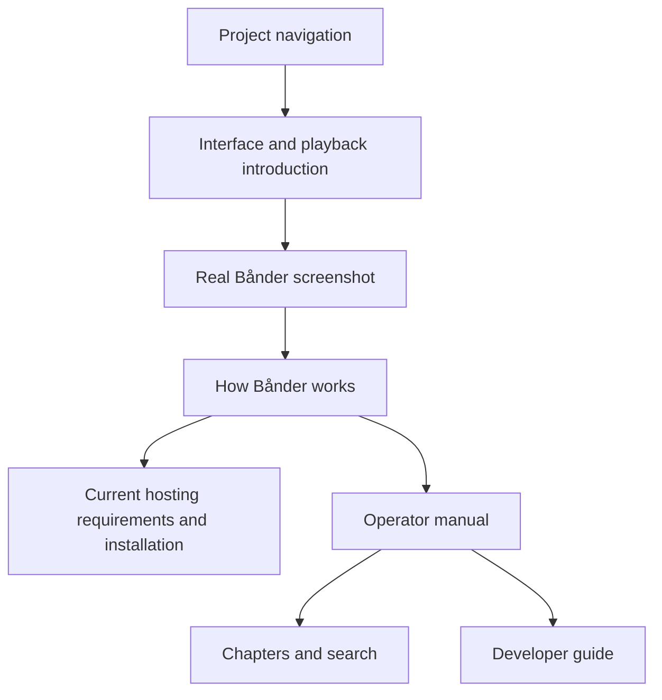
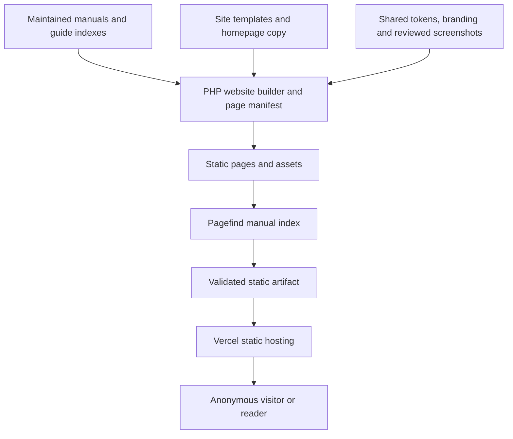
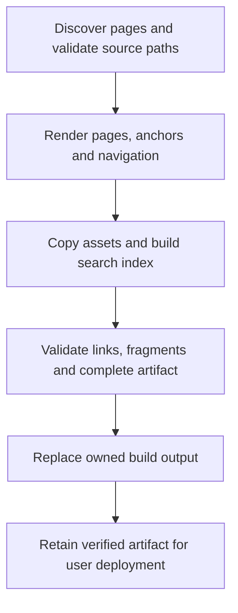
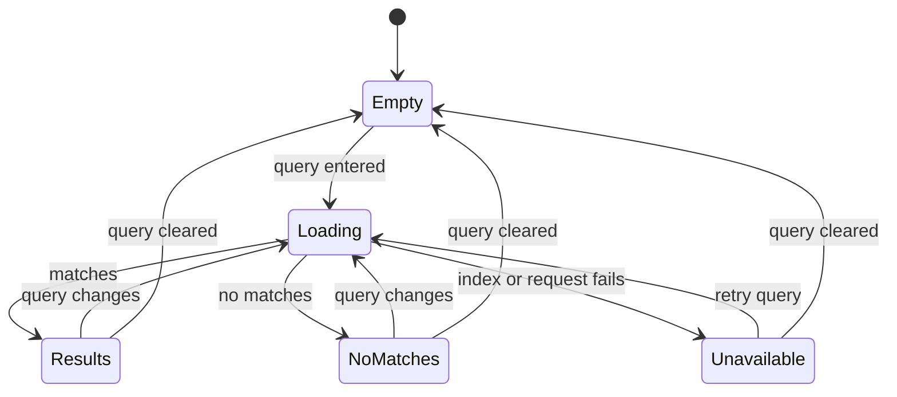

# Public Project Website and Documentation - Plan

## Goal Capsule

**Objective:** Prospective Bånder hosts can assess the media experience, understand what running an instance involves, and find the instructions to install and operate it.

**Means:** A static public website at baander.app, using homepage direction A, the existing manuals and Vercel hosting (KTD1–KTD5).

**Product authority:** The user confirmed the Product Contract below after choosing direction A from three homepage sketches. The intended audience already understands personal media servers; the site presents Bånder on its own merits.

**Execution profile:** Standard plan, one reviewable change with five implementation units. Follow the repository's `ce-work`, local commit and review workflow. The implementer owns the code and verification; the user owns Vercel project access and domain setup. Push and publication require the user's instruction.

**Authority:** Preserve the Product Contract and its stable IDs. Technical choices below implement that contract; they do not expand the application or reopen the confirmed homepage direction.

**Stop conditions:** No blocker prevents implementation. Missing Vercel access blocks live publication only. Stop affected work if it would require changing application behavior, resetting local data or inventing product readiness claims.

---

## Product Contract

### Summary

Create a public home for Bånder that introduces its interface and playback experience, explains how the system works, and connects visitors to installation and operation guidance. Host the operator and developer manuals within the same visual language and maintain their existing content authority.

### Problem Frame

The audience is people interested in running Bånder who already understand personal media servers. They need to judge the experience and operating requirements before investing in setup. Existing project explanations and manuals provide the substance, but repository content alone does not establish a cohesive public introduction and reading experience.

### Key Decisions

- **Direction A: experience first.** Governs R2 and R3. The user chose the interface-led sketch over the collection-led and hosting-explanation-led alternatives; detailed hosting guidance follows the introduction.
- **An independent project identity.** Governs R4. The user rejects competitor references as a way to explain or promote Bånder.
- **The operator manual is the main documentation path.** Governs R5 and R6. The developer guide remains available without becoming the first task for prospective hosts.
- **One maintained manual.** Governs R7. Publishing should make existing guidance easier to read and find without creating another copy to keep synchronized.
- **Carry the design language into a public website.** Governs R9 and R10. The sketch establishes emphasis and order; it does not freeze its provisional copy, illustrations, dimensions or colors.

### Requirements

**Project introduction**

- R1. Visitors can read the project introduction and documentation at baander.app without an application account.
- R2. The homepage leads with Bånder's browsing and playback experience using real interface screenshots, followed by an explanation of how it works and clear paths into hosting guidance and the manual.
- R3. Public explanations distinguish current capabilities, installation requirements and pre-release limitations from future ambitions.
- R4. Public-site content must not name or compare competing media servers, including indirect comparison or migration pitches.

**Hosted documentation**

- R5. The site hosts the existing operator and developer guides, with the operator reading path prominent for prospective hosts.
- R6. Readers can navigate chapters, search the manuals, and open or share direct links to pages and sections within a consistent reading experience.
- R7. The hosted manuals derive from the maintained documentation source, so publishing an updated chapter does not require editing a separate website copy.
- R8. The introduction connects the media experience to the operating model, helping visitors find explanations of the components, storage, background work and the path from files to playback before installation.

**Design and usability**

- R9. The website follows the visual principles and applicable surface, typography, color and interaction rules in `ui/DESIGN.md`, adapting page composition to a public website rather than reproducing the application shell.
- R10. The homepage and documentation remain readable and operable on desktop and mobile, including keyboard navigation, visible focus, accessible screenshots and contained code blocks or tables.

### Key Flows

- F1. **Covers R1–R5, R8–R10.** A prospective host arrives at the homepage, sees the interface and supported experience, reads how the system works, checks the current setup requirements, and follows the operator guide into installation.
- F2. **Covers R1, R5, R6, R10.** A returning reader opens a chapter link or searches for a task, reaches the relevant section, and uses the manual navigation to find related guidance.
- F3. **Covers R3, R7.** A maintainer changes the existing documentation source and publishes the site; the hosted chapter reflects that change without a second content edit.

Homepage composition for F1; labels describe regions rather than final copy:

### Acceptance Examples

- AE1. **Covers R1, R2, R8.** A first-time visitor can understand what Bånder offers from the homepage and reach both an explanation of how it works and the installation guide without signing in.
- AE2. **Covers R3.** While the documented setup remains pre-release and source-based, the hosting path states that status and the required background-worker deployment instead of implying a stable, one-command installation.
- AE3. **Covers R4.** Reviewing the public introduction and hosted documentation finds explanations of Bånder's own behavior, with no competing-server names, comparisons or migration pitches.
- AE4. **Covers R5, R6.** Searching for a documented task such as library scanning leads to its chapter; opening a shared section link reaches the corresponding section, and an unmatched search clearly reports that no results were found.
- AE5. **Covers R3, R7.** After a maintained chapter is updated and the site is republished, its hosted content reflects the update without a separate website edit.
- AE6. **Covers R9, R10.** Desktop and narrow mobile views preserve the homepage hierarchy and readable manual content; keyboard users can reach navigation and search with visible focus, and wide examples do not push the page beyond the viewport.

### Scope Boundaries

This work introduces the public project site and the hosted reading experience. Documentation adjustments needed for publication, navigation and accurate project explanations belong here; a general rewrite of the manuals does not.

Application features, a new installer, interactive product demos, competitor migration guides and historical documentation-version browsing are outside this first scope. The selected sketch is a layout reference, not production code or a commitment to add decorative material effects.

### Dependencies / Assumptions

The existing manuals remain the operating authority. Current readiness statements come from the maintained project guidance and verified behavior, not promotional language in older strategy documents. Real screenshots must represent the features described by R2 and R3.

The existing HTML documentation generator combines manual and source-reference generation. The public site needs a separate manual publishing path. The user selected Vercel; project access, domain configuration and publication credentials remain unverified.

### Outstanding Questions

Planning resolves the build, design integration, URLs and search in KTD1–KTD5. Vercel is the selected host. Its project identifiers, credentials and domain setup are deployment prerequisites owned by the user; implementation can proceed before they are available.

### Sources / Research

- `README.md:1–11` defines the product and main browser workflows; `README.md:116–137` describes the source-installation path, pre-release state and bounded verification evidence.
- `docs-book/README.md`, `docs-book/part-1-operator-guide/README.md` and `docs-book/part-2-developer-guide/README.md` define the existing audiences and reading paths.
- `docs-book/part-1-operator-guide/understanding-baander.md` explains the components, background-worker deployment and journey from media files to playback.
- `ui/DESIGN.md:17–84` governs the reference era, material direction and surface restrictions; `ui/design-tokens/` contains the shared design inputs and generated web themes.
- `src/Command/GenerateDocsCommand.php:17–104` provides an existing local HTML generation path from documentation and source code; execution and public deployment were not established by this source review.
- `docs/plans/2026-10-30-1817-docs-cohesive-operator-manual-plan.md:98–106` explicitly excluded a documentation website from the earlier manual work.
- Selected visual aid: direction A in `/tmp/compound-engineering-1000/ce-brainstorm-visual/baander-site-20261031/screens/001-homepage-directions.html`; comparison image at `/tmp/baander-site-brainstorm.FXZUVJ/homepage-sketches.png`. These are machine-local, best-effort references while the temporary directories survive. Their absence does not block planning, and this Product Contract governs any disagreement.

---

## Planning Contract

### Key Technical Decisions

- KTD1. **Build static pages with PHP 8.5.** Put Composer-autoloaded build code in `packages/baander-tooling/src/Website/`, with a thin `scripts/build-website.php` entrypoint and site templates/assets in `ui/site/`. This follows the existing tooling ownership and produces anonymous pages without booting Symfony, loading the authenticated React shell or requiring application services (R1, R7). Use the existing process wrapper for external build tools. Keep the local `app:generate-docs` source-reference command separate; repairing or replacing it is outside this delivery.
- KTD2. **Render the maintained manual through one page manifest.** Use `league/commonmark` with tables and heading permalinks, transforming parsed link/image nodes rather than Markdown with regexes. A manifest owns source paths, public URLs, headings, assets and chapter navigation. Guide README links supply chapter ordering; linked chapters remain the content authority (R5–R7). Configure heading IDs on headings without a prefix, preserve repository-style Unicode and duplicate-heading behavior, and verify existing fragments against rendered IDs. Escape raw HTML and disallow unsafe URL schemes. Lock the supported stable library version during implementation; do not refresh unrelated dependencies.
- KTD3. **Give public links a single contract.** Map `docs-book/README.md` to `/docs/`, operator and developer roots to `/docs/operator-guide/` and `/docs/developer-guide/`, and other Markdown files to directory URLs with `index.html`. Preserve nested paths and fragments. Resolve targets against their source page before mapping. Outside-book repository links use a configured public source-browser URL at the build commit; they do not become public website routes. Document instance-local endpoints as instance-local. Fail the build for unresolved local pages, assets or fragments, and return a real 404 for unknown public paths (R6, R7).
- KTD4. **Index the built manual with Pagefind.** Add its pinned package to the site's independent Yarn package and index only manual article bodies after rendering. Use its section results and bundled search assets, with no external search service. A small site script adapts the search API to the shared visual language. Distinguish empty input, loading, results, no matches and unavailable search; ordinary chapter navigation works without JavaScript (R6, R10). Pagefind avoids maintaining a custom search engine while keeping the deployed site static.
- KTD5. **Publish a prebuilt artifact to Vercel.** (session-settled: user-directed — Vercel chosen over an unspecified hosting target because the user will host the site there.) Build in the repository's PHP-capable environment, package the verified tree as Vercel Build Output API v3, and document deployment with the pinned Vercel CLI's prebuilt mode. No PHP runtime is needed on Vercel. This plan provides build validation, the artifact and deployment instructions; project creation, domain connection and live publication remain a user-operated handoff (R1, R7). Do not configure automatic production publishing in this change.
- KTD6. **Share visual assets without importing the application.** Copy the generated theme variables and existing brand SVGs into the site build; bundle licensed fonts locally. Use semantic HTML and static CSS for this site, with a narrow implementation exception documented in `ui/DESIGN.md`; its visual rules remain authoritative (R9, R10). Preserve OLED black surface levels and restrained borders. Decorative depth stays confined to the player centerpiece visible inside real screenshots, not surrounding website cards. Follow system light/dark preference using the shared themes; a new theme-settings interface is unnecessary.

### High-Level Technical Design

The build separates maintained content, rendering and hosting. The application is used only to capture real screenshots.

The artifact is completed before it can be published. A failed render, index or validation step exits unsuccessfully and leaves the previous valid output intact.

Search states remain separate from navigation; a failed index load does not remove the manual.

### Implementation Constraints and Impact

The public site introduces no application endpoints, account state, databases or worker changes. Build dependencies belong to the tooling Composer project and the independent site Yarn package. Update affected lockfiles and dependency ownership checks together. Use modern PHP 8.5 syntax, readable pipelines for nested transformations where appropriate, and the repository formatter; do not introduce Python or a custom autoloader.

Use a dedicated owned output under `var/website/`, with a sibling temporary build directory. Reject source/output overlap and escaping symlinks before writing. Replace only the owned destination after successful validation. This small guard is required because the existing generator recursively deletes a caller-selected output directory; reusing that behavior could destroy repository inputs.

Source-browser mapping validates repository target existence locally. It preserves external HTTPS and mail links without fetching them during tests. Do not copy the repository, local paths, `.env` files or application configuration into the public artifact. Existing Mermaid fences remain readable, contained code blocks in this delivery; rendering diagrams would add a separate build/runtime dependency.

Create real screenshots from an isolated application preview with cleared personal content and suitable demonstration media. Store reviewed images and a short capture/provenance note, so routine website builds do not need a running application. Screenshot capture follows `make preview-up` and `make preview-url`; use that URL explicitly for browser automation and retain local data.

### Risks and Deferred Execution Details

- Existing manual links may expose latent broken fragments or repository targets. Correct the smallest source-link defect or mapping error and run the full-book validator; do not weaken validation or rewrite unrelated chapters.
- Vercel routing must match the local directory-URL contract. Package explicit trailing-slash, directory-index and 404 behavior, and verify deep requests on a Vercel preview before calling publication accepted.
- The homepage must describe verified capabilities. Review its copy and screenshot selection against the current README and operator guide, including source-based setup and separate background workers.
- Exact image crops, responsive breakpoints and library patch versions are implementation details. Resolve them during browser review and dependency installation; they do not reopen direction A.
- Vercel project/team identifiers, credentials, DNS and any deployment protection settings are external setup. Missing access leaves a named publication checkpoint, not an unfinished renderer.

### Considered and Not Built

Replacing the local code-reference generator is unnecessary for the public manual and would broaden the affected application surface. Reconsider only when that tool is itself requested for replacement. A new CMS, hosted search backend, analytics system, automatic production deployment and historical-version browser do not serve an unresolved requirement here. Reconsider them only for a concrete editorial, search, measurement or release need.

### Research Basis

- `GenerateDocsCommand` always scans application source and overwrites the manual index with source-reference navigation. `MarkdownConverter` uses Parsedown, emits no heading IDs, rewrites links before parsing and copies no assets. These behaviors justify KTD1–KTD3 rather than reusing the converter unchanged.
- `ui/web` initializes authentication and streaming concerns and builds into application `public/`. Shared tokens and SVG branding can be reused independently, which supports KTD6.
- Existing manual README files already express the reading paths. `testing.md`, `registry-threat-model.md` and `php-dependencies.md` contain real outside-book links; their treatment is part of the renderer contract.
- The [CommonMark heading extension](https://commonmark.thephpleague.com/2.x/extensions/heading-permalinks/) provides configurable heading IDs; its [security guidance](https://commonmark.thephpleague.com/2.x/security/) covers raw HTML and unsafe links. Tests must establish the selected configuration's compatibility with this manual.
- [Pagefind](https://pagefind.app/docs/) generates search assets from static HTML. Its [section results](https://pagefind.app/docs/sub-results/) use existing element IDs, so the renderer and search can share section URLs.
- Vercel's [Build Output API](https://vercel.com/docs/build-output-api) and [prebuilt CLI deployment](https://vercel.com/docs/cli/deploy) support the artifact handoff. [Output configuration](https://vercel.com/docs/build-output-api/configuration) owns routing in that artifact.
- Relevant `docs/solutions/` entries were checked; none provides an existing public-site publishing pattern. No build, application test or deployment was performed during planning.

---

## Implementation Units

U1 establishes the renderer and URL contract. U2 and U3 can then proceed independently in their owned template and search files. U4 integrates their artifact with CI and Vercel packaging; U5 verifies the complete visitor and maintainer flows. Deliver as one change under the repository workflow.

### U1. Build the maintained manual as a static site

**Goal:** Produce a complete manual tree without application services.

**Requirements:** R1, R5–R7; F2, F3; AE4, AE5; KTD1–KTD3.

**Files:** New `packages/baander-tooling/src/Website/`, `scripts/build-website.php`, `scripts/tests/php/Website/`, and minimal `ui/site/templates/`; the tooling Composer manifest and scripts Composer manifest/lockfile, and `packages/baander-tooling/resources/php-dependencies.json` if its declared ownership inventory changes.

**Approach:** Build the page manifest first, then render with CommonMark and transform links through it. Derive navigation from guide indexes, preserve code examples, map outside-book links and copy only declared assets. Apply the owned-output rules before adding a default build destination. Keep the old generator unchanged.

**Test scenarios:** Root, sibling and nested README links resolve to real pages; cross-guide fragments reach headings; duplicate and Unicode headings have unique usable IDs; links inside code remain literal. Outside-book Markdown, JSON, script and directory targets point to the source browser. Missing links, duplicate output paths, unsafe schemes, escaping symlinks and overlapping output are handled explicitly. A failing build leaves existing output and source files intact. A full-book fixture change appears in the next artifact without another prose edit.

**Verification:** Focused tooling PHPUnit fixtures and a complete manual build validate every generated local link, asset and fragment. Run existing tooling architecture, formatting, dependency and static-analysis gates for the affected package.

### U2. Build the experience-first homepage and reading layout

**Goal:** Present Bånder and its manuals with the selected hierarchy and shared design language.

**Requirements:** R1–R5, R8–R10; F1, F2; AE1–AE3, AE6; KTD6.

**Dependencies:** U1's manifest and template boundary.

**Files:** `ui/site/templates/`, `ui/site/content/`, `ui/site/assets/`, `ui/site/README.md`, and the narrowly scoped implementation guidance in `ui/DESIGN.md`. Publication-only link/wording fixes may touch the affected `docs-book/` pages.

**Approach:** Implement direction A with real screenshots, a concise operating-model explanation, current setup status and links into installation. Give documentation a persistent desktop chapter list, reachable narrow-screen navigation, a current-page indicator and section links. Reuse tokens and SVGs; provide skip navigation, readable fallback fonts and local licensed font assets. Keep application endpoints such as `/api/doc` clearly tied to a hosted instance.

**Test scenarios:** Anonymous visitors reach understanding and installation from the homepage; the operator manual leads and developer chapters remain reachable. Keyboard navigation and section links work at desktop and narrow widths. Light/dark views, 200% zoom, long code and tables preserve readable content without page overflow. With JavaScript disabled, the homepage and manual navigation still work. Editorial review finds no competitor references or unsupported readiness claims.

**Verification:** Browser screenshots and keyboard checks prove AE1–AE3 and AE6. Capture provenance records the application revision and demonstration content; inspect images for personal information and misleading feature presentation.

### U3. Add manual search with section results

**Goal:** Let readers find a task and open its relevant section.

**Requirements:** R5–R7, R10; F2, F3; AE4, AE5; KTD4.

**Dependencies:** U1's article markers, titles and heading IDs; coordinate search markup with U2.

**Files:** New `ui/site/package.json`, `ui/site/src/search.ts`, site search styles, the independent site Yarn lockfile, and `ui/site/tests/` search browser cases. Extend the builder's orchestration through its existing process abstraction.

**Approach:** Run the pinned Pagefind CLI after rendering; package the resulting index with the pages that produced it. Show matching heading links and identify operator/developer context. Handle failed index loads separately from a valid search with no matches; prevent a late response from replacing newer query results. Keep chapter navigation usable in all states.

**Test scenarios:** Library-scanning queries find the relevant chapter/section; unknown terms show no matches; empty queries do not show stale results. Missing index assets show unavailable search. Rapid query changes keep the current result set. Updating a manual fixture changes both the rendered text and indexed results on rebuild. Results and input are keyboard operable with announced status.

**Verification:** Exercise the real generated index in the browser, including section navigation, failure and stale-response cases; do not substitute mocked search for the acceptance check.

### U4. Package and document Vercel delivery

**Goal:** Give the user one verified static artifact and a repeatable Vercel publishing procedure.

**Requirements:** R1, R7; F3; AE5; KTD5.

**Dependencies:** U1–U3.

**Files:** Vercel packaging code in `packages/baander-tooling/src/Website/`, site build configuration and scripts in `ui/site/`, root `Makefile` integration, `.gitignore`, new `.forgejo/workflows/website.yaml`, and `ui/site/README.md` deployment instructions. Extend existing CI filters only where needed to run the authoritative tooling gates.

**Approach:** Expose one documented build entrypoint. Build HTML, CSS and search in staging, validate, then package `.vercel/output/static` and v3 `config.json` beneath the owned artifact directory. Provide real 404 behavior, canonical directory URLs and production canonical-origin metadata while keeping navigation same-origin on previews. CI validates relevant manual, site, token, tooling and dependency changes and retains the artifact. Use a pinned Vercel CLI for the documented manual upload; keep project metadata and credentials outside committed content. The procedure covers project linking, preview inspection, domain connection and production publication without assuming any step has run.

**Test scenarios:** A docs-only change selects the website checks. A missing page/search asset fails before artifact acceptance. The artifact contains only public files and matching page/index content. Static serving handles nested directory URLs and unknown paths. Packaging is reproducible for a fixed source revision and locked dependencies, excluding explicitly documented build metadata.

**Verification:** Validate the Build Output configuration and inspect the retained artifact. On the user's Vercel preview, confirm homepage, nested page reload, section link, search assets and HTTP 404 before production publication; report this checkpoint pending when access is absent.

### U5. Verify the complete site and maintainer workflow

**Goal:** Establish acceptance evidence for the public site without relying on the application runtime at serving time.

**Requirements:** R1–R10; F1–F3; AE1–AE6.

**Dependencies:** U1–U4.

**Files:** Dedicated `ui/site/tests/playwright.config.ts` and browser tests, final publication adaptations in site/manual content, `ui/site/README.md`, and `ROADMAP.md` verification evidence.

**Approach:** Serve the completed static artifact through a disposable test-owned server. Route a `baander.app` subdomain to loopback for this suite; the application preview remains solely for screenshot capture. Reuse the repository's Playwright version and browser infrastructure without making normal application test discovery run the website tests. Mock or block outbound network calls and pass the explicit static test origin to the suite.

**Test scenarios:** Run F1 from homepage to installation, F2 through chapter/section links and real search, and F3 through a temporary manual edit and rebuild. Cover 390px and desktop viewports, light/dark preference, keyboard navigation, zoom, JavaScript disabled, search failure, wide examples and unknown routes. Check that requests do not depend on application authentication, APIs or remote fonts.

**Verification:** Complete the gates below, apply justified `ce-code-review` findings and record suite counts and any deployment-only checkpoint in `ROADMAP.md`. Keep tests focused on reader/build behavior rather than exact prose or template internals.

---

## Verification Contract

Authoritative PHP and tooling gates run in the CI image described by `docs-book/part-2-developer-guide/testing.md`. Existing entrypoints are reused; the website entrypoints below are deliverables, not commands that already exist.

| Check | Entry point / owner | Required evidence |
|---|---|---|
| Renderer, manifest and output safety | Tooling PHPUnit via `phpunit-tooling.xml.dist`, new `scripts/tests/php/Website/` | Fixture cases in U1 pass; source and prior output survive failures. |
| PHP quality and dependency ownership | `composer check:tooling-format`, `composer check:tooling-architecture`, `composer analyse:tooling` and the existing PHP dependency check | Affected tooling passes without new baselines or unrelated dependency refresh. |
| Complete public artifact | Proposed `php scripts/build-website.php`, including Pagefind and validation | Every maintained manual page appears once; local URLs/assets/fragments resolve; public output excludes source/config secrets. |
| Browser behavior | Proposed site Yarn test script using `ui/site/tests/playwright.config.ts` | AE1–AE6 evidence at desktop and mobile; search uses the actual index; no unintended external requests. |
| Visual and content review | Browser captures, `ui/DESIGN.md`, current manual and README | Direction A, shared themes, real screenshots, current readiness and competitor-free copy verified. |
| Maintainer update | Disposable source fixture edit and complete rebuild | Updated chapter and search appear together without editing duplicate content. |
| Vercel deployment | User's preview and production handoff | Direct nested requests, search, fragments, 404 and baander.app HTTPS verified when access is available. |

Run `ce-simplify-code` at implementation phase boundaries and `ce-code-review` before shipping. Run `prose-fix` on changed documentation and `git diff --check`. Application playback/native qualification is not a website gate; the screenshot capture does not reopen unrelated runtime work.

---

## Definition of Done

- U1–U5 implement the preserved Product Contract, with passing artifact, browser and tooling checks recorded in `ROADMAP.md`.
- Homepage direction A uses real, reviewed screenshots and accurate setup guidance. The manuals retain one source, working navigation, shareable sections and local search.
- The complete static artifact builds without application services and includes Vercel routing metadata plus a tested local publishing procedure.
- Vercel project/domain setup and live smoke evidence are recorded separately. The site is not described as live until baander.app is actually published and checked; missing access does not block delivery of the implementation and artifact.
- No abandoned prototype code, temporary captures, generated site output, credentials or unrelated changes remain in the delivered diff. The user retains control of push and publication.
