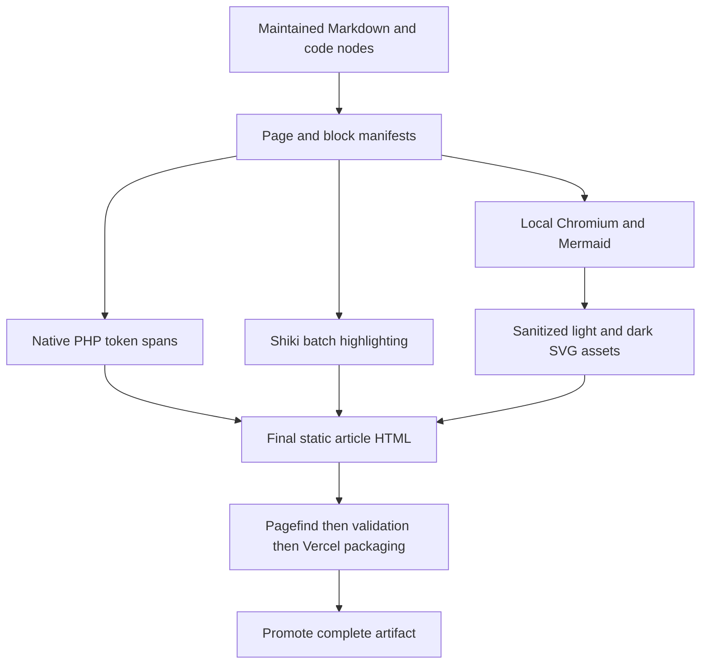
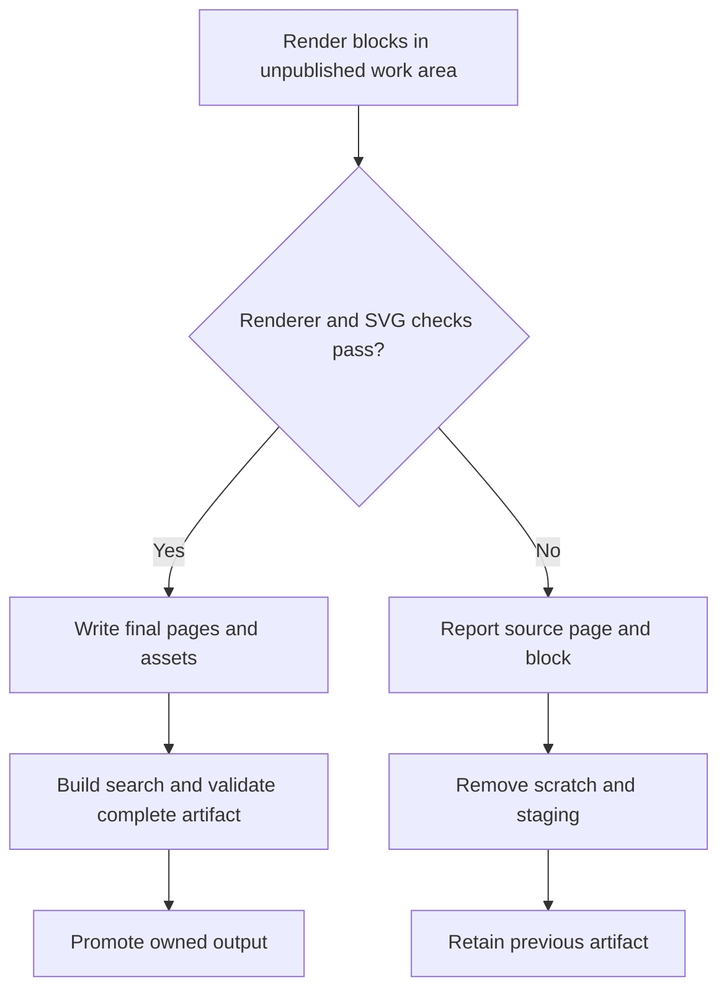

# Render public manual diagrams and syntax - Plan

## Goal Capsule

**Objective:** Public manual readers can understand the diagrams and distinguish code syntax while reading accurate examples on desktop and mobile.

**Means:** Extend the existing static website with build-time diagram images and syntax highlighting, including native PHP 8.5 tokenization (KTD2–KTD5).

**Authority:** The user requested rendered Mermaid diagrams styled to Bånder's guidelines and syntax highlighting with PHP 8.5 support. This explicitly replaces the source-only Mermaid decision in `docs/plans/2026-10-31-1530-feat-public-project-website-plan.md`. That plan's remaining Product Contract and static PHP builder, Pagefind and Vercel decisions remain in force. Existing direction A, project identity and single maintained manual are preserved.

**Execution profile:** Standard bounded extension, one reviewable change with three implementation units and local commits under the repository workflow. The user has authorized implementation; this plan hands back to the lead for execution without another approval question. No publication or push is authorized here.

**Stop conditions:** Rendering can proceed independently of prose-scope clarification. The lead owns the separate question of whether the user's prose-fix request covers website copy or the entire manual; this plan does not assume an answer or authorize a general manual rewrite.

---

## Product Contract

### Summary

The existing public site renders manuals from `docs-book/`. Add readable Mermaid diagrams and syntax-colored examples without changing their meaning, source authority or static hosting contract.

### Problem Frame

The manual currently exposes Mermaid source as ordinary code and displays other examples without syntax colors. Diagram readers must reconstruct relationships themselves, and developers lose visual cues when reading PHP and configuration examples. These improvements must preserve exact example text and remain available when JavaScript is disabled.

### Requirements

- R1. Existing Mermaid fences render as readable diagrams in the public manual, with labels, relationships and source text preserved.
- R2. Diagrams and code colors follow Bånder's typography, shared light/dark colors, restrained surfaces and accessibility rules. Diagrams remain legible at narrow widths without pushing the page beyond the viewport.
- R3. Declared code languages receive syntax highlighting. PHP examples support PHP 8.5 syntax, including pipe operators and modern declarations; snippets need not be complete executable programs. Plain text, unlabeled and unsupported languages remain safely readable.
- R4. Highlighting preserves each example's decoded text, whitespace, indentation and trailing newline. Selecting or copying code returns the source text without labels, artificial PHP tags or line numbers.
- R5. Diagrams and highlighting work without reader-side rendering libraries, network services or JavaScript. Navigation, section links and Pagefind search retain their current behavior.
- R6. Failed diagram rendering or an unavailable/failed build helper identifies the source page and block, fails the unpublished build and retains the previous complete artifact. A recoverable PHP lexical failure instead warns with page/block context and preserves escaped uncolored source. Author text cannot introduce executable HTML, unsafe SVG references or external requests.

### Acceptance Examples

- AE1. A reader opens the live-updates, application-threat-model and registry-threat-model chapters with JavaScript disabled and sees the three existing flowcharts, with readable labels and a source disclosure.
- AE2. PHP examples containing `|>`, attributes, enums, property hooks and clone-with syntax receive appropriate token colors; a partial method snippet without an opening tag remains readable and copies exactly.
- AE3. At 390px and desktop widths, both theme preferences show readable code and diagrams. Wide diagrams scroll inside their own region and can be opened at full size; no labels are clipped.
- AE4. A malformed Mermaid fixture or unavailable renderer fails rebuilding with a page/block diagnostic, leaving the previous site intact. A script-shaped code sample stays literal and SVG output contains no executable content or external references.
- AE5. A documented term remains searchable after highlighting and diagram generation; ordinary code text is indexed once and hidden duplicate theme images/source alternatives do not multiply search content.

### Scope Boundaries

This plan covers the public manual renderer, build dependencies, Bånder styling, focused fixtures and existing website checks. It does not change application behavior, diagram semantics, the homepage direction, publication workflow or manual authority. Small diagram accessibility annotations are allowed where needed to describe the existing relationships accurately.

The separate prose-fix request remains with the lead until its content scope is confirmed. Any prose added or changed for this work receives `prose-fix`; that standing requirement is independent of the broader prose request.

Considered and not built: a custom general-purpose language lexer, a browser-side diagram/highlighting runtime, a second Puppeteer browser installation, an external rendering API, a theme-settings interface, interactive diagram editing and a new copy-button interface. Existing browser infrastructure, native text selection and source disclosure satisfy this work; additional interactions need a separate concrete reader need.

---

## Planning Contract

### Key Technical Decisions

- KTD1. **Extend the existing public builder.** (session-settled: user-approved — retain PHP static builder, single manual, Pagefind and prebuilt Vercel artifact over a new application/runtime.) Add rendering within the current unpublished build lifecycle. Keep raw Markdown HTML escaped and unsafe link schemes disabled. Complete every transformation before Pagefind and Vercel packaging; promote only after artifact validation.
- KTD2. **Use the PHP 8.5 lexical scanner for PHP fences.** Native `token_get_all` supplies version-correct tokens without maintaining a PHP grammar. Classify tokens into a small documented color-role set; escape all literal token text. For snippets lacking an initial PHP opening tag, tokenize a synthetic prefix and remove only its exact bytes before rendering. Preserve originals with opening tags, mixed HTML, whitespace and partial syntax. Do not enable parser validation: documentation fragments are not executable programs. Unclassified tokens remain escaped text; lexical failures produce a page/block warning and safely escaped uncolored source rather than executing or dropping the example.
- KTD3. **Use Shiki 4.5.0 at build time for other declared languages.** Pin that exact release in the isolated site Yarn package and use its CSS-variable theme helper. Load only grammars for the current manual: Bash, JSON, YAML, dotenv, SQL, TypeScript and TSX, with explicit aliases for `bash`, `env`, `ts` and `tsx`. Plain `text`, unknown languages and unlabeled fences remain escaped code. Batch blocks through one initialized highlighter rather than spawning a process per fence. Both native PHP and Shiki use one site-owned syntax palette whose CSS variables map to shared theme roles or contrast-checked derived colors.
- KTD4. **Render Mermaid 12.2.0 through the existing Chromium installation.** Pin that exact Mermaid release in `ui/site/`. A local Node build helper loads the bundled Mermaid library in Playwright Chromium, renders each collected diagram once per light/dark palette, and writes SVG files inside the unpublished artifact. Use Mermaid's customizable `base` theme, resolved shared-token values, plain SVG labels (`htmlLabels: false`), strict security, disabled click bindings and deterministic IDs seeded from page/block identity and theme. Load the site's local Inter font and await its readiness before layout. A generated image cannot inherit the page font: embed only the known local licensed Inter WOFF2 bytes as a builder-owned font-face in the completed SVG, so image-context labels use the measured typeface offline. Load no CDN, remote font, icon pack or external renderer. Keep browser requests local and explicitly block outbound traffic.
- KTD5. **Publish sanitized images and readable source.** Pin `enshrined/svg-sanitize` 1.1.1 in tooling Composer dependencies and enable remote-reference removal. Reject parse failures and output that retains script/event attributes, foreign objects, source-controlled data/external resource references or external CSS imports; do not weaken the ordinary raw-HTML policy. After sanitization, append only the fixed font-face template and base64 bytes read from the trusted local font asset in KTD4. Final SVG policy permits that exact builder-generated font payload, never arbitrary diagram-supplied data URLs. Serve SVG as paired local light/dark image assets rather than injecting it into article HTML. CSS shows exactly one image and matching full-size link according to the existing root `data-theme` choice (`balanced` for light, `dark` for dark), using system preference only when no explicit choice exists. This supports the existing persisted theme toggle and works with JavaScript disabled; a picture media query alone would miss explicit theme choices. Keep hidden variants out of the accessibility tree and Pagefind. Preserve `viewBox`, intrinsic dimensions, text, markers and local fragment references. Wrap each diagram in a named, keyboard-scrollable figure with an accurate accessible description and native disclosure containing escaped original source. Source-only rendering is not a successful substitute for a failed diagram build.
- KTD6. **Provision and bound build dependencies explicitly.** Move the existing website CI Chromium installation before the site build; use that same installation for later browser tests. Fail early with an actionable dependency message when unavailable. Add a website-specific build budget to tooling configuration rather than silently inheriting the shared 120-second process deadline or globally raising it. Start with a documented ten-minute bound, measure the full manual build in the authoritative image and retain a bounded value that covers the verified workload. Keep helper request/result scratch files outside the published tree and clean them on failure.

### High-Level Technical Design

Use CommonMark fenced-code nodes and a renderer-owned block manifest. The source text is authoritative; intermediate identifiers associate generated output with a page/block without rewriting Markdown or matching HTML with regexes. Keep the PHP renderer injectable so ordinary builder tests do not launch Chromium.

The builder currently renders pages before its after-render callback, while `Website\Command` runs asset copying, search bundling, Pagefind and packaging there. Introduce one explicit fence-rendering phase after discovery/link transformation and before final article rendering. The command supplies the external-helper orchestration through the existing `EngineExecutor` and structured `ProcessSpec` boundary. Rendering results update the same manifest and final HTML that search and validation consume; avoid a second stale HTML representation or post-package edits.

### Research Basis

- `Website\WebsiteBuilder` already owns CommonMark configuration, page manifests, article rendering, artifact validation and atomic promotion. `Website\Command` owns bounded subprocesses and final search/packaging order. Existing SVG image contents are not inspected by HTML link validation.
- A targeted fence inventory found three Mermaid flowcharts, 39 PHP, 398 Bash, 20 JSON, eight YAML, seven environment, one SQL, one TypeScript, two TSX, two text and 23 unlabeled blocks. Current diagrams live in developer `live-updates.md`, `application-threat-model.md` and `registry-threat-model.md`. Several PHP fences begin directly with class or method snippets rather than `<?php`.
- [PHP's tokenizer](https://www.php.net/manual/en/function.token-get-all.php) uses the engine's lexical scanner and treats code without an opening tag as inline HTML. The [token reference](https://www.php.net/manual/en/tokens.php) includes PHP 8.5's `T_PIPE`. Native PHP tokenization therefore avoids making PHP 8.5 correctness depend on an independently updated syntax grammar.
- [Shiki's output API](https://shiki.style/guide/install) can produce static tokenized output. Its [CSS-variable theme](https://shiki.style/guide/theme-colors) provides a small palette that the site can supply. This gives existing non-PHP languages a maintained grammar while keeping the PHP-specific compatibility requirement native.
- [Mermaid's API](https://mermaid.js.org/config/usage.html), [theme configuration](https://mermaid.js.org/config/theming.html), [accessibility options](https://mermaid.js.org/config/accessibility.html) and [configuration schema](https://mermaid.js.org/config/schema-docs/config.html) support local rendering, custom base themes, descriptions and deterministic IDs. Site initialization owns security and theme settings; diagram directives must not override them.
- [SVG sanitizer](https://github.com/darylldoyle/svg-sanitizer) supports configurable allowed tags/attributes and remote-reference removal; its CSS handling is explicitly defense in depth. Generated images are therefore isolated in image contexts, with independent rejection of residual active/external content.
- Direct versions and runtime requirements were checked against the official [Shiki registry metadata](https://registry.npmjs.org/shiki/4.5.0), [Mermaid registry metadata](https://registry.npmjs.org/mermaid/12.2.0) and [Composer package feed](https://repo.packagist.org/p2/enshrined/svg-sanitize.json).
- `.forgejo/workflows/website.yaml` currently installs Chromium after building; the order must change. The existing website subprocess context shares a 120-second deadline, which must be addressed deliberately when adding Chromium work. No relevant rendering learning was found in `docs/solutions/`.

### Constraints and Implementation Details

Use `ui/DESIGN.md` and generated shared tokens. Diagram fills, edges, arrowheads, labels and cluster boundaries receive deliberate light/dark colors; do not accept Mermaid's decorative default palette, gradients or shadows. Wait for local fonts before measuring labels. Preserve legible intrinsic diagram size with contained scrolling instead of shrinking dense text to fit a phone. Full-size links open the already generated image without a JavaScript zoom dependency.

The reader does not load Mermaid or Shiki. Load their build code only in helpers; artifact checks must confirm those libraries and renderer manifests are absent from publication. Fonts, SVGs and CSS remain local. Source disclosures and duplicate theme alternatives must not duplicate Pagefind text; preserve one searchable textual representation of each code example and one deliberate diagram description/source representation.

Composer changes belong to `packages/baander-tooling/composer.json`, both root and standalone consumer lockfiles, and the declared dependency inventory where required. Node changes belong to `ui/site/package.json` and its lockfile. Keep other packages and application dependencies unchanged. Official registry metadata selects Shiki 4.5.0 (Node >=20), Mermaid 12.2.0 (Node >=22.12.0) and SVG sanitizer 1.1.1 (PHP 7.1/8.x plus DOM/libxml); `docker/runner/Dockerfile` installs Node 24 and PHP 8.5 satisfies the PHP requirements. These are exact direct pins; lock transitive dependencies and verify the release APIs during implementation. Final helper/class names remain implementation choices.

---

## Implementation Units

### U1. Add the block manifest and native PHP 8.5 highlighting

**Goal:** Highlight current code examples without changing their contents.

**Requirements:** R2–R5; AE2, AE3, AE5; KTD1–KTD3.

**Files and ownership:** PHP worker owns new native-tokenizer and block-renderer classes plus dedicated `scripts/tests/php/Website/` proof fixtures. The lead owns CommonMark integration in `WebsiteBuilder.php`, orchestration in `Command.php` and the shared manifest interface. This unit does not edit Node helpers, dependency files or site CSS.

**Approach:** Agree the block manifest and pre-article rendering boundary with the lead and Node worker first; implement native PHP token roles. The manifest carries original literal, declared language, page identity and block ordinal; renderer results preserve that text and distinguish token HTML from diagram assets. Keep escaped fallbacks for recoverable PHP lexical failures. Use the shared palette contract; leave inline code visually distinct but unparsed. U2 supplies non-PHP and diagram results through this same boundary.

**Test scenarios:** PHP 8.5 pipes, clone-with, property hooks, attributes, enums, quoted HTML, heredoc/nowdoc, interpolated strings, opening tags and partial snippets preserve decoded text. Prefix injection is invisible; unclassified tokens and lexical failures retain source. Unknown/unlabeled/text fences remain escaped. Compare final code text to the original CommonMark literal, including whitespace and final newline.

**Verification:** Focused tooling fixtures prove native source fidelity and safe markup. Final browser checks in U3 establish distinct, readable token roles in both themes, unchanged selection/copy text and Pagefind results.

### U2. Build Mermaid images and highlight other languages locally

**Goal:** Produce static diagram assets and maintained non-PHP syntax output.

**Requirements:** R1–R6; AE1–AE5; KTD1, KTD3–KTD5.

**Dependencies:** U1's block manifest and final rendering boundary.

**Files and ownership:** Node worker owns `ui/site/scripts/` batch helper and its focused Node fixtures, producing Shiki results and both Mermaid palettes. The lead owns site package/lock updates, tooling SVG dependency/consumer locks and inventory, PHP sanitizer and figure integration. This unit does not edit U1's native tokenizer or U3's site CSS/browser files. Accessibility annotations may touch the three existing Mermaid blocks through the lead without changing relationships.

**Approach:** Batch Shiki highlighting for declared non-PHP languages and render both diagram palettes in the existing Playwright browser. Sanitize and validate SVG, embed the trusted font payload, then supply image references and source disclosure to the trusted renderer. Protect security/theme initialization from diagram directives, remove external resource paths and keep same-document marker references. Block outbound browser requests and fail staging on unavailable helpers, bad diagrams or sanitizer failures.

**Test scenarios:** Bash, environment, JSON, YAML, SQL, TS and TSX fixtures receive token spans with exact decoded text; unknown/unlabeled/text examples remain escaped. Render all three maintained flowcharts and fixtures with quotes, ampersands, Unicode and long labels. Light/dark variants have complete labels, local arrow markers, stable identifiers and the same local Inter face used for measurement. Script/event/foreign-object payloads, click URLs, source-controlled data/external CSS or resource references and configuration overrides cannot introduce active/external content. Invalid syntax or a failed helper reports page/block and preserves previous output. Source disclosure reproduces original text.

**Verification:** Test sanitizer contracts without Chromium; separately run the real offline Mermaid helper and inspect resulting SVG/XML. Browser screenshots at desktop and 390px in both themes establish unclipped labels, restrained surfaces and contained overflow. Check all generated asset URLs and ensure Pagefind has no duplicated theme/source text.

### U3. Integrate the build runtime and qualify the complete manual

**Goal:** Keep the documented build repeatable and verify the published reading behavior.

**Requirements:** R1–R6; AE1–AE5; KTD1, KTD6.

**Dependencies:** U1 and U2.

**Files and ownership:** Visual/test worker owns `ui/site/assets/site.css`, a focused `ui/site/tests/` rendering spec and narrow diagram presentation hooks agreed with the lead. The lead owns `.forgejo/workflows/website.yaml`, tooling budget configuration/defaults/schema and fixtures as needed, `Website\Command`, template/renderer integration, `ui/site/README.md` and `ROADMAP.md`. Shared proof tests remain under their assigned owners; workers do not overwrite each other's files.

**Approach:** Provision the existing Chromium before the build, add the website-specific deadline through current configuration conventions, and document local prerequisites and errors. Serialize expensive full-book/browser checks. Build the full manual through highlighting, diagrams, Pagefind, validation and Vercel packaging; confirm helper artifacts stay private. Run `prose-fix` on changed documentation and record delivered scope and exact verification counts in the roadmap.

**Test scenarios:** A clean documented dependency installation can build the complete book; missing Chromium fails before publication with recovery guidance. Diagram/helper failure leaves prior output intact and cleans scratch. JavaScript-disabled reads show diagrams/highlighting with the system appearance. Desktop/mobile, both themes, keyboard interaction and wide examples remain usable. Toggle light/dark against the opposite system preference and reload the persisted choice: exactly one matching diagram variant and its full-size link remain visible and accessible. Code search finds current text once. Rebuilding an edited fixture updates highlighted text, diagram assets and search together; a repeated fixed-input build produces equivalent public output under pinned dependencies.

**Verification:** Existing tooling PHPUnit, source policy, formatting, architecture, static-analysis and PHP dependency gates pass for affected code. Real site browser tests run against the disposable `website.baander.app` origin with outbound requests blocked. Retained Vercel artifact contains final SVGs, static token HTML and matching search, with no new runtime dependency. No live publication is required for this implementation checkpoint.

---

## Verification Contract

Use the established CI-image tooling and website entrypoints rather than a new runner. Keep existing proof fixtures meaningful and extend them with behavioral cases; do not rewrite passing expectations merely to match the implementation.

| Gate | Owner | Evidence |
|---|---|---|
| Token/source fidelity | Tooling PHP and build-helper fixtures | Exact decoded code text, native PHP 8.5 categories and safe fallbacks. |
| Diagram rendering and SVG safety | Offline real Mermaid plus sanitizer fixtures | Three maintained diagrams rendered; unsafe/external content rejected; source retained. |
| Atomic output | Existing builder integration fixtures | Failed render/index/validation retains prior output and cleans scratch. |
| Theme and viewport behavior | Existing site Playwright suite | Desktop/390px, light/dark, JavaScript disabled, readable labels and contained overflow. |
| Search and publication | Full static build and real Pagefind browser cases | Matching index/assets, one searchable text representation, no runtime renderer. |
| Tooling and documentation | Existing PHP quality/dependency gates, prose-fix | No new baseline, accurate prerequisites, roadmap scope and checkpoint counts. |

Run `ce-simplify-code` at unit boundaries and `ce-code-review` before delivery. Keep Vercel access and publication as the existing separate handoff; do not claim a live deployment from a local build.

---

## Definition of Done

- Every existing manual Mermaid fence has readable light/dark static output and accessible original source.
- Current declared code languages are highlighted; PHP 8.5 fixtures and exact source fidelity pass.
- Diagrams and syntax work without reader JavaScript, remote resources or application services and follow `ui/DESIGN.md`.
- Failure, security, browser, search and tooling checks pass with recorded counts; complete static/Vercel artifacts include the improvements.
- Changed documentation has received `prose-fix`; any broader prose request is handled under the lead's confirmed scope, without silently expanding this rendering plan.
