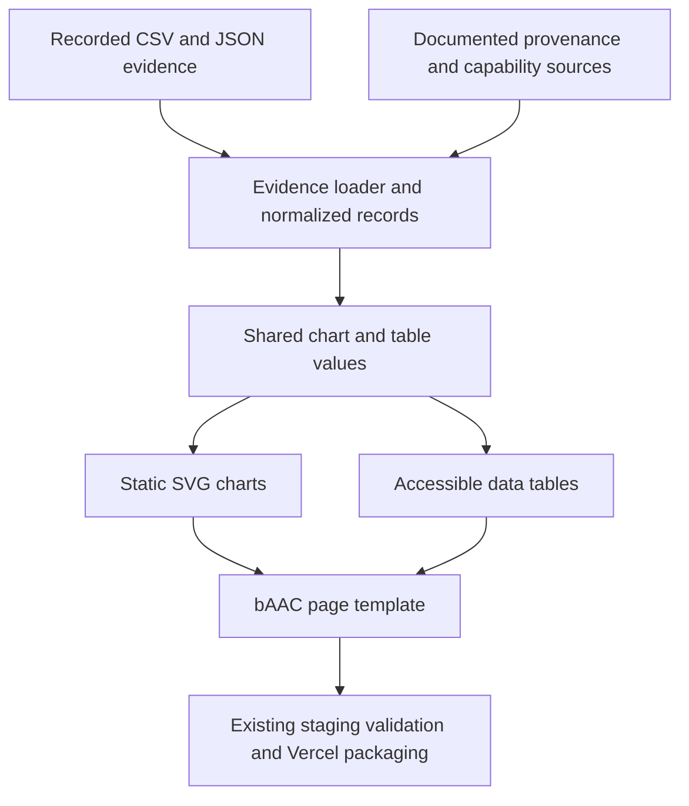
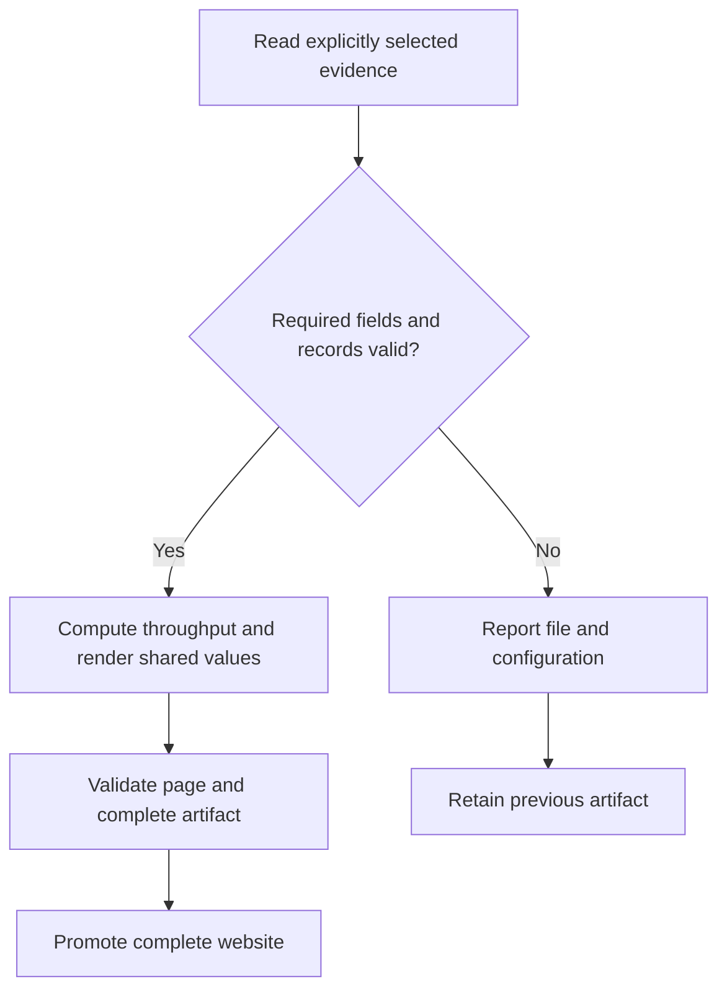

# Public bAAC page and measured comparisons - Plan

## Goal Capsule

**Objective:** Visitors can understand bAAC's purpose and current integration, inspect its measured tradeoffs against the reference codecs, and trace each comparison to its evidence.

**Means:** Add `/baac/` to the existing static public site, with accessible charts and tables derived from recorded repository measurements (KTD1–KTD4).

**Authority:** The user requested a dedicated page, comparisons against the reference codecs, graphs/charts and `prose-fix`, and specified the display name **bAAC**. Retain `baander-aac` only in literal package paths, API identifiers and source URLs. Codec comparisons are explicitly requested; the existing prohibition on using competing media servers to position Bånder does not prohibit these references.

**Execution profile:** One bounded reviewable change with three implementation units, local commits and the repository review workflow. The user has authorized implementation; return this plan to the lead to continue without another approval question. Keep PHP static generation, shared themes, Pagefind's manual scope and prebuilt Vercel publishing. No push or publication is authorized here.

**Stop conditions:** Do not change native codec code, rerun benchmarks, start new codec qualification or touch the user's untracked `packages/codecs/`. Missing selected evidence or inconsistent arithmetic blocks the affected chart with an actionable build error; do not invent replacements. Recorded provenance gaps are disclosed rather than filled with assumptions.

---

## Product Contract

### Summary

Create a public bAAC page explaining the codec library, its current Bånder integration, measured quality and throughput, and the limits of that evidence. Keep the comparisons inspectable through accessible tables, dated methodology and revision-pinned source links.

### Problem Frame

The codec package has detailed documentation and recorded comparisons. Public-site visitors cannot yet find a concise account of what bAAC does or evaluate those measurements. Charts must preserve the evidence's coverage and provenance: model scores are not listening results, nominal rates differ from measured rates, and missing configurations are not zero-valued results.

### Requirements

- R1. `/baac/` is anonymously accessible and discoverable from the public site. Its title, headings, body and chart labels use bAAC; literal technical identifiers retain their spelling.
- R2. The page accurately describes the C++17 encoder/decoder, C API, CLI and Node/Electron binding, with current integration status and profile/interoperability limitations. It identifies transcoder and FFmpeg integration as planned, as confirmed by the user. It does not imply that all Bånder playback uses bAAC or promise unverified public binaries.
- R3. Visitors can compare bAAC with the actual measured AAC references through charts and equivalent data tables. Every graph states its metric, unit, direction, profile, rate basis, corpus and measurement scope; no chart silently turns unavailable observations into zeros.
- R4. Methodology and source links identify recorded dates, codec/reference versions, relevant commits, alignment/level matching, throughput definition and material limitations. The page distinguishes objective models from listening results, throughput from memory, and lossless reference context from lossy quality scores.
- R5. Charts and tables follow the existing Bånder design, explicit/system light and dark themes, keyboard access, mobile containment and JavaScript-independent reading. Each vendor has a distinct color that stays consistent across profiles and operations, as requested by the user. Values and series remain distinguishable without color alone.
- R6. Apply `prose-fix` to the page copy, methodology, chart titles/captions, descriptions and any changed maintainer documentation. Preserve exact data, units, provenance, numerical signs, uncertainty and limitations; remove hype rather than strengthening claims.
- R7. Publishing uses recorded data and the existing static build. It requires no codec binaries, corpus download, benchmark execution, new native qualification, remote chart service or reader-side chart library.

### Acceptance Examples

- AE1. A visitor follows a bAAC link, understands the library and its Electron service/preload integration, and reaches source/API/provenance guidance without encountering an unsupported download or default-playback claim.
- AE2. The AAC-LC quality plots show five encoders at their actual measured rates. Selecting or reading the adjacent table exposes the same 25 records, not rounded values invented from a screenshot or prose summary.
- AE3. Throughput graphs use audio seconds divided by CPU seconds from the speed dataset, not timing collected during the parallel quality stage. Missing profile/reference combinations are clearly unavailable; the zero-duration Wine baseline is not a codec result.
- AE4. A reader sees where bAAC's low-rate xHE-AAC results trail the references and reads the corresponding limits. The page supplies no universal winner badge or aggregate score that hides those tradeoffs.
- AE5. At 390px, desktop, both theme preferences and an explicit theme choice opposite to the system preference, charts, legends, values and tables remain readable. JavaScript-disabled reading still exposes all results, source links and methodological qualifications.
- AE6. A selected CSV value changes in a disposable fixture and rebuilding changes both chart geometry and its table. A blank required value, duplicate configuration or non-finite number fails validation; measured zero remains a real observation.

### Scope Boundaries

Include the dedicated page, existing-site discovery, recorded quality and speed comparisons, concise lossless reference context, methodology, accessible presentation, focused tests and provenance. Package documentation remains evidence authority; the website adds a public explanation, not a rewritten codec manual.

Outside scope: native codec implementation, new profiles, benchmark reruns, listening studies, codec qualification, performance optimization, release publication, package licensing or patent conclusions, downloadable proprietary reference binaries, a general-purpose chart framework and interactive comparison controls. No new data is needed to publish the bounded comparisons below. If a future claim needs additional evidence, obtain that evidence in separately authorized work rather than expanding this delivery.

---

## Planning Contract

### Key Technical Decisions

- KTD1. **Extend the settled static site at `/baac/`.** (session-settled: user-directed — retain PHP static pages, shared themes and prebuilt Vercel hosting over a new runtime or application.) The lead registers a public-page descriptor for the bAAC template and supplied page data. Reuse the existing head/header/footer, canonical URL, appearance control, output validation and atomic staging. Keep it outside the manual manifest and manual-only Pagefind index. Add a clear site discovery link without changing the experience-first homepage hierarchy.
- KTD2. **Load measured evidence from its maintained files.** A dedicated Composer-autoloaded website helper reads the selected CSV/JSON and documented provenance at build time. It produces normalized finite numeric records, public display labels, chart series and table rows from the same values. Never copy chart values into handwritten template arrays. Explicitly select configurations; permit documented extra raw rows without accidentally adding them to the public comparison. Retain raw precision in the data model, format values only for display, and preserve missing/null separately from zero.
- KTD3. **Use static SVG and ordinary tables.** Generate small, deterministic chart SVGs from normalized records using trusted PHP templates/helpers; use no new chart dependency. Embed chart SVG inline so it inherits the site's local font and theme variables, with page-scoped CSS and uniquely prefixed IDs. Escape all data-derived text/attributes; emit only builder-owned SVG structure, no raw markup from CSV or metadata. Supply titles/descriptions, figure captions, visible units and adjacent HTML tables. Distinguish series with label, shape and stroke pattern as well as color. Throughput bars start at zero; model-score domains include all observed values, including small positive PEAQ results. Wide graphs scroll inside a focusable region instead of shrinking labels into unreadable text.
- KTD4. **Publish bounded, dated comparisons rather than rankings.** Show separate PEAQ and ViSQOL quality plots for the four measured profile families, and paired encode/decode throughput panels for each family. Plot actual measured file rate against model score; points are observations, and any connecting line is only a visual guide, not an equal-rate interpolation. Do not invent confidence intervals for absolute mean scores: existing paired-difference intervals answer another question. Give lossless a small separate context table, and link detailed compatibility, experiments and equal-bitrate analyses rather than rebuilding every benchmark report.
- KTD5. **Make prose preservation a delivery gate.** Use `prose-fix` before review, with the project's Stroustrup register for methodology/reference material and Chen for the reader introduction. Keep a baseline outside the tracked tree for rewrites and inspect its preservation audit, especially negative scores, signs, dates, hashes, units and qualifiers. The page uses bAAC consistently while imported configuration IDs and paths retain their literal identifiers.

### High-Level Technical Design

The public-page descriptor identifies URL `/baac/`, template `baac`, title, description and its bAAC data payload; it has no manual-guide identity. The chart helper exposes a stable chart ID, title, axis units/direction, series labels, points and matching table rows. The lead owns this small integration boundary and preserves the existing manual return/count contract. No worker edits shared builder routes or navigation independently.

### Evidence Inventory and Selection

All input paths below are under `packages/baander-aac/`. The research inspected tracked evidence only and performed no new measurements.

| Source | Recorded contents | Public use |
|---|---|---|
| `bench/results/quality.csv` | 830 per-item rows: 83 configurations × ten excerpts; 18 columns | Verify/select observations behind the published summary; preserve the two extra raw FDK xHE rows groups as excluded coverage. |
| `bench/results/quality_summary.csv` | 81 configurations; each summarizes ten excerpts; 19 columns | Primary quality source; select 55 default CBR configurations below. |
| `bench/results/speed.json` | 38 records: 19 encode, 18 decode, one Wine baseline | Select 15 main encode plus 18 decode observations; exclude four encode experiments and baseline. |
| `bench/results/lossless.json` | Four recorded reference encoders; all `bit_exact` true | Separate bitrate/context table for ALAC and FLAC, with no bAAC lossless mode implied. |
| `bench/results/compat.json` | 790 attempts: 780 success, ten failure | Methodology limitation/source link; do not claim universal decoder compatibility. |
| `bench/results/bandwidth.json` | 81 keys, including eight legacy `oursab` names absent from current summary | Excluded from current charts; no unverified relabelling to `oursnoab`. |
| `bench/results/tables.md` | Generated quality, paired differences, interpolated equal-rate tables and timing | Source link and independent spot-check reference; do not extract rounded table values for primary charts. |
| `docs/codec-comparison.md`, `bench/README.md`, `bench/bench.py`, `bench/setup-refs.sh`, `bench/corpus.sh` | Method, versions, dated interpretation, calculations and pinned corpus/reference setup | Provenance and qualification sources; website build never invokes the harness. |

Use exactly these default CBR quality groups, labelled with the public codec name rather than the raw `ours` identifier:

| Profile family | Raw encoder keys | Nominal rate settings (kbit/s) | Selected records |
|---|---|---|---:|
| AAC-LC (`lc`) | `ours`, `ffmpeg`, `fdk`, `libxaac`, `apple` | 64, 96, 128, 192, 256 | 25 |
| HE-AAC v1 (`he`) | `ours`, `fdk`, `libxaac`, `apple` | 32, 48, 64 | 12 |
| HE-AAC v2 (`hev2`) | `ours`, `fdk`, `libxaac` | 24, 32 | 6 |
| xHE-AAC (`xhe`) | `ours`, `fdk` at all five settings; `libxaac` only at 64 and 96 | 24, 32, 48, 64, 96 | 12 |

These 55 records produce separate plots of `peaq_basic` and `visqol` against `kbps`: eight quality plots, with the AAC-LC pair prominent and the other families grouped below. Both metrics are higher-is-better models. `kbps` is the mean measured file rate over excerpts, including transport framing, not nominal rate or duration-weighted corpus rate. Mark nominal settings in the associated tables. `peaq_basic_min` and `visqol_min` are worst-item model scores, not uncertainty bounds; leave them in the linked detailed report rather than misusing them as error bars. Blank delta/CI cells are unavailable, never zero.

Throughput uses `speed.json` `seconds / cpu`, audio seconds per CPU second, higher is better; CPU includes user plus system time. Each profile has its own workload panel: LC encode at nominal 128, HE at 48, HEv2 at 32, xHE at 64 kbit/s, with encode and decode visually separate. Main encoder counts are 5/4/3/3; decoder counts are 5/5/5/3. Encode and decode codecs/configuration fields differ: select by their actual stored schema, not by assuming a shared configuration key. Decode streams are the harness's common FDK stream, or libxaac where FDK is unavailable. Preserve unavailable combinations as such and compare within each panel.

Do not use `quality_summary.csv`'s `enc_x_realtime`: that is quality-stage timing under parallel load. The speed baseline has zero audio duration and is not zero codec speed; do not subtract its Wine CPU/wall time from codec records. Do not replace `cpu` with `wall` silently or combine independently selected minima. Peak `rss_kb` is whole-process memory and the encoder reads the entire 130-second input; memory bars and working-memory claims are excluded.

### Provenance and Public Qualifications

Recorded quality was first measured on 2026-10-30 at codec commit `166dec8e5e32598cb0b9911755bfd4a417b9822b`; bAAC was remeasured on 2026-10-31 at `129ce927775beee5548aa9418829fa0fe2639b1f`. Other encoders' quality streams and scores remain from the first run. The tracked result revision is `9d05f8b1dcd6b04f61f046a9a42a453ef593a813`. The speed table is a second run on 2026-10-31; the document reports the machine ran about 20% slower than the first run. Do not combine timings across runs. The raw files do not contain their own complete provenance metadata; the documented record supplies these qualifications.

The corpus is ten TCDAudio14 music excerpts at 48 kHz, 16-bit stereo, about seven to sixteen seconds each, concatenated duration 130.3173125 seconds. Setup pins the ViSQOL corpus repository to `38d0b0163e441047d4429bf07ad09e5b9031d02c` and verifies file SHA-256 sums. Timing machine: four-core Intel Xeon 2.1 GHz cloud VM, Ubuntu 24.04, single-threaded runs; bAAC Release build/GCC 13.3. The harness defaults to three timing repeats and selects minimum CPU and wall separately, maximum RSS; actual repeat count is not stored in the raw results. State the documented protocol without inventing raw metadata.

Reference labels and versions come from the recorded comparison: FFmpeg 6.1.1 native AAC two-loop coder; FDK AOSP C++ tree `c41c3c7516ea8d0d78a53b96b30bed3a29745cc6`, not FFmpeg's linked `libfdk-aac` 2.0.3; Ittiam libxaac v0.1.14, `2fbadd57bca46693b7a077bcf1513131106d960c`; Apple CoreAudioToolbox 7.10.9.0 from iTunes for Windows 12.13.9.1 through qaac 2.85/Wine 9.0, quality 2. Apple timings include Wine and are not current macOS measurements. Lossless references are FFmpeg ALAC, refalac 2.85 and FLAC 1.4.3 levels 5/8. Display original names and roles accurately; do not imply endorsement or package runtime dependencies.

Meter provenance is distinct from corpus provenance. Setup pins GstPEAQ to `7397e49f5ede2f2429fb78f6663784e548401fec`; ViSQOL v3 uses audio mode and the default libsvm model, but the exact executable revision is not recorded. Do not present the corpus repository pin as proof of the ViSQOL executable revision.

Place material limits alongside the charts and expand method details below them: no listening test; only ten music excerpts, no speech/44.1 kHz/multichannel/low-delay comparison. PEAQ is not validated for SBR or parametric stereo, compresses severe impairments below about -3, and the GstPEAQ implementation reports conformance limitations. ViSQOL's model rewards bandwidth and this corpus is its own conformance material, which can flatter its agreement with listeners. Neither metric establishes a universal audible winner.

The quality pipeline uses one decoder per family (FFmpeg for LC/HE, libxaac for xHE with normalization/limiter off), source alignment by cross-correlation and low-band level matching below 3 kHz. Low-rate gain corrections reach about 3.2 dB on individual items. Achieved rates differ at the same nominal setting: AAC-LC nominal 128 measures roughly 127.9–131.8 kbit/s across encoders. Existing paired intervals are Student-t 95% half-widths of reference-minus-bAAC differences (ten items, multiplier 2.262), not bootstraps or confidence intervals of the individual mean scores. Equal-bitrate tables interpolate item curves; this delivery links them without recomputing or extrapolating them.

Capability copy must separate implemented features from checked interoperability. The package exposes AAC-LC, HE-AAC v1/v2, LD/ELD and USAC/xHE profiles, with ADTS, LOAS/LATM and configured raw access units subject to profile restrictions; raw MP4 sample support is not an MP4 file demuxer. ER RVLC/HCR, LD-SBR and several USAC/spatial tools have documented approximations, unverified external streams or refused modes. Link the relevant limitations rather than asserting full standard conformance. Compatibility data includes ten bAAC decode failures on libxaac raw xHE64 input requiring an unsupported config/size-list input path; all 440 attempts involving bAAC-encoded streams succeed in that recorded dataset. State those denominators if mentioning compatibility.

The current integration consists of the Electron main-process `AacService`, registered IPC handlers and preload bridge, with packaged native files. Research found no direct web playback consumer proving it is the default playback path. Version 0.1.0 and source-build/API guidance are supported; public npm availability, passing release artifacts and installed bindings are not established. Link Baander-authored Apache-2.0 licensing together with the package's provenance disclosures; add no patent assurance.

All bAAC source and data links use the latest commit affecting the codec package in the checkout. This keeps website-only commits from introducing broken source links in a local preview, as reported by the user. Keep the recorded measurement commits separate from that source revision. Provide revision-pinned links to the package README/provenance, API, comparison method, raw summary/speed/lossless/compatibility evidence and corpus/reference setup. Current capability text is reviewed against source at implementation time; measurement dates do not become claims about newly benchmarked code.

---

## Implementation Units

### U1. Create the bAAC explanation and comparison page

**Goal:** Explain bAAC and present its measured tradeoffs with the correct scope.

**Requirements:** R1–R6; AE1, AE2, AE4, AE5; KTD1, KTD4, KTD5.

**Files and ownership:** Page worker owns new `ui/site/templates/baac.php` and route-scoped `ui/site/assets/baac.css`. The lead owns shared header/footer/home discovery links, head metadata/CSS loading and public-route registration. Codec source/docs remain read-only.

**Approach:** Present a concise introduction, integration/status, measured quality, throughput, separate lossless context and methodology/provenance in that order. Consume U2's chart/table payload without hardcoded numerical claims. Keep qualifications beside the relevant chart and richer method details in reachable sections. Reuse existing appearance behavior, typography and restrained surfaces. Apply `prose-fix` to page text, chart captions and methodology while checking facts against the evidence inventory.

**Test scenarios:** Anonymous readers find the page and its source/API links. Public copy uses bAAC consistently, identifies current Electron integration and does not promise a binary or default playback. Every graph has matching units, direction, profile, source date and inspectable table. Narrow views and both explicit/system themes preserve labels, legends and table access; JavaScript-disabled readers reach every result.

**Verification:** Evidence/content review, prose preservation audit, responsive/theme browser captures and keyboard checks. Page worker does not edit chart calculations or shared builder files.

### U2. Load recorded comparisons and render accessible charts

**Goal:** Produce charts and tables from one validated numerical source.

**Requirements:** R3–R7; AE2–AE6; KTD2–KTD5.

**Files and ownership:** Evidence/chart worker owns new `packages/baander-tooling/src/Website/AacEvidence.php`, `AacCharts.php` or equivalently scoped classes, plus dedicated `scripts/tests/php/Website/` fixture tests. Read-only inputs remain under `packages/baander-aac/`; no edit to those inputs or `packages/codecs/` is authorized. Lead integrates helper invocation and shared payload fields with U1 before parallel edits begin.

**Approach:** Parse named CSV columns with explicit CSV escape handling and JSON with checked types. Select the documented 55 quality and 33 throughput records; validate identity, uniqueness, finite values and positive timing denominators. Validate ten-item support using matched selected raw rows without admitting the two raw-only FDK configurations. Generate escaped inline SVG with deterministic IDs and equivalent table records. Keep actual rates, model scores and throughput arithmetic independent; retain raw precision until formatting. Add four separate lossless reference rows with bit-exact flags, without fabricated AAC quality scores.

**Test scenarios:** Fixtures cover the complete selection, actual versus nominal rate, both metrics, non-finite/missing numbers, blanks versus measured zero, duplicate configurations, unavailable reference/profile combinations, extra raw-only configurations, and a zero-duration baseline. A known speed row proves `seconds / cpu` and differs from quality-stage timing. Captions never inherit paired-difference CIs as absolute-score intervals. XML/HTML-shaped labels are escaped; every chart point/bar has the same value and identity as its table. Updating fixture evidence updates both representations; bad required evidence fails staging without damaging prior output.

**Verification:** Focused tooling fixtures establish counts, selection, arithmetic, escaping, source URLs and chart/table correspondence. Read the actual selected datasets once through the final helper during implementation; tests use disposable fixtures and do not execute codecs or fetch corpus/reference software.

### U3. Integrate the public route and verify the static artifact

**Goal:** Deliver the bAAC page through the existing website workflow.

**Requirements:** R1–R7; AE1–AE6; KTD1, KTD5.

**Dependencies:** U1 and U2's agreed page/data boundary.

**Files and ownership:** Lead owns `WebsiteBuilder.php`/`Command.php` route integration where needed, shared templates/navigation, website workflow input filters, `ui/site/tests/baac.spec.ts`, maintainer guidance and `ROADMAP.md`. Preserve ongoing manual-rendering changes and existing proof tests. No worker overwrites another worker's files.

**Approach:** Register `/baac/` as a non-manual public page with canonical metadata and shared chrome; pass the validated chart/page payload before final artifact validation. Ensure the website workflow also runs when bAAC evidence/docs or relevant integration-status sources change. Keep manual-only Pagefind unchanged. Validate source links locally and use the resolved revision for external targets without network fetches during tests. Run `prose-fix`, `ce-simplify-code` and `ce-code-review` under the existing workflow; record exact delivered scope/checkpoint counts.

**Test scenarios:** Direct `/baac/` reload and site discovery work; canonical directory handling and unknown-route 404 remain correct. Manual page counts, search and homepage hierarchy remain intact. Browser assertions cover chart/table correspondence, explicit light/dark opposite system preference, 390px/desktop, keyboard scrolling and JavaScript-disabled access. No requests load a remote chart library, reference codec or benchmark corpus. A docs/evidence-only change selects website CI. Failed evidence loading leaves the previous full artifact intact.

**Verification:** Existing tooling quality/dependency gates, focused PHP fixtures, full static website build and dedicated browser checks pass. Inspect Vercel packaging and local serving; live publication remains the existing user-operated checkpoint. No native benchmark, CTest or codec-upgrade qualification is introduced.

---

## Verification Contract

| Gate | Evidence |
|---|---|
| Dataset selection and arithmetic | 55 quality configurations/550 selected raw rows, 33 throughput observations and four lossless context rows; missing, extra and zero states distinguished. |
| Chart integrity | Plots/tables share records; actual-rate axes, model separation, unclamped observed values, zero-based throughput bars, escaped labels and deterministic IDs. |
| Reader behavior | Anonymous direct/discovery paths; desktop/390px; explicit and system light/dark; no JavaScript; keyboard/table access; no external data/runtime requests. |
| Source and prose audit | bAAC branding, measured dates/versions/commits, honest integration and capability caveats, exact revision links, completed `prose-fix` preservation review. |
| Existing static workflow | Tooling PHP tests/format/source-policy/architecture/static analysis/dependency checks, full site build, real manual search, Vercel package and atomic failure behavior remain valid. |
| Scope record | `ROADMAP.md` names delivered page/evidence selection and actual passing check counts, with publication separately pending. |

---

## Definition of Done

- `/baac/` explains bAAC's actual capabilities/integration and presents the selected recorded quality and throughput comparisons plus separate lossless context.
- Every chart has accessible equivalent data, accurate units/scope and revision-pinned methodology/source links; unsupported/missing states and evidence limits remain visible.
- Shared themes, responsive layout, keyboard access and JavaScript-independent reading pass the website checks.
- Page copy, chart captions and methodology pass `prose-fix` without altering data or qualifications; justified document/code review findings are resolved.
- Existing static generation/manual search/Vercel packaging remain valid, verification is recorded, and codec code, benchmarks and user-owned untracked files remain untouched.
