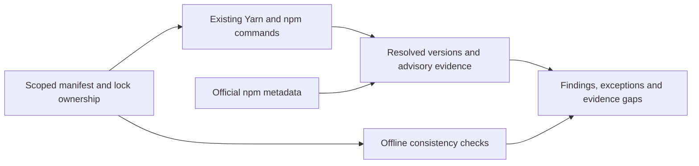

# Web UI Dependency Refresh - Plan

## Goal Capsule

Keep the web application and public website on current, compatible dependencies,
with repeatable checks that expose retained versions, security findings and patch
ownership. Update manifests, resolved dependencies and their actual consumers.

The user's scope is web, the public site, shared packages and test/build tooling.
Electron, React Native/TV and native codec development are excluded. Existing
qualification limits do not authorize unrelated feature work. Finish as reviewed
local commits on `chore/ui-dependency-refresh-plan`; push only when requested.

Stop only the affected upgrade when a required platform or compatibility fact
cannot be established. Record the retained version and evidence while completing
independent upgrades. Preserve local application data and unrelated working files.

---

## Product Contract

### Problem frame

The JavaScript projects have independent lockfiles and several different tool
generations. A manifest update alone can leave browser images, embedded-player
tests and shared source consumers on incompatible versions. The repository also
lacks repeatable JavaScript dependency checks comparable to its PHP checks.

### Requirements

- R1. Review every direct dependency and refresh compatible stable releases in the eight in-scope manifests, including transitive lockfile updates.
- R2. Review authored patches, resolutions and package-manager compatibility patches separately; retain only justified authored changes.
- R3. Keep the existing web, media, authentication, search and documentation behavior working through required consumer migrations.
- R4. Provide read-only local consistency and explicit online freshness/security checks with evidence, findings and unavailable checks reported separately.
- R5. Record every retained upgrade and verification limit without hiding it behind a successful installation or an existing baseline.
- R6. Keep dependency maintenance within the user's selected web scope and existing PHP tooling architecture.

### Scope

The manifests are `ui/web`, `ui/web/packages/baander-player`, `ui/site`,
`ui/shared`, `ui/shared/dpop`, `ui/shared/blurhash`, `ui/design-tokens` and
`tests/e2e`. Their relevant workflow, runtime, browser-image and helper pins are
included. Shared runtime changes must preserve excluded consumers' existing
contracts; their own manifests and native qualification are not part of this work.

No scheduled update PRs, package-manager migration, new media features, native
codec work, unrelated backend upgrades or production website redeployment are
included.

### Acceptance examples

- AE1. A clean checkout can identify every in-scope manifest, its lock ownership and any maintained patch without installing or executing application scripts.
- AE2. An online check reports an available release alongside a documented compatibility exception; an unreachable registry remains an evidence gap.
- AE3. The refreshed web and player build, and existing audio/authentication tests exercise the upgraded libraries without new failures.
- AE4. The site builds its maintained manuals; search, themed diagrams and screenshot transitions still work in its browser suite.

---

## Planning Contract

### Key technical decisions

- KTD1. Preserve independent package-manager roots and lock ownership. The two nested shared package manifests have no independent locks, and design tokens have no dependencies; classify those cases explicitly rather than inventing installs. This implements R1 and R4.
- KTD2. Choose stable versions by compatibility group. React/DOM/types, Vitest/coverage/Vite, ESLint/plugins and Three/types move together; retain TypeScript 6.0.3 where typescript-eslint's declared `<6.1.0` peer range requires it. Other compiler-only projects may adopt TypeScript 7 if their checks pass. This implements R1 and R5.
- KTD3. Keep the supported Node 24 build line, refresh its patch-level pins where present, and select Node types for that runtime. Upgrade in-scope Yarn pins to the verified stable Yarn 4 release without changing excluded projects. This implements R3 and R6.
- KTD4. Synchronize Playwright package, browser-image and helper pins. Preserve the existing Docker engine and image-selection abstractions; do not add direct Docker commands or a second image registry policy. This implements R3.
- KTD5. Add a bounded PHP maintenance command beside the existing dependency checker. Use supported package-manager output for resolved dependency and advisory evidence; do not implement a new Yarn lock parser or npm range engine. Local checks inspect declared ownership and structural consistency without network access; online checks require the applicable installed package-manager state and report missing state as a gap. This implements R4.
- KTD6. Keep authored patches distinct from Yarn's generated builtin compatibility patches. Inventory actual patch targets and reasons; do not add a patch merely to silence a peer conflict or suppress an advisory. This implements R2 and R5.

### Initial version evidence

These are registry observations to recheck during execution, not installation
receipts or permission to disregard peer requirements.

| Group | Candidate |
|---|---|
| React / React DOM | 19.3.1 |
| Vite / React plugin | 8.3.5 / 6.1.2 |
| Vitest / coverage | 5.0.5 |
| ESLint / typescript-eslint | 10.14.0 / 8.72.1 |
| Playwright | 1.64.1 |
| Yarn | 4.18.1 |
| TypeScript | 7.0.2, with the KTD2 compatibility exception |
| Site esbuild / fonts | 0.28.2 / 5.3.0 |

Vitest 5 requires an explicit Vite dependency for Yarn consumers; `ui/shared`
currently lacks one. The web Vite configuration directly imports esbuild without
declaring it. Both ownership gaps must be corrected as part of the upgrade.

### High-level technical design

The maintenance command observes dependencies. Package-manager upgrade commands
remain a separate, explicitly requested operation.

### Risks and deferred details

Motion, jsdom, ESLint, tsup and the embedded player's Vite/Vitest upgrades cross
major versions. Use their migration guides and fix demonstrated consumer breaks.
Do not replace these libraries or redesign their consumers as part of this chore.
The exact advisory set and compatible transitive resolutions are execution-time
evidence. Preserve pre-existing failures separately from upgrade regressions.

---

## Implementation Units

### U1. Upgrade web and embedded-player dependencies

**Goal:** Refresh the web runtime and its independently built player.
**Requirements:** R1–R3, R5; AE3. **Dependencies:** none.
**Files:** `ui/web/package.json`, `ui/web/yarn.lock`, `ui/web/packages/baander-player/`, web build/test configuration and affected consumers.
**Approach:** Apply KTD2, declare the direct esbuild dependency, regenerate locks and make the smallest required consumer migrations. Preserve shared playback and live-update contracts.
**Test scenarios:** Existing component, store, player, audio-graph and auth cases retain their behavior. Add regression coverage only for a consumer migration whose behavior changed or broke.
**Verification:** Web/player typechecks, lint where configured, unit/coverage suites, generated-client drift and production builds pass; relevant browser checks use the isolated preview.

### U2. Upgrade shared, site and standalone test tooling

**Goal:** Refresh the other in-scope JavaScript projects and their consumers.
**Requirements:** R1–R3, R5; AE4. **Dependencies:** coordinated versions with U1.
**Files:** `ui/shared/`, `ui/site/`, `ui/design-tokens/package.json`, `tests/e2e/package.json`, `tests/e2e/package-lock.json`.
**Approach:** Apply KTD1–KTD3, including shared Vite ownership. Preserve each root's package manager. Refresh the nested library manifests without inventing lockfiles or a publishing redesign.
**Test scenarios:** Shared DPoP/storage tests retain behavior; site rendering, search, light/dark diagrams and carousel checks pass. Existing fixtures supply the coverage unless an actual migration needs a regression case.
**Verification:** Immutable installs for owned Yarn roots, shared type/tests, token drift/tests, site type/render/build/browser checks and standalone Playwright discovery pass.

### U3. Align build runtimes and browser helpers

**Goal:** Run checks with the versions their packages require.
**Requirements:** R3, R5, R6. **Dependencies:** U1 and U2 version selections.
**Files:** `Dockerfile`, `.forgejo/workflows/frontend.yaml`, `.forgejo/workflows/website.yaml`, `packages/baander-tooling/resources/tooling-defaults.json`, affected image tests and `scripts/test-transcode-*-browser.sh`.
**Approach:** Apply KTD3–KTD4. Update relevant Node/Yarn pins and route browser helpers through their existing version/configuration owners where practical. Leave unrelated PHP/native image pins intact.
**Test expectation:** No new product behavior; existing image-selection and helper checks must validate synchronized versions.
**Verification:** Image configuration tests and script checks pass; the selected browser runtime can execute the scoped browser checks.

### U4. Add repeatable dependency and patch checks

**Goal:** Make the next refresh an evidence-producing maintenance command.
**Requirements:** R2, R4–R6; AE1 and AE2. **Dependencies:** U1–U3 final inventory.
**Files:** `packages/baander-tooling/src/Dependencies/` or a sibling JavaScript dependency module, an owned policy under `packages/baander-tooling/resources/`, a thin `scripts/check-js-dependencies.php` entry point, `composer.json`, focused `scripts/tests/php/` tests, relevant CI and maintenance guide.
**Approach:** Apply KTD5–KTD6 and reuse bounded process execution. Report current/latest versions, retained-version reasons, authored/builtin patch ownership and package-manager advisory results. Local mode must not fetch, install or execute lifecycle scripts. Online mode retains completed evidence when one project fails.
**Test scenarios:** Unknown scoped manifest, missing owned lock, malformed manifest, changed authored patch, builtin patch classification, version exception, advisory finding and failed registry/package-manager request produce the intended finding or gap. Excluded roots and local package references are not queried as public registry packages.
**Verification:** Focused tooling tests cover these contracts, PHP formatting/source-policy/static/architecture checks pass, and both check modes run against the actual scoped projects with their real findings retained.

### U5. Qualify and record the refresh

**Goal:** Deliver the upgraded tree with honest compatibility and test evidence.
**Requirements:** R1–R6. **Dependencies:** U1–U4.
**Files:** `ROADMAP.md`, scoped dependency maintenance documentation and any justified migration corrections.
**Approach:** Review the final dependency/patch inventory and targeted source diff. Record exact command outcomes, advisories, exceptions and unavailable checks; remove this implemented plan at completion, retaining its history and the roadmap checkpoint.
**Test expectation:** Reuse the verification contract; do not add tests that duplicate manifest text.
**Verification:** No new unexplained failures remain and the delivered item is locally committed.

---

## Verification Contract

Use the canonical frontend CI image for authoritative web gates. Run each
independent root's immutable install, typecheck and existing tests, then web lint,
coverage, generated-client drift and build. Verify token generation and the
embedded player's build separately. Run the website helper tests, static build
and browser suite with matching browser binaries.

For application browser checks, use `make preview-up`, obtain `make preview-url`
and pass it explicitly as `E2E_BASE_URL`. Cover authentication, audio graph,
playback/seek/volume, equalizer controls and live queries affected by the upgraded
libraries. Do not point tests at the published site or persistent instance.

Run focused PHP tests and required static gates for maintenance/image changes.
Local dependency checks must succeed without network; online output may contain
justified compatibility findings, advisories or evidence gaps, which must remain
visible in the delivery record. Missing credentials, unavailable hardware and
excluded native platforms are reported limits, not reasons to expand scope.

---

## Definition of Done

Every in-scope manifest has an explicit disposition; upgraded locks install
immutably, required consumer migrations are complete, and patch ownership is
reviewed. Repeatable checks distinguish findings from unavailable evidence.
The verification contract is completed where the environment supports it, with
no new unexplained failures and all exceptions recorded. Final simplification
and code review findings are resolved, local commits contain only this work,
and no remote push or deployment is implied.

## Sources

- Existing PHP dependency checker: `packages/baander-tooling/src/Dependencies/`.
- Existing frontend and website workflows under `.forgejo/workflows/`.
- [Vitest migration](https://vitest.dev/guide/migration/): explicit Vite ownership and coordinated runner migration.
- [ESLint 10 migration](https://eslint.org/docs/latest/use/migrate-to-10.0.0): changed lint APIs and recommended rules.
- [Vite migration](https://vite.dev/guide/migration): embedded-player bundler migration.
- [typescript-eslint metadata](https://registry.npmjs.org/typescript-eslint/latest): compiler peer range.
- [Yarn audit](https://yarnpkg.com/cli/npm/audit): advisory scope and output.
- [Node release schedule](https://github.com/nodejs/Release): supported LTS lines.
