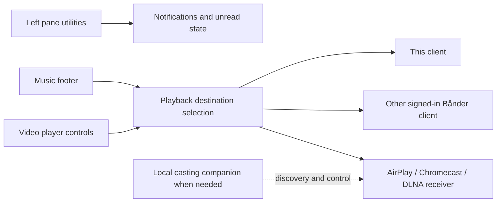
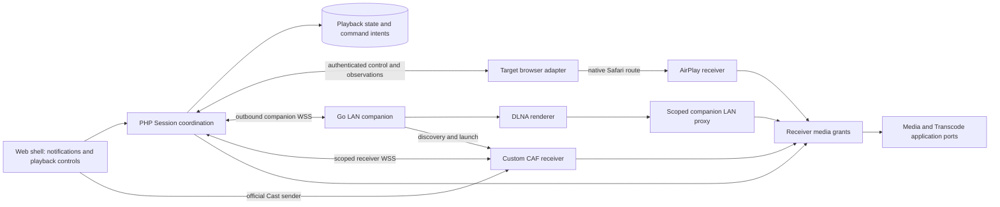

# Playback destinations and notifications - Plan

## Goal Capsule

- **Objective:** Listeners can choose where their music or video plays, control it from Bånder and reach notifications independently of the right pane.
- **Means:** Extend Session coordination and player adapters, with native browser casting and a paired Go companion where needed (KTD1–KTD7).
- **Product authority:** The user confirmed the scope on 2026-11-01, including AirPlay, Chromecast, DLNA, remotely hosted servers and a local companion. Subsequent clarification limits available client hardware to Linux and an iPhone; no Android device is available.
- **Authority:** Product requirements govern behavior; KTDs govern implementation within those requirements; units cannot override either. The user confirmed the implementation direction on 2026-11-01.
- **Execution profile:** Three ordered PR groups, with local commits per unit on `feat/playback-destinations-and-notifications`. Implementation, simplification and review follow `AGENTS.md`; pushing and opening PRs require a later user instruction.
- **Stop conditions:** Do not remove protocol coverage to bypass a failed qualification. Missing receiver hardware, Cast registration or external hosting blocks the affected acceptance checkpoint, not independent implementation. Preserve local media and user data.
- **Ownership:** The implementing agent completes code, checks and review; the user supplies unavailable hardware/account access and authorizes external publication. This plan authorizes no deployment.

---

## Product Contract

### Summary

Move Notifications to the sidebar and make destination selection part of the music and video players.
Support playback transfer and remote control across Bånder devices, AirPlay, Chromecast and DLNA, including remotely hosted servers through a local companion where required.

### Problem Frame

The right pane currently holds notification and device controls even though those actions belong to persistent navigation and playback.
The existing device control offers transfer to the current browser rather than a choice of destinations, and its restoration hook reconstructs a music queue.
Listeners need to choose a destination for the media they are playing without navigating to an unrelated pane or mistaking a registered device for a reachable receiver.

### Actors

- A1. **Listener:** A signed-in user choosing and controlling playback from Bånder.
- A2. **Host operator:** The person configuring the Bånder server and, where required, a companion on the receiver's network; this may also be A1.

A **playback destination** is the Bånder client or external receiver selected to play the media.
A **local casting companion** is a Bånder component on the receiver's network that provides discovery and control where the browser or remote server cannot provide them directly.

### Key Decisions

- **Functional transfer, beyond placement.** Governs R4, R9–R15. (session-settled: user-approved — chosen over placement-only changes: the user accepted adding destination selection and video transfer.)
- **External receiver coverage.** Governs R5. (session-settled: user-directed — chosen over Bånder devices only: the user explicitly included AirPlay, Chromecast and DLNA.)
- **Local and remote server hosting.** Governs R6. (session-settled: user-directed — chosen over home-network servers only: the user selected support for both deployment arrangements.)
- **Local companion where needed.** Governs R7–R8. (session-settled: user-approved — chosen over requiring no local installation: the user accepted a companion on a home computer or NAS.)
- **Available hardware determines evidence.** Governs R20–R21. Linux and iPhone are the available client platforms; unavailable hardware must not be presented as tested.

### Requirements

**Placement and notifications**

- R1. The Notifications control belongs in the left pane's utility area beside Settings and, in music mode, Equalizer, retaining its unread badge and existing notification actions.
- R2. Notification updates and access remain independent of whether the right pane is open, including when the sidebar is collapsed.
- R3. The right pane contains neither notifications nor destination selection.
- R4. Destination selection belongs in the music footer and in the video player's controls, using the same destination and playback concepts.

**Destinations and hosting**

- R5. Destination selection covers the listener's signed-in Bånder devices and AirPlay, Chromecast and DLNA receivers for music and video supported by the sender/receiver combination.
- R6. Casting supports both a server on the receiver's home network and a remotely hosted server while the controlling client and receiver are together on the home network.
- R7. A local casting companion supplies discovery and control when direct browser or server support cannot satisfy R5–R6.
- R8. Companion setup makes its server association and connection status clear, and playback retains the listener's existing library access restrictions.
- R9. Destination selection distinguishes the active destination, available destinations and unavailable or incompatible destinations, explaining why a destination cannot play the current media.

**Transfer and control**

- R10. Successful transfer preserves the current media item, playback position and playing or paused state, and preserves the music queue for continued playback.
- R11. Transfer keeps one playback destination active for the transferred session, without introducing synchronized multiroom playback.
- R12. A failed transfer retains the source item, queue and position and reports the failure without displaying the target as active; if target startup is uncertain after the source paused, keep the source paused and recoverable until reconciliation establishes that it can resume safely.
- R13. The originating player controls remote play, pause, seek, stop and volume where supported, and continues music queue navigation where applicable.
- R14. The player reflects remote playback and connection changes and provides a way to return playback to the local client.
- R15. Connection loss is shown as a loss of remote control or playback certainty, rather than a successful stop or transfer that the destination has not acknowledged.

**Compatibility and presentation**

- R16. Playback uses a format the destination can play, applying available transcoding where needed or explaining an unsupported combination before reporting success.
- R17. The interface explains receiver or platform limitations that affect controls, playback or Bånder EQ processing, without implying that local processing applies to remote playback.
- R18. Placement and controls follow `ui/DESIGN.md`, including the compact music footer, its exclusive centerpiece depth treatment, theme contrast and keyboard accessibility.
- R19. The host documentation explains supported client and receiver combinations, network reachability and companion setup for both hosting arrangements in R6.

**Qualification**

- R20. Verification uses Linux and the available iPhone as client platforms, with real receiver checks for AirPlay, Chromecast and DLNA recorded separately from simulated tests.
- R21. Qualification identifies the tested browser, operating system and receiver combinations and records unsupported or unverified combinations explicitly, including Android-specific behavior while no Android device is available.

### Key Flows

- F1. **Read notifications.** The listener opens Notifications from the left pane, reads or marks notifications and returns to browsing. The badge continues updating with the right pane closed. **Covers R1–R3.**
- F2. **Move playback.** From the music footer or video player, the listener opens destination selection, chooses an available target and sees transfer progress until success or failure. The player then controls the confirmed destination. **Covers R4–R5, R9–R17.**
- F3. **Cast from a remotely hosted server.** The operator establishes the local companion where needed; the listener selects a home receiver while browsing the remote server. Unavailable companion or network access produces an actionable connection state. **Covers R6–R9, R15, R19.**
- F4. **Return playback locally.** The listener selects the local client from the active remote session and resumes control there with the state defined by R10. **Covers R10–R15.**

The following diagram shows user-facing ownership, not protocol or service boundaries:

### Acceptance Examples

- AE1. **Covers R1–R3, R18.** With the right pane closed, a new notification updates the left utility badge; the listener opens and reads it using the keyboard. Collapsing the sidebar does not remove access.
- AE2. **Covers R4–R5, R9–R11, R13–R14.** A listener transfers a playing music queue from one reachable Bånder client to another. The selected song and position are retained, the queue continues in order, and the original player reflects and controls the destination.
- AE3. **Covers R4–R5, R10–R11, R16–R17.** A paused video transfers to a compatible destination at its retained position and remains paused. A receiver that cannot play video is not presented as a successful target for it.
- AE4. **Covers R6–R8, R15, R19.** With the server hosted remotely and a configured companion on the receiver's home network, the listener discovers and controls a compatible DLNA receiver. When that companion becomes unavailable, the player shows the connection problem without falsely reporting a successful stop.
- AE5. **Covers R9, R12, R15.** A selected destination disappears before transfer completes. The source remains usable, the target is not shown as active and the listener can retry or choose another destination.
- AE6. **Covers R10–R14.** During remote playback, the listener pauses, seeks and selects the local client. Supported controls update the actual destination, and local playback resumes at the retained position and state without leaving the remote session playing as well.
- AE7. **Covers R16–R17.** A receiver needs a different media format or bypasses the local EQ path. Playback uses a supported delivery format when available, and the interface makes the processing limitation visible rather than claiming the EQ remains applied.
- AE8. **Covers R5, R20–R21.** Qualification records AirPlay from the available iPhone and Chromecast from a supported Linux browser against available receivers. Missing receivers are recorded as pending hardware qualification; these results make no claim about Android-specific behavior.

### Scope Boundaries

- R11 excludes synchronized multiroom playback; browsing the Bånder library directly from a DLNA device is also outside this change.
- This is a sender and remote-control feature; turning Bånder into a general AirPlay, Chromecast or DLNA receiver is outside scope.
- Native mobile or TV application redesigns are not implied by receiver coverage; integration work needed for R5 remains in scope.
- The existing EQ need not be reproduced on external receivers; R17 owns how processing limitations are communicated.

### Dependencies / Assumptions

- The user works on Linux and has an iPhone 13 and Apple TV 4K, but has no Android device available for verification. These devices are available for AirPlay qualification; no physical receiver checks have been completed.
- Specific AirPlay, Chromecast and DLNA receiver models and their availability have not been established. Their absence limits qualification, not the agreed protocol scope.
- Receiver access to playable media, platform permissions and any provider registration requirements must be established during planning; a remote server alone is not assumed to discover the home network.
- Native platform selection dialogs are acceptable where required by the casting platform; R4 defines where the user enters the flow, not a promise of identical dialogs on every platform.

### Planning Resolutions

The user confirmed the sender coverage, Go companion, queue continuity and uncertain-transfer behavior on 2026-11-01.
R5 and R12 now express those clarifications; all existing R, A, F and AE identifiers are retained.
KTD5–KTD7 resolve the sender matrix and companion delivery choices; KTD1–KTD4 resolve ownership, authentication and receiver delivery.
Hardware availability and runtime qualification remain in the Planning Contract's deferred checkpoints.

### Sources / Research

Repository observations were independently checked against source on 2026-11-01:

- `ui/web/src/features/layout/components/ContextPanel.tsx:263` renders the current device and notification controls; `ui/web/src/features/layout/components/PlayerTransport.tsx:33` also renders device selection.
- `ui/web/src/features/session/components/DevicePicker.tsx:93` renders the current-device or transfer-here control rather than a destination list.
- `ui/web/src/features/session/hooks/use-session-claim.ts:35` reconstructs tracks from song resources and restores the music player; this hook has no video restoration path.
- `src/Session/Infrastructure/SessionAdapter.php:106` returns device identity, name and last-used time; its listing response has no explicit presence or media capability fields.
- `CONCEPTS.md` distinguishes the browser device token from the device resource public ID; planning must retain that distinction.
- `ui/DESIGN.md` and `.agents/rules/frontend.md` govern the UI and frontend work.

External integration references:

- [Apple: adding an AirPlay button to Safari media controls](https://developer.apple.com/documentation/webkitjs/adding_an_airplay_button_to_your_safari_media_controls) describes the Safari integration entry point.
- [Google: Cast Web Sender setup](https://developers.google.com/cast/docs/web_sender) lists supported web platforms, including Linux, and HTTPS requirements; it explicitly excludes iOS Chrome casting.
- [OCF: MediaServer and MediaRenderer specifications](https://openconnectivity.org/developer/specifications/upnp-resources/upnp/mediaserver4-and-mediarenderer3/) provides the UPnP AV service references for DLNA receiver research.
- [W3C: Network Service Discovery](https://www.w3.org/TR/discovery-api/) records that the proposed browser discovery API was discontinued and must not be used as an implementation basis.

---

## Planning Contract

### Key Technical Decisions

- KTD1. **Session coordinates playback; adapters own media execution.** Extend the existing Session context to carry a discriminated song/video selection, music queue, source-time position, desired state, observed state, active endpoint and revision (R4–R5, R9–R15). Keep Transcode responsible for video execution and Media responsible for track delivery through application ports. Evolve `ListeningSession` in place rather than renaming the context and every existing consumer as a prerequisite. Use public destination identities plus ephemeral endpoint incarnation IDs: a saved browser device token cannot distinguish two tabs. A fresh tab or reconnect cannot inherit the right to execute stale commands. Persist the account's playback intent; expose expiring presence/capabilities separately from registered device history.

- KTD2. **Use an acknowledged, revision-fenced handoff.** A transfer carries its own identity, session revision, source and target endpoint incarnations, retained media snapshot and bounded deadline. Prepare the target without playing, obtain source-quiesced acknowledgement and its final cursor, then start the target and commit the destination only after matching observed state. Before source quiescence, rejection leaves the source unchanged. Afterwards, a lost startup acknowledgement enters uncertainty under R12; stop or reconcile the target before resuming the retained source. Reject stale or duplicate effects, and never infer silence from a disconnected endpoint (R10–R15). Native AirPlay route changes follow KTD7 instead of pretending the browser controls an independent receiver transaction. This chooses recoverable paused state over automatic source restart after an ambiguous start (session-settled: user-approved — chosen over automatic restart: the user accepted avoiding simultaneous playback).

- KTD3. **Commit command intent before delivery and reconcile from a snapshot.** Add a Session-owned durable command ledger and delivery adapter; existing domain events and the notification outbox replay are not an endpoint command queue. Session mutation and intent insertion share one database transaction. The existing authenticated WebSocket infrastructure carries versioned Session commands, acknowledgements and complete snapshots; HTTP uses the same application use cases. A CAF receiver exchanges a one-use launch capability for a receiver-role connection limited to its session, acknowledgements, observations and grant renewal; it never obtains ordinary user API authority. Only the authenticated endpoint named by an intent may acknowledge it, and only an authorized account controller may issue commands. Use fresh snapshots after reconnect rather than replaying obsolete playback actions. Repair the existing partial `session.state`/unconsumed `session.claimed` mismatch and retire the old bypass paths together with their consumers (R8–R15).

- KTD4. **Receiver access uses revocable playback grants, not browser credentials.** Add a receiver delivery capability scoped to the account, playback session, destination and permitted media. Recheck library authorization on issuance, queue selection and renewal. A receiver gets opaque delivery URLs, never the browser access/refresh token or its DPoP key. Grant revocation prevents new authorized requests and renewal, although it cannot retract buffered media. Preserve range/HEAD, content type, HLS child authorization, subtitle/artwork access and transcode execution generations. Existing signed video routes remain a separate contract; introduce receiver routes that consult grant state and use Media/Transcode application ports. Browser, companion and CAF receiver renewal have named owners, independent of the initiating page where KTD5 provides one (R8, R10, R14–R17).

- KTD5. **Choose the sender per client capability, with one runner per destination.** Use native Safari AirPlay, the official Cast Web Sender in supported browsers, companion Cast where the browser sender is unavailable, and companion DLNA. Linux Chrome is the primary direct Cast verification target; iPhone Safari is the AirPlay target and can control companion Cast/DLNA. Linux-browser AirPlay is not part of the supported matrix, and Android remains unverified. Store queue/revision centrally; a Bånder target browser runs its own queue, the companion runs DLNA, and the custom CAF receiver runs both Cast paths after handoff. For companion Cast, the companion discovers and launches the receiver but does not become a second queue runner. Only the selected runner advances the queue or renews grants; browser controls send commands rather than duplicating advancement. Native AirPlay uses the Safari element's lifecycle, with background/closed-page limits recorded from real-device evidence (R5, R10, R13–R17, R20–R21). The user accepted this sender matrix and continuation without the initiating tab where the companion owns playback (session-settled: user-approved — chosen over universal browser support and tab-owned remote queues: the accepted design uses platform support and an independent companion).

- KTD6. **Ship a separate, paired Go companion.** Create `packages/baander-cast-companion`, with Linux amd64/arm64 binaries and a container packaging path. It makes an outbound authenticated WSS connection to the configured Bånder server; no home router port forwarding is required. Pairing uses a short-lived, single-use code approved by an authenticated user and yields a revocable, account/server-bound credential stored locally with restrictive permissions. A browser logout does not revoke this independent pairing; unpairing, account disablement and library authorization changes prevent further commands or grants as applicable. Use a dedicated companion role/channel, not a general user bearer session. Keep discovery, receiver control and an optional scoped LAN media proxy here, outside `relay/` and the PHP web workers (R6–R8, R19). Go was accepted over implementing all protocol machinery in PHP/Swoole (session-settled: user-approved — chosen over a PHP-only companion: the user accepted existing Go protocol libraries and binary distribution).

- KTD7. **Use protocol-specific adapters behind the shared destination model.** For AirPlay, expose the OS picker from a user gesture, attach receiver-fetchable alternatives alongside MSE/HLS sources, and observe wireless-route changes on the same media element; cancellation changes no committed destination. Do not invent a receiver name or device list the API does not expose. For Cast, use a registered custom CAF receiver for grant renewal and queue/state integration, shared by official browser senders and the companion. For DLNA, use SSDP/service discovery, AVTransport, RenderingControl and ConnectionManager capabilities with bounded polling; optional seek, next-URI and volume behavior are advertised only when supported. A STOPPED/error observation is not automatically a normal track completion. Each adapter reports unsupported processing, including EQ, under R17; no new receiver DSP engine is included.

- KTD8. **Preserve layout and lifecycle ownership.** Mount one notification reader in the authenticated shell, and anchor its popover to the left utility control with keyboard focus/escape handling. Keep playback coordination and remote video controls alive above the video overlay; closing remote presentation must not tear down the active destination or its renewal owner. Local video close retains its existing stop behavior. Route changes between music and video use the same Session coordinator, rather than overlay autoplay starting an independent session. The shared destination control uses existing styled-components, theme tokens and accessible primitives, remains flat, and does not enlarge the shortened footer (R1–R4, R14, R18).

### High-Level Technical Design

KTD1–KTD8 define the boundaries below. The PHP server coordinates authorization and playback intent; each runtime adapter reports what its player or receiver actually did.

The proxy is used when the renderer cannot consume the server's authorized delivery directly; it maps opaque media identifiers to granted resources, never arbitrary caller-supplied URLs.

**KTD2 transfer states**

| State | Allowed effect | Failure outcome |
|---|---|---|
| Preparing | Validate permission/capabilities and prepare target paused; source remains authoritative | Reject or expire without changing source playback |
| Quiescing source | Obtain matching source stop/pause and cursor acknowledgement | Do not start the target without confirmation |
| Starting target | Start at the retained cursor and requested state under the transfer identity | Unknown startup enters reconciliation with source retained paused |
| Committed | Publish the observed destination and release old execution resources | Further commands target this endpoint and revision |
| Uncertain | Observe or stop the attempted target before compensation | Report uncertainty; do not start a second endpoint on timeout |
| Failed | After confirmed target non-start/stop, restore source when possible | Keep media/cursor available if local autoplay prevents automatic recovery |

For paused transfers, “start” means confirming the loaded, paused item at the requested position. Handoff position is source media time, not a rendition-relative segment offset. The prepared target and command ledger cannot advance queue revision until the committed runner owns it.

**Identity and persistence under KTD1–KTD3**

Persist the existing account session with typed media, revision, selected destination and transfer identity; carry current music queues and cursors forward through an additive migration. Add persisted companion associations and destination identities where reconnection needs stable identity. Keep endpoint connection incarnation and presence leases separate from device registration. Store transfer/command intents with request identity, expected revision, endpoint incarnation, outcome and expiry so a restart can distinguish pending work from observed completion.

Retain `listening_sessions` and its existing per-user uniqueness. Add `playback_destinations`, `playback_destination_incarnations`, `playback_transfers` and `playback_commands`; the commands table is both the transactional delivery ledger and acknowledgement record, not a duplicate of the notification outbox. Destination owner and incarnation relationships are constrained together, with a partial unique index allowing only one nonterminal transfer per session. Use the repository's UUID/public-ID conventions, `jsonb` for typed payloads and timezone-aware instants. Companion credentials are stored separately from destination metadata and command bodies.

The migration preserves session/public IDs and resolves the old active browser token through the existing `(user_id, device_id)` registration. It must not fabricate a live incarnation or erase a queue when a device is absent; the next authenticated endpoint reconciles the retained state.

Enforce one active session per account and one current transfer per session at the database boundary. Use atomic revision checks or a session row lock for transitions; save outbox/intent records on the same connection. Network I/O occurs after commit. Do not copy unguarded flush-then-dispatch behavior from the existing Session adapter. New PostgreSQL mappings follow `.agents/skills/postgres-remediation/SKILL.md`; do not reset development data or copy the registry's SQLite/rqlite architecture.

**Receiver access under KTD4 and KTD6**

A grant authorizes only playback-owned media resources and expires independently of a browser login. Cast's CAF receiver renews its grant through a narrow receiver credential, restricted to the configured server and session; the companion renews DLNA grants through its paired channel. Native AirPlay renewal belongs to Safari while that route remains controlled; verify long-play and background behavior rather than assuming browser refresh code reaches the receiver.

Stop/unpair/revocation closes renewal and new delivery access. Attempts to fetch another account's media, use a grant for another destination or replay an expired transfer cannot become ordinary authenticated API calls. Receiver CORS is limited to the configured receiver origin and actual media methods/headers; credentials are not logged. The companion accepts only configured LAN interfaces and discovered receiver addresses, rejects redirects into unrelated networks, and exposes no general forward proxy. This is a dedicated LAN policy, not an exception added to the application's public-destination URL validator.

### Protocol and Dependency Evidence

- Use `huin/goupnp` for SSDP/SOAP and generated AVTransport/RenderingControl/ConnectionManager clients. The inspected revision is `f5685b8255eda21d34b7e7bdf0750561df0b39ab`, BSD-2-Clause; its tagged release is old, so pin and test the selected revision rather than describe it as newly maintained. [Source](https://github.com/huin/goupnp/tree/f5685b8255eda21d34b7e7bdf0750561df0b39ab).
- The inspected `go-chromecast` revision is `17b10a3630ac3fa8c04530a23ad8bd3637098610`, Apache-2.0. Use only low-level `cast`/`dns` packages behind an owned adapter: the high-level loader forces the default receiver and its queue helper is unsuitable. Audit and patch frame bounds and concurrent connection use before adopting the pin, with reproducible patches and regression tests. [Connection](https://github.com/vishen/go-chromecast/blob/17b10a3630ac3fa8c04530a23ad8bd3637098610/cast/connection.go), [application API](https://github.com/vishen/go-chromecast/blob/17b10a3630ac3fa8c04530a23ad8bd3637098610/application/application.go).
- Go2TV's current source supplies interoperability examples, but its payload API couples HTTP serving, subtitles and application types; it is not the companion framework. [Inspected source](https://github.com/alexballas/go2tv/tree/341c178bfbaf11bbf1f011b77dc6e00f2ba77991).
- Cast uses the official hosted CAF SDK and custom receiver, with current Shaka HLS behavior rather than obsolete MPL assumptions. Custom app registration, test-device registration and receiver hosting are deployment prerequisites, not implied by a working local mock. [CAF integration](https://developers.google.com/cast/docs/web_receiver/core_features), [registration](https://developers.google.com/cast/docs/registration), [Shaka migration](https://developers.google.com/cast/docs/web_receiver/shaka_migration).
- AirPlay uses WebKit's supported alternate media URL mechanism. Physical Safari behavior remains a qualification gate. [MSE with AirPlay](https://webkit.org/blog/15036/how-to-use-media-source-extensions-with-airplay/).

These choices reuse concrete APIs rather than create a universal casting protocol. No bake-off is required: the rejected alternatives either duplicate mature wire protocols or couple the companion to an unrelated application; hardware qualification determines support, not another speculative architecture.

### System-Wide Impact

Session HTTP/WebSocket producers, generated API consumers, local music playback and video execution must change together. Inventory `ui/web`, `ui/rn`, `ui/electron` and shared Session ports before retiring old payloads; fix affected consumers without expanding into native-client feature redesign. Keep authentication/account-generation guards and live-query ownership from the existing web client.

The Session command ledger needs an explicit durable replay owner; the current notification outbox consumer cannot silently become that owner. Library authorization and media capability renewal cross Media and Transcode application boundaries. Custom Swoole callbacks must release pooled services through the established coroutine wrappers. Companion health is observed by the server, not solely self-reported by the process that may have stopped.

The relevant captured lessons are `docs/solutions/architecture-patterns/state-set-when-work-is-queued-on-swoole-task-must-expire.md`, `docs/solutions/runtime-errors/swoole-callbacks-outside-the-bundle-leak-pooled-services.md` and `docs/solutions/runtime-errors/swoole-sigterm-waits-for-master-timers-and-closes-connections-before-workers-stop.md`. KTD2–KTD4 apply their ownership, cleanup and interrupted-delivery constraints.

### Deferred Execution Checkpoints

- **Hardware qualification:** The available AirPlay pair is an iPhone 13 and Apple TV 4K. Record OS and receiver firmware before claiming protocol success. Linux and iPhone checks can proceed without Android hardware; physical Chromecast and DLNA receivers remain unidentified, and their tests remain open under R20–R21.
- **Cast deployment:** Obtain the owner's Cast application ID, registered test-device access and HTTPS receiver hosting before the real custom-app test. Plan the receiver as `ui/cast-receiver`, with its own build; deploying it or registering the application requires the user's external-account authorization.
- **Protocol proof:** Before expanding each adapter, prove one real music/video load as applicable, status/control round trip and authorized media fetch. A failure triggers a bounded correction within the chosen adapter; a change to confirmed scope returns to the user.
- **Delivery compatibility:** Validate LAN address advertisement, certificate trust, Range/HLS behavior, long-play renewal and Safari background behavior against actual devices. Publish only the matrix proved by those checks.
- **Dependency pinning:** Pin a supported stable Go toolchain, modules, licenses and any transport patches during U5–U6. Research pins are auditable candidates, not a claim that their unpatched transports are production-qualified.

### Considered and Not Built

A universal Linux AirPlay sender, a companion for every browser when direct casting works, full receiver-side EQ, synchronized multiroom playback, a generic LAN proxy and a new global event bus are not included. The current sender matrix, destination capabilities and existing WebSocket infrastructure cover the agreed work; revisit these only for a separately requested capability or a demonstrated failure of that matrix.

---

## Implementation Units

### PR1. Notifications and Bånder device transfer

**Waits on:** None. This group exposes only Bånder destinations with working adapters; external protocol entries become available in the groups that implement them.

### U1. Move notifications into persistent sidebar utilities

**Goal:** Notifications remain accessible and current without the right pane.
**Requirements:** R1–R3, R18; F1; KTD8.
**Files:** `ui/web/src/features/layout/components/ContextPanel.tsx`, `ui/web/src/features/layout/components/SidebarPinnedFooter.tsx`, authenticated layout ownership, `ui/web/src/features/notification/components/NotificationPopout.tsx`, notification hooks, new `ui/web/src/features/layout/components/__tests__/sidebar-notifications.test.tsx`.
**Approach:** Move subscription ownership to the authenticated shell and use the existing notification store/actions; replace right-anchored popout positioning with a sidebar-anchored accessible primitive. Preserve collapsed-sidebar access and current media-mode utility links.
**Test scenarios:**
- Covers AE1. With the right pane closed, deliver a notification and verify the visible unread count and readable item update.
- Open, mark read and close from keyboard in expanded and collapsed layouts; focus returns to the trigger.
- Change accounts while the popout is open; the old account's items and badge do not remain visible.
**Verification:** Relevant notification/live-update tests and browser theme/overflow checks pass without duplicate readers.

### U2. Establish typed playback coordination and reliable commands

**Goal:** Session owns destination transfer and remote command outcomes for music and video.
**Requirements:** R4–R5, R8–R15; F2–F4; KTD1–KTD3.
**Dependencies:** None; shared contracts created here are consumed by U3 onward.
**Files:** `src/Session/{Domain,Application,Infrastructure,Interface}/`, `src/Shared/Interface/Controller/WebSocketController.php`, Session cross-context ports, `migrations/`, new `tests/Integration/PlaybackTransferPersistenceTest.php`, existing `tests/Integration/SessionOwnershipPersistenceTest.php`, new `tests/Unit/Session/PlaybackTransferTest.php`, Session HTTP/WebSocket contract tests.
**Approach:** Add typed media/destination state, endpoint incarnations, companion association contracts and the command ledger. Make transaction/replay ownership explicit under KTD3, and generate complete response resources/snapshots. Carry existing music state forward without deleting data; update in-repo contract consumers in this PR.
**Test scenarios:**
- Two simultaneous transfer requests contend for one session; only the current revision may advance.
- A stale endpoint acknowledgement, duplicate command or replay after restart cannot advance another attempt.
- Rollback leaves neither a changed active destination nor a deliverable command intent; a committed intent survives a dispatcher crash.
- Two tabs with one browser device token receive distinct endpoint authority; an old tab cannot stop or acknowledge for the new one.
- Another account cannot list, command or acknowledge this account's destinations.
- Fresh schema and migration from an existing music queue preserve identities, cursor and queue order.
**Verification:** Backend domain/integration contracts, generated API shape and architecture gates pass; no network send precedes its durable commit.

### U3. Connect local music/video execution to the shared destination control

**Goal:** Bånder browser destinations transfer and control actual playback through one coordinator.
**Requirements:** R4–R5, R9–R15, R18; F2, F4; KTD1–KTD3, KTD8.
**Dependencies:** U2.
**Files:** `ui/web/src/features/session/`, `ui/web/src/features/player/`, `ui/web/src/features/catalog/hooks/useBaanderPlayer.ts`, `ui/web/src/features/catalog/components/MoviePlayerOverlay.tsx`, layout player controls, generated API bindings, new `ui/web/src/features/session/__tests__/playback-transfer.test.tsx`, new `ui/web/tests/e2e/playback-destinations/browser-transfer.spec.ts`.
**Approach:** Introduce music/video adapters that prepare, quiesce, start, observe and dispose only their owned execution. Replace transfer-here and legacy sync bypasses with KTD2–KTD3, move remote coordination above video presentation, and expose the shared selector in each player. Reuse the current media element/runtime and video source-time model.
**Test scenarios:**
- Covers AE2–AE3. Transfer playing music and paused video between two browser contexts, preserving state and music queue.
- Covers AE5. Reject before source pause, lose acknowledgement after target start, and deliver a late acknowledgement after another attempt; each follows KTD2.
- Covers AE6. Pause/seek remotely and return locally; autoplay refusal retains state and requests a local user gesture.
- Change music to video, close/reopen remote video presentation and reconnect a controller without creating a second playback execution.
- An unavailable current track or empty queue produces a usable state rather than discarding the retained source snapshot.
**Verification:** Integration browser checks prove source quiescence and target behavior, not just store values; existing local playback and auth-generation tests still pass.

### PR2. Receiver delivery and local DLNA companion

**Waits on:** PR1, merge order only. Development can proceed against its contract commits; PR1 must merge before this group.

### U4. Authorize receiver media and renewal

**Goal:** External receivers can fetch only their permitted playback resources without browser credentials.
**Requirements:** R6, R8, R10, R14–R17; F3; KTD4.
**Dependencies:** U2.
**Files:** new receiver-grant application/domain/infrastructure contracts in `src/Session/`, receiver delivery adapters in `src/Media/` and `src/Transcode/`, scoped routes/security/CORS configuration, new `tests/Integration/ReceiverPlaybackGrantTest.php`, new `tests/Unit/Transcode/ReceiverManifestAuthorizationTest.php`.
**Approach:** Implement KTD4 through application ports, preserving existing browser media paths. Map grants to authorized track/video execution and child resources. Make renew/stop/revoke behavior independent of browser hooks and reject attempts to turn a grant into general API access.
**Test scenarios:**
- Covers AE7. A granted receiver fetches a permitted track, HLS manifest, child segment and seek range without a browser cookie or DPoP key.
- Expired, revoked, wrong-account, wrong-destination and unrelated-child requests fail without leaking another media resource.
- A long playback renewal preserves source position and execution generation; old child authority cannot extend itself.
- Library access is removed between queue items; the next item and renewal are denied.
- Range/HEAD, CORS and interrupted delivery preserve valid protocol behavior; a failed transfer can retain source authority for recovery.
**Verification:** Disposable backend integration proves authorization and child delivery; existing signed-stream tests remain valid.

### U5. Pair and run the Go DLNA companion

**Goal:** A remote Bånder server can control and feed a DLNA receiver on the listener's network.
**Requirements:** R5–R9, R10–R17, R19; F3–F4; KTD3–KTD7.
**Dependencies:** U2, U4.
**Files:** new `packages/baander-cast-companion/` module, companion association/control adapters in `src/Session/`, pairing UI in `ui/web/src/features/session/`, new `packages/baander-cast-companion/internal/dlna/adapter_test.go`, `internal/control/channel_test.go` and `internal/media/proxy_test.go`, new `tests/Integration/CompanionAssociationTest.php`, new `ui/web/src/features/session/__tests__/companion-pairing.test.tsx`.
**Approach:** Build the Linux companion, outbound channel and bounded DLNA polling/queue runner. Use goupnp behind an owned adapter and implement scoped LAN delivery where required. Add user-approved pairing and revoke/unpair behavior; use ordinary account settings rather than creating an unrelated administration surface. Any administrative commands added follow `.agents/rules/admin-cli-parity.md`.
**Test scenarios:**
- Covers AE4. Pair through a one-use code, discover a renderer and control it through a remote-server simulation without an inbound Internet listener.
- A reused/expired pairing code, wrong server association or revoked credential cannot register a destination or obtain media.
- Companion reconnect reconciles state without replaying an old start, and closing the initiating browser does not stop its queue runner.
- DLNA fixtures vary optional seek/volume/next-URI support; early STOPPED/error does not advance the queue as normal completion.
- A discovery URL redirects outside the allowed LAN scope or a proxy request names an arbitrary URL; neither becomes a fetch primitive.
- Shutdown and reconnect leave no orphaned media server, goroutine or receiver command runner.
**Verification:** Go unit/race and wire-fixture checks pass; physical DLNA loading, seek, queue advance and remote-host delivery are recorded separately.

### PR3. Cast, AirPlay and full qualification

**Waits on:** PR2, merge order only; protocol implementation can start against PR1/PR2 contract commits. Receiver publication is required before claiming support on unregistered Cast devices, not before local code work.

### U6. Integrate the custom Cast receiver and both sender paths

**Goal:** Supported Linux browsers and companion-controlled iPhone sessions can cast through the same playback contract.
**Requirements:** R5–R6, R9–R17; F2–F4; KTD4–KTD7.
**Dependencies:** U3–U5.
**Files:** new `ui/cast-receiver/`, new web Cast adapter in `ui/web/src/features/session/`, new companion Cast adapter and owned dependency patches, new `ui/cast-receiver/tests/session.test.ts`, `ui/web/src/features/session/__tests__/cast-session.test.ts` and `packages/baander-cast-companion/internal/cast/adapter_test.go`, new `ui/web/tests/e2e/playback-destinations/cast-adapter.spec.ts`.
**Approach:** Implement the official Web Sender path and CAF receiver grant/queue handling. Use the audited low-level Cast transport for the companion, with an owned message model and correlation/connection cleanup; do not call the high-level default-receiver helpers. Exactly one sender/runner owns a selected destination under KTD5. Build the receiver separately with a configured application ID and hosting origin.
**Test scenarios:**
- Browser and companion senders launch the configured custom app and preserve item, position, paused state and queue revision.
- Closing the original controller leaves the designated runner advancing/renewing; reconnect reads current receiver state without a second LOAD.
- Oversized frames, concurrent writes, late responses and connection loss do not corrupt transport state or confirm a stale command.
- Receiver hardware remote controls update the observed state; unsupported media selects an available profile or fails visibly.
- Covers AE8. Record real Linux Cast and iPhone-via-companion checks only after registration/hosting prerequisites are met.
**Verification:** Automated adapter/CAF tests pass; the real receipt includes custom-app launch, namespace round trip, permitted media fetch, renewal and queue advance on named hardware.

### U7. Integrate native Safari AirPlay without replacing the player

**Goal:** iPhone Safari can route music/video through the native AirPlay picker while retaining Bånder controls.
**Requirements:** R4–R5, R9–R10, R13–R18; F2, F4; KTD4–KTD5, KTD7–KTD8.
**Dependencies:** U3, U4; independent of U6 inside this PR.
**Files:** new AirPlay adapter in `ui/web/src/features/session/`, music runtime attachment and video HLS attachment, player selector registry, new `ui/web/src/features/session/__tests__/airplay-route.test.tsx`, new `docs-book/part-2-developer-guide/casting-qualification.md` AirPlay procedures.
**Approach:** Add receiver-fetchable source alternatives and observe native route changes under KTD7. Keep the existing element and processing ownership explicit; show generic AirPlay route identity when Safari exposes no receiver name. Unsupported Linux browsers get capability messaging rather than a nonfunctional picker.
**Test scenarios:**
- Picker cancellation leaves the session and local playback unchanged.
- Wireless-route activation, system-UI route return and route loss update state without duplicate play/stop effects.
- Covers AE3, AE7. A paused video retains its cursor/state; processing limitations are displayed when the native route bypasses local EQ.
- Covers AE8. Real iPhone music/video checks cover seek, return-local, long playback and screen lock/background behavior; Linux WebKit results are not substituted.
**Verification:** Simulated event tests pass, and actual iPhone/receiver receipts define the supported native lifecycle.

### U8. Package, document and qualify the complete workflow

**Goal:** Operators can set up the supported combinations and understand exactly which ones were verified.
**Requirements:** R1–R21; F1–F4; KTD1–KTD8.
**Dependencies:** U1–U7.
**Files:** companion release/container configuration, receiver build configuration, `.forgejo/workflows/frontend.yaml`, `.forgejo/workflows/ci.yaml`, new companion/receiver CI jobs as needed, `docs-book/part-1-operator-guide/` casting guide, `docs-book/part-2-developer-guide/casting-qualification.md`, `ROADMAP.md`, dependency inventories/notices and new end-to-end qualification fixtures.
**Approach:** Package reproducible Linux artifacts, document companion network setup and Cast registration, and maintain a sender/receiver capability matrix. Test real local- and remote-server paths with bounded, test-owned fixtures. Run simplification and code review before delivery; remove abandoned adapters and patches.
**Test scenarios:**
- Covers AE1–AE8. Run the traced user flows across the available Linux/iPhone and receiver matrix, including failures and source retention.
- A server restart interrupts delivery/control; clients reconcile rather than treating the interruption as track completion.
- Light, dark and OLED themes, collapsed navigation and narrow layouts retain usable controls without extra centerpiece shadows or footer growth.
- A clean companion install can pair, cast, upgrade and unpair without exposing a general LAN proxy or deleting local data.
**Verification:** Record actual suite counts, static gates, browser results and hardware receipts in ROADMAP; missing Android/receiver checks remain named limits rather than fabricated passes.

---

## Verification Contract

No application or hardware tests were run while authoring this plan. Commands below are execution gates, not planning receipts.

| Area | Gate | Required evidence |
|---|---|---|
| PHP Session/media/auth | `bash scripts/test-backend-container.sh tests/Unit/Session tests/Integration/PlaybackTransferPersistenceTest.php tests/Integration/ReceiverPlaybackGrantTest.php tests/Integration/CompanionAssociationTest.php` | Disposable CI-image results for implemented files, including transactions and negative authorization |
| Backend static/integration | `make ci` and repository PHPStan/Deptrac gates | No new architecture/baseline exceptions; affected existing stream and WebSocket suites pass |
| Web contracts | `yarn --cwd ui/web typecheck`, `yarn --cwd ui/web lint`, targeted `yarn --cwd ui/web test`, `yarn --cwd ui/web generate:check` | Typed producer/consumer agreement and local playback regressions |
| Live readers | `yarn --cwd ui/web test tests/live-updates` | Notification and session ownership/reconnect behavior remains correct |
| Companion | From `packages/baander-cast-companion`, `go test -race ./...` and reproducible Linux builds | Protocol fixture, lifecycle and proxy tests; approved dependency pins/patches |
| Cast receiver | Define package `typecheck`, `test` and `build` scripts in U6 | CAF contracts and assets compile independently of the web application |
| Browser integration | `make preview-up`, obtain `make preview-url`, then explicitly set `E2E_BASE_URL` for `yarn --cwd ui/web e2e:headless tests/e2e/playback-destinations` | Isolated preview, two-browser transfers, control state and layout checks |
| Physical receivers | Procedures in the new casting qualification guide | Linux browser/iPhone OS versions, receiver model/firmware, protocol, media format, hosting path and observed outcomes |
| Documentation | Prose-fix preservation audit and `git diff --check` | Requirements, scope and operational limits retain their meaning |

Run expensive backend and preview mutation checks serially. Route test networking to fixtures or explicitly authorized local receivers, never production. Browser automation proves application behavior; it does not prove AirPlay or Cast hardware support. Cast Developer Console registration and receiver deployment are separate external actions requiring the user's instruction.

The hardware matrix must include music and video where the destination supports them, local and remote hosting, paused transfer, queue progression, return-local, receiver control loss and delivery renewal. Android is not a required local test device for this implementation; record it as unverified until evidence exists.

---

## Definition of Done

- Every unit's verification outcome and the corresponding R/F/AE behavior is implemented or explicitly left as an unresolved acceptance item; unresolved protocol acceptance prevents claiming the whole feature complete.
- Existing music queues and local user data survive the migration, and old Session paths cannot bypass the new ownership rules.
- Each supported sender/receiver path has real evidence for its advertised capabilities; fixture tests and unavailable hardware are clearly distinguished.
- Companion pairing, revocation, scoped delivery, stale-command rejection and uncertain-transfer recovery have integration evidence.
- Notifications and player controls meet the existing layout/design contract in all supported themes and relevant layouts.
- Operator/developer docs and ROADMAP record setup, verification counts, external prerequisites and remaining limits.
- Simplification and independent code review are complete, justified findings are applied, and abandoned experimental code is removed.
- Local commits are ready for review; no push, PR creation or external deployment occurs without the user's instruction.
