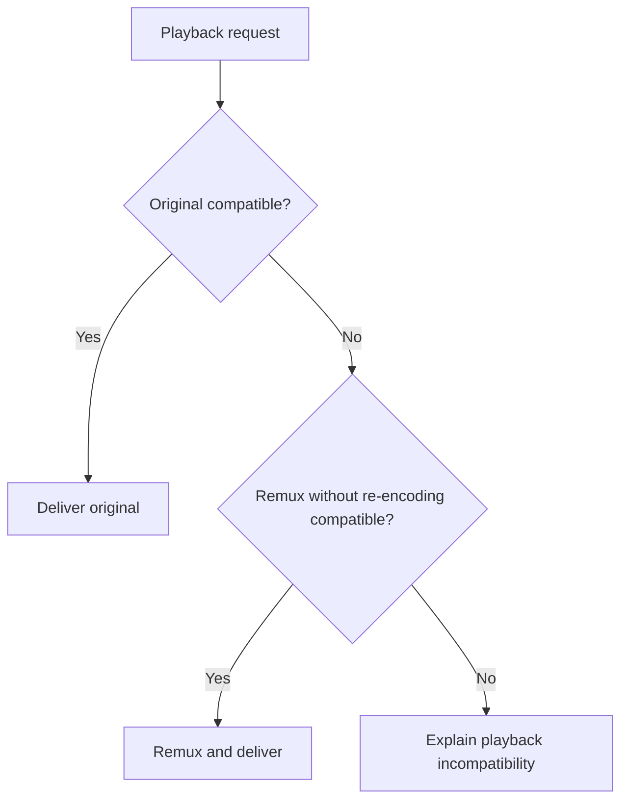
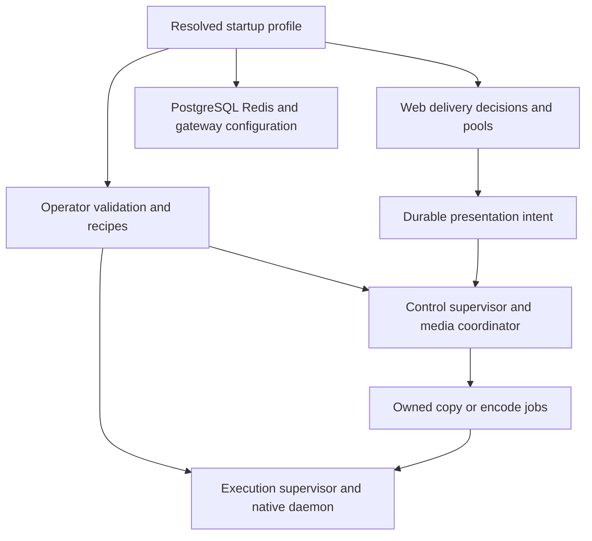
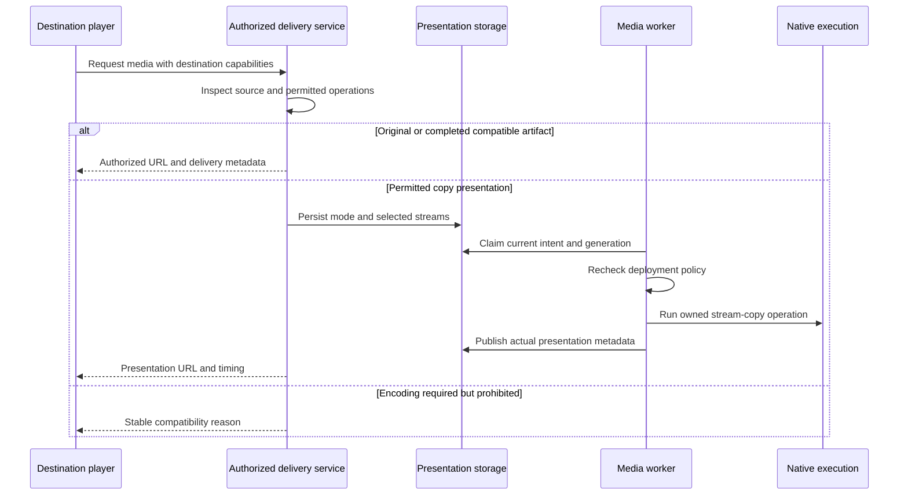
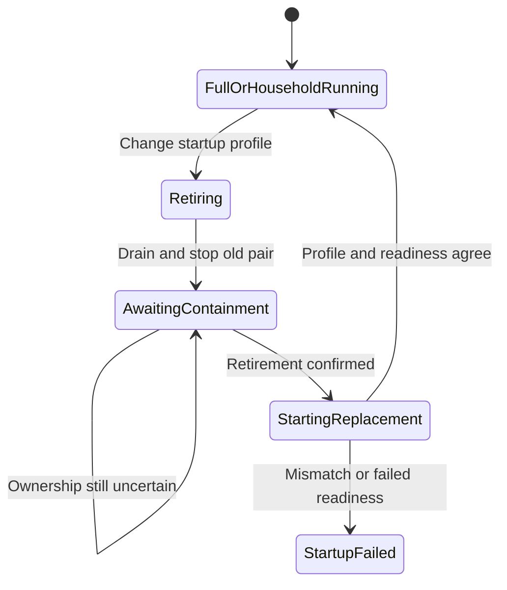

# Small-host household deployment - Plan

## Goal Capsule

**Objective:** A household can run Bånder on a smaller host with a measured, documented memory requirement while listening, watching and maintaining its library.

**Product authority:** The user confirmed the household workload, playback restrictions and separate small-host profile described below.
Product behavior is governed by R1–R12; the technical decisions below define how to deliver it.
Runtime changes have not been implemented or qualified.

**Means:** Extend the existing worker deployment pair and media delivery paths with a shared startup profile and measured resource budgets (KTD1–KTD7).

**Execution profile:** One integrated PR with eight dependency-ordered units, on a branch named after this plan.
The lower-budget deployment is published only when its playback restrictions and qualification are complete.
The lead integrates delegated work, runs the authoritative checks and records local commits; push only when requested.

**Authority and stop conditions:** Follow `AGENTS.md`, the Product Contract and then the Planning Contract.
Stop affected work if it would weaken ownership or media access checks, discard local data, or require a product-scope change.
A failed memory target or unavailable Pi hardware is handled by R12 and does not block the remaining work.

**Product Contract preservation:** Requirements and R/A/F/AE identifiers are unchanged; planning questions are resolved below without changing scope.

---

## Product Contract

### Summary

Add a small-host household deployment profile that reserves resources for its supported workload.
Qualify the complete stack and document its operating limits, while retaining the full transcoding profile.

### Problem Frame

The getting-started guide illustrates a worker pair reserving 2,944 MiB for control and 4,800 MiB for execution, with a further 1 GiB host admission margin.
Web, PostgreSQL and Redis also require capacity.
Those figures describe configured resource reservations, not measured whole-stack use.

The user observed roughly 800 MB in use across four web workers and questioned the larger deployment requirement.
That observation does not measure the separate worker pair or the rest of the stack.
Current worker admission floors and fixed media capacity mean a smaller deployment needs runtime changes as well as revised guidance.

### Key Decisions

- **Offer a separate household profile.** Governs R1 and R7; operators needing full transcoding retain their existing deployment choice.
- **Trade encoding capability for a smaller resource budget.** Governs R2–R6; ordinary library maintenance remains part of the supported workload.
- **Publish capacity claims from whole-stack evidence.** Governs R8–R11; a single worker measurement cannot establish host requirements.

### Requirements

**Household operation**

- R1. Operators can select a documented small-host household profile with bounded resource reservations appropriate to its enabled workload.
- R2. The profile supports 1–2 simultaneous streams against a library of 2,000 songs, 50 movies and 250 TV episodes while normal scanning and metadata updates run.
- R3. Playback in the profile supports original-file delivery and remuxing, which changes the container without re-encoding the audio or video.
- R4. The profile prohibits server-side audio and video re-encoding across playback and background workloads, including automatic fallbacks and requests from remote playback destinations.
- R5. When a destination cannot play an item through the paths allowed by R3, the user receives a clear compatibility explanation without an encoder being started.
- R6. Background library work remains functional with bounded concurrency; it may take longer to complete than in the full profile.
- R7. The full transcoding profile remains available, and the smaller profile preserves resource containment and work ownership guarantees.

**Qualification and guidance**

- R8. Qualification measures the complete deployment, including web, PostgreSQL, Redis, workers, required supporting services and host headroom, at idle and during the concurrent workload in R2.
- R9. The qualification procedure is repeatable and records hardware, software, resource settings, memory accounting, peak use, memory pressure, swap use, playback results and background completion.
- R10. Operator guidance distinguishes configured limits and reservations, observed consumption and the smallest tested host capacity, with explicit playback and background-work limits.
- R11. A complete deployment within 4 GB of host memory is a stretch goal, and Raspberry Pi support is claimed only after separate ARM build and hardware qualification.
- R12. If the stretch goal in R11 is not achieved or cannot be tested, report the measured result and remaining limits without blocking delivery of the qualified smaller profile.

### Actors

- A1. The household operator selects a deployment profile and uses its documented capacity and compatibility limits.
- A2. A listener or viewer starts playback from a client or an existing playback destination.
- A3. The server performs library maintenance alongside playback within the selected profile's resource budget.

### Key Flows

- F1. **Choose and run the household profile.** A1 follows the deployment guidance, starts the complete stack and imports the qualification library; A3 performs scans and metadata updates while A2 uses the supported streams. Covers R1, R2, R6–R10.
- F2. **Play within the profile's capabilities.** A2 requests an item; the server provides original delivery or remuxing when compatible with the destination, otherwise it explains why playback is unavailable. Covers R3–R5.

The playback decision below illustrates F2; the requirements remain authoritative.

### Acceptance Examples

- AE1. **Concurrent household use. Covers R2, R6, R8, R9.** With the qualification library present, two supported streams play while a scan discovers changes and metadata work completes; the run records peak memory and any playback interruption or job failure.
- AE2. **Container mismatch only. Covers R3, R4.** A destination accepts the source audio and video codecs but needs another container; the server remuxes the item without starting an audio or video encoder.
- AE3. **Encoding required. Covers R4, R5.** A destination needs an unsupported codec converted, or playback requires subtitle burn-in; the server explains the incompatibility and does not silently re-encode.
- AE4. **Remote destination request. Covers R4, R5.** An existing casting or other remote playback route requests an encoded rendition; the household profile applies the same restriction as local playback.
- AE5. **Measured capacity exceeds the stretch goal. Covers R10–R12.** The qualified profile needs more memory than the stretch target; guidance reports the smallest tested capacity and does not describe the deployment as fitting that target.
- AE6. **ARM evidence is incomplete. Covers R11, R12.** The stack passes memory qualification on another architecture but no Raspberry Pi hardware run is available; guidance keeps Pi support unqualified while reporting the verified profile results.

### Success Criteria

The qualified profile reduces the complete deployment's admitted memory budget relative to the existing full profile and completes the workload in R2 without out-of-memory termination, lost background work or playback failure caused by local resource exhaustion.
The report records the baseline and candidate under comparable conditions so the improvement can be checked.

### Scope Boundaries

- Runtime configuration, capability enforcement, resource budgeting, qualification and operator guidance needed for R1–R12 are included.
- A replacement deployment architecture, general benchmark platform and unrelated worker refactoring are outside this change.
- No new receiver protocol, client-side encoding capability or universal media compatibility is promised.
- Meeting the Raspberry Pi stretch goal does not justify expanding this work into an unbounded native dependency porting effort.

### Dependencies and Assumptions

Existing stream delivery, playback negotiation and worker execution need inspection for remux-only operation.
An audio-only setting is not sufficient to establish the restriction in R4.
Qualification uses media and destination combinations with known capabilities so compatibility failures can be separated from resource failures.
Available physical Raspberry Pi hardware has not been established.

### Outstanding Questions

The playback and resource design questions are resolved in KTD1–KTD6.
Qualification scenarios and failure criteria are defined in KTD7 and the Verification Contract.
The safe per-process memory budgets, smallest tested host capacity and physical ARM qualification remain deferred to implementation measurements under R11 and R12.

### Sources and Research

- `docs-book/part-1-operator-guide/getting-started.md`, prerequisites: worker-pair example and host margin.
- `src/Shared/Application/DTO/WorkerAutoscalingProfile.php`, `minimumMemoryMiB()`: admission floors of 2,944 MiB for control and `4160 + 320 * (maximumConcurrency - 1)` MiB for execution.
- `src/Shared/Application/DTO/WorkerRuntimeConfiguration.php`, constructor: execution management includes a 3,136 MiB native-process envelope.
- `src/Shared/Infrastructure/Worker/WorkerSupervisorRunner.php`, worker definitions: media management reserves 1,600 MiB for one manager and four kernel children.
- `dev-docs/worker-runtime-inventory.md`, process model and routing table: ordinary scans and metadata work use workers independently of encoding.
- `src/Transcode/Application/Settings/TranscodeSettingDefinitions.php` and `src/Media/Interface/Controller/StreamController.php`: `transcode.enabled` governs audio conversion, not a global video policy.
- `docs-book/part-2-developer-guide/testing.md`, worker qualification results: execution peak cgroup use of 878.5–1,021.4 MiB on a Ryzen 7 5800X3D with 64 GiB RAM; these are not whole-stack measurements.

A bounded search of `docs-book/` and `dev-docs/` found no Raspberry Pi or ARM whole-stack qualification.
This does not establish the absence of other artifacts or unrecorded hardware runs.

---

## Planning Contract

### Key Technical Decisions

- KTD1. **Use one immutable startup profile across the deployment.** A validated Shared application DTO owns the effective profile identifier, resource settings and allowed execution capabilities; web, operator, supervisor, media children and native daemon receive the same resolved values. Include these values in manifest validation, recipe fingerprints and readiness comparisons. Keep the current worker deployment pair, lease authority, disjoint CPU sets and retirement protocol. Unknown or mismatched profiles fail startup instead of falling back to a different budget. Governs R1, R7. (session-settled: user-approved — chosen over a live profile toggle or replacement worker architecture: deployment-time selection keeps resource admission and actual execution aligned.)

- KTD2. **Derive reservations from the processes and operations the profile admits.** Keep full-profile defaults unchanged. The household candidate has one resident ordinary consumer, the existing scheduled consumer, and two shared copy-job slots for audio or video, with no audio/video encoding slots. Keep relay, scheduler, media coordination and native execution available. Start web qualification with two workers and four Doctrine slots per worker. Build the reservation calculation from role counts, PHP heaps, native headroom and admitted native operations; use that calculation for both validation and launch configuration. Safe heap sizes and native limits are measurement results, not estimates promoted into defaults. Governs R1, R2, R6, R7.

- KTD3. **Enforce media capability at typed operation boundaries.** A Transcode application policy checks planned stream operations before durable admission and again when recovered work is claimed or executed. Household mode refuses any A/V encoding operation, including startup encoder test jobs, without creating an indefinite retry loop. Preserve FFprobe, image derivatives, loudness analysis and subtitle-only extraction needed for ordinary operation. Copy jobs do not require a fabricated encoder-capability snapshot. Keep existing authorization independent of capability checks. Governs R3–R7. (session-settled: user-approved — chosen over request-only checks: recovered and background work must obey the same restriction.)

- KTD4. **Negotiate delivery for the actual destination before assigning a media URL.** Extend the Media/Transcode application boundary with a typed decision covering original delivery, compatible completed artifact, copy-only presentation, or a stable incompatibility reason. Source metadata and selected streams constrain reported destination capabilities; a client cannot make an encoding operation permissible by requesting copy mode. Add authorized Range-capable original-video delivery using existing media-access and binary-response patterns. Preserve the full profile's encoded path and audio setting semantics. Household errors are terminal compatibility outcomes, not retryable capacity errors. Governs R3–R5.

- KTD5. **Extend durable presentation execution for genuine stream copy.** Persist copy/encode mode, selected streams and output container with the desired presentation; include them in reuse and cache identity. Use existing claims, generation publication, cancellation and native-process ownership for both audio-only and video copy jobs. Copy every selected A/V stream explicitly, with no encoding filters, bitrate conversion, forced keyframes or silence padding. Extend the current segmented delivery path to publish actual timestamps, segment durations and keyframe boundaries for copied video; seek from a valid source boundary and report its presentation offset. Audio-only container remux may publish a completed Range-capable artifact through the same owned job lifecycle. Follow [FFmpeg stream-copy semantics](https://www.ffmpeg.org/ffmpeg.html#Streamcopy). Governs R3–R5, R7.

- KTD6. **Reuse complete compatible artifacts without authorizing regeneration.** Separate read-only artifact lookup from admission of work. Verify source signature, selected streams, container and completion before reuse; missing, stale, partial or evicted output returns to KTD4. Profile changes retire the old pair before the new pair claims work; pending forbidden encoding reaches an existing visible terminal failure state. Eligible copy work retains normal recovery behavior. Governs R4, R5, R7. (session-settled: user-approved — chosen over purging cached media: serving existing compatible bytes does not require a new encoder.)

- KTD7. **Qualify production behavior with reproducible, constrained runs.** Extend the PHP tooling fixtures and owned Docker resources rather than introduce a separate benchmark framework. Build fixtures before measurement, then run the same production image, dataset and traffic against full and household profiles. Measure idle, startup, first import, warm maintenance, original playback, fresh remux and recovery. Use the [cgroup v2 memory interfaces](https://www.kernel.org/doc/html/latest/admin-guide/cgroup-v2.html) and host accounting, counting each cgroup only once. Record configured limits separately from observed use, including controller, gateway and observer overhead. A limited application container on a large host is not evidence that the whole deployment fits that host size. Governs R2, R8–R12. (session-settled: user-approved — chosen over warm-cache or worker-only evidence: the reported capacity must cover the complete household workload.)

- KTD8. **Ship a coherent deployment preset with explicit service configuration.** Add a household deployment renderer and sample configuration using the existing release identity, Docker engine wrapper and operator lifecycle. Do not copy the development Compose stack's privileged application or host-specific binds. Resolve images and application paths through the existing tooling configuration. Explicitly select PostgreSQL's configuration and bound its connections alongside application pools; preserve autovacuum and installed extensions. Use [PostgreSQL 18 resource guidance](https://www.postgresql.org/docs/18/runtime-config-resource.html) for the candidate settings below. Preserve Redis `noeviction` and account for persistence overhead. Governs R1, R6–R10.

### Resource qualification candidates

These are starting points for U7, not published minimum requirements.
The accepted preset is the configuration that passes the Verification Contract.

| Component | Initial candidate | Evidence required before retaining it |
|---|---|---|
| Web | Two workers, four Doctrine slots per worker | Concurrent playback, API and WebSocket activity; no connection starvation or leaked pool assignments |
| Ordinary consumers | One resident consumer | Scan and metadata queues complete during playback |
| Copy execution | Two shared audio/video copy-job slots | Two fresh copy presentations progress concurrently; probes and maintenance still have native capacity |
| PostgreSQL | `shared_buffers=128MB`, `work_mem=4MB`, `maintenance_work_mem=64MB`, `autovacuum_work_mem=32MB`, `max_parallel_workers_per_gather=0` | Effective settings, temporary-file activity, autovacuum progress and peak memory under the same workload |
| PostgreSQL connections | Candidate `max_connections=32` after inventory | Account for dedicated scheduler/media connections, pooled web connections, consumers, health checks and administrative reserve |
| Redis and native work | Limits derived from measured peaks and admitted concurrency | No rejected required writes, lost jobs or starvation; record fork/persistence and overlapping native-process peaks |

Current worker formulas reserve fixed media and native capacity even when unused.
Reducing media children alone saves only part of that envelope; U2 must change actual admission and the matching resource calculation together.
The PostgreSQL file copied into the image is not selected explicitly by the current root Compose command, so its contents are not proof of effective settings.

### High-Level Technical Design

These diagrams show ownership and required information flow; they do not prescribe method signatures.

For KTD3–KTD6, media delivery is selected before job admission and verified again at execution.
An incompatibility result reaches the player before the browser's media element can discard the HTTP response body.

For KTD1 and KTD6, profile replacement uses the existing deployment lifecycle.
Uncertain process ownership remains a retirement problem; it never permits overlapping replacement execution.

The operation decision in KTD3 is distinct from whether a native executable is present.

| Work | Full profile | Household profile |
|---|---|---|
| Authorized original-file delivery | Existing behavior | Allowed |
| Complete compatible artifact reuse | Existing behavior | Allowed without regeneration |
| Copy-only audio/video presentation | Allowed after this change | Allowed within copy capacity |
| New audio/video encoding | Existing settings and capacity | Refused |
| Encoder hardware qualification job | Existing startup behavior | Skipped |
| Probes, images, analysis and subtitle-only extraction | Existing behavior | Retained within native capacity |

### Alternatives and boundaries

The existing segmented video lifecycle is the chosen starting point because it already owns generation publication, cancellation and seeks.
A new unowned FFmpeg process in an HTTP request would bypass those contracts; a second full-file video conversion pipeline would duplicate them and delay first playback.
No competing mechanism requires a separate prototype before implementation, but real-media timing proof is an early U4 gate.

A generic shell-argument firewall, a new worker orchestration system and live profile switching are not part of this change.
Typed operation checks and the existing retirement protocol close the identified paths; reconsider these exclusions only if a traced caller cannot be controlled there.
Do not expand this work into new casting protocols, broad schema remediation, native dependency porting or unrelated service-pool cleanup.

### Dependencies and implementation unknowns

Safe PHP heaps, native-process envelopes, Redis capacity and minimum host memory require U7 measurements.
Start with existing safe limits, remove only disabled capacity, then lower measured candidates with recorded failure and success results.
If a minimum cannot be reduced while preserving the workload, report it under R12 rather than weaken the tests.

The copy path needs an explicit supported source/container/destination matrix.
Use named positive cases and deterministic negative cases; unsupported layouts must fail before an encoder fallback.
Physical Pi hardware and ARM image/native-library availability remain optional qualification prerequisites.
An ARM build or emulated boot alone does not establish Pi playback capacity.

### System-Wide Impact

Persisted presentation mode affects reuse, seek, retry and recovery; schema and state serialization changes need fresh-install and PostgreSQL review.
Existing full-profile jobs remain encoding jobs when mode is resolved under the prerelease schema policy, and local data must not be reset without authorization.
The selected profile affects web pools, worker reservations, native admission and readiness, so all consumers change together.

Player error handling must use structured decisions for play, preload, fallback and remote preparation.
Keep media authorization, signed URL expiry, Range handling and source-path confinement on the existing access boundary.
The existing browser/Electron destination flow is in scope; absent receiver adapters are not invented to exercise it.

### Research Constraints to Preserve

- `docs/solutions/runtime-errors/swoole-callbacks-outside-the-bundle-leak-pooled-services.md`: pool limits cannot compensate for leaked assignments; retain callback ownership and release behavior.
- `docs/solutions/architecture-patterns/state-set-when-work-is-queued-on-swoole-task-must-expire.md`: preserve scan claims and transactional stale-owner fencing.
- `docs/solutions/architecture-patterns/health-checks-run-in-a-messenger-consumer-cannot-see-outages-that-stop-it.md`: workload liveness needs an observer outside the failing consumer.
- `docs/solutions/runtime-errors/swoole-table-default-conflict-proportion-drops-keys.md`: do not save memory by reducing shared-table capacity without checking all required keys.
- `docs/solutions/runtime-errors/registry-coroutine-work-must-preserve-the-signal-reactor.md`: a successful load phase is insufficient without successful process exit and cleanup.

---

## Implementation Units

### U1. Resolve and propagate the deployment profile

**Goal:** Every process starts from one validated profile and agrees on its identity.

**Requirements:** R1, R7; KTD1. **Dependencies:** None.

**Files:** Add `src/Shared/Application/DTO/DeploymentProfile.php` and its unit test; update `src/Shared/Application/DTO/WorkerRuntimeConfiguration.php`, `src/Shared/Infrastructure/Worker/DeploymentOperatorManifest.php`, `DeploymentContainerRecipe.php`, `DeploymentReadiness.php`, `WorkerReadinessObservation.php`, `config/services.yaml`, and the worker entrypoint configuration consumers.

**Approach:** Define full and household profile resolution, strict serialization and immutable effective values. Extend the manifest schema and fingerprint once, then update all tooling and runtime consumers. Keep unsupported versions explicit under the prerelease policy. Record the profile in existing readiness/diagnostic output rather than add a monitoring subsystem.

**Test scenarios:** Round-trip both profiles; reject unknown identifiers, contradictory capabilities and resource fields; changing a relevant field changes the recipe fingerprint; reject web/pair mismatch; full-profile launch values match existing behavior.

**Tests:** Extend `tests/Unit/Shared/Application/DTO/WorkerRuntimeConfigurationTest.php` and the existing manifest, recipe and readiness tests; add `tests/Unit/Shared/Application/DTO/DeploymentProfileTest.php`.

**Verification:** Focused backend configuration tests, worker readiness fixture and backend static gates.

### U2. Make worker and native capacity match the selected profile

**Goal:** Household processes admit only the concurrency covered by their reservations.

**Requirements:** R1, R2, R6, R7; KTD1–KTD3. **Dependencies:** U1.

**Files:** `src/Shared/Application/DTO/WorkerAutoscalingProfile.php`, `WorkerRuntimeConfiguration.php`, `src/Shared/Infrastructure/Worker/WorkerSupervisorRunner.php`, `NativeExecutionDaemon.php`, `NativeExecutionProtocol.php`, `src/Transcode/Infrastructure/Worker/MediaWorkerRunner.php`, `bin/worker-native.php`, `bin/worker-media.php`, `bin/worker-media-job.php`.

**Approach:** Replace duplicated fixed floor calculations with the profile's role and native envelopes. Make copy capacity shared across audio/video jobs, and keep ordinary and scheduled work independent of those slots. Carry limits through child launch and native handshake. Skip disabled encoder readiness/probing without skipping metadata readiness. Preserve whole-pair drain, containment and recovery behavior.

**Test scenarios:** Two copy jobs progress while maintenance can probe; excess copy work waits without spawning extra children; no encoder qualification runs in household startup; disabled audio encoding queues do not prevent readiness; full-profile limits remain unchanged; native capacity exhaustion and child failure retain ownership until confirmed retirement.

**Tests:** Extend worker runtime/supervisor/native-protocol tests, `tests/Unit/Transcode/Infrastructure/Worker/MediaWorkerRunnerTest.php`, `MediaWorkerBootstrapTest.php`, and the existing media-control, lifecycle and recovery fixtures.

**Verification:** Focused backend tests plus worker media-control, production, lifecycle and recovery container gates.

### U3. Add capability-aware delivery decisions and original-video delivery

**Goal:** Players receive a permitted delivery decision or a useful incompatibility result before media loading.

**Requirements:** R3–R5, R7; KTD3, KTD4, KTD6; F2, AE3, AE4. **Dependencies:** U1.

**Files:** Add a Transcode application execution policy and a Media application delivery decision service with ports for metadata and artifact lookup; update `src/Media/Interface/Controller/StreamController.php`, media access/stream ports, `src/Transcode/Application/CommandHandler/CreateTranscodeSessionHandler.php`, audio rendition cache/executor and their application ports. Add the delivery request/resource/controller and original-video route in their existing contexts. Update `openapi.json` through generation.

**Approach:** Separate complete-artifact lookup from work admission. Keep capability checks in application use cases shared by HTTP, worker and any existing CLI path. Add structured reasons for prohibited encoding and incompatible containers/streams. Recheck policy for durable recovered jobs and all typed encoder operations, including `FFmpegAdapter`, `FMP4SegmentWriter` and `SegmentEncoder`. Use the existing failure lifecycle for rejected work. Check access again when an authorized URL is consumed.

**Test scenarios:** Original audio/video supports authenticated Range requests; denied library access stays denied; fresh encoding requests and recovered encode work are refused without retry churn; completed compatible cache hits do not schedule work; stale/partial/evicted hits return to negotiation; metadata analysis and image/subtitle extraction remain allowed; full-profile audio toggle behavior is unchanged.

**Tests:** Extend `tests/Functional/Media/AudioTranscodeToggleTest.php`, `AudioTranscodeStreamTest.php`, `tests/Unit/Media/AudioRenditionCacheTest.php`, `AudioRenditionExecutorTest.php`, and `tests/Integration/AudioRenditionWorkerHandoffTest.php`; add Media delivery decision and original-video functional tests.

**Verification:** Backend unit/functional/integration lanes, API schema export and static architecture gates.

### U4. Execute and publish owned copy presentations

**Goal:** Supported container changes preserve encoded A/V streams and remain playable through seek and recovery.

**Requirements:** R2–R5, R7; KTD3–KTD6; AE2, AE3. **Dependencies:** U2, U3.

**Files:** `src/Transcode/Application/DTO/DesiredTranscodeState.php`, `src/Transcode/Infrastructure/Doctrine/TranscodeRuntimeState.php`, transcode job state/identity and persistence, `src/Transcode/Infrastructure/FFmpeg/SegmentEncoder.php`, `src/Transcode/Infrastructure/Swoole/TranscodeStreamManager.php`, `src/Transcode/Infrastructure/HLS/FMP4SegmentWriter.php`, HLS/DASH manifest generators, `src/Transcode/Domain/Model/SegmentMetadata.php`, audio rendition execution/publication and applicable migrations.

**Approach:** Implement KTD5 through the existing owned media lifecycle. Retain actual timestamps and source-codec metadata throughout segment publication and playback manifests. Remove fixed encoded-GOP assumptions from copy-mode seek calculations. Add an audio-only container-copy case through the shared copy capacity. Have the PostgreSQL specialist review persisted mode and identity changes; follow `.agents/skills/postgres-remediation/SKILL.md` without unrelated schema changes.

**Execution note:** Prove copy output, irregular keyframes and nonzero source timestamps with real media before broadening the supported matrix.

**Test scenarios:** H.264/AAC in a container requiring repackaging; audio-only AAC container repackaging; video without audio; nonzero timestamps and irregular keyframes; seek beyond published output; final partial segment and EOF; pause/resume, cancellation and worker recovery; incompatible audio codec or burn-in never starts an encoder; copy/encode requests never share an incompatible job or cache artifact.

**Tests:** Extend `tests/Unit/Transcode/Infrastructure/FFmpeg/SegmentEncoderStreamArgsTest.php`, `tests/Integration/TranscodeExecutionIntentTest.php`, `TranscodeStartupUnavailableTest.php`, existing ownership/publication/adaptive-delivery tests, and add real-media copy-presentation integration tests.

**Verification:** Backend integration/native lanes, media publication/ownership gates and real-media output inspection demonstrating stream copy rather than merely checking argument strings.

### U5. Integrate delivery decisions with player and destination flows

**Goal:** Music and video use the negotiated path and show terminal compatibility errors consistently.

**Requirements:** R3–R5; KTD4–KTD6; F2, AE3, AE4. **Dependencies:** U3, U4.

**Files:** `ui/web/src/features/player/stores/player-playback-runtime.ts`, `features/player/hooks/use-audio-playback.ts`, `features/catalog/hooks/useBaanderPlayer.ts`, related `hls-playback.ts`, video runtime/overlay components, `features/session/services/playback-command-runner.ts`, playback execution/coordinator services, translations and generated API clients.

**Approach:** Regenerate API types and adapt play, preload, fallback, seek and remote preparation together. Negotiate using the destination's capabilities; the initiating browser's codec support does not stand in for a remote browser. Direct-video delivery uses native file playback while copy presentations retain adaptive playback. Preserve playback ownership and stop acknowledgements. Capability failures stop automatic conversion retry and remain visible through existing player error UI.

**Test scenarios:** Supported original, fresh copy and completed-cache playback; terminal incompatible audio/video with no fallback loop; next-track/preload failure; seek and duration accuracy for copied media; browser-to-browser destination preparation with different capabilities; stale request completion cannot replace a newer track; full-profile encoding fallback still works.

**Tests:** Extend audio playback hook tests, session command/coordinator tests, catalog player tests and `ui/web/tests/e2e/playback-destinations/video-transfer.spec.ts`; add household music/video browser cases to the existing playback fixtures.

**Verification:** Web tests, typecheck, lint, generated-client drift check, and Playwright against the isolated preview with an explicit base URL.

### U6. Provide the complete household deployment preset

**Goal:** Operators can start the same constrained configuration that qualification measures.

**Requirements:** R1, R6–R10; KTD1, KTD2, KTD8; F1. **Dependencies:** U1–U5.

**Files:** Add `packages/baander-tooling/src/Deployment/Household.php`, a thin `scripts/deploy-household.php` entrypoint, and `deploy/household/` sample configuration; reuse existing tooling runtime configuration, release identity and Docker engine APIs. Update `config/packages/swoole.yaml` to consume validated profile values, PostgreSQL startup configuration, worker manifest consumers and relevant tooling tests.

**Approach:** Render or validate gateway, web, PostgreSQL, Redis and worker settings from one selected profile and immutable image identity. Continue creating the worker pair through its operator lifecycle. Make paths and image references configurable through existing tooling conventions. Preserve user data volumes across profile replacement. Explicitly select the PostgreSQL file and configure pool/server limits together. Keep operator/controller requirements and resource use visible in the generated instructions.

**Test scenarios:** Rendered values agree with runtime fingerprints; full and household configuration stay separate; no host-specific paths, privileged app, or application Docker socket; persistent data survives stop/restart; unsupported/mixed profiles fail validation; PostgreSQL effective settings match the chosen file; Redis retains required writes and tag semantics under the candidate workload.

**Tests:** Add `scripts/tests/php/HouseholdDeploymentTest.php`; extend tooling configuration and development-worker tests only where shared consumers change; add deployment integration assertions to U7's fixture.

**Verification:** Tooling tests/static gates, generated configuration validation and U7's complete deployment run.

### U7. Qualify resource reduction and the household workload

**Goal:** Produce reproducible evidence for the smallest tested configuration that satisfies the Product Contract.

**Requirements:** R2, R8–R12; KTD2, KTD7, KTD8; AE1, AE5, AE6. **Dependencies:** U2–U6.

**Files:** Add `packages/baander-tooling/src/Fixtures/Household/Qualification.php`, dataset and report helpers, and `scripts/test-household-deployment-container.sh`; reuse worker `Measurements.php`, `PostgresSampler.php`, owned resource/cleanup helpers and configured images/budgets. Add fixture report validation tests under `scripts/tests/php/`.

**Approach:** Implement the Verification Contract's dataset, workload and measurement protocol. Use disposable resources and immutable production builds; cache/fixture preparation is outside the measured window and recorded. Retain successful and failed receipts. Compare full and household configurations on adequate hardware, then verify the candidate on an explicitly constrained whole host or VM. Do not reinterpret a skipped run as a pass.

**Test scenarios:** Idle/startup and complete cold scan; warm scan/metadata update with two original streams; two fresh copy streams with uncached maintenance; mixed music/video load; profile replacement with pending encoding and eligible copy work; worker recovery; a deliberately insufficient memory budget produces a failed receipt; missing Pi hardware records unqualified rather than success.

**Verification:** Complete household workload protocol below, existing full-profile worker regressions, fixture parser tests and clean resource teardown.

### U8. Publish measured operator guidance

**Goal:** Operators can choose a profile and understand its actual resource and playback limits.

**Requirements:** R10–R12; KTD7, KTD8; AE5, AE6. **Dependencies:** U7.

**Files:** `docs-book/part-1-operator-guide/getting-started.md`, `configuration.md`, `transcoding.md`, worker command guidance, `docs-book/part-2-developer-guide/testing.md`, `packages/baander-tooling/README.md`, `CONCEPTS.md`, `ROADMAP.md` and relevant public-site documentation source links.

**Approach:** Replace the implication of a universal worker-pair minimum with profile-specific measured guidance. Explain direct/remux compatibility, startup selection and replacement, cached reuse, slower maintenance and failed compatibility outcomes. Publish the accepted preset, measured peaks, host headroom and test limitations together. Keep unqualified Pi support explicit under R12. Regenerate derived documentation only through its normal build.

**Test expectation:** Documentation-only changes need source/command/link checks and prose preservation review, not new application tests.

**Verification:** `prose-fix`, documentation source/build checks, whitespace check and cross-check of every published number against U7's retained receipt.

---

## Verification Contract

### Workload and pass criteria

The dataset contains the counts in R2 as distinct library records discovered through normal scanning, with recorded fixture sizes, durations, codecs and metadata.
Generated media is prepared outside the measured deployment; it must not disguise encoder execution inside household mode.
Include positive H.264/AAC video and audio-only container-copy cases, a video with no audio, irregular keyframes, nonzero timestamps, and negative audio-codec/burn-in cases.
Document synthetic fixtures and their limits rather than imply they represent every media collection.

Run cold startup and a complete first scan, then at least 30 minutes per overlap scenario: two original streams with maintenance, two fresh copy presentations with maintenance, and mixed music/video playback.
Repeat the accepted constrained configuration three times from recorded initial conditions.
Continue each run until the scheduled scan and metadata work completes, even when that exceeds the playback interval.
Use deterministic local metadata-provider fixtures for repeatability and record that external-provider latency is outside this result.

A passing run has no OOM event, unexpected process exit, lost job, unbounded retry, prohibited encoder launch, resource-induced playback stall, or failure to finish maintenance within the fixture's declared deadline.
Declare the deadline and traffic schedule in the receipt before the run; changing either invalidates comparison with earlier receipts.
Keep playback-progress and queue-completion evidence, not only successful HTTP responses.
A capacity claim requires the total host memory constraint, effective service limits, storage characteristics and observed headroom to be recorded.
Report swap activity explicitly and do not describe a run sustained by continuing swap growth as a memory fit.

Measure per-service cgroup peaks/events, native process/thread concurrency, web pool assignments, PostgreSQL connections/settings, Redis memory/write failures, controller/gateway overhead and host memory pressure.
Use one synchronized sampling interval across the run and record missing samples.
After the load phase, verify normal process exit, pair retirement, data-volume retention and fixture cleanup.

The reduction succeeds when the accepted household configuration has a lower total admitted budget than the full-profile baseline under comparable accounting and passes the workload above.
The stretch target remains governed by R11–R12; do not weaken acceptance to label a run as fitting it.
Physical Pi evidence additionally names board, architecture, OS/kernel, storage, image/native dependency identities and thermal conditions.

### Repository gates

These gates run during implementation, not while writing this plan.
The CI image is authoritative for backend results; use existing configured image selection and preserve isolated resources.

| Area | Gate | Scope |
|---|---|---|
| Backend | `bash scripts/test-backend-container.sh` with affected test paths, then the required backend lanes | U1–U4 and persistence/full-profile regressions |
| PHP analysis | `php scripts/check-backend-container.php` running PHPStan and Deptrac through the configured CI image | No new violations or weakened baselines |
| Tooling | `composer test:tooling`, tooling PHPStan/Deptrac scripts | U1, U6, U7 configuration, rendering and receipt validation |
| Worker runtime | Existing `scripts/test-worker-production-container.sh`, `test-worker-media-control-container.sh`, `test-worker-lifecycle-container.sh`, `test-worker-recovery-container.sh` | Full profile and household ownership, capacity and retirement |
| API and web | `composer openapi`; in `ui/web`, `yarn generate:check`, `yarn test`, `yarn typecheck`, `yarn lint` | Delivery decisions, generated consumers and player behavior |
| Browser | Existing Playwright configuration and affected playback specs with explicit `E2E_BASE_URL` from `make preview-url` | Original/copy playback, terminal errors, seek and remote preparation after `make preview-up` |
| Household capacity | New `scripts/test-household-deployment-container.sh` using U6 configuration | Complete protocol above, including failed-capacity receipts |
| Documentation | Prose preservation audit, relevant documentation build/link checks and `git diff --check` | U8 and recorded qualification claims |

Each implementation unit records its actual commands, counts, image identity and remaining limits in `ROADMAP.md`.
Apply `ce-simplify-code` at implementation phase boundaries and `ce-code-review` before shipping, as required by `AGENTS.md`.

---

## Definition of Done

- R1–R12 and AE1–AE6 are accounted for by the implementation and recorded verification, with optional hardware results labeled accurately.
- U1–U6 agree on one startup profile, preserve authorization and worker ownership, and pass their focused and integration checks.
- U7 produces repeatable whole-stack receipts and a qualified preset with a reduced admitted budget; unsuccessful stretch-target runs remain visible.
- U8 describes the accepted preset and measured limitations without treating configured ceilings as observed consumption.
- Required backend, tooling, API, web, browser and runtime gates pass without weakened baselines; justified review findings are applied.
- Experimental code, abandoned packaging approaches and temporary compatibility paths are removed from the delivered diff.
- Local user data and unrelated workspace changes are preserved; no push, merge or deployment is implied by finishing this plan.
