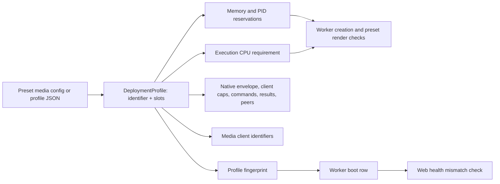
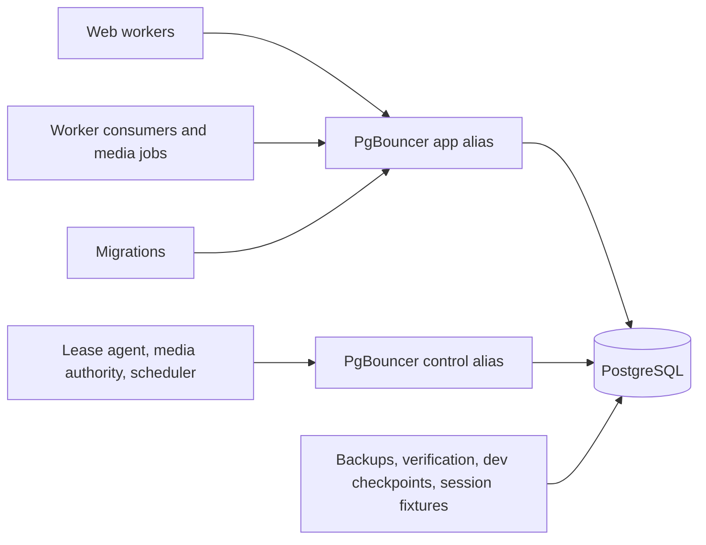

# Configurable media capacity and connection pooling - Plan

## Goal Capsule

**Objective:** A household with a capable server can play 8 videos and 12 audio streams that need conversion or copy at the same time, in real time, and the deployment reserves exactly the memory, CPU and database capacity that its configured load requires.

**Means:** Operator-set video and audio job slots in the startup profile, with every resource limit derived from them (KTD1–KTD5), and a transaction-mode PgBouncer 1.26.1 so PostgreSQL backends stop scaling with clients (KTD8–KTD11).

**Product authority:** The user directed the capacity model, the pooler, and the answers recorded under Key Decisions on 2026-11-03.
Product behavior is governed by R1–R15; the Planning Contract decides how to deliver it.

**Execution profile:** One branch, `feat/configurable-media-capacity`, with dependency-ordered units landed as local commits.
U2's measurements are inputs to U3, U5 and U7; no derived constant is written before they exist.
Push only when the user asks.

**Authority and stop conditions:** Follow `AGENTS.md`, then this Product Contract, then the Planning Contract.
Stop affected work if it would weaken ownership, lease, signed-delivery or media access checks, change household slot values or worker reservations, or discard local data.
A measured per-job cost that makes the 8 + 12 target exceed any reasonable single-host envelope is reported with the numbers rather than hidden by lowering the target.

**Product Contract preservation:** New plan; no upstream Product Contract.

---

## Product Contract

### Summary

The full profile gains operator-set video and audio job slots with measured, generous defaults.
Memory, PID, CPU and native-execution limits follow from the configured slots, so a deployment is admitted only when its host covers the configured load.
A transaction-mode PgBouncer sits between the application and PostgreSQL in both profiles and the standard install, so database memory depends on a small server pool instead of on every web, worker and media client.
Operators get documentation, a CLI that prints the effective profile and its reservations, and a health signal when web and workers disagree.

### Problem Frame

The full profile admits only 3 video jobs and 1 audio job at a time, and stream copy shares those slots.
Some households run 8 video and 12 audio streams that need conversion or copy at once; everything beyond the fixed slots queues, even on a host with spare CPU and memory.
The limits are constants in `src/Shared/Application/DTO/DeploymentProfile.php`, and several dependent limits are hard-coded elsewhere: media client identifiers, a 16-peer native daemon cap, a single global native command limit, fixed PID floors, and a one-CPU execution quota in the managed preset.

Database memory compounds the problem.
Each PostgreSQL connection that touches a PGroonga index keeps about 22 MiB, and every media child opens its own connections.
More media slots would therefore grow PostgreSQL's memory with the same multiplier that caused the OOM kills fixed on the household branch.

### Key Decisions

- **Operator-set slots with derived reservations.** (session-settled: user-directed — chosen over fixed 8 + 12 defaults and over sizing automatically from host CPU and memory: operators know their hardware; reservations must follow the choice.) Governs R1, R3.
- **No compatibility constraint; aim for great defaults.** (session-settled: user-directed — chosen over keeping today's 3 + 1 for existing installs: nothing is deployed.) Governs R1.
- **Real-time capability with CPU derived from slots.** (session-settled: user-directed — chosen over proving admission only and over CPU guidance without validation: a slot that cannot keep up is not capacity.) Governs R3, R4.
- **Zero slots disable a kind.** (session-settled: user-directed — chosen over a minimum of one per kind: operators may run audio-only or video-only conversion.) Governs R5.
- **Derived maximums, rejected early.** (session-settled: user-directed — chosen over fixed caps: limits move with the derived resources.) Governs R6.
- **Queue when busy, with a documented busy response.** (session-settled: user-directed — chosen over an immediate busy error: today's queueing is kept.) Governs R7.
- **PgBouncer in this plan, in both profiles and the standard install.** (session-settled: user-directed — chosen over a separate plan: more slots must not raise database memory.) Governs R9.
- **Real time is guaranteed at 1080p.** (session-settled: user-directed — chosen over 1440p and over the ladder's 4K top tier: matches typical household content and fits a reasonable CPU envelope.) Governs R4.
- **Default slots shrink in the 8:12 ratio.** (session-settled: user-directed — chosen over trimming video first and over trimming audio first: keeps the mix the target describes.) Governs R1.
- **The pooler's credentials get their own volume.** (session-settled: user-directed — chosen over the application secrets volume: the network-facing pooler must not mount the OAuth signing key.) Governs R14.
- **Household gets the pooler without requalification.** (session-settled: user-directed — chosen over freezing household entirely and over re-running its qualification: the configured values change; the measured figures are labelled as pre-pooler.) Governs R8, R15.

### Requirements

**Media capacity**

- R1. Full-profile operators set the number of concurrent video jobs and audio jobs; stream copy shares the slots of its kind, and unset values use measured defaults sized for a typical full-profile host.
- R2. Web, workers, the native daemon and the worker manifest use the same slot values; workers refuse a disagreeing profile, and web health reports when its profile differs from the active worker boot.
- R3. Worker memory and PID reservations, the native encoder envelope, native execution limits and the execution CPU allowance are derived from the configured slots, and a deployment is refused when its host or configuration does not cover them.
- R4. A full deployment configured for 8 video and 12 audio jobs runs all twenty concurrently, keeps every stream ahead of real-time playback at 1080p, and causes no media-role containment; 1440p and 4K renditions keep working but are outside this guarantee.
- R5. In the full profile, a kind configured with zero slots is disabled: its encodes and its stream copies are refused with the existing compatibility explanation instead of waiting forever.
- R6. Slot counts beyond the derived maximums are rejected when the managed preset renders and when the profile is built, naming the bound that was exceeded.
- R7. When every slot of a kind is busy, new work of that kind queues; an audio start that exceeds its wait receives a documented busy response.
- R8. The household profile keeps its slot values, worker reservations and native envelope, and rejects slot overrides.

**Database pooling**

- R9. Web, workers and migrations reach PostgreSQL through a transaction-mode PgBouncer 1.26.1 in both profiles and the standard install, so PostgreSQL backends are bounded by the pooler's server pools rather than by client counts.
- R10. Worker leases, media authority checks and the scheduler use a separate reserved pool whose waits end before their lease and authority deadlines.
- R11. Backups, deployment verification, development checkpoints and test fixtures that need session state connect to PostgreSQL directly.
- R12. PostgreSQL's time zone is UTC by configuration and by migration, and web and workers refuse to start when the server reports another zone.
- R13. Application SQL stays safe for transaction pooling, and a test fails when session-scoped constructs are introduced.
- R14. The pooler authenticates with a SCRAM auth file generated from the database password into a private credentials volume that only the pooler mounts.

**Guidance**

- R15. Operator documentation explains slot sizing, the derived reservations and CPU, the pooler and connection sizing; System Requirements shows the new configured values and labels the household measurements as taken before the pooler.

### Acceptance Examples

- AE1. **Covers R1, R3.** Given a full preset configuration with `videoSlots: 8` and `audioSlots: 12` and an execution CPU set too small for them, when the operator renders the deployment, then rendering fails and names the required CPU count.
- AE2. **Covers R5.** Given a full profile with zero audio slots, when a client requests an audio rendition or an audio stream copy, then it receives the existing compatibility explanation and no job is queued.
- AE3. **Covers R2.** Given a source install whose web profile says 8 video slots while the active worker boot was started with 4, when an operator checks web health, then health reports the profile mismatch.
- AE4. **Covers R7.** Given all audio slots busy, when a listener starts a track that needs a new rendition and no slot frees within the start wait, then the player receives the documented busy response.
- AE5. **Covers R9, R10.** Given web traffic that saturates the application pool, when a worker renews its lease, then the renewal is served from the control pool within its deadline.
- AE6. **Covers R8.** Given a household preset configuration that sets `videoSlots`, when the operator renders it, then rendering fails because household slots are fixed.

### Success Criteria

- The 8 + 12 load proof finishes with every stream ahead of real time, no containment, no OOM event, and PostgreSQL backends never exceeding the configured server pools plus direct reserve.
- Household's derived worker reservations and native envelope are byte-identical to today's in tests.
- An operator can size a full host from System Requirements and the profile CLI without reading code.

### Scope Boundaries

- Requalifying the household profile with the pooler is not part of this plan (Key Decisions).
- Automatic sizing from host CPU and memory stays out (Key Decisions).
- Redesigning the one-process-per-job media model is out; this plan measures and right-sizes each job's reservation instead.
- Web-side slot admission is out: web receives the configured slot-bearing profile for policy refusal and the health fingerprint, but does not count or admit jobs against slots.
- GPU encoding and hardware-acceleration selection are unchanged.

---

## Planning Contract

### Key Technical Decisions

- KTD1. **The profile carries a validated slot choice.** `DeploymentProfile` takes the identifier plus optional video and audio slot counts, validates them against per-profile rules, and `fromJson` validates the serialized fields instead of comparing them with a built-in table. This follows `WorkerAutoscalingProfile`'s strict-JSON, bounded-choice pattern. Household keeps its fixed shared copy pool (two shared copy slots, `media-copy-0` and `media-copy-1`, encoders prohibited) as a profile mode the video and audio slot parameters do not express. The eleven parameters that default-construct a profile are removed so every consumer receives the configured instance. Instantiates the Key Decision governing R1 and R3.
- KTD2. **Every dependent limit is derived from slots by one set of formulas.** The full profile's media child reservation becomes a measured per-child value of its own; household keeps today's 320 MiB per child (R8). The native envelope is the sum of measured per-kind native allowances plus fixed headroom; household keeps 512 MiB. Per-client native caps exist for every profile: a video client may run one encoder and one helper, an audio client one encoder, a household shared copy client one copy command and one helper, media control one command. Commands are the sum of client caps; results are twice the commands plus two; clients are the fixed system clients plus one per slot. Process floors add the measured per-slot thread counts. The formulas reproduce household's current values exactly, and tests pin both. The video cap counts one helper rather than the helper queue's eight because helpers beyond the first already queue inside the job; today's full command limit of 8 is this formula at 3 + 1. Every video encode runs with a fixed two-thread cap today (`SegmentEncoder`); if U2 measures that cap below real time at the R4 tier, the per-encoder thread count becomes a measured constant used by `SegmentEncoder` and counted in the per-slot thread floors and per-kind CPU cost.
- KTD3. **CPU follows the slots.** The required execution CPUs are the measured per-kind CPU cost, taken with the slots running concurrently, times the configured slots, rounded up. Because the playback governor admits new encodes only up to its configured share of host CPU, the required host cores are that cost divided by the governor's budget cap, rounded up, and rendering reports both figures. The managed preset sets the execution unit's CPU quota to the size of its CPU set instead of one CPU, and rendering rejects a CPU set smaller than the requirement; the source-install manifest applies the same check at worker creation. (session-settled: user-directed — chosen over proving admission only: real-time is the requirement.) Governs R3, R4.
- KTD4. **The native daemon admits by derived peer cap with backpressure.** Its open-peer cap is the derived client count plus a small margin. At the cap it stops accepting, so new peers wait in the listen backlog instead of being closed and escalating to containment, and it drains all pending accepts each loop iteration. (session-settled: user-directed — chosen over raising the cap but still closing excess peers: a closed peer is treated as uncertain and contains the media role.)
- KTD5. **Defaults are measured, not guessed.** The full profile's default slot pair starts at 8 video and 12 audio and, while its derived CPU requirement exceeds an 8-core execution set or its derived worker reservation exceeds 16 GiB, shrinks both kinds in the 8:12 ratio, rounding down. U2's measurements decide the numbers, and System Requirements records them beside the measurements.
- KTD6. **Web reports profile disagreement through health.** The worker boot row records the profile fingerprint the boot started with; the web health check compares it with its own profile and reports a mismatch. (session-settled: user-directed — chosen over refusing web startup and over documenting only: misconfiguration becomes visible without a restart loop.) Governs R2.
- KTD7. **Zero slots refuse the kind at the policy.** `MediaOperation::StreamCopy` splits into video and audio stream copy, and in the full profile `MediaExecutionPolicy` refuses encodes and stream copies of a kind whose slot count is zero, so delivery negotiation returns its existing compatibility explanation and nothing reaches the worker queue. Household's shared copy pool is not gated by this rule. Governs R5.
- KTD8. **PgBouncer runs from the database image as its own service.** PgBouncer 1.26.1 is installed from the PostgreSQL project's packages in `docker/postgres/Dockerfile` and started as a separate service with its own memory limit; the preset image list and configuration version stay unchanged. It runs transaction pooling. Every pooled PDO connection, through Doctrine and through the dedicated connection factories, sets `Pdo\Pgsql::ATTR_DISABLE_PREPARES`: the image's pdo_pgsql links libpq 15, which frees named statements with SQL `DEALLOCATE`, and PgBouncer does not map that to its renamed server statements, so it would abort transactions. (session-settled: user-directed — chosen over a separate pooler image role: one database image to build and pin.) Governs R9.
- KTD9. **Two pooler databases separate application and control traffic.** An application alias carries web and ordinary worker traffic; a control alias with its own reserved server connections carries leases, media authority and the scheduler, with a query-wait timeout shorter than the lease safety margin. (session-settled: user-directed — chosen over control traffic connecting directly and over a single shared pool: control deadlines must hold under web load.) Governs R10.
- KTD10. **Connection routing is explicit.** `DATABASE_URL` points at the application alias, a control DSN at the control alias, and a direct URL at PostgreSQL for backups, preset verification, development checkpoints and session-state fixtures; migrations use the pooler. (session-settled: user-directed — chosen over migrations connecting directly: migration SQL is already transaction-scoped.) Governs R9, R11.
- KTD11. **PostgreSQL is sized from the server pools.** `max_connections` becomes the application pool plus the control pool plus a direct reserve plus superuser slots, and the preset's PostgreSQL memory default follows the existing sizing rule (shared buffers, 128 MiB auxiliary, 24 MiB per server connection) applied to that smaller count. The household branch's per-client rule is replaced.
- KTD12. **The pooler authenticates from a generated auth file.** Before the pooler starts, the preset generates one SCRAM-SHA-256 verifier from `DB_PASSWORD`, applies it to the database role with `ALTER ROLE … PASSWORD` over the direct connection, and writes the same verifier to the auth file with `auth_type = scram-sha-256`. The auth file lives in a dedicated pooler credentials volume, mounted read-only only into the pooler; the pooler never mounts the application secrets volume. PgBouncer can reuse a client's SCRAM proof for its server login only when its verifier is byte-identical to the role's, so the role and the file must carry the same one. The file never holds a plain-text or MD5 password, and `auth_query` is not used, which avoids CVE-2025-12819's precondition. (session-settled: user-directed — chosen over a separate operator-supplied pooler password: one secret to manage.) Governs R14.
- KTD13. **UTC is guaranteed three ways.** Both PostgreSQL configuration files set `timezone = 'UTC'`, a migration runs `ALTER DATABASE … SET timezone`, and web and worker startup refuse when the default zone, read as `reset_val` for `TimeZone` from `pg_settings`, is not UTC; `SHOW TimeZone` would only echo the connect-time setting. The per-connection `SET TIME ZONE` stays; PgBouncer tracks `TimeZone` per client. (session-settled: user-directed — chosen over configuration files only: drift is caught at startup.) Governs R12.
- KTD14. **A convention test keeps SQL pool-safe.** A unit test scans `src/` and `migrations/` for session advisory locks, `LISTEN`, SQL `PREPARE`/`DEALLOCATE`, `WITH HOLD` cursors, temporary tables without `ON COMMIT DROP`, session `set_config(…, false)`, and `SET` other than the transaction-scoped forms (`SET LOCAL`, `SET TRANSACTION`, `set_config(…, true)`) and the connect-time time zone, following `InstantBindConventionTest`. The lease agent's session `SET statement_timeout` moves into a transaction as `SET LOCAL`. Governs R13.
- KTD15. **Busy is a documented response, not a new admission path.** The audio rendition start wait keeps queueing; when it expires, the delivery response states that every audio slot is busy, and the obsolete "server-wide encode limit" docblock on `AudioRenditionPortInterface` is corrected. Governs R7.

### High-Level Technical Design

Slot values flow from the operator's configuration into one profile that every process derives its limits from:

Connections reach PostgreSQL through two pooled aliases, with a direct path kept for session-state work:

### System-Wide Impact

- **Every database client changes address.** Web, worker consumers, media children, the scheduler, the lease agent, migrations, console commands, the host controller, backups and the development tooling all resolve one of three DSNs (KTD10); a missed client keeps working against PostgreSQL directly and silently escapes the pool bound.
- **Worker boots and manifests change shape.** The manifest and boot row carry the slot-bearing profile and its fingerprint, so every worker deployment is replaced once; nothing is deployed, so no migration path is needed.
- **The household preset's rendered stack gains a service.** Its compose fingerprint, PostgreSQL sizing and total reservation change while its worker reservations do not (R8).
- **Tests that pin today's numbers move.** Profile, reservation, manifest, image-profile, preset and media-control tests and fixtures that hard-code 3 + 1, 3136 MiB or 2944/4480 MiB are updated to the derived values.

### Deferred to Implementation

- The per-kind native allowance, per-child media reservation, per-slot thread count and per-kind CPU cost: set from U2's receipt.
- The full default slot pair: set by KTD5's rule from those values.
- The application and control pool sizes, the direct reserve and the control query-wait timeout: set in U8 from the lease safety margin and measured concurrency, then confirmed by U10.
- Whether HEVC at 1080p needs its own allowance: decided by U2's measurement.

### Assumptions

- 1080p is representative of household content for the R4 guarantee; U2 measures at 1080p with a 1080p source.

### Risks

| Risk | Mitigation |
| --- | --- |
| The QoL governor samples host-wide CPU and may veto or downgrade new encodes while eight run. | U10 records governor decisions; a veto on a host that meets the derived CPU requirement is treated as a defect in the requirement or the governor, not tuned away. |
| Per-job memory at 1080p exceeds the 360p figures measured so far. | U2 measures 1080p before any constant is set (KTD2, KTD5). |
| Pooler queueing adds latency under bursts. | KTD9's control pool and query-wait timeout bound control traffic; U10 measures web latency through the pooler. |
| Twenty clients polling the native daemon expose untested transport behavior. | KTD4 and U10's load proof. |

### Sources

- Key code anchors: `src/Shared/Application/DTO/DeploymentProfile.php`, `src/Shared/Application/DTO/WorkerAutoscalingProfile.php`, `bin/worker-media-job.php`, `src/Shared/Infrastructure/Worker/NativeExecutionDaemon.php`, `src/Transcode/Infrastructure/Worker/MediaWorkerRunner.php`, `src/Transcode/Application/Service/MediaExecutionPolicy.php`, `packages/baander-tooling/src/Deployment/ImageProfile.php`, `packages/baander-tooling/src/Deployment/HouseholdRenderer.php`, `packages/baander-tooling/src/Deployment/WorkerLifecycle.php`, `bin/worker-lease-agent.php`, `src/Shared/Infrastructure/Doctrine/Platform/BaanderDriverMiddleware.php`.
- Existing per-job measurements: `var/test-runs/media-control-1793644552-540907/` (libx264 360p encode about 299 MiB RSS, helper about 61 MiB, MP3 encode about 52 MiB; control peak 611.5 MiB with four children).
- PgBouncer 1.26.1 features and changelog: https://www.pgbouncer.org/features.html and https://www.pgbouncer.org/changelog.html#pgbouncer-126x (transaction-pooling compatibility, tracked `TimeZone`, `max_prepared_statements` default 200 since 1.24.0, 1.26.1 security fixes).
- PGroonga per-backend memory: `.agents/skills/postgres-remediation/references/extensions.md`, "Size memory per PGroonga backend".

---

## Implementation Units

| U-ID | Title | Key files | Depends on |
| --- | --- | --- | --- |
| U1 | Slots in the startup profile | `src/Shared/Application/DTO/DeploymentProfile.php` | — |
| U2 | Measure per-job cost | `tests/Fixtures/Worker/`, `packages/baander-tooling/src/Fixtures/Worker/MediaControl.php` | — |
| U3 | Derived reservations and native limits | `DeploymentProfile.php`, `WorkerAutoscalingProfile.php`, `WorkerSupervisorRunner.php` | U1, U2 |
| U4 | Media client identity, admission and daemon backpressure | `bin/worker-media-job.php`, `NativeExecutionDaemon.php`, `MediaWorkerRunner.php`, `MediaExecutionPolicy.php` | U1, U3 |
| U5 | CPU derived from slots | `WorkerLifecycle.php`, `HouseholdRenderer.php`, `DeploymentOperatorManifest.php` | U2, U3 |
| U6 | Operator configuration, CLI and mismatch health | `HouseholdConfiguration.php`, `ImageProfile.php`, console command, health check | U1, U3, U5 |
| U7 | Measured defaults and bounds | `DeploymentProfile.php` | U2, U3, U5, U8 |
| U8 | PgBouncer in the database image and deployments | `docker/postgres/`, `HouseholdRenderer.php`, `docker-compose.yml`, config | — |
| U9 | Pool-safe SQL and UTC guarantee | `bin/worker-lease-agent.php`, migration, convention test | U8 |
| U10 | 8 + 12 real-time load proof | media-control drill and fixtures | U4, U5, U6, U7, U8 |
| U11 | Busy response | `AudioRenditionCache.php`, `AudioRenditionPortInterface.php` | U4 |
| U12 | Documentation and roadmap | `docs-book/`, `deploy/household/README.md`, `CONCEPTS.md`, `ROADMAP.md` | U10 |

### U1. Slots in the startup profile

**Goal:** The profile carries operator slot values through every process that already shares it.

**Requirements:** R1, R2, R5, R6, R8; KTD1.

**Dependencies:** none.

**Files:** `src/Shared/Application/DTO/DeploymentProfile.php`, the eleven consumers that default-construct a profile (`WorkerRuntimeConfiguration`, `WorkerAutoscalingProfile`, `WorkerPeerHandshake`, `NativeExecutionDaemon`, `DeploymentContainerRecipe`, `NativeExecutionClient`, `AdmissionLedger`, `WorkerReadinessObservation`, `AutoscalingStatus`, `TranscodeProcessPool`, `MediaWorkerRunner`), `config/services.yaml`, `tests/Unit/Shared/Application/DTO/DeploymentProfileTest.php`, `tests/Fixtures/Worker/deployment-profile.json`.

**Approach:**
1. Add video and audio slot parameters with per-profile validation: household keeps its fixed shared copy mode and rejects any slot value; full accepts zero up to the derived maximum (bounds land in U7; U1 tests use explicit slot values).
2. Replace `fromJson`'s table-equality check with validation of the serialized fields and a consistency check that derived fields match the slots.
3. Remove default-constructed profile parameters and pass the configured profile through constructors and service wiring.

**Patterns to follow:** `WorkerAutoscalingProfile` constructor bounds and strict `fromJson`.

**Test scenarios:**
- A full profile built with 8 video and 12 audio slots serializes and round-trips through `fromJson` unchanged.
- A household profile with any slot override is rejected (Covers AE6).
- A full profile JSON whose derived field disagrees with its slots is rejected.
- A full profile with zero audio slots is accepted and reports audio as disabled.
- Unknown or non-integer slot fields are rejected.

**Verification:** Profile tests pass in the CI image, and no production class default-constructs a profile.

### U2. Measure per-job cost

**Goal:** Measured native memory, PHP child memory, threads and CPU per job kind at 1080p exist before any constant is derived.

**Requirements:** R3, R4; KTD2, KTD3, KTD5.

**Dependencies:** none.

**Files:** `tests/Fixtures/Worker/` media fixtures (add a 1080p source alongside the 360p one), `packages/baander-tooling/src/Fixtures/Worker/MediaControl.php` and its observation helpers, `tests/Fixtures/TwoCommand/media-control.php`.

**Approach:**
1. Extend the media-control drill to run one job per kind at the R4 tier, H.264 and HEVC where the ladder uses them, stream copy, and each audio codec, then again with the candidate default video and audio slot counts running concurrently.
2. Record per-process peak RSS, thread counts, per-job CPU seconds per second of output in isolation and under concurrency, encode speed (output seconds per wall second) under the current two-thread cap, and the control unit's per-child PHP peak.
3. Write the results into a retained receipt and summarise them in the unit's commit message for U3, U5 and U7.

**Execution note:** This is measurement: run it on the real FFmpeg build in the worker image before writing U3's constants.

**Test expectation:** none -- measurement fixture; its output is evidence, verified by the drill's existing receipt validation.

**Verification:** A receipt with per-kind memory, threads and CPU at 1080p exists and is cited by U3.

### U3. Derived reservations and native limits

**Goal:** Every resource limit follows from the configured slots by the formulas in KTD2.

**Requirements:** R3, R8; KTD2.

**Dependencies:** U1, U2.

**Files:** `src/Shared/Application/DTO/DeploymentProfile.php`, `src/Shared/Application/DTO/WorkerAutoscalingProfile.php`, `src/Shared/Application/DTO/WorkerRuntimeConfiguration.php`, `src/Shared/Infrastructure/Worker/WorkerSupervisorRunner.php`, `src/Transcode/Infrastructure/Swoole/TranscodeProcessPool.php`, `packages/baander-tooling/src/Deployment/ImageProfile.php`, tests under `tests/Unit/Shared/Application/DTO/` and `tests/Unit/Shared/Infrastructure/Worker/`, `scripts/tests/php/ImageProfileTest.php`.

**Approach:**
1. Introduce the full profile's measured per-child media reservation and per-kind native allowances from U2.
2. Derive the envelope, per-client caps, command, result and client limits, and PID floors from the slots.
3. Keep household's existing outputs byte-identical.

**Test scenarios:**
- Household's derived control floor, execution floor, native envelope and native limits equal today's values.
- A full profile with 8 video and 12 audio derives 29 native commands, 60 results, and a client count of the fixed clients plus 20.
- Raising video slots by one raises the envelope by the measured video allowance and the commands by two.
- A full profile with zero video slots derives no video client caps.

**Verification:** Reservation and limit tests pass; household pins are unchanged.

### U4. Media client identity, admission and daemon backpressure

**Goal:** Every configured slot can launch, connect and run without hitting a hard-coded limit.

**Requirements:** R3, R4, R5; KTD2, KTD4, KTD7.

**Dependencies:** U1, U3.

**Files:** `bin/worker-media-job.php`, `src/Shared/Infrastructure/Worker/NativeExecutionDaemon.php`, `src/Transcode/Infrastructure/Worker/MediaWorkerRunner.php`, `src/Transcode/Application/Service/MediaExecutionPolicy.php`, `src/Transcode/Application/Service/MediaOperation.php`, its stream-copy callers (`CopyPresentationService`, `TranscodeSessionSubscriber`, `AudioRenditionCache`, `AudioRenditionExecutor`), `tests/Unit/Transcode/Infrastructure/Worker/MediaWorkerRunnerTest.php`, `tests/Integration/NativeExecutionDaemonTest.php`, `tests/Unit/Transcode/Application/Service/MediaExecutionPolicyTest.php`.

**Approach:**
1. Validate media client identifiers against the profile's derived slot names (`media-video-N`, `media-audio-N`, and household's `media-copy-0`/`media-copy-1`) instead of a literal pattern, and derive the daemon's client allowlist and per-client caps for every profile.
2. Apply KTD4's derived peer cap with backpressure and drain pending accepts each loop.
3. Split stream copy by kind and refuse encodes and stream copies of a zero-slot kind in the full profile's policy (KTD7).

**Test scenarios:**
- A full profile with 8 video slots launches `media-video-7`, and `media-video-8` is refused at the launch fence.
- With the peer cap reached, a further client waits and then connects once a peer closes, without an uncertain failure.
- An audio stream copy under zero audio slots is refused with the compatibility explanation (Covers AE2), while a video stream copy under the same profile succeeds.
- Household's client allowlist, per-client caps and permitted stream copies are unchanged.

**Verification:** Media runner, daemon and policy tests pass in the CI image.

### U5. CPU derived from slots

**Goal:** A deployment is admitted only with enough execution CPU for its configured slots, and the preset gives the execution unit that CPU.

**Requirements:** R3, R4; KTD3.

**Dependencies:** U2, U3.

**Files:** `packages/baander-tooling/src/Deployment/WorkerLifecycle.php`, `packages/baander-tooling/src/Deployment/HouseholdRenderer.php`, `src/Shared/Infrastructure/Worker/DeploymentOperatorManifest.php`, `bin/worker-deployment.php`, `scripts/tests/php/WorkerLifecycleTest.php`, `scripts/tests/php/HouseholdDeploymentTest.php`, `tests/Unit/Shared/Infrastructure/Worker/DeploymentOperatorManifestTest.php`.

**Approach:**
1. Derive the required execution CPUs from U2's per-kind CPU cost.
2. Set the preset's execution CPU quota to its CPU set size and reject a set smaller than the requirement at render.
3. Apply the same check in the manifest at worker creation.

**Test scenarios:**
- A full configuration with 8 + 12 and a CPU set smaller than the requirement fails to render and names the required count (Covers AE1).
- Rendering reports the required host cores derived from the governor's budget cap alongside the execution CPU requirement.
- The rendered execution quota equals the CPU set size.
- A manifest whose execution CPU set is too small is refused at worker creation.
- Household's CPU requirement is satisfied by its existing one-CPU execution set.

**Verification:** Tooling and manifest tests pass.

### U6. Operator configuration, CLI and mismatch health

**Goal:** Operators set slots in the managed preset or the source install, can see the effective profile and its reservations, and see when web and workers disagree.

**Requirements:** R1, R2, R6; KTD1, KTD6; `.agents/rules/admin-cli-parity.md`.

**Dependencies:** U1, U3, U5.

**Files:** `packages/baander-tooling/src/Deployment/HouseholdConfiguration.php`, `packages/baander-tooling/src/Deployment/ImageProfile.php`, `packages/baander-tooling/src/Deployment/Household.php`, `deploy/household/example.json`, a console command under `src/Shared/Interface/Console/` that prints the effective profile JSON and its derived reservations, the worker boot persistence and web health check under `src/Shared/`, `packages/baander-tooling/src/Development/Workers.php`, tests for each.

**Approach:**
1. Add a `media` object with `videoSlots` and `audioSlots` to the preset configuration (full only) and pass the values into the image profile probe.
2. Add the console command so source installs can produce the manifest and web values without hand-writing JSON.
3. Record the profile fingerprint on the worker boot row and compare it in web health (KTD6).
4. Keep the development preview on the measured defaults.

**Test scenarios:**
- A full preset with `media` renders a profile with those slots and pins its fingerprint.
- A household preset with `media` is rejected (Covers AE6).
- The console command prints JSON that `DeploymentProfile::fromJson` accepts and reservations equal to U3's derivation.
- Web health reports a mismatch when its fingerprint differs from the active boot's (Covers AE3) and is healthy when they match.

**Verification:** Tooling, unit and functional tests pass; `lint:container` passes for both profiles.

### U7. Measured defaults and bounds

**Goal:** Unset slots use measured, generous defaults, and oversized configurations are rejected early.

**Requirements:** R1, R6; KTD5.

**Dependencies:** U2, U3, U5, U8.

**Files:** `src/Shared/Application/DTO/DeploymentProfile.php`, `packages/baander-tooling/src/Deployment/HouseholdConfiguration.php`, profile and preset tests.

**Approach:**
1. Apply KTD5's rule to U2's measurements and set the full defaults.
2. Derive the per-kind and total maximums from the daemon peer, worker child and pooler client limits, and reject beyond them with the bound named.

**Test scenarios:**
- An unset full profile uses the measured defaults, and its derived reservation fits KTD5's envelope.
- A slot count one above the derived maximum is rejected with the bound in the message.

**Verification:** Profile and preset tests pass.

### U8. PgBouncer in the database image and deployments

**Goal:** Every deployment reaches PostgreSQL through PgBouncer 1.26.1 with separate application and control pools, and PostgreSQL is sized from those pools.

**Requirements:** R9, R10, R11, R14; KTD8–KTD12.

**Dependencies:** none.

**Files:** `docker/postgres/Dockerfile`, a PgBouncer configuration template under `docker/postgres/`, `packages/baander-tooling/src/Deployment/HouseholdRenderer.php`, `packages/baander-tooling/src/Deployment/HouseholdConfiguration.php`, `packages/baander-tooling/src/Deployment/Household.php`, `docker-compose.yml`, `deploy/household/postgresql.conf`, `docker/postgres/conf/postgresql.conf`, `.env`, `config/packages/doctrine.yaml`, the worker DSN wiring for the control alias, `packages/baander-tooling/src/Development/Database.php`, backup and verification tooling, `scripts/tests/php/HouseholdDeploymentTest.php`.

**Approach:**
1. Install the pinned PgBouncer package in the database image and add a pooler service, started after PostgreSQL is healthy, with its own memory limit.
2. Before the pooler starts, generate the verifier, apply it to the role and write the auth file (KTD12); render application and control aliases with their pool sizes and query-wait timeout (KTD9).
3. Route `DATABASE_URL`, the control DSN and the direct URL per KTD10, and set `Pdo\Pgsql::ATTR_DISABLE_PREPARES` on every pooled connection (KTD8).
4. Make the development writer check count clients on the pooler's application and control aliases (PgBouncer's `SHOW CLIENTS`) as writers and ignore only idle pooler server connections.
5. Resize `max_connections` and the preset's PostgreSQL memory default per KTD11.

**Execution note:** Verify `TimeZone` tracking and the disabled-prepares behavior against a running PgBouncer 1.26.1, including through the web runtime's Swoole coroutine pgsql driver, before building on them.

**Test scenarios:**
- The rendered preset contains a pooler service that depends on healthy PostgreSQL and exposes both aliases.
- The auth file holds only a `SCRAM-SHA-256$` entry equal to the role's verifier, lives in the pooler credentials volume, and the pooler mounts no other secrets volume or content-hashed configuration volume containing it.
- A client authenticates through the pooler and the pooler opens a server connection, end to end in the preset start test.
- A multi-statement Doctrine transaction that frees a statement mid-transaction commits through the pooler.
- PostgreSQL's rendered `max_connections` equals the two pools plus direct reserve plus superuser slots.
- A client connected through the pooler blocks a development checkpoint; idle pooler server connections alone do not.
- A full start and stop of a preset deployment through the pooler serves pages and retains data.

**Verification:** Tooling tests pass, a preset deployment starts through the pooler, and the preview refreshes through it.

### U9. Pool-safe SQL and UTC guarantee

**Goal:** Application SQL cannot regress into session-scoped constructs, and PostgreSQL is always UTC.

**Requirements:** R12, R13; KTD13, KTD14.

**Dependencies:** U8.

**Files:** `bin/worker-lease-agent.php`, a migration under `migrations/`, `tests/Integration/InitialSchemaMigrationTest.php`, a startup time-zone check in the web and worker bootstrap, a convention test under `tests/Unit/Shared/Infrastructure/Doctrine/`.

**Approach:**
1. Move the lease agent's timeout into a transaction as `SET LOCAL`.
2. Add the `ALTER DATABASE` migration and the startup check.
3. Add the convention test (KTD14).

**Test scenarios:**
- The convention test fails on a fixture source containing `pg_advisory_lock(` and passes on `pg_advisory_xact_lock(` and `SET TRANSACTION ISOLATION LEVEL`.
- The lease agent's renewal runs its timeout inside the transaction.
- Against a database whose default zone is not UTC, startup refuses even though the connection sets UTC; against a UTC default it proceeds.
- The migration sets the database default time zone and its `down()` restores the previous value.

**Verification:** Unit and integration lanes pass in the CI image.

### U10. 8 + 12 real-time load proof

**Goal:** A full deployment configured for 8 video and 12 audio jobs proves R4 on real FFmpeg.

**Requirements:** R4, R9, R10; Success Criteria.

**Dependencies:** U4, U5, U6, U7, U8.

**Files:** `scripts/test-worker-media-control-container.sh` and its PHP driver, `packages/baander-tooling/src/Fixtures/Worker/MediaControl.php`, `packages/baander-tooling/src/Fixtures/Worker/ControlCapacityVerifier.php`, `packages/baander-tooling/src/Fixtures/Worker/AutoscalingVerifier.php`, `tests/Fixtures/TwoCommand/media-control.php`, `tests/Fixtures/TwoCommand/deployment.php`.

**Approach:**
1. Parameterize the drill's job counts and verifiers from the profile instead of three video jobs.
2. Bring the playback governor to its Active state before the run, by a warm-up of at least its learning sample count, and record the governor state with every admission decision.
3. Run 8 video jobs at the R4 tier and 12 audio jobs concurrently through the pooler, recording segment progress against wall time, governor decisions, native launches, the longest native connect-to-accept wait, cgroup peaks, PostgreSQL backends and lease renewals.

**Test scenarios:**
- All twenty jobs are admitted with the governor Active and produce output ahead of real time for the run; a decision made while the governor was still learning fails the receipt.
- No media-role containment, OOM event or uncertain native failure occurs.
- PostgreSQL backends stay at or below the configured server pools plus direct reserve.
- Lease renewals complete within their deadlines while web load saturates the application pool (Covers AE5).

**Verification:** A retained receipt shows every criterion above.

### U11. Busy response

**Goal:** A listener whose audio start exceeds the wait learns that every audio slot is busy.

**Requirements:** R7; KTD15.

**Dependencies:** U4.

**Files:** `src/Transcode/Infrastructure/Transcode/AudioRenditionCache.php`, `src/Transcode/Application/Port/AudioRenditionPortInterface.php`, the delivery response mapping, `ui/web` player handling if the response is new to it, tests for each.

**Approach:** Map the start-wait expiry to a documented busy response, correct the docblock, and show it in the player.

**Test scenarios:**
- With every audio slot busy, a new rendition start that times out returns the busy response (Covers AE4).
- A start that gets a slot within the wait plays normally.

**Verification:** Backend and web tests pass.

### U12. Documentation and roadmap

**Goal:** Operators can size, configure and diagnose a full or household deployment from the guides.

**Requirements:** R15.

**Dependencies:** U10.

**Files:** `docs-book/part-1-operator-guide/system-requirements.md`, `configuration.md`, `transcoding.md`, `background-work.md`, `commands/README.md`, `commands/app-worker.md`, `getting-started.md`, `docs-book/part-2-developer-guide/testing.md`, `deploy/household/README.md`, `CONCEPTS.md` (media job slot, connection pooler), `ROADMAP.md`.

**Approach:** Replace the fixed 3 + 1 statements with slot configuration and derived sizing, document the pooler and its aliases, record U2 and U10 figures, and label the household measurements as taken before the pooler.

**Test expectation:** none -- documentation; verified by `prose-fix`, link checks and `git diff --check`.

**Verification:** Every published number traces to a U2 or U10 receipt.

---

## Verification Contract

| Area | Gate | Proves |
| --- | --- | --- |
| Backend | `bash scripts/test-backend-container.sh` on affected paths, then the unit, functional and integration lanes, in the CI image | U1, U3, U4, U6, U9, U11 |
| Static analysis | PHPStan, Deptrac and `lint:container` for both profiles through `scripts/check-backend-container.php` | No new violations or weakened baselines |
| Tooling | `composer run-script --timeout=7200 test:tooling`, `composer analyse:tooling`, `composer check:tooling-format`, `composer check:tooling-architecture` | U5, U6, U7, U8 |
| Web | in `ui/web`: `corepack yarn vitest run` on affected tests, `corepack yarn typecheck`, `corepack yarn lint` | U11 |
| Worker runtime | `scripts/test-worker-media-control-container.sh` (U2 measurements, U10 proof), `test-worker-lifecycle-container.sh`, `test-worker-recovery-container.sh` | U2, U4, U10 |
| Deployment | A preset deployment of each profile started and stopped through the pooler; `make preview-up` with the pooler | U8 |
| Documentation | `prose-fix` preservation audit, local link check, `git diff --check` | U12 |

---

## Definition of Done

- R1–R15 are satisfied, with AE1–AE6 covered by tests named in their units.
- Household's derived reservations, native envelope and slot values are unchanged in tests.
- The U10 receipt shows 8 video and 12 audio jobs ahead of real time with no containment, and PostgreSQL backends within the configured pools.
- The gates above pass without weakened baselines; `ce-simplify-code` and `ce-code-review` ran and justified findings were applied.
- Code from abandoned approaches and temporary measurement scaffolding is removed from the diff.
- `ROADMAP.md` records the delivered checkpoint and any remaining limits; nothing is pushed unless the user asks.
