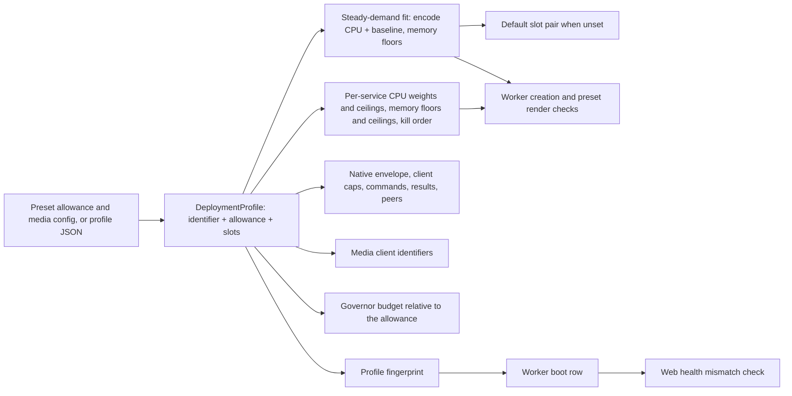
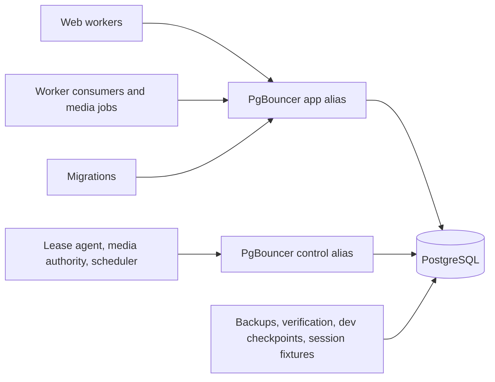

# Configurable media capacity and connection pooling - Plan

## Goal Capsule

**Objective:** A household with a capable server can play 8 videos and 12 audio streams that need conversion or copy at the same time, in real time. The deployment derives its configuration from the CPU and memory the operator allows Baander as a whole: steady demand is guaranteed, and bursty services are overprovisioned instead of each holding a worst-case reservation.

**Means:** A resource allowance and optional video and audio job slots in the startup profile, with every resource limit derived from them (KTD1–KTD5, KTD16–KTD18), and a transaction-mode PgBouncer 1.26.1 so PostgreSQL backends stop scaling with clients (KTD8–KTD11).

**Product authority:** The user directed the capacity model, the pooler, and the answers recorded under Key Decisions on 2026-11-03.
Product behavior is governed by R1–R18; the Planning Contract decides how to deliver it.

**Execution profile:** One branch, `feat/configurable-media-capacity`, with dependency-ordered units landed as local commits.
U2's measurements are inputs to U3, U5 and U7; no derived constant is written before they exist.
Push only when the user asks.

**Authority and stop conditions:** Follow `AGENTS.md`, then this Product Contract, then the Planning Contract.
Stop affected work if it would weaken ownership, lease, signed-delivery or media access checks, change household's shared copy mode or slot values, or discard local data.
A measured per-job cost that makes the 8 + 12 target exceed any reasonable single-host envelope is reported with the numbers rather than hidden by lowering the target.

**Product Contract preservation:** New plan; no upstream Product Contract.

---

## Product Contract

### Summary

The operator states the CPUs and memory Baander as a whole may use, and, in the full profile, may set video and audio job slots; unset slots default to the largest pair, up to 8 + 12, whose steady demand fits that allowance.
Per-service CPU weights and ceilings, memory floors and ceilings, PID and native-execution limits follow from the allowance and the slots. Steady demand must fit the allowance, while burst ceilings may add up to more than it, because web, Redis and PostgreSQL rarely peak together.
No service holds a dedicated CPU.
A transaction-mode PgBouncer sits between the application and PostgreSQL in both profiles and the standard install, so database memory depends on a small server pool instead of on every web, worker and media client.
Operators get documentation, a CLI that prints the effective profile and its reservations, and a health signal when web and workers disagree.

### Problem Frame

The full profile admits only 3 video jobs and 1 audio job at a time, and stream copy shares those slots.
Some households run 8 video and 12 audio streams that need conversion or copy at once; everything beyond the fixed slots queues, even on a host with spare CPU and memory.
The limits are constants in `src/Shared/Application/DTO/DeploymentProfile.php`, and several dependent limits are hard-coded elsewhere: media client identifiers, a 16-peer native daemon cap, a single global native command limit, fixed PID floors, and a one-CPU execution quota in the managed preset.

Sizing also adds up worst cases.
The preset pins the control and execution workers to disjoint CPU sets, so the control worker holds a whole core it barely uses. Sizing host cores from the playback governor's budget cap, a share of host-wide CPU, silently sets aside the rest of the host for everything else. Every service's memory limit is a fixed worst-case reservation, and the total is the sum of all of them, although web, Redis and PostgreSQL burst at different times.

Database memory compounds the problem.
Each PostgreSQL connection that touches a PGroonga index keeps about 22 MiB, and every media child opens its own connections.
More media slots would therefore grow PostgreSQL's memory with the same multiplier that caused the OOM kills fixed on the household branch.

### Key Decisions

- **A resource allowance for Baander as a whole, with optional slots.** The operator states the CPUs and memory Baander may use. In the full profile, slots default to the largest pair on the 8:12 shrink sequence, up to 8 + 12, whose steady demand fits the allowance; an explicit pair is checked against the allowance and refused when it does not fit. (session-settled: user-directed, 2026-11-03 — supersedes "operator-set slots with summed reservations"; chosen over requiring both allowance and slots and over deriving slots with no override: bursty services need not each hold a worst-case reservation.) Nothing is sized from host hardware; the allowance is the operator's statement, and rendering only checks that the host has at least that much, as it checks the reservation today. Governs R1, R3.
- **CPU is shared by weight; no service gets a dedicated core.** The control and execution CPU sets are removed; every service shares the allowance through CPU weights and ceilings, and the control worker gets the weight that keeps its lease deadlines. (session-settled: user-directed — chosen over keeping pinning as an option and over keeping pinning.) Governs R16.
- **Memory floors fit the allowance; ceilings may exceed it.** Each service gets a floor for its steady memory and a hard ceiling for bursts. The floors must add up to no more than the allowance; the ceilings may add up to more. Under host pressure, web workers are reclaimed or killed before PostgreSQL, the pooler, Redis and the control worker. (session-settled: user-directed — chosen over no memory overcommit and over a fixed overcommit ratio.) Governs R3, R17.
- **Memory floors are sizing figures, not kernel protection.** A container's `memory.low` protects nothing on a default Docker host because its parent slice has none, so the floors are arithmetic that must fit the allowance; host-pressure safety rests on the per-service ceilings and the kill order, and the documentation says so. (session-settled: user-directed — chosen over a protected parent slice and over using a slice only when the operator set one up.) Governs R3, R17.
- **No compatibility constraint; aim for great defaults.** (session-settled: user-directed — chosen over keeping today's 3 + 1 for existing installs: nothing is deployed.) Governs R1.
- **Real-time capability with CPU derived from slots.** (session-settled: user-directed — chosen over proving admission only and over CPU guidance without validation: a slot that cannot keep up is not capacity.) Under the allowance model, the slots' steady encode demand must fit the CPU allowance. Governs R3, R4.
- **Zero slots disable a kind.** (session-settled: user-directed — chosen over a minimum of one per kind: operators may run audio-only or video-only conversion.) Governs R5.
- **Derived maximums, rejected early.** (session-settled: user-directed — chosen over fixed caps: limits move with the derived resources.) Governs R6.
- **Queue when busy, with a documented busy response.** (session-settled: user-directed — chosen over an immediate busy error: today's queueing is kept.) Governs R7.
- **PgBouncer in this plan, in both profiles and the standard install.** (session-settled: user-directed — chosen over a separate plan: more slots must not raise database memory.) Governs R9.
- **Real time is guaranteed at 1080p.** (session-settled: user-directed — chosen over 1440p and over the ladder's 4K top tier: matches typical household content and fits a reasonable CPU envelope.) Governs R4.
- **Default slots shrink in the 8:12 ratio.** (session-settled: user-directed — chosen over trimming video first and over trimming audio first: keeps the mix the target describes.) The default starts at 8 + 12 and shrinks until it fits the allowance. Governs R1.
- **The pooler's credentials get their own volume.** (session-settled: user-directed — chosen over the application secrets volume: the network-facing pooler must not mount the OAuth signing key.) Governs R14.
- **Household gets the pooler without requalification.** (session-settled: user-directed — chosen over freezing household entirely and over re-running its qualification: the configured values change; the measured figures are labelled as pre-pooler.) Governs R8, R15.
- **The allowance model applies to both profiles.** Household keeps its shared copy mode and its rule against encoding, but its per-service sizes come from the allowance like full's. Household requalification under the new model is recorded in the roadmap and is not run in this plan. (session-settled: user-directed — chosen over applying the model to full only.) Governs R8.

### Requirements

**Media capacity**

- R1. Operators state the CPUs and memory Baander as a whole may use. Full-profile operators may also set the number of concurrent video jobs and audio jobs; stream copy shares the slots of its kind. Unset slots default to the largest pair on the 8:12 shrink sequence (KTD5), up to 8 + 12, whose steady demand fits the allowance.
- R2. Web, workers, the native daemon and the worker manifest use the same allowance and slot values; workers refuse a disagreeing profile, and web health reports when its profile differs from the active worker boot.
- R3. Per-service CPU weights and ceilings, memory floors and ceilings, PID reservations, the native encoder envelope and native execution limits are derived from the allowance and the slots. A deployment is refused when its steady demand (the memory floors, and the encode CPU demand plus the measured baseline of the other services) exceeds the allowance, or the allowance exceeds the host. Ceilings may add up to more than the allowance.
- R4. A full deployment configured for 8 video and 12 audio jobs runs all twenty concurrently, keeps every stream ahead of real-time playback at 1080p, and causes no media-role containment; 1440p and 4K renditions keep working but are outside this guarantee.
- R5. In the full profile, a kind configured with zero slots is disabled: its encodes and its stream copies are refused with the existing compatibility explanation instead of waiting forever.
- R6. Slot counts beyond the derived maximums are rejected when the managed preset renders and when the profile is built, naming the bound that was exceeded.
- R7. When every slot of a kind is busy, new work of that kind queues; an audio start that exceeds its wait receives a documented busy response.
- R8. The household profile keeps its shared copy mode (two shared copy slots, no encoders), its native execution limits and its native envelope, and rejects slot overrides; its per-service sizes come from the allowance.
- R16. No service holds a dedicated CPU; CPU is shared by weight within the allowance, and worker leases and media authority checks meet their deadlines while every slot encodes.
- R17. When memory runs short on the host, web workers are reclaimed or killed before PostgreSQL, the pooler, Redis and the control worker.
- R18. The playback governor measures its CPU budget against Baander's CPU allowance, not against all host CPUs.

**Database pooling**

- R9. Web, workers and migrations reach PostgreSQL through a transaction-mode PgBouncer 1.26.1 in both profiles and the standard install, so PostgreSQL backends are bounded by the pooler's server pools rather than by client counts.
- R10. Worker leases, media authority checks and the scheduler use a separate reserved pool whose waits end before their lease and authority deadlines.
- R11. Backups, deployment verification, development checkpoints and test fixtures that need session state connect to PostgreSQL directly.
- R12. PostgreSQL's time zone is UTC by configuration and by migration, and web and workers refuse to start when the server reports another zone.
- R13. Application SQL stays safe for transaction pooling, and a test fails when session-scoped constructs are introduced.
- R14. The pooler authenticates with a SCRAM auth file generated from the database password into a private credentials volume that only the pooler mounts.

**Guidance**

- R15. Operator documentation explains the allowance, slot sizing, the derived floors, ceilings and weights, the kill order, the pooler and connection sizing. System Requirements shows the new configured values and labels the household measurements as taken before the pooler and the allowance model.

### Acceptance Examples

- AE1. **Covers R1, R3.** Given a full preset configuration with `videoSlots: 8` and `audioSlots: 12` and a CPU allowance smaller than their steady demand, when the operator renders the deployment, then rendering fails and names the required CPU allowance.
- AE7. **Covers R1.** Given a full preset configuration with an allowance and no slots, when the operator renders the deployment, then rendering picks the largest pair on the 8:12 shrink sequence that fits and reports it with the derived floors and ceilings.
- AE8. **Covers R16.** Given every slot encoding and web load on the same allowance, when a worker renews its lease, then the renewal completes within its deadline although no service has a dedicated CPU.
- AE2. **Covers R5.** Given a full profile with zero audio slots, when a client requests an audio rendition or an audio stream copy, then it receives the existing compatibility explanation and no job is queued.
- AE3. **Covers R2.** Given a source install whose web profile says 8 video slots while the active worker boot was started with 4, when an operator checks web health, then health reports the profile mismatch.
- AE4. **Covers R7.** Given all audio slots busy, when a listener starts a track that needs a new rendition and no slot frees within the start wait, then the player receives the documented busy response.
- AE5. **Covers R9, R10.** Given web traffic that saturates the application pool, when a worker renews its lease, then the renewal is served from the control pool within its deadline.
- AE6. **Covers R8.** Given a household preset configuration that sets `videoSlots`, when the operator renders it, then rendering fails because household slots are fixed.

### Success Criteria

- The 8 + 12 load proof finishes with every stream ahead of real time, no containment, no OOM event, and PostgreSQL backends never exceeding the configured server pools plus direct reserve.
- Household's shared copy mode, native execution limits and native envelope are byte-identical to today's in tests.
- The 8 + 12 load proof runs on an allowance equal to the derived steady demand rounded up, with no CPU sets.
- An operator can size a full host from System Requirements and the profile CLI without reading code.

### Scope Boundaries

- Requalifying the household profile with the pooler or the allowance model is not part of this plan (Key Decisions); the roadmap records it.
- Detecting host CPU and memory stays out: sizing derives from the allowance the operator states (Key Decisions).
- A hard aggregate cap on Baander's total CPU and memory use, through a parent cgroup, is out; the allowance sizes floors and per-service ceilings (KTD17).
- Redesigning the one-process-per-job media model is out; this plan measures and right-sizes each job's reservation instead.
- Web-side slot admission is out: web receives the configured slot-bearing profile for policy refusal and the health fingerprint, but does not count or admit jobs against slots.
- GPU encoding and hardware-acceleration selection are unchanged.

---

## Planning Contract

### Key Technical Decisions

- KTD1. **The profile carries a validated slot choice.** `DeploymentProfile` takes the identifier plus optional video and audio slot counts, validates them against per-profile rules, and `fromJson` validates the serialized fields instead of comparing them with a built-in table. This follows `WorkerAutoscalingProfile`'s strict-JSON, bounded-choice pattern. Household keeps its fixed shared copy pool (two shared copy slots, `media-copy-0` and `media-copy-1`, encoders prohibited) as a profile mode the video and audio slot parameters do not express. The eleven parameters that default-construct a profile are removed so every consumer receives the configured instance. The profile also carries the resource allowance (CPUs as a decimal with millicore precision, memory in MiB), so web, workers and the manifest derive from one value and the fingerprint covers it. Instantiates the Key Decisions governing R1 and R3.
- KTD2. **Every dependent limit is derived from slots by one set of formulas.** The full profile's media child reservation becomes a measured per-child value of its own and counts toward the execution worker's memory floor (KTD17); household keeps today's 320 MiB per child. The native envelope is the sum of measured per-kind native memory shares plus fixed headroom; household keeps 512 MiB. Per-client native caps exist for every profile: a video client may run one encoder and one helper, an audio client one encoder, a household shared copy client one copy command and one helper, media control one command. Commands are the sum of client caps; results are twice the commands plus two; clients are the fixed system clients plus one per slot. Process floors add the measured per-slot thread counts. The formulas reproduce household's current values exactly, and tests pin both. The video cap counts one helper rather than the helper queue's eight because helpers beyond the first already queue inside the job; today's full command limit of 8 is this formula at 3 + 1. Every video encode runs with a fixed two-thread cap today (`SegmentEncoder`); if U2 measures that cap below real time at the R4 tier, the per-encoder thread count becomes a measured constant used by `SegmentEncoder` and counted in the per-slot thread floors and per-kind CPU cost.
- KTD3. **Steady CPU demand follows the slots and must fit the allowance.** The steady encode demand is the measured per-kind CPU cost per second of output at real time, taken with the slots running concurrently, times the configured slots. The steady baseline is the measured steady CPU of web, PostgreSQL, Redis and the control worker under the target load (U2), plus the pooler's (U8). A configuration fits when the encode demand plus the baseline is at most the CPU allowance; the slots and this check bound the aggregate encode demand, because each video media child runs its own playback governor that sees only its own stream (KTD18). Rendering and the source-install manifest refuse a configuration that does not fit, naming the required allowance, and refuse an allowance larger than the host's CPUs. (session-settled: user-directed — chosen over proving admission only: real-time is the requirement.) Governs R3, R4.
- KTD4. **The native daemon admits by derived peer cap with backpressure.** Its open-peer cap is the derived client count plus a small margin. At the cap it stops accepting, so new peers wait in the listen backlog instead of being closed and escalating to containment, and it drains all pending accepts each loop iteration. (session-settled: user-directed — chosen over raising the cap but still closing excess peers: a closed peer is treated as uncertain and contains the media role.)
- KTD5. **Default slots are derived from the allowance.** When the full profile's slots are unset, rendering takes the first pair on the sequence video v from 8 down to 1 with audio floor(3v/2) (8 + 12, 7 + 10, 6 + 9, 5 + 7, 4 + 6, 3 + 4, 2 + 3, 1 + 1) that passes KTD3's CPU check and KTD17's memory-floor check for the stated allowance. When no pair fits, rendering refuses, naming the allowance that 1 + 1 needs and the explicit `media.videoSlots`/`media.audioSlots` setting, so a disabled kind only ever comes from an explicit zero. The allowance itself is a required configuration field with no host detection; `deploy/household/example.json` shows one for each profile. U2's measurements set the per-kind costs, and System Requirements records the resulting slot pair for common allowances beside the measurements.
- KTD6. **Web reports profile disagreement through health.** The worker boot row records the profile fingerprint the boot started with; the web health check compares it with its own profile and reports a mismatch. (session-settled: user-directed — chosen over refusing web startup and over documenting only: misconfiguration becomes visible without a restart loop.) Governs R2.
- KTD7. **Zero slots refuse the kind at the policy.** `MediaOperation::StreamCopy` splits into video and audio stream copy, and in the full profile `MediaExecutionPolicy` refuses encodes and stream copies of a kind whose slot count is zero, so delivery negotiation returns its existing compatibility explanation and nothing reaches the worker queue. Household's shared copy pool is not gated by this rule. Governs R5.
- KTD8. **PgBouncer runs from the database image as its own service.** PgBouncer 1.26.1 is installed from the PostgreSQL project's packages in `docker/postgres/Dockerfile` and started as a separate service with its own memory limit; the preset image list and configuration version stay unchanged. It runs transaction pooling. Every pooled PDO connection, through Doctrine and through the dedicated connection factories, sets `Pdo\Pgsql::ATTR_DISABLE_PREPARES`: the image's pdo_pgsql links libpq 15, which frees named statements with SQL `DEALLOCATE`, and PgBouncer does not map that to its renamed server statements, so it would abort transactions. (session-settled: user-directed — chosen over a separate pooler image role: one database image to build and pin.) Governs R9.
- KTD9. **Two pooler databases separate application and control traffic.** An application alias carries web and ordinary worker traffic; a control alias with its own reserved server connections carries leases, media authority and the scheduler, with a query-wait timeout shorter than the lease safety margin. (session-settled: user-directed — chosen over control traffic connecting directly and over a single shared pool: control deadlines must hold under web load.) Governs R10.
- KTD10. **Connection routing is explicit.** `DATABASE_URL` points at the application alias, a control DSN at the control alias, and a direct URL at PostgreSQL for backups, preset verification, development checkpoints and session-state fixtures; migrations use the pooler. (session-settled: user-directed — chosen over migrations connecting directly: migration SQL is already transaction-scoped.) Governs R9, R11.
- KTD11. **PostgreSQL is sized from the server pools.** `max_connections` becomes the application pool plus the control pool plus a direct reserve plus superuser slots, and PostgreSQL's memory follows the existing sizing rule (shared buffers, 128 MiB auxiliary, 24 MiB per server connection) applied to that smaller count; that figure is PostgreSQL's memory floor under KTD17. The household branch's per-client rule is replaced. U8 implements these as pure functions of the pool sizes.
- KTD12. **The pooler authenticates from a generated auth file.** Before the pooler starts, the preset generates one SCRAM-SHA-256 verifier from `DB_PASSWORD`, applies it to the database role with `ALTER ROLE … PASSWORD` over the direct connection, and writes the same verifier to the auth file with `auth_type = scram-sha-256`. The auth file lives in a dedicated pooler credentials volume, mounted read-only only into the pooler; the pooler never mounts the application secrets volume. PgBouncer can reuse a client's SCRAM proof for its server login only when its verifier is byte-identical to the role's, so the role and the file must carry the same one. The file never holds a plain-text or MD5 password, and `auth_query` is not used, which avoids CVE-2025-12819's precondition. (session-settled: user-directed — chosen over a separate operator-supplied pooler password: one secret to manage.) Governs R14.
- KTD13. **UTC is guaranteed three ways.** Both PostgreSQL configuration files set `timezone = 'UTC'`, a migration runs `ALTER DATABASE … SET timezone`, and web and worker startup refuse when the default zone, read as `reset_val` for `TimeZone` from `pg_settings`, is not UTC; `SHOW TimeZone` would only echo the connect-time setting. The per-connection `SET TIME ZONE` stays; PgBouncer tracks `TimeZone` per client. (session-settled: user-directed — chosen over configuration files only: drift is caught at startup.) Governs R12.
- KTD14. **A convention test keeps SQL pool-safe.** A unit test scans `src/` and `migrations/` for session advisory locks, `LISTEN`, SQL `PREPARE`/`DEALLOCATE`, `WITH HOLD` cursors, temporary tables without `ON COMMIT DROP`, session `set_config(…, false)`, and `SET` other than the transaction-scoped forms (`SET LOCAL`, `SET TRANSACTION`, `set_config(…, true)`) and the connect-time time zone, following `InstantBindConventionTest`. The lease agent's session `SET statement_timeout` moves into a transaction as `SET LOCAL`. Governs R13.
- KTD15. **Busy is a documented response, not a new admission path.** The audio rendition start wait keeps queueing; when it expires, the delivery response states that every audio slot is busy, and the obsolete "server-wide encode limit" docblock on `AudioRenditionPortInterface` is corrected. Governs R7.
- KTD16. **CPU weights and ceilings replace CPU sets.** `controlCpuSet` and `executionCpuSet` are removed from the preset configuration, the worker configuration, the lifecycle and the operator manifest, along with the one-CPU execution quota. Every service, including the worker units the deployment operator creates, gets a CPU ceiling (Docker `cpus` / `NanoCpus`, cgroup `cpu.max`) no larger than the allowance and a CPU weight (Docker `cpu_shares` / `CpuShares`, cgroup v2 `cpu.weight`). The execution worker's ceiling is the whole allowance, so encodes can run ahead of real time when the host is idle. Weights are proportional to each service's steady demand, and the control worker, PostgreSQL and the pooler, which carries lease and authority traffic on its control alias, carry a priority multiplier so lease, authority and query latency win under contention. CPU ceilings may add up to more than the allowance, because CPU overuse throttles rather than kills. (session-settled: user-directed.) Governs R16.
- KTD17. **Memory has floors that fit and ceilings that may overcommit.** Each service gets a floor for its steady memory, used as sizing arithmetic and not rendered as `mem_reservation`, and a ceiling (`mem_limit` / `Memory`, cgroup `memory.max`) for bursts. The floors are: the execution worker's native envelope plus its per-child media reservation per slot; the control worker's fixed reservation; PostgreSQL's KTD11 figure; the pooler's steady memory as U8 measures it; Redis's measured steady size; and the web server's measured anonymous memory per worker times its worker count. Page cache is not part of a floor. The floors must add up to no more than the memory allowance. Each ceiling is its floor plus a measured burst headroom, capped at the allowance, and the ceilings may add up to more than the allowance. Host-pressure kill order is set with `oom_score_adj`: web workers first, then the execution worker's media children, then Redis, with PostgreSQL, the pooler and the control worker last. Because the score is per process and inherited, each media child raises its own score above its container's (raising needs no privilege), so the execution worker's supervisor and native daemon are not the first victims in that container. Baander's aggregate use is not capped by a parent cgroup. (session-settled: user-directed.) Governs R3, R17.
- KTD18. **The governor's budget is relative to the allowance and measures its own stream.** The playback governor runs in each video media child (`WorkerQoLLifecycle`, started from `bin/worker-media-job.php`) and holds only that child's stream, so it bounds one stream's cost; the aggregate is bounded by the slots and KTD3. Its learning samples and the mid-stream monitor's readings become the stream's own CPU (its encoder processes' CPU seconds per wall second, from the native execution result or the child's process accounting), expressed as a percentage of the CPU allowance, instead of host-wide `/proc/stat` utilization. An 80 % cap then means one stream may use up to 80 % of the allowance. The QoL profiles and their caps stay. Governs R18.

### High-Level Technical Design

The allowance and slot values flow from the operator's configuration into one profile that every process derives its limits from:

Connections reach PostgreSQL through two pooled aliases, with a direct path kept for session-state work:

### System-Wide Impact

- **Every database client changes address.** Web, worker consumers, media children, the scheduler, the lease agent, migrations, console commands, the host controller, backups and the development tooling all resolve one of three DSNs (KTD10); a missed client keeps working against PostgreSQL directly and silently escapes the pool bound.
- **Worker boots and manifests change shape.** The manifest and boot row carry the slot-bearing profile and its fingerprint, so every worker deployment is replaced once; nothing is deployed, so no migration path is needed.
- **The household preset's rendered stack gains a service and new sizing.** Its compose fingerprint, PostgreSQL sizing and every per-service limit change; its shared copy mode and native limits do not (R8).
- **CPU sets disappear from configuration.** The preset configuration, the worker configuration, the lifecycle, the operator manifest and their tests lose `controlCpuSet` and `executionCpuSet`; the qualification harness stops pinning units.
- **Tests that pin today's numbers move.** Profile, reservation, manifest, image-profile, preset and media-control tests and fixtures that hard-code 3 + 1, 3136 MiB or 2944/4480 MiB are updated to the derived values.

### Deferred to Implementation

- The per-kind native memory share, per-child media reservation, per-slot thread count and per-kind CPU cost: set from U2's receipt.
- The steady CPU baseline, the web per-worker anonymous memory, Redis's steady size and each service's burst headroom: set from U2's receipt.
- The CPU weight values and the priority multiplier: set in U5 from the steady demands, then confirmed by U10's lease timing.
- The example allowances in `deploy/household/example.json`: set by U7 from KTD5's rule so each profile's example admits a useful slot pair.
- The application and control pool sizes, the direct reserve and the control query-wait timeout: set in U8 from the lease safety margin and measured concurrency, then confirmed by U10.
- Whether HEVC at 1080p needs its own native memory share: decided by U2's measurement.

### Assumptions

- 1080p is representative of household content for the R4 guarantee; U2 measures at 1080p with a 1080p source.

### Risks

| Risk | Mitigation |
| --- | --- |
| Each video media child's governor learns host-wide CPU as its own stream's cost, so under eight concurrent encodes it would veto or downgrade every new encode. | KTD18 records the stream's own encoder CPU against the allowance; U10 records governor decisions, and a veto on an allowance that meets the derived requirement is treated as a defect in the requirement or the governor, not tuned away. |
| Without a dedicated core, the control worker's lease renewals lose to encodes under contention. | KTD16's priority weight; U10 measures lease timing with every slot encoding and web load (AE8). A missed deadline is a defect in the weights, not a reason to restore pinning silently. |
| Coinciding bursts exceed host memory when ceilings overcommit. | The floors are not kernel-protected (Key Decisions); page cache is reclaimed first, and the kill order sacrifices web workers and media children before stateful services; U10 records cgroup memory events. |
| A rootless Docker daemon cannot set a negative `oom_score_adj`. | U5 verifies the kill order on the CI host's Docker and refuses to render with a named reason where it cannot be applied. |
| Per-job memory at 1080p exceeds the 360p figures measured so far. | U2 measures 1080p before any constant is set (KTD2, KTD5). |
| Pooler queueing adds latency under bursts. | KTD9's control pool and query-wait timeout bound control traffic; U10 measures web latency through the pooler. |
| Twenty clients polling the native daemon expose untested transport behavior. | KTD4 and U10's load proof. |

### Sources

- Key code anchors: `src/Shared/Application/DTO/DeploymentProfile.php`, `src/Shared/Application/DTO/WorkerAutoscalingProfile.php`, `bin/worker-media-job.php`, `src/Shared/Infrastructure/Worker/NativeExecutionDaemon.php`, `src/Transcode/Infrastructure/Worker/MediaWorkerRunner.php`, `src/Transcode/Application/Service/MediaExecutionPolicy.php`, `packages/baander-tooling/src/Deployment/ImageProfile.php`, `packages/baander-tooling/src/Deployment/HouseholdRenderer.php`, `packages/baander-tooling/src/Deployment/WorkerLifecycle.php`, `bin/worker-lease-agent.php`, `src/Shared/Infrastructure/Doctrine/Platform/BaanderDriverMiddleware.php`.
- Existing per-job measurements: `var/test-runs/media-control-1793644552-540907/` (libx264 360p encode about 299 MiB RSS, helper about 61 MiB, MP3 encode about 52 MiB; control peak 611.5 MiB with four children).
- PgBouncer 1.26.1 features and changelog: https://www.pgbouncer.org/features.html and https://www.pgbouncer.org/changelog.html#pgbouncer-126x (transaction-pooling compatibility, tracked `TimeZone`, `max_prepared_statements` default 200 since 1.24.0, 1.26.1 security fixes).
- PGroonga per-backend memory: `.agents/skills/postgres-remediation/references/extensions.md`, "Size memory per PGroonga backend".

---

## Implementation Units

| U-ID | Title | Key files | Depends on |
| --- | --- | --- | --- |
| U1 | Slots in the startup profile | `src/Shared/Application/DTO/DeploymentProfile.php` | — |
| U2 | Measure per-job cost | `tests/Fixtures/Worker/`, `packages/baander-tooling/src/Fixtures/Worker/MediaControl.php` | — |
| U3 | Derived reservations and native limits | `DeploymentProfile.php`, `WorkerAutoscalingProfile.php`, `WorkerSupervisorRunner.php` | U1, U2 |
| U4 | Media client identity, admission and daemon backpressure | `bin/worker-media-job.php`, `NativeExecutionDaemon.php`, `MediaWorkerRunner.php`, `MediaExecutionPolicy.php` | U1, U3 |
| U5 | Allowance fit, CPU weights and memory ranges | `DeploymentProfile.php`, `WorkerLifecycle.php`, `HouseholdRenderer.php`, `DeploymentOperatorManifest.php` | U2, U3, U8 |
| U6 | Operator configuration, CLI and mismatch health | `HouseholdConfiguration.php`, `ImageProfile.php`, console command, health check | U1, U3, U5 |
| U7 | Allowance-derived defaults and bounds | `DeploymentProfile.php`, `deploy/household/example.json` | U2, U3, U5, U8 |
| U13 | Governor budget relative to the allowance | `StreamGovernor.php`, `StreamAdmissionService.php`, `MidStreamMonitor.php` | U1, U5 |
| U8 | PgBouncer in the database image and deployments | `docker/postgres/`, `HouseholdRenderer.php`, `docker-compose.yml`, config | — |
| U9 | Pool-safe SQL and UTC guarantee | `bin/worker-lease-agent.php`, migration, convention test | U8 |
| U10 | 8 + 12 real-time load proof | media-control drill and fixtures | U4, U5, U6, U7, U8, U13 |
| U11 | Busy response | `AudioRenditionCache.php`, `AudioRenditionPortInterface.php` | U4 |
| U12 | Documentation and roadmap | `docs-book/`, `deploy/household/README.md`, `CONCEPTS.md`, `ROADMAP.md` | U10 |

### U1. Slots in the startup profile

**Goal:** The profile carries operator slot values through every process that already shares it.

**Requirements:** R1, R2, R5, R6, R8; KTD1.

**Dependencies:** none.

**Files:** `src/Shared/Application/DTO/DeploymentProfile.php`, the eleven consumers that default-construct a profile (`WorkerRuntimeConfiguration`, `WorkerAutoscalingProfile`, `WorkerPeerHandshake`, `NativeExecutionDaemon`, `DeploymentContainerRecipe`, `NativeExecutionClient`, `AdmissionLedger`, `WorkerReadinessObservation`, `AutoscalingStatus`, `TranscodeProcessPool`, `MediaWorkerRunner`), `config/services.yaml`, `tests/Unit/Shared/Application/DTO/DeploymentProfileTest.php`, `tests/Fixtures/Worker/deployment-profile.json`.

**Approach:**
1. Add video and audio slot parameters with per-profile validation: household keeps its fixed shared copy mode and rejects any slot value; full accepts zero up to the derived maximum (bounds land in U7; U1 tests use explicit slot values).
2. Replace `fromJson`'s table-equality check with validation of the serialized fields and a consistency check that derived fields match the slots.
3. Remove default-constructed profile parameters and pass the configured profile through constructors and service wiring.

**Patterns to follow:** `WorkerAutoscalingProfile` constructor bounds and strict `fromJson`.

**Test scenarios:**
- A full profile built with 8 video and 12 audio slots serializes and round-trips through `fromJson` unchanged.
- A household profile with any slot override is rejected (Covers AE6).
- A full profile JSON whose derived field disagrees with its slots is rejected.
- A full profile with zero audio slots is accepted and reports audio as disabled.
- Unknown or non-integer slot fields are rejected.

**Verification:** Profile tests pass in the CI image, and no production class default-constructs a profile.

### U2. Measure per-job cost

**Goal:** Measured native memory, PHP child memory, threads and CPU per job kind at 1080p exist before any constant is derived.

**Requirements:** R3, R4; KTD2, KTD3, KTD5.

**Dependencies:** none.

**Files:** `tests/Fixtures/Worker/` media fixtures (add a 1080p source alongside the 360p one), `packages/baander-tooling/src/Fixtures/Worker/MediaControl.php` and its observation helpers, `tests/Fixtures/TwoCommand/media-control.php`.

**Approach:**
1. Extend the media-control drill to run one job per kind at the R4 tier, H.264 and HEVC where the ladder uses them, stream copy, and each audio codec, then again with the candidate default video and audio slot counts running concurrently.
2. Record per-process peak RSS, thread counts, per-job CPU seconds per second of output in isolation and under concurrency, encode speed (output seconds per wall second) under the current two-thread cap, and the control unit's per-child PHP peak.
3. During the concurrent run and one idle period, record per-container CPU (mean and p95 from `cpu.stat`) and memory (anonymous memory and page cache separately, from `memory.stat`) for web, PostgreSQL, Redis, the control worker and the execution worker. These give KTD3's baseline and KTD17's floors and burst headroom.
4. Write the results into a retained receipt and summarise them in the unit's commit message for U3, U5 and U7.

**Execution note:** This is measurement: run it on the real FFmpeg build in the worker image before writing U3's constants.

**Test expectation:** none -- measurement fixture; its output is evidence, verified by the drill's existing receipt validation.

**Verification:** A receipt with per-kind memory, threads and CPU at 1080p exists and is cited by U3.

### U3. Derived reservations and native limits

**Goal:** Every resource limit follows from the configured slots by the formulas in KTD2.

**Requirements:** R3, R8; KTD2.

**Dependencies:** U1, U2.

**Files:** `src/Shared/Application/DTO/DeploymentProfile.php`, `src/Shared/Application/DTO/WorkerAutoscalingProfile.php`, `src/Shared/Application/DTO/WorkerRuntimeConfiguration.php`, `src/Shared/Infrastructure/Worker/WorkerSupervisorRunner.php`, `src/Transcode/Infrastructure/Swoole/TranscodeProcessPool.php`, `packages/baander-tooling/src/Deployment/ImageProfile.php`, tests under `tests/Unit/Shared/Application/DTO/` and `tests/Unit/Shared/Infrastructure/Worker/`, `scripts/tests/php/ImageProfileTest.php`.

**Approach:**
1. Introduce the full profile's measured per-child media reservation and per-kind native memory shares from U2.
2. Derive the envelope, per-client caps, command, result and client limits, and PID floors from the slots.
3. Keep household's existing outputs byte-identical.

**Test scenarios:**
- Household's derived control floor, execution floor, native envelope and native limits equal today's values.
- A full profile with 8 video and 12 audio derives 29 native commands, 60 results, and a client count of the fixed clients plus 20.
- Raising video slots by one raises the envelope by the measured video native memory share and the commands by two.
- A full profile with zero video slots derives no video client caps.

**Verification:** Reservation and limit tests pass; household pins are unchanged.

### U4. Media client identity, admission and daemon backpressure

**Goal:** Every configured slot can launch, connect and run without hitting a hard-coded limit.

**Requirements:** R3, R4, R5; KTD2, KTD4, KTD7.

**Dependencies:** U1, U3.

**Files:** `bin/worker-media-job.php`, `src/Shared/Infrastructure/Worker/NativeExecutionDaemon.php`, `src/Transcode/Infrastructure/Worker/MediaWorkerRunner.php`, `src/Transcode/Application/Service/MediaExecutionPolicy.php`, `src/Transcode/Application/Service/MediaOperation.php`, its stream-copy callers (`CopyPresentationService`, `TranscodeSessionSubscriber`, `AudioRenditionCache`, `AudioRenditionExecutor`), `tests/Unit/Transcode/Infrastructure/Worker/MediaWorkerRunnerTest.php`, `tests/Integration/NativeExecutionDaemonTest.php`, `tests/Unit/Transcode/Application/Service/MediaExecutionPolicyTest.php`.

**Approach:**
1. Validate media client identifiers against the profile's derived slot names (`media-video-N`, `media-audio-N`, and household's `media-copy-0`/`media-copy-1`) instead of a literal pattern, and derive the daemon's client allowlist and per-client caps for every profile.
2. Apply KTD4's derived peer cap with backpressure and drain pending accepts each loop.
3. Split stream copy by kind and refuse encodes and stream copies of a zero-slot kind in the full profile's policy (KTD7).

**Test scenarios:**
- A full profile with 8 video slots launches `media-video-7`, and `media-video-8` is refused at the launch fence.
- With the peer cap reached, a further client waits and then connects once a peer closes, without an uncertain failure.
- An audio stream copy under zero audio slots is refused with the compatibility explanation (Covers AE2), while a video stream copy under the same profile succeeds.
- Household's client allowlist, per-client caps and permitted stream copies are unchanged.

**Verification:** Media runner, daemon and policy tests pass in the CI image.

### U5. Allowance fit, CPU weights and memory ranges

**Goal:** Baander's configuration is derived from the allowance: steady demand is checked against it, and every service gets CPU weights and ceilings, memory floors and ceilings and a kill priority instead of CPU sets and summed worst-case reservations.

**Requirements:** R3, R4, R8, R16, R17; KTD3, KTD11, KTD16, KTD17.

**Dependencies:** U2, U3, U8.

**Files:** `src/Shared/Application/DTO/DeploymentProfile.php` (allowance and the derived resource plan, or a value object it owns), `packages/baander-tooling/src/Deployment/HouseholdConfiguration.php`, `packages/baander-tooling/src/Deployment/HouseholdRenderer.php`, `packages/baander-tooling/src/Deployment/Household.php`, `packages/baander-tooling/src/Deployment/WorkerConfiguration.php`, `packages/baander-tooling/src/Deployment/WorkerLifecycle.php`, `src/Shared/Infrastructure/Worker/DeploymentOperatorManifest.php`, `bin/worker-deployment.php`, `deploy/household/example.json`, the qualification harness under `packages/baander-tooling/src/Fixtures/Household/`, tests for each (`scripts/tests/php/WorkerLifecycleTest.php`, `scripts/tests/php/HouseholdDeploymentTest.php`, `tests/Unit/Shared/Infrastructure/Worker/DeploymentOperatorManifestTest.php`).

**Approach:**
1. Add the allowance to the profile and derive one resource plan from the allowance and slots: steady encode demand and baseline (KTD3), per-service CPU weights and ceilings (KTD16), memory floors, ceilings and kill priorities (KTD17), using U2's measurements and U8's PostgreSQL and pooler functions.
2. Remove `controlCpuSet`, `executionCpuSet` and the one-CPU execution quota from configuration, lifecycle, manifest and harness.
3. Render the plan into the preset (`cpus`, `cpu_shares`, `mem_limit`, `oom_score_adj`) and apply the same values when the deployment operator creates worker units; refuse at render and at worker creation when the steady demand does not fit, naming the required allowance, or when the allowance exceeds the host.
4. Have each media child raise its own `oom_score_adj` above its container's, verify on the CI host that the kill priorities apply, and refuse with a named reason where they cannot.

**Test scenarios:**
- A full configuration with 8 + 12 and a CPU allowance below their steady demand fails to render and names the required allowance (Covers AE1).
- The memory floors of a rendered deployment add up to no more than the memory allowance while its ceilings may add up to more; a configuration whose floors exceed the allowance is refused.
- No rendered service or created worker unit carries a CPU set; the execution worker's CPU ceiling equals the allowance, the control worker's weight is above every other service's, and PostgreSQL's and the pooler's weights carry the priority multiplier.
- Web workers carry the highest `oom_score_adj`, a media child's score is above its execution container's, and PostgreSQL, the pooler and the control worker carry the lowest.
- An allowance larger than the host's CPUs or memory is refused.
- Household renders from its allowance with its shared copy mode and native limits unchanged.

**Verification:** Tooling, manifest and preset tests pass; a rendered deployment's cgroup files show the derived `cpu.weight`, `cpu.max` and `memory.max`, and its processes show the derived `oom_score_adj`.

### U6. Operator configuration, CLI and mismatch health

**Goal:** Operators set the allowance and slots in the managed preset or the source install, can see the effective profile and its derived resource plan, and see when web and workers disagree.

**Requirements:** R1, R2, R6; KTD1, KTD6; `.agents/rules/admin-cli-parity.md`.

**Dependencies:** U1, U3, U5.

**Files:** `packages/baander-tooling/src/Deployment/HouseholdConfiguration.php`, `packages/baander-tooling/src/Deployment/ImageProfile.php`, `packages/baander-tooling/src/Deployment/Household.php`, `deploy/household/example.json`, a console command under `src/Shared/Interface/Console/` that prints the effective profile JSON and its derived reservations, the worker boot persistence and web health check under `src/Shared/`, `packages/baander-tooling/src/Development/Workers.php`, tests for each.

**Approach:**
1. Add a required `allowance` object (`cpus`, `memoryMiB`) for both profiles and an optional `media` object with `videoSlots` and `audioSlots` (full only) to the preset configuration, and pass the values into the image profile probe.
2. Add the console command so source installs can produce the manifest and web values without hand-writing JSON; it prints the effective slots and the derived floors, ceilings, weights and kill priorities.
3. Record the profile fingerprint on the worker boot row and compare it in web health (KTD6).
4. Keep the development preview on the measured defaults.

**Test scenarios:**
- A full preset with `media` renders a profile with those slots and pins its fingerprint.
- A household preset with `media` is rejected (Covers AE6).
- The console command prints JSON that `DeploymentProfile::fromJson` accepts and a resource plan equal to U5's derivation.
- A preset configuration without `allowance` is rejected naming the field.
- Web health reports a mismatch when its fingerprint differs from the active boot's (Covers AE3) and is healthy when they match.

**Verification:** Tooling, unit and functional tests pass; `lint:container` passes for both profiles.

### U7. Allowance-derived defaults and bounds

**Goal:** Unset slots take the largest pair the allowance supports, and oversized configurations are rejected early.

**Requirements:** R1, R6; KTD5.

**Dependencies:** U2, U3, U5, U8.

**Files:** `src/Shared/Application/DTO/DeploymentProfile.php`, `packages/baander-tooling/src/Deployment/HouseholdConfiguration.php`, `deploy/household/example.json`, profile and preset tests.

**Approach:**
1. Implement KTD5's shrinking rule over U5's fit check and set the example allowances.
2. Derive the per-kind and total maximums from the daemon peer, worker child and pooler client limits, and reject beyond them with the bound named.

**Test scenarios:**
- An unset full profile with an allowance that fits 8 + 12 gets 8 + 12; with a smaller allowance it gets the first fitting pair on the 8:12 shrink sequence, and rendering reports it (Covers AE7).
- An unset full profile whose allowance fits no pair down to 1 + 1 is refused, naming the allowance 1 + 1 needs.
- A slot count one above the derived maximum is rejected with the bound in the message.
- Each example allowance in `deploy/household/example.json` renders.

**Verification:** Profile and preset tests pass.

### U8. PgBouncer in the database image and deployments

**Goal:** Every deployment reaches PostgreSQL through PgBouncer 1.26.1 with separate application and control pools, and PostgreSQL is sized from those pools.

**Requirements:** R9, R10, R11, R14; KTD8–KTD12.

**Dependencies:** none.

**Files:** `docker/postgres/Dockerfile`, a PgBouncer configuration template under `docker/postgres/`, `packages/baander-tooling/src/Deployment/HouseholdRenderer.php`, `packages/baander-tooling/src/Deployment/HouseholdConfiguration.php`, `packages/baander-tooling/src/Deployment/Household.php`, `docker-compose.yml`, `deploy/household/postgresql.conf`, `docker/postgres/conf/postgresql.conf`, `.env`, `config/packages/doctrine.yaml`, the worker DSN wiring for the control alias, `packages/baander-tooling/src/Development/Database.php`, backup and verification tooling, `scripts/tests/php/HouseholdDeploymentTest.php`.

**Approach:**
1. Install the pinned PgBouncer package in the database image and add a pooler service, started after PostgreSQL is healthy, with its own memory limit.
2. Before the pooler starts, generate the verifier, apply it to the role and write the auth file (KTD12); render application and control aliases with their pool sizes and query-wait timeout (KTD9).
3. Route `DATABASE_URL`, the control DSN and the direct URL per KTD10, and set `Pdo\Pgsql::ATTR_DISABLE_PREPARES` on every pooled connection (KTD8).
4. Make the development writer check count clients on the pooler's application and control aliases (PgBouncer's `SHOW CLIENTS`) as writers and ignore only idle pooler server connections.
5. Resize `max_connections` and the preset's PostgreSQL memory default per KTD11.
6. In the preset start run, record the pooler's steady CPU (mean and p95 from `cpu.stat`) and memory (anonymous memory and page cache from `memory.stat`), idle and under light query load; these are the pooler's CPU baseline and memory floor in KTD3 and KTD17.

**Execution note:** Verify `TimeZone` tracking and the disabled-prepares behavior against a running PgBouncer 1.26.1, including through the web runtime's Swoole coroutine pgsql driver, before building on them.

**Test scenarios:**
- The rendered preset contains a pooler service that depends on healthy PostgreSQL and exposes both aliases.
- The auth file holds only a `SCRAM-SHA-256$` entry equal to the role's verifier, lives in the pooler credentials volume, and the pooler mounts no other secrets volume or content-hashed configuration volume containing it.
- A client authenticates through the pooler and the pooler opens a server connection, end to end in the preset start test.
- A multi-statement Doctrine transaction that frees a statement mid-transaction commits through the pooler.
- PostgreSQL's rendered `max_connections` equals the two pools plus direct reserve plus superuser slots.
- A client connected through the pooler blocks a development checkpoint; idle pooler server connections alone do not.
- A full start and stop of a preset deployment through the pooler serves pages and retains data.

**Verification:** Tooling tests pass, a preset deployment starts through the pooler, and the preview refreshes through it.

### U9. Pool-safe SQL and UTC guarantee

**Goal:** Application SQL cannot regress into session-scoped constructs, and PostgreSQL is always UTC.

**Requirements:** R12, R13; KTD13, KTD14.

**Dependencies:** U8.

**Files:** `bin/worker-lease-agent.php`, a migration under `migrations/`, `tests/Integration/InitialSchemaMigrationTest.php`, a startup time-zone check in the web and worker bootstrap, a convention test under `tests/Unit/Shared/Infrastructure/Doctrine/`.

**Approach:**
1. Move the lease agent's timeout into a transaction as `SET LOCAL`.
2. Add the `ALTER DATABASE` migration and the startup check.
3. Add the convention test (KTD14).

**Test scenarios:**
- The convention test fails on a fixture source containing `pg_advisory_lock(` and passes on `pg_advisory_xact_lock(` and `SET TRANSACTION ISOLATION LEVEL`.
- The lease agent's renewal runs its timeout inside the transaction.
- Against a database whose default zone is not UTC, startup refuses even though the connection sets UTC; against a UTC default it proceeds.
- The migration sets the database default time zone and its `down()` restores the previous value.

**Verification:** Unit and integration lanes pass in the CI image.

### U10. 8 + 12 real-time load proof

**Goal:** A full deployment configured for 8 video and 12 audio jobs proves R4 on real FFmpeg.

**Requirements:** R4, R9, R10, R16, R17, R18; Success Criteria.

**Dependencies:** U4, U5, U6, U7, U8, U13.

**Files:** `scripts/test-worker-media-control-container.sh` and its PHP driver, `packages/baander-tooling/src/Fixtures/Worker/MediaControl.php`, `packages/baander-tooling/src/Fixtures/Worker/ControlCapacityVerifier.php`, `packages/baander-tooling/src/Fixtures/Worker/AutoscalingVerifier.php`, `tests/Fixtures/TwoCommand/media-control.php`, `tests/Fixtures/TwoCommand/deployment.php`.

**Approach:**
1. Parameterize the drill's job counts and verifiers from the profile instead of three video jobs.
2. Bring the playback governor to its Active state before the run, by a warm-up of at least its learning sample count, and record the governor state with every admission decision.
3. Run 8 video jobs at the R4 tier and 12 audio jobs concurrently through the pooler, on an allowance equal to the derived steady demand rounded up and with no CPU sets. Record segment progress against wall time, governor decisions, native launches, the longest native connect-to-accept wait, per-service CPU throttling and cgroup memory events, cgroup peaks, PostgreSQL backends and lease renewals.

**Test scenarios:**
- All twenty jobs are admitted with the governor Active and produce output ahead of real time for the run; a decision made while the governor was still learning fails the receipt.
- No media-role containment, OOM event or uncertain native failure occurs.
- No admission is vetoed or downgraded after the governor learned under the 8 + 12 load.
- PostgreSQL backends stay at or below the configured server pools plus direct reserve.
- Lease renewals complete within their deadlines while every slot encodes and web load saturates the application pool, with no service on a dedicated CPU (Covers AE5, AE8).
- No service's memory floor is breached and no OOM kill occurs.

**Verification:** A retained receipt shows every criterion above.

### U11. Busy response

**Goal:** A listener whose audio start exceeds the wait learns that every audio slot is busy.

**Requirements:** R7; KTD15.

**Dependencies:** U4.

**Files:** `src/Transcode/Infrastructure/Transcode/AudioRenditionCache.php`, `src/Transcode/Application/Port/AudioRenditionPortInterface.php`, the delivery response mapping, `ui/web` player handling if the response is new to it, tests for each.

**Approach:** Map the start-wait expiry to a documented busy response, correct the docblock, and show it in the player.

**Test scenarios:**
- With every audio slot busy, a new rendition start that times out returns the busy response (Covers AE4).
- A start that gets a slot within the wait plays normally.

**Verification:** Backend and web tests pass.

### U12. Documentation and roadmap

**Goal:** Operators can size, configure and diagnose a full or household deployment from the guides.

**Requirements:** R15.

**Dependencies:** U10.

**Files:** `docs-book/part-1-operator-guide/system-requirements.md`, `configuration.md`, `transcoding.md`, `background-work.md`, `commands/README.md`, `commands/app-worker.md`, `getting-started.md`, `docs-book/part-2-developer-guide/testing.md`, `deploy/household/README.md`, `CONCEPTS.md` (media job slot, connection pooler), `ROADMAP.md`.

**Approach:** Replace the fixed 3 + 1 statements and the CPU-set guidance with the allowance, slot configuration and derived sizing. Explain why ceilings may overcommit while floors may not, that the floors are sizing figures rather than kernel protection, and the kill order. Document the pooler and its aliases, record U2 and U10 figures with the slot pair common allowances produce, and label the household measurements as taken before the pooler and the allowance model. Record household requalification under the new model as an open roadmap item, and add a `CONCEPTS.md` entry for the resource allowance.

**Test expectation:** none -- documentation; verified by `prose-fix`, link checks and `git diff --check`.

**Verification:** Every published number traces to a U2 or U10 receipt.

### U13. Governor budget relative to the allowance

**Goal:** The playback governor's budget cap means a share of Baander's CPU allowance, not of all host CPUs.

**Requirements:** R18; KTD18.

**Dependencies:** U1, U5 (U5 adds the allowance to the profile, which reaches the video media child through `BAANDER_DEPLOYMENT_PROFILE_JSON`).

**Files:** `src/QoL/Domain/Service/StreamGovernor.php`, `src/QoL/Infrastructure/Swoole/CpuGpuSampler.php`, `src/QoL/Infrastructure/StreamAdmissionService.php`, `src/QoL/Infrastructure/Swoole/MidStreamMonitor.php`, `src/QoL/Infrastructure/Swoole/LearningDataPersister.php`, `src/QoL/Infrastructure/Worker/WorkerQoLLifecycle.php`, the native execution result that reports the encoder's CPU, tests under `tests/Unit/QoL/`.

**Approach:** Record each learning sample and mid-stream reading as the stream's own encoder CPU expressed against the allowance (KTD18), and keep the QoL profiles and their caps.

**Test scenarios:**
- On a 16-CPU host with an 8-CPU allowance and an 80 % cap, a stream whose predicted cost exceeds 6.4 CPUs is downgraded or refused, and one below it is admitted.
- Samples recorded while eight encodes run concurrently predict a single stream's cost within a stated tolerance of samples recorded in isolation.
- The mid-stream monitor does not release a stream whose own CPU stays under the cap while the host is saturated by other encodes.
- A learned cost model from before the rescale is not misread after it (reset or rescaled at load).

**Verification:** QoL unit tests pass in the CI image.

---

## Verification Contract

| Area | Gate | Proves |
| --- | --- | --- |
| Backend | `bash scripts/test-backend-container.sh` on affected paths, then the unit, functional and integration lanes, in the CI image | U1, U3, U4, U6, U9, U11, U13 |
| Static analysis | PHPStan, Deptrac and `lint:container` for both profiles through `scripts/check-backend-container.php` | No new violations or weakened baselines |
| Tooling | `composer run-script --timeout=7200 test:tooling`, `composer analyse:tooling`, `composer check:tooling-format`, `composer check:tooling-architecture` | U5, U6, U7, U8 |
| Web | in `ui/web`: `corepack yarn vitest run` on affected tests, `corepack yarn typecheck`, `corepack yarn lint` | U11 |
| Worker runtime | `scripts/test-worker-media-control-container.sh` (U2 measurements, U10 proof), `test-worker-lifecycle-container.sh`, `test-worker-recovery-container.sh` | U2, U4, U10 |
| Deployment | A preset deployment of each profile started and stopped through the pooler; `make preview-up` with the pooler | U8 |
| Documentation | `prose-fix` preservation audit, local link check, `git diff --check` | U12 |

---

## Definition of Done

- R1–R18 are satisfied, with AE1–AE8 covered by tests named in their units.
- Household's shared copy mode, native envelope, native limits and slot values are unchanged in tests.
- No configuration, manifest or rendered service carries a CPU set.
- The U10 receipt shows 8 video and 12 audio jobs ahead of real time with no containment, and PostgreSQL backends within the configured pools.
- The gates above pass without weakened baselines; `ce-simplify-code` and `ce-code-review` ran and justified findings were applied.
- Code from abandoned approaches and temporary measurement scaffolding is removed from the diff.
- `ROADMAP.md` records the delivered checkpoint and any remaining limits; nothing is pushed unless the user asks.
