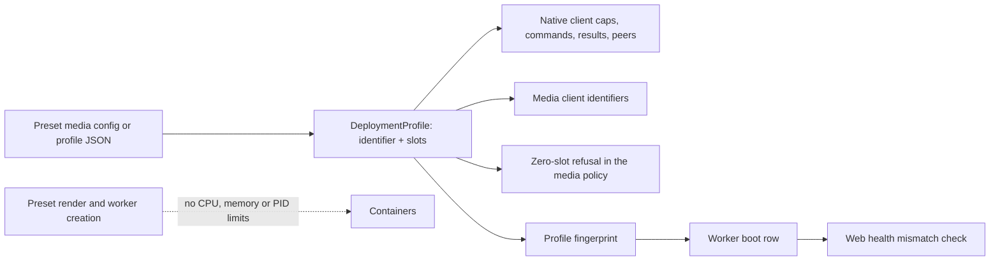
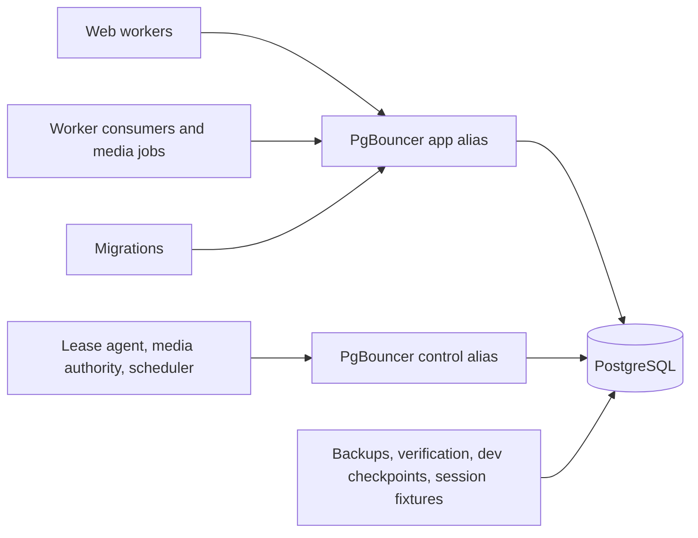

# Configurable media capacity and connection pooling - Plan

## Goal Capsule

**Objective:** A household with a capable server can run 8 video and 12 audio conversion or copy jobs at the same time. Baander bounds its media work with its own slot counts, containers carry no CPU or memory ceilings, and operators lower the slots when their host cannot keep up.

**Means:** Operator-set video and audio job slots in the startup profile with Baander-internal limits derived from them (KTD1–KTD5), no container resource limits (KTD3, KTD16, KTD17), a governor that learns each stream's own cost (KTD18), and a transaction-mode PgBouncer 1.26.1 so PostgreSQL backends stop scaling with clients (KTD8–KTD11).

**Product authority:** The user directed the capacity model, the pooler, and the answers recorded under Key Decisions on 2026-11-03.
Product behavior is governed by R1–R18; the Planning Contract decides how to deliver it.

**Execution profile:** One branch, `feat/configurable-media-capacity`, with dependency-ordered units landed as local commits.
U2's measurements set the per-codec encoder thread count and the operator guidance; no measured constant is written before they exist.
Push only when the user asks.

**Authority and stop conditions:** Follow `AGENTS.md`, then this Product Contract, then the Planning Contract.
Stop affected work if it would weaken ownership, lease, signed-delivery or media access checks, change household's shared copy mode or slot values, or discard local data.

**Product Contract preservation:** New plan; no upstream Product Contract.

---

## Product Contract

### Summary

Full-profile operators set how many video and audio jobs run at once; unset, the profile runs 8 video and 12 audio. Baander's own limits (the slot counts and the native command, result and client counts) follow from the slots. No container gets a CPU, memory or PID ceiling, a CPU set or a CPU weight: operators find their host's capacity by trial and error, guided by measured per-codec costs that distinguish software from hardware encoding.
A transaction-mode PgBouncer sits between the application and PostgreSQL in both profiles and the standard install, so database memory depends on a small server pool instead of on every web, worker and media client.
Operators get documentation, a CLI that prints the effective profile and its derived limits, and a health signal when web and workers disagree.

### Problem Frame

The full profile admits only 3 video jobs and 1 audio job at a time, and stream copy shares those slots.
Some households run 8 video and 12 audio streams that need conversion or copy at once; everything beyond the fixed slots queues, even on a host with spare CPU and memory.
The limits are constants in `src/Shared/Application/DTO/DeploymentProfile.php`, and several dependent limits are hard-coded elsewhere: media client identifiers, a 16-peer native daemon cap, a single global native command limit, fixed PID floors, and a one-CPU execution quota in the managed preset.

Container sizing adds up worst cases.
The preset pins the control and execution workers to disjoint CPU sets, so the control worker holds a whole core it barely uses, and every service has a fixed worst-case memory limit although web, Redis and PostgreSQL burst at different times. Deriving those limits from the slots would make the code complex while the real capacity still depends on the host and its encoders, including GPU and QuickSync encoders that use almost no CPU.

Database memory compounds the problem.
Each PostgreSQL connection that touches a PGroonga index keeps about 22 MiB, and every media child opens its own connections.
More media slots would therefore grow PostgreSQL's memory with the same multiplier that caused the OOM kills fixed on the household branch.

### Key Decisions

- **Slots bound media work; containers carry no upper limits.** Baander limits how many transcodes run at once; no service or worker unit gets a CPU, memory or PID ceiling, a CPU set or a CPU weight, and operators tune the slots by trial and error. (session-settled: user-directed, 2026-11-03 — supersedes the resource allowance with derived ceilings and floors and the summed per-service reservations; chosen over keeping memory limits and over dropping the kill order too: simpler code, and real capacity depends on the host and its encoders.) Governs R1, R3.
- **Defaults are 8 video and 12 audio.** (session-settled: user-directed — supersedes "Default slots shrink in the 8:12 ratio"; chosen over today's 3 + 1 and over a measured reference-host pair: operators lower it if their host cannot keep up.) Governs R1.
- **The kill order stays.** Under host memory pressure, web workers and media work (the FFmpeg processes and the PHP media children) are killed before Redis, PostgreSQL, the pooler and the control worker. (session-settled: user-directed — chosen over letting the kernel pick victims.) Governs R17.
- **The load proof proves mechanics and records real time here.** (session-settled: user-directed — supersedes "Real-time capability with CPU derived from slots"; chosen over proving mechanics only: real-time margins on this workstation are published as a reference, not a guarantee.) Governs R4.
- **The governor learns each stream's own cost.** (session-settled: user-directed — chosen over leaving the governor's host-wide samples in place.) Governs R18.
- **No compatibility constraint; aim for great defaults.** (session-settled: user-directed — chosen over keeping today's 3 + 1 for existing installs: nothing is deployed.) Governs R1.
- **Zero slots disable a kind.** (session-settled: user-directed — chosen over a minimum of one per kind: operators may run audio-only or video-only conversion.) Governs R5.
- **Derived maximums, rejected early.** (session-settled: user-directed — chosen over fixed caps: limits move with the derived resources.) Governs R6.
- **Queue when busy, with a documented busy response.** (session-settled: user-directed — chosen over an immediate busy error: today's queueing is kept.) Governs R7.
- **PgBouncer in this plan, in both profiles and the standard install.** (session-settled: user-directed — chosen over a separate plan: more slots must not raise database memory.) Governs R9.
- **Real time is guaranteed at 1080p.** (session-settled: user-directed — chosen over 1440p and over the ladder's 4K top tier: matches typical household content and fits a reasonable CPU envelope.) The guarantee is per stream: each 1080p encode can run ahead of real time when the host has CPU to spare, which sets the per-codec encoder thread count. Whether all configured slots run in real time at once depends on the host, so under the load-proof decision above that aggregate figure is measured and published as a reference. Governs R4.
- **The pooler's credentials get their own volume.** (session-settled: user-directed — chosen over the application secrets volume: the network-facing pooler must not mount the OAuth signing key.) Governs R14.
- **Household gets the pooler without requalification.** (session-settled: user-directed — chosen over freezing household entirely and over re-running its qualification: the configured values change; the measured figures are labelled as pre-pooler.) Governs R8, R15.
- **Both profiles drop container limits.** Household keeps its shared copy mode and its rule against encoding. Household requalification without container limits is recorded in the roadmap and is not run in this plan. (session-settled: user-directed — chosen over changing the full profile only.) Governs R8.
- **CPU-based guidance excludes hardware-encoded codecs.** Where a GPU, QuickSync or another hardware encoder handles a codec, that codec's encode costs almost no CPU, so the published per-codec CPU costs apply to software encoding only. (session-settled: user-directed.) Governs R15.

### Requirements

**Media capacity**

- R1. Full-profile operators set the number of concurrent video jobs and audio jobs; stream copy shares the slots of its kind. Unset values default to 8 video and 12 audio.
- R2. Web, workers, the native daemon and the worker manifest use the same slot values; workers refuse a profile that disagrees with their worker manifest's profile fingerprint (the existing manifest check), and web health reports when its profile differs from the active worker boot.
- R3. Baander's own limits (the slot counts and the native command, result and client counts derived from them) are the only bound on media work. No rendered service, created worker unit or source-install manifest carries a CPU, memory or PID ceiling, a CPU set or a CPU weight, and nothing admits work against a memory or PID budget.
- R4. A full deployment configured for 8 video and 12 audio jobs runs all twenty concurrently with no media-role containment, OOM kill or uncertain native failure. A single 1080p encode of each codec runs ahead of real time on an otherwise idle host. The load proof records each stream's real-time margin at 8 + 12 on the reference workstation, and System Requirements publishes it as a reference figure.
- R5. In the full profile, a kind configured with zero slots is disabled: its encodes and its stream copies are refused with the existing compatibility explanation instead of waiting forever.
- R6. Slot counts beyond the derived maximums are rejected when the managed preset renders and when the profile is built, naming the bound that was exceeded.
- R7. When every slot of a kind is busy, new work of that kind queues; an audio start that exceeds its wait receives a documented busy response.
- R8. The household profile keeps its shared copy mode (two shared copy slots, no encoders) and its native execution limits, and rejects slot overrides; like full, it carries no container limits.
- R16. Worker leases and media authority checks meet their deadlines while every slot encodes.
- R17. When memory runs short on the host, web workers and media work (FFmpeg processes and PHP media children) are killed before Redis, PostgreSQL, the pooler and the control worker's other processes.
- R18. The playback governor learns each stream's own encoder CPU, as a share of the host's CPUs, instead of host-wide utilization; hardware-accelerated streams are learned separately from software ones.

**Database pooling**

- R9. Web, workers and migrations reach PostgreSQL through a transaction-mode PgBouncer 1.26.1 in both profiles and the standard install, so PostgreSQL backends are bounded by the pooler's server pools rather than by client counts.
- R10. Worker leases, media authority checks and the scheduler use a separate reserved pool whose waits end before their lease and authority deadlines.
- R11. Backups, deployment verification, development checkpoints and test fixtures that need session state connect to PostgreSQL directly.
- R12. PostgreSQL's time zone is UTC by configuration and by migration, and web and workers refuse to start when the server reports another zone.
- R13. Application SQL stays safe for transaction pooling, and a test fails when session-scoped constructs are introduced.
- R14. The pooler authenticates with a SCRAM auth file generated from the database password into a private credentials volume that only the pooler mounts.

**Guidance**

- R15. Operator documentation explains choosing slots by trial and error, with measured per-codec CPU and memory costs for software encoding, the note that hardware-encoded codecs use almost no CPU, the reference real-time margins, the kill order, the pooler and connection sizing. System Requirements labels the household measurements as taken before the pooler and before container limits were removed.

### Acceptance Examples

- AE1. **Covers R1, R3.** Given a full preset configuration with `videoSlots: 8` and `audioSlots: 12`, when the operator renders the deployment, then no service carries `cpus`, `cpu_shares`, `cpuset`, `mem_limit` or `pids_limit`, and the profile carries the native limits for 8 + 12.
- AE7. **Covers R1.** Given a full preset configuration without `media`, when the operator renders the deployment, then the profile runs 8 video and 12 audio slots.
- AE8. **Covers R16.** Given every slot encoding and web load, when a worker renews its lease, then the renewal completes within its deadline.
- AE2. **Covers R5.** Given a full profile with zero audio slots, when a client requests an audio rendition or an audio stream copy, then it receives the existing compatibility explanation and no job is queued.
- AE3. **Covers R2.** Given a source install whose web profile says 8 video slots while the active worker boot was started with 4, when an operator checks web health, then health reports the profile mismatch.
- AE4. **Covers R7.** Given all audio slots busy, when a listener starts a track that needs a new rendition and no slot frees within the start wait, then the player receives the documented busy response.
- AE5. **Covers R9, R10.** Given web traffic that saturates the application pool, when a worker renews its lease, then the renewal is served from the control pool within its deadline.
- AE6. **Covers R8.** Given a household preset configuration that sets `videoSlots`, when the operator renders it, then rendering fails because household slots are fixed.

### Success Criteria

- The 8 + 12 load proof finishes with no containment, no OOM kill, lease renewals within deadline, and PostgreSQL backends never exceeding the configured server pools plus direct reserve; its receipt records each stream's real-time margin.
- Household's shared copy mode and native execution limits are byte-identical to today's in tests.
- An operator can choose slots for a full host from System Requirements and the profile CLI without reading code.

### Scope Boundaries

- Requalifying the household profile with the pooler and without container limits is not part of this plan (Key Decisions); the roadmap records it.
- Detecting host CPU, memory or encoders to size slots stays out; operators choose slots.
- Container resource limits of any kind, and a parent cgroup, are out (Key Decisions).
- Redesigning the one-process-per-job media model is out.
- Web-side slot admission is out: web receives the configured slot-bearing profile for policy refusal and the health fingerprint, but does not count or admit jobs against slots.
- GPU encoding and hardware-acceleration selection are unchanged; only the guidance distinguishes hardware from software cost.

---

## Planning Contract

### Key Technical Decisions

- KTD1. **The profile carries a validated slot choice.** `DeploymentProfile` takes the identifier plus optional video and audio slot counts, validates them against per-profile rules, and `fromJson` validates the serialized fields instead of comparing them with a built-in table. This follows `WorkerAutoscalingProfile`'s strict-JSON, bounded-choice pattern. Household keeps its fixed shared copy pool (two shared copy slots, `media-copy-0` and `media-copy-1`, encoders prohibited) as a profile mode the video and audio slot parameters do not express. The eleven parameters that default-construct a profile are removed so every consumer receives the configured instance. Instantiates the Key Decision governing R1 and R3.
- KTD2. **Baander's native limits are derived from slots by one set of formulas.** Per-client native caps exist for every profile: a video client may run one encoder and one helper, an audio client one encoder, a household shared copy client one copy command and one helper, media control one command. Commands are the sum of client caps; results are twice the commands plus two; clients are the fixed system clients plus one per slot. The formulas reproduce household's current values exactly, and tests pin both. The video cap counts one helper rather than the helper queue's eight because helpers beyond the first already queue inside the job; today's full command limit of 8 is this formula at 3 + 1. The native envelope and the per-child media reservations only sized container limits and the supervisor's memory admission, so they are removed with them (KTD3); U2's per-kind memory figures become operator guidance. Every video encode runs with a fixed two-thread cap today (`SegmentEncoder`); U2 measured that cap below real time for 1080p HEVC (0.67× in isolation), so the per-codec encoder thread count becomes a measured constant used by `SegmentEncoder`.
- KTD3. **Containers carry no resource limits.** The preset, the worker units the deployment operator creates, and the source-install manifest render no `cpus`/`NanoCpus`, `cpu_shares`/`CpuShares`, `cpuset`, `mem_limit`/`Memory`, `memswap_limit` or `pids_limit`/`PidsLimit`. `controlCpuSet`, `executionCpuSet`, the one-CPU execution quota, the PID floors and the host-reservation admission check that compares configured reservations with the host are removed, together with the memory reservations that exist only to size those limits. (session-settled: user-directed.) Governs R3, R8.
- KTD4. **The native daemon admits by derived peer cap with backpressure.** Its open-peer cap is the derived client count plus a small margin, so it follows the slots rather than bounding them. Each loop iteration it accepts pending peers only while the open-peer count is below the cap; above the cap, new peers wait in the listen backlog until a peer closes instead of being closed and escalating to containment. (session-settled: user-directed — chosen over raising the cap but still closing excess peers: a closed peer is treated as uncertain and contains the media role.)
- KTD5. **Defaults and bounds.** Unset full-profile slots are 8 video and 12 audio. The only fixed resource bound left is the pooler's client limit (`max_client_conn`): the total slot maximum is that limit minus the web, worker-consumer, lease-agent and scheduler clients, divided by each media job's pooled connections, and the per-kind maximum is the same bound for a profile with the other kind at zero. The daemon peer cap and the supervisor's child ceiling follow from the slots. Larger values are rejected with the bound named. (session-settled: user-directed.) Governs R1, R6.
- KTD6. **Web reports profile disagreement through health.** The worker boot row records the profile fingerprint the boot started with; the web health check compares it with its own profile and reports a mismatch. (session-settled: user-directed — chosen over refusing web startup and over documenting only: misconfiguration becomes visible without a restart loop.) Governs R2.
- KTD7. **Zero slots refuse the kind at the policy.** `MediaOperation::StreamCopy` splits into video and audio stream copy, and in the full profile `MediaExecutionPolicy` refuses encodes and stream copies of a kind whose slot count is zero, so delivery negotiation returns its existing compatibility explanation and nothing reaches the worker queue. Household's shared copy pool is not gated by this rule. Governs R5.
- KTD8. **PgBouncer runs from the database image as its own service.** PgBouncer 1.26.1 is installed from the PostgreSQL project's packages in `docker/postgres/Dockerfile` and started as a separate service with no resource limits; the preset image list and configuration version stay unchanged. It runs transaction pooling. Every pooled PDO connection, through Doctrine and through the dedicated connection factories, sets `Pdo\Pgsql::ATTR_DISABLE_PREPARES`: the image's pdo_pgsql links libpq 15, which frees named statements with SQL `DEALLOCATE`, and PgBouncer does not map that to its renamed server statements, so it would abort transactions. (session-settled: user-directed — chosen over a separate pooler image role: one database image to build and pin.) Governs R9.
- KTD9. **Two pooler databases separate application and control traffic.** An application alias carries web and ordinary worker traffic; a control alias with its own reserved server connections carries leases, media authority and the scheduler, with a query-wait timeout shorter than the lease safety margin. (session-settled: user-directed — chosen over control traffic connecting directly and over a single shared pool: control deadlines must hold under web load.) Governs R10.
- KTD10. **Connection routing is explicit.** `DATABASE_URL` points at the application alias, a control DSN at the control alias, and a direct URL at PostgreSQL for backups, preset verification, development checkpoints and session-state fixtures; migrations use the pooler. (session-settled: user-directed — chosen over migrations connecting directly: migration SQL is already transaction-scoped.) Governs R9, R11.
- KTD11. **PostgreSQL's connection count follows the server pools.** `max_connections` becomes the application pool plus the control pool plus a direct reserve plus superuser slots. PostgreSQL's own memory settings (`shared_buffers` and the per-connection settings) stay as configured; its container gets no memory limit. The household branch's per-client rule and the preset's PostgreSQL memory limit are removed.
- KTD12. **The pooler authenticates from a generated auth file.** Before the pooler starts, the preset generates one SCRAM-SHA-256 verifier from `DB_PASSWORD`, applies it to the database role with `ALTER ROLE … PASSWORD` over the direct connection, and writes the same verifier to the auth file with `auth_type = scram-sha-256`. The auth file lives in a dedicated pooler credentials volume, mounted read-only only into the pooler; the pooler never mounts the application secrets volume. PgBouncer can reuse a client's SCRAM proof for its server login only when its verifier is byte-identical to the role's, so the role and the file must carry the same one. The file never holds a plain-text or MD5 password, and `auth_query` is not used, which avoids CVE-2025-12819's precondition. (session-settled: user-directed — chosen over a separate operator-supplied pooler password: one secret to manage.) Governs R14.
- KTD13. **UTC is guaranteed three ways.** Both PostgreSQL configuration files set `timezone = 'UTC'`, a migration runs `ALTER DATABASE … SET timezone`, and web and worker startup refuse when the default zone, read as `reset_val` for `TimeZone` from `pg_settings`, is not UTC; `SHOW TimeZone` would only echo the connect-time setting. The per-connection `SET TIME ZONE` stays; PgBouncer tracks `TimeZone` per client. (session-settled: user-directed — chosen over configuration files only: drift is caught at startup.) Governs R12.
- KTD14. **A convention test keeps SQL pool-safe.** A unit test scans `src/` and `migrations/` for session advisory locks, `LISTEN`, SQL `PREPARE`/`DEALLOCATE`, `WITH HOLD` cursors, temporary tables without `ON COMMIT DROP`, session `set_config(…, false)`, and `SET` other than the transaction-scoped forms (`SET LOCAL`, `SET TRANSACTION`, `set_config(…, true)`) and the connect-time time zone, following `InstantBindConventionTest`. The lease agent's session `SET statement_timeout` moves into a transaction as `SET LOCAL`. Governs R13.
- KTD15. **Busy is a documented response, not a new admission path.** The audio rendition start wait keeps queueing; when it expires, the delivery response states that every audio slot is busy, and the obsolete "server-wide encode limit" docblock on `AudioRenditionPortInterface` is corrected. Governs R7.
- KTD16. **Encoders yield CPU inside their container through process priority.** Across containers, the control worker, the pooler, PostgreSQL and web keep their share through each container's own cgroup at the default CPU weight; nice has no effect between cgroups. Inside the execution container, the native daemon starts FFmpeg encode, copy and helper commands at nice 10, so they yield to the execution worker's lease renewal, supervisor, native daemon and consumers. An idle host still gives encodes all its CPU. Governs R16.
- KTD17. **The kill order uses `oom_score_adj`.** Web workers carry the highest score; media work the next: the native daemon raises the score of every FFmpeg command it launches above the execution container's base score, in the same launch step that applies nice 10, and each PHP media child in the control container raises its own score above the control container's (raising needs no privilege). The execution container's base score sits between media work and Redis; PostgreSQL, the pooler and the control container's base score are lowest. (session-settled: user-directed.) Governs R17.
- KTD18. **The governor learns each stream's own cost.** The playback governor runs in each PHP media child (`WorkerQoLLifecycle`, started from `bin/worker-media-job.php`) and holds only that child's stream, while the encoder runs under the native daemon in the execution container, out of the child's sight. The native daemon therefore reads each running command's CPU time (`utime` + `stime` from `/proc/<pid>/stat`) and reports cumulative encoder CPU seconds and encoded output seconds in every attempt snapshot, polled and final. The governor's learning samples and the mid-stream monitor's readings become CPU seconds per output second divided by the host's CPUs, which does not shrink when the host is contended, instead of host-wide `/proc/stat` utilization. Samples carry the hardware-accelerated flag the cost model already keys on, so hardware and software encodes are learned apart. The QoL profiles and their caps stay; the aggregate is bounded by the slots. (session-settled: user-directed.) Governs R18.

### High-Level Technical Design

Slot values flow from the operator's configuration into one profile that every process derives Baander's own limits from:

Connections reach PostgreSQL through two pooled aliases, with a direct path kept for session-state work:

### System-Wide Impact

- **Every database client changes address.** Web, worker consumers, media children, the scheduler, the lease agent, migrations, console commands, the host controller, backups and the development tooling all resolve one of three DSNs (KTD10); a missed client keeps working against PostgreSQL directly and silently escapes the pool bound.
- **Worker boots and manifests change shape.** The manifest and boot row carry the slot-bearing profile and its fingerprint and no resource limits, so every worker deployment is replaced once; nothing is deployed, so no migration path is needed.
- **The preset's rendered stack gains a service and loses its limits.** The compose fingerprint changes, every `cpus`, `cpuset`, `mem_limit` and `pids_limit` disappears, and the host-reservation check goes; household's shared copy mode and native limits do not change (R8).
- **CPU sets disappear from configuration.** The preset configuration, the worker configuration, the lifecycle, the operator manifest, the qualification harness and their tests lose `controlCpuSet` and `executionCpuSet`.
- **Autoscaling and supervisor admission lose their limit inputs.** `CgroupResourceSampler` reads ratios against cgroup limits and `WorkerSupervisorRunner` budgets children from the PID and memory limits; both move to host- and profile-derived figures in U5.
- **Tests that pin today's numbers move.** Profile, reservation, manifest, image-profile, preset and media-control tests and fixtures that hard-code 3 + 1, 3136 MiB, memory limits, PID limits or CPU sets are updated or removed.

### Deferred to Implementation

- The per-codec encoder thread count: set from U2's receipt.
- Which remaining memory constants other than the native envelope, the per-child media reservations and the supervisor's memory admission (removed by KTD2 and KTD3) exist only for container limits: classified in U5 by reading their consumers.
- The application and control pool sizes, the direct reserve and the control query-wait timeout: set in U8 from the lease safety margin and measured concurrency, then confirmed by U10.

### Assumptions

- 1080p is representative of household content for the published real-time margins; U2 and U10 measure at 1080p with a 1080p source.

### Risks

| Risk | Mitigation |
| --- | --- |
| Each video media child's governor learns host-wide CPU as its own stream's cost, so under eight concurrent encodes it would veto or downgrade every new encode. | KTD18 records the stream's own encoder CPU; U10 fails on a veto or downgrade after the governor learned under the 8 + 12 load. |
| Without CPU weights or a dedicated core, lease renewals lose to encodes under contention. | KTD16's lower encoder priority; U10 measures lease timing with every slot encoding and web load (AE8). |
| With no memory limits, one service's leak or burst can exhaust host memory. | The slots bound how many encoders run; KTD17's kill order sacrifices web workers and media work before stateful services; nothing caps a single process's memory. U10 records OOM events. Accepted by the Key Decision. |
| A rootless Docker daemon cannot set a negative `oom_score_adj`. | U5 verifies the kill order on the CI host's Docker and refuses to render with a named reason where it cannot be applied. |
| 8 + 12 is more than a typical host runs in real time with software encoding (U2: about 1.6 CPUs per 1080p H.264 stream, about 3.2 for HEVC). | The default is the operator's starting point; System Requirements publishes the per-codec costs and the reference margins so operators can lower the slots. |
| Pooler queueing adds latency under bursts. | KTD9's control pool and query-wait timeout bound control traffic; U10 records web request latency through the pooler. |
| Twenty clients polling the native daemon expose untested transport behavior. | KTD4 and U10's load proof. |
| The control pool's size (U8) was chosen before the slots grew, and media authority checks scale with the slots. | U10 confirms control deadlines at 8 + 12; larger slot counts rely on the control pool's query-wait timeout and are recorded as unproven in System Requirements. |

### Sources

- Key code anchors: `src/Shared/Application/DTO/DeploymentProfile.php`, `src/Shared/Application/DTO/WorkerAutoscalingProfile.php`, `bin/worker-media-job.php`, `bin/worker-media.php`, `src/Shared/Infrastructure/Worker/NativeExecutionDaemon.php`, `src/Transcode/Infrastructure/Worker/MediaWorkerRunner.php`, `src/Transcode/Application/Service/MediaExecutionPolicy.php`, `src/QoL/Infrastructure/Worker/WorkerQoLLifecycle.php`, `packages/baander-tooling/src/Deployment/ImageProfile.php`, `packages/baander-tooling/src/Deployment/HouseholdRenderer.php`, `packages/baander-tooling/src/Deployment/WorkerLifecycle.php`, `bin/worker-lease-agent.php`, `src/Shared/Infrastructure/Doctrine/Platform/BaanderDriverMiddleware.php`.
- Per-job measurements: U2's 1080p receipt, and the earlier `var/test-runs/media-control-1793644552-540907/` (libx264 360p encode about 299 MiB RSS, helper about 61 MiB, MP3 encode about 52 MiB; control peak 611.5 MiB with four children).
- PgBouncer 1.26.1 features and changelog: https://www.pgbouncer.org/features.html and https://www.pgbouncer.org/changelog.html#pgbouncer-126x (transaction-pooling compatibility, tracked `TimeZone`, `max_prepared_statements` default 200 since 1.24.0, 1.26.1 security fixes).
- PGroonga per-backend memory: `.agents/skills/postgres-remediation/references/extensions.md`, "Size memory per PGroonga backend".

---

## Implementation Units

| U-ID | Title | Key files | Depends on |
| --- | --- | --- | --- |
| U1 | Slots in the startup profile | `src/Shared/Application/DTO/DeploymentProfile.php` | — |
| U2 | Measure per-job cost | `tests/Fixtures/Worker/`, `packages/baander-tooling/src/Fixtures/Worker/MediaControl.php` | — |
| U3 | Derived native limits | `DeploymentProfile.php`, `TranscodeProcessPool.php`, `SegmentEncoder.php` | U1, U2 |
| U4 | Media client identity, admission and daemon backpressure | `bin/worker-media-job.php`, `NativeExecutionDaemon.php`, `MediaWorkerRunner.php`, `MediaExecutionPolicy.php` | U1, U3 |
| U5 | Remove container limits; kill order and encoder priority | `HouseholdRenderer.php`, `WorkerLifecycle.php`, `DeploymentOperatorManifest.php`, `NativeExecutionDaemon.php` | U3, U8 |
| U6 | Operator configuration, CLI and mismatch health | `HouseholdConfiguration.php`, `ImageProfile.php`, console command, health check | U1, U3 |
| U7 | Defaults and bounds | `DeploymentProfile.php`, `deploy/household/example.json` | U3, U8 |
| U8 | PgBouncer in the database image and deployments | `docker/postgres/`, `HouseholdRenderer.php`, `docker-compose.yml`, config | — |
| U9 | Pool-safe SQL and UTC guarantee | `bin/worker-lease-agent.php`, migration, convention test | U8 |
| U10 | 8 + 12 load proof | media-control drill and fixtures | U4, U5, U6, U7, U8, U13 |
| U11 | Busy response | `AudioRenditionCache.php`, `AudioRenditionPortInterface.php` | U4 |
| U12 | Documentation and roadmap | `docs-book/`, `deploy/household/README.md`, `CONCEPTS.md`, `ROADMAP.md` | U10 |
| U13 | Governor learns each stream's own cost | `StreamGovernor.php`, `StreamAdmissionService.php`, `MidStreamMonitor.php` | U1 |

### U1. Slots in the startup profile

**Goal:** The profile carries operator slot values through every process that already shares it.

**Requirements:** R1, R2, R5, R6, R8; KTD1.

**Dependencies:** none.

**Files:** `src/Shared/Application/DTO/DeploymentProfile.php`, the eleven consumers that default-construct a profile (`WorkerRuntimeConfiguration`, `WorkerAutoscalingProfile`, `WorkerPeerHandshake`, `NativeExecutionDaemon`, `DeploymentContainerRecipe`, `NativeExecutionClient`, `AdmissionLedger`, `WorkerReadinessObservation`, `AutoscalingStatus`, `TranscodeProcessPool`, `MediaWorkerRunner`), `config/services.yaml`, `tests/Unit/Shared/Application/DTO/DeploymentProfileTest.php`, `tests/Fixtures/Worker/deployment-profile.json`.

**Approach:**
1. Add video and audio slot parameters with per-profile validation: household keeps its fixed shared copy mode and rejects any slot value; full accepts zero up to the derived maximum (bounds land in U7; U1 tests use explicit slot values).
2. Replace `fromJson`'s table-equality check with validation of the serialized fields and a consistency check that derived fields match the slots.
3. Remove default-constructed profile parameters and pass the configured profile through constructors and service wiring.

**Patterns to follow:** `WorkerAutoscalingProfile` constructor bounds and strict `fromJson`.

**Test scenarios:**
- A full profile built with 8 video and 12 audio slots serializes and round-trips through `fromJson` unchanged.
- A household profile with any slot override is rejected (Covers AE6).
- A full profile JSON whose derived field disagrees with its slots is rejected.
- A full profile with zero audio slots is accepted and reports audio as disabled.
- Unknown or non-integer slot fields are rejected.

**Verification:** Profile tests pass in the CI image, and no production class default-constructs a profile.

### U2. Measure per-job cost

**Goal:** Measured native memory, PHP child memory, threads and CPU per job kind at 1080p exist for the encoder thread count and the operator guidance.

**Requirements:** R3, R4, R15; KTD2.

**Dependencies:** none.

**Files:** `tests/Fixtures/Worker/` media fixtures (add a 1080p source alongside the 360p one), `packages/baander-tooling/src/Fixtures/Worker/MediaControl.php` and its observation helpers, `tests/Fixtures/TwoCommand/media-control.php`.

**Approach:**
1. Extend the media-control drill to run one job per kind at the R4 tier, H.264 and HEVC where the ladder uses them, stream copy, and each audio codec, then again with the candidate default video and audio slot counts running concurrently.
2. Record per-process peak RSS, thread counts, per-job CPU seconds per second of output in isolation and under concurrency, encode speed (output seconds per wall second) under the current two-thread cap, and the control unit's per-child PHP peak.
3. During the concurrent run and one idle period, record per-container CPU (mean and p95 from `cpu.stat`) and memory (anonymous memory and page cache separately, from `memory.stat`) for web, PostgreSQL, Redis, the control worker and the execution worker, for the operator guidance.
4. Record the per-codec encoder thread count at which 1080p HEVC reaches 1.2× real time in isolation.
5. Write the results into a retained receipt and summarise them in the unit's commit message for U3 and U12.

**Execution note:** This is measurement: run it on the real FFmpeg build in the worker image before writing U3's constants.

**Test expectation:** none -- measurement fixture; its output is evidence, verified by the drill's existing receipt validation.

**Verification:** A receipt with per-kind memory, threads and CPU at 1080p exists and is cited by U3 and U12.

### U3. Derived native limits

**Goal:** Baander's own limits follow from the configured slots by the formulas in KTD2.

**Requirements:** R3, R8; KTD2.

**Dependencies:** U1, U2.

**Files:** `src/Shared/Application/DTO/DeploymentProfile.php`, `src/Transcode/Infrastructure/Swoole/TranscodeProcessPool.php`, `src/Transcode/Infrastructure/FFmpeg/SegmentEncoder.php`, `packages/baander-tooling/src/Deployment/ImageProfile.php`, tests under `tests/Unit/Shared/Application/DTO/` and `tests/Unit/Transcode/`, `scripts/tests/php/ImageProfileTest.php`.

**Approach:**
1. Derive per-client caps, command, result and client limits from the slots (structural part landed with U4's worker commit).
2. Set the per-codec encoder thread count from U2 so a single 1080p encode of each codec runs ahead of real time on an idle host, and remove the native envelope and per-child media reservations.
3. Keep household's existing outputs byte-identical.

**Test scenarios:**
- Household's native limits equal today's values.
- A full profile with 8 video and 12 audio derives 29 native commands, 60 results, and a client count of the fixed clients plus 20.
- Raising video slots by one raises the commands by two and the clients by one.
- A full profile with zero video slots derives no video client caps.
- A 1080p HEVC encode runs with the measured thread count; H.264 keeps two.

**Verification:** Limit tests pass; household pins are unchanged.

### U4. Media client identity, admission and daemon backpressure

**Goal:** Every configured slot can launch, connect and run without hitting a hard-coded limit.

**Requirements:** R3, R4, R5; KTD2, KTD4, KTD7.

**Dependencies:** U1, U3.

**Files:** `bin/worker-media-job.php`, `bin/worker-media.php`, `src/Shared/Infrastructure/Worker/NativeExecutionDaemon.php`, `src/Transcode/Infrastructure/Worker/MediaWorkerRunner.php`, `src/Transcode/Application/Service/MediaExecutionPolicy.php`, `src/Transcode/Application/Service/MediaOperation.php`, its stream-copy callers (`CopyPresentationService`, `TranscodeSessionSubscriber`, `AudioRenditionCache`, `AudioRenditionExecutor`), `tests/Unit/Transcode/Infrastructure/Worker/MediaWorkerRunnerTest.php`, `tests/Integration/NativeExecutionDaemonTest.php`, `tests/Unit/Transcode/Application/Service/MediaExecutionPolicyTest.php`.

**Approach:**
1. Validate media client identifiers against the profile's derived slot names (`media-video-N`, `media-audio-N`, and household's `media-copy-0`/`media-copy-1`) instead of a literal pattern, and derive the daemon's client allowlist and per-client caps for every profile.
2. Apply KTD4's derived peer cap with backpressure and drain pending accepts each loop.
3. Split stream copy by kind and refuse encodes and stream copies of a zero-slot kind in the full profile's policy (KTD7).
4. Start media control's hardware probe only when the profile has video slots, because the probe asserts that video encoding is allowed and would crash an audio-only full profile.

**Test scenarios:**
- A full profile with 8 video slots launches `media-video-7`, and `media-video-8` is refused at the launch fence.
- With the peer cap reached, a further client waits and then connects once a peer closes, without an uncertain failure.
- An audio stream copy under zero audio slots is refused with the compatibility explanation (Covers AE2), while a video stream copy under the same profile succeeds.
- Household's client allowlist, per-client caps and permitted stream copies are unchanged.
- Media control starts under a full profile with zero video and twelve audio slots.

**Verification:** Media runner, daemon and policy tests pass in the CI image.

### U5. Remove container limits; kill order and encoder priority

**Goal:** No container carries a resource limit or CPU set, host memory pressure kills in the agreed order, and encodes yield CPU to control traffic.

**Requirements:** R3, R8, R16, R17; KTD3, KTD16, KTD17.

**Dependencies:** U3, U8.

**Files:** `packages/baander-tooling/src/Deployment/HouseholdConfiguration.php`, `packages/baander-tooling/src/Deployment/HouseholdRenderer.php`, `packages/baander-tooling/src/Deployment/Household.php`, `packages/baander-tooling/src/Deployment/WorkerConfiguration.php`, `packages/baander-tooling/src/Deployment/WorkerLifecycle.php`, `packages/baander-tooling/src/Deployment/ContainerMeasurement.php`, `src/Shared/Infrastructure/Worker/DeploymentOperatorManifest.php`, `src/Shared/Infrastructure/Worker/NativeExecutionDaemon.php`, `src/Shared/Application/DTO/DeploymentProfile.php`, `WorkerRuntimeConfiguration.php`, `src/Shared/Infrastructure/Worker/WorkerSupervisorRunner.php`, `src/Shared/Infrastructure/Worker/Autoscaling/CgroupResourceSampler.php` and the autoscaling policy tests, `bin/worker-deployment.php`, `deploy/household/example.json`, the qualification harness under `packages/baander-tooling/src/Fixtures/Household/`, tests for each.

**Approach:**
1. Remove `cpus`, `cpu_shares`, `cpuset`, `mem_limit`, `memswap_limit` and `pids_limit` from the rendered preset and from worker-unit creation, and remove `controlCpuSet`, `executionCpuSet`, the one-CPU execution quota, the PID floors and the host-reservation check (KTD3).
2. Remove the worker supervisor's memory admission against `memoryLimitBytes` and its PID-derived child cap, together with `--memory-mib` and `--pids-limit` in the operator manifest and `WorkerRuntimeConfiguration`; the supervisor's child ceiling becomes the profile-derived count (fixed role children, the media manager and one per slot, with their descendants). Teach `CgroupResourceSampler` to measure an unlimited cgroup against the host (CPU usage over the host's CPU count, `memory.current` over `MemTotal`, `pids.current` over the kernel PID limit) so autoscaling observations stay known.
3. Render `oom_score_adj` per service and for created worker units, have the native daemon raise every launched FFmpeg command's score and each PHP media child raise its own (KTD17), and verify on the CI host that the scores apply.
4. Start FFmpeg encode, copy and helper commands at nice 10 from the native daemon (KTD16).

**Test scenarios:**
- A rendered full and household preset, and every created worker unit, carry no CPU, memory or PID limit and no CPU set (Covers AE1).
- Web workers carry the highest `oom_score_adj`; a launched FFmpeg command's score is above the native daemon's and the execution supervisor's; a PHP media child's score is above the control supervisor's; PostgreSQL, the pooler and the control container's base score are lowest.
- An unlimited execution cgroup yields a known autoscaling observation, and the policy can scale above one consumer.
- The supervisor admits children up to the profile-derived ceiling with no memory or PID limit configured.
- A native encode command runs at nice 10 while the native daemon itself keeps its own priority.
- A rootless daemon that cannot apply a negative score is refused at render with a named reason.
- Household renders with its shared copy mode and native limits unchanged.

**Verification:** Tooling, manifest and preset tests pass; a started preset deployment's `docker inspect` shows no resource limits and its processes show the derived `oom_score_adj` and nice values.

### U6. Operator configuration, CLI and mismatch health

**Goal:** Operators set slots in the managed preset or the source install, can see the effective profile and its derived limits, and see when web and workers disagree.

**Requirements:** R1, R2, R6; KTD1, KTD6; `.agents/rules/admin-cli-parity.md`.

**Dependencies:** U1, U3.

**Files:** `packages/baander-tooling/src/Deployment/HouseholdConfiguration.php`, `packages/baander-tooling/src/Deployment/ImageProfile.php`, `packages/baander-tooling/src/Deployment/Household.php`, `deploy/household/example.json`, a console command under `src/Shared/Interface/Console/` that prints the effective profile JSON and its derived limits, the worker boot persistence and web health check under `src/Shared/`, `packages/baander-tooling/src/Development/Workers.php`, tests for each.

**Approach:**
1. Add an optional `media` object with `videoSlots` and `audioSlots` (full only) to the preset configuration, and pass the values into the image profile probe.
2. Add the console command so source installs can produce the manifest and web values without hand-writing JSON; it prints the effective slots and the derived native limits.
3. Record the profile fingerprint on the worker boot row and compare it in web health (KTD6).
4. Keep the development preview on the defaults.

**Test scenarios:**
- A full preset with `media` renders a profile with those slots and pins its fingerprint.
- A household preset with `media` is rejected (Covers AE6).
- The console command prints JSON that `DeploymentProfile::fromJson` accepts and native limits equal to U3's derivation.
- Web health reports a mismatch when its fingerprint differs from the active boot's (Covers AE3) and is healthy when they match.

**Verification:** Tooling, unit and functional tests pass; `lint:container` passes for both profiles.

### U7. Defaults and bounds

**Goal:** Unset slots run 8 video and 12 audio, and oversized configurations are rejected early.

**Requirements:** R1, R6; KTD5.

**Dependencies:** U3, U8.

**Files:** `src/Shared/Application/DTO/DeploymentProfile.php`, `packages/baander-tooling/src/Deployment/HouseholdConfiguration.php`, `deploy/household/example.json`, profile and preset tests.

**Approach:**
1. Set the full defaults to 8 + 12.
2. Derive the per-kind and total maximums from the pooler's client limit (KTD5), and reject beyond them with the bound named.

**Test scenarios:**
- An unset full profile runs 8 video and 12 audio slots (Covers AE7).
- A slot count one above the derived maximum is rejected with the bound in the message.
- `deploy/household/example.json` renders for each profile.

**Verification:** Profile and preset tests pass.

### U8. PgBouncer in the database image and deployments

**Goal:** Every deployment reaches PostgreSQL through PgBouncer 1.26.1 with separate application and control pools, and PostgreSQL is sized from those pools.

**Requirements:** R9, R10, R11, R14; KTD8–KTD12.

**Dependencies:** none.

**Files:** `docker/postgres/Dockerfile`, a PgBouncer configuration template under `docker/postgres/`, `packages/baander-tooling/src/Deployment/HouseholdRenderer.php`, `packages/baander-tooling/src/Deployment/HouseholdConfiguration.php`, `packages/baander-tooling/src/Deployment/Household.php`, `docker-compose.yml`, `deploy/household/postgresql.conf`, `docker/postgres/conf/postgresql.conf`, `.env`, `config/packages/doctrine.yaml`, the worker DSN wiring for the control alias, `packages/baander-tooling/src/Development/Database.php`, backup and verification tooling, `scripts/tests/php/HouseholdDeploymentTest.php`.

**Approach:**
1. Install the pinned PgBouncer package in the database image and add a pooler service, started after PostgreSQL is healthy, with no resource limits.
2. Before the pooler starts, generate the verifier, apply it to the role and write the auth file (KTD12); render application and control aliases with their pool sizes and query-wait timeout (KTD9).
3. Route `DATABASE_URL`, the control DSN and the direct URL per KTD10, and set `Pdo\Pgsql::ATTR_DISABLE_PREPARES` on every pooled connection (KTD8).
4. Make the development writer check count clients on the pooler's application and control aliases (PgBouncer's `SHOW CLIENTS`) as writers and ignore only idle pooler server connections.
5. Resize `max_connections` per KTD11 and remove the preset's PostgreSQL memory limit and per-client sizing rule.
6. In the preset start run, record the pooler's steady CPU (mean and p95 from `cpu.stat`) and memory (anonymous memory and page cache from `memory.stat`), idle and under light query load, for the operator guidance.

**Execution note:** Verify `TimeZone` tracking and the disabled-prepares behavior against a running PgBouncer 1.26.1, including through the web runtime's Swoole coroutine pgsql driver, before building on them.

**Test scenarios:**
- The rendered preset contains a pooler service that depends on healthy PostgreSQL and exposes both aliases.
- The auth file holds only a `SCRAM-SHA-256$` entry equal to the role's verifier, lives in the pooler credentials volume, and the pooler mounts no other secrets volume or content-hashed configuration volume containing it.
- A client authenticates through the pooler and the pooler opens a server connection, end to end in the preset start test.
- A multi-statement Doctrine transaction that frees a statement mid-transaction commits through the pooler.
- PostgreSQL's rendered `max_connections` equals the two pools plus direct reserve plus superuser slots.
- A client connected through the pooler blocks a development checkpoint; idle pooler server connections alone do not.
- A full start and stop of a preset deployment through the pooler serves pages and retains data.

**Verification:** Tooling tests pass, a preset deployment starts through the pooler, and the preview refreshes through it.

### U9. Pool-safe SQL and UTC guarantee

**Goal:** Application SQL cannot regress into session-scoped constructs, and PostgreSQL is always UTC.

**Requirements:** R12, R13; KTD13, KTD14.

**Dependencies:** U8.

**Files:** `bin/worker-lease-agent.php`, a migration under `migrations/`, `tests/Integration/InitialSchemaMigrationTest.php`, a startup time-zone check in the web and worker bootstrap, a convention test under `tests/Unit/Shared/Infrastructure/Doctrine/`.

**Approach:**
1. Move the lease agent's timeout into a transaction as `SET LOCAL`.
2. Add the `ALTER DATABASE` migration and the startup check.
3. Add the convention test (KTD14).

**Test scenarios:**
- The convention test fails on a fixture source containing `pg_advisory_lock(` and passes on `pg_advisory_xact_lock(` and `SET TRANSACTION ISOLATION LEVEL`.
- The lease agent's renewal runs its timeout inside the transaction.
- Against a database whose default zone is not UTC, startup refuses even though the connection sets UTC; against a UTC default it proceeds.
- The migration sets the database default time zone and its `down()` restores the previous value.

**Verification:** Unit and integration lanes pass in the CI image.

### U10. 8 + 12 load proof

**Goal:** A full deployment configured for 8 video and 12 audio jobs runs all of them correctly on real FFmpeg, and the receipt records real-time margins on this workstation.

**Requirements:** R4, R9, R10, R16, R17, R18; Success Criteria.

**Dependencies:** U4, U5, U6, U7, U8, U13.

**Files:** `scripts/test-worker-media-control-container.sh` and its PHP driver, `packages/baander-tooling/src/Fixtures/Worker/MediaControl.php`, `packages/baander-tooling/src/Fixtures/Worker/ControlCapacityVerifier.php`, `packages/baander-tooling/src/Fixtures/Worker/AutoscalingVerifier.php`, `tests/Fixtures/TwoCommand/media-control.php`, `tests/Fixtures/TwoCommand/deployment.php`.

**Approach:**
1. Parameterize the drill's job counts and verifiers from the profile instead of three video jobs.
2. Bring the playback governor to its Active state before the run, by a warm-up of at least its learning sample count, and record the governor state with every admission decision.
3. Run 8 video jobs at 1080p and 12 audio jobs concurrently through the pooler with no container limits, recording segment progress against wall time per stream, the hardware or software encode path, governor decisions, native launches, the longest native connect-to-accept wait, OOM events, PostgreSQL backends, lease renewals and web request latency.

**Test scenarios:**
- All twenty jobs are admitted with the governor Active and run to completion; a decision made while the governor was still learning fails the receipt.
- No media-role containment, OOM kill or uncertain native failure occurs.
- No admission is vetoed or downgraded after the governor learned under the 8 + 12 load.
- PostgreSQL backends stay at or below the configured server pools plus direct reserve.
- Lease renewals complete within their deadlines while every slot encodes and web load saturates the application pool (Covers AE5, AE8).
- The receipt records each stream's real-time margin and the encode path.

**Verification:** A retained receipt shows every criterion above.

### U11. Busy response

**Goal:** A listener whose audio start exceeds the wait learns that every audio slot is busy.

**Requirements:** R7; KTD15.

**Dependencies:** U4.

**Files:** `src/Transcode/Infrastructure/Transcode/AudioRenditionCache.php`, `src/Transcode/Application/Port/AudioRenditionPortInterface.php`, the delivery response mapping, `ui/web` player handling if the response is new to it, tests for each.

**Approach:** Map the start-wait expiry to a documented busy response, correct the docblock, and show it in the player.

**Test scenarios:**
- With every audio slot busy, a new rendition start that times out returns the busy response (Covers AE4).
- A start that gets a slot within the wait plays normally.

**Verification:** Backend and web tests pass.

### U12. Documentation and roadmap

**Goal:** Operators can choose slots, configure and diagnose a full or household deployment from the guides.

**Requirements:** R15.

**Dependencies:** U10.

**Files:** `docs-book/part-1-operator-guide/system-requirements.md`, `configuration.md`, `transcoding.md`, `background-work.md`, `commands/README.md`, `commands/app-worker.md`, `getting-started.md`, `docs-book/part-2-developer-guide/testing.md`, `deploy/household/README.md`, `CONCEPTS.md` (media job slot, connection pooler), `ROADMAP.md`.

**Approach:** Replace the fixed 3 + 1 statements, the CPU-set guidance and the per-service memory limits with slot configuration and trial-and-error sizing. Publish U2's per-codec software costs, state that hardware-encoded codecs use almost no CPU, and publish U10's reference margins. Document the kill order, the encoder priority, the pooler and its aliases, and label the household measurements as taken before the pooler and before container limits were removed. Record household requalification as an open roadmap item.

**Test expectation:** none -- documentation; verified by `prose-fix`, link checks and `git diff --check`.

**Verification:** Every published number traces to a U2, U8 or U10 receipt.

### U13. Governor learns each stream's own cost

**Goal:** The playback governor's cost model and mid-stream monitor see the stream they govern, not the whole host.

**Requirements:** R18; KTD18.

**Dependencies:** U1.

**Files:** `src/QoL/Domain/Service/StreamGovernor.php`, `src/QoL/Infrastructure/Swoole/CpuGpuSampler.php`, `src/QoL/Infrastructure/StreamAdmissionService.php`, `src/QoL/Infrastructure/Swoole/MidStreamMonitor.php`, `src/QoL/Infrastructure/Swoole/LearningDataPersister.php`, `src/QoL/Infrastructure/Worker/WorkerQoLLifecycle.php`, `src/Shared/Infrastructure/Worker/NativeExecutionDaemon.php`, `NativeExecutionAttempt.php`, tests under `tests/Unit/QoL/` and the daemon's tests.

**Approach:** Have the native daemon report cumulative encoder CPU seconds and encoded output seconds in every attempt snapshot, and record each learning sample and mid-stream reading as CPU seconds per output second against the host's CPUs, carrying the hardware-accelerated flag; keep the QoL profiles and their caps.

**Test scenarios:**
- Samples recorded while eight encodes run concurrently predict a single stream's cost within a stated tolerance of samples recorded in isolation.
- The mid-stream monitor does not release a stream whose own CPU stays under the cap while the host is saturated by other encodes.
- A hardware-accelerated stream's learned cost does not raise the prediction for a software encode.
- Learning data stored before the change is reset rather than misread.

**Verification:** QoL unit tests pass in the CI image.

---

## Verification Contract

| Area | Gate | Proves |
| --- | --- | --- |
| Backend | `bash scripts/test-backend-container.sh` on affected paths, then the unit, functional and integration lanes, in the CI image | U1, U3, U4, U6, U9, U11, U13 |
| Static analysis | PHPStan, Deptrac and `lint:container` for both profiles through `scripts/check-backend-container.php` | No new violations or weakened baselines |
| Tooling | `composer run-script --timeout=7200 test:tooling`, `composer analyse:tooling`, `composer check:tooling-format`, `composer check:tooling-architecture` | U5, U6, U7, U8 |
| Web | in `ui/web`: `corepack yarn vitest run` on affected tests, `corepack yarn typecheck`, `corepack yarn lint` | U11 |
| Worker runtime | `scripts/test-worker-media-control-container.sh` (U2 measurements, U10 proof), `test-worker-lifecycle-container.sh`, `test-worker-recovery-container.sh` | U2, U4, U5, U10 |
| Deployment | A preset deployment of each profile started and stopped through the pooler with no container limits; `make preview-up` with the pooler | U5, U8 |
| Documentation | `prose-fix` preservation audit, local link check, `git diff --check` | U12 |

---

## Definition of Done

- R1–R18 are satisfied, with AE1–AE8 covered by tests named in their units.
- Household's shared copy mode, native limits and slot values are unchanged in tests.
- No configuration, manifest or rendered service carries a CPU, memory or PID limit, a CPU set or a CPU weight.
- The U10 receipt shows 8 video and 12 audio jobs completing with no containment or OOM kill, leases within deadline, PostgreSQL backends within the configured pools, and each stream's real-time margin.
- The gates above pass without weakened baselines; `ce-simplify-code` and `ce-code-review` ran and justified findings were applied.
- Code from abandoned approaches and temporary measurement scaffolding is removed from the diff.
- `ROADMAP.md` records the delivered checkpoint and any remaining limits; nothing is pushed unless the user asks.
