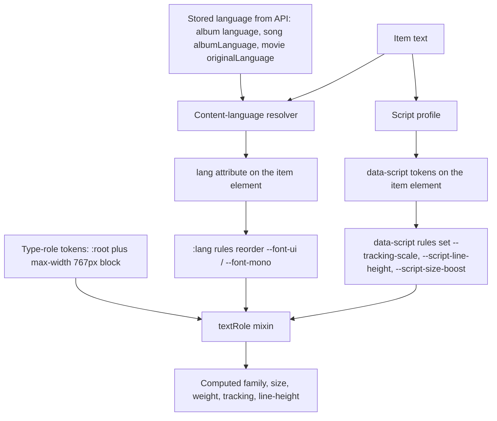
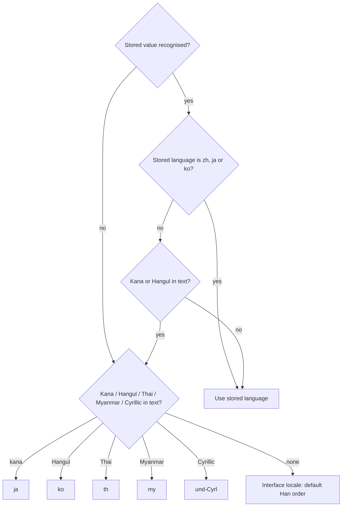

# Geist and Noto Typography - Plan

## Goal Capsule

- **Objective:** The web app, the Electron desktop app and the public website have a distinctive typeface of their own, and titles in Latin, Vietnamese, Cyrillic, Thai, Burmese, Korean, Chinese and Japanese render with bundled fonts, correct glyph forms and legible spacing.
- **Means:** Adopt the typography specification in the Appendix on those surfaces, with the deltas this Product Contract records, through shared type-role tokens and a content-text primitive (KTD4–KTD7).
- **Product authority:** This Product Contract. The Appendix specification binds wherever the Product Contract does not state a delta; where they differ, the Product Contract wins. Key Technical Decisions win on mechanism within the Requirements.
- **Execution profile:** Frontend-heavy with one small backend contract change (U4). Units land as local commits on a branch named after this plan; the lead runs the authoritative gates.
- **Stop conditions:** Stop and ask when a requirement cannot be met as written, when a fixed-height list cannot fit wholly Burmese text at its role (R21), or when the bundled fonts break the Electron package.
- **Open blockers:** None.
- **Product Contract preservation:** changed: R27 now keys on the characters an element contains, matching R19; R28 and R29 added and AE8–AE10 added, confirmed in the planning synthesis. All other R and AE entries unchanged.

---

## Product Contract

### Summary

Baander's web surfaces move from Inter and JetBrains Mono to Geist and Geist Mono. The app adds a self-hosted Noto fallback stack for non-Latin scripts.
The web app and Electron adopt the specification's desktop and mobile type scale, a 12px floor with two named exceptions, and per-element script rules driven by each item's language.
The public website takes the same families for its English-only pages.

### Problem Frame

Inter and JetBrains Mono read as generic, and the owner wants Baander to look better and feel more distinctive.
The current non-Latin handling is incomplete. `ui/web/src/main.tsx` imports Kanit, Noto Sans JP and Pretendard, but no font stack names them, so Thai, Japanese and Korean titles render in whatever font the viewer's system has.
No element carries a content language, so Japanese and Chinese titles cannot get their own Han glyph forms, and tracked labels apply Latin tracking to Thai text.
Each feature sets its own type inline, and about 150 of those declarations sit between 8px and 11px.
`ui/DESIGN.md` prescribes 14px body, 11px labels and "semibold, never bold" headings.

### Key Decisions

- **Adopt the whole specification on the web app and Electron.** The new identity comes from the families, the scale and the bold titles together. Governs R11–R16. (session-settled: user-directed — chosen over fonts with script rules only, and over a font swap only: the owner wants the full visual change.)
- **Include the public website.** `ui/DESIGN.md` makes the site share the app's typography, and splitting them would need a recorded exception. Governs R8. (session-settled: user-directed — chosen over leaving the site on Inter: keeps one typographic identity.)
- **Content language comes from stored metadata first, then from the text's script.** Detection alone gives kanji-only Japanese names Chinese forms, and metadata alone leaves Thai and Burmese song, artist and lyric text with Latin spacing. Governs R17, R18. (session-settled: user-directed — chosen over script detection only, and over stored metadata only: both break a mandatory rule for common content.)
- **Simplified Chinese glyph forms win for Han-only text with no language.** This keeps the specification's default order. Governs R23. (session-settled: user-directed — chosen over Japanese-first and Traditional-first defaults: the specification's Chinese-primary order fits the library.)
- **Add Korean through Noto Sans KR.** The unused Pretendard import suggests Korean was intended, and without a Korean font Hangul titles render in the system font. Governs R2, R10, R19, R20, R23. (session-settled: user-directed — chosen over keeping Korean out as the specification does: Korean titles appear in music and film libraries.)
- **Keep a 12px floor, with admin tables and feature-level badges and chips allowed 11px.** The owner chose to keep these two dense surfaces compact. Governs R14, R15. (session-settled: user-directed — chosen over a hard floor with no exceptions: those two surfaces stay compact.)
- **Apply script rules per element, and let the most demanding script present win.** One decision per element keeps long virtualised lists cheap and never gives a no-tracking script any tracking. The Latin part of a mixed string loses its tracking. Governs R19–R22. (session-settled: user-directed — chosen over per-script runs and over the dominant script deciding: runs add DOM and complexity for little gain, and dominant-script rules break the specification's mandatory zero tracking.)
- **Correct two specification errors.** The Noto families load as variable fonts so weight 600 is a real face, and the CJK families use their published names, Noto Sans SC, TC, JP and KR. Governs R2, R5. (session-settled: user-approved — chosen over the specification's static 400/500/700 files and "Noto Sans CJK" names: those leave 600 without a face and do not load from the named sources.)
- **Kana or Hangul in the text overrides a stored language outside Chinese, Japanese and Korean.** Taggers often write English for every album, and an obviously Japanese title should still get Japanese forms. Governs R17, R28. (session-settled: user-approved — chosen over the stored language always winning: mis-tagged albums would show Chinese forms for Japanese titles.)
- **A movie's original language describes only its original title.** The localised title is usually in another language. Governs R29. (session-settled: user-approved — chosen over tagging every movie title with the original language: a localised English title tagged Japanese misleads screen readers and glyph selection.)
- **Replace the real-TV-hardware check with browser checks.** No TV client is in scope, and Electron runs on Chromium. Governs R26, R27. (session-settled: user-approved — chosen over the specification's TV-hardware verification: no TV surface exists in this work.)

### Requirements

**Font families and loading**

- R1. All text in the web app, Electron (including its configuration window) and the public website uses Geist, and timecodes, durations, technical metadata and file names use Geist Mono; Inter and JetBrains Mono are removed.
- R2. In the web app and Electron, the UI font falls back per glyph to Noto Sans, Noto Sans Thai, Noto Sans Myanmar, Noto Sans SC, Noto Sans TC, Noto Sans JP and Noto Sans KR, in that default order.
- R3. Non-Latin text in mono contexts, such as a file name with Japanese or Thai characters, renders with a bundled Noto font, never a system fallback.
- R4. Every font is served from Baander's own origin; no page requests a third-party font service.
- R5. Every weight the UI uses (400, 500, 600 and 700) has a real face in every bundled family, so no browser synthesises bold.
- R6. A browser downloads a script's font only when text in that script is on screen, so a viewer who sees only Latin text downloads no Thai, Burmese, Korean or CJK font.
- R7. Font files have fingerprinted names, are served with `Cache-Control: max-age=31536000, immutable`, and use `font-display: swap`.
- R8. The public website self-hosts Latin subsets of Geist and Geist Mono and carries no Noto fallbacks.
- R9. The SIL OFL license text for every bundled family ships with the fonts, and `THIRD_PARTY.md` lists each family.
- R10. The Kanit, Pretendard and Noto Sans JP imports are removed; the Noto families in R2 replace them.

**Type scale and weights**

- R11. The web app and Electron define the ten type roles of specification §3, from `text-hero` to `text-mono-sm`, with the Desktop/Web column's size, weight, tracking and line-height, and every text element uses one of those roles.
- R12. At phone widths the web app uses the Mobile column of specification §3.
- R13. No text uses weights 100–300, and `text-hero` and `text-title-lg` use 700 while `text-title` uses 600, as specification §3 gives.
- R14. No text renders below 12px, except text in admin tables and in feature-level badges and chips, which may use 11px.
- R15. Where a larger role crowds a row, badge or column, the layout adapts through padding, truncation or width, and the text keeps its role size.
- R16. Durations, timecodes, bitrates, file sizes and episode counters use the mono role with tabular numerals, so digits keep a constant width as they change; mono never sets paragraphs.

**Content language and script rules**

- R17. Each content item's language is its stored language when that value is a recognised language code: an album's release language, which its songs inherit, or a movie's original language. Otherwise the language is detected from the text: kana means Japanese, Hangul means Korean, and Thai, Myanmar and Cyrillic characters mean their scripts.
- R28. Kana or Hangul in an item's text overrides a stored language that is not Chinese, Japanese or Korean.
- R29. A movie's stored original language applies to its original title; its localised title takes its language from detection.
- R18. Interface text carries the active interface locale as its language, and the page language follows that locale.
- R19. An element containing any Thai, Burmese, Hangul or CJK character has zero letter-spacing for the whole element, including in tracked roles such as `text-label`, `text-hero` and the titles.
- R20. An element's line-height is the larger of its role's line-height and the minimum of the most demanding script it contains: CJK and Korean 1.6, Thai 1.8, Burmese 2.0.
- R21. In fixed-height rows, such as virtualised song lists, Thai and Burmese text keeps its stacked marks and vowels fully visible.
- R22. A string written wholly in Burmese, apart from digits, spaces and punctuation, renders 2px larger than its role size; a mixed string keeps its role size.
- R23. An element's language selects which Han glyph forms win: Japanese puts Noto Sans JP first, Korean puts Noto Sans KR first, Traditional Chinese puts Noto Sans TC first, and anything else keeps the default order in R2.
- R24. Japanese text uses strict line breaking, CJK text may break between any characters when it would overflow, and no CJK text is justified.

**Design language**

- R25. The typography section of `ui/DESIGN.md` describes the new families, the type roles with their Desktop/Web and Mobile values, the weights, the floor and its two exceptions, and the script rules; its website section names the site's Geist subsets.

**Verification**

- R26. The specification's test strings (Appendix, §8) render correctly at every role in Chromium, Firefox and WebKit: correct glyph forms, stacked Burmese marks, crisp Vietnamese diacritics at `text-caption`, and no clipping.
- R27. An automated check fails when any element whose text contains a Thai, Burmese, Hangul or CJK character has non-zero letter-spacing.

### Acceptance Examples

- AE1. **Covers R19.** **Given** a category chip in the `text-label` role (uppercase, +0.12em) reading `ฤดูกาล 2`, **then** the chip has zero letter-spacing; a chip reading `Season 2` keeps +0.12em.
- AE2. **Covers R17, R23.** **Given** an album whose stored language is Japanese and a song on it titled `直`, **then** the song title shows the Japanese form of `直`. The album's artist, `坂本龍一`, has no stored language and no kana, so it shows Simplified Chinese forms.
- AE3. **Covers R17.** **Given** an album whose stored language is free text the UI does not recognise as a language code, **when** its song title is `続きを見る`, **then** kana detection marks the title Japanese.
- AE4. **Covers R20, R22.** **Given** desktop `text-body` (15px), **then** `ဆက်ကြည့်ရန်` renders at 17px with line-height 2.0, and `Season 1 · စီးဇင်း 1` renders at 15px with line-height 2.0 and zero letter-spacing.
- AE5. **Covers R16.** **When** the player's elapsed time ticks from `9:59` to `10:00` and from `0:09` to `0:10`, **then** no digit changes width.
- AE6. **Covers R6.** **Given** a viewer who browses only Latin-titled albums, **then** the browser requests no Thai, Burmese, Korean or CJK font file.
- AE8. **Covers R17, R23.** **Given** a song row showing the title `直` from an album stored as Japanese and the artist `周杰倫` with no stored language, **then** the title shows Japanese forms and the artist shows the default Simplified Chinese order; neither inherits the other's language.
- AE9. **Covers R28.** **Given** an album stored as English with the song title `続きを見る`, **then** the title is marked Japanese and uses Japanese forms.
- AE10. **Covers R21, R22.** **Given** the column browser and a song list, **when** a row shows the wholly Burmese title `ဆက်ကြည့်ရန်`, **then** every stacked mark is visible and the row keeps its fixed height.
- AE7. **Covers R14.** **Given** an admin table cell or a codec badge on a song row, **then** 11px is allowed; a track-list duration or the player's time label renders at 12px or larger.

### Success Criteria

- A side-by-side review of the main browse, album, player and admin screens against today's screenshots reads as a deliberate new identity, not a font swap.

### Scope Boundaries

- TV and native mobile clients, which are the deferred React Native app, and the specification's TV column.
- TTF bundles for native or Qt-based targets; every target in scope reads woff2.
- Splitting text into per-script runs; R19–R22 apply per element.
- Emoji fonts. Emoji and symbols outside the bundled fonts' ranges keep the system fallback; symbols such as arrows, ⌘, ✓ and ★ fall inside the Noto CJK slices, so interface text shows them as icons instead (U5, U7).
- Arabic, Hebrew and right-to-left layouts.
- New interface translations; only the page-language wiring in R18 is in scope.
- A language field on songs, artists or lyrics of their own; they rely on the album's language or on detection.
- Adding the specification's specimen page to the repo; R26's browser checks replace it.
- Language marking outside rendered page text: `document.title`, Media Session metadata, native `title` tooltips, OS notifications and `aria-label` values render in system fonts and get no content language.
- Considered and not built: metric-matched fallback faces (`size-adjust`) and font preloading. Fixed rows do not change height when fonts swap, so the cost is a brief width shift; evidence of visible layout shift on cards or headers would change this.
- Considered and not built: interface-locale script rules (`:lang(th)` and similar setting tracking and line-height for interface text). Only English resources ship; add them with the first Thai, Burmese, Korean, Chinese or Japanese interface locale.
- Considered and not built: per-row measured heights in virtualised lists; KTD10's fixed 32px rows fit every script at `text-body-sm`.

#### Deferred to Follow-Up Work

- Reading ID3 `TLAN` and MusicBrainz release language into the album's stored language; most albums have no stored language today, so detection carries most of the load until then.

### Dependencies / Assumptions

- Album language reaches the UI only after U4: the Catalog album model stores a `language`, but no album response schema in `openapi.json` exposes it today; only `UpdateAlbumRequest` does.
- Stored album language is not a guaranteed ISO code: the WAV reader maps the free-form `ILNG` tag into it, so R17 applies only to values recognised as language codes.
- Electron's main window reuses the web app's code through `ui/electron/config/vite.config.mts`, so it inherits every web change; only its configuration window has its own styles.

### Outstanding Questions

**Deferred to Implementation**

- How the multi-browser harness reaches its fixture host in Firefox and WebKit, since the existing store-debug harness routes with a Chromium-only resolver flag; follow the browser-auth harness's approach.
- Whether the font-face rules stay in the main stylesheet. The four CJK families add about 457 `@font-face` rules, roughly 407 KB raw and 120 KB compressed, to the render-blocking stylesheet; measure first paint after U2 and record it in the roadmap entry.

### Sources / Research

- `ui/DESIGN.md` (Typography section and Static public website section) — the rules R25 replaces.
- `ui/design-tokens/tokens/base/typography.json` and `ui/web/src/shared/theme/GlobalStyles.tsx` — today's family tokens and body defaults.
- `ui/web/src/main.tsx` — the current `@fontsource` imports, including the unused Kanit, Noto Sans JP and Pretendard.
- `ui/site/assets/site.css` — the site's self-hosted Inter and JetBrains Mono faces.
- `ui/web/src/features/player/components/ProgressBar.tsx` — the player time label (11px mono with tabular numerals).
- `src/Catalog/Domain/Model/Album.php` and `openapi.json` (`UpdateAlbumRequest`, `MovieResource.originalLanguage`) — the stored language sources.
- `src/Shared/Domain/Model/Setting/SupportedLanguages.php` — the server's supported languages (`en`, `da`, `th`).
- `ui/web/tests/e2e/store-debug/` and `ui/web/tests/e2e/browser-auth/playwright.config.ts` — the self-contained and multi-browser harness patterns U12 follows.
- `ui/web/tests/live-updates/coverage.test.ts` — the source-scan census pattern U8 follows.
- `packages/swoole-bundle/src/Server/RequestHandler/AdvancedStaticFilesServer.php` — sets only `Content-Type` today.
- `packages/baander-tooling/src/Website/Publication.php` — copies the site's font files and writes the Vercel output.

---

## Planning Contract

### Key Technical Decisions

- KTD1. **Bundle every family from Fontsource variable packages.** `@fontsource-variable/geist`, `geist-mono`, `noto-sans`, `noto-sans-thai`, `noto-sans-myanmar`, `noto-sans-sc`, `noto-sans-tc`, `noto-sans-jp`, `noto-sans-kr` and `noto-sans-mono` all ship variable 100–900 faces split into `unicode-range` slices under the OFL. Vite fingerprints the files into `/assets/`, which gives R4, R5 and R6 without custom tooling. The registered family names carry a ` Variable` suffix (`Geist Variable`, `Noto Sans SC Variable`), so the stacks name those.
- KTD2. **Two stacks, with the mono stack continuing through the UI Noto chain.** `--font-ui` is Geist, then Noto Sans, Thai, Myanmar, SC, TC, JP and KR. `--font-mono` is Geist Mono, then Noto Sans Mono, then the same Noto chain from Noto Sans onward. Noto Sans Mono has no Thai, Burmese or CJK, so this is how R3 holds. Geist now ships Cyrillic subsets, so Russian text renders in Geist rather than Noto Sans; this is a delta to Appendix §1 that keeps the look uniform. (session-settled: user-approved — chosen over excluding Geist's Cyrillic subset to follow the specification literally: one Latin and Cyrillic design reads better.)
- KTD3. **Language-dependent font order through custom properties, never direct `font-family` rules.** Every element with a `lang` attribute resets `--font-ui` and `--font-mono` to the default order, and `:lang(ja)`, `:lang(ko)` and the Traditional Chinese tags then reorder them. Every `font-family` declaration in the app reads one of the two properties, so descendants such as mono metadata keep their family while inheriting the order. The body stops interpolating the family literal from the theme. Governs the mechanism for R23.
- KTD4. **Type roles become flat design tokens with a mobile value.** A new base token file defines each role's size, weight, tracking and line-height as flat keys (`--text-body-size` and so on) plus `--text-dense-size: 11px` for the R14 exceptions. A size token may carry a `mobile` value, which the generator emits in one `@media (max-width: 767px)` block. 767px is where the app shell already switches to its phone layout, so a narrow desktop window gets the Mobile column too (R12). (session-settled: user-approved — chosen over a separate 639px phone breakpoint: one phone boundary for layout and type.) The generator also regenerates the React Native outputs, which are committed unchanged in meaning so `build:check` passes.
- KTD5. **One `textRole(role)` mixin applies a role, and script adjustments arrive as inherited custom properties.** The mixin sets family, size, weight, tracking and line-height from the role tokens. Tracking is the role tracking multiplied by `--tracking-scale` (default 1), line-height is the larger of the role value and `--script-line-height` (default 0), and size adds `--script-size-boost` (default 0px). Mono roles also set tabular numerals (R16). Literal font sizes, weights and tracking disappear from feature code.
- KTD6. **Script rules come from the characters an element renders, computed once in JavaScript.** A pure script-profile function reports whether a string contains Thai, Burmese, Hangul, kana or Han, and whether it is wholly Burmese. A shared content-text primitive writes that profile as `data-script` tokens, and global rules map the tokens to the KTD5 properties: zero tracking scale for any no-tracking script, the R20 line-height minimums, and +2px for wholly Burmese (R19–R22). Only `data-script` sets these properties, never a `lang` value, so a stored album language cannot change a Latin title's tracking or a mixed title's size. Every non-root element with a `lang` attribute resets them to their defaults before its own `data-script` rules apply, and the line-height rules are declared in ascending order (CJK, Thai, Burmese) so the most demanding script wins.
- KTD7. **One pure resolver turns a stored value and the text into the element's `lang`.** The primitive always writes the result, so no item inherits another item's language. The resolver works in this order:
  1. Recognise ISO 639-1, 639-2/B and /T, 639-3 and BCP 47 forms, such as `ja`, `jpn`, `zh`, `chi`, `zho`, `ko`, `kor`, `th`, `tha`, `my`, `mya` and `bur`. Anything else is unrecognised.
  2. Map `zh-Hant`, `zh-TW`, `zh-HK`, `zh-MO`, `yue` and TMDB's `cn` to `zh-Hant`. A plain `zh` keeps the default Simplified order.
  3. Let kana or Hangul in the text override a recognised language outside Chinese, Japanese and Korean (R28).
  4. With no usable stored language, detect: kana means `ja`, Hangul `ko`, Thai `th`, Myanmar `my`, Cyrillic `und-Cyrl`.
  5. Otherwise use the interface locale, which keeps the default Han order.
- KTD8. **`lang` sits on the element that holds exactly one item's text.** Lines that join items, such as artist and album in a row or the now-playing subtitle, become one primitive per item with a plain separator between them (AE8). This keeps the per-element rule of the Product Contract and does not split a single item's text into script runs.
- KTD9. **The API carries the raw stored album language; the client normalises it.** `AlbumResource` gains `language`, and `SongResource` gains `albumLanguage`, filled by widening the existing album-title batch query in `SongRepository` to also select the album language. Normalisation stays in the KTD7 resolver, so the album edit form keeps showing what was stored. `SongEntry` and the player `Track` gain an optional `albumLanguage`; the persisted `baander-player` store keeps version 1, and tracks saved earlier render with the default order until they are queued again. (session-settled: user-approved — chosen over bumping the store version and dropping saved queues: keeps the listener's queue.)
- KTD10. **Dense rows use `text-body-sm` and stay fixed-height.** Song rows in `VirtualSongRow`, `AlbumTrackList` and `ListRow` use `text-body-sm`, whose wholly Burmese line box is 15px × 2.0 = 30px on desktop and 16px × 2.0 = 32px on the Mobile column, inside a 32px row with no vertical cell padding. `BrowserColumn` rows grow from 28px to 32px. Badges switch from a fixed height to a minimum height so Thai at 1.8 line-height fits (R15, R21). (session-settled: user-approved — chosen over per-row measured heights: fixed heights keep scroll positions stable in long lists.)
- KTD11. **A source-scan census guards the floor and the role system.** A Vitest test, following `ui/web/tests/live-updates/coverage.test.ts`, scans `ui/web/src` for literal `font-size`, `font-weight` 100–300, literal `letter-spacing` and raw `font-family` outside the token and mixin files. `--text-dense-size` is allowed only in an explicit allowlist of admin table and badge or chip files, and canvas text and SVG `viewBox` text are allowlisted by path (R13, R14).
- KTD12. **Fingerprinted static files get the immutable header where they are served.** The Swoole `AdvancedStaticFilesServer` adds `Cache-Control: public, max-age=31536000, immutable` to responses under `/assets/`, which holds only Vite's fingerprinted output. (session-settled: user-approved — chosen over a font-only rule: every file there is fingerprinted.) The website's publication step copies fonts under content-hashed names, writes their `@font-face` rules, and adds a headers route for `/assets/site/fonts/` to the Vercel output. Electron loads fonts from its bundle over `file://`, so R7 does not apply there and fonts work offline with any server URL.
- KTD13. **The page language follows `i18n.resolvedLanguage`.** The detector can report a browser locale such as `th` while only English resources ship, so the resolved language, updated on `languageChanged`, is the honest value for `<html lang>` (R18).
- KTD14. **A self-contained three-browser harness proves R26 and R27.** Following `ui/web/tests/e2e/store-debug`, a new harness serves a fixture page that renders the Appendix test strings in every role through the content-text primitive, plus a song row, a column-browser row, a badge and a label. It runs in Chromium, Firefox and WebKit, as `browser-auth` does for two of them.

### High-Level Technical Design

How a title reaches its computed style:



Language resolution, per item:



### System-Wide Impact

- **API contract:** album and song responses gain fields; `openapi.json` and the generated client change together (U4).
- **Static serving:** every `/assets/` response gains a one-year immutable header, which also covers JavaScript and CSS.
- **Bundle:** the main stylesheet gains several hundred `@font-face` rules and `public/assets` gains the CJK slices; browsers fetch only the slices they render.
- **Electron:** inherits all web changes; its configuration window gets its own font import (U10).
- **Website:** fonts, diagram rendering and the Vercel output change (U11).
- **React Native:** generated token files change through the shared generator only; no React Native code changes.

### Risks

- Noto Sans Myanmar's tall vertical metrics may clip inside 32px rows even when the line box fits; U12's clipping assertion and screenshots catch it, and the stop condition in the Goal Capsule applies.
- CJK glyphs appear slice by slice on a cold cache while scrolling a Chinese or Japanese library; this is accepted pop-in, not a defect.
- Noto Sans SC and TC slices also cover regional-indicator code points and U+2764, so flag and heart emoji in titles may render as monochrome Noto glyphs in some browsers; the U12 screenshots show it.
- Safari's handling of variable fonts with `unicode-range` differs from Chromium's; the WebKit project in U12 is the guard.

---

## Implementation Units

| U-ID | Title | Key files | Depends on |
|---|---|---|---|
| U1 | Type tokens and font stacks | `ui/design-tokens/tokens/base/*`, `ui/design-tokens/web.mjs` | — |
| U2 | Font bundling and global type rules | `ui/web/src/main.tsx`, `ui/web/src/shared/theme/*` | U1 |
| U3 | Content language and the content-text primitive | `ui/web/src/shared/typography/*`, `ui/web/src/shared/i18n/index.ts` | U2 |
| U4 | Album language in the API | `src/Catalog/Interface/Resource/*`, `SongRepository.php` | — |
| U5 | Shared primitives, shell and player | `ui/web/src/shared/components/ui/*`, `features/layout`, `features/player` | U2 |
| U6 | Catalog and media surfaces | `ui/web/src/features/{catalog,library,movies,tv,…}` | U3, U4, U5 |
| U7 | Admin, settings and auth surfaces | `ui/web/src/features/{admin,settings,auth,…}` | U5 |
| U8 | Typography census guard | `ui/web/tests/typography/census.test.ts` | U5, U6, U7 |
| U9 | Immutable cache header for assets | `packages/swoole-bundle/src/Server/RequestHandler/AdvancedStaticFilesServer.php` | — |
| U10 | Electron windows | `ui/electron/src/renderer/*` | U2, U3 |
| U11 | Public website | `packages/baander-tooling/src/Website/*`, `ui/site/*` | U1 |
| U12 | Three-browser typography harness | `ui/web/tests/e2e/typography/*` | U3, U6 |
| U13 | Design language and rules | `ui/DESIGN.md`, `.agents/rules/frontend.md`, `THIRD_PARTY.md` | U2, U11 |

### U1. Type tokens and font stacks

**Goal:** The token generator emits the two font stacks, their per-language variants and the ten type roles with desktop and mobile values.

**Requirements:** R2, R3, R11, R12, R13, R14; KTD2, KTD3, KTD4.

**Dependencies:** None.

**Files:**
- Modify `ui/design-tokens/tokens/base/typography.json` (replace `sans`, `mono`, `heading` with `ui`, `mono` and the per-language variants)
- Create `ui/design-tokens/tokens/base/type.json` (role tokens and `denseSize`)
- Modify `ui/design-tokens/build.mjs`, `ui/design-tokens/web.mjs`
- Regenerate `ui/design-tokens/build/web/theme.css`, `ui/design-tokens/build/web/theme.ts`, `ui/design-tokens/build/rn/*`
- Create `ui/design-tokens/tests/typography.test.mjs`

**Approach:**
1. Keep keys flat so `values()` in `web.mjs` needs no nesting support; add the new file to `baseFiles` and a `text` namespace.
2. Add the mobile branch: collect `mobile` values and emit them once inside `@media (max-width: 767px) { :root { … } }`.
3. Remove `font.heading`; its three consumers move to `--font-ui` in U5.
4. Encode the Appendix §3 Desktop/Web and Mobile columns and the §2 weights; the TV column is not encoded. Write every tracking value with a length unit (`0em`, not `0`), because KTD5 multiplies it inside `calc()` and a bare number would make `letter-spacing` invalid.

**Patterns to follow:** existing `:root` emission and `--check` mode in `ui/design-tokens/web.mjs`; `ui/design-tokens/tests/web-theme.test.mjs`.

**Test scenarios:**
- `--text-body-size` is 15px in `:root` and 16px inside the `max-width: 767px` block.
- `--text-label-tracking` is `0.12em` and `--text-hero-tracking` is `-0.02em`.
- Every `--text-*-tracking` value in the generated `theme.css` ends in `em`, including the zero values.
- No role weight is below 400.
- `--font-mono` lists Geist Mono, Noto Sans Mono, then the Noto chain from Noto Sans onward.
- The Japanese variant of `--font-ui` puts Noto Sans JP before SC and TC; the Korean variant puts KR first; the Traditional variant puts TC first.
- `build.mjs --check` passes on the regenerated outputs and fails after a token edit without regeneration.

**Verification:** design-token build check and tests pass; `theme.ts` exposes the new keys to TypeScript.

### U2. Font bundling and global type rules

**Goal:** The web bundle ships the variable Geist and Noto families, the global styles apply the stacks and the script rules, and the role mixin exists.

**Requirements:** R1, R2, R4, R5, R6, R9, R10, R16, R19, R20, R22, R23, R24; KTD1, KTD3, KTD5, KTD6.

**Dependencies:** U1.

**Files:**
- Modify `ui/web/package.json`, `ui/web/src/main.tsx`, `ui/web/src/types.d.ts`
- Modify `ui/web/src/shared/theme/GlobalStyles.tsx`, `ui/web/src/shared/theme/mixins.ts`, `ui/web/src/shared/theme/index.ts`, `ui/web/src/shared/theme/theme.types.ts`, `ui/web/src/styled-components.d.ts`
- Create `public/licenses/Geist-OFL.txt`, `public/licenses/Noto-OFL.txt`
- Create `ui/web/src/shared/theme/__tests__/GlobalStyles.test.tsx`, `ui/web/src/shared/theme/__tests__/mixins.test.ts`

**Approach:**
1. Replace the five `@fontsource` imports with the ten variable packages from KTD1; remove Inter, JetBrains Mono, Kanit, Noto Sans JP and Pretendard from `package.json`.
2. Body reads `var(--font-ui)`, uses `textRole('body')`, and drops the global `-0.01em` tracking.
3. Add the `[lang]` reset (font order and script properties), the `:lang()` font reorders and the `data-script` mappings from KTD3 and KTD6 to the global styles.
4. Add `textRole(role)` and its mono variant to the mixins; add CJK line-breaking rules for `:lang(ja)` and CJK `data-script` tokens (R24).
5. Copy each family's OFL text into `public/licenses/`.

**Patterns to follow:** `public/licenses/hls.js-LICENSE.txt`; the existing mixins in `ui/web/src/shared/theme/mixins.ts`.

**Test scenarios:**
- `textRole('label')` output reads the label size, weight and tracking variables and multiplies tracking by `--tracking-scale`.
- `textRole('timecode')` sets the mono family and tabular numerals.
- The global styles set `--tracking-scale: 0` for the `no-tracking` script token and contain no `:lang()` rule that sets a script property.
- The `data-script` line-height rules appear in ascending order: CJK, Thai, Burmese.
- The global styles reorder `--font-ui` for `:lang(ja)` and reset it for any other `[lang]`.

**Verification:** typecheck, lint and unit tests pass; the built `public/assets` contains Geist and Noto woff2 files with hashed names and no Inter or JetBrains Mono files.

### U3. Content language and the content-text primitive

**Goal:** One primitive renders any content string with its resolved `lang` and script tokens, and the page language follows the interface locale.

**Requirements:** R17, R18, R19, R20, R22, R23, R28, R29; AE1–AE4, AE8, AE9; KTD6, KTD7, KTD8, KTD13.

**Dependencies:** U2.

**Files:**
- Create `ui/web/src/shared/typography/script-profile.ts`, `ui/web/src/shared/typography/content-language.ts`, `ui/web/src/shared/typography/ContentText.tsx`, `ui/web/src/shared/typography/index.ts`
- Create `ui/web/src/shared/typography/__tests__/script-profile.test.ts`, `ui/web/src/shared/typography/__tests__/content-language.test.ts`, `ui/web/src/shared/typography/__tests__/ContentText.test.tsx`
- Modify `ui/web/src/shared/i18n/index.ts`; create `ui/web/src/shared/i18n/__tests__/document-language.test.ts`

**Approach:**
1. The primitive takes the role, the text, an optional stored language and the element to render; it memoises the profile and the resolved language per text.
2. It renders `lang` always and `data-script` only when a token applies, so Latin-only text adds one attribute.
3. Inputs and textareas do not use the primitive and their values get no `lang`. They take the body role with zero tracking and a line-height of 2.0, so typed Thai and Burmese never clip; typed values get no Han glyph-form selection or Burmese size boost.
4. Set `document.documentElement.lang` from `i18n.resolvedLanguage` at init and on `languageChanged`.

**Test scenarios:**
- Covers AE1. `ฤดูกาล 2` produces the `no-tracking` and `thai` tokens; `Season 2` produces none.
- Covers AE4. `ဆက်ကြည့်ရန်` produces `burmese` and `burmese-only`; `Season 1 · စီးဇင်း 1` produces `burmese` without `burmese-only`.
- `直` with stored `jpn` resolves to `ja`; with no stored value it resolves to the interface locale.
- Covers AE3. Stored `Japanese` (free text) with `続きを見る` resolves to `ja` through kana detection.
- Covers AE9. Stored `en` with `続きを見る` resolves to `ja`.
- Stored `en` with `직` resolves to `ko`; stored `ja` with a Thai title stays `ja` and still gets the `thai` token.
- Stored `zh-TW`, `zh-HK`, `yue` and `cn` resolve to `zh-Hant`; stored `zh` and `chi` resolve to `zh`.
- `Продолжить просмотр` with no stored value resolves to `und-Cyrl`.
- Empty text renders with the interface locale and no `data-script`.
- With i18n detecting `th` but only English resources, `<html lang>` becomes `en`.

**Verification:** unit tests pass; the primitive renders correct attributes in jsdom.

### U4. Album language in the API

**Goal:** Album responses carry the stored language and song responses carry their album's stored language.

**Requirements:** R17; KTD9.

**Dependencies:** None.

**Files:**
- Modify `src/Catalog/Interface/Resource/AlbumResource.php`, `src/Catalog/Interface/Resource/SongResource.php`
- Modify `src/Catalog/Infrastructure/Doctrine/Repository/SongRepository.php`, `src/Catalog/Infrastructure/SongService.php`, `src/Catalog/Interface/Controller/SongController.php`, `src/Playlist/Interface/Controller/PlaylistController.php`
- Regenerate `openapi.json`, `ui/web/src/shared/api-client/gen/endpoints/index.ts`
- Modify `ui/web/src/features/catalog/utils/api-adapters.ts`, `ui/web/src/features/catalog/types/album.ts`, `ui/web/src/features/player/stores/player-types.ts`
- Modify `tests/Unit/Catalog/Interface/Resource/AlbumResourceTest.php`; create `tests/Unit/Catalog/Interface/Resource/SongResourceTest.php`; extend `tests/Functional/Catalog/Interface/Controller/SongListSortTest.php` or add a sibling functional test for the song list payload

**Approach:**
1. Widen the batch query from album id and title to id, title and language, and carry the language map beside the title map into `SongResource::fromWithMeta`.
2. Album detail keeps passing empty maps for its songs; the album page applies `album.language` to its songs client-side.
3. Thread `albumLanguage` through the adapters into `SongEntry` and `Track` wherever they are built.
4. Follow `.agents/rules/architecture-rules.md` and the PostgreSQL guidance in `AGENTS.md` for the query change; no schema change.

**Patterns to follow:** existing `albumTitle` mapping in `SongResource`; `AlbumResourceTest`.

**Test scenarios:**
- An album with stored language `jpn` serialises `language: "jpn"`; an album with none serialises `null`.
- A song on that album, listed through the song list endpoint, serialises `albumLanguage: "jpn"`.
- A playlist's songs serialise `albumLanguage` from their albums.
- A song whose album is not visible to the user serialises no album title and no album language.
- The adapter maps `albumLanguage` onto `SongEntry` and preserves it when a song enters the player queue.

**Verification:** PHP static gates, unit and functional suites pass; the OpenAPI export check and `yarn generate:check` pass.

### U5. Shared primitives, shell and player

**Goal:** Shared UI primitives, the app shell and the player use type roles, meet the floor and fix the known defect.

**Requirements:** R11, R13, R14, R15, R16; AE5, AE7; KTD3, KTD5, KTD10.

**Dependencies:** U2.

**Files:**
- Modify `ui/web/src/shared/components/ui/{badge,button,card,dialog,sheet,tooltip,table,tabs,dropdown-menu,context-menu,command}.tsx` and the other primitives in that directory that set type
- Modify `ui/web/src/shared/components/*.tsx` that set type
- Modify `ui/web/src/features/layout/components/*` (Sidebar, SidebarPinnedFooter, ContextPanel, SpotlightOverlay, lyrics tab and overlay chrome)
- Modify `ui/web/src/features/player/components/*` (NowPlayingBar, ProgressBar, PlayerTimeLabel), `ui/web/src/features/session/components/PlaybackDestinationSelector.tsx`
- Update tests beside each changed component that assert type styles

**Approach:**
1. Map each primitive to a role: button and active states `text-label` or `text-body` at 600, menu group labels `text-label`, dialog and sheet titles `text-title`, table cells `text-body-sm`, badge `text-caption` with a minimum height.
2. Player time labels use `text-timecode`; the now-playing title, artist and album use the U3 primitive per item (KTD8).
3. Replace `var(--font-size-xs)` in `PlaybackDestinationSelector.tsx` with a role.
4. Replace `var(--font-heading)` and raw `monospace` with the KTD3 properties.
5. Replace symbol characters rendered as interface text with `lucide-react` icons: the arrow, ⌘, ⇧ and ↵ glyphs in the keyboard-shortcuts help and `ui/web/src/shared/lib/shortcut-definitions.ts`, and ✕ in the mediator dev panel. Otherwise the Noto SC slice that covers them downloads on English-only screens (R6).

**Test scenarios:**
- Covers AE5. The progress-bar time label renders with the timecode role and tabular numerals.
- Covers AE7. The player time label's role size is at least 12px; a badge may use the dense size.
- The badge renders with `min-height` and no fixed `height`.
- The keyboard-shortcuts help renders arrow and modifier keys as icons, with no arrow, ⌘, ⇧ or ↵ character in its text.
- The now-playing subtitle renders artist and album as separate elements with their own `lang`.

**Verification:** web unit tests and typecheck pass; the shell and player render at phone and desktop widths without overflow in the existing styling e2e specs.

### U6. Catalog and media surfaces

**Goal:** Every surface that shows content names renders them through the content-text primitive with the right role and stored language.

**Requirements:** R11, R14, R15, R17, R19–R24, R28, R29; AE2, AE8, AE10; KTD8, KTD10.

**Dependencies:** U3, U4, U5.

**Files:**
- Modify the song lists and rows: `ui/web/src/features/catalog/components/{VirtualSongList,VirtualSongRow,AlbumTrackList,ListRow,BrowserColumn,SongListItem,SongRow}.tsx`, `ui/web/src/features/catalog/views/ListView.tsx`
- Modify cards, headers and panels: `AlbumCard`, `ArtistCard`, `AlbumHeader`, `AlbumMetadata`, `MovieHeader`, `MovieGridItem`, `MovieListItem`, `MovieMetadata`, `MoviePlayerOverlay`, `panels/AlbumDetailsPanel`, `panels/SongPreviewPanel`, `SearchResults`, `ActivityItem`, lyrics components (`LyricsDialog`, `LyricsTab`, `LyricsFullscreenOverlay`)
- Modify the detail pages and lists under `ui/web/src/features/{catalog,library,movies,tv,concerts,podcasts,radio,playlist,ebooks,notification,visualizer,equalizer}` that set type or show content names
- Update the component tests beside each changed file
- Modify `ui/web/tests/e2e/styling/fixtures.ts` and `ui/web/tests/e2e/styling/browsing-playback.spec.ts`

**Approach:**
1. Content slots that take the primitive: song, album, artist, playlist, podcast, episode, radio station, movie, TV, concert, ebook, file and user-entered names; lyrics; search results; toasts and dialogs that interpolate a content name. Pure interface strings keep a plain element with a role.
2. Song rows pass `albumLanguage`; album pages pass `album.language` to their songs; movie views pass `originalLanguage` only to the original title (R29).
3. Rows take `text-body-sm`, cells drop vertical padding, and `BrowserColumn` row height becomes 32px (KTD10).
4. Lyrics `pre` blocks keep the UI family through `textRole('body')`; the whole block is one element for the script rules.
5. Add non-Latin catalog data to the styling fixtures: an album stored as `jpn` with a kana title, a Thai song title and a wholly Burmese song title. On the album page, song list, column browser, context panel and now-playing bar, the styling spec asserts R27 and runs the U12 ink-bounds check, so a content slot that skips the primitive fails on a real screen.

**Test scenarios:**
- Covers AE2. An album page with stored `jpn` renders the song title `直` with `lang="ja"` and the album artist `坂本龍一` with the interface locale.
- Covers AE8. A song row renders title and artist as separate elements; the artist does not inherit the title's `lang`.
- A song row in a search result renders `albumLanguage` as the title's language.
- A movie header renders the original title with the movie's language and the localised title with the detected language.
- `BrowserColumn` uses a 32px row height in its virtualiser estimate.
- A lyrics block containing Thai lines renders with the `thai` script token.

**Verification:** web unit tests pass; U12's harness and the extended styling spec show zero tracking on non-Latin text and no clipped glyphs on real screens (AE10).

### U7. Admin, settings and auth surfaces

**Goal:** Admin, settings and auth pages use type roles, with the dense size only in admin tables and feature-level badges and chips.

**Requirements:** R11, R13, R14, R15, R16; AE7; KTD3, KTD5.

**Dependencies:** U5.

**Files:**
- Modify `ui/web/src/features/admin/**` (pages and components, including the raw `monospace` declarations in scheduler, users, monitor and diagnostics)
- Modify `ui/web/src/features/{settings,auth,session}/**` that set type
- Update the component tests beside each changed file

**Approach:**
1. Admin table cells and their badges may use `--text-dense-size`; headings, forms and panels use roles at or above 12px.
2. Technical values (IDs, cron expressions, bitrates) use `text-mono-sm`.
3. User and client names shown in admin tables use the content-text primitive.
4. Replace the ✓ and ✗ glyphs in the dashboard quick actions with `lucide-react` icons, for the reason in U5 step 5.

**Test scenarios:**
- An admin table cell renders with the dense size; the page heading renders with `text-title`.
- A cron expression input renders with the mono family from `--font-mono`.

**Verification:** web unit tests pass; the admin styling e2e specs render without overflow.

### U8. Typography census guard

**Goal:** A test fails whenever feature code bypasses the roles or drops below the floor outside the allowed exceptions.

**Requirements:** R13, R14; KTD11.

**Dependencies:** U5, U6, U7.

**Files:**
- Create `ui/web/tests/typography/census.test.ts`, `ui/web/tests/typography/allowlist.ts`

**Approach:** Scan source text, not rendered output; the allowlist names files and the reason for each entry (admin table, badge or chip, canvas, SVG viewBox).

**Patterns to follow:** `ui/web/tests/live-updates/coverage.test.ts`.

**Test scenarios:**
- A literal `font-size: 11px` in a feature file outside the allowlist fails the census with the file and line.
- `var(--text-dense-size)` in an allowlisted admin table file passes; the same token in a catalog file fails.
- `font-weight: 300` anywhere fails.
- A raw `font-family: monospace` fails.
- The canvas `ctx.font` in the spectrogram renderer passes through its allowlist entry.

**Verification:** the census passes on the migrated tree and fails on each seeded violation in its own fixture strings.

### U9. Immutable cache header for assets

**Goal:** Fingerprinted files under `/assets/` are cached for a year and never revalidated.

**Requirements:** R7; KTD12.

**Dependencies:** None.

**Files:**
- Modify `packages/swoole-bundle/src/Server/RequestHandler/AdvancedStaticFilesServer.php`
- Create `tests/Unit/SwooleBundle/Server/RequestHandler/AdvancedStaticFilesServerTest.php`

**Approach:** Add the header only for request paths under `/assets/`; other static files keep today's headers.

**Test scenarios:**
- A GET for `/assets/geist-latin-wght-normal-<hash>.woff2` responds with `font/woff2` and `Cache-Control: public, max-age=31536000, immutable`.
- A GET for `/favicon.svg` responds without the immutable header.
- A path that resolves outside the public directory is still refused.

**Verification:** unit tests and PHP static gates pass.

### U10. Electron windows

**Goal:** Electron's main and configuration windows render Geist, and the main window's page language follows the interface locale.

**Requirements:** R1, R18; KTD1, KTD12, KTD13.

**Dependencies:** U2, U3.

**Files:**
- Modify `ui/electron/src/renderer/config/index.html` (import Geist and Geist Mono, use role values, keep its 12px floor)
- Modify `ui/electron/src/renderer/index.html` only if the hard-coded `lang` conflicts with the U3 runtime update
- Modify or create a test under `ui/electron/tests/`

**Approach:** The main window inherits U2 and U3 through the shared web source; only the configuration window needs its own font import. The CSP already allows `font-src 'self'`.

**Test scenarios:**
- The packaged renderer output contains the Geist woff2 files and no Inter files.
- The configuration window's styles name the Geist family.

The existing Electron runtime smoke test covers window startup.

**Verification:** Electron typecheck, tests and build pass; the smoke test starts both windows.

### U11. Public website

**Goal:** The public website, including its rendered diagrams and social card, uses self-hosted Latin Geist and Geist Mono with fingerprinted names and long-lived caching.

**Requirements:** R1, R7, R8, R9; KTD12.

**Dependencies:** U1.

**Files:**
- Modify `ui/site/package.json` (pin the Geist and Geist Mono variable packages; remove Inter and JetBrains Mono)
- Modify `packages/baander-tooling/src/Website/Publication.php` (copy hashed Latin files and licenses, write their `@font-face` rules, add the Vercel headers route)
- Modify `ui/site/assets/site.css` (drop hand-written `@font-face` rules; read `var(--font-ui)` instead of the removed `var(--font-sans)`), `ui/site/templates/head.php` if the generated font stylesheet needs a link
- Modify `ui/site/scripts/social-card.mjs` (read `var(--font-ui)`) and regenerate `ui/site/assets/social-card.png`
- Modify `packages/baander-tooling/src/Website/BlockRendering.php`, `packages/baander-tooling/src/Website/SvgDiagram.php`, `ui/site/scripts/render-blocks.mjs`
- Modify `scripts/tests/php/Website/PublicationTest.php`, `scripts/tests/php/Website/BlockRenderingTest.php`, `scripts/tests/php/Website/SvgDiagramTest.php`, `ui/site/scripts/render-blocks.test.mjs`, `ui/site/tests/website.spec.ts`

**Approach:**
1. Use the Latin subset of each variable family; the site carries no Noto (R8). The generated `@font-face` rules use the token family names `Geist Variable` and `Geist Mono Variable`, so the shared `--font-ui` and `--font-mono` stacks find them.
2. Embed Geist in diagrams wherever Inter is embedded today, including mermaid's font family.
3. The site's existing role sizes and the 16px body exception in `ui/DESIGN.md` stay; only families and weights change.

**Test scenarios:**
- The publication output contains `geist-latin-wght-normal-<hash>.woff2` and its license, and no Inter file.
- No site stylesheet or script references `--font-sans`.
- The Vercel `config.json` contains a headers route for `/assets/site/fonts/` with the immutable value.
- A rendered SVG diagram embeds the Geist face and names it in its text style.
- In the browser test, the homepage body's computed family starts with Geist and `document.fonts` reports Geist loaded.

**Verification:** site typecheck, node tests, the tooling PHP suite and the site browser test pass.

### U12. Three-browser typography harness

**Goal:** One command shows that the test strings render with bundled fonts, correct spacing and no clipping in Chromium, Firefox and WebKit.

**Requirements:** R3, R5, R6, R21, R26, R27; AE1, AE4, AE6, AE10; KTD14.

**Dependencies:** U3, U6.

**Files:**
- Create `ui/web/tests/e2e/typography/{playwright.config.ts,vite.config.ts,index.html,fixture.tsx,typography.spec.ts}`
- Modify `ui/web/package.json` (add `test:typography`)
- Modify `.forgejo/workflows/frontend.yaml` to run it beside the other self-contained harnesses

**Approach:**
1. The fixture renders each Appendix §8 string in every role, a song row, a column-browser row, a badge and a label, with stored languages that exercise AE2 and AE8. A second, Latin-only page carries the AE6 check.
2. Export the ink-bounds check as a helper that the U6 styling spec reuses.
3. The spec checks computed styles and layout, then takes one screenshot per browser for review.

**Test scenarios:**
- Covers AE1. Every element whose text contains Thai, Burmese, Hangul or CJK characters has computed `letter-spacing` of 0 (R27).
- Covers AE4. The wholly Burmese body string computes 17px with line-height 2.0.
- Covers AE10. In the song row and column-browser row, each text element's glyph ink box lies inside its nearest clipping ancestor. The ink box comes from canvas `measureText` ascent and descent at the element's computed font, placed at the baseline found with a zero-size inline-block probe; scroll height cannot be used, because ink overflow does not count as scrollable overflow.
- Covers AE6. A Latin-only fixture page, including the keyboard-shortcuts help, requests no Noto Sans Thai, Myanmar, SC, TC, JP or KR file; the spec records every font request while the page renders.
- The Japanese string's element computes a font-family whose first CJK family is Noto Sans JP; the Simplified string's is Noto Sans SC.
- In Chromium, the DevTools `CSS.getPlatformFontsForNode` call reports only bundled Geist and Noto families for every fixture element, which proves R3 and that nothing falls back to a system font. Firefox and WebKit expose no equivalent, so there `document.fonts.check()` passes for each role and test string, and the computed family order is asserted.
- A Latin title with stored `ja` keeps its role tracking, a mixed Burmese string with stored `my` keeps its role size, and a Thai title with stored `ja` computes line-height 1.8.
- Every computed font weight is one of 400, 500, 600 or 700.

**Verification:** the harness passes in all three browsers locally and in CI.

### U13. Design language and rules

**Goal:** The design language and contributor rules describe the new typography, and third-party notices list the fonts.

**Requirements:** R9, R25.

**Dependencies:** U2, U11.

**Files:**
- Modify `ui/DESIGN.md` (Typography and Static public website sections)
- Modify `.agents/rules/frontend.md` (use `textRole` and the content-text primitive; no literal type values)
- Modify `THIRD_PARTY.md`

**Approach:** Run `prose-fix` on the changed prose; state the roles, the floor and its two exceptions, the script rules and the 767px Mobile column.

**Test expectation:** none -- documentation only.

**Verification:** the documents match the shipped tokens and rules.

---

## Verification Contract

| Gate | Command or check | Proves |
|---|---|---|
| Design tokens | `yarn --cwd ui/design-tokens build:check` and `yarn --cwd ui/design-tokens test` | U1 outputs current and correct |
| Web static | `yarn --cwd ui/web typecheck`, `yarn --cwd ui/web lint`, `yarn --cwd ui/web generate:check` | U2–U8 compile, lint, client current |
| Web unit | `yarn --cwd ui/web test` | U2–U8 behaviour and the census |
| Typography harness | `yarn --cwd ui/web test:typography` (Chromium, Firefox, WebKit) | R21, R26, R27, AE1, AE4, AE10 |
| App browser | `E2E_BASE_URL="$(make preview-url)" yarn --cwd ui/web e2e:headless tests/e2e/styling` after `make preview-up` | Zero tracking and no clipped glyphs for non-Latin content on real screens |
| Electron | `yarn --cwd ui/electron tsc`, `yarn --cwd ui/electron test`, `yarn --cwd ui/electron build`, `yarn --cwd ui/electron test:smoke` | U10 |
| Website | `yarn --cwd ui/site typecheck`, `node --test ui/site/scripts/*.test.mjs`, `yarn --cwd ui/site test:browser`, and the tooling PHPUnit suite for `scripts/tests/php/Website` | U11 |
| Backend | In the CI image per the gate recipe: PHPStan, Deptrac, `lint:container`, `app:export-openapi-spec --check`, the unit suite, and the functional suite for `tests/Functional/Catalog` | U4, U9 |

## Definition of Done

- Every requirement R1–R29 is met, and every AE has a passing test or harness assertion.
- No Inter, JetBrains Mono, Kanit, Pretendard or non-variable Noto import or file remains in the web app, Electron or the website.
- The census (U8) passes with an allowlist that names only admin tables, badges and chips, canvas and SVG viewBox text.
- All Verification Contract gates pass; the review screenshots from U12 and the styling specs have been looked at for the Success Criteria.
- `ROADMAP.md` records the delivered items and their verification checkpoint.
- Code from abandoned approaches is removed from the diff.

---

## Appendix

### Source typography specification

The specification below was supplied as approved for implementation. Its text is reproduced unchanged; only heading levels and checklist markup were adapted to this document. The Product Contract records its deltas; the specimen file it references is not in the repo.

#### 1. Font families

| Token | Stack (in order) | Usage |
|---|---|---|
| `--font-ui` | `"Geist", "Noto Sans", "Noto Sans Thai", "Noto Sans Myanmar", "Noto Sans CJK SC", "Noto Sans CJK TC", "Noto Sans CJK JP", sans-serif` | All UI text |
| `--font-mono` | `"Geist Mono", "Noto Sans Mono", monospace` | Timecodes, durations, technical metadata, file names |

Fallback is **per-glyph**: Geist renders Latin/Vietnamese natively; anything else falls through to the first Noto that has the glyph. Do not reorder globally for one locale — see §6 for the CJK exception.

Geist coverage:

- Geist: Latin, Latin Extended, Vietnamese. **Not** Cyrillic/CJK/Thai/Burmese — those always come from Noto.
- Geist Mono: Latin only. Non-Latin in mono contexts falls to Noto Sans Mono.

#### 2. Weights

Allowed range: **400–700 only**. Never use 100–300 anywhere in product.

| Weight | Use |
|---|---|
| 400 | Body text, descriptions, paragraphs |
| 500 | Emphasis within body, TV body text (all TV body is ≥500), secondary buttons |
| 600 | Section headers, buttons, active states |
| 700 | Titles, hero text, poster names |

Variable fonts are used; weights are set via `font-variation-settings` / CSS `font-weight`, not separate files.

#### 3. Type scale

Base size is in CSS px. Platform columns show the applied size.

| Token | TV (1080p) | Desktop/Web | Mobile | Weight | Letter-spacing | Line-height | Usage |
|---|---|---|---|---|---|---|---|
| `text-hero` | 64px | 40px | 34px | 700 | −0.02em | 1.1 | Title-card hero, big browse headers |
| `text-title-lg` | 46px | 30px | 26px | 700 | −0.015em | 1.2 | Screen titles, "Continue Watching" headers |
| `text-title` | 34px | 24px | 20px | 600 | −0.01em | 1.25 | Card group headers, details-page title |
| `text-subtitle` | 28px | 18px | 17px | 500 | 0 | 1.35 | Subtitles under titles, cast rows |
| `text-body` | 28px | 15px | 16px | 400 (500 on TV) | 0 | 1.5 | Descriptions, settings, menus |
| `text-body-sm` | 24px | 13px | 14px | 400 (500 on TV) | 0 | 1.5 | Dense lists, metadata rows |
| `text-caption` | 22px | 12px | 12px | 400 | 0 | 1.4 | Timestamps, badges, helper text |
| `text-label` | 24px | 12px | 12px | 600 | +0.12em, uppercase | 1.3 | Overline labels, category chips |
| `text-timecode` | 28px | 15px | 15px | 500 (mono) | 0 | 1.2 | Player timecodes, durations |
| `text-mono-sm` | 24px | 13px | 13px | 400 (mono) | 0 | 1.3 | Codec/bitrate lines, file names |

Notes:

- TV sizes are tuned for ~10 ft viewing distance at 1080p. Do not scale down; TV is a low-DPI surface.
- Minimum TV body size is 22px. Nothing on TV may be set below 22px except decorative text, which should not exist.
- On desktop/mobile HiDPI, 12px is the hard floor.

#### 4. Script-specific rules (mandatory)

These override scale defaults where they conflict.

1. **Letter-spacing must be exactly `0` for Thai, Burmese, and CJK text.** Never apply tracking (positive or negative) — it breaks vowel/marking positioning in Thai and Burmese and looks broken in CJK. `text-label`'s +0.12em applies to Latin/Cyrillic only; use 0 for those scripts.
2. **Line-height:** Latin/Cyrillic 1.5 · CJK 1.6 · Thai 1.8 · Burmese 2.0 (stacked marks need headroom).
3. **Burmese** renders 1–2px smaller visually: set optical size +2px over the token value (e.g. body 28→30 on TV). Never below 24px on TV.
4. **CJK line breaking:** use `line-break: strict` (JA) / `overflow-wrap: anywhere` (CJK generally). Do not justify.
5. **Mixed-script strings** follow the token size; only letter-spacing/line-height adjust per script.

#### 5. Numerals & mono

- All durations, timecodes, bitrates, file sizes, and episode counters use `--font-mono` with **`font-feature-settings: "tnum" 1`** (or `font-variant-numeric: tabular-nums`). No exceptions — counting-down digits must not jitter.
- Mono is for numbers and technical strings only; never for paragraphs.

#### 6. CJK ordering (per-content-locale, not global)

Shared Han codepoints render differently in JP vs. SC/TC (e.g. 骨, 直, 与). Per-glyph fallback means **stack order = which variant wins**. The default stack above is correct for a Chinese-primary UI. For Japanese-primary surfaces (e.g. an anime row), the content's locale ordering must put `Noto Sans CJK JP` first *for that content's scope*, not app-wide. Implementation: set `lang` attributes per content item and map `lang` → stack order via `:lang()` selectors or a locale prop on text components.

```css
:lang(ja) { font-family: "Geist", "Noto Sans", "Noto Sans CJK JP",
             "Noto Sans CJK SC", "Noto Sans CJK TC", sans-serif; }
```

#### 7. Self-hosting

Files (all SIL OFL; keep the OFL license text file alongside):

| File | Role |
|---|---|
| `Geist[wght].woff2` | Primary UI (variable 100–900, use 400–700) |
| `GeistMono[wght].woff2` | Primary mono (variable) |
| Noto Sans (400/500/700 + italic) | Cyrillic, Greek, extended Latin |
| Noto Sans Thai (400/500/700) | Thai |
| Noto Sans Myanmar (400/500/700) | Burmese |
| Noto Sans CJK SC / TC / JP (400/500/700) | Chinese Simplified/Traditional, Japanese |

- Serve woff2 with `Cache-Control: max-age=31536000, immutable`, fingerprinted filenames.
- Bundle TTF versions for native/Qt-based desktop and TV targets that can't parse woff2.
- `font-display: swap` everywhere; declare variable fonts with `font-weight: 100 900` in one `@font-face` per family.
- A derivative/mixed font must not be named "Geist" (OFL Reserved Font Name) — rename if using Bastardica output.

#### 8. Acceptance criteria

Every item below renders correctly on TV (1080p, 10 ft), desktop, and mobile:

- All rows at §3 sizes legible; nothing below floor sizes
- Burmese strings render with correctly stacked marks on **all** target devices (highest-risk script — verify on real TV hardware, not just browser)
- Thai letter-spacing is 0 everywhere (automated lint: `letter-spacing === 0` on `lang="th"` subtrees)
- Countdown timecode digits do not change width as numbers tick (`tnum`)
- Japanese content shows JP Han glyph forms; Chinese content shows SC/TC forms (same screen, mixed rows)
- Vietnamese diacritics (ư, ơ, ề, ộ) crisp at `text-caption` size on 1× displays
- No synthetic bold: every weight used has a real font file

Test strings:

```text
EN:  The quick brown fox — "Dune: Part Two" (2024)
VI:  Tiếng Việt có dấu: động vật, ứng dụng, đường, ề, ộ, ư
TH:  รับชมต่อ · ฤดูกาล 2 ตอนที่ 3 · ภาษาไทยทดสอบการแสดงผล
MY:  ဆက်ကြည့်ရန် · မြန်မာစာ စမ်းသပ်ခြင်း · နေကောင်းပါသလား
SC:  继续观看 · 第3集《约定》· 简体中文显示测试
TC:  繼續觀看 · 第3集《約定》· 繁體中文顯示測試
JP:  続きを見る · シーズン2 第3話「約束」· 日本語の表示テスト
RU:  Продолжить просмотр · Сезон 2, серия 3
MIX: Season 1 · 第1季 · シーズン1 · Сезон 1 · ฤดูกาล 1 · စီးဇင်း 1
```
