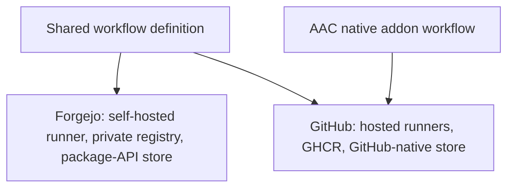
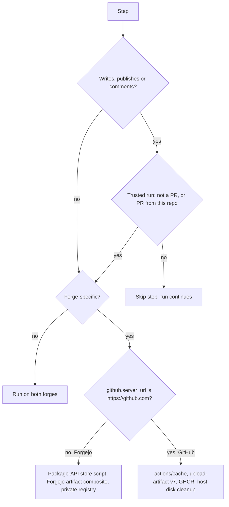
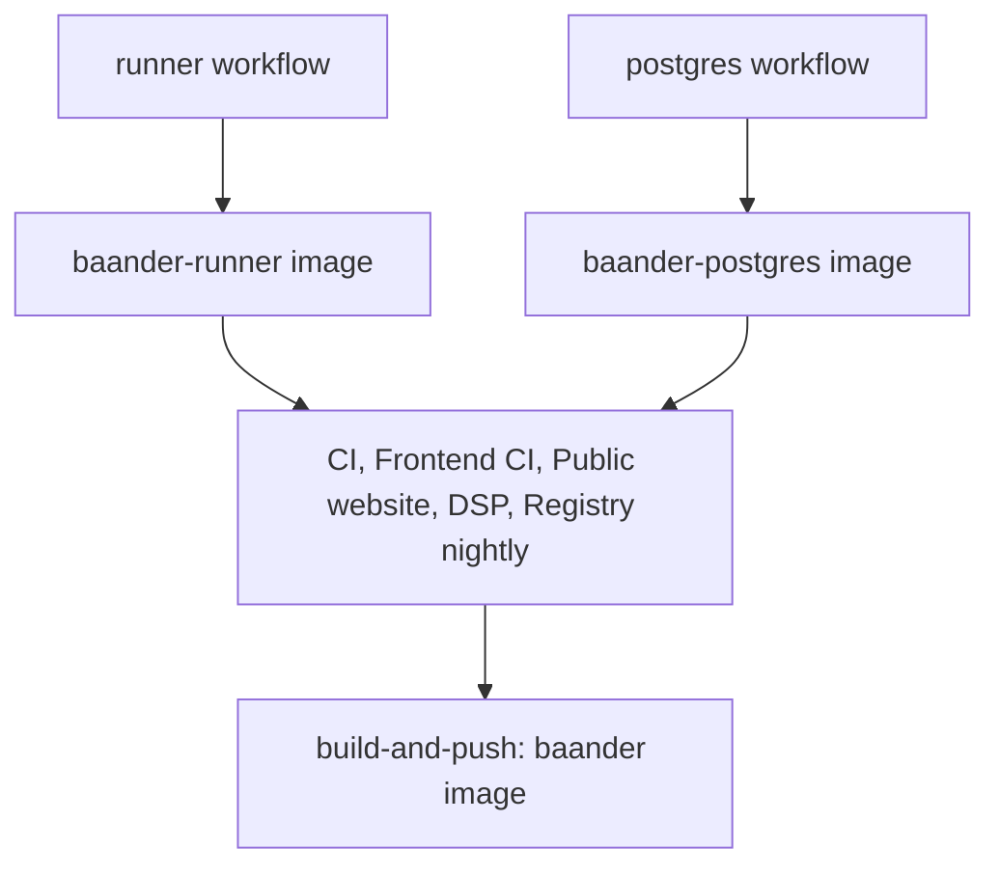

# Forge-Neutral CI - Plan

## Goal Capsule

- **Objective:** Every commit on the public GitHub repository carries the same CI verdict that the Forgejo instance gives it, so the public repository shows the project's real build health.
- **Means:** One forge-neutral workflow tree under `.github/workflows` that Forgejo and GitHub both run (KTD1).
- **Product authority:** This Product Contract. The "Application release acceptance" section of `ROADMAP.md` governs when application images may be redistributed.
- **Execution profile:** Workflow YAML, one local composite action, one standalone tooling script, the workflow contract tests, the CI image build context, and CI documentation. No application code changes.
- **Stop conditions:**
  - Stop and return to the user if Forgejo cannot run the shared definition (R1).
  - Stop if a GitHub job cannot fit the hosted runner's time, memory or disk limits even after splitting (R12).
  - Stop before any push to either forge until the user authorizes it (U7).
- **Who finishes:** `ce-work` delivers U1–U6 as local commits. U7 needs the user's push authorization and the operator steps in the runbook.
- **Open blockers:** None.

---

## Product Contract

Product Contract preservation: changed: R12 — "the hosted job limit" now names time, memory and disk, because research found memory and disk bind before time on a 16 GB, 14 GB-disk runner. Answered Outstanding Questions were resolved in place into KTD1, KTD2, KTD3, KTD5, KTD12 and KTD13. The verified `github.*` assumption was updated. No other scope change.

### Summary

Forgejo and GitHub run one shared set of workflows with the same gates, image builds and nightly job. Each forge supplies its own runner, registry, cache and coverage store. GitHub publishes the CI images publicly on GHCR and keeps the application images private until their redistribution gaps close.

### Problem Frame

All real CI runs only on the self-hosted Forgejo instance. Nine workflows there gate the backend, frontend, website, DSP and registry code, build and publish the images, and run the nightly registry qualification. GitHub hosts the public `baander-app/baander` repository but runs only the AAC native addon workflow. A visitor sees a green check for the AAC addon and nothing for the rest of the code.

Forgejo CI is healthy today, so the problems this work addresses are the ones a port exposes. The workflows read `forgejo.*` context, run on the `docker-cli` self-hosted label inside a runner image from a private registry, and use the Forgejo package API as their cache and coverage store. GitHub-hosted runners can reach none of these.

### Key Decisions

- **Full parity between the forges.** Both forges run every gate, image build and the nightly job, so either one gives the authoritative verdict. (session-settled: user-directed — chosen over GitHub as a pull-request gate only, GitHub as primary CI with Forgejo as fallback, and shared gates with separate publishing: the public repository should show the verdict Forgejo gives.) Governs R2, R3, R15.
- **One forge-neutral definition.** Parity is the point, and a single definition prevents drift for the least added scope. (session-settled: user-approved — chosen over two hand-maintained trees checked by a parity test, and over moving job logic into repo scripts behind thin per-forge wrappers: those either keep two copies or move far more code.) Governs R1, R4, R14.
- **GitHub-hosted runners only.** On a public repository, a self-hosted runner would run fork pull-request code on home hardware. (session-settled: user-approved — chosen over registering the self-hosted runner with GitHub, and over hosted runners for pull requests with self-hosted runners for master.) Governs R7, R12.
- **Public CI images only.** The runner and PostgreSQL images are CI tooling. The application image still has notice, provenance and embedded-dependency gaps that the roadmap requires closing before redistribution. (session-settled: user-directed — chosen over keeping every GitHub image private, publishing every image publicly, and closing the redistribution gaps within this work.) Governs R8, R9.
- **The goal is the public signal.** Status visible on the public repository matters more than outside-contributor workflows or redundancy. Governs R13.

### Requirements

**Shared definition**

- R1. One workflow definition runs on both Forgejo and GitHub, and no shared workflow has a second hand-maintained copy.
- R2. The shared definition covers every current Forgejo workflow: CI, Frontend CI, Public website, DSP analysis qualification, Registry nightly qualification, and the runner, PostgreSQL, Nginx and FFmpeg image builds.
- R3. Each workflow keeps its current triggers, path filters, job dependencies and gate behavior on both forges.
- R4. The forges differ only in runner, registry, cache and coverage-baseline storage, the channel for pull-request feedback, and job timeouts. Each difference is resolved per forge without editing the workflow.
- R5. The AAC native addon workflow stays GitHub-only, because it needs hosted macOS and Windows runners. It is the only exception to R1 and R2.

**Forgejo**

- R6. Forgejo jobs keep the self-hosted runner, the private registry and the package-API cache and coverage store, and Forgejo's gate results and published images do not change.

**GitHub**

- R7. Every GitHub job runs on a GitHub-hosted runner, and no self-hosted runner is registered with GitHub.
- R8. GitHub publishes the runner and PostgreSQL images as public GHCR packages under `baander-app`, and GitHub jobs pull them from there.
- R9. GitHub publishes the application, Nginx and FFmpeg images as private GHCR packages until the roadmap's redistribution gaps close.
- R10. GitHub keeps build caches, coverage baselines and pull-request coverage comparisons equivalent to Forgejo's, and saves caches and baselines from master only.
- R11. Pull requests from forks run every gate. Steps that need write access or secrets are skipped without failing the run.
- R12. A job's timeout may differ per forge, and a job is split only when it cannot fit within the hosted runner's time, memory or disk limits.

**Public signal**

- R13. The README shows GitHub CI status badges for the shared workflows.

**Verification**

- R14. The workflow contract test checks the shared definition, including the per-forge differences in R4.
- R15. The same master commit passes every shared workflow on both forges and publishes to each forge's registry, and each forge records one scheduled nightly run.

### Acceptance Examples

- AE1. **Covers R11.** **Given** a pull request opened from a fork on GitHub, **when** CI runs, **then** every gate runs and reports. The coverage comment, the cache and baseline saves and publishing are skipped, and the run's verdict comes from the gates alone.
- AE2. **Covers R10, R6.** **Given** a pull request from a branch on either forge, **when** CI finishes, **then** coverage is compared against that forge's master baseline and no cache or baseline is saved. **Given** a push to master, the baseline and caches are saved on that forge.
- AE3. **Covers R8, R9, R6.** **Given** a push to master that passes on both forges, **when** publishing runs, **then** Forgejo pushes every image to its private registry as today. GitHub pushes the runner and PostgreSQL images as public GHCR packages and the application, Nginx and FFmpeg images as private ones.

### Scope Boundaries

- Closing the application image's redistribution gaps, or making the application, Nginx or FFmpeg images public.
- Self-hosted runners on GitHub.
- New gates, or test changes beyond what porting needs.
- Running the AAC native addon workflow on Forgejo.
- Fixing Forgejo problems a port does not expose; Forgejo CI is healthy today. The two cache defects in KTD5 are in scope because this work rewrites those steps.
- Branch protection and required-check settings on either forge.
- Moving job logic into repo scripts so CI jobs run locally. Deferred; it was the larger alternative to R1.
- Considered and not built:
  - **Comment posting for fork pull requests through a privileged `workflow_run` workflow.** R11 skips the comment instead, and Forgejo has no `workflow_run` trigger. Revisit if outside contributors start relying on coverage feedback.
  - **Automated GHCR visibility changes.** GitHub documents the change only in its web UI. KTD12 detects a wrongly public package instead.

### Dependencies / Assumptions

- Commits reach GitHub by push to the `baander-github` remote, so both forges trigger on the same commits.
- The Forgejo instance runs Forgejo 15.0.11, which populates the `github.*` context with the same names as `forgejo.*` (verified from the instance's API schema and Forgejo's source).
- GitHub-hosted Ubuntu runners mount `/var/run/docker.sock` into job containers, which the backend gate drives.
- The pre-release policy in `AGENTS.md` applies: the current `.forgejo/workflows` definitions are replaced, with no compatibility layer.

### Sources / Research

- `.forgejo/workflows/ci.yaml`: self-hosted label and runner container (lines 20-24), PostgreSQL image pull (line 41), package-API caches and coverage baselines (lines 43-60, 372-428), master-only publishing in `build-and-push` (lines 682-734).
- `.forgejo/workflows/frontend.yaml`: Yarn cache and coverage store (lines 48-60, 189-224, 260-275).
- `.forgejo/workflows/runner.yaml`, `postgres.yaml`, `nginx.yaml`, `ffmpeg.yaml`: image builds pushed to the private registry. `ffmpeg.yaml` is dispatch-only.
- `.forgejo/workflows/registry-nightly.yaml`: cron `17 2 * * *` with manual dispatch.
- `.github/workflows/aac-native.yml`: the hosted macOS and Windows matrix, SHA-pinned actions, `contents: read` permissions and per-ref concurrency.
- `docker/runner/Dockerfile`: the runner image every Forgejo job except the runner build uses.
- `tests/Unit/Shared/Infrastructure/Ci/PublicationWorkflowTest.php`: parses `.forgejo/workflows/` and asserts `forgejo.*` expressions (lines 66-67, 363).
- `ROADMAP.md` lines 303-304 and 309-315, and `relay/README.md` line 302: the nightly hosted run is unobserved, and application images have redistribution gaps.
- No script under `scripts/` or `src/`, and nothing in the `Makefile`, reads `GITHUB_*` or `FORGEJO_*` variables. Forge-specific values enter only through the workflow files.

---

## Planning Contract

### Key Technical Decisions

- KTD1. **The shared tree lives in `.github/workflows`, and `.forgejo/workflows` is deleted in the same change.** Forgejo 15 reads only the first existing directory of `.forgejo/workflows`, `.gitea/workflows` and `.github/workflows`, and never merges them. GitHub reads only `.github/workflows`. Every file there therefore runs on both forges. (session-settled: user-approved — chosen over two hand-maintained trees checked by a parity test, and over thin per-forge wrappers around repo scripts: parity without drift.) Governs R1, R2.
- KTD2. **The forge test is `github.server_url == 'https://github.com'`, and every per-forge value takes GitHub's value when it is true.** The runner label (`ubuntu-latest` versus `docker-cli`), job container image, registry host and owner, store backend and step guards all switch on that one expression. `github.forgejo_server_version` is not used: Forgejo resolves `runs-on` from its run-creation context, which lacks that key, while `server_url` is filled there and in the runner. The label never depends on a repository variable, so a missing variable cannot leave a job queued forever. Fork pull requests, which may not receive variables, resolve to GitHub's values. Forgejo keeps its `REGISTRY_URL` and `REGISTRY_OWNER` variables for its registry. Governs R4, R6, R7.
- KTD3. **Steps that differ by forge come in guarded pairs, and every `uses:` is short-form and SHA-pinned.** `data.forgejo.org` mirrors the upstream action SHAs, so `actions/checkout@3d3c42e5…` and `actions/cache@…` resolve to identical code on both forges. A Forgejo-only action reference lives inside a local composite action under `.github/actions/`. Only a Forgejo-guarded step calls it, so GitHub never resolves it, and GitHub rejects full-URL `uses:` and the dead v3 artifact actions at job setup. Governs R1, R4.
- KTD4. **Artifacts upload with `actions/upload-artifact@cf430e03… # v7.0.2` on GitHub and with Forgejo's patched fork of `upload-artifact` on Forgejo.** The fork is wrapped in `.github/actions/forgejo-upload-artifact`. The fork is needed because upstream v4 and later refuse any non-github.com server, and the current v3 pin has not run on github.com since 2025-01-30. Names, paths and the 14-day retention stay the same on both forges. Governs R3.
- KTD5. **Forgejo's package-API operations move into one standalone tooling script. GitHub uses `actions/cache` for the same data.** The script restores and saves archives, and fetches and stores coverage baselines. It replaces eight inline `curl` blocks and fixes two defects:
  - The BuildKit archive is saved with a nested `tmp/buildkit-cache` path that the restore never finds.
  - The Yarn save archives `/home/*/.local/share/yarn/berry/cache` while root jobs use `~/.yarn/berry/cache`.

  On GitHub, master pushes save a baseline under `coverage-<suite>-<sha>`. Pull requests restore it by the prefix `coverage-<suite>-`, and an evicted baseline takes the existing "no baseline" path. Every job that calls the script first installs the standalone tooling (`composer --working-dir=scripts install --no-dev ...`), as the CI jobs already do. Governs R6, R10.
- KTD6. **Checkout stays the verified shell checkout on both forges, pinned to `github.event.pull_request.head.sha || github.sha`.** On pull requests GitHub's `github.sha` is a merge commit while Forgejo's is the head commit. Pinning to the head makes both forges qualify the same code. Keeping the shell checkout preserves the event-commit check that the contract test exercises. Governs R3.
- KTD7. **Every shared workflow declares `concurrency` per workflow and ref, cancelling in progress only for `pull_request`.** Forgejo cancels superseded runs by default and GitHub does not. A master run therefore always finishes and publishes on both forges. Governs R3.
- KTD8. **One "trusted run" condition guards every write step: the event is not a pull request, or the pull request's head repository is this repository.** It guards registry login, cache and baseline saves, coverage comments and publishing. Login uses `secrets.REGISTRY_TOKEN || github.token` with `github.actor`. GitHub's default token permission is `contents: read`. Only the jobs that publish get `packages: write`, and only jobs that comment get `pull-requests: write`. Governs R8, R9, R11.
- KTD9. **On Forgejo, AAC native jobs resolve `runs-on` to `docker-cli` and skip through `if: github.server_url == 'https://github.com'`.** Forgejo evaluates a job's `if:` only once a matching runner picks the job up. A macOS or Windows label would sit queued for up to 24 hours. Governs R5.
- KTD10. **Both forges get the same timeouts until a GitHub run shows a job needs more. Only that job then gets a forge expression.** Splitting follows R12 and is decided from measured runs, not in advance. Governs R12.
- KTD11. **The CI image's build context keeps `.github/workflows` and `.github/actions` and still excludes the rest of `.github`.** `PublicationWorkflowTest` and `PythonBoundaryTest` read workflow files from inside the image in CI. `.forgejo` reaches the image today only because nothing excludes it. Governs R14.
- KTD12. **GitHub images are `ghcr.io/baander-app/<name>`, using the Forgejo image names.** The names are `baander`, `baander-runner`, `baander-postgres`, `baander-nginx` and `ffmpeg-baander-static`. GHCR creates new packages as private. An operator makes the runner and PostgreSQL packages public once, and the organization's package-creation setting must keep allowing public packages. After each push of the application, Nginx or FFmpeg image, the job requests an anonymous pull token from `ghcr.io` and fetches the `latest` manifest without credentials. It fails if the fetch succeeds, because that means a stranger can pull the image. The probe needs no token; GitHub's packages REST API accepts only a classic personal access token. A failed probe means the operator makes the package private at once. Governs R8, R9.
- KTD13. **README badges cover CI, Frontend CI, Public website, DSP analysis qualification and Registry nightly qualification, from GitHub.** The image-build workflows run rarely or only on dispatch, so their badges would show stale or empty state. Governs R13.
- KTD15. **On GitHub, the disk-heavy jobs first free host disk through the mounted Docker socket.** A step runs a short-lived container that bind-mounts the hosted runner's preinstalled toolchain directories, removes them and reports host free space. A plain `run:` step would only touch the job container. The step is GitHub-only, because on Forgejo it would delete directories on the self-hosted host. Governs R7, R12.
- KTD14. **Each image build gets a `docker-container` BuildKit builder before any build that exports a cache, creating one when the job has none.** `scripts/build-application.php` uses the current builder. GitHub's default `docker` driver may reject `--cache-to type=local`. Governs R3, R10.

### High-Level Technical Design

Each job resolves its forge first. Write steps also check the trusted-run condition (KTD8), and forge-specific storage branches last.

Image dependencies are the same on both forges: CI jobs run inside the runner image, and the backend gate pulls the PostgreSQL image, so both images must exist in a forge's registry before that forge's first CI run.

### Assumptions

- Forgejo's patched `upload-artifact` fork works with the instance's forgejo-runner version. The runner version could not be read without signing in.
- `ghcr.io` refuses an anonymous pull token or manifest fetch for a private package, so KTD12's probe distinguishes private from public.
- The hosted runner's 14 GB disk holds the images the backend gate builds once KTD15's cleanup frees the preinstalled toolchains. U7 measures this.
- Forgejo resolves job-level keys such as `runs-on` and `timeout-minutes` from its run-creation context, so job-level expressions use only fields that context carries, such as `github.server_url`.
- Scripts that start containers through the socket do not bind-mount workspace paths. On GitHub the job workspace is `/__w` inside the container but a different path on the host. Forgejo already runs the same way, which suggests this holds.

### Risks

| Risk | Effect | Mitigation |
|---|---|---|
| The backend gate's worker fixtures need at least 15 GiB of host memory, and a 16 GB runner reports about 15.6 GiB | The gate fails on GitHub only | U7 measures the first run; R12 permits splitting; stop condition if splitting cannot fit |
| BuildKit caches crowd out coverage baselines in GitHub's 10 GB cache | Pull requests report "no baseline" more often | Distinct keys per cache, `mode=min` if measured sizes demand it (U3) |
| `data.forgejo.org` has not yet mirrored a newly pinned SHA | Forgejo jobs fail at setup | Pin SHAs that `git ls-remote https://data.forgejo.org/actions/<name>` lists |
| GitHub suspends scheduled workflows after 60 days without repository activity | The nightly stops on GitHub | The repository is active; the runbook names the re-enable step |
| `--init` in the nightly's container options takes effect on GitHub; Forgejo may ignore it | Process reaping differs between forges | Kept as is; U7 compares both nightly runs |

### Sequencing

Delivery reaches the forges in two stages, because GitHub's `workflow_dispatch` runs only workflows already on the default branch and every GitHub CI job needs the GHCR runner image.

1. **Stage 1:** U2 adds the four image workflows to `.github/workflows` while `.forgejo/workflows` keeps its originals, so Forgejo is unaffected. Merged to master on both forges, it publishes the runner and PostgreSQL images to GHCR.
2. **Stage 2:** U1, U3, U4, U5 and U6 delete `.forgejo/workflows` and move the gate workflows. On Forgejo the image workflows then come from `.github/workflows` too.

Within stage 2, U1 lands before U3, because U3 calls its script, and U5 starts alongside U3 (see its execution note). U7 drives both stages and needs the user's authorization for every push.

---

## Implementation Units

### U1. Forgejo package store script

**Goal:** One tested tooling entry point for every Forgejo package-API operation that the workflows use.

**Requirements:** R6, R10; KTD5.

**Dependencies:** None.

**Files:**
- `scripts/ci-package-store.php` (new entry point)
- `packages/baander-tooling/src/Ci/PackageStore.php` (new)
- `scripts/tests/php/CiPackageStoreTest.php` (new)
- `deptrac-tooling.yaml` (if the new namespace needs a layer)

**Approach:**
1. Operations: restore an archive into a directory, save a directory as an archive, fetch a baseline file, and store a baseline file. The package name, version (`latest`), file name, API base and repository owner are arguments or environment, read from `GITHUB_API_URL` and `GITHUB_REPOSITORY` as the inline steps do.
2. Archives are created relative to the directory being cached, so restore and save use the same layout. This fixes the BuildKit defect.
3. A save deletes the previous `latest` file before uploading, as today. A missing package on restore or fetch is a normal "nothing cached" result, not a failure.
4. Use the tooling package's process and filesystem abstractions; `composer check:tooling-source-policy` rejects raw process calls.

**Patterns to follow:** `scripts/test-registry-static.php` (entry-point shape, `Requirements::check()`, signal scope); `packages/baander-tooling/src/Process/`.

**Test scenarios:**
- A directory saved and then restored into an empty directory reproduces the same files at the same relative paths.
- Restore when the package does not exist (HTTP 404) leaves an empty target directory and exits successfully.
- Restore when the archive is corrupt reports the failure, leaves an empty target, and exits successfully, matching today's `|| true`.
- Save sends a delete followed by an upload, and an upload failure exits non-zero.
- Baseline fetch writes the file when present and reports absence otherwise.
- The token comes from the environment and never appears in output or error messages.

**Verification:** The tooling suite passes with the new tests, and the static, format and architecture gates pass.

### U2. Image-build workflows on both forges

**Goal:** The runner, PostgreSQL, Nginx and FFmpeg image workflows run from `.github/workflows` on both forges and publish to each forge's registry. This unit is stage 1 of the Sequencing section.

**Requirements:** R2, R3, R4, R6, R8, R9; AE3; KTD1, KTD2, KTD7, KTD8, KTD12, KTD14.

**Dependencies:** None.

**Files:**
- `.github/workflows/runner.yaml`, `.github/workflows/postgres.yaml`, `.github/workflows/nginx.yaml`, `.github/workflows/ffmpeg.yaml` (ported from `.forgejo/workflows/`; the originals stay until U3 deletes the directory)

**Approach:**
1. Copy each file, rewrite `forgejo.*` to `github.*`, and change path filters to name `.github/workflows/<file>`.
2. Resolve `runs-on` and the registry host and owner per KTD2. The runner build keeps its `docker:cli` job container on both forges.
3. Add explicit `concurrency` (KTD7), `permissions: contents: read` at workflow level, and `packages: write` on the publishing job.
4. Log in only on trusted runs (KTD8). On GitHub, the Nginx and FFmpeg pushes are followed by the anonymous pull probe from KTD12.
5. Image names and tags stay as today: `latest` plus the commit SHA where the workflow tags one.

**Patterns to follow:** `.github/workflows/aac-native.yml` (pinned actions, permissions, concurrency).

**Test scenarios:**
- Covers AE3. The contract test resolves each image workflow's registry to the private registry when the forge expression is set and to `ghcr.io/baander-app` when it is not.
- The anonymous pull probe fails the job when a stubbed `ghcr.io` serves a token and the `latest` manifest for `baander-nginx` without credentials. It passes when the stub refuses with 401 or 403. Exercise it in the contract test's shell harness.
- No step uses a `forgejo.` expression or a full-URL `uses:`.

**Verification:** U5's contract tests pass for these files. A `workflow_dispatch` run on each forge publishes each image to that forge's registry (U7).

### U3. Gate workflows on both forges

**Goal:** CI, Frontend CI, Public website, DSP analysis and Registry nightly run from `.github/workflows` on both forges with the same gates, and `.forgejo/workflows` is gone.

**Requirements:** R1, R2, R3, R4, R6, R7, R8, R9, R10, R11, R12; AE1, AE2, AE3; KTD1–KTD8, KTD10, KTD12, KTD14, KTD15.

**Dependencies:** U1, U2.

**Files:**
- `.github/workflows/ci.yaml`, `.github/workflows/frontend.yaml`, `.github/workflows/website.yaml`, `.github/workflows/dsp-analysis.yaml`, `.github/workflows/registry-nightly.yaml` (moved)
- `.github/actions/forgejo-upload-artifact/action.yml` (new)
- `.forgejo/workflows/` (deleted)

**Approach:**
1. Move the files and rewrite `forgejo.*` to `github.*`. Rewrite path filters that name `.forgejo/workflows/...`, and add `.github/actions/**` where a workflow uses a local action.
2. Resolve each job's runner and container image per KTD2. The container image is `<registry>/<owner>/baander-runner:latest`. The PostgreSQL pull uses the same registry resolution.
3. Pin checkout to the head commit per KTD6, keeping the fetch, detach and verify steps and their step names.
4. Replace each package-API block with a guarded pair (KTD3, KTD5):
   - Forgejo calls `scripts/ci-package-store.php`.
   - GitHub uses `actions/cache/restore` and `actions/cache/save` with the same paths.
   - Saves run on master pushes only.
   - The Yarn cache path follows Yarn 4's default for the job user.
   - Every job that calls the script, the Frontend CI jobs included, first installs the standalone tooling (KTD5).
5. Coverage comments keep the same issues-comment request on both forges. They run on trusted pull requests only (KTD8) and only after the baseline step.
6. Replace each `upload-artifact` v3 reference with the KTD4 pair.
7. Ensure a `docker-container` builder before `build-application.php --buildx` per KTD14.
8. On GitHub, `quality-gate` and `build-and-push` start with KTD15's host disk cleanup.
9. On GitHub, the application image push in `build-and-push` is followed by KTD12's anonymous pull probe for `baander`.
10. Add explicit `concurrency` (KTD7) and least-privilege `permissions` to each workflow.
11. Keep job names, step names, `needs`, matrices, the registry tmpfs option and the nightly `--init` unchanged, because the contract test keys on them.

**Execution note:** Write U5's new contract assertions before moving the files, and let them fail against `.forgejo`.

**Patterns to follow:** the existing step structure in `.forgejo/workflows/ci.yaml`; `.github/workflows/aac-native.yml` for pin comments.

**Test scenarios:**
- Covers AE1. With a pull-request event whose head repository differs from the base, every write step's condition evaluates false, and gate steps carry no such condition.
- Covers AE2. With a pull-request event from this repository, the baseline restore runs and the baseline save does not. With a master push, both run.
- The checkout step, given a pull-request payload, fetches and verifies the head SHA rather than the merge SHA.
- A local Git remote whose branch advances still yields the event commit, matching the existing checkout regression.
- Each qualification step still exits with the failing local tool's status (the existing exit-47 harness), after the forge expressions are substituted.
- Covers AE3. The anonymous pull probe after the application image push fails the job when a stubbed `ghcr.io` serves the `baander` manifest without credentials, and passes when it refuses.
- The host disk cleanup step resolves to skipped when the forge expression names Forgejo.
- The `.forgejo/workflows` directory does not exist.

**Verification:** U5's tests pass. On each forge, a pull request from this repository and a master push both run green (U7).

### U4. AAC native addon stays GitHub-only

**Goal:** Forgejo sees `aac-native.yml` but skips its jobs immediately. GitHub behavior is unchanged.

**Requirements:** R5; KTD9.

**Dependencies:** None.

**Files:**
- `.github/workflows/aac-native.yml`

**Approach:** The matrix job and the release job resolve `runs-on` to `docker-cli` on Forgejo and carry `if: github.server_url == 'https://github.com'` (KTD9). Nothing else changes.

**Test scenarios:**
- The contract test confirms that every job in `aac-native.yml` has the Forgejo skip condition and that its `runs-on` resolves to `docker-cli` when the forge expression is set.
- With the forge expression unset, `runs-on` resolves to the original matrix and release labels.

**Verification:** On Forgejo a push touching `packages/baander-aac/**` shows the jobs skipped, not queued. On GitHub the same push builds as before (U7).

### U5. Workflow contract tests and CI image context

**Goal:** The contract tests check the shared tree, its per-forge differences and its guards, and they still run inside the CI image.

**Requirements:** R14; KTD1–KTD4, KTD7–KTD11.

**Dependencies:** None for the test changes. The tests pass only once U2–U4 land.

**Files:**
- `tests/Unit/Shared/Infrastructure/Ci/PublicationWorkflowTest.php`
- `scripts/tests/php/PythonBoundaryTest.php`
- `.dockerignore`
- `packages/baander-tooling/src/Fixtures/DockerContext.php`
- `scripts/tests/php/` test for the Docker context contract, if one asserts `.github` exclusion

**Approach:**
1. Point both tests at `.github/workflows`, and include `.github/actions` where they walk files.
2. Replace `forgejo.*` in expected strings and in the checkout substitution map with `github.*`. Substitute the forge expression both ways so each shell check runs once as Forgejo and once as GitHub.
3. Accept `timeout-minutes` as an integer or an expression (KTD10).
4. Add tree-wide assertions:
   - no `forgejo.` expression and no `forgejo_server_version` reference
   - no full-URL `uses:` in `.github/workflows` or in shared actions; only `.github/actions/forgejo-*` may reference Forgejo's fork by full URL
   - every remote `uses:` pinned to a 40-character SHA, including the reference inside the Forgejo composite
   - `.forgejo/workflows` absent
   - explicit `concurrency` with `cancel-in-progress` in every workflow
   - a top-level `permissions` block in every workflow; only publishing jobs request `packages: write`, and only commenting jobs request `pull-requests: write`
   - every write step guarded by the trusted-run condition
   - every step that mounts host paths carries the GitHub-only forge guard
   - every job's `runs-on` resolves on both forges
5. Change `.dockerignore` and the `DockerContext` fixture per KTD11.

**Execution note:** Implement these assertions first, against the current tree, so U2–U4 turn them green.

**Patterns to follow:** the existing `qualificationCommands()` table and checkout regression in `PublicationWorkflowTest.php`.

**Test scenarios:** the U2, U3 and U4 contract scenarios live here, plus:
- A workflow containing `uses: https://...` fails the full-URL assertion.
- A write step without the trusted-run guard fails the guard assertion.
- The Docker context check accepts `.github/workflows/ci.yaml` in the context and rejects `.github/sentinel`.

**Verification:** The unit suite passes in the CI image built from the branch, and the tooling suite passes.

### U6. Documentation, badges and operator runbook

**Goal:** Readers find how CI runs on both forges and how to operate it, and the README shows the public status.

**Requirements:** R13; KTD12, KTD13.

**Dependencies:** U2–U5.

**Files:**
- `README.md` (badges)
- `docs-book/part-2-developer-guide/continuous-integration.md` (new: forges, forge detection, store backends, trusted-run guard, and the operator runbook)
- `docs-book/part-2-developer-guide/README.md` (link)
- `docs-book/part-2-developer-guide/testing.md` ("Application publication gates" and the tooling-runtime CI note)
- `docs-book/part-2-developer-guide/application-threat-model.md` (the "Forgejo workflow" mention)
- `relay/README.md` (nightly section: both forges)
- `packages/baander-tooling/README.md` (CI tooling gates)
- `CONCEPTS.md` (a "Forge" entry)
- `ROADMAP.md` (delivered item and checkpoint)

**Approach:** The runbook lists, per forge:
- Forgejo: confirm the `REGISTRY_URL` and `REGISTRY_OWNER` variables and the `REGISTRY_TOKEN` secret, and remove any variables the old workflows used.
- GitHub:
  - Keep the organization's package-creation setting allowing public packages; GHCR creates new packages as private.
  - Keep the repository's default workflow token permissions read-only; publishing jobs get `packages: write` from their own `permissions` block.
  - After the runner and PostgreSQL packages first publish, make those two public in the web UI and link them to the repository.
  - When KTD12's probe fails a job, make that package private at once.
  - Re-enable the nightly schedule if GitHub suspends it.

Run `prose-fix` on every changed prose file.

**Test expectation:** none -- documentation; the badge URLs are checked by eye on GitHub in U7.

**Verification:** Links resolve, and no doc names `.forgejo/workflows` as the live location.

### U7. Dual-forge acceptance

**Goal:** Evidence that R15 holds.

**Requirements:** R7, R8, R9, R12, R15; AE1–AE3.

**Dependencies:** U1–U6 and the user's authorization to push to both remotes.

**Files:**
- `ROADMAP.md` (checkpoint)

**Approach:**
1. With authorization, merge stage 1 (U2) to master on both forges. On GitHub, let the runner workflow publish, then dispatch the PostgreSQL workflow again if its first run failed for want of the runner image. Dispatch the FFmpeg workflow once.
2. Run the U6 runbook's operator steps: make the runner and PostgreSQL packages public, and confirm the Nginx and FFmpeg packages are private.
3. With authorization, push the stage 2 branch to both forges and open a pull request from this repository on each.
4. Measure GitHub runs for time, memory and host disk, and apply R12 if needed. A job that cannot fit after splitting triggers the stop condition.
5. After merge, confirm the master runs on both forges, each registry's packages and their visibility, and one scheduled nightly run on each forge.
6. Record run URLs and durations in `ROADMAP.md`.

**Test expectation:** none -- operational acceptance of the units above.

**Verification:** The same master commit is green on both forges for every shared workflow. Each registry holds the new tags. GHCR shows the runner and PostgreSQL packages public and the rest private. Each forge has a scheduled nightly run.

---

## Verification Contract

| Check | Command or evidence | Proves |
|---|---|---|
| Tooling suite | `composer run-script --timeout=7200 test:tooling` | U1, `PythonBoundaryTest`, Docker context contract |
| Tooling static gates | `composer analyse:tooling`, `composer check:tooling-format`, `composer check:tooling-architecture` | U1 code quality and source policy |
| Docker context | `bash scripts/test-docker-context.sh` | KTD11 |
| Workflow contract | Unit suite in a CI image built from the branch (`php scripts/build-application.php --target ci ...`, then `scripts/test-unit-container.sh`); for local runs add `.github` and `scripts` to the mount list | U2–U5 |
| Backend static gates | PHPStan and Deptrac in the CI image | No regressions from the test changes |
| Live runs | Run URLs on both forges for pull requests and master | R15, AE1–AE3 |

---

## Definition of Done

- Every unit's Verification holds, and the Verification Contract checks pass.
- `.forgejo/workflows` no longer exists, and no file names it as the live CI location.
- `ROADMAP.md` records the delivered item with suite counts, static gates and the dual-forge run evidence.
- No abandoned experiments remain in the diff: no unused composite actions, store commands or workflow steps.
