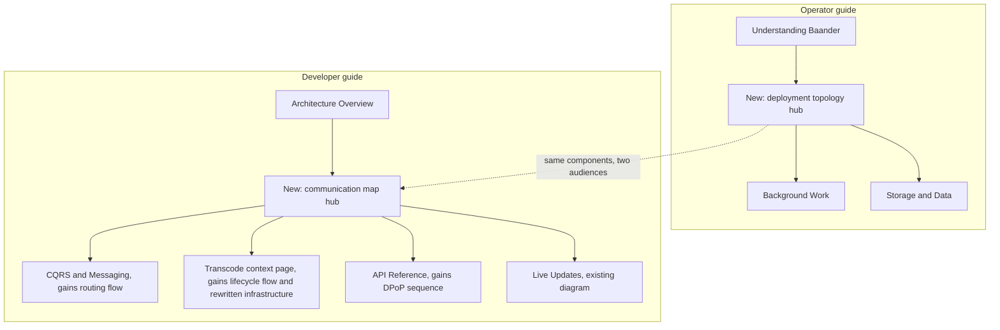
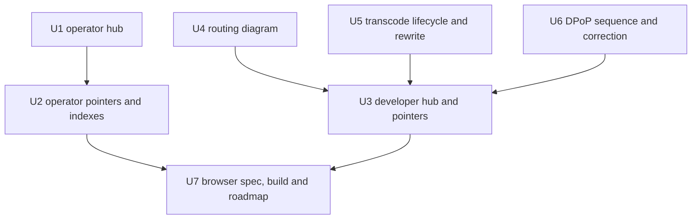

# System Overview Pages - Plan

## Goal Capsule

- **Objective:** An operator can see from one documentation page what runs where in a Baander installation and what PostgreSQL and Redis each hold. A developer can see from one page how the clients, web application, message transports, stores, worker pair and external services talk to each other, and can find the flow for routing a message, running a transcode and completing an OAuth login with DPoP without being walked through it by hand.
- **Means:** Two hub pages, one per guide, each built around a diagram, with the three flow diagrams placed on the pages that already own those subjects (KTD1, KTD2).
- **Product authority:** The maintainer who today explains the system by hand. The product decisions were made in dialogue on 2026-11-05; the Product Contract below wins on what the pages say, the Planning Contract on how they are built.
- **Execution profile:** Documentation and one browser-test change on a branch named after this plan, landed as local commits, with the website build and the browser rendering spec as the gates. Push only when asked.
- **Stop conditions:** Stop and ask if the website build cannot run on the host because the Mermaid helper prerequisites are missing, if a diagram fact cannot be confirmed in source, or if a touched page turns out to contradict the diagram beyond the sections this plan rewrites.
- **Who finishes:** The implementer runs the verification gates, applies prose-fix to every touched page, records the delivery in ROADMAP.md and hands the branch to review. Shipping is a separate decision.

---

## Product Contract

**Product Contract preservation:** changed: R12 (the transcode path is a durable request in PostgreSQL claimed by the control unit, not a Messenger transport hop), R13 (the sequence is pinned to one generic token endpoint). Added R18 to R21 for the Transcode page rewrite, the API Reference correction, browser-spec coverage and the planned casting companion. The deep-page prose boundary in Scope Boundaries is narrowed to match. All other requirements and IDs are unchanged.

### Summary

Add a deployment topology page to the operator guide and a communication map page to the developer guide. Each opens with one Mermaid diagram and a table that answers its audience's standing questions, then links to the deep pages. Three flow diagrams are added to the pages that own their subjects: message routing on CQRS and Messaging, the transcode lifecycle on the Transcode context page, and the OAuth with DPoP handshake on API Reference. The Transcode context page's infrastructure description is rewritten to the worker pair design so it no longer contradicts the diagram. Understanding Baander and Architecture Overview point at the new pages instead of carrying the overview themselves.

### Problem Frame

The system view is spread across prose pages. Understanding Baander lists the components in a table and tells the story from files to playback in paragraphs. Background Work describes the worker deployment pair. Architecture Overview describes bounded contexts and layers, not what runs or how it communicates. CQRS and Messaging, Real-Time Patterns and Live Updates each cover one channel. Only Live Updates and the two threat models carry a diagram.

Because no page shows the parts together, the maintainer draws the system by hand each time someone new needs the whole picture. The operator questions are always the same: how do the pieces fit together, and how do Redis and PostgreSQL fit in. The developer questions are also stable: when should something be a message, how are messages routed, how does a transcode work, and how does OAuth work with DPoP. Each hand-drawn answer is lost when the conversation ends.

Two of the pages that will carry a flow diagram still describe an earlier design. The Transcode context page says FFmpeg runs in the web server's Swoole process pool, and API Reference says WebSocket connections authenticate with a query token. The worker pair and the handshake ticket replaced both.

### Key Decisions

- **Two new hub pages, and the existing overview pages link to them.** (session-settled: user-directed, chosen over adding diagrams inside Understanding Baander and Architecture Overview, and over standalone pages that leave the old component table in place: the hubs own the overview, so nothing is said twice.) Governs R1, R7, R14, R15.
- **Hub pages carry the map and a table; flow diagrams live on the deep pages.** (session-settled: user-directed, chosen after a visual comparison against one large map per page and against six diagrams on the two hubs: the hubs stay short and the pages that own a subject get its picture.) Governs R2, R3, R8, R9, R10, R11, R12, R13.
- **The operator page covers the documented installation and the development instances.** (session-settled: user-directed, chosen over the documented installation alone: contributors read the operator guide first and need to see how the persistent instance and worktree previews differ.) Governs R4, R5.
- **The developer page covers every communication path, not only the core ones.** (session-settled: user-directed, chosen over a map limited to HTTP, WebSocket, Messenger and the outbox: worker pair internals, outbound integrations, registry and discovery, and the desktop and casting clients are all in.) Governs R8.
- **The Transcode context page's infrastructure sections are rewritten to the worker pair design.** (session-settled: user-directed, chosen over correcting only the sentences the diagram contradicts and over leaving the stale prose as follow-up: a page that says the web server runs FFmpeg beside a diagram that says the execution unit does would teach the wrong recovery check.) Governs R18, R19.
- **The local casting companion is drawn on the communication map, labelled as planned.** (session-settled: user-directed, chosen over omitting it until its code lands: the map shows the intended client set.) Governs R21.
- **Diagrams are Mermaid blocks with accessible title and description lines.** The website build renders Mermaid to SVG through its local helper, and the existing Live Updates and threat-model diagrams set this shape. Governs R16, R17.
- **The question of what lives in PostgreSQL versus Redis is answered by a table, not a diagram.** Ownership and loss consequences read as rows. Governs R3.

### Requirements

**Operator hub page**

- R1. The operator guide gains one page that shows the deployment topology of a Baander installation and is reachable from the operator guide index and from Understanding Baander.
- R2. The page opens with one diagram that shows nginx, the web application with its Swoole HTTP and WebSocket server, PostgreSQL behind the connection pooler, Redis, the worker deployment pair with its control and execution units and the host controller that deploys it, the shared source and output storage, and the optional registry as a separate service.
- R3. The page carries a table that lists what PostgreSQL holds and what Redis holds, and states for each store what its loss means for the instance.
- R4. The page has a section on the development instances that names the persistent development instance and worktree previews and states how they differ from the documented installation.
- R5. The development instances get no second topology diagram.
- R6. A reader of the page can answer, without opening another page, how the pieces fit together and how Redis and PostgreSQL fit in. The deep pages are linked for the next level of detail.
- R7. The component table in Understanding Baander is reduced to a pointer at the new page, and the rest of that page keeps its role.

**Developer hub page**

- R8. The developer guide gains one page that shows how the parts communicate: the browser single-page application, the Electron app and the local casting companion as clients; the HTTP API with its authentication and the WebSocket channel; the message bus with the async and scheduler transports on Redis streams and the failed-message table in PostgreSQL; the outbox and the change inbox in PostgreSQL; the control and execution units of the worker pair and their IPC volume; the metadata providers, email, push and webhook delivery; and LAN discovery and device pairing together with the separate registry service.
- R9. The page carries a decision table that answers when something should be a message, split between an inline command, a domain event through the outbox, a scheduled occurrence and a routed async command with a workload resource class, and states how each is routed.
- R10. The page links to the pages that carry the flow diagrams of R11, R12 and R13 and to Live Updates for the committed-change path.

**Flow diagrams on the deep pages**

- R11. CQRS and Messaging gains a diagram of how a dispatched message is routed from the bus to inline execution, the async transport or the scheduler transport, and from a transport to a consumer, a retry or the failed-message table.
- R12. The Transcode context page gains a diagram of a transcode from the web request that commits the session and its execution request in PostgreSQL, through the control unit claiming that request when a media job slot is free, the bounded native request to the execution unit over the private IPC socket, the encoder output to shared storage, and the job state and published files the web application serves and the browser is told to reread.
- R13. API Reference gains a sequence diagram of a DPoP-bound token request against one generic token endpoint: the nonce challenge, the token response bound to the proof key, and an API request with a proof that carries the access token hash, with a note naming how the first-party login and the OAuth token endpoint answer a missing proof.

**Integration with the existing documentation**

- R14. Architecture Overview links to the developer hub page, and its own content stays about bounded contexts and layers.
- R15. The documentation root README's quick link that promises how web, workers, storage and the registry fit together points at the operator hub page. Both guide indexes list their new page.

**Diagram format**

- R16. Every new diagram is a Mermaid block with an accessible title line and an accessible description line, following the Live Updates and threat-model diagrams.
- R17. Every new diagram renders in the website build, and the build passes with the new pages in place.

**Corrections on touched pages**

- R18. The Transcode context page's description of where encoding runs matches the worker pair design: the control unit admits work, the execution unit runs the native encoder, and job state persists in PostgreSQL; no sentence on the page says the web server runs FFmpeg or a CPU process pool.
- R19. API Reference no longer says WebSocket connections authenticate with a query token; it says the WebSocket upgrade carries a handshake ticket and points at Real-Time Patterns.
- R20. The browser rendering spec checks the new diagram pages the same way it checks the three existing ones.
- R21. The communication map shows the local casting companion as a client labelled as planned, with the CONCEPTS definition as its only description.

### Acceptance Examples

- AE1. **Covers R2, R6.** Given an operator who has read only the new topology page, when asked which process accepts browser traffic and which processes run background work, then they name nginx and the web application for the first and the worker deployment pair for the second, and they can say that the host controller, not Compose, deploys the pair.
- AE2. **Covers R3, R6.** Given the same operator, when asked what happens to queued work if Redis is lost and what happens to the catalog if PostgreSQL is lost, then they answer both from the table on the page.
- AE3. **Covers R4, R5.** Given a contributor reading the operator hub page, when they reach the development instances section, then they can say how a worktree preview differs from the documented installation without a second diagram.
- AE4. **Covers R9, R11.** Given a developer adding a new background task, when they consult the decision table on the developer hub page, then they can say whether it is an inline command, a domain event, a scheduled occurrence or a routed async command, and the routing diagram on CQRS and Messaging shows where that choice sends it.
- AE5. **Covers R12, R13.** Given a developer asked how a transcode runs and how an OAuth client proves possession of its key, when they follow the hub's links, then the Transcode context page and API Reference each carry a diagram that answers the question.
- AE6. **Covers R7, R14, R15.** Given a reader starting from the documentation root README, Understanding Baander or Architecture Overview, when they look for the system overview, then one link takes them to the matching hub page and the component table no longer appears in Understanding Baander.
- AE7. **Covers R16, R17.** Given the website build with the new pages, when it runs with the local rendering helper, then every new Mermaid block renders to a diagram and the build reports no rendering failure.
- AE8. **Covers R18, R19.** Given a reader who opens the Transcode context page or API Reference directly, when they read the text beside the new diagram, then no sentence names a Swoole process pool for FFmpeg or a WebSocket query token.
- AE9. **Covers R20.** Given the browser rendering spec run after the change, when it lists the pages it checks, then the two hub pages, the Transcode context page, CQRS and Messaging and API Reference are among them and their diagrams pass the width and theme checks.

### Success Criteria

- The maintainer answers the six named questions by linking a page instead of drawing by hand.
- Each hub page is read in one sitting: one diagram, one table, short sections, links for depth.
- CQRS and Messaging and API Reference gain a diagram section each, and their prose changes only where R19 requires it. The Transcode context page changes only where R12 and R18 require it.
- Every new page and changed page passes prose-fix in the house voice.

### Scope Boundaries

- No change to the prose of CQRS and Messaging, Background Work, Storage and Data or Live Updates beyond the added diagram section and the pointer changes in R7, R14 and R15. On the Transcode context page and API Reference, prose changes only as R18 and R19 state.
- No diagram for the small-host household profile; the operator page mentions it in one sentence with a link.
- No new diagram on the operator Transcoding page; the transcode lifecycle lives on the developer Transcode context page.
- The generated documentation is not changed by hand: the context map and architecture notes under dev-docs, and the generated sections of each src context README. The docs-book context guides are hand-maintained and are in scope.
- The two threat-model pages and their diagrams stay as they are.
- The registry service's own internals are not diagrammed; the hubs show it as one external box with edges from clients only.
- No Forgejo website gate is added; the GitHub website workflow is the gate (KTD9). Considered and not built because the forge-neutral CI plan already owns Forgejo workflow parity; evidence that it will not cover the website workflow would change the call.
- React Native is out of scope.

#### Deferred to Follow-Up Work

- The stale mention of a task transport in the Auth context guide, found during research, is outside the touched pages and goes to a later documentation pass.
- Two entries under docs/solutions name a transport that no longer exists and a single combined consumer; they are candidates for ce-compound-refresh, not for this plan.

### Dependencies / Assumptions

- The website build renders Mermaid through its local helper, which needs the PHP tooling dependencies, the site's Node dependencies and Playwright Chromium (KTD9). Both are installed on the development host.
- The operator guide remains the first reading for developers, which is why the development instances belong on the operator hub page.
- The vocabulary in CONCEPTS.md is used as written: worker deployment pair, connection pooler, persistent development instance, worktree preview, preview worker snapshot, transcode session, transcode execution generation, transcode control revision, media job slot, local casting companion.

### Sources / Research

- docs-book/part-1-operator-guide/understanding-baander.md: the component table and the pair paragraphs the operator hub takes over, and the two headings other pages link to.
- docs-book/part-1-operator-guide/background-work.md: the worker deployment pair, its control and execution duties, the request-to-result phases and the scheduler path.
- docs-book/part-1-operator-guide/storage-and-data.md: the store rows the hub's table reuses, the writer column it links to and the note that Compose declares no persistent Redis volume.
- docs-book/part-1-operator-guide/registry.md: the registry as a separately operated service that the Discovery context does not call.
- docs-book/part-2-developer-guide/development-environment.md: the persistent instance, worktree previews and the preview worker snapshot.
- docs-book/part-2-developer-guide/cqrs-and-messaging.md, live-updates.md, real-time-patterns.md, api-reference.md, contexts/transcode.md, contexts/discovery.md: the current developer coverage, the DPoP proof section and the stale infrastructure prose.
- docs-book/part-2-developer-guide/application-threat-model.md: the existing trust-boundary diagram the communication map must agree with.
- config/packages/messenger.php: the workloads map with transport, resource class and default flag, the async, scheduler and failed transports, and the retry policy.
- src/Shared/Domain/Event/Outbox/RelayOutboxHandler.php and src/Shared/Infrastructure/Event/OutboxEventDispatcher.php: the outbox relay path.
- src/Shared/Infrastructure/LiveUpdates/LiveUpdateRuntime.php and DoctrineLiveChangeProjector.php: the change inbox projection.
- src/Shared/Infrastructure/Messenger/WorkerHeartbeatSubscriber.php and src/Shared/Infrastructure/Health/MessengerWorkerHealth.php: the Redis heartbeat the web health check reads.
- src/Transcode/Application/CommandHandler/CreateTranscodeSessionHandler.php, src/Transcode/Infrastructure/Doctrine/TranscodeRuntimeState.php, src/Transcode/Infrastructure/Worker/MediaWorkerRunner.php, src/Transcode/Infrastructure/Swoole/TranscodeSessionSubscriber.php, src/Shared/Infrastructure/Worker/NativeExecutionClient.php: the transcode path the lifecycle diagram draws.
- src/Auth/Infrastructure/Security/OAuth/DpopNonceManager.php, DpopTokenRequestVerifier.php, DpopProofValidator.php, DpopBindingListener.php: the DPoP handshake.
- src/Shared/Infrastructure/Security/WsTicketAuthenticator.php: the WebSocket handshake ticket.
- bin/worker-deployment.php, deploy/household/README.md, src/Shared/Infrastructure/Worker/DeploymentLease.php, WorkerPeerHandshake.php: the worker pair deployment, lease and heartbeats.
- packages/baander-tooling/src/Website/WebsiteBuilder.php, BlockRendering.php, SvgDiagram.php and ui/site/scripts/render-blocks.mjs: Mermaid rendering, the link and fragment checks, and the navigation built from the guide index files.
- ui/site/tests/rendering.spec.ts and .github/workflows/website.yaml: the browser rendering spec and the CI gate.
- .agents/skills/prose-fix/references/project-house-style.md: the register per document path.
- CONCEPTS.md and docs/plans/2026-11-02-1819-feat-small-host-household-deployment-plan.md: the vocabulary and the household profile the operator page mentions.

---

## Planning Contract

### Key Technical Decisions

- KTD1. **Page files and index placement.** The operator hub is docs-book/part-1-operator-guide/deployment-topology.md titled "Deployment Topology"; the developer hub is docs-book/part-2-developer-guide/communication-map.md titled "Communication Map". The operator index lists the hub in reading-path step 1 after Understanding Baander and as the first row of the Components and reference table; the developer index lists it in the Architecture table directly after Architecture Overview. The website sidebar is built from the first link to each page in the guide index, grouped by the heading above it, so these rows decide navigation. Governs R1, R15.
- KTD2. **Diagram shape.** Each diagram opens with the diagram type, then one accTitle line and one accDescr line; the build uses them as the figure caption and image alt text. Diagrams carry no init directive, frontmatter, click, classDef, style or theme line: the helper refuses the first three and the shared site theme supplies all styling. The two hub maps use a top-to-bottom flowchart with their subgraphs stacked vertically so they stay under about 900 pixels wide; the routing and transcode flows are flowcharts; the DPoP flow is a sequence diagram, which the helper has been verified to render. Node ids are short words, labels in brackets, stores as cylinder nodes. Governs R16, R17.
- KTD3. **The transcode diagram draws the PostgreSQL execution request, not a transport hop.** The session command runs inline in the web request and commits the session and its execution request in one transaction. The control unit's media worker runner polls pending requests only while a media job slot is free, claims one under a lease it renews, and sends bounded native requests over the unix socket on the private IPC volume. The execution unit's native daemon runs probe and FFmpeg. Fragments land in the generation directory under the conversion storage path, segment and manifest state persists through writes fenced on the execution generation and control revision, the web application serves manifests and segments, and the live-update path tells the browser to reread. The Transcode context page's Infrastructure sections are rewritten to this design. (session-settled: user-directed, chosen over correcting only the contradicted sentences and over leaving the prose for follow-up: the page is the reference for the context and must agree with its own diagram.) Governs R12, R18.
- KTD4. **The DPoP sequence uses one generic token endpoint.** Lifelines are the client, the token endpoint, the Redis nonce store and a resource endpoint. Three phases: a proof without a nonce gets a 400 challenge with a DPoP-Nonce header; the retry with the nonce gets a token pair whose access token carries the key thumbprint plus a fresh nonce; an API request sends the DPoP authorization scheme with a proof that includes the access token hash. One note under the diagram says that the first-party login endpoints answer a missing proof with an API error and an invalid proof with the nonce challenge, while the OAuth token endpoint answers both with its own error name, by reference to the existing paragraph. The stale WebSocket query-token sentence in the Client Fingerprint Binding section is replaced by the handshake ticket statement. Governs R13, R19.
- KTD5. **Understanding Baander keeps both of its linked headings.** The "The components" heading stays with a pointer paragraph beneath it, because the operator index links its anchor; the "Which installation a command targets" heading and section stay unchanged, because three pages link it. The component intro and the worker-pair definition paragraphs move to the hub; the paragraphs about web workers versus background workers and encoder ownership stay, since they are operational guidance. The operator index row that pointed at the components anchor is retargeted at the hub. Governs R7.
- KTD6. **Store table columns.** Store, What it holds, What its loss means, Detail. Writers are not repeated; the Detail column links the Storage and Data row. The PostgreSQL row names accounts, libraries, catalog, outbox and change inbox, job history and failed messages, deployment lease and execution state, with loss meaning a restore from backup. The Redis row names the message streams, cache, sessions, rate limits, DPoP nonces and the worker heartbeat, with loss meaning in-flight queued work replays from the outbox and scheduled occurrences from PostgreSQL, and notes that the repository Compose file declares no persistent Redis volume. A sentence after the table says that the web server's 60-second health check alerts administrators once when Redis becomes unreachable, because the alert is stored as a PostgreSQL row, and that a PostgreSQL outage cannot be recorded as an alert, so PostgreSQL must be watched from outside; it links the Monitoring health-check section and the Notifications health-alerts section. Governs R3.
- KTD7. **Decision table columns and the event row.** Kind, Choose it when, How it is routed, Where it runs, Where it fails to. Rows: inline command, domain event through the outbox, scheduled occurrence, routed async command. The routing authority is the workloads map in the Messenger configuration: a message absent from it runs inline; a message with the default flag off enters a transport only by explicit selection. The event row says committed events are captured in the PostgreSQL outbox and relayed by the control unit, and that some listeners also run live in the producing process. The scheduled row says the control unit records occurrences in PostgreSQL and relays them to the scheduler stream, and that the execution unit's separate consumer handles them. The table carries no retry policy; that stays on CQRS and Messaging. Governs R9.
- KTD8. **Edges on the communication map.** The registry is one external box with an edge from clients only; the application has no edge to it. The casting companion is a client box labelled planned with a dotted edge. (session-settled: user-directed, chosen over omitting the companion until its code lands: the map shows the intended client set.) The web application has a direct edge to external services for authentication email and for provider calls made inside a request, such as the on-demand lyrics fetch, whose workload is not routed by default and so runs inline. Queued email, push, webhooks and metadata sync leave the workers through the async transport. This matches the threat-model diagram, which draws outbound edges from both the kernel and the workers; the fact check in U3 names any other request-time provider call it finds. The WebSocket edge shows ticket issuance over HTTP followed by the upgrade with the ticket. Governs R8, R21.
- KTD9. **Verification gates.** The website build is the rendering and link check: every relative link and fragment must resolve, and any Mermaid failure names the page and block. The gate in CI is the existing GitHub website workflow, which runs on changes under docs-book. The browser rendering spec's list of diagram pages is extended with every page that gains a diagram: the two hubs, the Transcode context page, CQRS and Messaging and API Reference, which needs its path template to accept the part-1 and contexts paths. API Reference carries the only sequence diagram, so the spec is the first repository evidence that the helper renders that type. Local prerequisites are the scripts Composer install, the site's Yarn install and the Playwright Chromium install from the site README. Governs R17, R20.
- KTD10. **Registers.** The operator hub is written in the Chen register; the developer hub and the three deep-page sections in the Stroustrup register, per the project house style. prose-fix runs on every new or changed page.

### High-Level Technical Design

Unit order follows link targets: a hub may only link a fragment that exists, because the build fails on a missing one.

Diagram content, in words, so the implementer draws the mechanism rather than inventing one:

- **Topology (U1).** Subgraph installation host containing: subgraph Compose web stack with nginx, the web application (Swoole HTTP and WebSocket), the connection pooler, PostgreSQL and Redis; subgraph worker deployment pair with the control unit (lease, outbox relay, scheduler poller, media coordinator) and the execution unit (async consumers, scheduler consumer, native execution daemon) joined by the IPC volume; subgraph shared storage with source media, images and generated output; the host controller outside Compose with a dotted edge that deploys the pair. Browser and apps enter through nginx. The registry sits outside the host with a dotted discovery edge from the clients. Edges: pair to PostgreSQL through the pooler, pair to Redis, web and execution to storage. The development instances are prose, not nodes.
- **Communication map (U3).** Clients subgraph: browser SPA, Electron app, casting companion (planned). Web application subgraph: HTTP API with firewall and DPoP, WebSocket, message bus. PostgreSQL subgraph: aggregates, outbox, change inbox and revisions, failed messages. Redis subgraph: async stream, scheduler stream, nonces and heartbeat. Worker pair subgraph: control unit, execution unit, IPC edge. External subgraph: metadata providers, email, push, webhooks. Registry as one box. Edges per KTD8 plus: bus to async for routed messages, bus to aggregates for inline, aggregates to outbox to control to async, aggregates to change inbox to WebSocket, async and scheduler to execution, control to scheduler stream, execution to failed messages.
- **Routing flow (U4).** Dispatch on the bus; first decision: is the message in the workloads map? No: inline handler in the calling process. Yes, second decision: is its default flag on, or did the dispatcher select its transport explicitly? No: inline handler. Yes: async stream or scheduler stream by its transport. From a stream: consumer on the execution unit; handler failure goes to retry with backoff up to the configured attempts, then to the failed messages table; cancellation at a checkpoint acknowledges without retry.
- **Transcode lifecycle (U5).** Per KTD3, as a top-to-bottom flowchart with the web application, PostgreSQL, control unit, execution unit, shared storage and browser as the columns of the story.
- **DPoP sequence (U6).** Per KTD4.

### Sequencing

1. U1, then U2.
2. U4, U5 and U6 in any order, each a separate commit.
3. U3, after the headings it links exist.
4. U7 last: the browser spec change, the full build and spec run, and the roadmap entry.

---

## Implementation Units

### U1. Operator deployment topology page

- **Goal:** The operator guide has a page that shows the installation topology, what PostgreSQL and Redis hold, and how the development instances differ.
- **Requirements:** R1 (the page), R2, R3, R4, R5, R6, R16; AE1, AE2, AE3.
- **Dependencies:** None.
- **Files:** docs-book/part-1-operator-guide/deployment-topology.md (new).
- **Approach:**
  1. Open with the H1 and one paragraph that the build uses as the search description, then the topology diagram per KTD2 and the High-Level Technical Design.
  2. Follow the diagram with one short section per box, each ending in a link to the page that owns it: Background Work for the pair and the host controller, Storage and Data for the volumes, Registry for the registry, Configuration for the proxy choice. Label the proxy "nginx (recipe)" and say another proxy is the operator's choice.
  3. Add the store table per KTD6 under its own heading.
  4. Add the development instances section: the persistent instance follows remote master in its own checkout; a worktree preview runs the worktree's source with its own PostgreSQL, Redis, keys and storage; preview workers run the snapshot captured by the last preview start while web and Vite read the live worktree; both use the development gateway on the .test name rather than the recipe's nginx. Link Which installation a command targets and the development environment guide.
  5. One sentence on the household profile with a link to the deployment profiles section of Configuration.
- **Patterns to follow:** docs-book/part-1-operator-guide/understanding-baander.md for tone and section shape; docs-book/part-2-developer-guide/live-updates.md for the Mermaid block; docs-book/part-1-operator-guide/storage-and-data.md for the store rows.
- **Test scenarios:**
  - Covers AE1. The diagram alone names nginx and the web application on the browser path, the control and execution units under the host controller, and the registry outside the host.
  - Covers AE2. The table's Redis row answers what happens to queued work, and its PostgreSQL row answers what happens to the catalog.
  - Covers AE3. The development instances section contains no Mermaid block.
  - Every relative link on the page resolves in the website build.
- **Verification:** The website build passes with the page present, and prose-fix reports the page in the Chen register.

### U2. Operator pointers and indexes

- **Goal:** Readers reach the operator hub from the root README, the operator index and Understanding Baander, and the component table no longer appears twice.
- **Requirements:** R1 (index reach), R7, R15; AE6.
- **Dependencies:** U1.
- **Files:** docs-book/part-1-operator-guide/understanding-baander.md, docs-book/part-1-operator-guide/README.md, docs-book/README.md.
- **Approach:**
  1. In Understanding Baander, per KTD5: keep the components heading, replace the table and the component intro and pair-definition paragraphs with one paragraph that points at the hub, keep the web-workers-versus-background-workers paragraphs.
  2. In the operator index, per KTD1: add the hub to reading-path step 1, add a Tasks row "See how the pieces fit together", and retarget the first Components and reference row at the hub.
  3. In the root README, retarget the quick link per R15.
- **Patterns to follow:** The existing index rows and quick-link form.
- **Test scenarios:**
  - Covers AE6. From each of the three pages, one link leads to the hub.
  - The anchors for the components heading and the command-targets heading still resolve from every page that links them.
- **Verification:** The website build passes and the hub appears in the sidebar under the operator guide's first section.

### U3. Developer communication map page and pointers

- **Goal:** The developer guide has a page that shows how the parts communicate and when something is a message, linked from Architecture Overview and the developer index.
- **Requirements:** R8, R9, R10, R14, R15 (developer index), R16, R21; AE4, AE6.
- **Dependencies:** U4, U5, U6 (link targets).
- **Files:** docs-book/part-2-developer-guide/communication-map.md (new), docs-book/part-2-developer-guide/README.md, docs-book/part-2-developer-guide/architecture.md.
- **Approach:**
  1. Open with the H1, one paragraph, then the communication map per KTD2, KTD8 and the High-Level Technical Design.
  2. One short section per group of boxes with the link that owns it: Real-Time Patterns and Live Updates for the WebSocket and committed-change path, CQRS and Messaging for the bus, Background Work for the pair, External APIs and Notifications for outbound, the Discovery context page and Registry for discovery, Frontend Development for the clients. The casting companion gets the CONCEPTS definition in one clause and no code link.
  3. Add the decision table per KTD7 under its own heading, followed by links to the routing section of CQRS and Messaging, the lifecycle section of the Transcode page and the DPoP section of API Reference.
  4. Add the page to the developer index Architecture table after Architecture Overview, and add a sentence with the link to Architecture Overview's section on communication between contexts.
- **Patterns to follow:** docs-book/part-2-developer-guide/application-threat-model.md for the external-services group; docs-book/part-2-developer-guide/cqrs-and-messaging.md for register.
- **Test scenarios:**
  - Covers AE4. For a new background task, the table gives one row per kind and the routing column names the workloads map as the authority.
  - Covers AE6. Architecture Overview and the developer index each link the page.
  - The map has no edge from the application to the registry.
  - The casting companion node carries the word planned.
- **Verification:** The website build passes, the page appears in the sidebar's Architecture group, and prose-fix reports the Stroustrup register.

### U4. Routing diagram on CQRS and Messaging

- **Goal:** CQRS and Messaging shows where a dispatched message goes.
- **Requirements:** R11, R16; AE4.
- **Dependencies:** None.
- **Files:** docs-book/part-2-developer-guide/cqrs-and-messaging.md.
- **Approach:** Add a "Routing" H3 at the head of the Async Processing section with one lead sentence and the flowchart from the High-Level Technical Design. Retry counts and the failed table stay in the existing Message contract and retries section; the diagram shows the path, not the numbers.
- **Patterns to follow:** The existing Mermaid block in docs-book/part-2-developer-guide/live-updates.md.
- **Test scenarios:**
  - The diagram has an inline branch, an async branch and a scheduler branch, and a failed-messages terminal.
  - The new heading's anchor resolves from the developer hub.
- **Verification:** The website build renders the block and the page's existing prose is unchanged except the new section.

### U5. Transcode lifecycle diagram and infrastructure rewrite

- **Goal:** The Transcode context page shows the real transcode path and no longer describes a web-side process pool.
- **Requirements:** R12, R16, R18; AE5, AE8.
- **Dependencies:** None.
- **Files:** docs-book/part-2-developer-guide/contexts/transcode.md.
- **Approach:**
  1. Add a "Lifecycle" H2 between the opening paragraph and Domain Models with one lead sentence and the flowchart per KTD3.
  2. Rewrite the opening paragraph's clause about the Swoole process pool, the Cross-Context Relationships row that depends on the process pool, and the Infrastructure section's FFmpeg and Swoole Integration subsections to the worker pair design: the control unit's media coordinator and slots, the execution unit's native daemon over the IPC socket, lease renewal, generation-fenced persistence in PostgreSQL. Keep the Manifest Generation and Caching and Storage subsections unless a sentence names the process pool.
  3. Keep every other section as written.
- **Execution note:** Confirm each rewritten statement against the source files named in Sources before writing it; the page is the reference for the context.
- **Patterns to follow:** docs-book/part-1-operator-guide/background-work.md's admission section for the vocabulary; CONCEPTS.md media execution entries for the names.
- **Test scenarios:**
  - Covers AE5. The diagram shows the request, the PostgreSQL execution request, the control claim, the IPC request, the execution unit, shared storage and the served output.
  - Covers AE8. A search of the page for the process pool and for CPU-bound FFmpeg workers in the web server finds nothing.
  - The Lifecycle anchor resolves from the developer hub.
- **Verification:** The website build renders the block, and the operator Transcoding page and Background Work agree with the rewritten text.

### U6. DPoP sequence diagram and WebSocket correction on API Reference

- **Goal:** API Reference shows the DPoP token handshake and no longer mentions query-token WebSocket authentication.
- **Requirements:** R13, R16, R19; AE5, AE8.
- **Dependencies:** None.
- **Files:** docs-book/part-2-developer-guide/api-reference.md.
- **Approach:**
  1. Inside the DPoP Proofs subsection, after the numbered list, add the sequence diagram per KTD4 with one lead sentence and the endpoint note.
  2. Replace the last sentence of the Client Fingerprint Binding subsection with the handshake ticket statement and a link to Real-Time Patterns.
- **Patterns to follow:** The subsection's existing numbered steps; docs-book/part-2-developer-guide/real-time-patterns.md for the ticket wording.
- **Test scenarios:**
  - Covers AE5. The sequence has the challenge, the bound token response and the resource request with the token hash.
  - Covers AE8. The page no longer contains the phrase about a query token.
  - The DPoP Proofs anchor resolves from the developer hub.
- **Verification:** The website build renders the sequence diagram and the sanitizer accepts it in both theme variants.

### U7. Browser spec coverage, full verification and roadmap entry

- **Goal:** The new diagram pages are covered by the browser rendering spec, the full gates pass, and the delivery is recorded.
- **Requirements:** R17, R20; AE7, AE9.
- **Dependencies:** U2, U3.
- **Files:** ui/site/tests/rendering.spec.ts, ROADMAP.md.
- **Approach:**
  1. Extend the spec's diagram page list with the operator hub, the developer hub, the Transcode context page, CQRS and Messaging and API Reference, and change the path template so an entry can name its guide directory and subdirectory instead of assuming a flat part-2 slug.
  2. Run the website build and the browser spec locally, then record a "Delivered, 2026-11-05" entry in ROADMAP.md naming the website build and the browser spec as the checkpoint and stating that the GitHub website workflow is the CI gate.
- **Execution note:** Verification-first: run the build before and after the spec change so a failure is attributable.
- **Patterns to follow:** The existing entries in ui/site/tests/rendering.spec.ts; the recent "Delivered" and "Checkpoint" entries in ROADMAP.md.
- **Test scenarios:**
  - Covers AE9. The spec enumerates the five added pages and their diagrams, the sequence diagram included, pass the width and light and dark variant checks.
  - Covers AE7. The website build completes with every new block rendered.
  - An entry with a wrong path fails the spec with the page named.
- **Verification:** The build, the helper tests and the browser spec all pass on the host, and the roadmap entry names them.

---

## Verification Contract

| Check | Command or action | Applies to | Proves |
| --- | --- | --- | --- |
| Website build | `php scripts/build-website.php` from the repo root, after `composer --working-dir=scripts install`, `corepack yarn install --immutable` and `corepack yarn playwright install --with-deps chromium` in ui/site | U1 to U7 | R17, every link and fragment resolves |
| Helper tests | `node --test scripts/*.test.mjs` in ui/site | U7 | The Mermaid helper still passes its own tests |
| Browser rendering spec | `corepack yarn test:browser` in ui/site | U7 | R20, diagram width and theme variants on the new pages |
| CI gate | The GitHub website workflow on the pull request | all | The same three checks in the runner image |
| Prose | prose-fix on each new or changed page; `git diff --check` | U1 to U6 | House voice and clean whitespace |
| Fact check | Each diagram edge and rewritten sentence traced to a file in Sources | U1, U3, U4, U5, U6 | The diagrams show the mechanism in source |

---

## Definition of Done

- Every unit's verification holds, and the website build, helper tests and browser spec pass on the host with the final tree.
- All acceptance examples AE1 to AE9 hold on the built site.
- No page carries a plan id, requirement id or plan path; diagram description lines included.
- prose-fix has run on every new or changed page and the registers in KTD10 hold.
- ROADMAP.md records the delivery and its checkpoint.
- No experimental diagram variants or scratch files remain in the tree.
