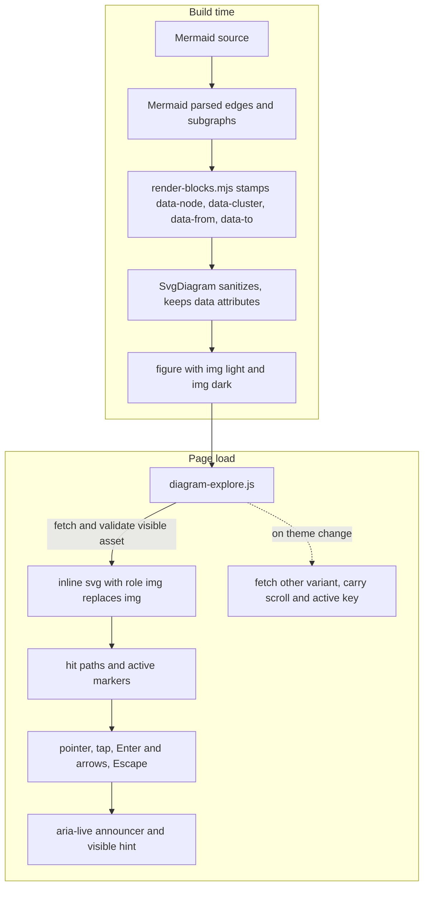

# Interactive Manual Diagrams - Plan

## Goal Capsule

- **Objective:** A reader of the published manual can follow one connection at a time on any diagram: pointing at or stepping to a node or an edge shows which lines belong to it, so converging edges on one node are no longer ambiguous. Keyboard and screen-reader readers get the same information, and the page keeps working without JavaScript.
- **Means:** Progressive enhancement on the built site: a script swaps the static diagram image for the already-built, sanitized SVG and adds emphasis, keyboard stepping and an announcer, following the bAAC chart interaction (KTD1, KTD2).
- **Product authority:** The maintainer's request on 2026-11-05 and the scoping synthesis confirmed in that session. The Product Contract wins on what the reader experiences; the Planning Contract on how it is built.
- **Execution profile:** Site tooling change on a branch named after this plan, landed as local commits, verified by the helper tests, the PHP tooling tests, the website build and the browser spec. Push only when asked.
- **Stop conditions:** Stop and ask if the sanitizer drops an attribute the script needs after all, if Mermaid's parsed edge list cannot be matched to the rendered edge paths, or if the no-JS checks cannot be kept green alongside the interaction tests.
- **Who finishes:** The implementer runs the gates, records the delivery in ROADMAP.md and hands the branch to review. Publishing to Vercel is a separate, user-run step.

---

## Product Contract

### Summary

Every Mermaid diagram on the site becomes interactive without touching its source. Hovering or stepping to a node emphasizes its edges and their far ends and recedes the rest; hovering or stepping to an edge emphasizes it, its label and both endpoints. Keyboard readers press Enter on a focused diagram to step through nodes and their edges and hear what is highlighted, and Escape leaves. The static image, the scrolling region, the full-size links and the source disclosure stay as they are for readers without JavaScript.

### Problem Frame

The manual's diagrams render as static images. On the deployment topology and the communication map, several edges converge on one node and leave the reader guessing which line belongs to which pair. The bAAC charts on the same site already answer this with hover emphasis, keyboard stepping and an announcer, so readers expect the diagrams to behave the same way.

### Key Decisions

- **Progressive enhancement, not a build-time change of the figure.** The page keeps today's static images; a script fetches the built SVG asset and swaps it in. (session-settled: user-approved, chosen over inlining the SVG at build time: the no-JavaScript page, the page weight, the sanitizer and the search index stay as they are.) Governs R1, R9, R10, R12.
- **Enter starts stepping, Escape ends it, arrows keep scrolling until then.** (session-settled: user-approved, chosen over arrows stepping at once: the region's arrow-key scrolling is existing behaviour the spec asserts.) Governs R5, R6.
- **No tooltip.** Labels are already drawn; emphasis plus an announcement is the whole feedback. (session-settled: user-approved.) Governs R4, R7.
- **The sequence diagram gets the lighter model: one message with its two lifelines.** (session-settled: user-approved; the diagram source is not changed.) Governs R3.
- **Touch gets tap to highlight and tap elsewhere to clear.** (session-settled: user-approved.) Governs R8.

### Requirements

**Emphasis**

- R1. On every page with a Mermaid diagram, the diagram becomes interactive after the page loads, and the static image remains the fallback until the swap succeeds.
- R2. Pointing at or stepping to a flowchart node emphasizes that node, every visible edge attached to it with its label, and the nodes or clusters at the far ends, and recedes everything else; pointing at or stepping to an edge or its label emphasizes that edge, its label and both endpoints.
- R3. On a sequence diagram, pointing at or stepping to a message emphasizes that message with its text and its two lifelines and recedes the rest.
- R4. Emphasis uses the site's theme tokens in both light and dark themes, honors the reduced-motion preference, and survives a theme switch while active.

**Keyboard and assistive access**

- R5. With the diagram region focused, Enter starts stepping: left and right arrows move between nodes in document order, up and down arrows move between the active node's edges, Home and End jump to the first and last node, and the active element is scrolled into view inside the region.
- R6. Escape ends stepping and clears emphasis; while stepping is off, arrow keys scroll the region as today.
- R7. A visually hidden live region announces the active node or edge and its connections, with edge labels; a short visible hint appears while the region has keyboard focus and tells the reader how stepping starts and stops.
- R8a. The inlined diagram keeps the accessible name and description the static image carried, so a screen reader meets the same alt text before and after the swap.

**Touch**

- R8. On touch devices a tap on a node or edge highlights it, a second tap on the same element clears it, and a tap elsewhere clears it.

**Fallbacks and safety**

- R9. With JavaScript off, the page shows the static image, the scrollable region, the full-size links and the source disclosure exactly as today.
- R10. The SVG sanitizer stays as strict as today, and the script inserts only a response it has verified to be an SVG document from the site's own asset path; anything else leaves the image in place.
- R11. The search index contains no diagram text, as today.
- R12. The full-size links keep pointing at the static assets, and the figure caption stays as today.

**Verification**

- R13. The browser spec proves the swap, the emphasis on a node and on an edge, the stepping and announcement, Escape, the theme switch and the touch behaviour with assertions that fail when the script is removed, and keeps its no-JavaScript sweep unchanged.
- R14. The renderer's own tests cover the endpoint data it adds, including clusters and multiple edges between one pair, and the render fails when an edge path cannot be matched to Mermaid's parsed edges.

### Acceptance Examples

- AE1. **Covers R2.** Given the communication map, when the reader hovers the execution unit, then the IPC edge, both consume edges, the failed edge and the queued edge with their far ends stand out and the rest fades; when the reader hovers the "relayed by control" edge or its label, then that edge, its label, the outbox and the async stream stand out.
- AE2. **Covers R3.** Given the DPoP sequence, when the reader hovers "Proof with nonce", then that message, its text and the client and token-endpoint lifelines stand out.
- AE3. **Covers R5, R6, R7.** Given the application threat model diagram, which overflows its column, focused by keyboard at desktop width, when the reader presses Right, then the region scrolls; when the reader presses Enter and then Right, then the second node is emphasized, scrolled into view and announced with its connections; when the reader presses Escape, then nothing is emphasized and Right scrolls again.
- AE4. **Covers R4.** Given a pinned node, when the reader switches from light to dark, then the dark variant shows the same node emphasized and the region keeps its scroll position.
- AE5. **Covers R9, R12.** Given JavaScript off, when the reader opens any diagram page, then the image, links and source disclosure render as before.
- AE6. **Covers R8.** Given a phone-width touch session, when the reader taps a node, then it is emphasized; when the reader taps near an edge, then that edge is emphasized; when the reader taps the page background, then the emphasis clears.
- AE7. **Covers R8a.** Given the swapped diagram, when a screen reader reaches the figure, then the name it reads equals the image's former alt text.

### Success Criteria

- A reader can name the two endpoints of any edge on the communication map by hovering it, without reading the source.
- The gates pass: helper tests, PHP tooling tests, website build and browser spec in Chromium, including its touch project.
- Each new JavaScript-enabled browser assertion was shown to fail once with the script tag removed before being trusted; the no-JS sweep is a regression guard and is exempt.

### Scope Boundaries

- No change to any diagram source in docs-book.
- No change to the bAAC chart code or CSS beyond sharing tokens; the diagram script and styles are their own files.
- No tooltip, no zoom, no pan, no click-through links from diagram nodes.
- No build-time inlining of SVG into the HTML; considered and not built because it would double page weight, expose SVG text to the search index and change the sanitizer's output surface.
- The sanitizer's rules are not loosened; considered and not built because the research confirmed ids, classes and data attributes already survive.
- No WebKit run of the website spec; considered and not built because that spec resolves its hostname with a Chromium-only launch flag and no WebKit project exists for it. Touch runs as a Chromium project with touch enabled. Evidence that a WebKit project for the website spec exists would change the call.
- No search assertion in the browser spec; the index is produced from the build's HTML before any script runs, so the unchanged build proves it.
- Clusters are not stepping stops; they are reached as the far end of a node's edges. Considered and not built because stepping through containers duplicates their members.

#### Deferred to Follow-Up Work

- Making the two threat-model diagrams fit the column; they stay scrollable by design in this plan and still gain the interaction.

### Dependencies / Assumptions

- Marker, style and flowchart ids carry a different Mermaid seed per theme variant, so both variants can be inlined together; the sequence SVG's actor and root ids are unseeded and unreferenced, so the script keys lifelines and participants by their data ids and never by element id.
- The inlined SVG keeps its embedded Geist face, so diagram labels render in Geist regardless of which glyph slices the page loaded for its own text.
- Pagefind indexes only build-time HTML, so runtime-inlined SVG text never reaches the index.
- Screen readers in browse mode consume Enter and arrow keys themselves, so stepping reaches them in focus mode; the inlined diagram's accessible name and description stay readable in either mode, as with the bAAC charts.

### Sources / Research

- ui/site/assets/baac-charts.js and ui/site/assets/baac.css: the announcer, hint, is-receded emphasis, Escape and focus handling, reduced motion, the hit layer, and the tokens to reuse.
- packages/baander-tooling/src/Website/BlockRendering.php and SvgDiagram.php: the figure markup, the two assets per block, and what the sanitizer keeps.
- ui/site/scripts/render-blocks.mjs and render-blocks.test.mjs: the render request, the validation of sources, the Mermaid page context, and the current tests over three flowchart pages.
- var/website/assets/diagrams: built SVG structure (node ids, edge data ids, edge-label groups, clusters, invisible edges with the edge-thickness-invisible class, markers, sequence messages and lifelines with data attributes).
- ui/site/templates/head.php: the docs-page script hook; ui/site/assets/appearance.js: theme switching by document attribute with no event.
- ui/site/tests/rendering.spec.ts, playwright.config.ts and serve-website.mjs: the no-JS sweep, the JS theme-toggle test, the fits check, the Chromium-only hostname mapping, the PHP web server.
- ui/site/tsconfig.json: the typecheck covers only the src directory today.
- docs/solutions/best-practices/browser-font-checks-that-pass-without-proving-anything.md and performance-issues/overlapping-unicode-range-fonts-download-unused-slices.md: spec fidelity and per-page font slicing.
- ui/design-tokens/build/web/theme.css: the color and duration tokens; highlight is a surface color paired with highlight-foreground, ring is the focus and emphasis stroke.

---

## Planning Contract

### Key Technical Decisions

- KTD1. **Runtime swap of the built asset, with validation.** A new script for docs pages, ui/site/assets/diagram-explore.js, finds each figure and fetches the SVG asset named by the visible image. It accepts the response only when it is OK and its content type is image/svg+xml, parses the text with DOMParser as image/svg+xml, and rejects a document whose root is not an svg element or that contains a parsererror element. It imports the root with importNode (never innerHTML or insertAdjacentHTML), copies the image's width and height onto the root (the sequence root is sized 100% and needs the pixel size for the fits geometry), keeps the embedded font-face style, gives the root role img and an aria-label equal to the image's alt, marks it with the image's theme class, and inserts it before the image, which it hides. On any rejection the image stays. The other theme's variant is fetched the first time the theme changes, observed through a mutation observer on the document element; the current variant stays visible until the new one is inserted, the region's scroll position and the active key are carried over, and on a failed fetch the old variant stays. Governs R1, R4, R8a, R9, R10, R12.
- KTD2. **Endpoint data stamped by the renderer from Mermaid's parsed diagram, never parsed from ids at runtime.** ui/site/scripts/render-blocks.mjs, which already runs inside Mermaid's page context, asks Mermaid for the parsed diagram of each flowchart source and reads its edge list (id, start, end, stroke) and subgraph list. It stamps every node group with data-node (its source name), every cluster with data-cluster, and every edge path and its label group with data-from and data-to by matching the path's data-id to the parsed edge id; an edge path with no parsed match fails the render with the page and block named. Invisible layout edges are left to the script, which ignores paths with the edge-thickness-invisible class. For sequence diagrams the message texts get the same data-from and data-to as their message lines by document order, which holds while every message is one line. The sanitizer already keeps data attributes. Governs R2, R3, R14.
- KTD3. **Emphasis by classes for receding and inline style for the active stroke, with tokens assigned by role.** Receding is a class on groups that sets opacity, which Mermaid's id-scoped styles never set. The active edge gets its stroke as an inline style from the ring token and a wider stroke width, because Mermaid's theme CSS is id-scoped and would out-specify a class; the script clones the diagram's arrowhead markers once per inlined SVG in the ring color and points the active edge's marker references at the clones, restoring the originals on clear. The highlight token is a surface color and is used only as the fill of an active node or label box, never as a stroke; receded text uses the muted foreground. Transitions use the duration tokens and are off under reduced motion. Styles live in ui/site/assets/site.css next to the figure rules. Governs R2, R3, R4.
- KTD4. **One active key per figure, with a fixed precedence.** The figure holds at most one active element; stepping outranks a pin, which outranks hover. Pointer enter on a node, cluster, edge, edge label or edge hit path emphasizes it unless something is pinned or stepping is on; pointer leave clears a hover; click pins and toggles, clicking another element moves the pin; a click or tap on plain content, inside the figure or outside it, and Escape clear pin and stepping alike, while a click on a diagram element or on a page control such as the theme toggle leaves them, so a pin survives the theme switch, and a pan or a scrollbar drag produces no click and leaves them too. The innermost target under the pointer wins, so a cluster is a target only on its own box and label, never through a nested node. Every visible edge gets an invisible hit path at swap time: a clone of the edge path with a transparent stroke about 12 pixels wide, pointer events on the stroke only, hidden from assistive technology, forwarding to the edge. Touch ignores pointer enter and leave, treats a pointer up with movement under a small threshold as a tap, and a tap also updates the live region. Keyboard: the existing focusable region takes Enter to start stepping, during which Left and Right move between nodes in document order, Up and Down cycle the active node's edges with wrap, Left and Right from an active edge move to the node after or before the edge's owning node, Home and End jump to the first and last node, a node without edges announces that it has no connections, and the active element is scrolled into view within the region; Escape ends stepping and restores arrow scrolling; blur ends stepping and keeps a pin. Announcer text is set with textContent and selectors use CSS.escape, as the bAAC script does. A visible hint beside the figure appears while the region has keyboard focus and reads "Enter steps through connections" before stepping and "Escape leaves" during it; the region's focus-visible outline is kept after the swap. Governs R5, R6, R7, R8.
- KTD5. **Sequence model.** Messages are the only targets; a message emphasizes its line, its text and the two lifelines named by its data attributes, found by data-id. Stepping moves between messages in order with Up, Down, Left and Right alike, and Home and End jump to the first and last message. Governs R3.
- KTD6. **Spec layout.** The no-JS sweep in ui/site/tests/rendering.spec.ts stays as it is. The JS theme-toggle test is rewritten so its variant check accepts the inline SVG. New JS-enabled tests cover the swap and the accessible name, hover emphasis on a node (computed opacity on a receded node and inline stroke on the active edge), hover emphasis on an edge through its label group and through a point on its hit path, stepping with the announcer text on the application threat model (which overflows at desktop width, so the scroll step is real), Escape restoring scroll, theme switch keeping the pinned node and the scroll position, and a touch project in playwright.config.ts with touch enabled for the tap cases. Each JS-enabled assertion is checked once against a build with the script tag removed to prove it can fail. The typecheck includes the tests directory. Governs R13.
- KTD7. **No PHP change.** The figure markup, the assets and the sanitizer are unchanged; the script discovers everything from the figure. The PHP tooling tests keep passing without edits, and the unchanged build is what proves the search index stays free of diagram text.

### High-Level Technical Design

Stepping order and emphasis keys: nodes are ordered by document order of their groups; a node's edges are ordered by document order of their paths; keys are the data-node and data-from plus data-to values, which are identical across the light and dark variants. A cluster at an edge's far end is emphasized by its border and label, and the announcer names the cluster.

### Sequencing

1. U1 (renderer data), with its tests, so every later unit builds on stamped assets.
2. U2 (swap and emphasis) and U3 (keyboard, announcer, touch) in order, both in the one script file.
3. U4 (styles and wiring) alongside U2.
4. U5 (spec) after U3, then U6 (gates and roadmap).

---

## Implementation Units

### U1. Stamp endpoint data in the renderer

- **Goal:** Every built flowchart SVG carries data-node, data-cluster, data-from and data-to attributes from Mermaid's parsed diagram, and every sequence SVG's message texts carry data-from and data-to.
- **Requirements:** R2, R3, R10, R14.
- **Dependencies:** None.
- **Files:** ui/site/scripts/render-blocks.mjs, ui/site/scripts/render-blocks.test.mjs.
- **Approach:**
  1. In the page context where Mermaid renders a block, obtain the parsed diagram for the source and read its edges and subgraphs per KTD2, then stamp the rendered SVG before serializing it.
  2. Fail the render, naming the page and block, when an edge path's data-id has no parsed match.
  3. Leave the result shape unchanged (kind, light, dark, width, height).
- **Execution note:** Proof-first: add the test cases below against fixtures with clusters, a double edge and a sequence, and watch them fail before stamping.
- **Patterns to follow:** The existing validateDiagram and result handling in render-blocks.mjs; the existing test file's fixture style.
- **Test scenarios:**
  - A flowchart with nodes a_b and b and an edge between them gets data-from a_b and data-to b from the parsed edge, not from the id.
  - An edge ending on a cluster gets data-to equal to the cluster's source name and the cluster carries data-cluster.
  - Two edges between the same pair get the same data-from and data-to and distinct data-id values.
  - An invisible layout edge keeps its edge-thickness-invisible class and is not stamped as a visible connection.
  - A sequence diagram's message texts get the same data-from and data-to as their lines, in order.
  - A rendered edge path whose data-id matches no parsed edge makes the render fail with the page and block named.
  - Covers AE1 indirectly: the communication map asset, rendered through the helper, has every visible edge stamped.
- **Verification:** The helper tests pass, and a rebuilt asset for the communication map shows the attributes on every visible edge.

### U2. Swap in the built SVG and emphasize on pointer

- **Goal:** Docs pages replace each static diagram image with the validated, inlined SVG and emphasize connections on hover and click.
- **Requirements:** R1, R2, R3, R4, R8a, R9, R10, R12; AE1, AE2, AE7.
- **Dependencies:** U1.
- **Files:** ui/site/assets/diagram-explore.js (new).
- **Approach:**
  1. For each figure, read the visible image's asset URL, size and alt, fetch and validate per KTD1, and insert the SVG; keep the image on any rejection.
  2. Build the model from the stamped attributes: nodes, clusters, edges with endpoints and labels, messages with lifelines; ignore paths with the edge-thickness-invisible class.
  3. Add the hit paths and the cloned active markers per KTD3 and KTD4.
  4. Implement emphasize, recede, pin and clear per KTD3 and the pointer part of KTD4.
  5. Observe theme changes, fetch and insert the other variant once, and reapply the current key with the scroll position carried over.
- **Patterns to follow:** ui/site/assets/baac-charts.js for structure, token use, the hit layer and the outside-click clear; ui/site/assets/appearance.js for how the theme attribute is set.
- **Test scenarios:** Covered by U5's browser tests; the unit has no separate harness. Test expectation: browser spec, see U5.
- **Verification:** On a built site served locally, hovering a node on the communication map emphasizes its edges and recedes the rest in both themes, hovering near an edge emphasizes that edge with its arrowhead in the ring color, and the image remains when the asset URL is broken.

### U3. Keyboard stepping, announcer, visible hint and touch

- **Goal:** Keyboard and touch readers get the same emphasis, with announcements and a visible hint.
- **Requirements:** R5, R6, R7, R8; AE3, AE6.
- **Dependencies:** U2.
- **Files:** ui/site/assets/diagram-explore.js.
- **Approach:**
  1. Attach the keyboard handler to the existing focusable region per KTD4 and KTD5; consume arrows only while stepping; scroll the active element into view.
  2. Add the announcer, the hidden description and the visible hint to the figure, describe the active node with its connections and labels or the active edge with its endpoints, and set aria-describedby on the region.
  3. Add tap handling per KTD4 using pointer events with the touch pointer type and a movement threshold, updating the live region on tap.
- **Patterns to follow:** The keydown, focus, blur and announcer code in baac-charts.js.
- **Test scenarios:** Covered by U5. Test expectation: browser spec, see U5.
- **Verification:** With a keyboard only, a reader can reach a diagram, scroll it, see the hint, enter stepping, hear each node and its edges, leave, and scroll again.

### U4. Styles and page wiring

- **Goal:** The emphasis styles exist and the script loads on docs pages.
- **Requirements:** R1, R4.
- **Dependencies:** None; lands with U2.
- **Files:** ui/site/assets/site.css, ui/site/templates/head.php.
- **Approach:** Add the active, related, receded and hint rules next to the figure rules in site.css using the ring, highlight, foreground and muted tokens by the roles in KTD3 and the duration tokens, with a reduced-motion override and the region's focus-visible outline kept; add the script tag with defer to the docs branch of head.php beside manual-navigation.js.
- **Patterns to follow:** The figure.diagram rules in site.css; the baac emphasis rules in baac.css; the existing docs script lines in head.php.
- **Test scenarios:** Test expectation: none beyond U5; pure styling and wiring.
- **Verification:** The script is served on every docs page and the styles apply in both themes.

### U5. Browser spec coverage

- **Goal:** The spec proves the interaction and keeps the no-JS sweep.
- **Requirements:** R13; AE3, AE4, AE5, AE6, AE7.
- **Dependencies:** U3, U4.
- **Files:** ui/site/tests/rendering.spec.ts, ui/site/tests/playwright.config.ts, ui/site/tsconfig.json.
- **Approach:**
  1. Leave the no-JS sweep as it is.
  2. Rewrite the JS theme-toggle test's variant check to accept svg.diagram-light or svg.diagram-dark after the swap.
  3. Add JS-enabled tests per KTD6, and a Chromium project with touch enabled for the tap cases.
  4. Extend the tsconfig include to the tests directory so the typecheck covers the spec; fix any type errors that surfaces.
- **Execution note:** Fidelity first: run each new JS-enabled assertion once against a build with the script tag removed and confirm it fails, as the font-check learning requires.
- **Patterns to follow:** The existing JS theme test and the visibleVariant helper; the bAAC chart tests in ui/site/tests for keyboard and announcer assertions.
- **Test scenarios:**
  - Covers AE1 and AE7: after load, the figure contains svg.diagram-light with role img and an aria-label equal to the former alt, the image is hidden, hovering the execution unit node gives its edges the active stroke and gives an unrelated node a reduced computed opacity.
  - Covers AE1: hovering the "relayed by control" label group, and hovering a point on that edge's hit path, each emphasize the edge and its two endpoints.
  - Covers AE2: on API Reference, hovering a message emphasizes its text and two lifelines.
  - Covers AE3: on the application threat model at desktop width, Right scrolls the region, Enter then Right emphasizes the second node and the announcer text names it and its connections, Escape clears and Right scrolls again; the visible hint shows while the region is focused.
  - Covers AE4: with a node pinned and the region scrolled, toggling the theme shows the dark variant with the same node emphasized and the same scroll position.
  - Covers AE5: the no-JS sweep still passes unchanged.
  - Covers AE6: in the touch project, a tap on a node emphasizes it, a tap near an edge emphasizes the edge, and a tap on the page background clears.
  - A broken asset URL, and a response that is an HTML page, each leave the image visible and the page without errors.
- **Verification:** The spec passes in Chromium locally, touch project included, and the typecheck passes with the tests directory included.

### U6. Gates and roadmap

- **Goal:** Every gate passes on the final tree and the delivery is recorded.
- **Requirements:** R13, R14.
- **Dependencies:** U5.
- **Files:** ROADMAP.md.
- **Approach:** Run the helper tests, the PHP tooling tests, the website build, the typecheck and the browser spec; record the delivery with the counts and the fidelity check, note that the search index is unchanged because the build output is unchanged, and leave publishing to the user-run Vercel step.
- **Test scenarios:** Test expectation: none; verification and record.
- **Verification:** The roadmap names each gate with its count.

---

## Verification Contract

| Check | Command or action | Applies to | Proves |
| --- | --- | --- | --- |
| Helper tests | `node --test scripts/*.test.mjs` in ui/site | U1 | R14 |
| PHP tooling tests | `vendor/bin/phpunit -c phpunit-tooling.xml.dist` | U1 | the figure and sanitizer are unchanged |
| Website build | `php scripts/build-website.php` | U1 to U4 | assets carry the stamped data, links resolve, the index is unchanged |
| Browser spec, Chromium with the touch project | `corepack yarn test:browser` in ui/site | U5 | R13, including the no-JS sweep and AE6 |
| Fidelity check | each new JS-enabled assertion run once with the script tag removed | U5 | assertions can fail |
| Typecheck | `corepack yarn typecheck` in ui/site, with tests included | U5 | the spec compiles |

---

## Definition of Done

- All units verified, every gate in the Verification Contract passes on the final tree, and the fidelity check is recorded.
- AE1 to AE7 hold on the built site.
- No diagram source, PHP file or sanitizer rule changed.
- No plan ids in code, comments, tests or styles.
- The roadmap records the delivery and its checkpoint; publishing is left to the user-run Vercel step.
- No experimental variants or scratch files remain in the tree.
