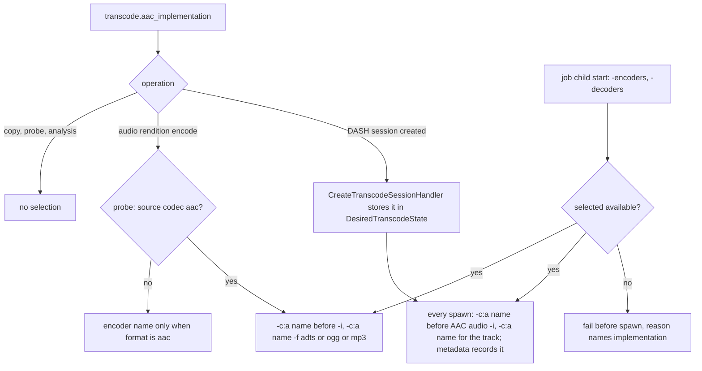

# bAAC in the FFmpeg Build and Transcoder - Plan

## Goal Capsule

- **Objective:** Every AAC rendition the server produces is encoded by bAAC and every AAC source it transcodes is decoded by bAAC, by default, so that a run period in production proves the codec before the desktop app depends on it.
- **Means:** bAAC enters the project's FFmpeg 8.1 build as an out-of-tree libavcodec encoder and decoder (KTD1, KTD2); the application image runs that build at `/usr/bin` (KTD5); one system setting selects the AAC implementation per command (KTD4, KTD6).
- **Product authority:** This plan. Vocabulary follows `CONCEPTS.md`. The pre-release policy in `AGENTS.md` applies: no compatibility layers for hypothetical installations. Admin and console parity follows `.agents/rules/admin-cli-parity.md`. Architecture follows `.agents/rules/architecture-rules.md`.
- **Execution profile:** Three phases in dependency order (Planning Contract, Sequencing). Each unit lands as a local commit on a branch named after this plan; `ce-simplify-code` runs at phase boundaries; `ce-code-review` runs before shipping. Push only when asked.
- **Stop conditions:** The static FFmpeg image fails to build with bAAC after the patch applies cleanly; the media suites on FFmpeg 8.1 fail in a way the upgrade learning does not explain and that would change product behaviour; the GPU host refuses to start its worker on the new binary and no configuration keeps it up. Each stops the run for the user's decision.
- **Who finishes:** The implementer records every delivered unit and its verification checkpoint in `ROADMAP.md`; the user runs the GPU host qualification and the production run period.
- **Open blockers:** None.

---

## Product Contract

**Product Contract preservation:** changed: R3 (LATM sources stay with FFmpeg's decoder, user-approved at plan synthesis), R6 (binaries at `/usr/bin`), R10 and R12 (encode operations only; the implementation is fixed per session), R14 (the preflight also covers the decoder of an AAC input), with the citations re-pointed. Added R15 and R16 and AE7 to AE11 from the flow analysis; the Summary now states the encode-only scope R15 carries. No other scope change.

### Summary

bAAC becomes an AAC encoder and decoder inside the project's own FFmpeg build, and the application image adopts that build. The transcoder keeps every rendition profile as it is and swaps only the implementation behind it. A three-position system setting, `bAAC` by default, `fdk-aac` and FFmpeg's built-in codec as fallbacks, governs the encoder of every rendition and the decoder of every AAC input to those encodes; stream copy, probing and analysis never carry it.

### Problem Frame

bAAC has been exercised by its own test suites, the benchmark harness, FFmpeg interoperability checks and the desktop addon. No real listener has heard a stream it produced, and no real library has been read through its decoder. Defects that only appear on real material under transcode load stay hidden until the desktop app depends on the codec.

The server is the place to find them. It already transcodes every supported library to AAC for the web client, through two paths: fMP4 DASH sessions for video and ADTS renditions for music. Both call FFmpeg's built-in `aac` encoder today. The project also maintains a static FFmpeg image with the non-free set, which carries Fraunhofer's fdk-aac, but nothing runs that image: the application image installs FFmpeg from Debian's apt repository, and the roadmap records that the static image's full build has never been run.

### Key Decisions

- **Prove the codec in production; quality parity is enough.** (session-settled: user-directed — chosen over better-quality-per-bit, xHE-AAC renditions and decoder-side features as the aim: the point of this work is real exposure, not new output.) Governs R13, R14.
- **bAAC lives inside FFmpeg as an external codec library, encoder and decoder both.** (session-settled: user-directed — chosen over encoder-only and over an encoder now with the decoder later: both halves need production exposure.) The alternative of piping audio to the `baac` command was rejected because it cannot decode sources and cannot feed the single-process DASH mux (user-approved). Governs R1, R2, R3.
- **All AAC output goes through bAAC by default, with one operator switch.** (session-settled: user-directed — chosen over opt-in per server, audio-only renditions first, and no fallback at all: the default must exercise the codec everywhere, and a defect must be recoverable without an image rebuild.) Governs R10, R11, R12.
- **fdk-aac stays in the build as a second fallback.** (session-settled: user-directed — chosen over dropping it: the switch gains a third position; the image remains non-redistributable, as today.) Governs R4, R10.
- **The proof signal is a run period with no defect.** (session-settled: user-directed — chosen over measured parity per rendition and over decoder agreement checks: no telemetry or comparison pipeline is built.) Governs the Success Criteria.
- **Rendition profiles stay as they are.** AAC-LC, bitrates, channel layouts, sample rates and the loudness and compressor filters do not change; the web client advertises only AAC-LC (`mp4a.40.2`), so HE-AAC and xHE-AAC output would need client work that is not this plan's (user-approved). Governs R13.
- **The application image adopts the project's FFmpeg build.** A codec inside FFmpeg can only reach the transcoder if the transcoder runs that FFmpeg; the Debian package cannot carry it (user-approved). Governs R6, R7, R8, R9.
- **The setting governs encode operations only, and LATM sources keep FFmpeg's decoder.** (session-settled: user-approved — chosen over forcing the decoder on every command and over a second bAAC codec entry for LATM: a forced decoder breaks stream copies and non-AAC inputs, and FFmpeg routes LATM to a separate codec id.) Governs R3, R10, R15.
- **Cached output survives a switch; the implementation is fixed per session.** (session-settled: user-approved — chosen over putting the implementation into the cache identities: a switch must not re-encode a library, and a seek must not change encoder mid-session.) Governs R12, R16.

### Requirements

**FFmpeg build**

- R1. The project's FFmpeg build includes bAAC from `packages/baander-aac` at the repository's own revision, so that the codec package and the FFmpeg image move together.
- R2. FFmpeg exposes bAAC as a named AAC encoder that accepts the bitrate, channel count and sample rate the transcoder passes today and produces AAC-LC for both ADTS and fMP4 output.
- R3. FFmpeg exposes bAAC as a named AAC decoder that reads every AAC source FFmpeg's built-in `aac` decoder reads today (AAC-LC and HE-AAC v1 and v2 in MP4, ADTS and raw access units), delivering the channel layouts the rest of the pipeline expects; LATM sources keep FFmpeg's own decoder.
- R4. The build keeps the fdk-aac encoder and decoder and FFmpeg's built-in AAC encoder and decoder available alongside bAAC.
- R5. The bAAC integration is kept in this repository and applied when the FFmpeg image is built; when it no longer applies to the FFmpeg source, or the built binary lacks the bAAC codecs, the build fails rather than publishing an image without bAAC.

**Application image and environments**

- R6. The application image runs the project's FFmpeg build as `/usr/bin/ffmpeg` and `/usr/bin/ffprobe` in place of Debian's package, so every FFmpeg process the web, worker and operator containers launch resolves to it.
- R7. On a given host, the hardware accelerators and video encoders the capability probe reports after the switch are the ones it reported before it.
- R8. The CI quality-gate image runs the same FFmpeg build, so the transcode suites exercise the bAAC paths.
- R9. The static FFmpeg image builds in the project's CI from a clean state, since it has never been fully built.

**Transcoder selection**

- R10. One system setting selects the AAC implementation for the server, with the positions bAAC (default), fdk-aac and FFmpeg built-in; it selects the AAC encoder of every encode operation and the decoder of every AAC input to an encode operation.
- R11. The setting is editable from the admin settings pages and through the existing settings console commands.
- R12. A change applies to sessions and renditions started after it; running sessions keep their implementation to their end, and cached renditions and completed presentations are neither re-encoded nor invalidated.
- R13. Every rendition keeps its profile regardless of the selected implementation: codec AAC-LC, bitrate, channel layout, sample rate, loudness normalisation and compressor settings.
- R14. When the selected implementation is absent from the FFmpeg binary in use, an encode operation that would use it, as AAC encoder or as decoder of an AAC input, fails before the encoding process is spawned with a reason that names the missing implementation, and no other implementation is substituted.
- R15. Stream copy, probing and audio analysis commands never carry the setting, and a non-AAC input never receives a forced AAC decoder.
- R16. The implementation of a DASH session is resolved once when the session is created and reused by every FFmpeg process of that session; the presentation identity the web process computes does not include it.

### Key Flows

- F1. Operator pulls the switch after a fault
  - **Trigger:** An operator hears an artefact or sees failed AAC transcodes while bAAC is selected.
  - **Steps:** The operator sets the AAC implementation to fdk-aac or FFmpeg built-in in the admin settings or with the settings console command. Sessions and renditions started from then on use the new implementation. Sessions in progress and cached outputs are untouched.
  - **Outcome:** Playback continues on the fallback codec; the fault is attributable to bAAC because the setting was global while it occurred.
  - **Covered by:** R10, R11, R12.
- F2. A DASH session with audio under the default setting
  - **Trigger:** A client starts a video session on a source with an AAC or non-AAC audio track.
  - **Steps:** The session records bAAC as its implementation. The transcoder decodes the source audio through bAAC when it is AAC, encodes the session's audio track with bAAC at the chosen profile, and muxes video and audio in one FFmpeg process as today. A seek respawns FFmpeg with the same implementation.
  - **Outcome:** The client plays the session unchanged; the manifest and codec string are the ones it accepts today.
  - **Covered by:** R2, R3, R10, R13, R16.
- F3. A worker starts against an FFmpeg without bAAC
  - **Trigger:** An operator points the FFmpeg path at a binary that lacks the bAAC codec while bAAC is selected.
  - **Steps:** The worker records at start which AAC implementations the binary offers. AAC encode operations fail before spawn with a reason naming bAAC as missing; stream copies, Opus and MP3 renditions of non-AAC sources and probing proceed.
  - **Outcome:** The operator either restores the project's FFmpeg build or moves the setting to an available implementation.
  - **Covered by:** R14, R15.

### Acceptance Examples

- AE1. **Covers R10, R13.** Given the setting is at its default, when an ADTS rendition is produced for a 64 kbit/s stereo profile, then the stream is AAC-LC at that bitrate and sample rate, produced by bAAC, and the web client's existing playability check accepts it.
- AE2. **Covers R3, R10.** Given the setting is fdk-aac, when a DASH session is started on an M4A source, then the source is decoded by fdk-aac's decoder and the audio track is encoded by fdk-aac.
- AE3. **Covers R12, R16.** Given a DASH session is running under bAAC, when the operator moves the setting to FFmpeg built-in, then the running session keeps bAAC across a seek until it ends, the next session uses the built-in codec, and renditions and presentations cached under bAAC are still served.
- AE4. **Covers R14, R15.** Given the FFmpeg binary lacks bAAC and the setting is bAAC, when an AAC rendition is requested, then the request fails before FFmpeg runs with a reason that names bAAC as unavailable, and an AAC stream-copy delivery of the same source still succeeds.
- AE5. **Covers R7.** Given a host where the capability probe reports a VAAPI HEVC encoder on the Debian FFmpeg, when the application image switches to the project's FFmpeg build, then the probe on the same host still reports that encoder.
- AE6. **Covers R5.** Given the FFmpeg source the image builds changes so that the bAAC integration no longer applies, when the image is built, then the build fails and no image is published.
- AE7. **Covers R10.** Given an AAC source and the default setting, when an Opus rendition is produced, then the source is decoded by bAAC and the Opus output is unchanged.
- AE8. **Covers R15.** Given a FLAC source, when an Opus or MP3 rendition is produced, then no AAC implementation appears in the FFmpeg command.
- AE9. **Covers R15.** Given an M4A source eligible for stream copy, when the copy delivery runs under any setting, then the FFmpeg command carries no AAC encoder or decoder name.
- AE10. **Covers R6.** Given the new application image, when the worker launches FFmpeg or ffprobe for any operation, then the process executable resolves to the project build at `/usr/bin`.
- AE11. **Covers R3.** Given a LOAS/LATM source, when a DASH session is started under the default setting, then FFmpeg's own LATM decoder reads it and the session's audio track is encoded by bAAC.

### Success Criteria

- bAAC runs as the default on the user's own instance for a run period of their choosing with no failed AAC transcode attributable to the codec, no audible fault, and the setting never moved off bAAC. The period includes DASH video sessions, music played from Safari or iOS, and AAC-source libraries played in any browser, since browsers that play Opus never request AAC music.
- The media suites, the twelve adaptive movie runs and the browser playback checks pass on the new image twice: with FFmpeg's built-in encoder as the upgrade gate, then with bAAC selected, where bAAC's 2048-sample encoder delay against the built-in encoder's 1024 is the expected difference the timing checks absorb.
- The FFmpeg interoperability tests in `packages/baander-aac` pass with the project's `ffmpeg` first on `PATH`.
- The static FFmpeg image and the application image build and publish from CI, and the new binary lists every accelerator and hardware encoder Debian's package lists.

### Scope Boundaries

- HE-AAC and xHE-AAC renditions, and client capability detection for them, are deferred.
- bAAC's loudness info set and DRC metadata do not replace the loudness normalisation and compressor filters.
- Per-rendition encoder identity, failure-rate reports and quality comparisons against the other implementations are not built.
- The bAAC integration is not upstreamed to FFmpeg.
- fdk-aac is not removed and the image's redistribution status does not change.
- The desktop addon and its prebuilds are unchanged.
- Rendition profiles, bitrates and the set of transcode formats are unchanged.
- Considered and not built: a purge of cached outputs by the implementation that produced them. It needs provenance per rendition and presentation plus a console command and admin counterpart; the existing cache sweep is the recovery, and the setting is global, so provenance is known from the switch time. A second production fault that the sweep cannot isolate would reopen this.
- Considered and not built: decoding LATM sources with bAAC. FFmpeg gives LATM its own codec id, so it would need a second codec entry; no LATM source exists in the user's libraries. A LATM library appearing in production would reopen this.
- Considered and not built: an admin page for the hardware capability report. `debug:hw-transcode` is the surface R7 is checked against.
- Considered and not built: a back-fill of the stored session state for sessions created before the upgrade. A missing key decodes to null and spawns the built-in encoder, which is what those sessions ran, so the migration would change nothing.
- Considered and not built: recording the implementation in a session's generation metadata. The setting is global, so attribution during the run period follows from the switch time; the proof signal decision rules out per-output provenance.

#### Deferred to Follow-Up Work

- The three AAC-emitting FFmpeg commands with no production caller (`FFmpegAdapter::encodeSegment`, `encodeAudioInitSegment`, `encodeAudioSegment` through `AudioProcessingRules::codecOptions`) are routed through the same selector here; whether they are removed under the pre-release policy is a separate decision after their history is read.
- Wiring the loudness analysis job that `AudioProcessingRules::loudnessFilter` expects, and deciding its decoder then.

### Dependencies / Assumptions

- The build script pinned in `docker/ffmpeg/Dockerfile` (markus-perl ffmpeg-build-script v1.59) builds FFmpeg 8.1 from the `n8.1` tag, always passes `--enable-version3`, and builds fdk-aac 2.0.3 under `--enable-gpl-and-non-free`; Debian trixie's package is 7.1.5, so the switch is a major upgrade and the learning in `docs/solutions/best-practices/ffmpeg-major-upgrades-break-shortest-and-guessed-frame-rates.md` applies.
- bAAC exposes a C API with `aac_encoder_create` and `aac_decoder_create` in `packages/baander-aac/include/aac.h`, hides symbols (`CMAKE_CXX_VISIBILITY_PRESET hidden`) so only a static library is viable, and ships no pkg-config file or version macro.
- The build already carries non-free components, so adding an Apache-2.0 library under `--enable-version3` changes no licence boundary; the image stays private as recorded in `ROADMAP.md`.
- The FFmpeg image builder installs no libva, libdrm or NVIDIA headers today, so whether the static build enables VAAPI, NVENC, QSV or AMF is unverified; the roadmap records NVENC, QSV and AMF were never run on hardware.
- The native execution daemon allows only `/usr/bin/ffmpeg` and `/usr/bin/ffprobe` and launches them with a fixed environment (`src/Shared/Infrastructure/Worker/NativeExecutionDaemon.php:304-328`), and `SegmentEncoder`, `FFmpegArguments` and `TranscodeProcessPool` hard-code the same paths; `.env.example` and the operator configuration page say `/usr/local/bin/ffmpeg`; the comment at `Dockerfile:13` names a `make build-ffmpeg` target that does not exist.
- The system settings store renders enum settings generically in the admin page and the `app:settings:*` commands, and `tests/Functional/Controller/SystemSettingsControllerTest.php` requires every definition to be enforced.
- `FFmpegAdapter::analyzeAudioLoudness` has no caller, so no production command decodes a source for analysis today.

### Outstanding Questions

**Deferred to implementation**

- Whether FFmpeg's `adts` muxer accepts packets the encoder has already framed as ADTS, which decides nothing if the wrapper emits raw access units as KTD2 says, but the first encode smoke test must confirm `-f adts` and `-f dash` both work from raw access units.
- Which `movenc` code path turns `initial_padding` into the edit list or a timestamp offset in fragmented output; the U2 smoke round trip records the observed mechanism and U8's media expectation is pinned to it.
- Whether the bAAC encoder takes interleaved float in FFmpeg's channel order for 5.1 or needs reordering to MPEG order; the wrapper's layout test settles it.
- Whether `make config` reproduces quoted configure arguments faithfully; the existing `ffmpeg-final` stage already re-runs `./configure` from `FFMPEG_CONFIGURATION`, so the same mechanism carries `--enable-libbaac`.

### Sources / Research

- `docker/ffmpeg/Dockerfile`, `.github/workflows/ffmpeg.yaml`, `Dockerfile:13,99-104`, `.env:101`: the two FFmpeg sources and their consumers.
- `src/Transcode/Domain/Service/AudioProcessingRules.php:139-149`, `src/Transcode/Infrastructure/FFmpeg/SegmentEncoder.php:254-265`, `src/Transcode/Infrastructure/Transcode/AudioRenditionExecutor.php:107-213`, `src/Transcode/Infrastructure/Transcode/AudioRenditionCache.php:86,113`, `src/Transcode/Infrastructure/Doctrine/AudioRenditionRuntime.php:21-50,154`, `src/Transcode/Domain/ValueObject/AudioProfile.php`: where the AAC encoder is chosen, and how a rendition's input reaches the worker through the database.
- `src/Transcode/Application/CommandHandler/CreateTranscodeSessionHandler.php:65`, `src/Transcode/Infrastructure/Doctrine/TranscodeRuntimeState.php:45-110,254-268`, `src/Transcode/Infrastructure/Swoole/TranscodeSessionSubscriber.php:213-237,556`, `src/Transcode/Infrastructure/Swoole/TranscodeStreamManager.php:77-135`, `src/Transcode/Infrastructure/Transcode/EncodePresentationAdapter.php:34-51`, `src/Transcode/Infrastructure/FFmpeg/EncodePresentationIdentity.php:16-44`: where a session's desired state is written, re-read, spawned and hashed.
- `src/Transcode/Infrastructure/FFmpeg/HardwareCapabilitiesProber.php`, `bin/worker-media.php:39-50`, `bin/worker-media-job.php:122-131`, `src/Transcode/Infrastructure/FFmpeg/WorkerEncoderCapabilitiesSnapshotStore.php`: the capability probe R7 protects, published only when video slots exist and never read by audio jobs, which is why KTD9 probes per job instead.
- `src/Shared/Domain/Model/Setting/SettingDefinition.php`, `src/Transcode/Application/Settings/TranscodeSettingDefinitions.php`, `src/Shared/Interface/Console/SettingsSetCommand.php`, `ui/web/src/features/admin/components/settings/SystemSettingRow.tsx`: the settings system.
- `packages/baander-tooling/src/Build/BuildRequest.php:14-34`, `packages/baander-tooling/src/Build/ApplicationImage.php:16`, `packages/baander-tooling/src/Development/Build/Builder.php:92`, `packages/baander-tooling/src/Configuration/ImageCatalog.php`, `packages/baander-tooling/src/Configuration/ToolingConfiguration.php:264`, `packages/baander-tooling/src/Architecture/SourcePolicy.php:86-88`, `packages/baander-tooling/resources/tooling-defaults.json`, `Dockerfile:15,656-662`: the operator-helper precedent for pulling a workflow image into the application build, its env override hook and the source-policy rule on image literals.
- FFmpeg 8.1 `libavcodec/libfdk-aacenc.c`, `libfdk-aacdec.c`, `libopusenc.c`, `codec_internal.h`, `allcodecs.c`, `configure` (`EXTERNAL_LIBRARY_VERSION3_LIST`, `die_license_disabled version3`), `libavformat/adtsenc.c`, `fftools/ffmpeg_demux.c` (`choose_decoder`): the wrapper conventions KTD2 and KTD4 follow.
- markus-perl ffmpeg-build-script v1.59 `build-ffmpeg` (`FFMPEG_VERSION=8.1`, `--enable-version3`, fdk-aac 2.0.3, `packages/FFmpeg-release-8.1`): the build the image pins.
- `docs/solutions/best-practices/ffmpeg-major-upgrades-break-shortest-and-guessed-frame-rates.md`, `docs/solutions/best-practices/debian-13-base-images-change-collation-time-zone-links-and-vaapi-limits.md`, `docs/solutions/best-practices/verify-aac-copy-after-normalizing-transport-framing.md`, `docs/solutions/developer-experience/local-gate-images-and-webkit-harness-runs.md`, `docs/solutions/runtime-errors/console-json-output-needs-real-logging-handlers.md`: the learnings the units apply.
- `packages/baander-aac/CMakeLists.txt`, `packages/baander-aac/include/aac.h`, `packages/baander-aac/include/encoder.h` (delay macros), `packages/baander-aac/tests/test_interop.cpp`, `packages/baander-aac/docs/codec-comparison.md`: the codec's build, API and interop tests.
- `ROADMAP.md` ("Application release acceptance", "AAC codec gap closure against the fdk-aac upstream", line 171 "Not run: the static FFmpeg image's full build").
- `docs-book/part-1-operator-guide/transcoding.md:108-114,313-322`, `docs-book/part-1-operator-guide/configuration.md:590,636-647`, `docs-book/part-1-operator-guide/system-requirements.md:97,132`, `docs-book/part-2-developer-guide/continuous-integration.md:25,235`, `docs-book/part-2-developer-guide/testing.md`: the pages U10 updates.

---

## Planning Contract

### Key Technical Decisions

- KTD1. **Target FFmpeg 8.1 as the build script ships it, and treat the application image switch as an FFmpeg upgrade.** (session-settled: user-approved — chosen over pinning the script back to 7.1: the script's dependency set is tested against 8.1, and the wrapper then has one API target.) The media suites run on the new image with the built-in encoder before any selection code lands, and the image smoke asserts the major version so a script bump cannot move it unnoticed. Governs R6, R8, R9.
- KTD2. **bAAC is an out-of-tree libavcodec wrapper kept in the repository and applied at image build.** Wrapper sources `libbaacenc.c` and `libbaacdec.c` plus a patch to `configure`, `libavcodec/allcodecs.c` and `libavcodec/Makefile` live under `docker/ffmpeg/baac/`. `libbaac` joins `EXTERNAL_LIBRARY_VERSION3_LIST` with `libbaac_encoder_select="audio_frame_queue"`, mirroring `libfdk_aac` and `libopencore_amr`. The encoder declares `AV_SAMPLE_FMT_FLT`, `frame_size` 1024, `AV_CODEC_CAP_DELAY | AV_CODEC_CAP_SMALL_LAST_FRAME | AV_CODEC_CAP_ENCODER_FLUSH`, sets `initial_padding` from `aac_encoder_delay`, always emits raw access units with the AudioSpecificConfig in `extradata`, and lets the `adts` and `dash` muxers frame them. The decoder uses `FF_CODEC_DECODE_CB`, `AV_CODEC_CAP_DR1 | AV_CODEC_CAP_CHANNEL_CONF | AV_CODEC_CAP_DELAY`, raw mode when `extradata` is present and ADTS otherwise, float output. The patch is applied to the script's extracted release tree before the `ffmpeg-final` configure re-run, with `git apply --check` first, so drift fails the build (R5). Governs R1, R2, R3, R5.
- KTD3. **bAAC is built as a static library in its own `lib-builder` stage from the repository checkout and installed with a pkg-config file.** `packages/baander-aac` gains a `libbaac.pc` template installed by CMake with `Libs.private: -lstdc++ -lm`, so FFmpeg's configure finds it through `--pkgconfigdir` with `--pkg-config-flags=--static`. The image build context becomes the repository root; `.dockerignore` already keeps `packages/`. Governs R1.
- KTD4. **FFmpeg's codec registration order is unchanged; the transcoder selects by name.** The encoder is `-c:a libbaac | libfdk_aac | aac` after the inputs; the decoder is the same name with a stream specifier before the input, `-c:a:<ordinal>`, where the ordinal is the audio stream the command maps, because FFmpeg applies an unscoped `-c:a` to every audio stream of that input and relabels the stream's codec id rather than refusing a mismatch. Reordering `allcodecs.c` would change every AAC decode including probing. Governs R10, R15.
- KTD5. **The application image installs the project binaries at `/usr/bin/ffmpeg` and `/usr/bin/ffprobe` and drops the apt package.** The image arrives through the operator-helper precedent: a tooling image role `ffmpeg` in `tooling-defaults.json` pinned by digest, a `FFMPEG_IMAGE` build arg in `BuildRequest`, an env override (`BAANDER_FFMPEG_IMAGE`) in `ToolingConfiguration` for Forgejo and local builds, and `FROM ${FFMPEG_IMAGE} AS ffmpeg-dist` with `COPY --from=ffmpeg-dist` into `base`, so every target (ci, dev, production, worker, operator) inherits it. The runtime VAAPI packages at `Dockerfile:428-430` stay. `SegmentEncoder`, `FFmpegArguments` and `TranscodeProcessPool` take the injected paths instead of constants, which is a defect in touched code and not a path change; the fixture images that wrap `/usr/bin/ffmpeg` are unaffected. Governs R6, R8.
- KTD6. **The setting is `transcode.aac_implementation`, an enum with values `baac`, `fdk_aac`, `ffmpeg`, default `baac`, group Media, in `TranscodeSettingDefinitions`.** A string-backed `AacImplementation` enum in `src/Transcode/Domain/ValueObject/` follows `HardwareAccelerator` and `LoudnessStandard`: `encoderName()` and `decoderName()` return the FFmpeg codec names, `from()` and `->value` carry the setting string. The definition keeps its allowed values as a literal list because its layer may not import Transcode Domain (`deptrac.yaml:1457-1459`); a unit test asserts the two agree. The enum is passed into the argument builders as a parameter; `AudioProfile->codec` stays the format name because it is persisted session identity. `AudioProcessingRules` stays free of the settings port. Governs R10, R11, R13.
- KTD7. **A DASH session resolves the implementation once at creation and stores it in its desired state; every spawn works from that record and the presentation identity leaves it out.** (session-settled: user-approved — chosen over reading the setting at each spawn and over hashing the codec name into the presentation identity: seeks must not mix encoder delays, and a switch must not invalidate cached presentations.) `CreateTranscodeSessionHandler` reads the setting and puts it in `DesiredTranscodeState`; `TranscodeRuntimeState` encodes it like the loudness standard (`->value`, `::from`), carries it through `control()`, and leaves it out of the profile-change comparison. The field is nullable, null for copy sessions; a desired state without the key decodes to null and spawns the built-in tokens, which is the implementation sessions created before the upgrade ran. `EncodePresentationIdentity::derive` never receives the implementation, and `buildStreamArgs` emits the built-in tokens when none is given, so the identity is the same for all three. `AudioRenditionInput::key()` and `AudioRenditionFormat::sourceSignature()` keep excluding it. Governs R12, R16.
- KTD8. **The decoder is forced only when the input audio codec is `aac`, and each path learns the codec where it already has it.** The override is scoped to the mapped audio stream (`-c:a:<ordinal>` per KTD4). The DASH path reads the probe's selected audio stream and uses its ordinal; the rendition executor probes the source stream once before an encode and uses ordinal 0, as it already does in copy mode, which keeps `AudioRenditionPortInterface`, the `audio_rendition_runtime` table and the three Media callers unchanged at the cost of one short ffprobe per rendition start. `aac_latm` is not `aac`, so LATM sources get no override (R3). Copy commands, `FFprobeArguments` and `analyzeAudioLoudness` never receive the selection. Governs R3, R10, R15.
- KTD9. **Each media job child probes its FFmpeg once at start for the AAC implementations it offers and refuses an unavailable selection before spawning the encoder.** (chosen over extending the worker capability snapshot: the snapshot is published only when video slots exist, is never read by audio jobs, and is shared by every worker on a host.) `ffmpeg -encoders` and `-decoders` run once per job; when the job's operation would use the selected implementation, as AAC encoder or as decoder of an AAC input, and it is missing from either list, the operation fails with `AAC implementation "<label>" is not available in this FFmpeg build`, written to the job failure reason or the rendition runtime error as today's failures are. Copies, probes and encodes of non-AAC sources to Opus or MP3 proceed unchanged. `debug:hw-transcode` runs the same probe on demand and prints the result. Governs R14.
- KTD10. **Hardware support links against Debian's shared libva and is gated without a GPU.** The FFmpeg builder stage installs `libva-dev` and `libdrm-dev`; the script enables VAAPI itself once libva's pkg-config entry exists but never enables libdrm, and without the CUDA compiler it records `--disable-ffnvcodec`, so NVENC headers (nv-codec-headers matching FFmpeg 8.1) and libvpl for QSV are built in their own `lib-builder` stages and the configure re-run passes `--enable-libdrm --enable-ffnvcodec --enable-nvenc --enable-nvdec --enable-cuvid --enable-libvpl` explicitly. The binary then depends on Debian shared libraries (libva, libdrm and the fontconfig, cairo, pango, gdk-pixbuf and fftw3 libraries the builder's other dependencies link), so both runtime package lists are derived from the dynamic loader's report on the built binaries and committed beside the capability list, and the application image runs its gate only in stages that have them. The committed capability list is the subset of Debian's 7.1 output the application can select, the hwaccels `cuda`, `vaapi` and `qsv` and the encoders matching the prober's patterns (`nvenc`, `vaapi`, `_qsv`, `_amf`); accelerators outside `HardwareAccelerator` are not gated. That list and a missing-shared-object check run in the image workflow and in the application build; the real qualification is `debug:hw-transcode` on the user's GPU host before the Debian package is dropped. The fixed launch environment of the native execution daemon means driver paths cannot be corrected at runtime, which is why the Debian libva is the only workable link. Governs R7.
- KTD11. **The FFmpeg image workflow builds from the repository root, triggers on `packages/baander-aac/**`, `docker/ffmpeg/**` and itself, and asserts the result.** After `make install`, the stage runs `ffmpeg -version` (major 8.1) and `-encoders`/`-decoders` and fails unless `libbaac` and `libfdk_aac` are present, then a round trip (f32 PCM to ADTS and fMP4 with `libbaac`, decoded with `aac` and, once U11 lands, with `libbaac`) must succeed. The workflow gains a `timeout-minutes` and the disk-free step `ci.yaml` uses. The application build pins the FFmpeg image by digest recorded in `tooling-defaults.json`; Forgejo overrides it through the env hook. Governs R1, R4, R5, R9.
- KTD12. **The three AAC-emitting commands without production callers take the same `AacImplementation` parameter.** They stay consistent with the live paths; their removal is deferred (Scope Boundaries).

### High-Level Technical Design

Build and image flow (KTD2, KTD3, KTD5, KTD10, KTD11):

```mermaid
flowchart TB
  A[packages/baander-aac] -->|baac-builder stage: CMake static lib + libbaac.pc| B[/dist]
  P[docker/ffmpeg/baac: wrapper sources + patch] -->|git apply --check, then apply| F[ffmpeg-final: configure --enable-libbaac --enable-vaapi, make install]
  B --> F
  S[ffmpeg-build-script v1.59: FFmpeg 8.1, fdk-aac, version3] --> F
  F -->|assert 8.1, libbaac, libfdk_aac; round trip; capability list; shared objects| I[ffmpeg-baander-static image]
  I -->|FFMPEG_IMAGE build arg, COPY --from to /usr/bin| D[Dockerfile base]
  D --> CI[ci target: suites and gate]
  D --> PR[production, worker, dev-runtime]
```

Selection per command (KTD4, KTD6, KTD7, KTD8, KTD9):



### System-Wide Impact

- **One binary, every context.** The swap at `/usr/bin` reaches Transcode (DASH, renditions, probes, subtitle extraction), Catalog scanning (`FilesDiscoveredHandler` probes new videos), QoL (reads the worker capability snapshot) and the tooling fixtures. Only new or incomplete videos are re-probed, so a library keeps 7.1 probe results while new files get 8.1 ones; a probe that drifts in the fields `VideoProbeResult` reads changes presentation identities for re-probed videos, which re-encodes their cached presentations once (U5 checks the drift and accepts the consequence).
- **Persisted session state.** `transcode_runtime_state.desired` gains a nullable key (KTD7, U8). Existing rows decode to null and keep the built-in encoder; no migration.
- **Rendition input contract untouched.** Because the executor probes the source (KTD8), `AudioRenditionPortInterface`, `AudioRenditionCache`, `AudioRenditionRuntime` and the three Media callers do not change.
- **Worker capability snapshot untouched.** KTD9 probes per job, so the snapshot version, its strict reader and the QoL and presentation adapters that depend on it are unchanged.
- **Tooling build contract.** `BuildRequest::fromSource` gains a role (two callers), `ImageCatalog` gains the `ffmpeg` default, `ToolingConfiguration` gains an env override, and the source policy's `default-image` rule learns the new image name (U4).
- **Forge differences.** Fork pull requests skip registry login and will fail the application build once `base` pulls the private FFmpeg image; accepted and documented while fdk-aac keeps the image private. Forgejo CI pushes its own FFmpeg image under `vars.REGISTRY_URL` and overrides the role through the env hook.
- **Admin and console parity.** The setting rides the existing `SystemSettingsController` and `app:settings:*` pair; `debug:hw-transcode` output changes, so its command page is updated (U10). No new route or command.
- **Layer rules.** `AacImplementation` is Transcode Domain; the settings port enters `AudioRenditionExecutor` (Infrastructure) and `CreateTranscodeSessionHandler` (Application), both permitted; `TranscodeSettingDefinitions` stays in the Audio Rendition Contract layer with literal values.

### Risks & Dependencies

- **FFmpeg 7.1 to 8.1 drift.** Mitigated by U5's suite gate and probe-drift check; the version is pinned only through the script tag, so the smoke asserts the major (KTD11). Accepted: point releases arrive only through a script bump that may move other libraries.
- **Hardware support in the static build.** Mitigated by KTD10: Debian's shared libva, runtime packages in both images, a CPU-only superset gate and a missing-shared-object check; the GPU host qualification is the real proof. Accepted: NVENC, QSV and AMF were never run on hardware before and are checked by listing only.
- **Patch coupling to libavcodec internals.** Mitigated by `git apply --check`, the pinned tag through the script, and the smoke round trip (KTD2). Accepted: every FFmpeg bump means re-basing the patch.
- **Encoder delay in fMP4 priming.** bAAC's 2048-sample delay against the built-in encoder's 1024 may land as an edit list or a timestamp offset; the U2 smoke records which, U8 pins its expectation to it, and the existing `apad`/`atrim`/`-max_interleave_delta 0` end alignment stays the end-of-track check. Consistent within a session by KTD7.
- **Private FFmpeg image.** Previews need a registry login or the env override to a local build; fork pull requests cannot build the application image (accepted, documented). A public fallback image is considered and not built while fdk-aac keeps the image non-redistributable.
- **Static image build time and disk.** Unknown until the first full run; U3 adds a timeout and the disk-free step and records the first run's wall time and disk in the roadmap. BuildKit registry caching is considered and not built unless that run shows the need.
- **Digest bumps.** The image workflow rebuilds on every `master` push touching the codec or the image, but the application build follows the digest in `tooling-defaults.json`, so each such change needs a second commit to bump the digest; until then the application suites run against the previous codec build. Accepted.
- **The script's own hardware steps.** The script enables Vulkan, OpenCL and AMF on Linux in its `ffmpeg-base` stage, which has never completed in this image (R9); a failure there is outside the patch and the configure re-run and surfaces on the first full build.
- **Dependency:** a published `ffmpeg-baander-static` digest before Phase B's CI gate, with the local image as the interim (Sequencing); the user's GPU host for AE5; `OUTBOX_TEST_DATABASE_URL` for the Integration suite that covers the runtime state.

### Sequencing

Three phases, each ending with `ce-simplify-code` and the authoritative checks:

1. **Phase A, FFmpeg image (U1, U2, U11, U3):** the static image builds with bAAC, fdk-aac and hardware support, and asserts itself.
2. **Phase B, application adoption (U4, U5):** the application and CI images run the project binary; the media suites pass on FFmpeg 8.1 with the built-in encoder.
3. **Phase C, transcoder selection (U6 to U10):** the setting, the per-command selection, the availability preflight, documentation and the roadmap record; the suites pass with bAAC as default.

The Phase A boundary is a user checkpoint: publishing the image needs the branch pushed and `ffmpeg.yaml` dispatched, which the user authorises; until the digest is recorded in `tooling-defaults.json`, Phases B and C proceed locally with `BAANDER_FFMPEG_IMAGE` pointing at the locally built image, and the digest commit follows the dispatched run. Phase C depends on Phase B so that the bAAC default is tested against a binary that has it. U6 can start any time but lands with U7 so the definition is consumed when it is enforced.

---

## Implementation Units

### U1. bAAC static library and pkg-config in the FFmpeg image

- **Goal:** The FFmpeg image builds bAAC from the repository checkout as a static library that FFmpeg's configure can find.
- **Requirements:** R1; KTD3.
- **Dependencies:** None.
- **Files:** `packages/baander-aac/CMakeLists.txt`, `packages/baander-aac/cmake/libbaac.pc.in` (new), `docker/ffmpeg/Dockerfile` (new `baac-builder` stage), `.github/workflows/ffmpeg.yaml` (build context `.`), `.dockerignore` (confirm `packages/baander-aac` and `docker/ffmpeg` are included), `packages/baander-aac/docs/README.md` (install section).
- **Approach:**
  1. Add a `libbaac.pc.in` configured by CMake (`Name: libbaac`, `Version` from the project, `Cflags: -I${includedir}`, `Libs: -L${libdir} -lbaander-aac`, `Libs.private: -lstdc++ -lm`) and install it to `lib/pkgconfig`.
  2. Add a `baac-builder` stage following the `lib-builder` pattern: `COPY packages/baander-aac`, CMake Release with tests, tools and the shared option off, install to `/dist`.
  3. Merge `/dist` into the script workspace in `ffmpeg-final` like the other libraries.
  4. Change the workflow's build context to the repository root with `--file docker/ffmpeg/Dockerfile`.
- **Patterns to follow:** The `librist-builder` and `chromaprint-builder` stages in `docker/ffmpeg/Dockerfile`; the `install(DIRECTORY ...)` rules at `packages/baander-aac/CMakeLists.txt:203-208`.
- **Test scenarios:**
  - In the `baac-builder` stage, `pkg-config --static --libs libbaac` resolves to the static library plus `-lstdc++ -lm`.
  - `ctest` in `packages/baander-aac` still passes after the CMake change (the aac-native workflow runs it).
  - The CMake install tree contains `include/aac.h`, `lib/libbaander-aac.a` and `lib/pkgconfig/libbaac.pc`.
- **Verification:** `docker buildx build --target baac-builder -f docker/ffmpeg/Dockerfile .` succeeds and the stage's pkg-config query prints the expected flags.

### U2. libavcodec encoder wrapper, patch set and build hook

- **Goal:** FFmpeg 8.1 exposes `libbaac` as an AAC encoder, built from sources kept in the repository, applied with a loud failure on drift, and proven by a smoke round trip that decodes with the built-in decoder.
- **Requirements:** R2, R4, R5; KTD2, KTD4, KTD11; AE6.
- **Dependencies:** U1.
- **Files:** `docker/ffmpeg/baac/libavcodec/libbaacenc.c` (new), `docker/ffmpeg/baac/ffmpeg-8.1-libbaac.patch` (new: `configure`, `libavcodec/allcodecs.c`, `libavcodec/Makefile`, encoder entries), `docker/ffmpeg/baac/README.md` (new: how to regenerate the patch against a new tag), `docker/ffmpeg/smoke.sh` (new), `docker/ffmpeg/Dockerfile` (`ffmpeg-final` stage).
- **Approach:**
  1. Write the encoder after `libfdk-aacenc.c` on the `n8.1` tag: `CODEC_SAMPLEFMTS(AV_SAMPLE_FMT_FLT)`, `CODEC_SAMPLERATES_ARRAY` for bAAC's rates, `CODEC_CH_LAYOUTS_ARRAY` for mono, stereo and 5.1, `ff_af_queue` for timestamps, `ff_alloc_packet` sized by `aac_encoder_max_frame_bytes`, `initial_padding` from `aac_encoder_delay`, `extradata` from `aac_encoder_config` set unconditionally, raw access units out, `-b:a` honoured, profile fixed to AAC-LC for this plan.
  2. Patch `configure` (`--enable-libbaac` help line, `EXTERNAL_LIBRARY_VERSION3_LIST`, `libbaac_encoder_deps`, `libbaac_encoder_select="audio_frame_queue"`, `enabled libbaac && require_pkg_config libbaac libbaac "aac.h" aac_encoder_create`), the `allcodecs.c` encoder extern in the external block, and the Makefile `OBJS` line.
  3. In `ffmpeg-final`, copy the wrapper sources into `libavcodec/` of the script's extracted release tree, run `git apply --check` then `git apply` on the patch (fail the stage on either), append `--enable-libbaac` to the existing configure re-run, build, install.
  4. `smoke.sh` runs in the stage: `ffmpeg -version` reports 8.1; `-encoders` lists `libbaac` and `libfdk_aac`; a 2 s f32 stereo tone encodes to ADTS and fMP4 with `libbaac`, decodes with `aac`, and `ffprobe` reports AAC-LC with the right rate and channels; the script prints how the fMP4 output carries priming (edit list or timestamp offset) for U8.
- **Execution note:** Build the smoke round trip first and keep it in the image build; it is the proof the wrapper works at all.
- **Patterns to follow:** FFmpeg 8.1 `libavcodec/libfdk-aacenc.c`, `libopusenc.c`; `libopencore_amr` in `configure` for the version3 list.
- **Test scenarios:**
  - Covers AE6. A deliberately shifted hunk in the patch makes `git apply --check` fail and the image build stop before configure.
  - `ffmpeg -h encoder=libbaac` lists FLT input, the sample rates and the three layouts.
  - Stereo 48 kHz tone encoded with `-c:a libbaac -b:a 128k -f adts` decodes with `aac` to within the interop tests' tolerance of the input after delay compensation.
  - The same tone with `-f mp4` carries an AudioSpecificConfig in the track, and the smoke output records the priming mechanism.
  - A 5.1 source encodes and decodes with channels in FFmpeg's order (compare against `aac` encoder output channel by channel).
  - `ffmpeg -version` from a script bump that moved the major fails the smoke.
- **Verification:** The image builds end to end; `smoke.sh` passes inside the build; `packages/baander-aac` `test_interop` passes with the new `ffmpeg` first on `PATH`.

### U11. libavcodec decoder wrapper

- **Goal:** FFmpeg 8.1 exposes `libbaac` as an AAC decoder for raw and ADTS input, proven against the U2 outputs.
- **Requirements:** R3; KTD2, KTD4.
- **Dependencies:** U2.
- **Files:** `docker/ffmpeg/baac/libavcodec/libbaacdec.c` (new), `docker/ffmpeg/baac/ffmpeg-8.1-libbaac.patch` (decoder entries: `libbaac_decoder_deps`, decoder extern, Makefile object), `docker/ffmpeg/smoke.sh` (decoder half).
- **Approach:**
  1. Write the decoder after `libfdk-aacdec.c`: `aac_decoder_set_config` from `extradata` when present, ADTS feed otherwise, `ff_get_buffer` float output, channel layout from the decoder's reported mode, `.flush` for seeks, `AV_FRAME_DATA_SKIP_SAMPLES` for the decoder delay.
  2. Extend the patch with the decoder entries and `smoke.sh` with the decoder half: `-decoders` lists `libbaac`; the U2 ADTS and fMP4 outputs decode with `-c:a libbaac` before `-i` to the same tolerance as with `aac`.
- **Patterns to follow:** FFmpeg 8.1 `libavcodec/libfdk-aacdec.c`, `libopusdec.c` (float output honouring `request_sample_fmt`).
- **Test scenarios:**
  - `ffmpeg -h decoder=libbaac` exists and reports float output.
  - The U2 ADTS and fMP4 outputs decoded with `libbaac` and with `aac` agree within the interop tolerance after delay compensation.
  - An ADTS stream with a damaged frame decodes through `libbaac` without aborting (concealment on).
  - A 5.1 fMP4 file decodes with channels in FFmpeg's order.
  - A LATM input with `-c:a:0 libbaac` forced is relabelled as AAC by FFmpeg and `libbaac` reports decode errors rather than FFmpeg refusing, which is why the transcoder's guard is the probe-side codec check (R3); without the override FFmpeg's LATM decoder reads it.
- **Verification:** The image builds with both halves; the full `smoke.sh` passes; `test_interop` passes with the new `ffmpeg` first on `PATH`.

### U3. Hardware acceleration and capability gate in the static build

- **Goal:** The static FFmpeg lists every accelerator and hardware encoder Debian's 7.1 package lists, runs in its own runtime stage, and the image workflow proves both on every build.
- **Requirements:** R7, R9; KTD10, KTD11; AE5 (CPU-only half).
- **Dependencies:** U11.
- **Files:** `docker/ffmpeg/Dockerfile` (builder packages, `nvcodec-builder` and `libvpl-builder` stages, configure flags, runtime stage packages), `docker/ffmpeg/expected-capabilities.txt` (new, the application-selectable subset of Debian's output), `docker/ffmpeg/runtime-packages.txt` (new, derived from the dynamic loader's report), `scripts/ffmpeg-capability-gate.sh` (new: capability superset and missing-shared-object check), `.github/workflows/ffmpeg.yaml` (triggers, `timeout-minutes`, disk-free step, gate step), `docs-book/part-2-developer-guide/continuous-integration.md`.
- **Approach:**
  1. Install `libva-dev` and `libdrm-dev` in `base-builder`; add `lib-builder` stages for nv-codec-headers (the release matching FFmpeg 8.1, `make install PREFIX=/dist`) and libvpl (static); append `--enable-libdrm --enable-ffnvcodec --enable-nvenc --enable-nvdec --enable-cuvid --enable-libvpl` to the configure re-run, since the script enables VAAPI itself but disables ffnvcodec without `nvcc` and never enables libdrm or libvpl.
  2. Derive the runtime package list from the dynamic loader's report on the built `ffmpeg` and `ffprobe` (at least libva, libdrm, fontconfig, cairo, pango, gdk-pixbuf and fftw3 runtime packages), commit it as `runtime-packages.txt`, and install it in the static image's runtime stage so the binary starts there.
  3. Record the application-selectable subset of Debian 7.1's output into the expected list: hwaccels `cuda`, `vaapi`, `qsv` and the `-encoders` lines matching `nvenc`, `vaapi`, `_qsv`, `_amf`.
  4. The gate script runs both commands on a given binary, fails if any expected entry is missing, and fails if the dynamic loader reports a missing shared object; the workflow runs it on the built image's runtime stage, and U4 runs it on the application image.
  5. Trigger the workflow on pushes to `master` touching `packages/baander-aac/**`, `docker/ffmpeg/**` or the workflow file, plus dispatch, following `.github/workflows/postgres.yaml`; add `timeout-minutes` and the disk-free step from `ci.yaml`; record the first run's wall time and disk use in the roadmap checkpoint.
- **Patterns to follow:** `.github/workflows/postgres.yaml` path filters; `ci.yaml:40-53` disk-free step; `scripts/ghcr-private-probe.sh` as a small gate script.
- **Test scenarios:**
  - The gate passes against the built image and fails against a binary built without libva (remove one line from a copy of the expected list to prove the failure path).
  - `ffmpeg -hwaccels` on the new binary includes `vaapi`, `cuda` and `qsv`, and `-encoders` lists `h264_nvenc`, `hevc_nvenc`, `h264_vaapi`, `hevc_vaapi`, `h264_qsv` and `hevc_qsv`.
  - The missing-shared-object check fails when `libva2` is removed from the runtime stage.
  - A push touching only `packages/baander-aac/docs/` still triggers the workflow (path filter is the package root).
- **Verification:** The workflow run publishes `ffmpeg-baander-static` with the gate green; the roadmap's "Not run: the static FFmpeg image's full build" entry can be closed with the recorded timings.

### U4. Application image runs the project FFmpeg at /usr/bin

- **Goal:** Every FFmpeg and ffprobe process the application launches resolves to the project build.
- **Requirements:** R6, R8; KTD5; AE10.
- **Dependencies:** U3 (a published image with a digest).
- **Files:** `Dockerfile` (`ARG FFMPEG_IMAGE`, `ffmpeg-dist` stage, `base` apt list, gate step after the runtime packages, comment at line 13), `packages/baander-tooling/resources/tooling-defaults.json` (image role `ffmpeg` with digest), `packages/baander-tooling/src/Build/BuildRequest.php`, `packages/baander-tooling/src/Build/ApplicationImage.php`, `packages/baander-tooling/src/Development/Build/Builder.php`, `packages/baander-tooling/src/Configuration/ToolingConfiguration.php` (`BAANDER_FFMPEG_IMAGE` override), `packages/baander-tooling/src/Architecture/SourcePolicy.php` (`default-image` alternation), `scripts/tests/php/ApplicationBuildContractTest.php`, `scripts/tests/php/ImageCatalogTest.php`, `scripts/tests/php/ToolingSourcePolicyTest.php`, `.github/workflows/ci.yaml` (export the Forgejo override), `src/Transcode/Infrastructure/FFmpeg/SegmentEncoder.php`, `src/Transcode/Infrastructure/FFmpeg/FFmpegArguments.php`, `src/Transcode/Infrastructure/Swoole/TranscodeProcessPool.php`, `config/services.yaml` (inject `FFMPEG_PATH` and `FFPROBE_PATH` where constants were), `src/Transcode/Infrastructure/FFmpeg/HardwareTranscodeDiagnostics.php:46`, `.env.example`, `docs-book/part-1-operator-guide/configuration.md:590`, `docs-book/part-2-developer-guide/development-environment.md` (registry login or local image for previews), `tests/Unit/Transcode/Infrastructure/FFmpeg/SegmentEncoderStreamArgsTest.php`, `tests/Integration/NativeExecutionDaemonTest.php`.
- **Approach:**
  1. Add the `ffmpeg` image role and `FFMPEG_IMAGE` build arg through the operator-helper path, with the env override for Forgejo and local builds; extend the source policy's image-literal rule to the new image name.
  2. `FROM ${FFMPEG_IMAGE} AS ffmpeg-dist`; in `base`, remove `ffmpeg` from the apt list and `COPY --from=ffmpeg-dist /usr/local/bin/ffmpeg /usr/local/bin/ffprobe /usr/bin/`; install the packages from `docker/ffmpeg/runtime-packages.txt` beside the explicit `libva2`, `libdrm2`, `mesa-va-drivers`, and run the U3 gate script against `/usr/bin/ffmpeg` in a stage that has them.
  3. Replace the `SegmentEncoder`, `FFmpegArguments` and `TranscodeProcessPool` path constants with the injected paths; the daemon allowlist is unchanged because the path is unchanged; the fixture images that wrap `/usr/bin/ffmpeg` need no change.
  4. Set `.env.example` and the configuration page to `/usr/bin/ffmpeg`; fix the stale `make build-ffmpeg` comment.
  5. Document that `make preview-up` needs a registry login for the private FFmpeg image, or `BAANDER_FFMPEG_IMAGE` pointing at a local build.
- **Execution note:** This is packaging; prove it with a runtime check (`readlink /proc/<pid>/exe` from `NativeExecutionDaemonTest`, `ffmpeg -version` showing `--enable-libbaac`) before running the suites.
- **Patterns to follow:** `Dockerfile:15,656-662` and `BuildRequest.php:14-34` for the image role; `ToolingConfiguration.php:264` for the env override; `ImageCatalogTest.php:23-38` for a digest-pinned default.
- **Test scenarios:**
  - Covers AE10. The native execution daemon test's `readlink` of a launched ffmpeg resolves to `/usr/bin/ffmpeg`, and `ffmpeg -version` in the CI image prints `--enable-libbaac`.
  - `ApplicationBuildContractTest` sees `FFMPEG_IMAGE=<reference>` beside the operator helper arg for ci, production and dev-runtime; `ImageCatalog::role('ffmpeg')` returns the digest default and an unknown role still fails with the named error.
  - `ToolingSourcePolicyTest` rejects a literal `ffmpeg-baander-static:<tag>` outside `ImageCatalog`.
  - `SegmentEncoderStreamArgsTest` passes with the injected path, and a configured non-default `FFMPEG_PATH` appears as argv[0] of the DASH command.
  - The capability gate passes on `/usr/bin/ffmpeg` in the built CI image.
- **Verification:** `php scripts/build-application.php --buildx --target ci --tag baander-ci:local` succeeds with the gate green inside it; the tooling suite, architecture and source-policy checks pass.

### U5. FFmpeg 8.1 upgrade gate with the built-in encoder

- **Goal:** The media, publication, scanning and browser suites pass on the new image with FFmpeg's built-in `aac` encoder, so later bAAC failures are attributable to bAAC.
- **Requirements:** R8; KTD1.
- **Dependencies:** U4.
- **Files:** Whatever the suites reveal, read as FFmpeg drift first per the upgrade learning; a probe-drift fixture check (ffprobe 7.1 against 8.1 JSON for the fields `src/Transcode/Infrastructure/FFmpeg/VideoProbeResult.php` reads: frame rates, `start_time`, `duration_ts`, `tags.DURATION`, packets); `docs-book/part-1-operator-guide/system-requirements.md:97,132`, `docs-book/part-2-developer-guide/testing.md` (FFmpeg version mentions), `scripts/test-transcode-adaptive-browser.sh:4`, `docs/solutions/performance-issues/pace-a-stream-copy-with-a-read-rate-burst-counted-from-the-seek-boundary.md` (re-verify the burst accounting it flags for the next major).
- **Approach:**
  1. Run the backend suites, the native lane, the Catalog scanning tests and the adaptive browser script on `baander-ci:local`.
  2. Compare ffprobe output from both majors on the media fixtures for the fields `VideoProbeResult` reads; a drift that changes presentation identities for re-probed videos is accepted and recorded (affected cached presentations re-encode once).
  3. Classify each failure as FFmpeg 8.1 drift (fix the argument or expectation with evidence) or a defect in this plan's units.
  4. Update the version mentions to 8.1 and re-verify the stream-copy burst accounting.
- **Execution note:** Suites first, expectations second; do not retune a timing expectation before the drift is understood.
- **Patterns to follow:** The method in `docs/solutions/best-practices/ffmpeg-major-upgrades-break-shortest-and-guessed-frame-rates.md`.
- **Test scenarios:**
  - All `SegmentEncoder*MediaTest`, `ProgressiveMediaPublicationTest`, `AudioRenditionExecutorTest` and `NativeExecutionDaemonTest` pass in the native lane.
  - The twelve adaptive movie runs pass with `BAANDER_TEST_AUDIO_PROFILE=streaming_stereo`.
  - The AAC copy fixture from `verify-aac-copy-after-normalizing-transport-framing.md` still compares equal in the same representation.
  - The probe-drift check lists every field whose value changed between majors on the fixtures, and each is either unchanged or recorded.
- **Verification:** Green native lane, backend suites, scanning tests and browser script on the new image; the image digest and the probe-drift result are recorded in the roadmap checkpoint.

### U6. AAC implementation value object and setting definition

- **Goal:** Operators can read and set the AAC implementation from the admin settings page and the settings console commands.
- **Requirements:** R10, R11; KTD6.
- **Dependencies:** None (lands with U7 so the enforced definition has a consumer).
- **Files:** `src/Transcode/Domain/ValueObject/AacImplementation.php` (new), `src/Transcode/Application/Settings/TranscodeSettingDefinitions.php`, `tests/Unit/Transcode/Domain/ValueObject/AacImplementationTest.php` (new), `tests/Functional/Controller/SystemSettingsControllerTest.php`, `tests/Unit/Shared/Interface/Console/SystemSettingsCommandsTest.php`, `deptrac.yaml` (verify no change needed).
- **Approach:**
  1. `AacImplementation` string-backed enum: cases `Baac = 'baac'`, `FdkAac = 'fdk_aac'`, `Ffmpeg = 'ffmpeg'`; `encoderName()` and `decoderName()` returning `libbaac`, `libfdk_aac`, `aac`; `label()` for messages.
  2. Add `TranscodeSettingDefinitions::AAC_IMPLEMENTATION = 'transcode.aac_implementation'`, enum type, the three string values as a literal list with labels ("bAAC", "Fraunhofer fdk-aac", "FFmpeg built-in"), default `baac`, group Media, `enforced: true`.
- **Patterns to follow:** `transcode.max_bitrate` in `TranscodeSettingDefinitions.php`; `HardwareAccelerator` and `LoudnessStandard` for the enum; `tests/Unit/Transcode/Domain/ValueObject/LoudnessStandardTest.php` for the test shape.
- **Test scenarios:**
  - Each case maps to its encoder and decoder name; the definition's allowed values equal the enum's values; `AacImplementation::from('xhe')` throws.
  - `GET /api/admin/settings/definitions` lists the new key with three options and `enforced` true.
  - `app:settings:set transcode.aac_implementation fdk_aac` then `get` round-trips, with `--json` on stdout and nothing on stdout from logs (real handlers, stdout and stderr separated).
  - `PATCH /api/admin/settings` rejects `xhe` for the key with a violation naming the allowed values.
- **Verification:** Unit and functional settings tests pass; the admin settings page shows the row under Media without frontend changes.

### U7. Encoder and decoder selection on the audio rendition path

- **Goal:** ADTS, Opus and MP3 renditions apply the selected AAC encoder and, for AAC sources, the selected decoder, while copy deliveries are untouched.
- **Requirements:** R10, R13, R15; KTD4, KTD6, KTD8, KTD12; AE1, AE7, AE8, AE9.
- **Dependencies:** U5, U6, U11.
- **Files:** `src/Transcode/Infrastructure/Transcode/AudioRenditionExecutor.php`, `src/Transcode/Domain/Service/AudioProcessingRules.php` (`codecOptions(AudioProfile, AacImplementation)`), `src/Transcode/Infrastructure/FFmpeg/FFmpegAdapter.php` (callers of `codecOptions`), `config/services.yaml`, `tests/Unit/Media/AudioRenditionExecutorTest.php`, `tests/Unit/Transcode/Domain/Service/AudioProcessingRulesTest.php`, `tests/Unit/Media/AudioRenditionCacheTest.php` (key unchanged).
- **Approach:**
  1. The executor injects `SystemSettingsPortInterface`, reads the setting once per rendition, and in encode mode probes the selected source stream's `codec_name` as the copy path already does; it builds `-c:a:0 <decoderName>` before `-i` only when the codec is `aac`, and `codecArguments()` takes the implementation for `AudioRenditionFormat::Aac`.
  2. `AudioRenditionInput`, its key and the rendition port are unchanged (R12).
  3. `AudioProcessingRules::codecOptions` takes the implementation as a parameter; `FFmpegAdapter`'s three callers pass it.
- **Patterns to follow:** `verifyCopySource` in `AudioRenditionExecutor.php:134-176` for the probe; `DeliveryDecisionService::track` reading `TranscodeSettingDefinitions::ENABLED`; `FFmpegArguments::input` placing `-c:v` before `-i`.
- **Test scenarios:**
  - Covers AE1. Default setting, 64 kbit/s stereo AAC rendition: command contains `-c:a libbaac -b:a 64000 ... -f adts` and the output probes as AAC-LC 44.1 kHz stereo.
  - Covers AE7. AAC source, Opus rendition, default setting: `-c:a:0 libbaac` appears before `-i` and `-c:a libopus` after.
  - Covers AE8. FLAC source, MP3 rendition: no `libbaac`, `libfdk_aac` or `aac` token in the command.
  - Covers AE9. AAC source in copy mode: the command is unchanged from today (`-c:a copy`, no decoder override, no extra probe).
  - An `aac_latm` source gets no decoder override.
  - Setting `fdk_aac`: encoder and decoder tokens are `libfdk_aac`; setting `ffmpeg`: both are `aac`.
  - `codecOptions` for the AAC profile with each implementation yields the matching encoder name; Opus and AC-3 profiles are unaffected.
  - A rendition started under `baac` is cached with the same key as one started under `ffmpeg` (R12).
- **Verification:** The rendition unit and functional tests pass in the CI image; `AudioRenditionExecutorTest` in the native lane produces bAAC renditions that ffprobe accepts.

### U8. Per-session selection on the DASH path and presentation identity

- **Goal:** A DASH session fixes its AAC implementation at creation, applies it to every FFmpeg spawn, and keeps it out of the presentation identity.
- **Requirements:** R10, R12, R13, R16; KTD4, KTD7, KTD8; AE2, AE3, AE11.
- **Dependencies:** U5, U6, U11.
- **Files:** `src/Transcode/Application/CommandHandler/CreateTranscodeSessionHandler.php:65`, `src/Transcode/Application/DTO/DesiredTranscodeState.php`, `src/Transcode/Application/Service/CopyPresentationService.php:70` (null for copy sessions), `src/Transcode/Infrastructure/Doctrine/TranscodeRuntimeState.php` (`encodeDesired`, `snapshot`, `control`), `src/Transcode/Infrastructure/Swoole/TranscodeSessionSubscriber.php:213-237` (thread the value to `startStream`), `src/Transcode/Infrastructure/Swoole/TranscodeStreamManager.php:77-135`, `src/Transcode/Infrastructure/FFmpeg/SegmentEncoder.php` (`buildStreamArgs` encoder and decoder tokens; built-in tokens when none is given), `src/Transcode/Infrastructure/Transcode/EncodePresentationAdapter.php` and `src/Transcode/Infrastructure/FFmpeg/EncodePresentationIdentity.php` (unchanged behaviour, test only), `tests/Unit/Transcode/Infrastructure/FFmpeg/SegmentEncoderStreamArgsTest.php`, `tests/Unit/Transcode/Infrastructure/Swoole/TranscodeStreamManagerTest.php`, `tests/Unit/Transcode/Infrastructure/FFmpeg/EncodePresentationIdentityTest.php`, `tests/Integration/TranscodeControlRevisionTest.php`, `tests/Integration/TranscodeExecutionIntentTest.php`, `tests/Unit/Transcode/Infrastructure/FFmpeg/SegmentEncoderAudioProfileMediaTest.php`.
- **Approach:**
  1. The create-session handler reads the setting and passes an `AacImplementation` into `DesiredTranscodeState`; the copy service passes null.
  2. `TranscodeRuntimeState` encodes the value as its string, decodes it with `::from` and a missing key as null, carries it through `control()` like `presentationSelection`, and keeps the profile-change comparison on the audio profile alone.
  3. `buildStreamArgs` takes the implementation: `-c:a:<ordinal> <decoderName>` before the audio `-i`, with the ordinal the command maps, when the probe's selected audio stream is `aac`, and `-c:a <encoderName>` for the track; without an implementation it emits the built-in tokens, which is what `EncodePresentationIdentity::derive` hashes on the web side.
  4. The subscriber passes the stored implementation on every `startStream`, including the seek respawn.
- **Patterns to follow:** `PresentationSelection::fromArray` for an optional desired-state key; `LoudnessStandard` serialisation in `AudioProfile::jsonSerialize()` and `TranscodeRuntimeState::snapshot`; `TranscodeStreamManagerTest::testSourceAudioOrdinalReachesEncoderMapping` for asserting spawned tokens.
- **Test scenarios:**
  - Covers AE2. Setting `fdk_aac`, M4A source: the DASH command has `-c:a:<ordinal> libfdk_aac` before the audio input, scoped to the mapped stream, and `-c:a libfdk_aac` for the track.
  - Covers AE3. A session created under `baac` whose setting changes to `ffmpeg` respawns after a seek with `libbaac`; a new session uses `aac`; `EncodePresentationIdentity` yields the same key for all three implementations.
  - Covers AE11. A LOAS/LATM audio stream (probe codec `aac_latm`) gets no decoder override and `-c:a libbaac` for the track.
  - A non-AAC audio source gets no decoder override.
  - The `apad`, `atrim` and `-max_interleave_delta 0` structure of the audio arguments is byte-identical apart from the codec tokens.
  - Integration: the desired state round-trips the implementation through PostgreSQL, a control with the same profile reports no profile change, and a copy session stores null.
  - Integration: a row written without the key decodes to null and the next spawn carries the built-in `aac` tokens.
  - A source with an AAC track beside an AC-3 track gets the override on the mapped AAC ordinal only; the AC-3 track is untouched.
  - Media test: a session with the default setting publishes an AAC track whose end matches the video end within the existing tolerance, with the priming mechanism U2 recorded.
- **Verification:** Stream-args, stream-manager and identity unit tests pass; the Integration suite passes against the disposable PostgreSQL; the `SegmentEncoder*MediaTest` native lane passes with bAAC as default.

### U9. Availability preflight and named failure reason

- **Goal:** A media job knows which AAC implementations its FFmpeg offers and refuses an unavailable selection before spawning the encoder, with a reason the operator can read.
- **Requirements:** R14; KTD9; AE4.
- **Dependencies:** U7, U8.
- **Files:** `src/Transcode/Infrastructure/FFmpeg/AacImplementationProbe.php` (new), `bin/worker-media-job.php`, `src/Transcode/Infrastructure/Transcode/AudioRenditionExecutor.php`, `src/Transcode/Infrastructure/Swoole/TranscodeStreamManager.php` (or the subscriber, where the spawn is decided), `src/Transcode/Infrastructure/FFmpeg/HardwareTranscodeDiagnostics.php` (report lists available implementations), `src/Transcode/Interface/Console/DebugHwTranscodeCommand.php`, `tests/Unit/Transcode/Infrastructure/FFmpeg/AacImplementationProbeTest.php` (new), `tests/Unit/Transcode/Infrastructure/FFmpeg/HardwareTranscodeDiagnosticsTest.php`, `tests/Unit/Media/AudioRenditionExecutorTest.php`, `tests/Unit/Transcode/Infrastructure/Swoole/TranscodeStreamManagerTest.php`.
- **Approach:**
  1. The probe runs `ffmpeg -hide_banner -encoders` and `-decoders` once per job child at start and returns which of `libbaac`, `libfdk_aac`, `aac` appear in both directions; its output is memoised for the job's lifetime.
  2. Before spawning an encode operation, the executor and the stream path compare the selected implementation with the probe; on absence they fail with `AAC implementation "bAAC" is not available in this FFmpeg build`, written to the job failure reason or the rendition runtime error, without substitution.
  3. `debug:hw-transcode` runs the probe and prints the available implementations.
- **Patterns to follow:** `probeEncoders()` parsing in `HardwareCapabilitiesProber`; `HardwareCapabilitiesProberTest`'s `exec()` interception for fixtures; `MediaWorkerFailure` naming conventions for reasons; `PublicDiagnosticText::redact` for anything that reaches the admin list.
- **Test scenarios:**
  - Covers AE4. Probe output without `libbaac`, setting `baac`: an AAC rendition fails before any encoding process starts, the error names bAAC, and a copy delivery of the same source succeeds.
  - Probe output with all three: no preflight failure; the command is spawned.
  - Probe output without `libbaac`, setting `baac`: an Opus rendition of a FLAC source and a stream copy proceed; an Opus rendition of an AAC source fails before spawn with the named reason, because its decoder would be bAAC.
  - Probe output listing `libbaac` as an encoder only: the selection is unavailable (both directions are required).
  - `debug:hw-transcode` output lists `libbaac`, `libfdk_aac`, `aac` on the project image.
- **Verification:** Probe, diagnostics, executor and stream-manager tests pass; starting a job against Debian's binary in a dev container reproduces AE4 end to end.

### U10. Documentation, glossary and roadmap

- **Goal:** Operators and developers can find the setting, the FFmpeg version, the image pipeline, the fork and Forgejo notes and the GPU qualification step in the manual, and the roadmap records the delivery and its checkpoints.
- **Requirements:** R11 (operator discoverability), Success Criteria; KTD1, KTD5, KTD9, KTD10, KTD11.
- **Dependencies:** U9.
- **Files:** `docs-book/part-1-operator-guide/transcoding.md` (settings table, a section on the AAC implementation and the kill switch), `docs-book/part-1-operator-guide/configuration.md` (server settings table), `docs-book/part-1-operator-guide/system-requirements.md`, `docs-book/part-1-operator-guide/commands/app-settings.md` (example), `docs-book/part-1-operator-guide/commands/debug-hw-transcode.md` (available implementations), `docs-book/part-2-developer-guide/continuous-integration.md` (workflow table, images table, FFmpeg image triggers and consumption, fork pull requests, Forgejo override), `docs-book/part-2-developer-guide/contexts/transcode.md`, `docs-book/part-2-developer-guide/testing.md` (running the suites with a chosen implementation), `docs-book/part-2-developer-guide/development-environment.md`, `CONCEPTS.md` (refine "AAC implementation setting" with the key and values if the entry needs it), `ROADMAP.md` (delivered item with checkpoint; close line 171 with the recorded timings; note under release acceptance).
- **Approach:** Write each page in the house voice and run `prose-fix`; the roadmap entry follows the "Delivered on branch ... Verification checkpoint ... Open" shape at `ROADMAP.md:568-636`, naming the GPU host qualification and the run period as the open items.
- **Patterns to follow:** `docs-book/part-1-operator-guide/transcoding.md:313-322` settings table; `ROADMAP.md:568-636`.
- **Test scenarios:** Test expectation: none -- documentation and roadmap text; `CommandDocsCoverageTest` and the docs-book build are the checks.
- **Verification:** Docs build passes; `prose-fix` audit shows no fact drift; the roadmap entry names every unit's checkpoint.

---

## Verification Contract

| Check | Command or action | Applies to | Done signal |
|---|---|---|---|
| FFmpeg image build | `docker buildx build -f docker/ffmpeg/Dockerfile -t ffmpeg-baander-static:local .` (or dispatch `ffmpeg.yaml`) | U1, U2, U11, U3 | Build succeeds; `smoke.sh` and `scripts/ffmpeg-capability-gate.sh` pass inside the build |
| Codec interop | `cmake -S packages/baander-aac -B cmake-build && cmake --build cmake-build && ctest --test-dir cmake-build` with the project `ffmpeg` first on `PATH` | U1, U2, U11 | All CTest suites pass including `test_interop` |
| CI image build | `php scripts/build-application.php --buildx --target ci --tag baander-ci:local` | U4 onward | Build succeeds; `ffmpeg -version` in the image prints 8.1 and `--enable-libbaac`; the capability gate passes on `/usr/bin/ffmpeg` |
| Backend suites | `BAANDER_TEST_IMAGE=baander-ci:local bash scripts/test-backend-container.sh` | U5 to U9 | Unit, StaticAnalysisRules, Functional, Integration green (Integration needs `OUTBOX_TEST_DATABASE_URL`) |
| Native media lane | `BAANDER_TEST_IMAGE=baander-ci:local bash scripts/test-backend-container.sh <paths in scripts/backend-native-tests.json>` | U5, U7, U8 | `SegmentEncoder*MediaTest`, `AudioRenditionExecutorTest`, `ProgressiveMediaPublicationTest`, `NativeExecutionDaemonTest` green, first with `transcode.aac_implementation=ffmpeg`, then default |
| Browser playback | `BAANDER_TEST_IMAGE=baander-ci:local bash scripts/test-transcode-adaptive-browser.sh` | U5, U8 | Twelve adaptive movie runs pass under both implementations |
| Probe drift | ffprobe 7.1 and 8.1 JSON compared on the media fixtures for the fields `VideoProbeResult` reads | U5 | Every changed field is recorded with its consequence |
| Static gates | `vendor/bin/phpstan analyse`, `vendor/bin/deptrac analyse --no-cache --no-progress`, `lint:container` in the CI image | U6 to U9 | No new findings |
| Tooling suite | `composer run-script --timeout=7200 test:tooling`, `composer analyse:tooling`, `composer check:tooling-format`, `composer check:tooling-architecture`, `composer check:tooling-source-policy` | U4 | Green |
| Frontend | `yarn test` in `ui/web` for the admin settings page | U6 | Green; no client regeneration needed |
| GPU host qualification | `debug:hw-transcode` and a worker start with the configured hardware encoder on the user's host | U4 (before dropping Debian's binary in production use) | Same accelerator and encoders reported as before; the worker starts; fallback is `VIDEO_ENCODER=libx265` |
| Docs | docs-book build; `prose-fix` audit on changed pages; `CommandDocsCoverageTest` | U10 | Build passes; audit clean |

---

## Definition of Done

- Every requirement R1 to R16 is covered by a unit's tests or a verification row, and every acceptance example AE1 to AE11 is cited by at least one test scenario.
- The static FFmpeg image and the application image are published from CI, with the FFmpeg image digest recorded in `tooling-defaults.json` and in the roadmap checkpoint together with the first full build's wall time and disk use.
- The media, native-lane, scanning and browser suites are green on the new image under both the built-in encoder and bAAC, the FFmpeg 8.1 drift fixes from U5 cite the upgrade learning, and the probe-drift result is recorded.
- The capability gate and the missing-shared-object check pass in CI, and the user has run the GPU host qualification; the roadmap records its result or that it is pending.
- The Integration suite proves the desired-state round trip, including a row without the key decoding to null.
- `ROADMAP.md` records each unit with its verification checkpoint; `CONCEPTS.md` carries the final vocabulary; the operator manual documents the setting, the fallback positions, the FFmpeg version and the fork and Forgejo notes.
- No dead-end or experimental code from abandoned approaches remains in the diff; `ce-simplify-code` has run at each phase boundary and `ce-code-review` findings are applied before shipping.
- Pushing and opening a pull request happen only when the user asks.
