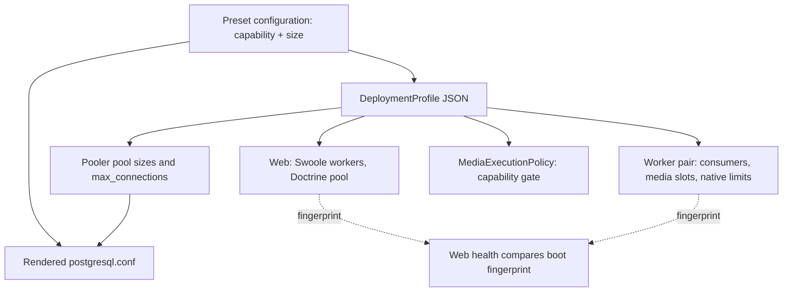
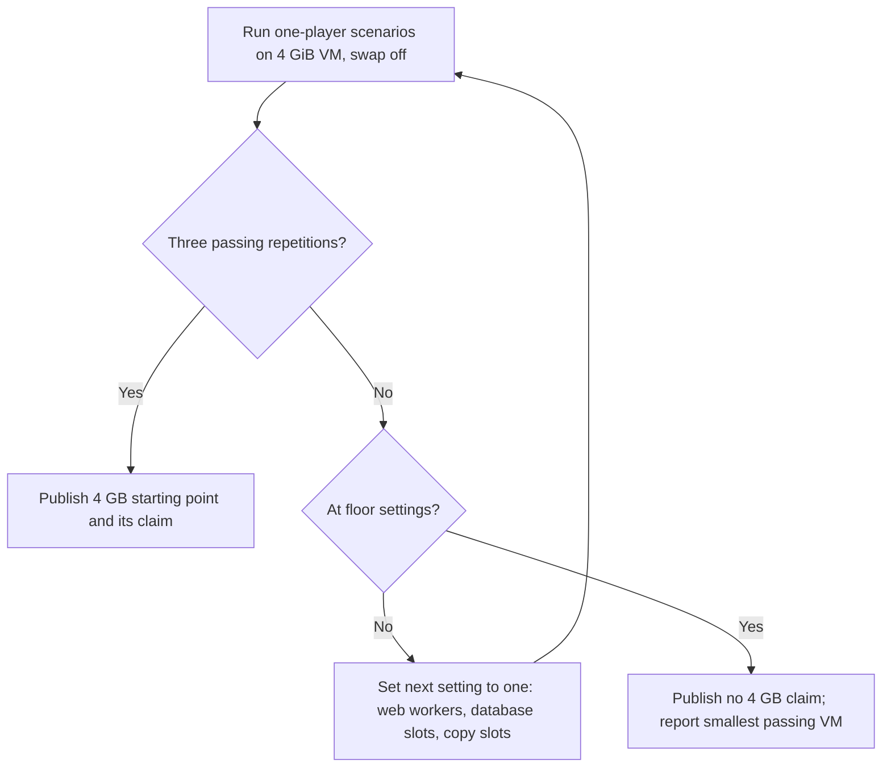

# Capability and size deployment settings - Plan

## Goal Capsule

**Objective:** An operator can fit a Bånder deployment to their host's memory, from a qualified 4 GB remux-only setup upward, without changing what the server is allowed to do.

**Means:** Replace the profile identifier with an explicit capability and bounded size fields on the shared startup profile (KTD1), render pooler and PostgreSQL settings from that size (KTD3, KTD4), and extend the qualification harness to prove the 4 GB remux-only starting point (KTD7).

**Product authority:** The user confirmed the scope in a brainstorm on 2026-11-07 and the plan-time call-outs the same day. R1–R14 govern product behavior; the KTDs govern how it is built. This plan covers x86 hosts only; ARM64 images and Raspberry Pi hardware are surrounding work, not active scope.

**Product Contract preservation:** Clarified, no scope change: R3 and the Summary name database connection slots per web worker as part of web worker sizing; AE4 names the reductions KTD8 performs; F1, AE1 and AE6 say starting point instead of size point. Planning questions are resolved by KTD1–KTD9.

**Execution profile:** One branch named after this plan, nine dependency-ordered units landing as local commits. U1–U8 are code and documentation; U9 is the measured qualification on VMs and sets the final 4 GB values. The lead integrates delegated work, runs the authoritative gates and commits; push only when asked. On 2026-11-12 the user decided to merge U1–U8 into `master` before U9 runs: the code lands with no host size qualified, and U9 stays open as a recorded item.

**Stop conditions:** Stop affected work if it would weaken ownership, media access or encoding-prohibition checks, discard local data without authorization, or change product scope. A 4 GiB failure at the floor settings is handled by KTD8 and does not block U1–U8.

**Open blockers:** None for U1–U8, which land without U9. U9 is deferred by the user's decision of 2026-11-12. It no longer needs libvirtd: a QEMU guest started with 4,096 MiB serves as the VM. Before it runs, the application, worker and operator images must be rebuilt from the landed code, and the database image from `docker/postgres/Dockerfile`, because the local `baander-database:latest` lacks the `baander-pooler-credentials` executable the preset runs.

---

## Product Contract

### Summary

A deployment is described by two independent choices made at deployment time: capability (re-encoding allowed, or remux-only) and size (web workers and their database connection slots, background consumers, media slots and PostgreSQL memory, each within bounds).
Bånder ships documented size starting points, and the remux-only 4 GB starting point is qualified on a 4 GiB x86 host with swap off.

### Problem Frame

The `full` and `household` profiles each fix two things at once: what the server may do and how much it runs.
`household` forbids re-encoding and fixes two web workers, four Doctrine slots per web worker, one ordinary consumer and two copy slots; `full` allows re-encoding with four web workers and operator-set media slots.
An operator with a 4 GB box, or one with 32 GB who wants remux-only, has no supported way to size the deployment to the host.

No host size has been proven.
The household measurements of 3 November 2026 peaked at 2,149–3,029 MiB for the whole stack, but they ran on a 62.7 GiB workstation with no whole-host cap, before the connection pooler was added and before container limits were removed.
The user observed about 800 MB across four web workers and questioned the old 8 GB worker-pair guidance; that guidance is already gone, but nothing replaced it with a measured host size.

### Key Decisions

- **Split capability from size.** The two concerns vary independently between hosts, so they become separate choices. Governs R1–R4. (session-settled: user-directed — chosen over named fixed size tiers and over tunable named tiers: one capability choice plus bounded size settings covers every host without multiplying profiles.)
- **Replace the `full` and `household` names outright.** The pre-release policy allows it; no compatibility path for the old names. Governs R5.
- **Measure before choosing the 4 GB values.** The current household counts may already fit; the measurement decides how far the 4 GB starting point trims them. Governs R8, R9. (session-settled: user-approved — chosen over building a reduced setup regardless: avoids trimming that the host does not need.)
- **The 4 GB bar is a whole-host cap with swap off.** It is the strictest bar and matches a real 4 GB machine. Governs R10. (session-settled: user-approved — chosen over a capped host with swap allowed and over a stack-only 3 GiB budget.)
- **At 4 GB, trade throughput, never capability.** One stream, fewer web workers and slower background work are acceptable; re-encoding restrictions and library maintenance are unchanged. Governs R8, R9. (session-settled: user-directed — the user chose these three trade-offs and left the full household workload as the alternative.)
- **A second stream at 4 GB is allowed but not promised.** No new concurrency gate. Governs R11. (session-settled: user-approved — chosen over refusing a second player and over reducing copy slots.)

### Requirements

**Deployment choices**

- R1. An operator chooses a capability at deployment time: re-encoding allowed, or remux-only.
- R2. Remux-only keeps today's household restriction: original delivery and stream copy only, with no server-side audio or video re-encoding on any path.
- R3. An operator sets size at deployment time through web workers and their database connection slots, ordinary background consumers, media slots and PostgreSQL memory settings, each with a documented lower and upper bound.
- R4. Any capability combines with any size within the bounds; values outside a bound are refused at deployment.
- R5. The `full` and `household` profile names are removed; existing presets, examples, documentation and the glossary describe deployments by capability and size.
- R6. Changing capability or size still requires deployment replacement, as a profile change does today.
- R7. Ownership, media access and resource containment guarantees, including the out-of-memory kill order, are unchanged under every combination.

**Starting points**

- R8. Bånder ships documented size starting points for 4, 8 and 16 GB hosts; operators adjust from there.
- R9. The 4 GB remux-only starting point supports one stream while scanning and metadata updates run against the existing qualification library of 2,000 songs, 50 movies and 250 TV episodes; background work may take longer than on larger starting points.
- R10. The 4 GB starting point passes qualification on an x86 host or VM with 4 GiB of total memory and swap off: no out-of-memory kill, no playback stall, no lost background work, and no deployment swap growth.
- R11. A second simultaneous stream on the 4 GB starting point is not refused; the guidance states it is outside the qualified claim.
- R12. The 8 and 16 GB starting points are published as unqualified guidance.

**Qualification and guidance**

- R13. A 4 GB claim requires the existing household qualification bar: three comparable repetitions, the restart, recovery and deployment-replacement checks, and an insufficient-memory run that shows the failure below the claimed size.
- R14. Operator guidance states the qualified host size and its workload, separate from per-service peaks, and keeps ARM and Raspberry Pi support marked unqualified.

### Actors

- A1. The operator chooses capability and size, deploys, and reads the published host-size guidance.
- A2. A listener or viewer plays media from a client or playback destination.
- A3. The server runs library maintenance alongside playback within the chosen size.

### Key Flows

- F1. **Size a deployment.** A1 picks a capability, starts from the documented starting point nearest the host's memory, adjusts settings within bounds and deploys; a value out of bounds is refused before anything starts. Covers R1, R3, R4, R6, R8.
- F2. **Run the 4 GB qualification.** On a 4 GiB VM with swap off, the remux-only 4 GB starting point runs the household scenarios; if a run fails, the starting point's size values are reduced within the R9 trade-offs and the run repeats. Covers R9, R10, R13.

### Acceptance Examples

- AE1. **Remux-only on a large host. Covers R1, R2, R4.** An operator chooses remux-only with the 16 GB starting point; a destination that needs a codec converted gets the compatibility explanation and no encoder starts.
- AE2. **Out-of-bounds size. Covers R3, R4.** An operator sets more web workers than the upper bound; deployment is refused with the bound named, and nothing starts.
- AE3. **Household already fits. Covers R9, R10.** The current household counts pass the 4 GiB run; the 4 GB starting point keeps those counts and its guidance promises one stream, the qualified workload.
- AE4. **Household does not fit. Covers R9, R10.** The first 4 GiB run hits an out-of-memory kill; the 4 GB starting point reduces web workers, their database connection slots or copy slots, never the remux-only rule, until the run passes.
- AE5. **Second player at 4 GB. Covers R11.** A second player starts while one streams; playback is attempted normally and the guidance makes no promise about its outcome.
- AE6. **Re-encoding on a small host. Covers R4, R12.** An operator chooses re-encoding with the 4 GB starting point; the deployment is accepted and the guidance names it as unqualified.

### Scope Boundaries

- ARM64 images and Raspberry Pi hardware qualification are not part of this plan.
- Qualifying the 8 and 16 GB starting points is deferred.
- Changing capability or size on a running deployment is excluded.
- A per-stream concurrency gate is excluded.
- Merging the two worker units, dropping a service such as the gateway, or other structural changes to fit 4 GB are excluded; fitting is done through counts and settings.
- Container CPU or memory limits stay excluded; media slots remain the bound on media work.

**Considered and not built**

- A combined host-memory fit check across settings: operators tune by trial, and the user rejected memory floors and derived fit checks on 2026-11-03. A report of operators repeatedly misconfiguring a small host would change this.
- Field-level diagnostics for a web/worker profile mismatch: the preset renders both from one configuration, and web health already reports the mismatch. Source-install mismatch reports would change this.
- VM provisioning inside the harness: a manual recipe serves a handful of qualification runs.

<!-- ce-section: work-relationships -->
### How This Work Fits Together

This plan covers capability and size settings and the x86 4 GB qualification.
The breakdown below is the current understanding, not a committed roadmap.

- ARM64 images for every service, including the static FFmpeg build and PostgreSQL with PGroonga.
  - Can proceed independently of this plan.
- Raspberry Pi 4 GB hardware qualification.
  - Depends on this plan's 4 GB starting point and on ARM64 images.
  - Still to decide: whether physical Pi hardware is available.
- Qualification of the 8 and 16 GB starting points.
  - Depends on this plan.

### Dependencies and Assumptions

- A 4 GiB VM counts as a 4 GB host for the claim; a physical 4 GB machine is not required.
- This plan supersedes the profile structure of `docs/plans/2026-11-02-1819-feat-small-host-household-deployment-plan.md` (its R1 and R7) and closes that plan's open qualification items as part of R13, including requalification after the connection pooler and the removal of container limits.
- The preset inherits `OTEL_ENABLED=true` from `.env` with an unreachable endpoint; fixing this defect is in scope because it distorts the measurement.

### Outstanding Questions

None block planning. Size bounds and the operator-set versus derived split are resolved in KTD2–KTD4, capability naming in KTD1, and starting-point values in KTD6.

### Sources and Research

- `src/Shared/Application/DTO/DeploymentProfile.php`: household `[2, 4, 1, 2]`, full `[4, 10, 4, 0]`; PHP heap 256 MiB, native manager heap 128 MiB.
- `deploy/household/postgresql.conf`: `max_connections = 20`, `shared_buffers = 128MB`, `work_mem = 4MB`.
- `packages/baander-tooling/src/Deployment/Pooler.php`: household pools 10 application, 4 control, 3 direct.
- `packages/baander-tooling/src/Fixtures/Household/Qualification.php`: refuses a host whose `MemTotal` exceeds `host.constraintBytes`; it imposes no cap itself.
- `packages/baander-tooling/src/Fixtures/Household/RunReport.php`: a memory fit requires zero host and cgroup swap growth.
- `docs-book/part-1-operator-guide/system-requirements.md`, Household measurements and Not yet established.
- `docs-book/part-2-developer-guide/testing.md`, Household deployment qualification.
- `ROADMAP.md`, Small-host household deployment open items.
- Commit 2107c5153 removed the 2,944 MiB control and 4,800 MiB execution worker-pair reservations from the operator guide.
- `docker-compose.yml`: the source install's `database` service passes no `config_file`, so PostgreSQL runs on initdb defaults, and the pooler pool sizes are fixed at 20 and 8.
- `.env:113-117` sets `OTEL_ENABLED=true` with `http://host.docker.internal:4318/v1/traces`; `.dockerignore` excludes only `.env.local*`, so the production image ships it.

---

## Planning Contract

### Key Technical Decisions

- KTD1. **The profile carries an explicit capability and no identifier.** `DeploymentProfile` gains a `capability` field with the values `transcode` and `remux` and loses `identifier`. Capability is authoritative: `MediaExecutionPolicy` admits encode operations only under `transcode`, and stream copy under either. A `remux` profile takes copy slots and refuses video slots, audio slots and a hardware encoder. A `transcode` profile takes video and audio slots and refuses copy slots. The existing exact-JSON and fingerprint comparisons at every seam (manifest, recipe, supervisor environment, readiness, native handshake, admission ledger, boot row, web health) carry the new fields through `toJson()` unchanged. The two environment variables collapse into one, `BAANDER_DEPLOYMENT_PROFILE`, holding the profile JSON. Governs R1, R2, R4, R5, R7.
- KTD2. **Size is five process settings on the profile, each bounded.** The size settings are web workers, Doctrine slots per web worker, the resident ordinary consumer limit, copy slots (remux) and video and audio slots (transcode). Bounds: web workers 1–16, Doctrine slots 1–16, ordinary consumers 1–4 (the autoscaling ceiling), copy slots 1–8. Video and audio slots keep their pooler-derived `MediaSlotBounds`, which already takes web workers, Doctrine slots and ordinary consumers as inputs; its messages stop naming a profile. Values out of bounds throw `InvalidArgumentException` naming the setting and its bound. Governs R3, R4, AE2.
- KTD3. **Pooler pools and `max_connections` are derived from the size.** `Pooler` derives the application, control and direct pool sizes from web workers, Doctrine slots, ordinary consumers and media slots instead of indexing a table by profile name, and `max_connections` stays their sum plus the superuser reserve. The derivation must reproduce the transcode point (4/10/4 with 8 + 12 slots gives 20/8/4) and the measured remux application and control pools (2/4/1 with 2 copy slots gives 10/4). Directional shape: application grows with web workers, control with media slots and has a floor of four. The direct reserve is four connections at every size, so the remux point is 10/4/4 with `max_connections` 21, where the household file had 10/4/3 and 20. A tooling test pins both points and the source-install compose values. Governs R3.
- KTD4. **PostgreSQL memory is two operator settings in the preset; the rest is derived.** The preset configuration's size takes `sharedBuffersMiB` (32–16,384) and `workMemMiB` (1–1,024). `maintenance_work_mem` is half of shared buffers capped at 256 MiB, and `autovacuum_work_mem` is half of that; the remux 4 GB starting point reproduces today's household file (128/4/64/32). The renderer writes `postgresql.conf` from these values, and `PostgresSettings::verify` checks the effective settings, including the derived ones. The template keeps the non-memory settings of both current files (`max_parallel_workers_per_gather = 0`, the connection reserves, WAL and checkpoint settings) for every size; the source install's statement logging moves to `-c` flags in its compose file. The 16 GB point therefore lowers `maintenance_work_mem` from today's 256 MB to 128 MB on purpose. PostgreSQL settings stay out of `DeploymentProfile`, because no PHP process reads them. Governs R3, R8.
- KTD5. **One code default, used only by dev and the source install.** An unset `BAANDER_DEPLOYMENT_PROFILE` resolves to `transcode` at the 16 GB starting point. The preset, worker controller and qualification harness always write the profile explicitly. The source install's compose mounts `docker/postgres/conf/postgresql.conf`, which becomes the rendered 16 GB conf, fixing today's initdb-default PostgreSQL. Governs R5, R8.
- KTD6. **Starting points are example configuration files, not names in code.** `deploy/preset/` ships one example per starting point and capability. Process and PostgreSQL values are shared by both capabilities of a point; media values differ by capability.

  | Starting point | Web workers / database slots / consumers | Shared buffers / work memory | Transcode media | Remux media |
  | --- | --- | --- | --- | --- |
  | 16 GB | 4 / 10 / 4 | 256 MiB / 16 MiB | 8 video, 12 audio | 8 copy |
  | 8 GB | 2 / 6 / 2 | 192 MiB / 8 MiB | 3 video, 6 audio | 4 copy |
  | 4 GB | 2 / 4 / 1 | 128 MiB / 4 MiB | 1 video, 2 audio | 2 copy |

  The 16 GB row is today's full profile; the 8 GB transcode media peak is about 2.7 GiB by the published per-job costs. The 4 GB remux example starts from today's household values and is finalized by U9; it is the only qualified example. Governs R8, R9, R12. (session-settled: user-directed — chosen over named fixed size tiers and over tunable named tiers: capability plus bounded settings with documented starting points.)
- KTD7. **The harness proves the claim it publishes.**
  - Runs are keyed on capability, not profile name. The native audit treats any encoder launch under `remux` as forbidden.
  - `start` refuses a host whose `SwapTotal` is not zero, alongside the existing `MemTotal` check.
  - Overlap scenarios take a player count of one or two; the 4 GB claim runs one player.
  - `recovery`, `deployment-replacement` and `insufficient-memory` become runnable scenarios.
  - The insufficient-memory case runs the same deployment on a 3 GiB VM and passes when it records an OOM kill or a playback stall; if the deployment completes, it repeats on a VM 512 MiB smaller until a failure is recorded.
  - VMs are provisioned by hand from a documented libvirt recipe; the harness does not create them.

  Governs R10, R13.
- KTD8. **The fit loop has a floor and an honest exit.** When a 4 GiB run fails, U9 sets web workers to one, then database slots per web worker to one, then copy slots to one, rerunning after each step and keeping one ordinary consumer and the remux capability. If the floor (1 web worker, 1 database slot, 1 consumer, 1 copy slot) still fails, no 4 GB claim is published; the guide reports the smallest passing VM size measured instead. Governs R9, R10, R14, AE4.
- KTD9. **The preset turns OpenTelemetry export off unless configured.** The renderer sets `OTEL_ENABLED=false` for web and workers, and the preset configuration's `environment` object may set `OTEL_ENABLED` and `OTEL_EXPORTER_OTLP_ENDPOINT` to turn it on. The image's `.env` keeps its development value; the explicit container environment wins over it. Governs the OpenTelemetry assumption.

### High-Level Technical Design

One operator configuration feeds every component. The profile JSON is the shared contract; the PostgreSQL and pooler settings are rendered beside it.

Capability and size validation, applied when the profile is constructed:

| Setting | `transcode` | `remux` |
| --- | --- | --- |
| Video and audio slots | Accepted, pooler-bounded | Refused |
| Copy slots | Refused | Required, 1–8 |
| Hardware encoder | Accepted with video slots above zero | Refused |
| Web workers, Doctrine slots, ordinary consumers | 1–16, 1–16, 1–4 | Same |

The 4 GB fit loop in U9 (KTD8):

### Assumptions

- A 4 GiB libvirt VM with swap off is an acceptable 4 GB host (carried from the Product Contract).
- Real container environment variables override values in the image's `.env` under Symfony's Dotenv loading, so KTD9 needs no image change.

### Sequencing

U1 defines the profile; U2 and U3 depend on it and can proceed in parallel. U4 depends on U1; U5 on U4. U6 depends on U1 and U4. U7 renames after U4–U6 settle. U8 documents after U7. U9 runs last on the built images.

---

## Implementation Units

### U1. Capability and size on the deployment profile

**Goal:** `DeploymentProfile` holds an explicit capability and bounded size settings and no identifier.

**Requirements:** R1, R3, R4, R5, R6; KTD1, KTD2, KTD5.

**Dependencies:** None.

**Files:**
- `src/Shared/Application/DTO/DeploymentProfile.php`
- `src/Shared/Application/DTO/MediaSlotBounds.php`
- `src/Shared/Infrastructure/DependencyInjection/DeploymentProfileEnvVarProcessor.php`
- `config/services.yaml`, `config/packages/swoole.yaml`
- `src/Shared/Interface/Console/DeploymentProfileShowCommand.php`
- `tests/Unit/Shared/Application/DTO/DeploymentProfileTest.php`, `tests/Unit/Shared/Application/DTO/DeploymentProfileHardwareTest.php`
- `tests/Unit/Shared/Infrastructure/DependencyInjection/DeploymentProfileEnvVarProcessorTest.php`
- `tests/Functional/Console/DeploymentProfileShowCommandTest.php`

**Approach:**
1. Replace the `identifier` match with a constructor taking capability and the size settings; validate them per the KTD1 matrix and KTD2 bounds.
2. Keep the derived methods (`mediaClientIds`, `nativeClientCommandCaps`, `mediaChildSlots`, native limits); branch on capability instead of `sharedCopySlots > 0`.
3. `fromJson` validates the new exact field set and re-derivation equality; drop the identifier cross-check in `resolve`.
4. `fromEnvironment` reads the single variable and falls back to the KTD5 default.
5. The show command takes `--capability` and the size options instead of `--identifier` and prints the single environment line.

**Patterns to follow:** The existing strict JSON validation and `MediaSlotBounds::assertAccepts` messages; `WorkerAutoscalingProfile` for bounded integer ranges.

**Test scenarios:**
- A remux profile with 2/4/1 and 2 copy slots builds and reports two `media-copy-` client ids and no audio clients.
- A transcode profile with 4/10/4 and 8 + 12 slots builds with today's native limits.
- Covers AE2. Seventeen web workers are refused with a message naming web workers and the bound 16.
- A remux profile with video slots, audio slots or a hardware encoder is refused.
- A transcode profile with copy slots is refused.
- Zero ordinary consumers, and five, are refused.
- Profile JSON with an extra field, a missing field, a string where an integer belongs, or an unknown capability is refused.
- Profile JSON whose derived fields disagree with its settings is refused.
- An unset environment yields transcode at the 16 GB starting point.
- The env processors return the profile's web workers and Doctrine slots.
- The show command prints the environment line and limits for a remux profile and rejects `--video-slots` with remux.

**Verification:** Unit and functional tests above pass; `DeploymentProfile` has no reference to a profile name.

### U2. Propagate the profile through web and worker seams

**Goal:** Every component that compares or reads the profile works with the new shape and single environment variable.

**Requirements:** R5, R6, R7; KTD1.

**Dependencies:** U1.

**Files:**
- `src/Shared/Interface/Console/WorkerCommand.php`
- `src/Shared/Infrastructure/Worker/WorkerSupervisorRunner.php`, `WorkerReadinessObservation.php`, `DeploymentOperatorManifest.php`, `DeploymentContainerRecipe.php`
- `src/Shared/Infrastructure/Health/WorkerProfileHealth.php`
- `bin/worker-deployment.php`, `bin/worker-native.php`, `bin/worker-media.php`, `bin/worker-media-job.php`, `bin/worker-scheduler.php`, `bin/worker-autoscaler.php`, `bin/worker-autoscaling-status.php`
- `tests/Unit/Shared/Infrastructure/Worker/*` (manifest, recipe, readiness, supervisor, native, handshake tests), `tests/Functional/Shared/WorkerProfileHealthTest.php`
- `tests/Fixtures/Worker/*.php`, `tests/Fixtures/TwoCommand/*.php` (constructor call sites)

**Approach:**
1. Export and check one environment variable instead of two in the supervisor, readiness observation and container recipe.
2. Bump the operator manifest version from 8 to 9; the manifest compares the web environment's profile JSON to its own.
3. Update every `new DeploymentProfile('full'|'household', …)` call site to the new constructor; test fixtures use the 16 GB or 4 GB starting-point values.

**Patterns to follow:** Existing seam comparisons; they need only the variable rename because they compare `toJson()` and `fingerprint()`.

**Test scenarios:**
- A manifest whose web environment carries a different capability is refused.
- A manifest of version 8 is refused.
- A container recipe's fingerprint changes when copy slots change and stays stable for identical settings.
- Readiness fails when a child's environment carries a profile whose web workers differ.
- Web health reports Unhealthy when the active boot's fingerprint differs from the web profile.
- The native handshake refuses a peer whose profile JSON differs.

**Verification:** The unit, functional and integration suites pass in the CI image; no source or test references `'full'` or `'household'` as a profile identifier.

### U3. Enforce media capability from the capability field

**Goal:** Encoding is admitted only under `transcode`, and refusals name the capability.

**Requirements:** R2, R4, R7; KTD1.

**Dependencies:** U1.

**Files:**
- `src/Transcode/Application/Service/MediaExecutionPolicy.php`
- `src/Transcode/Application/Exception/MediaEncodingProhibitedException.php`
- `src/Transcode/Infrastructure/FFmpeg/HardwareCapabilitiesProber.php`
- `tests/Unit/Transcode/Application/Service/MediaExecutionPolicyTest.php`, `tests/Unit/Transcode/Application/Service/CopyPresentationServiceTest.php`
- `tests/Unit/Media/DeliveryDecisionServiceTest.php`, `tests/Unit/Media/DeliveryCompatibilityTest.php`

**Approach:**
1. `MediaExecutionPolicy` decides encode admission from capability and slot presence, and stream copy from copy slots (remux) or kind slots (transcode).
2. The exception message names the remux-only capability instead of the household profile; the reason code `encoding_prohibited` is unchanged.
3. Recovered encode work claimed under remux reaches the existing terminal failure, as today under household.

**Patterns to follow:** The current household branch of the policy and its terminal-failure handling.

**Test scenarios:**
- Covers AE1. A remux profile with 8 copy slots refuses video and audio encode operations and admits stream copy.
- A transcode profile with zero audio slots refuses audio encode and audio copy, as today.
- Covers AE6. A transcode profile at the 4 GB size admits video encode.
- An encode job recovered after a replacement to remux fails terminally with `encoding_prohibited` and is not retried.
- The hardware prober refuses to run an encoder test under remux.

**Verification:** The listed tests and the delivery decision tests pass.

### U4. Preset configuration, pooler derivation and rendered PostgreSQL settings

**Goal:** The managed preset takes capability and size, derives pooler and connection settings, renders `postgresql.conf` and disables OpenTelemetry export by default.

**Requirements:** R1, R3, R4, R8, R12; KTD3, KTD4, KTD6, KTD9.

**Dependencies:** U1.

**Files:**
- `packages/baander-tooling/src/Deployment/HouseholdConfiguration.php`, `HouseholdRenderer.php`, `Household.php`, `Pooler.php`, `ImageProfile.php`, `PostgresSettings.php`
- `deploy/household/example.json` (replaced by `example-4gb-remux.json`), new examples for the other starting points and capabilities per KTD6, `deploy/household/postgresql.conf` (removed; rendered instead)
- `docker/postgres/conf/postgresql.conf`
- `scripts/tests/php/HouseholdDeploymentTest.php`, `HouseholdPostgresSettingsTest.php`, `ImageProfileTest.php`

**Approach:**
1. The configuration replaces `profile` and `media` with `capability`, a `size` object holding the process, media and PostgreSQL settings, and an optional top-level `hardware` object (accelerator, device, host group) accepted only with `transcode`; unknown keys stay refused.
2. `ImageProfile` passes the configuration's profile JSON into each image and compares the echoed JSON, replacing its positional argument contract and name checks; bump its version to 2.
3. `Pooler` derives pools per KTD3.
4. The renderer writes `postgresql.conf` from a template, the size and the derived connection count, and sets `OTEL_ENABLED=false` unless the configuration's environment sets it.
5. The configuration's environment allowlist accepts `OTEL_ENABLED` and `OTEL_EXPORTER_OTLP_ENDPOINT`.
6. `docker/postgres/conf/postgresql.conf` becomes the rendered output of the 16 GB example.

**Patterns to follow:** The existing renderer, `PostgresSettings` strict parser and the tooling tests that pin cross-file invariants.

**Test scenarios:**
- The remux 2/4/1, 2 copy slot size derives pools 10/4/4 and `max_connections` 21.
- The transcode 4/10/4, 8 + 12 size derives pools 20/8/4 and `max_connections` 35.
- Shared buffers of 128 MiB render `maintenance_work_mem` 64 MB and `autovacuum_work_mem` 32 MB; 1,024 MiB renders 256 MB and 128 MB.
- Shared buffers of 16 MiB, and work memory of 2,048 MiB, are refused.
- A configuration with a `profile` or `media` key is refused.
- A remux configuration with `hardware` is refused; a transcode configuration with it renders the device mapping.
- `docker/postgres/conf/postgresql.conf` equals the rendering of the 16 GB example.
- The rendered web and worker environments carry `OTEL_ENABLED=false` by default and the operator's values when set.
- An image that echoes a profile JSON different from the configuration's is refused.
- Each shipped example file validates.

**Verification:** `composer run-script test:tooling`, `analyse:tooling`, `check:tooling-format` and `check:tooling-architecture` pass.

### U5. Source install, development and drill tooling

**Goal:** The source install, preview tooling and drills run on the new profile with matching PostgreSQL and pooler settings.

**Requirements:** R5, R8; KTD3, KTD5.

**Dependencies:** U4.

**Files:**
- `docker-compose.yml`
- `packages/baander-tooling/src/Development/Runtime.php`, `packages/baander-tooling/src/Development/Workers.php`
- `packages/baander-tooling/src/Fixtures/Worker/OperatorProvisioning.php`, `MediaLoad.php`, `DrillProfile.php`, `LifecycleCheckpoint.php`
- `scripts/tests/php/WorkerLifecycleTest.php`, `WorkerMediaLoadTest.php`, `WorkerLifecycleManifestTest.php`

**Approach:**
1. The compose `database` service mounts `docker/postgres/conf/postgresql.conf` and starts with `config_file` set; the pooler sizes stay 20 and 8, now pinned to the KTD3 derivation of the default profile.
2. Development and fixture code derive pools and profiles from the 16 GB starting point instead of the `full` name.

**Execution note:** Mostly configuration; prove it with `make preview-up` and a worker drill rather than new unit coverage.

**Test scenarios:**
- A tooling test asserts the compose pooler sizes equal the derived pools of the default profile.
- The media-load fixture builds its profile with explicit 16 GB values and its expected client counts match.

**Verification:** `make preview-up` starts a healthy stack whose PostgreSQL reports `shared_buffers` 256MB; the two-command worker drill passes.

### U6. Qualification harness for the 4 GB claim

**Goal:** The harness can produce every piece of evidence R10 and R13 require.

**Requirements:** R10, R11, R13; KTD7.

**Dependencies:** U1, U4.

**Files:**
- `packages/baander-tooling/src/Fixtures/Household/Qualification.php`, `RunContract.php`, `NativeAudit.php`, `HostSampler.php`, `RunReport.php`
- `ui/web/tests/e2e/household/driver.mjs`, `ui/web/tests/e2e/household/driver.test.mjs`
- `scripts/tests/php/HouseholdQualificationTest.php`, `HouseholdNativeAuditTest.php`, `HouseholdRunReportTest.php`
- `docs-book/part-2-developer-guide/testing.md`

**Approach:**
1. The run contract records capability and size instead of a profile name; the native audit forbids encoder launches under remux.
2. `start` and `scenario` refuse a host with non-zero `SwapTotal`.
3. Overlap scenarios take `--players 1|2`; the report records the count and the browser driver runs that many players.
4. Implement `recovery` (stop PostgreSQL mid-playback and confirm recovery without lost work), `deployment-replacement` (replace with a changed size and confirm the new boot serves) and `insufficient-memory` (passes when it records an OOM kill or a playback stall on a smaller VM).
5. Document the libvirt VM recipe (4,096 MiB and 3,072 MiB, no swap device, rootful Docker, cgroup v2) in the testing guide.

**Patterns to follow:** The existing scenario commands, receipts and `RunReport` pass rules.

**Test scenarios:**
- A host observation with `SwapTotal` above zero makes `start` fail before any deployment is created.
- A remux run whose launch journal contains an encoder launch fails the report.
- A one-player overlap report passes with one player progressing and the other player absent.
- An insufficient-memory scenario passes its own check when the deployment records an OOM kill or a playback stall, and fails when the deployment completes cleanly.
- A deployment-replacement scenario fails when the new boot's fingerprint equals the old one.
- The driver test runs one player when asked for one.

**Verification:** The tooling suite passes, and each new scenario and the player option run end to end against a preview-sized deployment.

### U7. Rename the household preset and tooling

**Goal:** Nothing outside history refers to the household profile.

**Requirements:** R5.

**Dependencies:** U4, U5, U6.

**Files:**
- `deploy/household/` → `deploy/preset/`
- `scripts/qualify-household.php` → `scripts/qualify-deployment.php`; `scripts/deploy-household.php` → `scripts/deploy-preset.php`
- `packages/baander-tooling/resources/household/` → `resources/qualification/`
- `deptrac-tooling.yaml` layer and path entries and `SourceExceptions.php` paths for the renamed namespace
- `packages/baander-tooling/src/Deployment/Household*.php` → `Preset*.php`; `packages/baander-tooling/src/Fixtures/Household/` → `Fixtures/Qualification/`
- `ui/web/tests/e2e/household/` → `ui/web/tests/e2e/qualification/`
- `scripts/tests/php/Household*Test.php` → matching names
- Docker labels `org.baander.household*` → `org.baander.preset*`

**Approach:** A mechanical rename with `git mv`, then update references. Existing qualification receipts are left untouched.

**Test expectation:** none -- mechanical rename; the renamed suites from U4–U6 must still pass.

**Verification:** `rg -i household` finds only `ROADMAP.md` history, earlier plans, solution documents, third-party license text and `STRATEGY.md`'s generic household use; `check:tooling-architecture` passes.

### U8. Operator and developer documentation

**Goal:** The guide describes deployments by capability and size and states what is qualified.

**Requirements:** R5, R8, R11, R12, R14.

**Dependencies:** U7.

**Files:**
- `docs-book/part-1-operator-guide/configuration.md`, `system-requirements.md`, `getting-started.md`, `background-work.md`, `deployment-topology.md`, `transcoding.md`, `upgrading.md`, `README.md`
- `docs-book/part-1-operator-guide/commands/README.md`, `app-deployment-profile-show.md`, `app-health-check.md`, `app-worker.md`
- `deploy/preset/README.md`, `packages/baander-tooling/README.md`, `docs-book/README.md`
- `CONCEPTS.md`, `ROADMAP.md`

**Approach:**
1. Replace the profile table with the capability matrix, the size settings and their bounds, and the three starting points.
2. State that the 8 and 16 GB points are unqualified and that a second stream at 4 GB is outside the claim.
3. Replace the "Small-host household profile" glossary entry with entries for deployment capability and deployment size.
4. Run `prose-fix` on every changed page.

**Test expectation:** none -- documentation; the docs build must pass.

**Verification:** `make docs` passes; the admin/CLI parity test still finds the show command's docs page.

### U9. Qualify the 4 GB starting point

**Goal:** Measure the remux 4 GB starting point on a 4 GiB VM and publish the result.

**Requirements:** R9, R10, R11, R13, R14, AE3, AE4; KTD7, KTD8.

**Dependencies:** U1–U8; a 4,096 MiB VM with swap off, which a QEMU guest provides without libvirtd; images rebuilt from the landed code.

**Status:** Deferred. The user decided on 2026-11-12 to land U1–U8 first; until U9 passes, no host size is qualified and the 4 GB example keeps its starting values.

**Files:**
- `deploy/preset/example-4gb-remux.json` (final values)
- `docs-book/part-1-operator-guide/system-requirements.md`
- `ROADMAP.md`

**Approach:**
1. Build the application, worker and operator images from the branch head.
2. Provision the 4 GiB and 3 GiB VMs from the U6 recipe.
3. Run the one-player overlap, restart, recovery and deployment-replacement scenarios on the 4 GiB VM, three comparable repetitions, following KTD8 on failure.
4. Run the insufficient-memory scenario on the 3 GiB VM, stepping down per KTD7 until a failure is recorded.
5. Publish the passing values in the 4 GB example and the measured host size in the guide, or the KTD8 exit result.
6. Copy the receipts out of any agent worktree before removing it.

**Execution note:** Each repetition takes at least 30 minutes of playback per scenario; serialize runs and keep failed receipts.

**Test expectation:** none -- this unit produces measurements, not code.

**Verification:** Three passing reports with zero swap growth, a recorded insufficient-memory failure, and guide text that matches the reports.

---

## Verification Contract

| Gate | Command | Applies to |
| --- | --- | --- |
| Static analysis | `php ./vendor/bin/phpstan analyse --memory-limit=1G --no-progress` in the CI image | U1–U3, U5 |
| Architecture | `vendor/bin/deptrac analyse --no-cache --no-progress` | U1–U3 |
| Container lint | `php bin/console lint:container --env=test --no-debug` | U1 |
| OpenAPI check | `php bin/console app:export-openapi-spec --env=test --no-debug --check` | U1–U3 |
| Unit suite | `BAANDER_TEST_IMAGE=baander-ci-prewarm:local bash scripts/test-unit-container.sh` | U1–U3 |
| Functional and integration suites | `BAANDER_FUNCTIONAL_TIMEOUT_ACTIVE=1 bash scripts/test-functional-container.sh tests/Functional`, then `tests/Integration`, one at a time | U1–U3 |
| Tooling suite and gates | `composer run-script --timeout=7200 test:tooling`, `analyse:tooling`, `check:tooling-format`, `check:tooling-architecture` | U4–U7 |
| Browser driver unit test | `node --test ui/web/tests/e2e/household/driver.test.mjs` | U6 |
| Browser driver unit test after rename | `node --test ui/web/tests/e2e/qualification/driver.test.mjs` | U7 |
| Worker drill | `bash scripts/test-web-runtime-container.sh` and the two-command drill | U2, U5 |
| Preview smoke | `make preview-up` with a healthy `app:health:check` | U5 |
| Docs build | `make docs` | U8 |
| Qualification | `scripts/qualify-deployment.php` reports per U9 | U9 |

Mount the tree into the CI image per the project's gate recipe (including `packages`). Record suite counts and gate results in `ROADMAP.md` at each checkpoint.

## Definition of Done

- Every unit's verification holds and the gates above pass on the final branch head.
- No source, test, fixture, preset or operator page refers to a `full` or `household` profile.
- The 4 GB claim is either published from three passing reports and a recorded insufficient-memory failure, or withheld per KTD8 with the measured result published. U1–U8 land before this item by the user's decision of 2026-11-12; until U9 runs, the guide states that no host size is qualified.
- `ROADMAP.md` records the delivered items, the open household items this plan closes, and the remaining surrounding work (ARM64, Raspberry Pi, 8 and 16 GB qualification).
- `ce-simplify-code` ran at the end of U1–U3 and U4–U7, and `ce-code-review` findings were applied before shipping.
- Abandoned-attempt code and unused helpers are removed from the diff.
