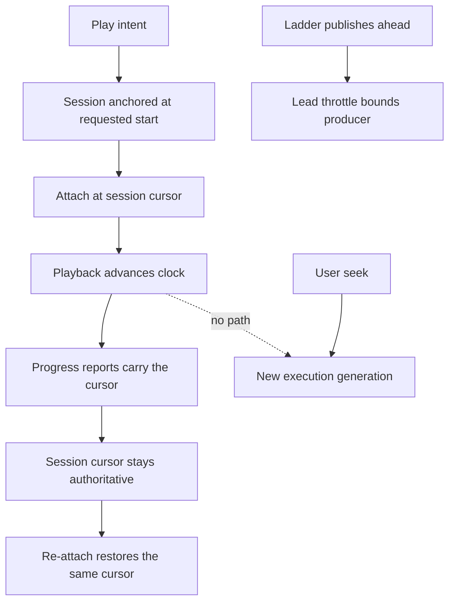

# Movie playback on growing presentations - Plan

## Goal Capsule

**Objective:** A movie whose presentation is still being encoded plays through continuously at
the viewer's own cursor: the clock never moves toward the published window's leading edge,
player-internal seeks do not restart encoders, the overlay shows one seek bar, and a failed
playback transfer never wedges the movie.

**Product authority:** The user reported the defects from a live persistent instance: two
progress bars, playback cutting forward roughly every six seconds, and a player that froze and
would not recover without retries. The diagnosis below reproduces each defect from the
instance's own state and the worktree source; nothing in this plan is speculative.

**Means:** Correct the player's HLS attachment, the position the server reports to attaching
clients, transfer-failure settlement, the overlay control layout, stale-session lifecycle, and
the browser gate that passed while the defects existed (KTD1–KTD7, first phase; KTD8–KTD15,
follow-up).

**Execution profile:** One branch named after this plan with seventeen dependency-ordered
units (U1–U7 delivered, U8–U17 the follow-up).
Playback is verified on a preview instance against the same source movie before merge; the
persistent instance receives the fixes only after master merges and the updater advances it.

**Follow-up phase (added 2026-11-10):** U1–U7 are delivered on the branch. Their verification
left open defects, each since diagnosed from a run or a PostgreSQL test. R8–R15, KTD8–KTD15
and U8–U17 close them on the same branch before merge.

**Authority and stop conditions:** Follow `AGENTS.md`, the Product Contract and then the
Planning Contract. Stop affected work if a change would weaken media access checks, session
ownership fencing, or the lead-throttle's producer bound. The two-command drill's existing
guarantees are preserved, not restated.

**Product Contract preservation:** Requirements and R/A/F/AE identifiers below are new for
this plan and govern it; no earlier plan's identifiers are changed.

---

## Product Contract

### Summary

Fix movie playback against growing presentations so the client's cursor stays authoritative
while encoders publish ahead of it, and so every failure path leaves the movie playable.

### Problem Frame

All evidence is from the persistent instance at `baander.test` on 2026-11-09, playing a
1920x1080 H.264/Opus Matroska music video (223.59 s) through the 1080p/720p/360p encode
ladder, and from the worktree source at master's revision.

- Segments are 6.0 s (`SegmentEncoder::SEGMENT_DURATION`) and the ladder encodes at roughly
  1.3x real time, so the published window's leading edge races ahead of the playhead.
- `ui/web/src/features/catalog/hooks/hls-playback.ts` constructs hls.js 1.7.4 with
  `latencyController: undefined` and a comment stating the published edge is not a live
  target. In hls.js 1.7.4 that undefined does disable the latency controller — an own key
  set to `undefined` overrides the default controller class through the config spread, and
  `createController` skips a falsy class — but the contract is implicit and unpinned: a
  hls.js upgrade that filters undefined keys or changes override semantics silently
  re-enables live-edge chasing, and `lowLatencyMode` stays enabled by default. The forward
  cuts come from a self-sustaining restart loop rather than the latency controller: every
  attachment replacement flushes the media element's buffer (`video.load()`), the player
  then reaches the freshly publishing edge, and the `useBaanderPlayer` `seeking` handler
  converts the resulting native seek into a server seek — which restarts the ladder
  encoders into a new execution generation and replaces the attachment again. Each cycle
  is a visible cut, and the loop runs at the segment cadence.
- After each jump the client reports the jumped position, and
  `TranscodeStreamingService::getPlaybackState` returns `desired->position`. A test attach
  an hour later was told the movie's position was 170.5 s, the drifted edge, and positioned
  its player there. That attach was not a fresh session: jobs are keyed by the client's
  request id, and a start that repeats the id gets its existing session back, with the
  cursor the client itself had reported. On the instance every session's cursor equals its
  execution's `desired->position` (ten of ten rows, 2026-11-10), because the only writers
  of that position are admission, which sets zero, and the client's own controls.
- `useBaanderPlayer`'s `seeking` handler enqueues a server seek whenever a native seek lands
  more than 50 ms off the session position. Every server seek restarts all ladder encoders
  into a new execution generation. One playback burned generations `0 → 18` in two minutes;
  three retry eras left 14 generation directories, every encoder stopped mid-segment, and
  eight accumulated sessions holding roughly 361 MB of output.
- A rejected playback transfer leaves the movie's snapshot with a stuck transfer state;
  `playback-session-coordinator` then returns early from later load intents with no error, no
  performance mark, and no video element. The wedge survives page reloads.
- `MoviePlayerOverlay` renders the movie volume slider and the seek slider in one flex row
  without constraining the volume slider; the shared `Slider` component defaults to
  `width: 100%`. Measured live: a 440 px disabled volume bar overlapping a 1248 px seek bar.
- `app:transcode:job:cleanup` removed only 1 of the 8 jobs because the stale sessions still
  reference the rest; no session-expiry path reclaims them. The eight held jobs are not
  dead: twenty hours after the client left, each still has a worker renewing its lease
  every 15 s with the encode parked at the lead throttle, so each also holds a transcode
  slot (instance state, 2026-11-10).
- The two-command browser gate passed while all of the above existed; its producer does not
  outrun playback far enough to expose edge-chasing.

### Key Decisions

- **The client's cursor is authoritative on growing presentations.** Governs R1–R3; the
  published window is a delivery window, never a playback target.
- **Failures settle instead of wedging.** Governs R4 and R6; every refusal is surfaced and
  every stale holder is reclaimable.
- **The gate must catch what the field caught.** Governs R7; an outrunning producer is now
  part of qualification.

### Requirements

**Continuous playback while encoding**

- R1. While a movie presentation grows during encoding, the player's clock advances only by
  playback and by user or app-committed seeks; it never moves toward the published window's
  leading edge.
- R2. The position a client receives when attaching, re-attaching or creating a session is
  that session's authoritative cursor — the client's requested start for a fresh session, or
  its last reported position thereafter — never the producer's published edge.
- R3. Player-internal seeks, including buffer-gap corrections and attachment restores, do not
  restart server encoders; only user or app-committed intents advance an execution
  generation.

**Recoverable failure and lifecycle**

- R4. A failed or superseded playback transfer settles the movie's playback state; a later
  load intent either runs or fails with a surfaced error. No refusal is silent and no wedge
  survives a page reload.
- R5. Stale transcode sessions — no client reports past a bounded age and no runnable jobs —
  stop holding jobs and output, so job cleanup can reclaim them.
- R6. The movie player overlay renders exactly one full-width seek bar; secondary controls
  such as volume are constrained and visually distinct from progress.

**Qualification**

- R7. The browser playback gate runs a producer that outruns playback and fails any run
  whose player clock advances without playback or a committed seek.

**Follow-up (added 2026-11-10)**

- R8. Within one execution generation the signed rendition set changes only when a sibling
  rendition joins or is about to fall behind the cursor. The session's primary rendition
  keeps today's rule and alone decides readiness. A growing sibling is offered only once
  its published end leads the cursor by a join lead, and a sibling the player has attached
  is withdrawn only when its lead shrinks to one segment, before the player reaches its
  edge. A progress report that commits while a signing reads the jobs does not change the
  set.
- R9. A browser runner that has gone and was confirmed idle does not hold the session. A
  command the gone runner was never shown settles when it expires, and a registration, a
  control and a transfer release a gone idle runner the same way a snapshot does. A runner
  that was shown a command able to start playback and did not answer stays unknown, and no
  other destination starts; what ends that fence is an open question for the user.
- R10. A viewer can always close the movie overlay. Closing during an uncertain transfer
  silences the local video; the session stays fenced until the transfer settles.
- R11. A client whose transcode sessions have ended receives a definite answer from signing,
  not a retryable one. When they ended by expiry it continues at its position on a new
  session without a reload; when their jobs failed or were cancelled it shows the error and
  starts nothing.
- R12. A development instance whose retained postgres or redis image no longer resolves in
  the daemon prepares with the release's image instead of failing. A postgres image of
  another major version than the retained data is outside this requirement: postgres
  refuses to start and the data is unchanged.
- R13. The browser gate passes in Chromium and Firefox with client controls, and its steps
  do not depend on where the paused cursor happens to stand or on when the page reconnects.
- R14. Loading a different movie starts it at zero unless the load names a position; it
  never starts at the previous media's cursor. There is no per-movie resume position.
- R15. Play on a movie whose cursor stands at the source end starts it from zero on any
  player, not only on the one that reached the end; a new target position supersedes a
  restore that has not settled.

### Actors

- A1. The viewer plays, seeks and pauses a movie on a local or remote destination.
- A2. The server and worker pair encode, publish, fence and reclaim movie presentations.

### Key Flows

- F1. **Continuous playback while encoding.** A1 plays a movie; A2's ladder publishes ahead;
  A1's clock advances only by playback. Covers R1–R3.
- F2. **Retry after failure.** A1's playback fails or a transfer is rejected; A1 retries and
  either plays or sees the error; A2 reclaims stale holders. Covers R4, R5.
- F3. **Unambiguous controls.** A1 scrubs one seek bar; volume stays a bounded control.
  Covers R6.

### Acceptance Examples

- AE1. **Fresh play through the ladder.** Covers R1–R3. The reported source movie plays from
  zero through the encode ladder; the clock advances at wall speed; no execution generation
  advances without a user seek; one era of sessions and jobs serves the whole play.
- AE2. **Encoder outruns and throttles.** Covers R1, R3. The producer runs more than 72 s
  ahead and the lead throttle pauses it; playback continues into the already published
  window, waits at the leading edge without jumping, and resumes when the throttle resumes
  the producer.
- AE3. **Late attach inherits the cursor.** Covers R2. A second client attaches while
  playback stands at 60 s with the edge at 150 s; it is positioned at 60 s, or at its own
  requested start, never at 150 s.
- AE4. **Rejected transfer does not wedge.** Covers R4. A transfer is rejected or superseded;
  the next Play click on any client starts playback or surfaces the error; no reload or
  manual state clearing is required.
- AE5. **Stale holders are reclaimable.** Covers R5. After playback ends and the expiry bound
  passes, `app:transcode:job:cleanup` removes the era's jobs and output.
- AE6. **The gate fails edge-chasing.** Covers R1, R7. With a producer at 1.5x real time or
  faster, the gate fails any run whose clock moves beyond playback plus committed seeks.
- AE7. **One seek bar.** Covers R6. The overlay renders a single full-width slider; the
  volume control is bounded and visually distinct in the same row.

- AE8. **Stable rendition set.** Covers R8. From a cold start in one generation with three
  jobs, the player attaches at most once per rendition; no rendition leaves and rejoins; a
  sibling whose encoder runs slower than playback is not offered while the cursor advances,
  and one that joined during a pause is withdrawn once, before the player reaches its edge.
- AE9. **Stop, close, play elsewhere.** Covers R9. A tab stops a movie and is closed, so its
  socket closes; Play in
  another tab inside the closed tab's 30-second registration window is refused at most until
  the command expires and the registration lapses, and then plays.
- AE10. **Reload and play.** Covers R9, R13. A paused browser tab without local recovery
  reloads; its registration answer already shows the runner released, and an immediate Play
  is accepted.
- AE11. **Shown play stays fenced.** Covers R9. A runner that was shown a play command and
  never answered keeps the session unknown with a stop outstanding, through every later
  stop expiry and after its registration lapses.
- AE12. **Close during an uncertain transfer.** Covers R10. The overlay closes and its video
  is silent; other tabs still see the fence.
- AE13. **Return after a day.** Covers R11. A tab whose sessions expired signs, is told the
  sessions ended, and plays on from its position on a new session, whether or not job
  cleanup has run since and whether the movie is encoded or copied. A tab whose job failed
  or was cancelled by an operator shows the error and starts no new work.
- AE15. **Next movie starts at zero.** Covers R14. After a movie played to 17 s, loading
  another movie starts it at 0; loading the first movie again also starts at 0, and only
  the movie that is still loaded keeps its cursor.
- AE16. **Replay after reload.** Covers R15. A movie finishes, the page reloads, the viewer
  presses Play: one seek to zero reaches the server, playback starts within a few seconds
  and no transfer fails. A paused session at the end does not restart by itself.
- AE14. **Lost retained image.** Covers R12. With the retained postgres or redis identity
  removed from the daemon, `make preview-up` prepares and starts on the retained data when
  the release's postgres major version matches it.

### Success Criteria

The reported movie plays start to finish on a preview instance with no uncommanded clock
movement, one seek bar, a single era of sessions and jobs per play intent, and a cleanup that
reclaims everything after playback ends. The existing two-command drill, adaptive-quality and
media-control gates keep passing.

### Scope Boundaries

- Included: the HLS attachment configuration, session position semantics, client seek
  classification, transfer settlement, overlay control layout, session expiry, and the
  browser gate extension.
- Excluded: adaptive-quality redesign, lead-throttle redesign, remote-destination semantics
  beyond transfer settlement, the copy-pacing band, and the OpenTelemetry
  `host.docker.internal` resolution (a separate small fix).
- Included by the follow-up phase (2026-11-10): the membership rule of the signed rendition
  set (not the ladder or the selection of tiers), the release and settlement of a gone
  browser runner, the signing answer for ended sessions, and the retained postgres and redis
  image identities of the development tooling, which the first phase had excluded; the
  cursor of a newly loaded movie and replay from the source end.

### Dependencies and Assumptions

- hls.js stays at 1.7.4; its controller and live-sync behavior is read from the installed
  `ui/web/node_modules/hls.js` typings and dist, not from memory.
- Encoder rates above 1x real time are normal for the ladder on this host; the gate must not
  depend on encoder speed.
- The persistent instance runs remote master; fixes reach it only after merge and update.
  Preview instances run the worktree, so previews verify first.

### Outstanding Questions

The configuration, position, seek-classification, transfer, layout, expiry and gate designs
are resolved in KTD1–KTD7, and the follow-up's designs in KTD8–KTD15.

Open for the user (added 2026-11-10, not built by this plan):

- **What ends the fence of a runner that was shown a start and then went away.** A tab that
  reloads or closes while a load, play or seek is still starting leaves the session unknown
  with a stop re-issued every 20 seconds, as before this plan; KTD9 keeps that fence
  because the server cannot tell a closed tab from one that is cut off and still playing.
  Candidates: an explicit viewer override ("play here anyway"); a same-tab registration
  taken as proof that the previous document is gone, which needs the tab identity to be
  held exclusively by one document in every supported engine; a bounded wait. Each weakens
  the ownership fence by a different amount.

### Sources and Research

- Instance evidence, 2026-11-09: transcode session list and shows (eight sessions, three
  eras), `/storage/conversions/01a1c0d7-cdc8-7ca6-987e-db088dc2ed94` (14 generation
  directories, all stopped mid-segment, seeks `0 → 18 → 96`), `generation.json` metadata
  (`startTime`, `hlsTargetDuration` 7), worker process table, and an instrumented browser
  session (performance marks, no-op load intents after a rejected transfer, a fresh session
  positioned at 170.5 s).
- [hls.js 1.7.4 API: `lowLatencyMode`, `latencyController`,
  `liveSyncDurationCount`](https://github.com/video-dev/hls.js/blob/v1.7.4/docs/api.md),
  verified against the installed package.
- [Media and playback qualification](../../docs-book/part-2-developer-guide/testing/media-and-playback.md)
  for the existing two-command, adaptive and media-control gates.

---

## Planning Contract

### Key Technical Decisions

- KTD1. **Pin the live-edge disable explicitly in the HLS attachment.** Keep the
  `latencyController: undefined` override — verified against the installed hls.js dist as a
  real disable, not a no-op — and make it explicit and regression-proof: set
  `lowLatencyMode: false`, state the spread-override mechanism in the comment, and pin the
  constructed configuration with a test that captures what is passed to the hls.js
  constructor, so a hls.js upgrade that re-enables chasing fails the suite. Keep the
  explicit `startPosition`. Governs R1. (chosen over raising `liveSyncDurationCount`: the
  disable is already effective; it needs pinning, not replacing. The cut loop itself is
  broken by KTD3.)

- KTD2. **The server already reports the session cursor; no server change.** Corrected
  2026-11-10 after reading the write paths and the instance's rows. Admission creates a
  fresh session's desired position at zero and never inherits another session's, since
  jobs are scoped to one client request id. The session cursor mirrors the execution's
  desired position on every control. The sign request carries no start position, so
  "requested start" is zero. The drift was fed entirely by the client's reported edge
  seeks, which KTD3 removes; a repeated start resuming its own live session at its last
  reported position is the intended resume. A first implementation of the original
  decision changed no behaviour and was discarded. Governs R2 together with KTD3 and, for
  sessions whose client has gone, KTD6.

- KTD3. **Classify seeks before they reach the server.** Only user or app-committed intents
  enqueue server seeks. The `seeking` event handler stops auto-enqueuing on native seeks:
  app-initiated restores are already tracked, buffer-gap and sync corrections are corrected
  by the next progress report, and an unexplained native seek surfaces in diagnostics rather
  than restarting encoders. Governs R3. (chosen over a drift tolerance: any tolerance still
  restarts encoders for a large enough correction.)

- KTD4. **Settle transfers and surface refusals.** A rejected or superseded playback transfer
  settles the movie's snapshot — the stuck transfer state is cleared with the same fence that
  recorded it — and the coordinator's early returns on unusable state report an error through
  the existing performance-mark and error paths instead of returning silently. Governs R4.
  Added 2026-11-10 after the preview run: a browser runner that acknowledged an explicit
  Stop and then went away kept its place and refused every other tab for good. A snapshot
  releases it once its registration has expired or been retired, its own last report was
  "stopped" and no command or transfer is outstanding; a runner still registered keeps its
  place.

- KTD5. **Constrain secondary controls in the movie overlay.** The volume slider gets an
  explicit bounded width in `MoviePlayerOverlay`, matching how `NowPlayingBar` constrains its
  controls, so the seek slider is the only full-width slider. Governs R6.

- KTD6. **Expire stale sessions so cleanup can reclaim their jobs.** A transcode session
  that no playback report and no stream signing has touched for 24 hours, the longest
  lifetime of a signed stream URL, is stale unless its presentation is finished. Signing
  now touches the session, so a paused player, which sends no reports but renews its URL,
  never expires. Signing writes only a session whose last write is over an hour old
  (added 2026-11-10 after code review), so it takes no row lock beside a playing client's
  playback control; the quality-ladder read is not a sign of life. Expiry runs at the start of job cleanup: it cancels the execution so the
  worker stops and frees its slot, ends the session and releases the job without
  cancelling it, which makes the job orphaned. Cleanup skips a job whose worker still
  holds a live lease and removes it on the next run. The original condition "no runnable
  job" was dropped (corrected 2026-11-10): an abandoned session's job stays runnable
  indefinitely, as the instance shows, so that condition could never be met. Sessions over
  a finished presentation stay, so the same client resumes without a new encode. Cleanup
  reports both counts. Governs R5.

- KTD7. **Gate edge-chasing with an outrunning producer.** Extend the existing browser
  playback checkpoint with a producer running at least 1.5x real time and an assertion that
  the player clock never advances beyond wall playback plus committed seeks, using the
  checkpoint's existing evidence receipts. Governs R7. (chosen over a dedicated new gate: the
  two-command checkpoint already owns growing-presentation playback proofs.)

- KTD8. **A rendition joins with a lead and stays while it covers the cursor.** The set was
  rebuilt on every signing from "the rendition's published timeline covers the cursor", with
  no margin. A rendition encoding near real time sits within one 6-second segment of the
  cursor, so it left and rejoined repeatedly, and every change replaced the player's
  attachment: 35 attachments and 100 seconds of starvation in one cold play on a loaded
  preview. The session's primary rendition keeps the coverage rule and alone decides readiness, so
  a start or a seek, paused or playing, is ready as before. A growing sibling now joins
  only when its published end leads the cursor by 18 seconds (three segments, below the
  lead throttle's 36-second resume lead so a throttled healthy encoder always qualifies),
  capped by the remaining duration; a finished presentation joins at once. A sibling in
  the client's attached set, in the same generation, stays while its published end leads
  the cursor by more than one segment (6 seconds) or its presentation is finished; it is
  withdrawn once at that margin, before the player reaches its edge. Staying while it merely
  covered the cursor kept a starving level attached: in the recorded cold play 1080p stayed
  in the set for two minutes while the clock ran at 0.65 times real time. The two
  thresholds are two segments apart because a real-time encoder's lead swings by one
  segment with every publication. The refresh request carries the attached set as a hint;
  it can only lower the join threshold to the stay margin, and only for jobs the caller's
  sessions already own. A sibling slower than playback therefore does not join while the
  cursor advances, which is intended: offering it paced the player to its encoder. The
  encoders of a paused session stop at coverage, so siblings join only after playback
  resumes. The jobs'
  runtime rows are read in one statement, so a progress report committing between reads no
  longer makes the siblings look incompatible. The client rule stays: an identity change
  replaces the attachment. Governs R8. (chosen over a client that ignores a shrinking set:
  that leaves a starving level attached and breaks the checkpoint's proof that the attached
  set equals the signed one; and over a stateless margin alone, which moved the chatter to
  the margin in replays of the recorded runs.)

- KTD9. **Disclosure decides whether an unanswered command can have had an effect.** A
  command leaves the server only when a snapshot is built for its incarnation, so
  `playback_commands` records `disclosed_at` there. When a control expires on a browser
  runner, the session's observed state and the runner's own last report are both stopped
  or paused, and the command was never disclosed or is itself a stop or pause, the command
  is cancelled with its own outcome (never effective) and the session returns to the
  confirmed state without a new stop. A disclosed play, load or seek keeps the existing
  path: the session turns unknown with a stop outstanding. Its expiry also marks the runner
  unknown, exactly as a stop that supersedes a disclosed pending control does, so neither
  the stop the expiry issues nor any later stop can settle a play that may have run; the
  unknown path holds until the runner answers. After code review (2026-11-10) one
  predicate decides every unanswered control on a browser runner: a control that was never
  disclosed settles as never effective whether it expires or a stop replaces it, a queue
  edit or volume change included; so does a disclosed stop or pause on a runner the session
  and its own report both hold idle. A disclosed queue edit or volume change still counts as
  a later command; whether a shown command that cannot start playback may be ignored is
  left to the user. A transfer whose target was never shown its start fails
  at expiry instead of staying uncertain. "Command expired and registration lapsed" alone is
  rejected as proof: a tab shown the play and then cut off keeps playing, and the server
  drops a dead socket only after 300 seconds. Governs R9.

- KTD10. **One release check, run wherever the proof can first hold.** The release of a
  confirmed paused or stopped browser runner ran only on the relay's one-second snapshot
  tick. A reloaded tab without local recovery (every engine but Linux Chromium) registered,
  was still shown the old incarnation as active, and an immediate Play was refused; that is
  the Firefox failure of the gate, not a second pause command as first recorded. The check
  becomes one method called from the snapshot, from the endpoint registration in the same
  transaction that retires the old incarnation, and from a control and a transfer after
  their revision and open-transfer guards. The stopped proof is unchanged. The paused proof
  ignores commands settled as never effective, both in its later-command clause and in its
  revision adjacency, and tells them from superseded commands by their outcome; its
  existing later-command and revision cases keep refusing. The adjacency is not computed:
  a never-effective command records the session revision at which it settled
  (`settled_revision`, added after code review), and the proof requires the session to
  stand at the last such revision, or one past the acknowledgement when there is none.
  Governs R9.

- KTD11. **The overlay closes; the fence stays.** Closing the overlay during an uncertain
  transfer silences the local video and resolves without a session control. The session
  stays uncertain for every tab until the target answers or the transfer settles by KTD9.
  Governs R10.

- KTD12. **Ended sessions are a definite answer.** A refresh signing answers 410 when none
  of the named sessions is still held, distinct from the 503 of a start that found no
  capacity. A session in a cancelled or failed state counts as ended even while its job and
  runtime row remain, which is the state between expiry and the next job cleanup; before,
  that state answered 200 with status cancelled and the player showed "ended". The answer
  carries the reason. When the sessions ended by expiry or their jobs are gone, the player
  drops its snapshot and its negotiated delivery, negotiates delivery again, signs and
  continues at its position; a copy delivery otherwise names the ended job again. When the
  jobs failed or were cancelled, the player shows the error and starts nothing, so a failed
  encode is not restarted by every open tab and an operator's cancel is not undone. The
  player restarts at most once per ended session set; a second 410 before the new session
  has shown it is held is an error. Held means a signing after the session's first one, or
  a seek answer that carries an accepted generation; a paused player restarts paused and
  proves its session by the later signing, so a tab left paused across several expiries
  restarts each time. Governs R11.

- KTD13. **A retained identity is kept only while the daemon resolves it.** The builder
  checks the retained postgres and redis identities in the daemon before reusing them and
  otherwise takes the release's image and records it as not retained; the release contract's
  effective identity follows the builder's decision. This is the rule the gateway already
  applies to its nginx identity. The check must also cover the path that restarts a stopped,
  ready instance from its saved release without calling the builder. A postgres image of
  another major version refuses to start on the retained data without changing it.
  Implementation found the cause of the live case: every image without a container had
  been removed from the daemon from outside, with the footprint of `docker system prune
  -a`; the tooling has no path that removes release pins. Two rules were added for that
  case and are the user's to accept: when the previous release's images are gone the
  preflight runs from the prepared release, and a worker boot whose operator image is
  gone is recorded retired without the operator when none of its containers exists, and
  refused before anything starts while containers of it survive or the database still
  registers it. Governs R12.

- KTD14. **A load of different media resets the cursor.** The session has one cursor and
  no per-media resume position. `ListeningSession::control` kept the cursor when a `load`
  replaced the media without naming a position, and the movie page, unlike every song
  load, names none; the new movie was prepared at the old movie's cursor. The domain rule
  becomes: a load that changes the media and names no position starts at zero. A load of
  the same media keeps its cursor; the movie page sends no load for the movie that is
  still loaded, which is the only resume there is. Present on the merge base. Governs R14.

- KTD15. **Replay is a rule of starting at the source end, not memory of having ended.**
  Replay lived in the player hook's in-memory completion state, so only the player that
  reached the end could replay. A fresh player (new tab, reload, after Stop) was prepared
  at the source end with desired state playing, its restore seek never settled, the
  prepare expired after 20 seconds, and every later prepare waited on the same wedged
  restore. A start or prepare whose cursor stands at the source end with desired state
  playing now begins at zero, the rule `replay()` already applies; and a prepare with a
  different target supersedes a pending restore instead of waiting for it. A paused
  session at the end stays at the end. Why the native seek at the source end never
  completes is not pinned; the paused restore at the end is tested for the same hang in
  U15. Governs R15.

### High-Level Technical Design

The client owns the clock; the server owns the fence.

Attachments restore the session cursor; only user or app-committed seeks advance a
generation; the throttle bounds the producer; failed transfers settle; stale sessions expire.

### Alternatives and boundaries

- Raising `liveSyncDurationCount` or clamping the reported position were rejected in KTD1 and
  KTD2.
- Rebuilding the player around a non-live manifest format (for example, a periodically
  rewritten VOD playlist) is out of scope: it changes delivery semantics for every gate.
- Server-side seek suppression for native seeks was rejected in KTD3: the server cannot
  distinguish intent classes the client has not declared.

### Dependencies and implementation unknowns

- The exact hls.js 1.7.4 mechanism for neutralizing the latency controller (no-op class vs
  null) is confirmed from the dist source in U1 before the change lands.
- The session-expiry bound in KTD6 needs the existing session lease lifetimes read before a
  number is chosen.

### System-Wide Impact

Shared transcode application services, the web player, the session coordinator and the
browser qualification fixtures change. The persistent instance's updater delivers the fixes
after master merges. The first phase needed no schema change. The follow-up adds one
migration (`playback_commands.disclosed_at`, following the repository's PostgreSQL rules)
and changes the Session context, the signing API specification and generated client, the
development tooling's image-identity handling, and `CONCEPTS.md`.

### Research Constraints to Preserve

The two-command drill's existing proofs — authenticated playback, paused seek, restart,
containment, recovery, completion — must keep passing unchanged. The lead throttle's 72/36
second band and the copy-pacing burst stay as they are.

---

## Implementation Units

### U1. Disable live-edge chasing in the HLS attachment

**Goal:** The player never moves its clock toward the published edge.

**Requirements:** R1; KTD1. **Dependencies:** None.

**Files:** `ui/web/src/features/catalog/hooks/hls-playback.ts`; a new
`ui/web/src/features/catalog/hooks/__tests__/hls-playback.test.ts` capturing the constructor
configuration.

**Approach:** Keep the verified `latencyController: undefined` override, add
`lowLatencyMode: false`, document the spread-override mechanism in the comment, and keep
`startPosition` and the existing error and subtitle paths untouched.

**Test scenarios:** The captured configuration contains `latencyController: undefined` and
`lowLatencyMode: false`, and never a defined latency controller; playback attach, error and
dispose behavior is unchanged.

**Tests:** The new capture test; the existing player hook and protocol suites.

**Verification:** Focused frontend tests, then the U7 browser run.

### U2. Anchor and report the session cursor

**Goal:** Attaching clients receive the session cursor, not the published edge.

**Requirements:** R2; KTD2. **Dependencies:** None.

**Files:** `src/Transcode/Application/CommandHandler/CreateTranscodeSessionHandler.php`,
`src/Transcode/Infrastructure/Transcode/TranscodeStreamingService.php`, their tests, and the
signing controller tests that assert the response shape.

**Approach:** None; see the corrected KTD2. No file changes. The scenarios below already
hold on master and are covered by the existing admission and playback-control suites.

**Test scenarios:** A fresh session over a reused job with drifted desired state reports the
requested start; a refreshed session reports its last reported position; the worker fence and
revision semantics are unchanged.

**Tests:** Extend the transcode session and streaming service suites.

**Verification:** Focused backend tests and static gates.

### U3. Stop server seeks from player-internal seeks

**Goal:** Native seeks never restart encoders.

**Requirements:** R3; KTD3. **Dependencies:** U1.

**Files:** `ui/web/src/features/catalog/hooks/useBaanderPlayer.ts`; the existing player hook
tests.

**Approach:** Remove the auto-enqueue from the `seeking` event handler; keep app-initiated
restore tracking; let progress reports correct drift; record unexplained native seeks in
diagnostics.

**Test scenarios:** A native seek far off the cursor produces no server seek and no
generation change; a user slider commit still seeks; an app restore still restores.

**Tests:** Extend the player hook suite with simulated media events.

**Verification:** Focused frontend tests, then the U7 browser run.

### U4. Settle failed transfers and surface refusals

**Goal:** A rejected transfer never wedges the movie, and no refusal is silent.

**Requirements:** R4; KTD4. **Dependencies:** None.

**Files:** The server transfer endpoint and its handler in
`src/Transcode`/`src/Session`, and `ui/web/src/features/session/services/playback-session-coordinator.ts`;
their tests.

**Approach:** Settle the snapshot's transfer state with the failure's fence; make the
coordinator's early returns report through the existing error and mark paths.

**Test scenarios:** A superseded transfer clears the state; the next load intent runs or
errors visibly; the reload path recovers without manual clearing.

**Tests:** Extend the coordinator and transfer handler suites.

**Verification:** Focused frontend and backend tests.

### U5. Constrain the movie overlay's secondary controls

**Goal:** Exactly one full-width slider in the overlay.

**Requirements:** R6; KTD5. **Dependencies:** None.

**Files:** `ui/web/src/features/catalog/components/MoviePlayerOverlay.tsx`; a component
test.

**Approach:** Bound the volume slider's width as `NowPlayingBar` bounds its controls; leave
the seek slider the row's only full-width element.

**Test scenarios:** The rendered overlay contains one full-width slider; the volume control
is bounded; controls keep their labels and disabled states.

**Tests:** A new overlay component test; the existing catalog component suites.

**Verification:** Focused frontend tests.

### U6. Expire stale transcode sessions

**Goal:** Stale sessions release their jobs for cleanup.

**Requirements:** R5; KTD6. **Dependencies:** U2.

**Files:** A new `StaleTranscodeSessionExpiry` application service,
`CleanupOrphanedJobsHandler`, `TranscodeJobService`, `AuthorizedPlayback` (signing touches
the session), the cleanup endpoint and console command with the API specification and
operator page, and their tests.

**Approach:** Add the bounded expiry described in KTD6 after reading the existing lease
lifetimes; let the cleanup command treat jobs held only by expired sessions as orphaned.

**Test scenarios:** A session past the bound with a dead job is expired and its job removed;
a paused player inside the bound keeps its jobs.

**Tests:** Extend the session and cleanup suites.

**Verification:** Focused backend tests; the live instance's cleanup run after U7.

### U7. Gate edge-chasing and verify the whole fix

**Goal:** The gate that missed the defect now fails it, and the reported movie plays
through.

**Requirements:** R1–R7; KTD7. **Dependencies:** U1–U6.

**Files:** The two-command browser checkpoint and its fixture; the qualification runner
configuration.

**Approach:** Add the outrunning producer and the clock-bound assertion to the existing
checkpoint; run the full checkpoint and the existing two-command, adaptive and media-control
gates; verify the reported movie end to end on a preview instance with the diagnostic marks
from this diagnosis.

**Test scenarios:** The checkpoint with the defect reintroduced fails; with the fix it
passes; the existing gates keep passing.

**Tests:** The checkpoint's own receipts and assertions.

**Verification:** The browser gates on the CI image, plus one instrumented preview run
against the reported source movie recorded as the delivery evidence.

### U8. Keep the signed rendition set stable

**Goal:** A rendition joins once with a lead and does not leave and rejoin.

**Requirements:** R8; KTD8. **Dependencies:** none.

**Files:** `TranscodeStreamingService`, `TranscodeStreamingPortInterface`,
`QualityFilteringStreamingDecorator`, `TranscodeExecutionOwnershipPort` and its
implementation (one read of the group's runtime rows), `StreamSigningController` with the
API specification and generated client, `useBaanderPlayer.ts` (the refresh sends the
attached set), the operator guide's transcoding page (the join lead),
`tests/Fixtures/Transcode/AdaptiveBrowserFixture.php` and the other test doubles of
`TranscodeExecutionOwnershipPort`, and their tests.

**Approach:** Apply KTD8 in `getPlaybackState`; use the same single read in `renditions()`.
The adaptive fixtures do not use the join rule; they stub the port's per-job runtime read
and must answer the new group read.

**Test scenarios:** A growing sibling joins only with the lead; with the primary one
segment ahead of the cursor and no sibling qualified, the state is ready with the primary
alone, also for a paused seek; an attached sibling stays while it leads by more than one
segment and is withdrawn at that margin; a sibling that joined during a pause and then
encodes slower than playback is withdrawn once, before its lead reaches zero; a withdrawn
sibling rejoins only with the lead; a real-time sibling changes the set at most once over
60 signings; a finished sibling joins
without a lead and the lead is capped by the remaining duration; a progress report committed
between runtime reads keeps the set; a malformed or foreign attached set is refused or
ignored; a generation change still replaces the attachment.

**Tests:** `AdaptiveDeliveryTest`, `GenerationDeliveryTest`, `StreamSigningSecurityTest`,
`useBaanderPlayer.test.ts`.

**Verification:** Focused backend and frontend tests; the preview measurement of U17.

### U9. Release and settle a gone browser runner

**Goal:** No sequence of stop, pause, close, reload, play or transfer leaves a session held
by a browser runner that has gone and was never shown a command able to start playback
since its last idle report.

**Requirements:** R9, R10; KTD9–KTD11. **Dependencies:** none.

**Files:** A migration adding `playback_commands.disclosed_at`; `PlaybackStoreInterface` and
`PlaybackStore` (disclosure in `snapshot()`, whether a superseded control was disclosed,
whether a transfer attempt's start was disclosed); `PlaybackCoordinator` (control expiry,
the shared release check and its four callers, transfer expiry); `ListeningSession`;
`PlaybackTransfer`; the web coordinator and command runner (close during an uncertain
transfer; the refusal alert clears once the session has no unconfirmed playback);
`src/Session/README.md` (the disclosed command); and their tests.

**Approach:** KTD9–KTD11. Read the history of the coordinator test that pins the refused
close before replacing it.

**Test scenarios:** An undisclosed play to a stopped browser settles without a stop; a
disclosed play still turns the session unknown, and after it expires two further stop
expiries and a lapsed registration leave the session unknown with a stop outstanding, and
registration, control and transfer do not release the runner; an unanswered stop on a
confirmed idle runner settles; a paused runner is released after an undisclosed play
settles, while the paused proof's existing later-command and revision cases keep refusing; a non-browser runner keeps the unknown path; a stop superseding a disclosed
control marks the runner unknown; registration of the same tab releases its acknowledged
paused or stopped runner in the registration answer; registration of another tab keeps a
live runner; a control and a transfer release a gone idle runner after the revision check
and a stale revision is refused first; a transfer right after the lapse starts its target
without a source; an uncertain transfer settles when its target was never shown the start
and stays fenced once it was; the overlay closes during an uncertain transfer.

**Tests:** `ListeningSessionTest`, `PlaybackTransferTest`, a new control-expiry unit test,
`ConfirmedPausedRunnerRecoveryTest`, `ConfirmedStoppedRunnerRecoveryTest`,
`ConfirmedPausedRunnerPersistenceTest`, `PlaybackTransferPersistenceTest`, the web coordinator, command-runner and overlay suites.

**Verification:** Session unit and PostgreSQL integration suites; the Firefox gate of U17.

### U10. Answer a signing for ended sessions definitely

**Goal:** A client that outlived its sessions continues on a new one.

**Requirements:** R11; KTD12. **Dependencies:** U8 (same files).

**Files:** `StreamSigningController` with the API specification and generated client,
`AuthorizedPlayback` (the session lookup excludes ended sessions), `useBaanderPlayer.ts`,
and their tests.

**Test scenarios:** A refresh naming only ended sessions answers 410 with its reason; a
refresh naming a session ended by `StaleTranscodeSessionExpiry`, before job cleanup, answers
410 as expired; a failed or cancelled job answers 410 as failed or cancelled; a start
without capacity still answers 503 with `Retry-After`; after an expiry 410 the player
renegotiates delivery, signs and continues at its position, for an encoded and for a copy
delivery; after a failed or cancelled 410 it shows the error and sends no start; a second
410 before playback has advanced fails instead of repeating; it does not loop when the new
start is unavailable.

**Tests:** `StreamSigningSecurityTest`, `AuthorizedPlaybackTest`, `useBaanderPlayer.test.ts`.

**Verification:** Focused backend and frontend tests.

### U11. Keep a retained image identity only while the daemon resolves it

**Goal:** A preview or persistent instance prepares after its retained postgres or redis
image was removed from the daemon.

**Requirements:** R12; KTD13. **Dependencies:** none.

**Files:** `Build/Builder.php`, `ReleaseContract.php`, `Updater.php` where it re-applies the
instance's identity, and the tooling tests under `scripts/tests/php`.

**Approach:** KTD13. Establish first why the release pins of `preview-fd790a887b6899cb`
left the daemon; if a tooling path removes pins that a retained identity still needs, fix
that path as well. Cover the restart of a stopped, ready instance from its saved release,
which does not call the builder.

**Test scenarios:** A resolvable retained identity is reused and recorded as retained; a
missing one is replaced by the release's image, recorded as not retained, and becomes the
instance's identity at activation; redis and postgres both.

**Tests:** `DevelopmentActivationTest`, `DevelopmentUpdatesTest`, `DevelopmentImagePinsTest`
or their fixtures.

**Verification:** The affected tooling suites; `make preview-up` in the primary checkout
reaches readiness on its retained data.

### U12. Type the cleanup result

**Goal:** The cleanup's counts are one typed value, not an array read in two places.

**Requirements:** none (left from review). **Dependencies:** none.

**Files:** A result object in the Transcode application layer, `CleanupOrphanedJobsHandler`,
`TranscodeJobController`, `TranscodeJobCleanupCommand`, and their tests.

**Verification:** Focused backend tests; the API specification is unchanged.

### U13. Make the gate's steps independent of timing and cursor position

**Goal:** The two-command checkpoint fails only for product defects.

**Requirements:** R13. **Dependencies:** U9.

**Files:** `ui/web/tests/e2e/two-command/browser.mjs`.

**Approach:** In `resumeReleasedPlayback`, decide between reopening and resuming only once
Play is enabled, so the reopen click cannot land on the overlay's own button after a late
reconnect. In `final-seek-paused`, choose a seek target at a fixed distance from the paused
cursor, so the pointer cannot land inside the slider thumb. The immediate Play after the
reload stays as it is: it is the proof of KTD10.

**Verification:** The gate in both engines (U17).

### U14. Start a newly loaded movie at zero

**Goal:** A movie never opens at another movie's cursor.

**Requirements:** R14; KTD14. **Dependencies:** U9 (same domain file).

**Files:** `ListeningSession.php` and its tests.

**Test scenarios:** A load of different media without a position resets the cursor; a load
of the same media without a position keeps it; a load naming a position uses it.

**Tests:** `ListeningSessionTest`.

**Verification:** Focused backend and frontend tests; the preview run of U17.

### U15. Replay from the source end on any player

**Goal:** Play after a finished movie works after a reload, in a new tab and after Stop.

**Requirements:** R15; KTD15. **Dependencies:** U8, U10 (same files).

**Files:** `useBaanderPlayer.ts`, `VideoPlaybackRuntime.tsx`, and their tests.

**Test scenarios:** A start asked to play at the source end begins at zero and sends one
seek to zero; a paused start at the source end stays at the end and settles; a new seek
supersedes a restore that has not settled; a prepare with a different position does not
wait for the previous restore; the checkpoint's replay after completion keeps its exact
seek sequence.

**Tests:** `useBaanderPlayer.test.ts`, a new `VideoPlaybackRuntime` test.

**Verification:** Focused frontend tests; the gate and the preview run of U17.

### U16. Correct the record

**Goal:** The roadmap and this plan state what the follow-up found.

**Files:** `ROADMAP.md`, `CONCEPTS.md`.

**Approach:** Add the join lead and the disclosed command to `CONCEPTS.md` (the lead owns
the file, so U8 and U9 can run side by side). Replace the "Firefox reload" open item's description (no second pause command
exists; the release ran late) and record the follow-up units, their checkpoints and what
stays open.

### U17. Verify the follow-up

**Goal:** Every gate named by this plan has run at the final code.

**Requirements:** R8–R15 and the first phase's success criteria. **Dependencies:** U8–U16.

**Approach:** `ce-simplify-code` over the follow-up changes; the Transcode and Session unit
suites, the PostgreSQL integration files and the static gates in the CI image; the web
typecheck and suites; a worker image built from the final code; the two-command gate with
client controls in Chromium and Firefox; the adaptive and media-control gates and the
movie-endpoint step; one cold-start preview run of the reported movie that counts
attachments and stalled time against AE8, then loads a second movie (AE15) and replays after a reload (AE16); `ce-code-review` over the follow-up range with its justified
findings applied.

