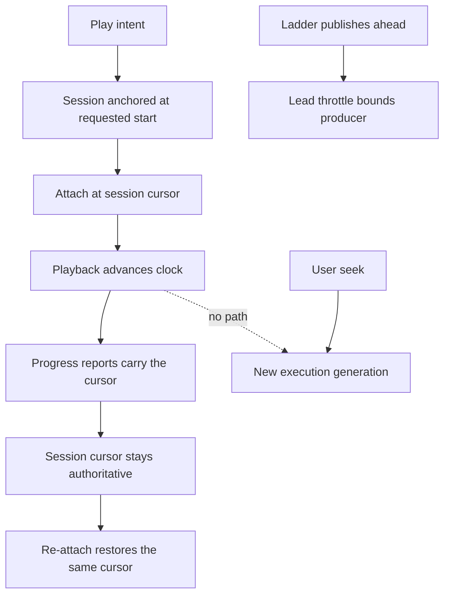

# Movie playback on growing presentations - Plan

## Goal Capsule

**Objective:** A movie whose presentation is still being encoded plays through continuously at
the viewer's own cursor: the clock never moves toward the published window's leading edge,
player-internal seeks do not restart encoders, the overlay shows one seek bar, and a failed
playback transfer never wedges the movie.

**Product authority:** The user reported the defects from a live persistent instance: two
progress bars, playback cutting forward roughly every six seconds, and a player that froze and
would not recover without retries. The diagnosis below reproduces each defect from the
instance's own state and the worktree source; nothing in this plan is speculative.

**Means:** Correct the player's HLS attachment, the position the server reports to attaching
clients, transfer-failure settlement, the overlay control layout, stale-session lifecycle, and
the browser gate that passed while the defects existed (KTD1–KTD7).

**Execution profile:** One branch named after this plan with seven dependency-ordered units.
Playback is verified on a preview instance against the same source movie before merge; the
persistent instance receives the fixes only after master merges and the updater advances it.

**Authority and stop conditions:** Follow `AGENTS.md`, the Product Contract and then the
Planning Contract. Stop affected work if a change would weaken media access checks, session
ownership fencing, or the lead-throttle's producer bound. The two-command drill's existing
guarantees are preserved, not restated.

**Product Contract preservation:** Requirements and R/A/F/AE identifiers below are new for
this plan and govern it; no earlier plan's identifiers are changed.

---

## Product Contract

### Summary

Fix movie playback against growing presentations so the client's cursor stays authoritative
while encoders publish ahead of it, and so every failure path leaves the movie playable.

### Problem Frame

All evidence is from the persistent instance at `baander.test` on 2026-11-09, playing a
1920x1080 H.264/Opus Matroska music video (223.59 s) through the 1080p/720p/360p encode
ladder, and from the worktree source at master's revision.

- Segments are 6.0 s (`SegmentEncoder::SEGMENT_DURATION`) and the ladder encodes at roughly
  1.3x real time, so the published window's leading edge races ahead of the playhead.
- `ui/web/src/features/catalog/hooks/hls-playback.ts` constructs hls.js 1.7.4 with
  `latencyController: undefined` and a comment stating the published edge is not a live
  target. In hls.js 1.7.4 `latencyController` is a controller-class override;
  `undefined` selects the default controller, so the intended disable is a no-op and
  `lowLatencyMode` remains enabled by default. On a playlist that grows during encoding the
  default live-sync machinery drags the playhead toward the edge; the viewer sees a forward
  cut each time a new segment publishes.
- After each jump the client reports the jumped position, and
  `TranscodeStreamingService::getPlaybackState` returns `desired->position`. A fresh test
  session created an hour later was told the movie's position was 170.5 s, the drifted edge,
  and positioned its player there on first attach.
- `useBaanderPlayer`'s `seeking` handler enqueues a server seek whenever a native seek lands
  more than 50 ms off the session position. Every server seek restarts all ladder encoders
  into a new execution generation. One playback burned generations `0 → 18` in two minutes;
  three retry eras left 14 generation directories, every encoder stopped mid-segment, and
  eight accumulated sessions holding roughly 361 MB of output.
- A rejected playback transfer leaves the movie's snapshot with a stuck transfer state;
  `playback-session-coordinator` then returns early from later load intents with no error, no
  performance mark, and no video element. The wedge survives page reloads.
- `MoviePlayerOverlay` renders the movie volume slider and the seek slider in one flex row
  without constraining the volume slider; the shared `Slider` component defaults to
  `width: 100%`. Measured live: a 440 px disabled volume bar overlapping a 1248 px seek bar.
- `app:transcode:job:cleanup` removed only 1 of the 8 jobs because the stale sessions still
  reference the rest; no session-expiry path reclaims them.
- The two-command browser gate passed while all of the above existed; its producer does not
  outrun playback far enough to expose edge-chasing.

### Key Decisions

- **The client's cursor is authoritative on growing presentations.** Governs R1–R3; the
  published window is a delivery window, never a playback target.
- **Failures settle instead of wedging.** Governs R4 and R6; every refusal is surfaced and
  every stale holder is reclaimable.
- **The gate must catch what the field caught.** Governs R7; an outrunning producer is now
  part of qualification.

### Requirements

**Continuous playback while encoding**

- R1. While a movie presentation grows during encoding, the player's clock advances only by
  playback and by user or app-committed seeks; it never moves toward the published window's
  leading edge.
- R2. The position a client receives when attaching, re-attaching or creating a session is
  that session's authoritative cursor — the client's requested start for a fresh session, or
  its last reported position thereafter — never the producer's published edge.
- R3. Player-internal seeks, including buffer-gap corrections and attachment restores, do not
  restart server encoders; only user or app-committed intents advance an execution
  generation.

**Recoverable failure and lifecycle**

- R4. A failed or superseded playback transfer settles the movie's playback state; a later
  load intent either runs or fails with a surfaced error. No refusal is silent and no wedge
  survives a page reload.
- R5. Stale transcode sessions — no client reports past a bounded age and no runnable jobs —
  stop holding jobs and output, so job cleanup can reclaim them.
- R6. The movie player overlay renders exactly one full-width seek bar; secondary controls
  such as volume are constrained and visually distinct from progress.

**Qualification**

- R7. The browser playback gate runs a producer that outruns playback and fails any run
  whose player clock advances without playback or a committed seek.

### Actors

- A1. The viewer plays, seeks and pauses a movie on a local or remote destination.
- A2. The server and worker pair encode, publish, fence and reclaim movie presentations.

### Key Flows

- F1. **Continuous playback while encoding.** A1 plays a movie; A2's ladder publishes ahead;
  A1's clock advances only by playback. Covers R1–R3.
- F2. **Retry after failure.** A1's playback fails or a transfer is rejected; A1 retries and
  either plays or sees the error; A2 reclaims stale holders. Covers R4, R5.
- F3. **Unambiguous controls.** A1 scrubs one seek bar; volume stays a bounded control.
  Covers R6.

### Acceptance Examples

- AE1. **Fresh play through the ladder.** Covers R1–R3. The reported source movie plays from
  zero through the encode ladder; the clock advances at wall speed; no execution generation
  advances without a user seek; one era of sessions and jobs serves the whole play.
- AE2. **Encoder outruns and throttles.** Covers R1, R3. The producer runs more than 72 s
  ahead and the lead throttle pauses it; playback continues into the already published
  window, waits at the leading edge without jumping, and resumes when the throttle resumes
  the producer.
- AE3. **Late attach inherits the cursor.** Covers R2. A second client attaches while
  playback stands at 60 s with the edge at 150 s; it is positioned at 60 s, or at its own
  requested start, never at 150 s.
- AE4. **Rejected transfer does not wedge.** Covers R4. A transfer is rejected or superseded;
  the next Play click on any client starts playback or surfaces the error; no reload or
  manual state clearing is required.
- AE5. **Stale holders are reclaimable.** Covers R5. After playback ends and the expiry bound
  passes, `app:transcode:job:cleanup` removes the era's jobs and output.
- AE6. **The gate fails edge-chasing.** Covers R1, R7. With a producer at 1.5x real time or
  faster, the gate fails any run whose clock moves beyond playback plus committed seeks.
- AE7. **One seek bar.** Covers R6. The overlay renders a single full-width slider; the
  volume control is bounded and visually distinct in the same row.

### Success Criteria

The reported movie plays start to finish on a preview instance with no uncommanded clock
movement, one seek bar, a single era of sessions and jobs per play intent, and a cleanup that
reclaims everything after playback ends. The existing two-command drill, adaptive-quality and
media-control gates keep passing.

### Scope Boundaries

- Included: the HLS attachment configuration, session position semantics, client seek
  classification, transfer settlement, overlay control layout, session expiry, and the
  browser gate extension.
- Excluded: adaptive-quality redesign, lead-throttle redesign, remote-destination semantics
  beyond transfer settlement, the copy-pacing band, the OpenTelemetry `host.docker.internal`
  resolution (a separate small fix), and the retained-redis tooling item already recorded in
  `ROADMAP.md`.

### Dependencies and Assumptions

- hls.js stays at 1.7.4; its controller and live-sync behavior is read from the installed
  `ui/web/node_modules/hls.js` typings and dist, not from memory.
- Encoder rates above 1x real time are normal for the ladder on this host; the gate must not
  depend on encoder speed.
- The persistent instance runs remote master; fixes reach it only after merge and update.
  Preview instances run the worktree, so previews verify first.

### Outstanding Questions

The configuration, position, seek-classification, transfer, layout, expiry and gate designs
are resolved in KTD1–KTD7.

### Sources and Research

- Instance evidence, 2026-11-09: transcode session list and shows (eight sessions, three
  eras), `/storage/conversions/01a1c0d7-cdc8-7ca6-987e-db088dc2ed94` (14 generation
  directories, all stopped mid-segment, seeks `0 → 18 → 96`), `generation.json` metadata
  (`startTime`, `hlsTargetDuration` 7), worker process table, and an instrumented browser
  session (performance marks, no-op load intents after a rejected transfer, a fresh session
  positioned at 170.5 s).
- [hls.js 1.7.4 API: `lowLatencyMode`, `latencyController`,
  `liveSyncDurationCount`](https://github.com/video-dev/hls.js/blob/v1.7.4/docs/api.md),
  verified against the installed package.
- [Media and playback qualification](../../docs-book/part-2-developer-guide/testing/media-and-playback.md)
  for the existing two-command, adaptive and media-control gates.

---

## Planning Contract

### Key Technical Decisions

- KTD1. **Disable live-edge machinery explicitly in the HLS attachment.** Replace the no-op
  `latencyController: undefined` with an explicit disable: `lowLatencyMode: false`, plus a
  verified way to neutralize the latency controller (a no-op controller class, or `null` if
  the installed hls.js supports disabling through it — read from the dist source in the
  unit). Keep the explicit `startPosition`. Pin the constructed configuration with a test
  that captures what is passed to the hls.js constructor, so a hls.js upgrade that re-enables
  chasing fails the suite. Governs R1. (chosen over raising `liveSyncDurationCount` alone: a
  larger trail distance only narrows the chase window instead of removing it.)

- KTD2. **Report the session cursor, not producer progress.** A session's sign response
  carries that session's cursor: the client's requested start at creation, and its last
  reported position afterwards. `CreateTranscodeSessionHandler` anchors a fresh session's
  desired position to the requested start instead of inheriting the reused job's drifted
  `desired->position`, and `TranscodeStreamingService::getPlaybackState` reports the
  session-tracked cursor. Governs R2. (chosen over clamping `desired->position` at read time:
  the drift enters through session creation, so it is corrected there.)

- KTD3. **Classify seeks before they reach the server.** Only user or app-committed intents
  enqueue server seeks. The `seeking` event handler stops auto-enqueuing on native seeks:
  app-initiated restores are already tracked, buffer-gap and sync corrections are corrected
  by the next progress report, and an unexplained native seek surfaces in diagnostics rather
  than restarting encoders. Governs R3. (chosen over a drift tolerance: any tolerance still
  restarts encoders for a large enough correction.)

- KTD4. **Settle transfers and surface refusals.** A rejected or superseded playback transfer
  settles the movie's snapshot — the stuck transfer state is cleared with the same fence that
  recorded it — and the coordinator's early returns on unusable state report an error through
  the existing performance-mark and error paths instead of returning silently. Governs R4.

- KTD5. **Constrain secondary controls in the movie overlay.** The volume slider gets an
  explicit bounded width in `MoviePlayerOverlay`, matching how `NowPlayingBar` constrains its
  controls, so the seek slider is the only full-width slider. Governs R6.

- KTD6. **Expire stale sessions so cleanup can reclaim their jobs.** A transcode session with
  no client reports past a bounded age and no runnable job becomes expired; expired sessions
  release their jobs for `app:transcode:job:cleanup`, which then removes the jobs and their
  output. The bound is long enough that a paused player never expires mid-session. Governs
  R5.

- KTD7. **Gate edge-chasing with an outrunning producer.** Extend the existing browser
  playback checkpoint with a producer running at least 1.5x real time and an assertion that
  the player clock never advances beyond wall playback plus committed seeks, using the
  checkpoint's existing evidence receipts. Governs R7. (chosen over a dedicated new gate: the
  two-command checkpoint already owns growing-presentation playback proofs.)

### High-Level Technical Design

The client owns the clock; the server owns the fence.

Attachments restore the session cursor; only user or app-committed seeks advance a
generation; the throttle bounds the producer; failed transfers settle; stale sessions expire.

### Alternatives and boundaries

- Raising `liveSyncDurationCount` or clamping the reported position were rejected in KTD1 and
  KTD2.
- Rebuilding the player around a non-live manifest format (for example, a periodically
  rewritten VOD playlist) is out of scope: it changes delivery semantics for every gate.
- Server-side seek suppression for native seeks was rejected in KTD3: the server cannot
  distinguish intent classes the client has not declared.

### Dependencies and implementation unknowns

- The exact hls.js 1.7.4 mechanism for neutralizing the latency controller (no-op class vs
  null) is confirmed from the dist source in U1 before the change lands.
- The session-expiry bound in KTD6 needs the existing session lease lifetimes read before a
  number is chosen.

### System-Wide Impact

Shared transcode application services, the web player, the session coordinator and the
browser qualification fixtures change. The persistent instance's updater delivers the fixes
after master merges. No schema change is expected; if session expiry needs a column, the
migration follows the repository's PostgreSQL rules.

### Research Constraints to Preserve

The two-command drill's existing proofs — authenticated playback, paused seek, restart,
containment, recovery, completion — must keep passing unchanged. The lead throttle's 72/36
second band and the copy-pacing burst stay as they are.

---

## Implementation Units

### U1. Disable live-edge chasing in the HLS attachment

**Goal:** The player never moves its clock toward the published edge.

**Requirements:** R1; KTD1. **Dependencies:** None.

**Files:** `ui/web/src/features/catalog/hooks/hls-playback.ts`; a new
`ui/web/src/features/catalog/hooks/__tests__/hls-playback.test.ts` capturing the constructor
configuration.

**Approach:** Read the installed hls.js dist to confirm how a controller override disables
the latency controller; set `lowLatencyMode: false` plus the verified disable; keep
`startPosition` and the existing error and subtitle paths untouched.

**Test scenarios:** The captured configuration contains the explicit disable and never
`latencyController: undefined`; playback attach, error and dispose behavior is unchanged.

**Tests:** The new capture test; the existing player hook and protocol suites.

**Verification:** Focused frontend tests, then the U7 browser run.

### U2. Anchor and report the session cursor

**Goal:** Attaching clients receive the session cursor, not the published edge.

**Requirements:** R2; KTD2. **Dependencies:** None.

**Files:** `src/Transcode/Application/CommandHandler/CreateTranscodeSessionHandler.php`,
`src/Transcode/Infrastructure/Transcode/TranscodeStreamingService.php`, their tests, and the
signing controller tests that assert the response shape.

**Approach:** Anchor a fresh session's desired position to the requested start; report the
session-tracked cursor in `getPlaybackState`; keep the runtime desired state as the control
fence for the worker.

**Test scenarios:** A fresh session over a reused job with drifted desired state reports the
requested start; a refreshed session reports its last reported position; the worker fence and
revision semantics are unchanged.

**Tests:** Extend the transcode session and streaming service suites.

**Verification:** Focused backend tests and static gates.

### U3. Stop server seeks from player-internal seeks

**Goal:** Native seeks never restart encoders.

**Requirements:** R3; KTD3. **Dependencies:** U1.

**Files:** `ui/web/src/features/catalog/hooks/useBaanderPlayer.ts`; the existing player hook
tests.

**Approach:** Remove the auto-enqueue from the `seeking` event handler; keep app-initiated
restore tracking; let progress reports correct drift; record unexplained native seeks in
diagnostics.

**Test scenarios:** A native seek far off the cursor produces no server seek and no
generation change; a user slider commit still seeks; an app restore still restores.

**Tests:** Extend the player hook suite with simulated media events.

**Verification:** Focused frontend tests, then the U7 browser run.

### U4. Settle failed transfers and surface refusals

**Goal:** A rejected transfer never wedges the movie, and no refusal is silent.

**Requirements:** R4; KTD4. **Dependencies:** None.

**Files:** The server transfer endpoint and its handler in
`src/Transcode`/`src/Session`, and `ui/web/src/features/session/services/playback-session-coordinator.ts`;
their tests.

**Approach:** Settle the snapshot's transfer state with the failure's fence; make the
coordinator's early returns report through the existing error and mark paths.

**Test scenarios:** A superseded transfer clears the state; the next load intent runs or
errors visibly; the reload path recovers without manual clearing.

**Tests:** Extend the coordinator and transfer handler suites.

**Verification:** Focused frontend and backend tests.

### U5. Constrain the movie overlay's secondary controls

**Goal:** Exactly one full-width slider in the overlay.

**Requirements:** R6; KTD5. **Dependencies:** None.

**Files:** `ui/web/src/features/catalog/components/MoviePlayerOverlay.tsx`; a component
test.

**Approach:** Bound the volume slider's width as `NowPlayingBar` bounds its controls; leave
the seek slider the row's only full-width element.

**Test scenarios:** The rendered overlay contains one full-width slider; the volume control
is bounded; controls keep their labels and disabled states.

**Tests:** A new overlay component test; the existing catalog component suites.

**Verification:** Focused frontend tests.

### U6. Expire stale transcode sessions

**Goal:** Stale sessions release their jobs for cleanup.

**Requirements:** R5; KTD6. **Dependencies:** U2.

**Files:** The transcode session lifecycle services and `CleanupOrphanedJobsHandler`, with
their tests.

**Approach:** Add the bounded expiry described in KTD6 after reading the existing lease
lifetimes; let the cleanup command treat jobs held only by expired sessions as orphaned.

**Test scenarios:** A session past the bound with a dead job is expired and its job removed;
a paused player inside the bound keeps its jobs.

**Tests:** Extend the session and cleanup suites.

**Verification:** Focused backend tests; the live instance's cleanup run after U7.

### U7. Gate edge-chasing and verify the whole fix

**Goal:** The gate that missed the defect now fails it, and the reported movie plays
through.

**Requirements:** R1–R7; KTD7. **Dependencies:** U1–U6.

**Files:** The two-command browser checkpoint and its fixture; the qualification runner
configuration.

**Approach:** Add the outrunning producer and the clock-bound assertion to the existing
checkpoint; run the full checkpoint and the existing two-command, adaptive and media-control
gates; verify the reported movie end to end on a preview instance with the diagnostic marks
from this diagnosis.

**Test scenarios:** The checkpoint with the defect reintroduced fails; with the fix it
passes; the existing gates keep passing.

**Tests:** The checkpoint's own receipts and assertions.

**Verification:** The browser gates on the CI image, plus one instrumented preview run
against the reported source movie recorded as the delivery evidence.
