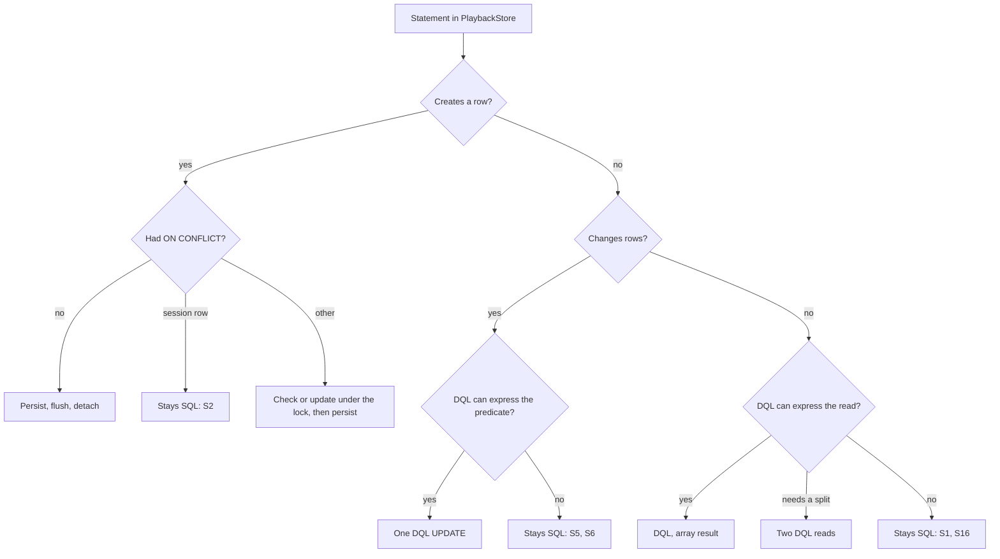

# Playback Session Entities - Plan

## Goal Capsule

**Objective:** The four playback coordination tables are described by the same Doctrine mapping as every other Session table, so a schema comparison, a mapping check or a search for an entity covers them, while playback coordination behaves the same and the snapshot the server builds every second for each connected player costs no more than it does today.

**Means:** Map the four tables with entities that match the migrated catalog and add no DDL (KTD1, KTD2). Move the playback store's reads and updates to DQL and its inserts to the unit of work (KTD3). Keep five named statements as SQL (KTD4).

**Product authority:** The user asked why the playback store's SQL bypasses the Doctrine entity manager and why these tables have no entities, then said "introduce entities". The scope below is confirmed. Asked on 2026-11-11 how far that should go, the user chose DQL through the entity manager (KTD3).

**Execution profile:** One branch, `playback-session-entities`, with seven dependency-ordered units. U1 and U2 touch disjoint files and can run in parallel. U3, U4 and U5 change `src/Session/Infrastructure/Doctrine/PlaybackStore.php` in sequence under one owner with the postgres specialist profile (`.agents/agents/postgres.md`). The lead owns `config/packages/doctrine.yaml`, integration, the authoritative gates and the commits.

**Authority and stop conditions:** Follow `AGENTS.md`, then the Product Contract, then the Planning Contract. Stop the affected unit and report when any of these holds:

- An existing assertion in the suites named by R9 would have to change for the suite to pass.
- An entity's column type, nullability and `options` cannot reproduce what the catalog reports, so that only a migration would make schema comparison clean.
- A statement listed in KTD4 cannot keep its single-statement form.
- The snapshot measurement still exceeds R8 after S33 and S34 have returned to SQL. KTD10 names no further fallback; reverting more of the store needs the user's decision.
- The control measurement still exceeds R12 after the fallback in KTD13.

**Who finishes:** Workers report files, evidence and check results without staging or committing. The lead integrates, runs the gates in the Verification Contract, records the result in `ROADMAP.md` and commits locally. Nothing is pushed until the user asks.

---

## Product Contract

### Summary

Add Doctrine entities for `playback_destinations`, `playback_destination_incarnations`, `playback_transfers` and `playback_commands`, remove the four tables from the ORM `schema_filter`, and rewrite `PlaybackStore` so its statements go through the entity manager's mapping. The port, the schema and the behaviour stay as they are. Five statements that DQL cannot express without losing a fence or a clock reading stay SQL, each named with its reason.

### Problem Frame

Migrations create the four tables, and nothing in the ORM knows them. `config/packages/doctrine.yaml` lists them in `schema_filter`, so schema comparison neither sees them nor reports drift in them. `PlaybackStore` reads and writes them with 38 hand-written statements on the entity manager's DBAL connection and hydrates rows by hand. The session row beside them, `listening_sessions`, has an entity that the store does not use.

Two things follow. A column renamed in a migration fails only when the statement that names it runs. A developer looking for the shape of a playback command finds SQL strings where every other Session table has a mapped class.

The store's statements were written this way for a reason that still holds for some of them. Every coordinator operation runs in one transaction that first takes an account advisory lock and the session row lock, and several writes are conditional statements whose predicate is the fence. The repository already keeps two such tables mapped while their writes stay statements: `src/Transcode/Infrastructure/Doctrine/Entity/TranscodeRuntimeEntity.php` and `src/Scheduler/Infrastructure/Doctrine/Entity/ScheduledJobEntity.php` are `readOnly` entities.

### Key Decisions

- **Only the four playback tables gain entities.** The other `schema_filter` entries stay as they are. Governs R1, R2.
- **Unchanged tests are the oracle.** The work is accepted on existing assertions passing untouched, not on new assertions replacing them. Governs R6, R9.

### Requirements

**Mapping and schema**

- R1. Each of the four tables has a Doctrine entity under `src/Session/Infrastructure/Doctrine/Entity/`, separate from the domain models, with every reference to another table held as a scalar `Uuid` column.
- R2. The four tables leave `schema_filter`, and schema comparison between the mapping and a freshly migrated database plans no statement for them.
- R3. Every column, default, check constraint, unique constraint, index, partial index and foreign key of the four tables keeps its definition and its name. No migration is added, edited or removed.
- R4. A database that already ran the current migrations needs no reset and no manual step.

**Store**

- R5. Every statement in `PlaybackStore` goes through the entity manager's mapping, as DQL or as a unit-of-work insert, except the statements KTD4 lists.
- R6. Playback coordination behaves as before: the same outcomes for every coordinator operation, the same conditional fences, and, except for `recovery_expires_at`, which the PHP clock sets today and keeps setting, stored instants read from the database clock.
- R7. `PlaybackStoreInterface` keeps its methods, parameters and returned array shapes.

**Cost**

- R8. A relayed snapshot, the snapshot `PlaybackCommandRelay` builds once per second for each bound socket, executes no more statements than before in each measured scenario, its median time is at most 1.15 times the baseline measured on the same host, and its time does not grow with the number of sockets one entity manager serves in a relay tick.
- R12. A control that issues one command to a runner executes no more statements than the count U5 records for it, and its median time is at most 1.5 times the baseline measured on the same host.

**Proof**

- R9. The Session unit suite (`tests/Unit/Session`, 143 tests) and the six PostgreSQL integration files (`PlaybackTransferPersistenceTest`, `ConfirmedPausedRunnerPersistenceTest`, `LocalPlaybackRecoveryPersistenceTest`, `SessionOwnershipPersistenceTest`, `InitialSchemaMigrationTest`, `ReferentialIntegrityTest`; 111 tests) pass with their assertions unchanged. A test that inserts or alters rows with raw SQL keeps doing so.
- R10. The whole-schema comparison in `DatabaseNamingConventionTest`, PHPStan, Deptrac, the container lint, the OpenAPI drift check and the two-command browser gate with client controls in Firefox and Chromium all pass.

**Documentation**

- R11. The Session context page, the Session README and the database naming page describe the new ownership, and a written rule states, for the playback store and for any table or store added after it, when a statement or a table may stay outside the ORM.

### Scope Boundaries

Out of scope:

- The other tables in `schema_filter`: the outbox, the change inbox and its revision table, the worker deployment tables, the scheduler occurrence tables and `failed_messages`.
- `PlaybackCoordinator`, the domain models under `src/Session/Domain/Model/`, the HTTP and WebSocket contracts and the browser.
- Every other store that runs DBAL statements. They are an unreviewed baseline: this plan neither approves them nor converts them (KTD12).

Considered and not built:

- **Version columns for optimistic locking.** The account advisory lock and the session row lock already serialize every writer of these tables, so a version column would add a column to four tables and catch no writer. A writer that reaches these tables outside `lockSession` would change this.
- **A DQL function for `clock_timestamp()`.** One statement needs it (KTD4). A second call site would justify the function.
- **Composite keys in the shared `ForeignKeyDeclaration`.** Session is the only context with composite foreign keys, and `PlaybackSessionSchemaListener` already declares them. A second context with composite keys would justify moving them into the shared declaration.
- **Renaming the seven PostgreSQL-named check constraints to `chk_` names.** R3 keeps names, the naming page accepts existing `<table>_<column>_check` names, and `DatabaseNamingConventionTest` does not inspect check constraints.

#### Deferred to Follow-Up Work

- **Typed read models on the port.** Returning domain objects from `PlaybackStoreInterface` would rewrite `PlaybackCoordinator` and the stub rows in seven unit test files, which removes the oracle this plan depends on (KTD7). It is a separate change once this one has landed.

### Dependencies and Assumptions

- The branch starts from `movie-playback-growing-presentations` at e839b7986, which carries `migrations/Version20261110120000.php`. That migration is unshipped but already part of the chain every fixture applies.
- `composer.lock` pins `doctrine/orm` 3.7.6 and `doctrine/dbal` 4.5.0. The statements below about DQL and the unit of work were read from that installed source.
- There are no production deployments (`AGENTS.md`, reconfirmed 2026-10-03). Local preview and persistent databases exist and R4 protects them.

### Sources and Research

- `src/Session/Infrastructure/Doctrine/PlaybackStore.php`, `src/Session/Application/Port/PlaybackStoreInterface.php` and `src/Session/Application/Service/PlaybackCoordinator.php`: the 38 statements, the port and its one caller.
- `migrations/Version20261101190000.php`, `Version20261101203000.php`, `Version20261101210000.php`, `Version20261102191000.php`, `Version20261102200000.php` and `Version20261110120000.php`: the complete DDL of the four tables.
- `src/Session/Infrastructure/Swoole/PlaybackCommandRelay.php`: one timer coroutine per worker serves every bound socket once per second through one entity manager.
- `src/Shared/Infrastructure/Doctrine/DoctrineTransaction.php`: the transaction port flushes inside the DBAL transaction and discards a closed manager for the current coroutine only.
- `docs/solutions/runtime-errors/swoole-callbacks-outside-the-bundle-leak-pooled-services.md`: the entity manager is pooled per coroutine and released by `CoWrapper::defer()`, which the relay tick already calls.
- `docs/solutions/architecture-patterns/state-set-when-work-is-queued-on-swoole-task-must-expire.md`: leases are measured on the database clock so every process agrees when one lapsed. KTD5 applies it.
- `docs/solutions/runtime-errors/heartbeat-checked-against-an-earlier-clock-reading-looks-future.md`: a timestamp judged against a clock read earlier looks like it came from the future. KTD5 keeps each comparison in the statement that reads the row.
- `docs/solutions/runtime-errors/fenced-completion-retry-must-not-redo-one-shot-steps.md`: a refused fenced write must not repeat one-shot steps. KTD8 keeps the store free of retries, so a failed write ends the operation.
- `.agents/skills/postgres-remediation/references/doctrine.md` and `docs-book/part-2-developer-guide/development/database-naming.md`: what schema comparison sees and how names are matched.
- Commit c422a05ff merged the snapshot's disclosure mark and command read into one statement to save a statement per socket per second.

---

## Planning Contract

### Key Technical Decisions

- KTD1. **The mapping is written to match the catalog, and no DDL runs.** The six migrations stay the source of the tables' DDL, and the entities are fitted to what they produce until schema comparison is clean. Editing or removing an applied migration would strand existing local databases: `UnknownExecutedMigrationGuard` refuses a database whose executed versions are missing from the directory, and an edit in place leaves old databases on the old DDL with nothing to report it. A column difference is closed by matching the column's type, nullability and `options` to the catalog, with each default written exactly as the catalog reports it; the default of `capabilities`, for example, must carry the catalog's spacing. `columnDefinition` does not exempt a column: DBAL's `AbstractPlatform::columnsEqual` blanks only that key and still compares type, default and nullability, and `ScheduledJobEntity` compares clean because it also sets `options: ['default' => …]`. When the options cannot reproduce the catalog the unit stops, because R3 allows no migration.

- KTD2. **Each kind of schema object has one place that declares it.**

  | Object | Declared by | Precedent |
  |---|---|---|
  | Columns, types, nullability, defaults | Entity attributes: `uuid`, `text`, `integer`, `float`, `boolean`, `json` with `jsonb`, `datetime_immutable` | `ListeningSessionEntity` |
  | `timestamptz` instants | `datetime_immutable`, which `InstantType` declares as `TIMESTAMPTZ` | `InstantColumnConventionTest` |
  | Unique constraints and plain indexes | `#[ORM\UniqueConstraint]` and `#[ORM\Index]` with the migration's name | `ListeningSessionEntity` |
  | Partial indexes | `#[ORM\Index]` with `options: ['where' => …]`, using the predicate text PostgreSQL reports | `TranscodeRuntimeEntity`, `ScheduledJobEntity` |
  | The partial unique index `uniq_playback_transfers_current` | `#[ORM\UniqueConstraint]` with the same `where` option | None: no mapped partial unique constraint exists yet, so U2 proves this one first |
  | Composite foreign keys inside Session | `PlaybackSessionSchemaListener`, extended from two keys to eight | The listener's existing two keys |
  | The owner key from `playback_destinations` to `users` | `SessionForeignKeys` | `fk_devices_user_id` |
  | Check constraints | Migrations only | `chk_job_monitors_status`, `chk_libraries_claim` on mapped tables |

  Attribute mapping cannot express a check constraint, and DBAL neither introspects nor compares one. Removing the tables from `schema_filter` therefore cannot drop a check, and nothing would report a missing one, so U2 asserts in a catalog test that the checks still exist. If the partial unique index cannot be mapped so that comparison is clean, it stays migration-only behind a case in `UnmanagedCustomIndex`, as the naming page prescribes for an index Doctrine cannot model. ORM associations are not used: each composite key references `(id, user_id)`, a unique key that is not the target's identifier, which an association cannot target.

- KTD3. **The unit of work inserts, DQL updates, and reads return arrays.** (session-settled: user-directed — chosen over loading, changing and flushing entities under the session lock, and over entities for the schema only with the store's SQL unchanged: asked on 2026-11-11 how far "introduce entities" should go, the user chose DQL through the entity manager) A store method that creates a row persists a new entity. A method that changes rows runs one DQL `UPDATE` with the predicate the SQL statement had. A read runs DQL and hydrates arrays, never managed entities. The four entities are `readOnly`, so the unit of work never computes changes for them, and the store detaches each inserted entity after its flush. No managed playback entity therefore outlives the store call that created it. Three facts from the tree weigh against loading, changing and flushing entities:
  - `PlaybackCoordinator` reads the endpoint before the transaction and the lock. An entity loaded there and changed later would be compared with a stale original, and a column another transaction changed in between would be skipped by the update.
  - The relay tick serves every bound socket in a worker through one entity manager, and every operation ends in `flush()`. Managed entities would accumulate over the tick and each flush would walk all of them.
  - The integration fixtures drive one entity manager across many operations and alter rows with raw SQL in between, which a managed copy would not see.

- KTD4. **Five statements stay SQL.**

  | ID | Statement | Why it stays |
  |---|---|---|
  | S1 | `pg_advisory_xact_lock` on the account in `lockSession` | DQL has no advisory lock, and it is the lock that serializes the first insert of a session row. |
  | S2 | `INSERT … ON CONFLICT(user_id) DO NOTHING` into `listening_sessions` | `ON CONFLICT` absorbs a session row created outside the account lock, which `ListeningSessionDoctrineRepository::save` can do. A persist would turn that into a unique violation and close the manager. |
  | S5 | `retireConfirmedPausedBrowser` | The proof is one predicate over the session's whole command ledger, with `UPDATE … FROM … RETURNING`, a JSON operator and the database clock. Evaluated in PHP it would hydrate an unbounded ledger on every relayed snapshot of a paused session. |
  | S6 | `retireConfirmedStoppedBrowser` | The same statement shape and the same relayed path as S5; the two proofs stay in one form. |
  | S16 | `recovery_expires_at > clock_timestamp()` in `localRecovery` | It must read the clock after the transaction waited for its locks. `testRecoveryExpiryUsesTheClockAfterTransactionWaits` pins this, and DQL offers only the transaction's start time. |

  S2 changes position, not text: it runs only when the locked read S3 finds no row, and S3 then runs again. Under S1 no coordinator operation can insert between the two reads.

- KTD5. **The database clock stamps every stored instant except `recovery_expires_at`.** The PHP clock sets `recovery_expires_at` today, 30 days ahead, and keeps doing so. For every other instant, DQL updates stamp with `CURRENT_TIMESTAMP()` in the statement, as the SQL did. An insert needs the value in PHP, so the store selects `CURRENT_TIMESTAMP()` in a DQL read, which returns the same value throughout a transaction, and builds `created_at`, `expires_at` and `acknowledged_at` from it. Availability and expiry comparisons stay inside the statements that read the rows.

- KTD6. **The session lock stays the only fence, and locking stays pessimistic.** `lockSession` keeps the advisory lock and reads the session row with a pessimistic write lock, which produces the same `FOR UPDATE`. `localRecovery` keeps its row lock on the incarnation. No entity carries a version column.

- KTD7. **The port keeps returning arrays.** Each read maps its DQL result to the row shape the SQL returned: column names as keys, identifiers as canonical strings, instants as strings `DateTimeImmutable` parses, JSON as arrays. Numeric and boolean scalars keep the PHP type the SQL rows carried. The store's `decode()` casts only `observedVolume`, so a destination's `position` and `epoch` and an endpoint's `available` reach the coordinator and the WebSocket snapshot as the PDO driver returns them, where ORM hydration returns PHP floats, integers and booleans. U1 records those types with strict comparisons and U3's mappers reproduce them. `PlaybackCoordinator` reads those rows by key throughout its 682 lines, and seven unit test files with 44 test methods build stub rows in that shape. Keeping the shape means neither changes and the Session unit suite stays an unmodified oracle.

- KTD8. **Every store write reaches the database before its method returns.** An insert is flushed in the method that persists it. Later reads in the same operation are queries, which do not see an unflushed insert: `requestedTransfer` follows `saveTransfer`, and `snapshot` follows `insertCommand`. Flushing per call also keeps the statement order of today, where the unit of work would otherwise run every insert before any update. The store catches nothing and retries nothing, so a failed write ends the operation and the transaction port rolls it back.

- KTD9. **The three remaining upserts are resolved under the lock.**
  - `register` updates the destination by `(user_id, device_id, endpoint_id)` and inserts when the update matched no row.
  - `saveTransfer` updates the transfer by `id` and inserts when the update matched no row.
  - `insertCommand` looks for the replay key `(session_id, request_id, type, incarnation_id, revision)` before inserting, and only for a command addressed to an incarnation. A retained command has a NULL incarnation, which the unique constraint never matches, so it is always inserted, as today.

  Every writer of these rows holds the account lock, so nothing can insert between the check and the insert.

- KTD10. **The snapshot path is measured, with a fixed fallback order.** S33 becomes a join on the highest epoch per destination, which returns the same rows because `uniq_playback_destination_incarnations_destination_id_epoch` makes that incarnation unique. S34 becomes a read of the pending commands followed by one update that marks them disclosed, issued only when a returned command lacks the mark. A resting session therefore still runs one statement for its commands, and the snapshot that first discloses a command runs two. The nesting guard stays: commands are read and marked only when the transaction is not nested. If U5 measures a count or a time beyond R8, two statements may return to SQL, in this order: S33, then S34. Each one that returns joins the list in KTD4. If R8 still fails with both back in SQL, the cause is the fixed cost of a DQL query, not one statement's plan, and returning further reads would undo most of U3. The unit then stops and the lead reports to the user before anything else is reverted.

- KTD11. **Nothing changes in how Swoole hands out the entity manager.** The store keeps receiving the pooled manager, the relay tick keeps calling `CoWrapper::defer()`, and the endpoint read before the transaction stays outside it. A flush that fails closes the manager where a failed DBAL statement did not; `DoctrineTransaction` already releases a closed manager for the current coroutine, and the relay logs the failure and serves the socket again on the next tick. Production is unaffected because the store holds the pooled proxy, which resolves a fresh manager. The integration fixture is affected: `PlaybackPersistenceFixture::coordinator()` hands the store one concrete manager, `DoctrineTransaction` resets only the fixture registry's manager, and the store keeps the closed one. `PlaybackTransferPersistenceTest::testCommandInsertionFailureRollsBackTransferRevisionAndRequestIdentity` makes a trigger refuse a command insert and then reuses the same coordinator, so its retried transfer would fail with a closed manager. U1 therefore builds the fixture's store on an `EntityManagerInterface` wrapper that resolves the fixture registry's current manager on every call, as the production proxy does. The test file stays unchanged.

- KTD12. **The rule is written into `.agents/rules/ddd-repositories.md`, governs the playback store and what is added after it, and `CONCEPTS.md` does not change.** For the playback store and for any table or store added after it, the rule states that a table has an entity unless schema comparison cannot represent it, that a new `schema_filter` entry carries its reason beside it, and that a statement stays SQL only when DQL has no form for it and no DQL statement or unit-of-work insert gives the same result without breaking a single-statement fence, losing a clock reading or adding a statement to a per-second path. It also states the `readOnly` pattern for rows whose updates are guarded statements. The rule says in its own text that the eleven remaining `schema_filter` tables and the existing stores that run DBAL statements are an unreviewed baseline, which it neither approves nor requires converting. A count on 2026-11-11 found 333 `executeStatement`, `executeQuery` and `fetch*` call sites in `src/` outside the playback store, 88 of them in the Transcode and Scheduler infrastructure this plan cites as precedent, so a rule without that boundary would outlaw the repository it governs. `ROADMAP.md` records the baseline as an open item. The plan introduces no domain term: it uses playback destination, playback endpoint, incarnation and disclosed command as `CONCEPTS.md` defines them.

- KTD13. **The insert path is measured too, with one fallback.** A unit-of-work insert inside the coordinator's transaction costs three round trips where the SQL insert cost one: DBAL nests the flush's own transaction with a savepoint, so it runs `SAVEPOINT`, the `INSERT` and `RELEASE SAVEPOINT`. With the clock read and the replay-key read, an addressed command costs up to five. No snapshot scenario contains an insert, so U1 and U5 measure a control that issues one command to a runner against R12. If R12 fails, `insertCommand` returns to its single `INSERT … ON CONFLICT DO NOTHING` and S22 joins the list in KTD4. Controls are user-driven, not per-second, which is why R12 allows 1.5 times the baseline where R8 allows 1.15.

### High-Level Technical Design

How a statement in the store is placed:

The statement inventory, in the order the statements appear in the file. "DQL update" is one conditional statement; "insert" is a unit-of-work insert under KTD8.

| ID | Method | Today | After |
|---|---|---|---|
| S1 | `lockSession` | Account advisory lock | SQL, unchanged |
| S2 | `lockSession` | Insert-if-absent session row, on every call | SQL, only when S3 finds no row |
| S3 | `lockSession` | Session row `FOR UPDATE` | DQL read with a pessimistic write lock |
| S4 | `saveSession` | Update of the session row | DQL update |
| S5 | `retireConfirmedPausedBrowser` | Fenced retire with proofs | SQL, unchanged |
| S6 | `retireConfirmedStoppedBrowser` | Fenced retire with proofs | SQL, unchanged |
| S7 | `register` | Device row | DQL read |
| S8 | `register` | Destination upsert | DQL update, then insert when no row matched |
| S9 | `register` | Destination read-back | DQL read, only after an update |
| S10 | `register` | Next epoch | DQL read |
| S11 | `register` | Retire the destination's unretired incarnations | DQL update, before S12 |
| S12 | `register` | Insert the incarnation | Insert, carrying the recovery columns |
| S13 | `register` | Update the recovery columns | Removed, folded into S12 |
| S14 | `endpoint` | Incarnation joined to its destination, with availability | DQL read |
| S15 | `localRecovery` | Incarnation `FOR UPDATE` by id, owner and tab | DQL read with a pessimistic write lock |
| S16 | `localRecovery` | Expiry against `clock_timestamp()` | SQL, unchanged |
| S17 | `completeLocalRecovery` | Retire, mark stopped, store the result | DQL update |
| S18 | `supersedeIncarnationCommands` | Close the incarnation's unanswered commands | DQL update |
| S19 | `sourceQuiesced` | Existence of a quiesced command | DQL read |
| S20 | `currentTransfer` | The session's open transfer | DQL read |
| S21 | `saveTransfer` | Transfer upsert | DQL update, then insert when no row matched |
| S22 | `insertCommand` | Insert, ignoring a replayed key | Replay-key read for an addressed command, then insert |
| S23 | `command` | Command by id and owner | DQL read |
| S24 | `acknowledgeCommand` | Write-once acknowledgement | DQL update |
| S25 | `requestedCommand` | First command of a request | DQL read |
| S26 | `requestedTransfer` | Transfer with its first rejection reason | Two DQL reads |
| S27 | `cancelCommands` | Supersede the attempt's unanswered commands | DQL update |
| S28 | `settleNeverEffective` | Settle the attempt's unanswered commands | DQL update |
| S29 | `attemptDisclosed` | Existence of a disclosed command | DQL read |
| S30 | `markRunnerUnknown` | Set the incarnation unknown | DQL update |
| S31 | `observe` | Record state, position, volume and renew presence | DQL update |
| S32 | `observeVolume` | Record volume and renew presence | DQL update |
| S33 | `snapshot` | Destinations with their latest incarnation | DQL read (KTD10) |
| S34 | `snapshot` | Mark and read pending commands in one statement | DQL read, then a conditional DQL update (KTD10) |
| S35 | `snapshot` | Selected destination's public id | DQL read |
| S36 | `snapshot` | Active destination's public id | DQL read |
| S37 | `pendingControl` | Oldest unanswered control | DQL read |
| S38 | `rememberRequest` | Request digest across transfers and commands | Two DQL reads |

Statements a relayed snapshot runs, counted from the source and confirmed by U1:

| Scenario | Today | After |
|---|---|---|
| Unbound socket, runner playing | S1, S2, S3, S20, S37, S33, S35, S36, S20: 9 | 8, without S2 |
| Bound socket, session resting paused, nothing pending | S14, S1, S2, S3, S20, S37, S5, S33, S34, S35, S36, S20: 12 | 11, without S2 |
| Bound socket, first disclosure of one command | 12 | 12: without S2, with the mark |

### Assumptions

- The coordinator is the only production code that creates a session row. `ListeningSessionDoctrineRepository` has no production caller in `src/`, and S2 stays SQL so that this does not need to be true.
- The 1.15 bound on median snapshot time in R8 and the 1.5 bound on a control in R12 are chosen here. The request asked for a measurement and a fallback, not a number.
- The test counts in R9 (143 and 111) come from the request and are confirmed when U1 first runs the suites.

### Alternatives Considered

- **Load each row, change the entity and flush, under the session lock.** This is the conventional repository shape. The user chose against it (KTD3). The three facts in KTD3 weigh against it for updates, and each update would cost a read first and an extra clock read where the DQL statement costs one round trip.
- **Entities for the schema only, with the store's SQL left as it is.** This is what the Transcode runtime and scheduled job tables do. It would give R1 to R4 and leave the 38 hand-written statements the request was about. The user chose against it (KTD3).
- **Regenerate the migrations from the mapping.** Rejected by KTD1: it strands existing databases and no DDL is needed.

### System-Wide Impact

- **Schema tooling.** Schema comparison starts to cover the four tables. A later mapping change to them now produces a diff where it produced nothing.
- **Stored JSON.** Doctrine's JSON type keeps a zero fraction, so a whole-number position in a command payload is stored as `30.0` where the store's encoder wrote `30`. Both are the same JSON number to the browser. In PHP the decoded value is a float where it was an integer.
- **Session media.** A session without media stores SQL NULL where the store wrote the JSON value `null`. Both read back as no media, and the mapped repository already writes SQL NULL. Rows change representation on their next save.
- **Live-update capture.** Capture is trigger-based and the four tables are classified `excluded` in `tests/Fixtures/LiveUpdates/capture-sources.json`. Their `mapping` entries point at a migration today and move to the entity files.
- **Focused SchemaTool fixtures.** Several integration tests create a schema from a subset of the metadata. The extended listener must add a key only when the table that owns it is in the schema.

### Risks

| Risk | Mitigation |
|---|---|
| An attribute cannot reproduce a default or a partial index predicate exactly, and comparison reports drift | The default written as the catalog reports it and the predicate text copied from `pg_get_expr`; KTD1 says when the unit stops, and KTD2 gives the fallback for the partial unique index. |
| The DQL form of S33 plans worse than the lateral join | U5 measures it; KTD10 returns it to SQL first. |
| A refused insert now closes the entity manager, and `testCommandInsertionFailureRollsBackTransferRevisionAndRequestIdentity` reuses its coordinator after a trigger refuses a command insert | U1 builds the fixture's store on a wrapper that resolves the registry's current manager per call (KTD11), and U4 asserts that the same coordinator completes a snapshot and a transfer after the refusal. KTD9 removes the three known conflict cases. |
| The fixed cost of a DQL query, not one statement's plan, pushes the snapshot past R8 | KTD10 allows two statements back to SQL and then stops for the user's decision. |
| A unit-of-work insert costs up to five round trips where one ran | R12 bounds a control that issues a command; KTD13 returns `insertCommand` to SQL when the bound fails. |
| The store's `flush()` writes unrelated dirty entities earlier in the request than the transaction's final flush would | They are written in the same transaction either way; the integration suite runs the store beside the device and catalog repositories. |
| A DQL construct this plan relies on is not accepted by the installed parser | The grammar was read in `vendor/doctrine/orm/src/Query/Parser.php`, not executed. U3 and U4 run every statement against PostgreSQL, and a rejected one falls under KTD4's rule and is reported. |

### Deferred to Implementation

- The exact predicate text for the three partial indexes, as `pg_get_expr` reports it.
- Whether the transaction clock is read once per inserting call or carried with a read the call already makes. KTD5 bounds it at one extra read per inserting store call.
- The baseline statement counts and times, which U1 measures before any store change.
- The names PostgreSQL gave the seven column-level check constraints, read from the catalog in U2.

---

## Implementation Units

### U1. Characterize the store and measure the baseline

- **Goal:** Pin the store behaviour that the coordinator-level suites do not assert, record what a relayed snapshot and a control cost, and make the fixture survive a closed entity manager, before the store changes.
- **Requirements:** R6, R8, R9, R12.
- **Dependencies:** None.
- **Files:**
  - `tests/Integration/PlaybackStoreContractTest.php` (new)
  - `tests/Integration/PlaybackSnapshotCostTest.php` (new)
  - `tests/Fixtures/Session/playback-snapshot-cost.php` (new)
  - `tests/Fixtures/Session/playback-concurrent-transfer.php` (only `PlaybackPersistenceFixture::coordinator()` changes, to build the store on the entity-manager wrapper in KTD11)
- **Approach:**
  1. Write the contract test against the current store through `PlaybackPersistenceFixture`, with `FinalSchemaBootstrap` creating the schema as the existing playback tests do.
  2. Count statements in the cost test on a connection the test builds itself, with DBAL's logging middleware beside `BaanderDriverMiddleware`, and assert a ceiling per scenario equal to the count measured now.
  3. Write the timing program as a command-line fixture beside the concurrent-transfer one. It prints the median and 95th-percentile time over 2,000 iterations after 200 warm-up iterations, per snapshot for one account and for 50 accounts served in turn by one entity manager, and per control that issues one command to a runner.
  4. Change `PlaybackPersistenceFixture::coordinator()` to construct the store with a thin `EntityManagerInterface` wrapper that forwards every call to the fixture registry's current manager. Against the unchanged store the wrapper changes nothing.
  5. Run the Session unit suite and the six integration files, and record their test counts with the baseline numbers.
- **Execution note:** Characterization first. Every scenario here passes against the unchanged store before U3 starts.
- **Patterns to follow:** `tests/Integration/ConfirmedPausedRunnerPersistenceTest.php` for store-level setup; `tests/Fixtures/Media/image-read-scope-plan.php` for counting statements with a DBAL logging middleware; `tests/Fixtures/Session/playback-concurrent-transfer.php` for a command-line fixture.
- **Test scenarios:**
  - Inserting the same addressed command twice, with equal session, request, type, incarnation and revision, leaves one row and raises nothing.
  - Inserting two retained commands with equal keys and no incarnation leaves two rows.
  - Saving a transfer twice with a new state, position and revision updates those columns and renews `expires_at`, and leaves `request_digest`, the incarnations and `created_at` as first written.
  - Registering the same device and endpoint twice keeps one destination with the second name and capabilities, retires the first incarnation, and gives the second incarnation the next epoch.
  - Registering with local recovery stores the tab, the eligibility flag, a 64-character credential hash and an expiry, and a registration without it stores none of them.
  - Inside one open transaction, a command's `created_at`, a transfer's `created_at` and an acknowledgement's `acknowledged_at` each equal that transaction's `CURRENT_TIMESTAMP`.
  - A snapshot built in a nested transaction returns no commands and marks none; the same snapshot outside one returns and marks them.
  - `endpoint`, `command`, `currentTransfer`, `pendingControl` and `localRecovery` return rows whose keys are the column names, with identifiers as strings and JSON columns as arrays.
  - Strict comparisons record the PHP type of every numeric and boolean value the rows and the snapshot carry: an endpoint's `available`, `epoch`, `position`, `observed_volume` and `local_recovery_eligible`, a snapshot destination's `available`, `epoch`, `position` and `observedVolume`, a command's `epoch` and `revision`, and a transfer's `position` and `revision`.
  - A session saved without media reads back with no media.
  - A relayed snapshot runs at most the measured number of statements in each of the three scenarios in the High-Level Technical Design.
  - A control that issues one command to a runner runs at most the measured number of statements.
  - With the wrapper in place, the six integration files pass unchanged, `testCommandInsertionFailureRollsBackTransferRevisionAndRequestIdentity` among them.
- **Verification:** The new tests pass against the DBAL store, the six integration files pass with the fixture's wrapper, and the baseline counts and times are recorded for U5 and for `ROADMAP.md`.

### U2. Map the four tables and hand their schema to the ORM

- **Goal:** Four entities that match the migrated catalog, with the tables out of `schema_filter` and schema comparison clean.
- **Requirements:** R1, R2, R3, R4.
- **Dependencies:** None.
- **Files:**
  - `src/Session/Infrastructure/Doctrine/Entity/PlaybackDestinationEntity.php` (new)
  - `src/Session/Infrastructure/Doctrine/Entity/PlaybackDestinationIncarnationEntity.php` (new)
  - `src/Session/Infrastructure/Doctrine/Entity/PlaybackTransferEntity.php` (new)
  - `src/Session/Infrastructure/Doctrine/Entity/PlaybackCommandEntity.php` (new)
  - `src/Session/Infrastructure/Doctrine/PlaybackSessionSchemaListener.php`
  - `src/Session/Infrastructure/Doctrine/SessionForeignKeys.php`
  - `config/packages/doctrine.yaml`
  - `tests/Fixtures/LiveUpdates/capture-sources.json`
  - `tests/Integration/PlaybackSchemaMappingTest.php` (new)
  - `src/Shared/Infrastructure/Doctrine/Platform/UnmanagedCustomIndex.php` (only under KTD2's fallback for the partial unique index)
- **Approach:**
  1. Write each entity from the six migrations, `readOnly`, with an application-assigned `Uuid` identifier and a constructor that takes every value an insert needs. The destination's constructor takes its public id, as `ListeningSessionEntity` does, so no listener is needed.
  2. Declare the objects in the inventory below where KTD2 places them.
  3. Extend the schema listener to the six further composite keys, each with its delete rule and each added only when its owning table is in the schema.
  4. Remove the four table names from `schema_filter` and leave the comment and the other entries.
  5. Point the four `mapping` entries in the capture manifest at the entity files.
- **Execution note:** Prove `uniq_playback_transfers_current` first. Map `playback_transfers` alone and get its comparison clean before writing the other three entities, because no mapped partial unique constraint exists to copy.
- **Patterns to follow:** `ListeningSessionEntity` for composite-key indexes declared by name; `TranscodeRuntimeEntity` for `readOnly` and a partial index; `docs-book/part-2-developer-guide/development/database-naming.md` for implicit foreign-key indexes.
- **Technical design:** The inventory that must survive, as directional guidance for the mapping:

  | Table | Unique constraints and indexes | Foreign keys | Check constraints (migrations only) |
  |---|---|---|---|
  | `playback_destinations` | `uniq_playback_destinations_public_id`, `uniq_playback_destinations_id_user_id`, `uniq_playback_destinations_user_id_device_id_endpoint_id` | `fk_playback_destinations_user_id` to `users`, cascade | none |
  | `playback_destination_incarnations` | `uniq_playback_destination_incarnations_id_user_id`, `uniq_playback_destination_incarnations_destination_id_epoch`, `idx_playback_destination_incarnations_destination_id_user_id` | `fk_playback_destination_incarnations_destination_id_user_id`, cascade | on `epoch`, `observed_volume` and `position`; `chk_playback_destination_incarnations_local_recovery_authority` |
  | `playback_transfers` | `uniq_playback_transfers_session_id_request_id`, `uniq_playback_transfers_id_user_id`, `uniq_playback_transfers_current` (partial, unique), `idx_playback_transfers_session_id_user_id`, `idx_playback_transfers_source_incarnation_id_user_id`, `idx_playback_transfers_target_incarnation_id_user_id` | `fk_playback_transfers_session_id_user_id`, cascade; `fk_playback_transfers_source_incarnation_id_user_id`; `fk_playback_transfers_target_incarnation_id_user_id` | on `state`, `desired_state` and `position` |
  | `playback_commands` | `uniq_playback_commands_request_replay`, `idx_playback_commands_replay` (partial), `idx_playback_commands_pending_controls` (partial), `idx_playback_commands_session_id_user_id`, `idx_playback_commands_incarnation_id_user_id` | `fk_playback_commands_session_id_user_id`, cascade; `fk_playback_commands_incarnation_id_user_id` | on `type`; `chk_playback_commands_authority`, `chk_playback_commands_rejection_reason`, `chk_playback_commands_settled_revision` |

- **Test scenarios:**
  - Schema comparison between the mapping and the migrated catalog plans no statement that names any of the four tables, `listening_sessions`, or any index or key on them.
  - Each of the eight composite keys and the owner key is present in the schema built from the metadata, with the columns, referenced table and delete rule the catalog reports under the same name.
  - The migrated catalog still holds the four named constraints `chk_playback_destination_incarnations_local_recovery_authority`, `chk_playback_commands_authority`, `chk_playback_commands_rejection_reason` and `chk_playback_commands_settled_revision`, and a check on each of the seven columns the inventory names.
  - The catalog reports `uniq_playback_transfers_current` as unique and partial, and the two partial command indexes with the predicates the migrations declared.
  - A schema built from the metadata of one unrelated entity gains no playback key from the listener.
  - `DatabaseNamingConventionTest`, `InstantColumnConventionTest` and `CaptureCoverageTest` pass unchanged.
- **Verification:** The whole-schema comparison in `DatabaseNamingConventionTest` is empty with the four tables mapped, `git status` shows no change under `migrations/`, and the store, still on SQL, passes the six integration files.

### U3. Move the store's reads to DQL

- **Goal:** Every read in `PlaybackStore` except S1, S9, S16 and S34 runs as DQL and returns the row shape it returned before. S1 and S16 stay SQL; S9 and S34 convert with their writes in U4.
- **Requirements:** R5, R6, R7; KTD3.
- **Dependencies:** U1, U2.
- **Files:**
  - `src/Session/Infrastructure/Doctrine/PlaybackStore.php`
  - `tests/Integration/PlaybackStoreContractTest.php`
- **Approach:**
  1. Convert S3, S7, S10, S14, S15, S19, S20, S23, S25, S26, S29, S33, S35, S36, S37 and S38 as the inventory states, hydrating arrays.
  2. Add one private mapper per table that turns a DQL result into the row shape KTD7 fixes, scalar types included, and remove the hand decoding it replaces.
  3. Move S2 behind S3 as KTD4 describes.
  4. Leave every write, S1, S9, S16, S34 and the retire statements as they are.
- **Patterns to follow:** `PlaylistRepository` and `SongRepository` for array results; `RefreshedEntityTrait` for the reason an identity-map read is not used here.
- **Test scenarios:**
  - Every scenario from U1 passes without a changed assertion, the strict scalar-type comparisons among them.
  - `lockSession` for an account with no session row creates one and returns a stopped session at revision 0; a second call returns the same session and inserts nothing.
  - A destination with three incarnations appears once in a snapshot, carrying the incarnation with the highest epoch.
  - A destination with no incarnation appears in a snapshot with no incarnation and `available` false.
  - `endpoint` reports `available` false for an incarnation whose `expires_at` raw SQL set into the past, and true again after raw SQL moves it into the future, with no new store instance in between.
  - `requestedTransfer` returns the first rejection reason of the attempt's rejected commands by creation order, and a null reason when none was rejected.
  - `rememberRequest` returns false for an unknown request, true for a known one with the same digest, and refuses a known one with another digest, for a request stored as a transfer and for one stored as a command.
  - After any read, the entity manager's unit of work holds no playback entity.
- **Verification:** The Session unit suite and the six integration files pass with no change under `tests/Unit/Session` and no changed assertion in the six files.

### U4. Move the store's updates to DQL and its inserts to the unit of work

- **Goal:** Every remaining statement except the five in KTD4 goes through the mapping.
- **Requirements:** R5, R6, R7; KTD3.
- **Dependencies:** U3.
- **Files:**
  - `src/Session/Infrastructure/Doctrine/PlaybackStore.php`
  - `tests/Integration/PlaybackStoreContractTest.php`
- **Approach:**
  1. Convert S4, S11, S17, S18, S24, S27, S28, S30, S31 and S32 to one DQL update each, keeping every predicate and stamping with the database clock in the statement.
  2. Convert S8, S9, S12, S21 and S22 as the inventory states, with the inserts under KTD8 and KTD9 reading the transaction clock under KTD5, and remove S13.
  3. Convert S34 as KTD10 states and keep the nesting guard.
  4. Keep S11 before S12, so the new incarnation is not retired by its own registration.
  5. Detach each inserted entity after its flush.
- **Patterns to follow:** `NotificationRepository` and `ImageRepository` for DQL updates; the `readOnly` comment on `ScheduledJobEntity` for why these rows are never flushed as changes.
- **Test scenarios:**
  - Every scenario from U1 and U3 passes without a changed assertion.
  - Acknowledging an acknowledged command changes nothing: outcome, reason and `acknowledged_at` stay as first written.
  - `observe` with no volume keeps the stored volume; with a volume it replaces it; both move `expires_at` to 30 seconds after the transaction's `CURRENT_TIMESTAMP`.
  - `observe` on an incarnation that raw SQL set to `unknown` after the endpoint was read writes the reported state.
  - `settleNeverEffective` closes only the attempt's unanswered commands and records the given revision on each; an answered command of the same attempt is untouched.
  - A snapshot that returns a command for the first time sets its `disclosed_at`; the next snapshot returns the same command with the same `disclosed_at`.
  - A command stored with a whole-number position reads back with a numerically equal position.
  - Saving a changed session sets `updated_at` and `last_used_at` to the transaction's `CURRENT_TIMESTAMP`, mirrors the desired state into `playback_state` and leaves `active_device_id` as it was.
  - After a trigger refuses a command insert and is dropped, the same coordinator completes a snapshot at the unchanged revision and then the refused transfer, which is what `testCommandInsertionFailureRollsBackTransferRevisionAndRequestIdentity` asserts unchanged.
  - After any write, the unit of work holds no playback entity and has no scheduled change.
  - The only SQL strings left in `PlaybackStore.php` are S1, S2, S5, S6 and S16.
- **Verification:** The Session unit suite and the six integration files pass as in U3, and a search of the store for `executeStatement`, `executeQuery` and `fetch` calls on the connection finds only the five statements in KTD4.

### U5. Measure the snapshot path and apply fallbacks

- **Goal:** Establish that R8 and R12 hold, or bring them to hold by the fallbacks in KTD10 and KTD13.
- **Requirements:** R8, R12.
- **Dependencies:** U1, U4.
- **Files:**
  - `src/Session/Infrastructure/Doctrine/PlaybackStore.php` (only when a fallback applies)
  - `tests/Integration/PlaybackSnapshotCostTest.php`
- **Approach:**
  1. Run the count test and the timing program on the host and database that produced U1's baseline, with nothing else running.
  2. Compare each snapshot scenario's count with its ceiling and each median with 1.15 times its baseline, and the 50-account time per snapshot with 1.15 times the one-account time.
  3. Record the control's statement count, which rises by design (KTD13), and compare its median with 1.5 times its baseline.
  4. When a snapshot bound is exceeded, return S33 and then S34 to SQL, measuring after each, and stop as KTD10 states if the bound still fails.
  5. When the control's bound is exceeded, apply KTD13's fallback and measure again.
  6. Set each ceiling in the count test to the count now measured, so a later statement added to either path fails the test.
- **Execution note:** This unit measures; it changes store code only through a fallback. Timing is recorded, not asserted in a test, because a time bound in the suite would fail on a loaded host.
- **Test scenarios:**
  - Each of the three snapshot scenarios runs at most its recorded number of statements.
  - A control that issues one command to a runner runs at most its recorded number of statements.
  - Serving 50 accounts in turn through one entity manager runs the same number of statements per snapshot as serving one.
- **Verification:** Before and after counts and times for every scenario, the host, the iteration count and any fallback applied are written down for U6, and R8 and R12 hold.

### U6. Document the ownership and write the rule

- **Goal:** The documents that describe these tables say what is now true, and the rule in KTD12 exists.
- **Requirements:** R11.
- **Dependencies:** U5.
- **Files:**
  - `docs-book/part-2-developer-guide/contexts/session.md`
  - `src/Session/README.md`
  - `docs-book/part-2-developer-guide/development/database-naming.md`
  - `.agents/rules/ddd-repositories.md`
  - `.agents/skills/postgres-remediation/references/doctrine.md`
  - `ROADMAP.md`
- **Approach:**
  1. Replace the `PlaybackSessionSchemaListener` row in the Session context page: eight composite keys, four mapped tables, and the store's three forms of statement.
  2. Add the entities and the statement forms to the Session README's persistence description, with the five SQL statements and their reasons.
  3. Add to the naming page that composite foreign keys inside a context are declared by that context's schema listener, with Session's as the example.
  4. Write the rule from KTD12 as a section of the repositories rule, with its scope and its statement about the unreviewed baseline.
  5. Add the playback tables to the Doctrine reference as the worked example of inserts through the unit of work with guarded DQL updates.
  6. Record in `ROADMAP.md` the delivered units, the suite counts, the static gates and U5's before and after numbers, stated inline.
  7. Add an open item to `ROADMAP.md`: the eleven remaining `schema_filter` tables and the existing stores that run DBAL statements have not been reviewed against the rule.
  8. Run `prose-fix` on every changed document.
- **Test scenarios:** Test expectation: none -- documentation and rules only.
- **Verification:** Each document names the four entities and no longer says the tables have none, the rule states its scope and the baseline it leaves alone, the roadmap lists that baseline as open, the rule is reachable from `.agents/rules/architecture-rules.md` through its existing link to the repositories rule, and no tracked document cites a path under `var/`.

### U7. Run the gates

- **Goal:** Every proof in R9 and R10 passes on the integrated branch.
- **Requirements:** R9, R10.
- **Dependencies:** U6.
- **Files:**
  - `ROADMAP.md`
- **Approach:**
  1. Run `ce-simplify-code` on the store and the entities, then `ce-code-review`, and apply the justified findings.
  2. Run the suites and static gates in the Verification Contract in the CI image.
  3. Build the worker image from the branch and run the two-command browser gate with client controls, once in Chromium and once in Firefox, one at a time on an otherwise idle host.
  4. Add the final counts and gate results to the `ROADMAP.md` entry.
- **Execution note:** The browser gate needs a new image because `src/` changed; the probe and its assertions are not edited.
- **Test scenarios:** Test expectation: none -- this unit runs existing gates.
- **Verification:** Every row of the Verification Contract passes, `git diff` against the branch point shows no change under `tests/Unit/Session`, `migrations/` or `ui/web/tests/e2e/two-command/`, and the roadmap entry states the results.

---

## Verification Contract

| Gate | How it runs | Proves |
|---|---|---|
| Session unit suite | `bash scripts/test-backend-container.sh tests/Unit/Session` | R7, R9: 143 tests, files unchanged |
| Playback integration files | `bash scripts/test-functional-container.sh` with the six files named in R9 | R6, R9: 111 tests, assertions unchanged |
| New store and schema tests | The same runner with `tests/Integration/PlaybackStoreContractTest.php`, `PlaybackSnapshotCostTest.php` and `PlaybackSchemaMappingTest.php` | R2, R3, R5, R6, R8, R12 |
| Whole-schema comparison and conventions | The same runner with `tests/Integration/DatabaseNamingConventionTest.php` and `InstantColumnConventionTest.php`; the unit runner with `tests/Unit/Shared/LiveUpdates/CaptureCoverageTest.php` | R2, R3, R10 |
| Snapshot and control timing | `tests/Fixtures/Session/playback-snapshot-cost.php` before U3 and after U4, same host | R8, R12 |
| PHPStan | `make phpstan` | R10 |
| Deptrac, container lint, OpenAPI drift | The three `scripts/check-backend-container.php` commands in `docs-book/part-2-developer-guide/testing/backend-runners.md` | R10 |
| Two-command browser gate | The recipe under "Iterating on the drill locally" in `docs-book/part-2-developer-guide/testing/media-and-playback.md`, with `BAANDER_TEST_BROWSER_CLIENT_CONTROLS=1` and `BAANDER_TEST_BROWSER_ENGINE` set to `chromium`, then `firefox` | R6, R10 |

`doctrine:schema:validate` is not a gate in this repository. The whole-schema comparison in `DatabaseNamingConventionTest` is the check that the mapping and the migrated catalog agree.

---

## Definition of Done

- The four entities exist, the four tables are out of `schema_filter`, and no file under `migrations/` changed.
- `PlaybackStore` holds five SQL statements, S1, S2, S5, S6 and S16, plus any that U5 returned under KTD10 or KTD13, each named with its reason in the Session README.
- `PlaybackStoreInterface`, `PlaybackCoordinator` and every file under `tests/Unit/Session` are unchanged.
- Every row of the Verification Contract passes, and the before and after numbers for R8 and R12 are recorded.
- The Session context page, the Session README, the naming page, the repositories rule and the Doctrine reference are updated and passed through `prose-fix`.
- `ROADMAP.md` records each delivered unit with its verification checkpoint, and lists the unreviewed baseline from KTD12 as an open item.
- Code, tests and comments cite no plan identifier, and no abandoned attempt is left in the diff.
- `ce-code-review` has run and its justified findings are applied.

| Unit | Done when |
|---|---|
| U1 | The characterization tests pass against the unchanged store, the six integration files pass with the fixture's wrapper, and the baseline is recorded. |
| U2 | Whole-schema comparison is empty with the tables mapped and the catalog test finds every check. |
| U3 | No read in the store uses the connection except S1, S9, S16 and S34, and both suites pass unchanged. |
| U4 | The store's SQL is the five statements in KTD4, and both suites pass unchanged. |
| U5 | R8 and R12 hold and the count ceilings are set to the measured values. |
| U6 | The five documents and the roadmap say what the code does. |
| U7 | Every gate passes on the integrated branch and the results are recorded. |
