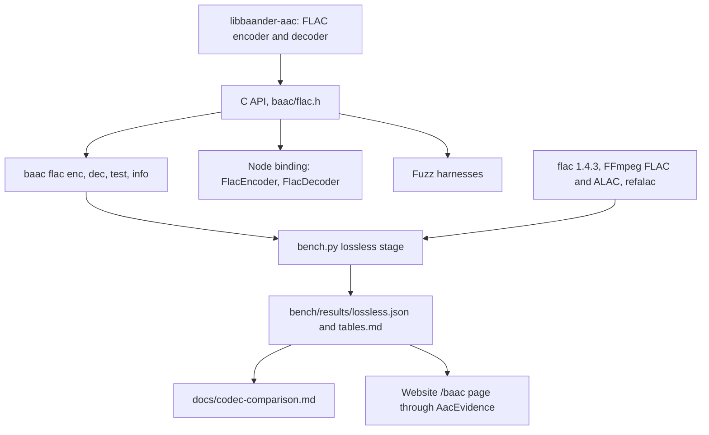
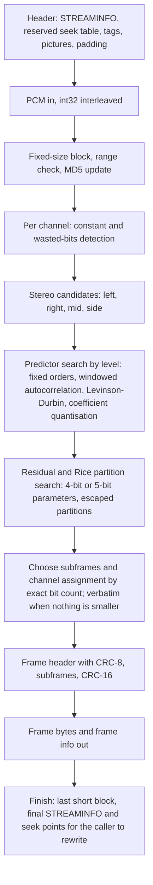
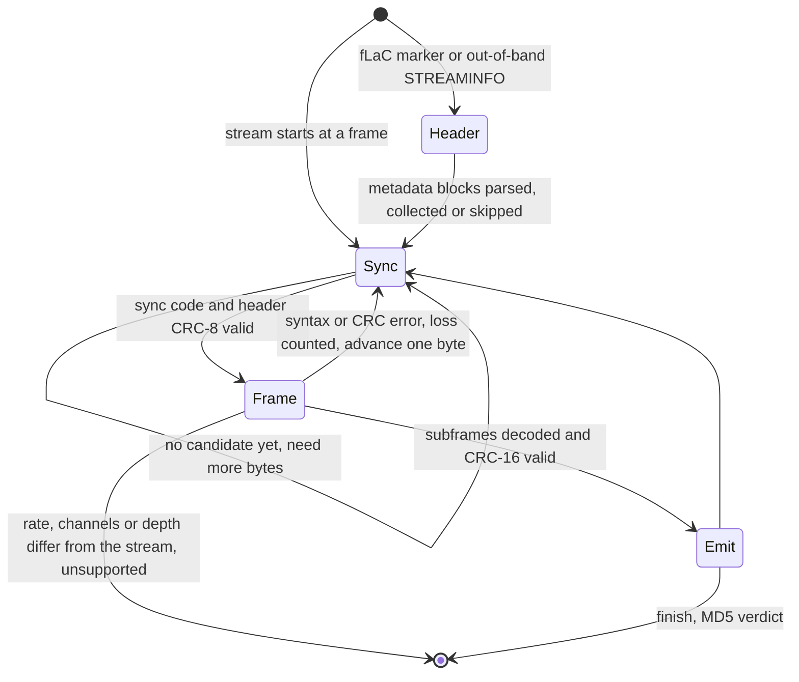

# bAAC lossless mode with FLAC streams - Plan

## Goal Capsule

**Objective:** Anyone using bAAC can compress PCM audio without loss and get the identical samples back, as standard FLAC that libFLAC, FFmpeg and browsers decode, at a size and speed on par with or better than the lossless references in the project's codec comparison.

**Means:** bAAC's own FLAC encoder and decoder, written from RFC 9639 inside `packages/baander-aac`, behind a new integer-PCM C API, `baac flac` commands and Node classes (KTD1, KTD2, KTD3).

**Product authority:** The user's request of 2026-11-10: "baac does not support lossless, it should so we are on par with the other codecs (or better). It should be efficient with good performance." The user then chose the FLAC bitstream, an own implementation, the par bar, the tag scope and the landing route (Key Decisions, KTD1, KTD13).

**Execution profile:** One branch, `baac-lossless`, with fifteen dependency-ordered units in four phases. Size parity is read as soon as linear prediction exists (U5), and speed is met in a measured loop (U11).

**Authority and stop conditions:** Follow `AGENTS.md`, then the Product Contract, then the Planning Contract.

- Stop and report if any round trip is not bit-exact; nothing else continues until it is.
- Stop at U5 and report if bAAC's frame bytes at level 5 or 8 are larger than `flac`'s on the corpus.
- Stop U11 and report when its stop rule fires with a gate of R14 to R17 still failing or undecided.
- No threshold is relaxed. The user decides what happens after a reported gap.
- No libFLAC or FFmpeg source is read for the implementation or copied into the package (KTD1).
- Do not push. Landing follows KTD13 when the user asks.

**Who finishes:** `ce-work` implements on the branch and the lead owns the commits and the ROADMAP record. The user asks for the pushes and cuts the `aac-native-v0.2.0` release tag at landing.

---

## Product Contract

### Summary

Add a lossless mode to bAAC that writes and reads standard FLAC streams, with tags and pictures. The work covers the library, a C API, the command-line tool, the Node binding, tests, fuzzing, the benchmark harness, the documentation and the website's bAAC page. The server's lossless rendition and a FLAC codec in the FFmpeg wrapper follow immediately as their own plans.

### Problem Frame

bAAC is a lossy codec only. `packages/baander-aac/docs/codec-comparison.md` says so in its Lossless section: "baander-aac has no lossless mode, and none is proposed here", and the website's `/baac` page repeats that its table "does not imply a bAAC lossless mode". Both treat lossless as a passthrough decision for the server.

The same section holds the references this work is judged against, measured over the 130 s corpus (ten TCDAudio14 excerpts, 48 kHz, 16-bit stereo), single-threaded:

| Codec | kbit/s | Encode | Decode |
|---|---:|---:|---:|
| ALAC, FFmpeg | 697 | 132× | 192× |
| ALAC, Apple reference (`refalac`) | 690 | 181×, under Wine | 214× |
| FLAC 1.4.3 level 5 | 630 | 521× | 407× |
| FLAC 1.4.3 level 8 | 615 | 195× | 395× |

Three facts about the package shape the work:

- The public API carries PCM as 32-bit float (`aac_encoder_encode(ctx, const float* pcm, …)` in `packages/baander-aac/include/aac.h`). A float holds 24 bits of integer precision, so the existing API cannot carry 32-bit audio exactly.
- The existing lossless stage of `packages/baander-aac/bench/bench.py` decodes every stream with FFmpeg, takes the best of three unpinned runs and times with `/usr/bin/time` at 0.01 s resolution. FLAC level 5 encodes the corpus in 0.25 CPU seconds (`packages/baander-aac/bench/results/lossless.json`), so one tick is 4 % of the figure. The stage cannot decide a speed gate at a 1 % spread as it stands.
- The corpus is 48 kHz, 16-bit stereo only. The comparison lists that as a coverage gap.

Measurements taken on this host during the plan's review, with `flac` built from the 1.4.3 tag, bound the work:

- The pinned build takes under a minute and reproduces 629.68 kbit/s for `flac -5` on the corpus.
- Without padding and seek table the corpus encodes to 10,248,767 bytes at `-5` and 10,010,707 bytes at `-8`.
- `flac`'s own exhaustive search inside the same ceilings gains only 0.25 % at level 5 and 0.15 % at level 8. The presets leave that little room, so a size gate with no tolerance is met only by model selection at least as good as libFLAC's.
- `flac -7` is 0.08 % larger than `flac -8` and 1.54 times faster.
- FFmpeg's FLAC encoder is 2.6 % larger at level 5 and 3.2 % larger at level 8.
- The worst corpus items carry one wasted bit in both channels.
- Over eight corpus repetitions `flac -5` encodes in 1.59 CPU seconds and `flac -8` in 4.27 s; `flac -d` with MD5 verification decodes them in 1.24 s and 1.33 s. Run-to-run spread is about 1 %.
- On corpus material resampled to 96 kHz, `flac -5 -l 12` is 7.6 % smaller than `flac -5`.

### Key Decisions

- KD1. **Lossless bAAC writes and reads standard FLAC.** (session-settled: user-directed — chosen over MPEG-4 ALS, MPEG-4 SLS and ALAC: standard FLAC streams decode in every browser and in FFmpeg) Governs R1, R2, R3, R4.
- KD2. **The par bar is strict on size and noise-only on speed, judged against references measured in the same run.** (session-settled: user-directed — chosen over "up to 0.5 % larger and 5 % slower" and over "strictly better": size is deterministic and takes no tolerance, speed is judged to the reference's measured run-to-run spread) Governs R13 to R17.
- KD3. **This plan delivers the codec and every surface the package already has; the server lossless rendition and the FFmpeg wrapper follow immediately as their own plans once the library lands.** (session-settled: user-directed — chosen over including them here and over leaving them for a later request: each needs its own plan, and neither should wait) Governs the Scope Boundaries.
- KD4. **The package keeps its names.** `baander-aac`, `libbaac`, `baac` and `@baander/aac-native` stay, because FFmpeg's `configure` check, the Electron dependency and the prebuild assets refer to them. The new mode is called lossless mode. Governs R8, R9, R10, R12.
- KD5. **Tags and pictures are in the first delivery.** (session-settled: user-directed — chosen over deferring them to a later download feature: a FLAC file without tags and cover art is not usable as a music file) Governs R23.
- KD6. **The held-out set was replaced after its first run.** (session-settled: user-directed, 2026-11-11 — chosen over publishing the second run on the same files with a disclosure: the first set was run once before the final code, two encode-speed gates failed, and four speed changes followed) The testbench files of the first set are now corpus additions with their own gates. R17 is judged on a fresh set that no tool had read before the recorded run: Open Goldberg Variations (96 kHz, 24-bit), and the Sintel 5.1 and stereo tracks, fetched against pinned checksums. If a fresh-set gate fails in the recorded run, the work stops for the user's decision. Amends R17 and the held-out paragraph of KTD12.
- KD7. **The decoder accepts ID3 tags and reports them.** (session-settled: user-directed, 2026-11-11 — chosen over accepting them silently and over matching the reference) The decoder passes over an ID3v2 tag in front of the marker and a 128-byte ID3v1 tag behind the last frame, decodes and verifies the stream between them, raises no error for either, and reports both. The reference `flac` accepts the first and reports the second as lost sync. Amends R5 and R9.
- KD8. **Encoded bytes do not depend on the compiler, the optimisation level, the processor or the C library.** Added 2026-11-11 after code review. Every file whose floating-point results decide a byte is compiled with strict math, the analysis uses its own cosine and base-2 logarithm, and fifteen pinned digests must be reproduced by every CI runner. Extends R18, which asked for identity across kernels on one machine.
- KD9. **Only the tool and the benchmark harness are split into smaller files, after the recorded run.** (session-settled: user-directed, 2026-11-11 — chosen over splitting the decoder and encoder files too, and over no split) `flac_dec.cpp` and `flac_enc.cpp` stay whole, like the package's existing encoder and decoder.

### Requirements

**Format and round trip**

- R1. The encoder writes native FLAC streams that conform to RFC 9639: the `fLaC` marker, a STREAMINFO block and frames, in the streamable subset with one fixed block size per stream, at every compression level.
- R2. Decoding an encoded stream returns the input samples bit for bit for every supported rate, depth and channel count. When the caller rewrites the header after the last frame, STREAMINFO carries the input's sample total and MD5; a stream whose header was not rewritten carries zero for both.
- R3. `flac` 1.4.3 and FFmpeg's `flac` decoder decode every stream the encoder writes to the input samples, without an error or warning. The oracle's notice about an unset MD5 on a stream whose header was not rewritten is not counted. FFmpeg is checked at 32 bits only where its version decodes 32-bit FLAC.
- R4. The decoder decodes every valid native FLAC stream bit for bit: fixed and variable block sizes, all four subframe types, both Rice parameter widths, escaped partitions, wasted bits, 1 to 8 channels, 4 to 32 bits, rates to 1,048,575 Hz, inside and outside the streamable subset. The one exception is a stream whose sample rate, channel count or bit depth changes mid-stream: it ends with an unsupported error at the first differing frame. Every file of the testbench's `subset` directory decodes bit for bit.
- R5. On damaged or hostile input the decoder does not crash, hang, or read or write out of bounds. It reports a damaged frame as an error with no concealment, resynchronises at the next valid frame, and reports that frame's sample position.

**Audio formats**

- R6. The encoder accepts 1 to 8 channels, bit depths of 8, 12, 16, 20, 24 and 32, and every sample rate a FLAC frame header can express (up to 655,350 Hz). It refuses any other input with an error and never codes it with loss.
- R7. PCM crosses the lossless API as interleaved signed 32-bit integers at the stream's bit depth, in the channel order RFC 9639 section 9.1.3 assigns to each channel count. The library does not reorder channels.

**Surfaces and naming**

- R8. The lossless C API is additive, in its own public header. Every existing `aac_*` function, the existing CLI commands and the existing Node exports behave as before.
- R9. `baac flac enc`, `baac flac dec`, `baac flac test` and `baac flac info` encode from and decode to WAV and raw integer PCM, verify integrity, and exit non-zero on any error or mismatch.
- R10. The Node binding exports a FLAC encoder and decoder class beside the AAC ones, and the package version becomes 0.2.0 everywhere it is declared. The `aac-native-v0.2.0` release tag is cut at landing, by the user, so existing installs keep a prebuilt binding.
- R11. Compression levels run from 0 to 8 with 5 as the default.
- R12. The package documentation, `CONCEPTS.md` and the website describe the lossless mode, and no tracked document still says bAAC has none.
- R23. The encoder writes and the decoder reads Vorbis comments and pictures (the VORBIS_COMMENT and PICTURE metadata blocks) through the C API, the CLI and the Node binding. `metaflac` and FFmpeg read what bAAC writes, and bAAC reads what they write.

**Performance: on par or better**

- R13. Every gate is measured by the benchmark harness in one run on one machine, single-threaded and pinned to one core, with the references at pinned versions measured in that run. Size is on par when bAAC's FLAC frame bytes are no larger than the reference's; size takes no tolerance. Speed is on par when bAAC is no slower than the reference by more than the reference's own run-to-run spread in that run (KTD12 defines the statistic). An undecided gate is not a passed gate.
- R14. At levels 5 and 8 on the corpus, bAAC's frame bytes are no larger than those of `flac -5` and `flac -8`, and its encode speed is on par with theirs.
- R15. At the default level on the corpus, bAAC's stream is no larger than either ALAC reference, and its encode and decode speeds are on par with FFmpeg's ALAC. `refalac` joins the speed comparison only when it runs in the same run. The result is recorded as a comparison and no document counts it as bAAC being better.
- R16. bAAC's decode speed on the `flac -5` and `flac -8` streams of the corpus is on par with `flac -d`, with MD5 verification on in both, and on par with FFmpeg's decode, with frame CRC checks on and MD5 verification off in both.
- R17. At the default level, R14's size and speed rules against `flac -5` and R16's decode rules hold on three held-out inputs: real 96 kHz, 24-bit recordings, a real 5.1 recording and a 16-bit stereo recording (KTD12 names the files). No tuning is driven by these inputs.
- R18. The encoder and decoder allocate nothing once running, run on one thread, and the `baac flac` commands use memory that does not grow with the input length. On one machine the scalar path and every SIMD path produce identical encoder output.

**Delivery**

- R19. The codec is bAAC's own, written from RFC 9639 and RFC 1321. It stays Apache-2.0, and the Provenance section states the sources and oracles.
- R20. The package's CI runs the lossless suites, the interop checks against the pinned `flac` and FFmpeg, and the decoder testbench, and fails when one of those oracles is missing.
- R21. The website build accepts the new benchmark rows and the `/baac` page shows bAAC's default level and level 8 beside the references.
- R22. Landing the work starts no FFmpeg image build.

### Acceptance Examples

- AE1. **Covers R2, R6.** Given 32-bit stereo input that contains the most negative value and alternates between full-scale extremes, when it is encoded at levels 0, 5 and 8, then each stream decodes to the input bit for bit and `flac -t` accepts it.
- AE2. **Covers R5.** Given a valid stream with one bit flipped inside its third frame, when it is decoded, then frames one and two decode, the third returns a decode error, the fourth decodes, and the decoder reports the fourth frame's sample position. `baac flac dec` exits non-zero.
- AE3. **Covers R6, R9.** Given a 32-bit float WAV file, when `baac flac enc` is run on it, then the command refuses it with a message naming the format and leaves no output file.
- AE4. **Covers R1, R2, R3, R9.** Given output to a pipe, when `baac flac enc` finishes, then STREAMINFO carries zero for the total and the MD5, the stream has no seek table, and `flac -d` decodes it to the input, printing at most its notice that the MD5 is unset.
- AE5. **Covers R4.** Given a variable-block-size stream from the testbench, when bAAC decodes it, then the samples equal `flac -d`'s and each frame reports its own block size and sample position.
- AE6. **Covers R13, R14.** Given `flac -5` frame bytes of F on the corpus, bAAC level 5 passes on size at F bytes or fewer and fails at F plus one. Given reference CPU times whose spread is 1 %, the speed threshold is a time ratio of 1.01: paired ratios of 0.97 to 1.00 pass, 0.99 to 1.03 are undecided, and 1.02 to 1.05 fail.
- AE7. **Covers R20.** Given the CI job with the step that builds the pinned `flac` removed, when the suites run with oracles required, then the interop suite fails instead of skipping.
- AE8. **Covers R23.** Given tags `ARTIST=Ravel`, two `GENRE` values and a JPEG front cover, when `baac flac enc` writes them and `metaflac --list` and `baac flac info` read the file, then both show the same tags in the same order and a picture of the same bytes, type and MIME type.

### Success Criteria

- The Lossless table in `packages/baander-aac/docs/codec-comparison.md` carries bAAC rows beside ALAC and FLAC from one run, with every row bit-exact, and states each gate's median ratio, spread and outcome.
- A developer who reads only `packages/baander-aac/docs/README.md` can encode a tagged WAV file to FLAC and decode it with the CLI, the C API and the Node binding.

### Scope Boundaries

In scope: the FLAC encoder and decoder, tags and pictures, the C API, the CLI, the Node binding, tests, fuzz harnesses, the benchmark harness and its results, the package documentation, `CONCEPTS.md`, the website's bAAC page with its evidence validator, and the addon workflow.

Considered and not built:

- **Wrapping libFLAC behind the API** (KTD1).
- **Variable-block-size encoding.** RFC 9639 Appendix C.2 says many decoders see little use of such streams and that fixed block sizes give maximum compatibility, which KD1 depends on. A reported size gap at U5 would put this back in front of the user.
- **Multithreaded encoding.** The library has no threading model and every timed run in the harness is single-threaded. Callers already parallelise across instances.
- **Error concealment in lossless mode.** A concealed frame is not lossless. The decoder reports the loss and its position instead (R5).
- **Decoding across a mid-stream change of sample rate, channel count or bit depth** (R4). Such streams are four testbench curiosities; a player would need a new output format mid-stream.
- **Mirroring libFLAC's accept-or-refuse behaviour** beyond the per-file expectations of U3.
- **Renaming the package, library, pkg-config file or addon** (KD4).
- **A lossless object type on `aac_encoder_create`.** That call takes float PCM and a bitrate (KTD2).
- **Encoder output outside the streamable subset**: bit depths the frame header cannot name, and rates above 655,350 Hz. The decoder reads them (R4).
- **A committed encoder stream checked byte for byte on every platform.** The guarantee is identical bytes across the dispatch paths of one machine (KTD7).
- **ALAC, MPEG-4 ALS and MPEG-4 SLS** (KD1).

#### Deferred to Follow-Up Work

- **Server lossless renditions or downloads.** Its own plan, started immediately once the library lands (KD3). It needs a new `AudioRenditionFormat`, delivery decisions and UI.
- **A FLAC codec in the FFmpeg wrapper** (`docker/ffmpeg/baac`). Its own plan, started immediately once the library lands (KD3). It needs a regenerated registration patch and one image build, and is measured against FFmpeg's native encoder there.
- **FLAC in fragmented MP4 for HLS and DASH.** The encoder reports each frame's bytes and sample position and exposes the STREAMINFO block, which is what an MP4 muxer needs (KTD2). The muxing belongs to the server plan. Browser support is uneven: WebKit bug reports describe `audio/mp4; codecs="flac"` reported as supported yet not playing, so that work must test real appends.
- **The Electron bridge.** `AacService` gains FLAC sessions when a renderer feature needs them. Chromium plays FLAC natively.
- **A browser playback matrix check**, with the feature that delivers bAAC's FLAC to browsers. Safari's Core Audio decoder is not exercised by this plan.
- **Cue sheets, APPLICATION blocks, interpretation of the channel-mask tag, and pass-through of metadata blocks the library does not model.**
- **Ogg FLAC and the Matroska mapping, RF64 and Wave64 input.**
- **AVX2 kernels in the Node binding.** `packages/baander-aac/binding.gyp` compiles SSE2 and NEON only, for AAC as well.

### Dependencies and Assumptions

- FFmpeg is available where the suites and the benchmark run; this host has 8.1.3. The pinned `flac` is built by the reference script (KTD17).
- The FLAC decoder testbench (`ietf-wg-cellar/flac-test-files`, commit `aa7b0c6`, CC0 1.0) stays fetchable. It holds 67 files in `subset` (294 MB), 12 in `uncommon` (14 MB) and 12 in `faulty` (1.7 MB), counting each directory's README.

### Sources and Research

- RFC 9639, *Free Lossless Audio Codec (FLAC)*: section 7 (streamable subset), 8.2 (STREAMINFO and MD5), 8.6 and 8.8 (Vorbis comment and picture blocks), 9.1 (frame header, channel order), 9.2.7 (residual coding and the 32-bit residual limit), 11 (security), Appendix A.4 (32-bit pitfalls), Appendix C.2 (variable block size).
- `flac` 1.4.3 manual (`man/flac.md` at tag 1.4.3) for the preset definitions in KTD5, the 8192-byte default padding and the 10 s default seek points.
- `packages/baander-aac/bench/bench.py` (`stage_lossless`, `stage_report`, `best_of`, `run`), `packages/baander-aac/bench/results/lossless.json`, `packages/baander-aac/bench/setup-refs.sh`.
- `packages/baander-aac/include/aac_dsp.h`, `packages/baander-aac/src/aac_cpu.cpp`, `packages/baander-aac/CMakeLists.txt` for the dispatch pattern, the `BAAC_AAC_CPU` cap, the Release math options and the per-file SIMD flags.
- `packages/baander-tooling/src/Website/AacEvidence.php` (`lossless()` accepts exactly four codec ids), `ui/site/tests/baac.spec.ts` (expects four rows).
- `docs-book/part-2-developer-guide/contributing/continuous-integration.md` for the workflow triggers and the `[skip ci]` rule.
- `docs/solutions/best-practices/static-ffmpeg-build-silently-drops-components-the-application-uses.md`: the capability gate lists what the application selects. This plan adds nothing the application selects, so `docker/ffmpeg/expected-capabilities.txt` is unchanged.

---

## Planning Contract

### Key Technical Decisions

- KTD1. **bAAC implements the FLAC encoder and decoder itself, from RFC 9639.** (session-settled: user-directed — chosen over wrapping libFLAC behind the API: an own codec keeps the library self-contained and is the only route to being better than the reference) An own implementation keeps `libbaac` one self-contained Apache-2.0 library with no second dependency in the FFmpeg image or the addon. It lets the lossless API follow the package's rules: streaming buffers and no allocation once running. The project owns the codec's behaviour and tuning. A wrapper could at best equal `flac`. libFLAC and FFmpeg are oracles through their binaries only; no source of either is read for the implementation or copied. FLAC has no trained normative tables, and the level ceilings in KTD5 come from the `flac` manual. The Provenance section records this (R19).
- KTD2. **A separate public header with its own handles and integer PCM.** `packages/baander-aac/include/flac.h` installs as `<baac/flac.h>` with symbols prefixed `baac_flac_`, returning the existing `AacError` codes. The AAC handles are built around float PCM, a bitrate, an object type, transports and codec delay, none of which applies. The existing API stays untouched (R8). The float contract rules out extending `aac_encoder_create`, so no second mechanism was left to compare.
- KTD3. **Streamable subset, fixed block size, native FLAC only.** Inherits KD1 (session-settled: user-directed — chosen over MPEG-4 ALS, MPEG-4 SLS and ALAC: standard FLAC streams decode in every browser and in FFmpeg); governs R1 to R3. Subset streams carry rate and depth in every frame header and are the profile RFC 9639 names as most compatible.
- KTD4. **Build the decoder first.** It is verified against streams from `flac` and FFmpeg and against the testbench before the encoder exists. The encoder is then checked by three independent decoders, so an encoder and decoder that share a misreading of the specification cannot pass.
- KTD5. **Level N searches within the ceilings of `flac`'s preset N, at every sample rate.** The table is in the High-Level Technical Design. That makes a same-level comparison like for like: bAAC's level 8 is a level-8 comparison because it may search up to that preset's order and windows and must reach `flac -8`'s size with no tolerance, which a level-7 search that is 0.08 % larger does not. The ceilings are not raised above 48 kHz, where a higher order alone is worth 7.6 %. Inside the ceilings the search strategy is bAAC's own.
- KTD6. **Integer arithmetic on every path that touches samples.** Prediction uses 32-bit accumulators when bit depth plus coefficient precision plus log2 of the order is at most 32, and 64-bit otherwise. A 32-bit side channel needs 33 bits and takes the 64-bit path. The encoder checks every residual against RFC 9639's limit (absolute value below 2^31) and falls back to another predictor, independent channels or a verbatim subframe.
- KTD7. **On one machine, the scalar path and every SIMD path produce identical encoder output.** Floating point appears only in the analysis (windowing, autocorrelation, Levinson-Durbin, quantisation). The analysis and its kernels live in their own translation units: `flac_lpc.cpp`, `flac_dsp.cpp` and one file per SIMD level under `packages/baander-aac/src/simd/` (`flac_sse2.cpp`, `flac_avx2.cpp`, `flac_neon.cpp`). Each gets per-file flags that negate the package's Release math options (`-fno-associative-math -fno-reciprocal-math -fsigned-zeros -ftrapping-math -fno-finite-math-only`) and add `-ffp-contract=off`, and the scalar and SIMD kernels share one accumulation order. The files are listed in CMake, in `baander-aac-simdeps`, and (SSE2 and NEON only) in `binding.gyp`. The existing AAC SIMD files and their flags stay untouched. No encoder stream is committed for byte comparison: ROADMAP records that `test_usac_enc`'s byte-identical fixture already fails on this host's compiler.
- KTD8. **A second dispatch table for the FLAC kernels, in the existing pattern.** It is filled from `aac_get_cpu_flags()`, capped by `BAAC_AAC_CPU`, and each kernel is tested against its scalar version. Kernels: autocorrelation, fixed and LPC residual at 16, 32 and 64 bits, Rice partition sums, LPC restore, stereo transforms and interleaving. Whether SSE4.1 earns its own translation unit is decided by measurement in U6; it would follow KTD7's file and flag rule. The Node binding keeps the levels `packages/baander-aac/binding.gyp` compiles today.
- KTD9. **Dedicated bit reader and writer with a 64-bit cache.** `aac_bitreader_read` recomputes from a bit position on each call and `aac_bitwriter_write` loops per byte; both were built for Huffman codes. Rice decoding needs a count-leading-zeros on a wide cache, with an MSVC path because the addon workflow builds with it.
- KTD10. **Integrity checks are on by default and matched in comparisons.** The encoder always computes the MD5 and writes both CRCs; the MD5 and the sample total reach the stream when the caller rewrites the header (R2). The decoder always checks the header CRC-8 and frame CRC-16. MD5 verification is optional in the API and on in the CLI, where `baac flac dec --no-md5` turns it off. The harness uses that option only for the comparison with FFmpeg, whose FLAC decoder does not verify the MD5 (R16).
- KTD11. **No threads.** One instance runs on the calling thread; instances are independent.
- KTD12. **The measurement method.** One owner for how every level is measured:
  - *Rows.* The lossless stage measures bAAC levels 0 to 8, `flac -0` to `-8`, FFmpeg ALAC, and `refalac` when the setup provides it. FFmpeg's native FLAC encoder at levels 5 and 8 is measured as ungated reference rows.
  - *Size.* Size comes from one pass over the 130 s corpus. FLAC rows also record frame bytes, the file minus its metadata blocks, because `flac` writes 8192 bytes of padding and seek points by default. Every size gate compares frame bytes.
  - *Timing.* Each timed run is pinned to one core with `taskset`, over the input repeated until the shortest run takes at least 2 CPU seconds (sixteen corpus repetitions on this host). Each gate takes at least five repeats, and inside a repeat the reference and bAAC run back to back in alternating order.
  - *Statistic.* A repeat yields one paired ratio, bAAC's CPU time over the reference's. The threshold is 1 plus the reference's spread, its maximum CPU time minus its minimum over its median across the repeats. The gate reads the median of the paired ratios against the threshold and records their range. A range that straddles the threshold makes the gate undecided.
  - *Decode.* Decode speed uses neutral streams, the `flac -5` and `flac -8` outputs, decoded by bAAC, `flac -d` and FFmpeg with the checks of R16; frame CRC verification is switched on explicitly in FFmpeg if its default leaves it off.
  - *Exactness.* Every stream is cross-decoded: bAAC's by `flac` and FFmpeg, theirs by bAAC, each compared with the source.
  - *Held-out inputs.* R17's inputs are PCM decoded with `flac -d` from the testbench's real recordings: `subset` files 28 to 32 (96 kHz, 24-bit), file 41 (5.1) and file 01 (16-bit stereo). Each set's total frame bytes gate; per-file figures are recorded. Inputs resampled or rearranged from the corpus serve as correctness round trips only.
  - *ALAC.* When `refalac` cannot run on the machine, its row is carried from the 2026-10-30 run and compared on size only. That carried row is the single exception to "one run".
  - *Check mode.* It prints each gate of R14 to R17 as passed, failed or undecided with its median and range, and exits non-zero unless every gate passed. It also prints whether each bAAC level is no larger than the level below it on the corpus, as an observation that does not affect the exit.
  - *Record.* The recorded run is the first complete run after the last code change. The report states the machine, compiler and tool versions. Speeds compare within a run only.
- KTD13. **Landing by the two-step push.** (session-settled: user-directed — chosen over a single ordinary push: the two-step push starts no FFmpeg image build) All of it happens only when the user asks.
  1. The branch is pushed to GitHub without touching `master`, and `aac-native.yml` is dispatched on that ref, so MSVC, Apple clang and the NEON build compile and run the new code. The master pushes follow only after every platform job passes.
  2. The first master push carries every commit that touches `packages/baander-aac/**`, the addon workflow and the website, with `[skip ci]` on its tip. U13's changes are committed before or with the results file, so the website builds at every commit.
  3. The second master push carries the root-level documents (`CONCEPTS.md`, `ROADMAP.md`, the CI guide). The CI guide is a website path, so this push runs `website.yaml` and `ci.yaml` on the complete tree, and it starts no FFmpeg build.
  4. `aac-native.yml` is dispatched on `master`, and the user cuts `aac-native-v0.2.0`.

  The FFmpeg wrapper links none of the new code and the pinned image digest does not move, so no new image is needed. Before step 1 the `baac-builder` stage of `docker/ffmpeg/Dockerfile` is built locally to prove the package compiles and installs with the image's toolchain.
- KTD14. **Version 0.2.0.** The install script fetches a prebuilt binding by package version and accepts it when the binary reports the same version. Without a bump, a 0.1.0 prebuild without FLAC classes would pass that check. Until the 0.2.0 release exists, installs build from source (R10).
- KTD15. **The `baac flac` commands stream their input and output.** The existing `baac enc` reads the whole file, which `codec-comparison.md` notes costs 69 MiB on the corpus; hi-res albums are far larger. The existing `read_wav` converts to float, so the lossless commands get an integer WAV reader and writer.
- KTD16. **The testbench is fetched, not committed.** It is 310 MB. A script pins the commit and a committed SHA-256 manifest. Small fixtures made with `flac` and FFmpeg from synthetic signals are committed for offline runs. A suite that needs an oracle skips with a message by default and fails when `BAAC_REQUIRE_ORACLES` is set, which CI sets (R20).
- KTD17. **One script provides the reference `flac`.** `packages/baander-aac/tests/flac-reference.sh` clones `xiph/flac` at the commit of tag 1.4.3, builds it with CMake in Release and prints the binary path; `metaflac` comes from the same build. The suites of U3 to U5 and U15 use it. `packages/baander-aac/bench/setup-refs.sh` calls it and writes the lossless exports before it builds the AAC references, so a missing GstPEAQ dependency cannot block the lossless stage. CI runs the same script behind a cache keyed on the pinned commit instead of installing the runner's package.
- KTD18. **Tags and pictures are modelled, bounded and opt-in on read.** The encoder takes Vorbis comments and pictures as options before the header is written and validates them. The decoder skips metadata by length unless the caller asks it to collect tags and pictures, and then holds them up to a caller-set byte cap, as RFC 9639 section 11 requires before allocating from a stream's lengths.
- KTD19. **The seek table is reserved up front or omitted.** It is written only when the options give a total-samples hint and the output is seekable. It is reserved at full size in the first header and filled when the header is rewritten, so the rewrite never changes the header's length.

### Assumptions

These are the planner's readings of the request, not confirmed by the user.

- `flac` 1.4.3 stays the FLAC reference, as in the published comparison. FLAC 1.5's multithreaded encoder is outside a single-threaded comparison.
- The testbench recordings named in KTD12 have the formats the review reported. U10 verifies each file's format before using it.
- The website must show the new rows because its build validates `packages/baander-aac/bench/results/lossless.json` and would fail otherwise.
- Chromium and Firefox decode FLAC with decoders this plan's oracles represent. This was not verified.

### High-Level Technical Design

Consumers and evidence flow:

Encoder pipeline:

Decoder states:

Level ceilings (KTD5), from the `flac` 1.4.3 manual. Every column is a ceiling, the window count included: `-6` and `-7` use the whole-block window plus its two halves, and `-8` adds three thirds and three punch-outs.

| Level | Block size | Max LPC order | Stereo search | Max Rice partition order | Analysis windows |
|---|---:|---:|---|---:|---|
| 0 | 1152 | fixed predictors only | independent | 3 | none |
| 1 | 1152 | fixed predictors only | adaptive | 3 | none |
| 2 | 1152 | fixed predictors only | full | 3 | none |
| 3 | 4096 | 6 | independent | 4 | one |
| 4 | 4096 | 8 | adaptive | 4 | one |
| 5 | 4096 | 8 | full | 5 | one |
| 6 | 4096 | 8 | full | 6 | three |
| 7 | 4096 | 12 | full | 6 | three |
| 8 | 4096 | 12 | full | 6 | nine |

API surface, by operation rather than signature:

- **Encoder:** create from rate, channels, bit depth and level; an options structure filled by an init function, as `aac_usac_encoder_options_init` does (padding, total-samples hint, Vorbis comments, pictures); write the stream header; encode any number of samples and receive whole frames; query the largest output a call can need; read the last frame's bytes, sample count and sample position; finish, which emits the last short block; read the final header bytes for the caller to rewrite at offset zero; destroy.
- **Decoder:** create; optionally set an out-of-band STREAMINFO; optionally ask for tags and pictures with a byte cap; feed bytes in any chunking; decode the next frame into int32; read the stream properties, the last frame's block size and sample position, and the collected tags and pictures; read the lost-frame count; drop buffered input for a seek; finish with an MD5 verdict of match, mismatch or unknown; reset; destroy.

### System-Wide Impact

- **FFmpeg image.** The new objects land in `libbaander-aac.a`, but the wrapper references none of them, so the image's behaviour does not change. `ffmpeg.yaml` triggers on the package path, which KTD13 avoids.
- **Website.** `website.yaml` triggers on the package path and validates the results files, so the validator changes before or with the results (KTD13).
- **Prebuilt binding.** Between the version bump and the 0.2.0 release, installs build from source; the install script already falls back that way.
- **Portability.** The addon workflow compiles every source with MSVC, Apple clang on x64 and arm64, and GCC, and runs the Node smoke test on each. The CTest suites run on Linux only. KTD13 runs that workflow on the branch before `master` moves.
- **Published claims.** The gates are measured on the CMake Release build, which dispatches to AVX2. The Node addon compiles SSE2 or NEON only, so the published figures describe the library build.

### Risks

| Risk | Mitigation |
|---|---|
| The size gate has no tolerance and `flac`'s presets sit within 0.25 % and 0.15 % of its own exhaustive search | Size is read at U5, before any speed work, and a larger result stops the work there for the user to decide |
| Speed parity is not reached | U11 is a measured loop with a stop rule; an undecided gate is reported as undecided |
| Encoder and decoder share a misreading of RFC 9639 | KTD4: three independent decoders and two independent encoders, plus the testbench |
| Hostile streams reach the decoder through the Node binding | R5, RFC 9639 section 11 bounds in U2 and U15, fuzzing under ASan and UBSan in U9 |
| 32-bit and 33-bit arithmetic overflow | KTD6, AE1, and the testbench's 32-bit file |
| A check passes because its oracle is absent | KTD16, KTD17 and AE7 |
| The held-out sets are small: five 96 kHz files, one 5.1 file, one 16-bit file | Per-file figures are recorded beside the totals, and the document states the coverage |
| The published toolchain (GCC 13.3, FFmpeg 6.1.1) differs from this host (GCC 16.2.1, FFmpeg 8.1.3) | Every row is re-measured in one run and the report states the versions |

---

## Implementation Units

| U-ID | Phase | Title | Key files | Depends on |
|---|---|---|---|---|
| U1 | 1 Decoder | Format foundation and build wiring | `packages/baander-aac/include/flac.h`, `packages/baander-aac/src/flac_format.cpp` | none |
| U2 | 1 Decoder | Decoder | `packages/baander-aac/src/flac_dec.cpp` | U1 |
| U3 | 1 Decoder | Reference tools, fixtures and conformance | `packages/baander-aac/tests/flac-reference.sh`, `packages/baander-aac/tests/test_flac_conformance.cpp` | U2 |
| U4 | 2 Encoder | Encoder core | `packages/baander-aac/src/flac_enc.cpp` | U1, U2, U3 |
| U5 | 2 Encoder | Linear prediction, levels and the size read | `packages/baander-aac/src/flac_lpc.cpp` | U4 |
| U6 | 2 Encoder | Kernels, dispatch and determinism | `packages/baander-aac/src/flac_dsp.cpp`, `packages/baander-aac/src/simd/flac_sse2.cpp` | U2, U5 |
| U7 | 3 Surfaces | Command-line tool | `packages/baander-aac/tools/baac_flac.cpp` | U2, U4 |
| U8 | 3 Surfaces | Node binding and version | `packages/baander-aac/node/src/flac_addon.cc` | U2, U5 |
| U15 | 3 Surfaces | Tags and pictures | `packages/baander-aac/src/flac_meta.cpp` | U3, U7, U8 |
| U9 | 3 Surfaces | Fuzzing | `packages/baander-aac/tools/fuzz/fuzz_flac_decoder.cpp` | U3, U5, U15 |
| U10 | 4 Measurement and delivery | Benchmark harness | `packages/baander-aac/bench/bench.py`, `packages/baander-aac/bench/setup-refs.sh` | U3, U7 |
| U11 | 4 Measurement and delivery | Meet the gates and record results | `packages/baander-aac/bench/results/lossless.json` | U6, U10 |
| U12 | 4 Measurement and delivery | Documentation and vocabulary | `packages/baander-aac/docs/README.md`, `packages/baander-aac/docs/codec-comparison.md` | U11, U15 |
| U13 | 4 Measurement and delivery | Website | `packages/baander-tooling/src/Website/AacEvidence.php` | U10 |
| U14 | 4 Measurement and delivery | CI and landing checks | `.github/workflows/aac-native.yml` | U3, U8, U9 |

The lead applies every edit to `packages/baander-aac/CMakeLists.txt`, `packages/baander-aac/tests/CMakeLists.txt` and `packages/baander-aac/binding.gyp`. A worker whose unit lists one of them reports the entries it needs. `ce-simplify-code` runs at the end of each phase.

### U1. Format foundation and build wiring

- **Goal:** The shared pieces both codecs need exist and are proven against known answers.
- **Requirements:** R1, R8, R19.
- **Dependencies:** none.
- **Files:** `packages/baander-aac/include/flac.h`, `packages/baander-aac/src/flac_internal.h`, `packages/baander-aac/src/flac_format.cpp`, `packages/baander-aac/CMakeLists.txt`, `packages/baander-aac/binding.gyp`, `packages/baander-aac/tests/CMakeLists.txt`, `packages/baander-aac/tests/test_flac_format.cpp`.
- **Approach:** Declare the public types and functions of KTD2. Implement CRC-8 and CRC-16, MD5 from RFC 1321, the coded frame and sample numbers, STREAMINFO and frame header reading and writing, and the bit reader and writer of KTD9. The sources go into both build systems under the existing `BAAC_AAC_BUILD_ENCODER` and `BAAC_AAC_BUILD_DECODER` options.
- **Patterns to follow:** `packages/baander-aac/src/usac_lpd_internal.h` for an internal header kept out of the installed set; the `_WIN32` guards in `packages/baander-aac/src/aac_cpu.cpp`.
- **Test scenarios:**
  - The MD5 of each RFC 1321 test string equals its published digest.
  - CRC-8 and CRC-16 of a fixed byte string equal values computed by hand from the polynomials in RFC 9639.
  - The example streams of RFC 9639 Appendix D parse to the header fields the appendix lists.
  - Coded numbers round-trip at 0, 127, 128, the 31-bit maximum and the 36-bit maximum.
  - A frame header with each reserved or forbidden field value is rejected.
  - The bit reader reports an overread instead of reading past the buffer.
  - The existing suites build and pass unchanged.
- **Verification:** `test_flac_format` passes in a Release and a `BAAC_FUZZ` build, and the binding compiles with the new sources.

### U2. Decoder

- **Goal:** Any valid native FLAC stream decodes bit for bit through a streaming API.
- **Requirements:** R4, R5, R7, R18.
- **Dependencies:** U1.
- **Files:** `packages/baander-aac/src/flac_dec.cpp`, `packages/baander-aac/src/flac_api.cpp`, `packages/baander-aac/tests/test_flac_decoder.cpp`, `packages/baander-aac/tests/test_allocation.cpp`.
- **Approach:**
  1. Parse the marker and metadata: read STREAMINFO and the seek table, skip other blocks by length without buffering them.
  2. Follow the decoder states of the design: sync, validate the header CRC-8, decode subframes, validate the CRC-16, emit.
  3. Decode constant, verbatim, fixed and LPC subframes with both Rice widths, escaped partitions and wasted bits, on the arithmetic of KTD6, then undo the stereo assignment.
  4. Bound every allocation and length by the stream's own limits before use, as RFC 9639 section 11 requires.
  5. Report each frame's block size and position and the lost-frame count; verify the MD5 when enabled.
- **Patterns to follow:** `aac_decoder_feed` and `aac_decoder_decode_next` for the FIFO contract; `packages/baander-aac/tests/test_allocation.cpp` for the steady-state check.
- **Test scenarios:**
  - A hand-built stream with one subframe of each type decodes to the expected samples.
  - Feeding a stream one byte at a time gives the same samples as feeding it whole.
  - Covers AE2. A flipped bit in the third frame gives two good frames, one error, then good frames with the right position.
  - A stream that starts at a frame header decodes once a valid frame is found; one whose frames defer rate or depth to STREAMINFO returns unsupported until a configuration is set.
  - A stream whose fourth frame names another sample rate, channel count or bit depth decodes three frames and then returns unsupported.
  - A 16 MB metadata block is skipped without growing the FIFO to its size.
  - A stream whose MD5 field is zero finishes with the verdict "unknown"; a wrong MD5 finishes with "mismatch".
  - A frame claiming a block size the stream cannot have is refused without allocation.
  - After a seek reset, decoding from an arbitrary byte offset resumes at the next frame and reports its position.
  - No allocation happens after the first frames of a steady stream.
- **Verification:** `test_flac_decoder` and the extended `test_allocation` pass.

### U3. Reference tools, fixtures and conformance

- **Goal:** The pinned reference exists, and the decoder is proven against other encoders' streams and the testbench.
- **Requirements:** R4, R5, R20.
- **Dependencies:** U2.
- **Files:** `packages/baander-aac/tests/flac-reference.sh`, `packages/baander-aac/tests/data/flac/`, `packages/baander-aac/tests/flac-testbench.sh`, `packages/baander-aac/tests/flac-testbench.sha256`, `packages/baander-aac/tests/test_flac_conformance.cpp`, `packages/baander-aac/tests/test_util.h`, `packages/baander-aac/tests/CMakeLists.txt`.
- **Approach:** Add the reference script of KTD17 and the fetch script of KTD16. Commit small streams encoded by the pinned `flac` and by FFmpeg from the suite's synthetic signals, each with the MD5 of its source, kept under 300 KB in total. The conformance suite reads the testbench directory and the `flac` path from the environment and holds the per-file expectations below.
- **Patterns to follow:** `packages/baander-aac/bench/corpus.sh` for a pinned, checksummed fetch; `have_ffmpeg` and `run_command` in `packages/baander-aac/tests/test_util.h`.
- **Test scenarios:**
  - The reference script prints the path of a binary that reports version 1.4.3.
  - Every committed fixture decodes to its recorded MD5: 8, 16, 24 and 32 bits, mono to 7.1, 8 kHz to 192 kHz, from both encoders.
  - Every `subset` file decodes to the MD5 in its STREAMINFO.
  - Covers AE5. `uncommon` files 05 to 10 decode to the samples of `flac -d`.
  - `uncommon` file 11 decodes from its first valid frame and equals `flac -d -F`.
  - `uncommon` files 01 to 04 end with an unsupported error at the first differing frame, with the frames before it decoded.
  - Every `faulty` file ends in an error or a clean finish, never a crash, under the sanitizer build.
  - Covers AE7. With `BAAC_REQUIRE_ORACLES` set and the testbench or `flac` absent, the suite fails.
- **Verification:** The suite passes with the testbench present and reports the file counts it checked.

### U4. Encoder core

- **Goal:** A correct encoder exists at levels 0 to 2, with the full stream lifecycle.
- **Requirements:** R1, R2, R3, R6, R7, R11.
- **Dependencies:** U1, U2, U3.
- **Files:** `packages/baander-aac/src/flac_enc.cpp`, `packages/baander-aac/src/flac_api.cpp`, `packages/baander-aac/tests/test_flac_encoder.cpp`, `packages/baander-aac/tests/test_flac_interop.cpp`, `packages/baander-aac/tests/CMakeLists.txt`.
- **Approach:**
  1. Buffer input into fixed blocks, check each sample against the bit depth, update the MD5.
  2. Detect constant channels and wasted bits; search fixed predictors of order 0 to 4.
  3. Search Rice parameters and partition orders by exact bit count; use an escaped partition or a verbatim subframe when smaller.
  4. Evaluate the stereo assignments the level allows.
  5. Write the header with the seek table of KTD19, the frames and, at finish, the final header bytes.
- **Patterns to follow:** `aac_encoder_max_frame_bytes` and its refusal before consuming input; `aac_encoder_flush` starting a new stream; `packages/baander-aac/tests/test_interop.cpp`.
- **Test scenarios:**
  - Round trips are exact for every depth of R6, 1 to 8 channels, and rates of 8,000, 44,100, 48,000, 96,000, 192,000, 22,254 and 655,350 Hz.
  - Covers AE1. The 32-bit extremes round-trip and `flac -t` accepts the streams.
  - Digital silence, a constant offset, full-scale noise, a signal with one wasted bit and one with eight each round-trip, and the noise stream is no larger than verbatim plus the frame overhead.
  - Inputs of zero, one, fifteen and block-size-plus-one samples produce valid streams with the right total.
  - A sample outside the declared depth, a rate of 700,001 Hz, nine channels and a depth of 17 are each refused with an invalid-argument or unsupported error.
  - An output buffer below the published bound is refused before any input is consumed.
  - A second stream after finish equals a fresh encoder's output.
  - With the header rewritten, the MD5 and total match the input and `flac -d` and FFmpeg decode the stream with no diagnostic output.
  - Covers AE4. Without the rewrite the MD5 and total are zero and both oracles still decode the stream to the input.
  - With a total-samples hint and a rewrite, the stream carries seek points that `flac -t` accepts and that name real frame starts; without the hint it carries no seek table.
- **Verification:** `test_flac_encoder` and `test_flac_interop` pass with the pinned `flac` and FFmpeg present.

### U5. Linear prediction, levels and the size read

- **Goal:** Levels 3 to 8 exist within the ceilings of KTD5, and their size against `flac` is known.
- **Requirements:** R1, R2, R11, R14, R18.
- **Dependencies:** U4.
- **Files:** `packages/baander-aac/src/flac_lpc.cpp`, `packages/baander-aac/src/flac_enc.cpp`, `packages/baander-aac/CMakeLists.txt`, `packages/baander-aac/tests/test_flac_encoder.cpp`, `packages/baander-aac/tests/test_flac_interop.cpp`.
- **Approach:** Window each block, compute the autocorrelation, run Levinson-Durbin for every order up to the level's ceiling, quantise the coefficients to a precision that keeps the 32-bit path where the depth allows, and choose the order from estimated then exact bit counts. Levels 6 to 8 may analyse up to the table's number of windows: the whole block, its halves and, at level 8, its thirds and punch-outs. Use 5-bit Rice parameters when a partition needs them. `flac_lpc.cpp` takes the flags of KTD7.
- **Execution note:** As soon as levels 5 and 8 round-trip, encode the corpus with bAAC and with the pinned `flac` and compare frame bytes. The interop suite does this when an environment variable names the corpus directory. If bAAC is larger at either level and the unit cannot close the gap, stop and report the figures.
- **Patterns to follow:** The per-file `COMPILE_FLAGS` given to `packages/baander-aac/src/simd/avx2.cpp` in `packages/baander-aac/CMakeLists.txt`, with the options KTD7 lists.
- **Test scenarios:**
  - Every scenario of U4's round-trip matrix passes at levels 3, 5 and 8.
  - A pure sine at 16 and 24 bits compresses to under a quarter of verbatim at level 5.
  - A block whose LPC residual would reach 2^31 falls back and still round-trips.
  - No stream at any level and any sample rate exceeds the order, partition order or block size of its row in the level table.
  - Two encodes of the same input at the same level give identical bytes.
  - At 96 kHz and 24 bits the round trip is exact and `flac -t` accepts the stream.
  - With the corpus present, the suite prints bAAC's and `flac`'s frame bytes at levels 5 and 8.
- **Verification:** The encoder and interop suites pass at every level, and bAAC's corpus frame bytes at levels 5 and 8 are no larger than `flac`'s.

### U6. Kernels, dispatch and determinism

- **Goal:** The hot loops run through a dispatch table without changing a byte of output.
- **Requirements:** R18, and the speed side of R14 to R17.
- **Dependencies:** U2, U5.
- **Files:** `packages/baander-aac/src/flac_dsp.cpp`, `packages/baander-aac/src/flac_internal.h`, `packages/baander-aac/src/simd/flac_sse2.cpp`, `packages/baander-aac/src/simd/flac_avx2.cpp`, `packages/baander-aac/src/simd/flac_neon.cpp`, `packages/baander-aac/CMakeLists.txt`, `packages/baander-aac/binding.gyp`, `packages/baander-aac/tests/test_flac_dsp.cpp`, `packages/baander-aac/tests/CMakeLists.txt`, `packages/baander-aac/tests/test_allocation.cpp`.
- **Approach:** Add the kernel table of KTD8 with scalar versions first, then the SIMD versions in the files and with the flags of KTD7. Add the lossless suites to the `BAAC_DISPATCH_LEVELS` loop.
- **Patterns to follow:** `aac_dsp_init` and its platform init functions; `packages/baander-aac/tests/test_dsp.cpp`.
- **Test scenarios:**
  - Each kernel at each level this machine runs equals the scalar kernel bit for bit on random data, including lengths that leave a vector tail.
  - The residual and restore kernels agree at the 32-bit boundary and on the 64-bit path with 33-bit input.
  - The same input encoded under `BAAC_AAC_CPU=scalar`, `sse2` and the default gives identical bytes at levels 0, 5 and 8.
  - The encoder at level 8 and the decoder allocate nothing in the steady state.
  - The AAC suites pass unchanged, which shows the existing SIMD files were not disturbed.
- **Verification:** `test_flac_dsp`, the per-level reruns and `test_allocation` pass.

### U7. Command-line tool

- **Goal:** The codec is usable from the shell and by the harness.
- **Requirements:** R9, R18.
- **Dependencies:** U2, U4.
- **Files:** `packages/baander-aac/tools/baac_flac.cpp`, `packages/baander-aac/tools/baac.cpp`, `packages/baander-aac/CMakeLists.txt`, `packages/baander-aac/tests/test_flac_cli.cpp`, `packages/baander-aac/tests/CMakeLists.txt`.
- **Approach:** Add the `flac` subcommand with `enc`, `dec` and `test`, a `--level` option, `--no-md5` on `dec`, raw PCM input with rate, channels and depth, and standard input and output. Read and write integer WAV in blocks, including the extensible format with its valid-bits field. When the output is seekable, pass the total as the hint and rewrite the header at the end. Add FLAC rows to `baac bench`.
- **Patterns to follow:** The subcommand dispatch and `usage` in `packages/baander-aac/tools/baac.cpp`; the `$<TARGET_FILE:…>` definitions that hand `test_fuzz_smoke` its executables, for a suite that runs the `baac` binary.
- **Test scenarios:**
  - A 16-bit stereo WAV encodes and decodes back to a byte-identical data chunk.
  - A 24-bit 5.1 extensible WAV round-trips, and the decoded file is extensible with the same depth.
  - Covers AE3. A float WAV is refused and no output file remains.
  - Covers AE4. Encoding to a pipe yields a stream `flac -d` decodes.
  - `baac flac test` exits zero on a good stream and non-zero on one with a wrong MD5 or a damaged frame.
  - `baac flac dec --no-md5` decodes a stream with a wrong MD5 and exits zero; without the option it exits non-zero.
  - The existing `baac enc`, `dec`, `loudness` and `bench` invocations behave as before.
  - Encoding a 20-minute generated input keeps peak resident memory within a few megabytes of a 10-second one.
- **Verification:** `test_flac_cli` passes and the `usage` text lists the new commands.

### U8. Node binding and version

- **Goal:** Node and Electron code can encode and decode FLAC, and stale prebuilds are not accepted.
- **Requirements:** R10, R8.
- **Dependencies:** U2, U5.
- **Files:** `packages/baander-aac/node/src/addon.cc`, `packages/baander-aac/node/src/flac_addon.cc`, `packages/baander-aac/node/index.js`, `packages/baander-aac/node/index.d.ts`, `packages/baander-aac/node/test/smoke.test.mjs`, `packages/baander-aac/binding.gyp`, `packages/baander-aac/package.json`, `packages/baander-aac/CMakeLists.txt`.
- **Approach:** Export `FlacEncoder` and `FlacDecoder` with `Int32Array` PCM, chunked input and the frame and stream properties of the C API. Set the version to 0.2.0 in `packages/baander-aac/package.json`, the CMake project and the binding's `version` export (KTD14).
- **Patterns to follow:** The `Decoder` and `Encoder` wrappers in `packages/baander-aac/node/src/addon.cc`; the option validation tested by "refuses numeric options that are not numbers".
- **Test scenarios:**
  - A stereo 16-bit signal encoded in uneven chunks and decoded in uneven chunks equals the input.
  - A 24-bit 5.1 signal round-trips.
  - A 32-bit signal with full-scale extremes round-trips, which exercises the 64-bit path on every platform the workflow builds.
  - A damaged frame surfaces as a reported error and decoding continues.
  - Non-numeric options and unsupported configurations throw.
  - `version` reports 0.2.0 and the AAC tests pass unchanged.
- **Verification:** `npm test` passes under Node and under Electron's Node.

### U15. Tags and pictures

- **Goal:** bAAC's FLAC files carry and return tags and cover art.
- **Requirements:** R23, R5, R9, R10.
- **Dependencies:** U3, U7, U8.
- **Files:** `packages/baander-aac/src/flac_meta.cpp`, `packages/baander-aac/include/flac.h`, `packages/baander-aac/src/flac_enc.cpp`, `packages/baander-aac/src/flac_dec.cpp`, `packages/baander-aac/src/flac_api.cpp`, `packages/baander-aac/tools/baac_flac.cpp`, `packages/baander-aac/node/src/flac_addon.cc`, `packages/baander-aac/node/index.d.ts`, `packages/baander-aac/node/test/smoke.test.mjs`, `packages/baander-aac/CMakeLists.txt`, `packages/baander-aac/binding.gyp`, `packages/baander-aac/tests/test_flac_meta.cpp`, `packages/baander-aac/tests/test_flac_cli.cpp`, `packages/baander-aac/tests/CMakeLists.txt`.
- **Approach:**
  1. Write VORBIS_COMMENT (the vendor string and the caller's comments) and PICTURE blocks after the seek table, and validate them first: field names per RFC 9639 section 8.6, UTF-8 values, a block within the 24-bit length, at most one picture each of types 1 and 2.
  2. Read both block types under KTD18 and expose the vendor string, the comments in order and each picture's type, MIME type, description, dimensions and bytes.
  3. Add `--tag NAME=VALUE` and `--picture FILE` to `baac flac enc`, and `baac flac info`, which prints the stream properties and tags and can export a picture. The CLI fills a picture's MIME type and dimensions from a JPEG or PNG header.
  4. Add the same data to the Node classes as options and properties.
- **Patterns to follow:** The options structure with its init function (KTD2); the length-bounded parsing in `packages/baander-aac/src/unidrc_parse.cpp`.
- **Test scenarios:**
  - Covers AE8. Tags and a JPEG cover written by bAAC are listed identically by `metaflac --list`, `ffprobe` and `baac flac info`.
  - A file tagged by `flac -T` with `--picture` is read by bAAC with the same tags, order and picture bytes.
  - Repeated field names, an empty value and non-ASCII UTF-8 values survive a round trip in order.
  - A comment without `=`, a field name with a forbidden character, invalid UTF-8, a picture over the block limit and a second type-1 picture are each refused before any byte is written.
  - A comment block whose declared count or lengths exceed the block ends in a decode error with nothing allocated beyond the cap.
  - A picture larger than the caller's cap is skipped and reported as skipped, and the audio still decodes.
  - Without the collect option the decoder holds no metadata and the FIFO stays small on a file with a 5 MB picture.
  - Audio round trips and both oracles' decodes are unchanged by the presence of tags and pictures.
  - The Node classes write and read the same tags and picture.
- **Verification:** `test_flac_meta`, `test_flac_cli` and the Node smoke test pass with the pinned `metaflac` and FFmpeg present.

### U9. Fuzzing

- **Goal:** Mutated input cannot break the lossless codec.
- **Requirements:** R5, R2.
- **Dependencies:** U3, U5, U15.
- **Files:** `packages/baander-aac/tools/fuzz/fuzz_flac_decoder.cpp`, `packages/baander-aac/tools/fuzz/fuzz_flac_encoder.cpp`, `packages/baander-aac/tools/fuzz/fuzz_seeds.cpp`, `packages/baander-aac/tools/fuzz/CMakeLists.txt`, `packages/baander-aac/tools/fuzz/README.md`, `packages/baander-aac/tests/test_fuzz_smoke.cpp`, `packages/baander-aac/tests/CMakeLists.txt`, `packages/baander-aac/tests/data/fuzz/`.
- **Approach:** The decoder harness drives the FIFO, the configuration call and the tag collection with option bytes first. The encoder harness takes its settings and tags from the first bytes and the rest as PCM, then requires our decoder to return the input exactly. Seeds come from the committed fixtures and hand-built inputs at the bounds. The decoder harness ignores CRC results, as RFC 9639 section 11 advises for fuzzing.
- **Patterns to follow:** `packages/baander-aac/tools/fuzz/fuzz_decoder.cpp`, `fuzz_encoder.cpp` and the reproducer directories under `packages/baander-aac/tests/data/fuzz/`.
- **Test scenarios:**
  - The smoke test runs both harnesses for its fixed mutation count from its fixed seed without a finding.
  - Seeds exist for the maximum block size, the maximum partition order, a 32-order predictor, 33-bit side data, a metadata length larger than the input, and comment and picture blocks with oversized inner lengths.
  - Any input found during the ten-minute sanitizer runs is fixed and kept as a reproducer.
- **Verification:** `test_fuzz_smoke` passes, and a `BAAC_FUZZ` build runs each new harness for ten minutes clean.

### U10. Benchmark harness

- **Goal:** The harness measures every level by the method of KTD12.
- **Requirements:** R13, and the measurement side of R14 to R17.
- **Dependencies:** U3, U7.
- **Files:** `packages/baander-aac/bench/bench.py`, `packages/baander-aac/bench/setup-refs.sh`, `packages/baander-aac/bench/README.md`.
- **Approach:**
  1. `setup-refs.sh` calls the reference script and writes the lossless exports first (KTD17).
  2. Extend `stage_lossless` as KTD12 lists: the rows, frame bytes, pinned and alternated timing, the statistic, the decode matrix, cross-decoding, the held-out inputs and the carried `refalac` row.
  3. Add the check mode.
  4. Change `stage_report` so that each section of `tables.md`, and each results file, is replaced only when its stage cache exists.
  5. Keep the four existing codec ids. This unit owns the results schema; agree the row ids and fields with U13 before either is written.
- **Execution note:** Prove the tooling on the references alone first: the stage must reproduce 629.68 kbit/s for `flac -5` and the frame-byte totals of the Problem Frame before bAAC is measured.
- **Patterns to follow:** `best_of`, `concat_corpus` and `decoders_for` in `packages/baander-aac/bench/bench.py`.
- **Test scenarios:**
  - `flac -5` on the corpus reports 629.68 kbit/s as a file and frame bytes just under 10,248,767.
  - A stream altered by one sample is reported as not bit-exact.
  - Fed paired ratios that all sit below, all sit above and straddle the threshold, the check mode prints passed, failed and undecided, and exits non-zero for the last two.
  - A bAAC row one byte larger than its reference fails the size gate.
  - With only the lossless cache present, `report` leaves the Quality, Speed and Decoder-agreement sections of `tables.md` and the other results files byte-identical.
  - With `refalac` absent, the stage completes, marks the carried row and gates ALAC speed against FFmpeg alone.
  - A held-out file whose format differs from the expected one stops the stage with a message naming the file.
  - With GstPEAQ's dependencies missing, `setup-refs.sh` still writes the lossless exports.
- **Verification:** `./bench.py lossless` and `./bench.py report` complete on the references and write the extended tables without touching the other sections.

### U11. Meet the gates and record results

- **Goal:** R14 to R17 pass and the results are recorded.
- **Requirements:** R14, R15, R16, R17.
- **Dependencies:** U6, U10.
- **Files:** `packages/baander-aac/src/flac_enc.cpp`, `packages/baander-aac/src/flac_lpc.cpp`, `packages/baander-aac/src/flac_dec.cpp`, `packages/baander-aac/src/flac_dsp.cpp`, `packages/baander-aac/src/simd/flac_sse2.cpp`, `packages/baander-aac/src/simd/flac_avx2.cpp`, `packages/baander-aac/src/simd/flac_neon.cpp`, `packages/baander-aac/bench/results/lossless.json`, `packages/baander-aac/bench/results/tables.md`.
- **Approach:** Run the stage on the corpus, profile the gate that fails, change one thing, measure again, keep what wins. Likely costs, in the order to check: the Rice bit writer and partition sums, the residual kernels, the autocorrelation, MD5, CRC-16, and candidate pruning in the order and stereo searches. Every change keeps the suites of U2 to U6 green and the size result of U5. The held-out inputs are measured for the record only; no change is chosen by their figures (R17).
- **Execution note:** `ce-optimize` fits this unit. Stop and report when five consecutive measured changes fail to move the failing ratio by more than the recorded spread. Otherwise the exit is the check mode passing in the first complete run after the last code change.
- **Test scenarios:** Test expectation: none beyond the existing suites -- this unit changes speed and search choices, which the suites of U3 to U6 and the harness gates already cover.
- **Verification:** The check mode reports every gate as passed in one run, every row is bit-exact, and the results files hold that run.

### U12. Documentation and vocabulary

- **Goal:** The documents describe the lossless mode and its measurements.
- **Requirements:** R12, R15, R19.
- **Dependencies:** U11, U15.
- **Files:** `packages/baander-aac/docs/README.md`, `packages/baander-aac/docs/codec-comparison.md`, `packages/baander-aac/bench/README.md`, `CONCEPTS.md`, `ROADMAP.md`.
- **Approach:** Add a Lossless section to the README covering the decoder, encoder, levels, tags and pictures, API, CLI, binding, tests and limits, and extend Project structure and Provenance (KTD1). Rewrite the comparison's Lossless section and summary bullet from the recorded run: its machine and versions, each gate's median, range and outcome, the ALAC rows as a comparison, and the note that the figures describe the library build. Update the bAAC entry in `CONCEPTS.md`. Record the delivered item, suite counts, open items and the two follow-up plans in `ROADMAP.md`. Run `prose-fix` on the changed prose.
- **Test scenarios:** Test expectation: none -- documentation only.
- **Verification:** No tracked file says bAAC lacks a lossless mode, every figure in the documents matches `packages/baander-aac/bench/results/`, and no document cites `var/`.

### U13. Website

- **Goal:** The website builds from the new results and shows them.
- **Requirements:** R21, R12.
- **Dependencies:** U10.
- **Files:** `packages/baander-tooling/src/Website/AacEvidence.php`, `scripts/tests/php/Website/AacEvidenceTest.php`, `ui/site/templates/baac.php`, `ui/site/tests/baac.spec.ts`, `ui/site/README.md`.
- **Approach:** The validator accepts the full result set U10 emits and rejects any other id. The page shows bAAC's default level and level 8 beside the references with size, encode and decode speed. Replace the sentence that disclaims a lossless mode and the hard-coded version. `packages/baander-tooling/src/Website/AacCharts.php` changes only if its existing code takes the new rows unchanged; otherwise the lossless section stays a table. Commit these changes before or with the results file (KTD13), which means the validator accepts the committed four-row file as well until the results land. Read `.agents/rules/frontend.md` and `ui/DESIGN.md` first, and run `.php-cs-fixer.tooling.php` on the PHP files.
- **Patterns to follow:** `AacEvidence::lossless()` and its `complete` check.
- **Test scenarios:**
  - The validator accepts the recorded results and returns the rows in a stable order.
  - An unknown codec id, a duplicate, a missing bAAC level and a non-positive figure are each rejected with a message naming the row.
  - A carried row without speed figures is accepted and rendered without them.
  - The page lists the references, bAAC's default level and level 8, and every bit-exact cell reads "Passed".
  - The website builds from the four-row file before the results commit and from the new file after it.
- **Verification:** `php scripts/build-website.php` succeeds, and the tooling suite and the site's browser tests pass.

### U14. CI and landing checks

- **Goal:** CI proves the lossless codec, and the branch is ready to land by KTD13.
- **Requirements:** R20, R22.
- **Dependencies:** U3, U8, U9.
- **Files:** `.github/workflows/aac-native.yml`, `docs-book/part-2-developer-guide/contributing/continuous-integration.md`.
- **Approach:** In the Linux job, run the reference script behind a cache keyed on the pinned commit, fetch the testbench behind a cache keyed on its manifest, and set `BAAC_REQUIRE_ORACLES`. Update the CI guide where it describes the job. Build the `baac-builder` stage locally. Confirm the branch's commit order matches KTD13. Consult `docs/solutions/developer-experience/one-workflow-tree-for-forgejo-and-github.md` before editing the workflow.
- **Test scenarios:**
  - Covers AE7. The job fails when the reference build step is removed.
  - A second run of the job restores `flac` from the cache instead of rebuilding it.
  - The `baac-builder` stage builds and `pkg-config --static --libs libbaac` resolves in it.
- **Verification:** The workflow file passes the repository's workflow checks, the stage builds, and `git log` shows the commit order of KTD13.

---

## Verification Contract

| Check | Command or source | Proves |
|---|---|---|
| Reference | `packages/baander-aac/tests/flac-reference.sh` prints a `flac` 1.4.3 path | KTD17 |
| Native suites | `cmake -S packages/baander-aac -B packages/baander-aac/cmake-build -G Ninja -DCMAKE_BUILD_TYPE=Release`, build, `ctest --test-dir packages/baander-aac/cmake-build --output-on-failure` with `BAAC_REQUIRE_ORACLES=1` | R1 to R8, R18, R23 |
| Sanitizer build | The same with `-DBAAC_FUZZ=ON`, then each new harness for ten minutes | R5 |
| Binding | `npx node-gyp rebuild` and `npm test` in `packages/baander-aac` | R10, R23 |
| Gates | `./setup-refs.sh`, then `./bench.py lossless` in check mode and `./bench.py report`, in `packages/baander-aac/bench` | R13 to R17 |
| Website | `composer run-script --timeout=7200 test:tooling`, `php scripts/build-website.php`, `corepack yarn test:browser` in `ui/site` | R21 |
| Image toolchain | `docker build --target baac-builder -f docker/ffmpeg/Dockerfile .` | R22 |
| Platforms | `aac-native.yml` dispatched on the pushed branch, all four jobs green, before `master` moves | R8, R10 |
| Existing behaviour | The pre-existing CTest suites and Node tests, unchanged | R8 |

`ROADMAP.md` already records that `test_usac_enc`'s byte-identical fixture fails on this host's compiler. That failure predates this work; report it separately and do not count it against R8.

---

## Definition of Done

- Every requirement R1 to R23 is met.
- Every gate of R14 to R17 is reported as passed in the recorded run, which is the first complete run after the last code change. An undecided gate is not done.
- Every check in the Verification Contract passes, apart from the pre-existing failure it names.
- `packages/baander-aac/bench/results/`, `packages/baander-aac/docs/codec-comparison.md` and the website agree on every figure.
- `ROADMAP.md` records the delivered item, the suite counts and what stays open, including the two follow-up plans of KD3.
- `ce-simplify-code` has run at each phase boundary and `ce-code-review` before shipping, with justified findings applied.
- Experiments that did not win in U11 are removed from the diff.
- No source, test or comment cites this plan's identifiers.
- Nothing is pushed until the user asks. Landing then follows KTD13, and it is complete when the user has cut `aac-native-v0.2.0`.
