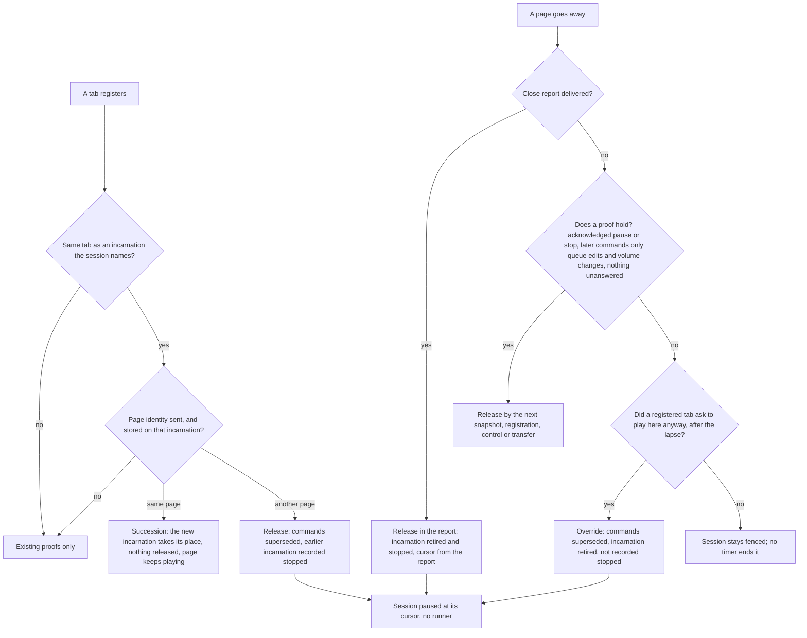

# Session Runner Fence Release - Plan

## Goal Capsule

**Objective:** A listener whose previous player has gone can play again in the browser in front of them. A reloaded tab plays at once. A tab that is closed tells the server it stopped, so the next tab plays at once. After a crash or a lost network, one explicit choice in the refused tab lets it play. A page whose socket was replaced without a close keeps playing; a page whose socket closed stops its players, reports its stop and registers again. A queue edit or a volume change made after playback was confirmed paused or stopped no longer blocks the next player. Nothing starts a second player on a timer.

**Means:** The paused release proof passes over queue edits and volume changes (KTD10). Every page load carries its own page identity in its registration; a registration of the same tab from another page releases the session from the earlier incarnation, and one from the same page succeeds it (KTD1, KTD18, KTD19). A closing page reports its own stop (KTD20, KTD21). A new override operation ends the hold of a destination that is no longer registered, on the listener's request (KTD7). The web client silences a tab that lost the session (KTD13).

**Product authority:** The user decided the two changes on 2026-11-11; `ROADMAP.md` records them under "Movie playback on growing presentations", "Decided by the user on 2026-11-11, not yet planned or built". The same day the user answered three questions on this plan. The five decisions are the session-settled entries under Key Decisions and are not reopened here.

**Execution profile:** One branch, `session-runner-fence-release`, cut from `master` at `c80c368cb`. Two workers run at the same time on disjoint files: a server worker (U1, U2, U11, U12, U3, in that order) with the postgres specialist profile (`.agents/agents/postgres.md`), and a web worker (U7, U4, U13, U5, U6, then the specs of U8). They build against "Interface between server and web client" and do not need each other. The lead owns `openapi.json`, the generated web client, the gate image, U9, U10, the authoritative gates and the commits. "Worker split and landing order" names the files.

**Authority and stop conditions:** Follow `AGENTS.md`, then the Product Contract, then the Planning Contract. Stop the affected unit and report when any of these holds:

- A path is found on which two live documents register with the same tab identity and different page identities while the earlier one can still play. The page identity would then not be proof, and the fifth Key Decision needs the user.
- A path is found on which one live document registers with two different page identities.
- The paused release proof cannot stay one statement, or any statement ceiling in `tests/Integration/PlaybackSnapshotCostTest.php` would have to rise.
- A migration other than the one column of KTD18 would be needed.
- A test outside the list in "Tests that change" would have to change an assertion for a suite to pass.
- A `queue` or `volume` command is found to start or move playback on a path that R6 does not cover.

**Who finishes:** Workers report files, evidence and check results without staging or committing. The lead integrates, exports the OpenAPI document, regenerates the web client, builds the gate image, runs the Verification Contract, records the result in `ROADMAP.md` and commits locally. Nothing is pushed until the user asks.

---

## Product Contract

### Summary

Change what ends the fence of a browser runner that has gone. The paused release proof stops counting queue edits and volume changes. A registration carries a page identity: the same tab registering from another page releases the session from its earlier incarnation, and the same page registering again keeps its place and keeps playing. A page that goes away reports its own stop. A refused tab gets a "Play here anyway" action that ends the hold of a destination whose registration has lapsed, and then starts what was refused when that was recent.

### Problem Frame

The playback session names one runner, the endpoint incarnation that executes playback. When that runner is no longer registered and has not proved that it is silent, the session is fenced: the web client refuses every `load`, `play` and local transfer with "Previous playback is unconfirmed" before it contacts the server (`ui/web/src/features/session/services/playback-status.ts`, `playback-session-coordinator.ts`), and the server refuses controls and transfers.

Five situations leave a session fenced for good today.

- **A tab was shown a start and then reloaded or closed.** A disclosed `play`, `load` or `seek` that expires unanswered turns the session unknown and marks the runner unknown; a `stop` is issued to the gone incarnation again every 20 seconds, and only that runner's answer ends it (`PlaybackCoordinator::expireControl`, `src/Session/README.md` "Unanswered commands and gone runners"). The same happens through a transfer: the first Play in a session without a runner is a transfer to the tab itself, and a target that was shown its `start` and vanished leaves the transfer uncertain (`PlaybackTransfer::expire`). A reloaded tab cannot answer for its previous page, and a closed tab never returns.
- **A confirmed paused runner received a queue edit or a volume change and then left.** `PlaybackStore::retireConfirmedPausedBrowser` refuses twice: its later-command clause counts every command that is not `never_effective`, and its revision equality fails because each such command advances the session revision at issue and at settlement.
- **A tab that reloads while it is confirmed playing**, in a browser without local recovery, has no proof of silence at all. `tests/Integration/PlaybackTransferPersistenceTest.php::testReRegisteringTheSameTabKeepsARunnerWithoutPauseProof` pins all three shapes as held.
- **A tab that is closed while it is confirmed playing** stops its player as it unloads and reports nothing; its stop report is sent only by the same page when it registers again. A new tab has a new tab identity, so no registration ever speaks for the closed one. This is the everyday case: close the tab during a song, open the application again.
- **A live page whose socket was replaced without a close** registers again while it still plays. `SharedLiveTransport.reconnect()` replaces the socket without notifying `onClose` (`ui/web/src/shared/live/transport.ts`, triggered after 15 seconds without a live message in `ui/web/src/shared/live/recovery.ts`), so `PlaybackSessionCoordinator.reconnect()` runs with the runner still bound. The session keeps naming the retired incarnation, and the tab is refused by its own previous registration while its audio continues.

Chromium on desktop Linux hides the first, third and fourth situation, because a page posts a local recovery proof for its own earlier incarnation and for closed tabs of the same browser before it registers (`supportsLocalVideoRecovery` in `ui/web/src/features/catalog/hooks/useBaanderPlayer.ts`, `playback-local-recovery.ts`). In the fifth it makes things worse: the page recovers its own live incarnation, and the server records a playing tab as stopped. Every other engine reaches the server with a registration only.

A registration today cannot tell a new page from a live one: both name the same device and tab. And a tab that is no longer the runner is not silenced by the snapshot that says so: `apply()` drops only a preparation.

### Key Decisions

- **A registration from the same tab ends the fence at once; a tab that closed or lost its network is ended by an explicit "Play here anyway"; nothing is released on a timer.** (session-settled: user-directed — chosen over a timed release and over leaving the fence to the runner's own answer: decided on 2026-11-11 and recorded in `ROADMAP.md`; the 2026-11-09 plan had left it as an outstanding question.) Governs R7, R8, R9, R10, R11, R14, R15, R16, R17, R19, R20, R21.
- **The release proof ignores a queue edit or a volume change shown after the confirmed pause or stop; only a command that can start or move playback keeps the runner fenced.** (session-settled: user-directed — chosen over counting every later shown command: decided on 2026-11-11 and recorded in `ROADMAP.md`; KTD9 of the 2026-11-09 plan had left it to the user.) Governs R1, R2, R3, R4, R5.
- **After an accepted override the tab starts what it was refused only when the refusal is recent, about two minutes; an older refusal only takes over.** (session-settled: user-directed — chosen over always starting the refused request and over never starting it: answered on 2026-11-11 to the review's open question on this plan; a refused movie still starts from its own Play button.) Governs R20.
- **A closing tab reports its own stop in this work; a crash or a killed browser sends nothing, and "Play here anyway" after the lapse stays the fallback.** (session-settled: user-directed — chosen over deferring the close report to follow-up work: answered on 2026-11-11; the report is proof from the tab itself, not a timer.) Governs R29, R30, R31.
- **A reload is told from a reconnect by a page identity; a registration from the same page releases nothing and keeps its runner playing; playback is not stopped when a socket is silently replaced.** (session-settled: user-directed — chosen over a live page stopping its players before every new registration: answered on 2026-11-11; the user did not accept that a socket replaced after 15 seconds of silence stops playback.) Governs R7, R25, R26, R27, R28.
- **The release by another page covers every state of the earlier incarnation, a confirmed playing runner and a transfer participant included.** The proof is that the page is gone, which does not depend on what the session last knew. Governs R7.
- **The override is offered only once the old destination's registration has lapsed.** While it is registered the server can still reach it and cannot tell a crashed tab from a playing one. Governs R14, R15, R19.

### Requirements

**Queue edits and volume changes**

- R1. The release of a gone, confirmed paused browser runner holds when the only commands shown to it after its confirming answer are queue edits and volume changes that were answered or have expired.
- R2. Every command of another type that follows the confirming answer and is not settled as never effective keeps the runner held, as today. The control types are `load`, `play`, `seek`, `pause` and `stop`; the transfer steps are `prepare`, `quiesce`, `start` and `stop`.
- R3. An unanswered queue edit or volume change holds the release until it is answered or expires. Its settlement keeps today's outcomes (`applied`, `rejected`, `superseded`, `never_effective`) and records nothing new.
- R4. The release of a gone, confirmed stopped browser runner holds after a queue edit or a volume change shown since the stop. The statement already behaves so; a test pins it.
- R5. A queue edit's answer, applied or rejected, records the cursor and renews presence. It changes neither the session's observed state nor the incarnation's.
- R6. On the web video player, a `volume` command on a stopped player sets the volume without selecting, mounting or preparing a video, and answers with the stopped observation and that volume.

**Page identity and registration**

- R25. The web client creates one page identity per document, in memory, never stored, and sends it with every registration of that document.
- R7. When a tab registers with a page identity that differs from the one an earlier incarnation of that tab registered with, the registration's transaction releases the session from that earlier incarnation wherever the session still names it, as its runner or as the source or target of its open transfer, whatever was last known about it. The answer to the registration shows the result.
- R8. That release settles the session as local recovery settles it for the same incarnation, without a checkpoint. Its unanswered commands are superseded; an open transfer is settled by the incarnation's role in it; a released session is paused at the cursor it last recorded, with no runner; the earlier incarnation is recorded as stopped.
- R26. When a tab registers with the same page identity as an earlier incarnation the session still names, the new incarnation takes the earlier one's place: as the runner, as the source or target of the open transfer, and as the addressee of its unanswered commands. Nothing is released, the session revision does not change, and the page keeps playing.
- R27. A registration without a page identity, or against an earlier incarnation that has none, neither releases nor succeeds. An absent identity is never proof.
- R9. The existing proofs run before the release of R7, so a confirmed stopped runner with nothing outstanding still ends stopped and a confirmed paused runner keeps its revision arithmetic. They run after the succession of R26, which leaves them nothing to release.
- R10. When a transfer fails and falls back to a runner whose incarnation is retired and whose last report is `stopped`, the session is released from that runner in the same step.
- R11. A registration of another tab releases nothing beyond what the existing proofs release.
- R28. A web page whose endpoint is still bound when its socket is replaced keeps its players playing, posts no local recovery for its own incarnation, registers again with its page identity, and answers commands under the incarnation they are last delivered for.
- R13. A socket replaced while a registration is pending still ends with the page registered. A page that keeps playing through a replacement and gets no answered registration on the new socket within 20 seconds stops its players as it does after a socket close.

**Close report**

- R29. An endpoint can report that it is going away and its players have stopped, with its capability. The server retires that incarnation, records it as stopped at the reported cursor, and releases the session from it wherever the session still names it, in that request. A report for an incarnation the session no longer names changes only that incarnation's row, and a repeated report changes nothing.
- R30. A web page sends that report when it is hidden for unloading (`pagehide`), before it fences its players, in a way that survives the page. A page restored from the back/forward cache reports again before it registers with its page identity, and finds nothing to succeed once either report was accepted.
- R31. A live web page that disconnected and silenced its players reports its earlier incarnation closed before it registers again. A failed report does not keep it from registering.

**Play here anyway**

- R14. A registered browser tab can override the hold of a browser destination that is not registered any more: the session's runner when no transfer is open, or the target of an uncertain transfer.
- R15. The override is refused, and changes nothing, when the expected revision does not match, when the asking tab is not an available endpoint with its capability, when the destination to override is still registered, when a transfer is open in another state than uncertain, or when nothing is held. Nothing performs an override except this request.
- R16. An accepted override supersedes the overridden incarnation's unanswered commands, fails an uncertain transfer, and leaves the session paused at its last recorded cursor. The session has no runner afterwards, except that an available source of the failed transfer keeps it. Each overridden incarnation is retired, is not recorded as stopped, and keeps its capability.
- R17. The override carries a request identity. A repeated request with the same identity returns the recorded result and changes nothing; the same identity with another payload is refused.
- R18. A connected web tab that a snapshot shows as neither the runner nor a participant of the open transfer silences media its player is playing, once, and is not resumed by mirrored state. A paused or stopped player is left as it is.
- R19. The web client offers "Play here anyway" in the playback destination menu while the session's runner is unavailable and no transfer is open, or while a transfer is uncertain and its target is unavailable or missing from the destination list. It is disabled while the tab is disconnected, busy or recovering.
- R20. After an accepted override that leaves no runner, the tab issues again the request it was last refused for unconfirmed playback, when that request was a `play` or a song selection that wanted playing and the refusal is at most 120 seconds old. An older refusal only takes over. A refused movie selection starts from its own Play button, which works again.
- R21. The refusal text and the menu's status line name the action and its consequence. A refused override shows the server's reason in the menu's alert.

**Proof and records**

- R22. The four statement ceilings in `tests/Integration/PlaybackSnapshotCostTest.php` (6, 9, 10, 21) do not move, `PlaybackStore` keeps exactly five SQL statements, and one migration adds one nullable column for the page identity; no other migration is added or edited.
- R23. The Session README, the Session context page, the API reference line, `CONCEPTS.md`, the media and playback testing page and `ROADMAP.md` say what the code does.
- R24. Source, tests, comments and docblocks cite no plan identifier.

### Acceptance Examples

- AE1. **Covers R1.** A tab pauses and the pause is acknowledged. Another tab changes the volume; the paused tab applies it and answers. The paused tab's browser is killed and its registration lapses. The next snapshot shows no runner, and Play in the other tab starts there.
- AE2. **Covers R2.** As AE1, but the command after the pause is a `play` that the paused tab was shown and did not answer. The runner stays; the session is unknown.
- AE3. **Covers R3.** A paused tab is shown a volume change and its browser is killed before it answers. Its registration lapses before the command expires. The runner stays until the command expires, and the first operation after that releases it.
- AE4. **Covers R7, R8.** A tab that is the runner is shown a `play` and reloads before answering; its close report is lost. The reloaded page registers with a new page identity. The answer has `activeIncarnationId` null, desired and observed state paused, and the cursor of the last report; Play in that tab then starts.
- AE5. **Covers R7.** A tab that confirmed playing reloads and its close report is lost. Its registration answer shows no runner, paused.
- AE6. **Covers R7, R8.** A tab pressed Play in a session without a runner, was shown the transfer's `start` and reloads. Its registration answer shows the transfer failed and no runner.
- AE7. **Covers R26, R28.** A playing page's socket is replaced without a close. The page keeps playing, registers again with the same page identity, and the answer names its new incarnation as the runner at the same revision. A pause sent from another tab during the replacement is delivered to the new incarnation and answered.
- AE8. **Covers R14, R16, R19, R20.** Tab A is shown a `play` and its browser is killed. Tab B selects a track and is refused. Once A's registration has lapsed, B's destination menu shows "Play here anyway". Pressing it within two minutes of the refusal leaves the session paused without a runner, A's incarnation retired, the owed stop superseded and not issued again, and B's refused track then plays in B.
- AE9. **Covers R15.** Inside A's registration the action is not shown, and an override request is refused with "The destination is still connected. Stop playback there."
- AE10. **Covers R17.** B's override request is sent twice with one request identity. Both answers carry the same result and the session changed once.
- AE11. **Covers R18, R16.** A was offline, not gone, and still playing. After B's override A's network returns. A's player is silenced at the first snapshot it receives, A's later registration with its page identity finds nothing to succeed, and B's session is untouched.
- AE12. **Covers R14, R16.** A transfer from an available source to a target is uncertain and the target's browser was killed. After the target's registration lapsed, an override fails the transfer and the source keeps the session paused. With no source the session has no runner.
- AE13. **Covers R6, R4.** A movie is stopped and its view closed. A volume change from another tab leaves the movie closed, the runner's next report is still `stopped`, and the stopped release holds when that tab later leaves.
- AE14. **Covers R29, R30.** A tab plays a song and is closed. A tab opened afterwards receives a registration answer with no runner and the session paused at the closed tab's cursor; its Play starts at once, with no refusal and no override.
- AE15. **Covers R29.** A tab plays and its browser crashes. Nothing is reported. The next tab is refused, and after the 30-second lapse "Play here anyway" is offered.
- AE16. **Covers R30, R26.** A playing page is left by navigating away and is kept in the back/forward cache. Its close report releases the session. The listener presses Back: the page reports again, registers with the same page identity, is an ordinary destination with its player stopped, and Play starts through the ordinary path. The same holds when the first report was lost.
- AE17. **Covers R20.** B is refused a track, and ten minutes later presses "Play here anyway". The hold ends and nothing starts; B's next Play starts.
- AE18. **Covers R25, R27.** A playing tab is duplicated. The duplicate cannot take the tab's browser lock, registers under a new tab identity, and the original keeps the session.
- AE19. **Covers R27.** A client that sends no page identity registers the same tab twice. The second registration neither releases nor succeeds; only the existing proofs apply.
- AE20. **Covers R31.** A playing page's socket closes and reopens. The page stops its players at the close, reports its earlier incarnation closed with its cursor, and registers; the session is paused without a runner, and Play starts through the ordinary path.

### Scope Boundaries

- Browser destinations only. A destination of another kind is neither released by a registration nor overridable; the two proofs already exclude it.
- No release by a timer, by a lapsed registration alone, or by a free browser lock alone.
- `ui/rn` is untouched.
- Local recovery keeps its credential, its checkpoint and its eligibility rule.
- The override and the close report are HTTP only. The WebSocket message set gains one optional field in `session.endpoint` and no message.
- A socket close still stops the page's players, as today. Only the silent replacement changes.

**Considered and not built**

- **A page that stops its own player when its registration lapses.** It would shorten double playback after an override of an offline tab. The listener hears that case at once and chose it, so it is left out. Evidence that would change the call: reports of overridden tabs playing unattended.
- **Trying a stored local recovery proof before an override in Chromium.** A connected tab does not use a closed tab's record until it reconnects. The override gives the same result without the saved cursor. Evidence that would change the call: lost cursors after an override in that engine.
- **A confirmation dialog.** The label states the choice, the status line above it states the consequence, and the existing "Check destination stopped" action has none.
- **"Play here anyway" inside the refusal toast or beside the movie alert.** No toast in the web client carries an action, and the destination menu is present in the footer and in the movie view.
- **Recording `settled_revision` for queue edits and volume changes.** See KTD10.
- **A close report by `sendBeacon`, or authenticated by the capability alone.** See KTD21.
- **A close report when the tab is hidden without unloading.** A hidden tab keeps playing music by design; `visibilitychange` cannot tell that from going away.
- **Keeping a page playing through a socket close.** The fifth Key Decision names the silent replacement; a close still fences, as today.

**Known limits that stay**

- A crash, a killed browser, a discarded mobile page and a network that died before the page went away send no close report. The next tab is refused and continues through "Play here anyway" after the lapse.
- For up to 30 seconds after such an end, the registration still holds. Play elsewhere is sent to the gone runner, waits 20 seconds and fails, and no override is offered until the lapse.
- The close report is best effort. A report whose prepared proof is older than the server's 60-second acceptance window is refused, which can happen to a page whose timers were throttled in the background; the engine may also drop the request while it shuts down.
- An uncertain transfer whose target is still registered and does not answer ends only at that device.
- A reloaded tab whose close report was lost loses up to ten seconds of cursor, the age of its last presence report.
- A session that was stopped with a command still unanswered ends paused, not stopped, when its page reloads or closes.
- A page that silently replaced its socket and was succeeded has no pause or stop proof under its new incarnation until it answers a new one. If its browser is then killed while paused, the override ends the hold.
- In a browser without Web Locks the tab identity is new on every load. A reload there is released by the close report or by the override, not by the registration.

### Dependencies and Assumptions

- The browser proofs need the preview (`make preview-up`) and the Playwright playback suite; the reload proof needs the gate image rebuilt from the branch.
- The assumptions the user may want to overrule are listed under Planning Contract, Assumptions.

### Sources and Research

- Decisions: `ROADMAP.md`, "Movie playback on growing presentations", "Decided by the user on 2026-11-11", "Open, known limits" ("Stop, close, play elsewhere", "Registration proof in Chromium", "Command disclosure by another incarnation"); "Playback session entities", "Store preconditions".
- Prior reasoning this plan amends: `docs/plans/2026-11-09-1635-fix-movie-playback-growing-presentations-plan.md` (R9 and its outstanding question, KTD9, KTD10, AE11); `docs/plans/2026-11-10-2252-refactor-playback-session-entities-plan.md` (KTD4, the five SQL statements).
- Server: `src/Session/Application/Service/PlaybackCoordinator.php` (`coordinate`, `recoverLocal`, `expireControl`, `expireTransfer`, `releaseGoneRunner`, `acknowledge`); `src/Session/Infrastructure/Doctrine/PlaybackStore.php` (`register`, the two retire proofs, `snapshot`, `supersedeIncarnationCommands`); `src/Session/Infrastructure/Doctrine/Entity/PlaybackDestinationIncarnationEntity.php`; `src/Session/Domain/Model/ListeningSession/ListeningSession.php`; `src/Session/Domain/Model/Playback/PlaybackTransfer.php`; `src/Shared/Interface/Controller/WebSocketController.php` (`handlePlaybackCoordination`, which passes the `session.endpoint` payload to the coordinator); `migrations/Version20261101190000.php` (type check, destination key), `migrations/Version20261110120000.php` (`chk_playback_commands_settled_revision`).
- Authentication at unload: `ui/web/src/shared/api-client/axios-instance.ts` (every request carries a DPoP proof signed asynchronously in a request interceptor); `src/Auth/Infrastructure/Security/OAuth/DpopProofValidator.php` and `config/packages/auth.yaml` (`iat` within 60 seconds, each `jti` once); `config/packages/nelmio_cors.yaml` (no origin is allowed for the session routes, so the web client calls them same-origin and without a preflight).
- Web: `ui/web/src/features/session/services/playback-session-coordinator.ts`, `playback-command-runner.ts`, `playback-local-recovery.ts`, `playback-execution-lock.ts`, `playback-status.ts`; `ui/web/src/features/session/components/PlaybackDestinationSelector.tsx`, `PlaybackSessionRuntime.tsx`; `ui/web/src/features/catalog/components/VideoPlaybackRuntime.tsx`; `ui/web/src/features/player/services/music-playback-adapter.ts`; `ui/web/src/shared/live/transport.ts`, `recovery.ts`.
- Learnings: `docs/solutions/best-practices/a-browser-gate-that-passes-by-where-a-server-tick-falls-proves-nothing.md` (assert the registration answer, keep both engines); `docs/solutions/runtime-errors/fenced-completion-retry-must-not-redo-one-shot-steps.md` (one-shot steps under a fence, request identity for a retry); `docs/solutions/architecture-patterns/state-set-when-work-is-queued-on-swoole-task-must-expire.md` (state only a lost holder can clear must expire; here the override replaces expiry and must be reachable from every engine); `docs/solutions/runtime-errors/doctrine-refuses-a-flush-after-the-database-cascaded-a-delete-under-managed-children.md` (nothing managed outlives a store call).
- Rules: `.agents/rules/ddd-repositories.md` "Tables and statements outside the ORM"; `.agents/rules/architecture-rules.md`; `.agents/rules/frontend.md`; `ui/DESIGN.md`; `docs-book/part-2-developer-guide/development/database-naming.md`; `.agents/skills/postgres-remediation/SKILL.md`.

---

## Planning Contract

### Key Technical Decisions

- KTD1. **The page identity is the proof that tells a new page from a live one.** A registration names its tab (device and endpoint) and its page. Same tab and another page: the earlier document is gone, because the new one holds the tab's exclusive browser lock, which the earlier document released by ending or by entering the back/forward cache, where it runs nothing. Same tab and same page: one live document registered again, and it speaks for its own players through its reports, so nothing needs releasing. This replaces "a registration is proof" as first drafted: a live page also registers again, after a socket close, a presence lapse or a silent socket replacement, and the code cannot tell these apart without the page. Governs R7, R26.
- KTD2. **The server takes both identities on trust from an authenticated client of the account.** The tab identity is a destination row keyed by user, device and endpoint; the page identity is a random value the document never stores, so it cannot be copied with the tab's storage. Evidence that two live documents cannot share a tab identity: the web client claims one only while it holds the Web Lock for it and registers only after taking the lock (`playback-local-recovery.ts`, `initialize`); a duplicated tab copies `sessionStorage`, fails to take the held lock and replaces its identity, pinned by `playback-local-recovery.test.ts` ("does not steal a copied tab identity from a live executor") and in a browser by `local-recovery.spec.ts`; a browser without Web Locks uses a random tab identity per page load and never reads the stored one. The lock is released before the document ends only at `pagehide`, after the page fenced its players. Neither identity leaves the server in a snapshot. Governs R7, R25, R27.
- KTD18. **The page identity is one nullable column.** `playback_destination_incarnations.page_id uuid`, written by `register()` from the registration's optional `pageId`, mapped on the entity, added by one new migration with a lock timeout as the last playback migration sets. It needs no index, no constraint and no default: it is read only with the incarnation row the registration already reads. An existing row has none, and R27 makes that mean "no proof". The snapshot does not carry it. Governs R22, R25, R27.
- KTD19. **Succession moves every live reference and leaves history where it is.** For an earlier incarnation with the same page identity that the session names, the registration sets the session's runner to the new incarnation, re-points the open transfer's source or target, and re-addresses that incarnation's unanswered commands to the new incarnation and epoch, keeping their disclosure mark. A stop owed to the earlier incarnation is thereby delivered to the live page, which answers it. Answered commands stay with the earlier incarnation, so no earlier pause or stop proves anything for the new one. The session revision does not change, because an answer is accepted only at its command's own revision; the relay still pushes the changed snapshot. The web runner answers a command with the incarnation and epoch of the delivery it is answering. (Chosen over superseding the unanswered commands: a live transfer step would then wait for an expiry that addresses a retired incarnation.) Governs R26, R28.
- KTD5. **Order inside a registration: expiries, `register()`, succession, the existing proofs, then the release.** Succession and release read the runner's row, and the rows of an open transfer's participants, only in the Endpoint case, and compare destination and page identity with the registration. They use the transfer as re-read after expiry. No ceiling measures a registration, and `releaseGoneRunner` gains no statement. Governs R7, R9, R26, R22.
- KTD4. **One release routine, four callers.** The body of `PlaybackCoordinator::recoverLocal` that settles the session for one incarnation becomes a private routine. Local recovery calls it with a checkpoint and records its recovery result. The registration from another page calls it without a checkpoint and records the incarnation as stopped. The close report calls it with the reported checkpoint and records the incarnation as retired and stopped. The override calls it without a checkpoint, retires the incarnation and leaves its observed state alone. The routine already handles each transfer role, including the case where the gone incarnation is the source of a starting or uncertain transfer and the transfer goes on. (Chosen over separate smaller releases: they would repeat the transfer handling the recovery tests already pin.) Governs R8, R16, R29.
- KTD6. **A failed transfer does not hand the session back to a runner already recorded gone.** `expireTransfer` and the failed-transfer branch of `acknowledge` already read the runner's row to restore the selection; when that row is retired with its own report `stopped`, they release the session instead. `Transfer` applies the same test to drop such a source. The shared routine of KTD4 applies it too: when it fails a transfer for its target and the source's row is retired with its own report `stopped`, it releases the session instead of keeping that source as runner, with no selection and no stop obligation. This also repairs the same edge after a local recovery. Governs R10.
- KTD20. **The close report is its own operation, authorised by the capability.** `PlaybackOperation::Close`, `POST /api/session/close`, input `incarnationId` and a checkpoint of the shape local recovery takes, with the `X-Baander-Playback-Endpoint` capability required and checked before the session lock. It carries no expected revision and no request identity: a leaving page cannot retry, and the report is idempotent because it acts only on what the session still names for that incarnation. Inside the transaction it retires the incarnation and records `stopped` at the reported cursor without renewing presence, runs the existing proofs, then the routine of KTD4 for whatever still names the incarnation. The retirement makes the destination unavailable at once, so the next tab does not wait for a lapse. (Chosen over an `observe` with state `stopped`: that renews presence for 30 seconds, is refused on a stale revision, and releases nothing while a command is unanswered or a transfer is open.) Governs R29.
- KTD21. **The page sends the close report with `fetch` and `keepalive`, from a request it prepared earlier.** Every API request needs a DPoP proof, and signing one is asynchronous, which a `pagehide` handler cannot wait for. The coordinator therefore keeps a prepared close request: the URL, the authorisation, the capability header and a fresh proof for `POST /api/session/close`. It prepares one after the registration answer and after every successful presence observation, so the proof is at most one presence interval old against a 60-second acceptance window, and prepares again when the access token changes. The `pagehide` handler reads the runner's cursor, sends the request synchronously with `keepalive`, then fences as today. A prepared request is used once. (Chosen over `sendBeacon`, which cannot set the capability or the proof headers; over authenticating by the capability alone on a route outside the firewall, which would add the only session route that skips the sender-constrained token; and over the WebSocket, whose queued frames a closing page does not promise to flush.) The session routes are same-origin for the web client, so no preflight runs at unload. The native `fetch` is a deliberate exception to the API-access rule in `.agents/rules/frontend.md`, confined to `ui/web/src/shared/api-client/keepalive-request.ts`; U9 records it in the rule as a third use of native `fetch`, a request prepared ahead and sent with `keepalive` at `pagehide`. Governs R30.
- KTD22. **A live page that disconnected uses the same report instead of the stop-report steps.** Today `reconnect()` reads a snapshot for its earlier incarnation, posts `observe stopped` and acknowledges owed stops with the old capability; that releases nothing while a command is unanswered, and a refused step keeps the page from registering. After a disconnect, when none of its registered adapters observes `playing`, the page posts the close report for its earlier incarnation and then registers. When a player still plays, it posts nothing and registers; succession keeps it the runner. An error from the report is logged and does not stop the registration. If that leaves a succession, the page is the runner of a session that may still say playing while its players are stopped; a page that is the runner and holds no player therefore reports `stopped`, at once after a registration answer that names it as runner and in every later presence observation, which the server's existing branch for a runner's own stop report turns into a release. Governs R31.
- KTD12. **A page whose endpoint is still bound registers again without stopping.** In `reconnect()`, an endpoint that is still bound means the socket was replaced without a close. The page then skips the fence, skips local recovery for its own incarnation, and sends the registration with its page identity. A new socket's open first abandons a registration still pending on the replaced socket; `retry()` and `ensureLocalEndpoint` keep the pending guard. The coordinator tracks whether the current socket carries an answered registration, separately from being ready: the relay reaches a page only through such a socket, so a page that plays without one cannot be commanded. On this path a registration that fails before it is sent, is refused, or stays unanswered is sent again while the socket stays open, and `retry()` sends one whenever the current socket carries none. When 20 seconds, the command lifetime, pass after the socket's open without an answered registration, the page takes the disconnected path: it fences its players, reports its earlier incarnation closed and registers. A page that did disconnect recovers its own stored record only when none of its adapters observes `playing`. Governs R13, R28.
- KTD3. **The override keeps the unavailability guard.** The asking tab cannot prove anything about the other device; the one fact the server has is whether that device still reports. Governs R14, R15.
- KTD7. **The override is its own operation.** `PlaybackOperation::Override`, `POST /api/session/override`, input `requestId`, `expectedRevision` and `incarnationId`, with the `X-Baander-Playback-Endpoint` capability required. It joins the operations whose endpoint is authenticated before the session lock, so it does not widen the limit "Command disclosure by another incarnation". It runs after the transfer and control expiries and after the existing proofs. R15's "nothing is held" is judged on the session as the request found it: a runner that a proof releases in the same request was held, so the override reports success and writes its ledger row for that incarnation (KTD8). (Chosen over a flag on Control or Transfer: both would mix a release without proof into guards that assume a proof, and Transfer has no capability.) Session routes are not admin routes, so no console counterpart is needed (`.agents/rules/admin-cli-parity.md`). Authentication is the `^/api/` access rule in `config/packages/security.yaml` and the user guard in `PlaybackController::respond()`, as for every session route; no backend test requests a session route over HTTP, and this plan adds none. Governs R14, R15.
- KTD8. **The override is one row in the command ledger.** Type `stop`, addressed to the overridden incarnation, carrying the override's request identity, stored already settled with the outcome `overridden`. `rememberRequest` and `requestedCommand` then give replay and the `requestResult` without new storage; the request digest leaves out `incarnationId`, as Control's does, so a replay after the asking tab registered again still matches. `outcome` has no check constraint and `type` keeps its list, so it needs no migration. The row is not a proof and is older than any later runner's proof. When an override covers an uncertain transfer and its gone source, the row addresses the transfer's target; when an existing proof released the runner in the same request, it addresses that runner. (Chosen over idempotence by state alone: a retried request could not tell "done" from "refused".) Governs R17, R22.
- KTD9. **An overridden incarnation is retired, keeps its capability and is not called stopped.** Retirement keeps a late presence report from making it available again. The capability stays valid because the returning page reads its commands and sends its reports with it; refusing it would turn every such call into an error the page cannot act on. Its observed state stays as it stands because nothing proved silence. Governs R16.
- KTD10. **The paused proof stays one statement and derives the revision a queue edit or volume change left.** Its later-command clause skips the types `volume` and `queue`. Its revision equality becomes: the session stands at the greater of the last `settled_revision` among later never-effective commands (or the proof's revision plus one) and the highest revision among later queue and volume commands plus one. Every such command leaves the session exactly one revision past its own when it is answered or expires: the control advances once and the command carries that revision, an answer is accepted only at the command's own revision and advances once, and nothing else moves the revision while a control is unanswered. A stop that replaces a shown volume change is itself a later row and governs. The equality fails closed: any other movement keeps the runner. (Chosen over recording `settled_revision` on these commands: that needs a migration to relax `chk_playback_commands_settled_revision`, three changed write paths and a reordered acknowledgement, for the same predicate.) Governs R1, R2, R22.
- KTD11. **The unanswered-command clause and the stopped proof do not change.** A queue edit or volume change still unanswered may be about to be answered, and "nothing outstanding" is what lets the proof read a settled ledger; it expires within the 20-second command lifetime. The stopped proof has no later-command clause, so it already passes these commands over. Governs R3, R4.
- KTD17. **A queue edit's answer is bookkeeping, not a confirmation.** Today `acknowledge` passes it through `confirmControl`, which copies the desired state into the observed state on `applied` and sets `unknown` on `rejected`. A rejected queue edit therefore turns a confirmed paused session unknown and keeps its gone runner fenced, and an applied one can make an unknown session look confirmed although the runner said nothing about playback. The second Key Decision's words cover a shown queue edit, so the answer stops touching the observed state on the session and on the incarnation. (Chosen over leaving it to the override: the fence would come from a command that cannot start or move playback.) Governs R5.
- KTD13. **A tab that lost the session silences a playing player once.** `apply()` extends the existing drop of a preparation: when the tab's incarnation is neither the runner nor named by the open transfer and its runner's adapter observes `playing`, the runner silences that media and lets go of the adapter through the same ordered chain a dropped preparation uses, so the next command for this tab waits for it. An adapter that observes paused or stopped is not touched: a paused runner whose presence lapsed is released by the existing proof while its tab stays open, and a stop there would close its movie. The check sits after the stale-revision return. A succession does not advance the revision, so snapshots around it cannot be ordered by revision; the check and the preparation drop therefore do not run from the moment a page with a bound endpoint sends its registration until the answer's endpoint is bound, and a snapshot that names any incarnation this document has been assigned, as runner or as transfer participant, counts as naming the page. Governs R18.
- KTD14. **One home for the action, in the destination menu.** A `DropdownMenuItem` under the status line, beside "Check destination stopped" when both apply. Strings are English literals, as every string in the session feature is; no translation key is added. The coordinator method renews the tab's presence, posts the override with a new request identity, reads the server's reason on a 4xx and runs on the intent queue, not under the pending-result guard. It treats `overridden` as success. Governs R19, R20, R21.
- KTD15. **The held request is narrow and ages out after 120 seconds.** The coordinator keeps the last request it refused for unconfirmed playback only when it is a `play` or a song `load` that wants playing, with the time of the refusal. The startup queue restore wants paused, a local transfer would end paused, and a movie's view opens only from its own page's handler; none of them is held. The age is `Date.now()` at the accepted override's answer minus `Date.now()` at the refusal, both read in the coordinator; a request older than 120 000 ms, or one whose age is negative, is dropped and not issued. The wall clock is used because it keeps counting while the machine sleeps, which a monotonic page clock does not promise, and it is the clock the coordinator already judges presence freshness by. Two minutes covers reading the refusal, opening the menu and pressing the action; a refusal older than that no longer says what the listener wants now. The held request is also dropped when the session stops being unconfirmed by other means, when a later request from the tab succeeds, and when the tab's endpoint or account changes. Governs R20.
- KTD16. **Each browser proof runs where its preconditions exist.** The reload is asserted in the two-command gate, in both engines. The override and the close report are driven in the Playwright playback suite, which has two contexts for one account and can close pages; the gate has one page and no way to lapse a registration. Governs the Verification Contract.

### High-Level Technical Design

What ends the fence of a runner that is no longer registered, and what a registration of the same tab does:



The callers of the release routine, and succession beside them:

| Caller | Evidence | Authority | Cursor | Earlier incarnation afterwards | Ledger |
|---|---|---|---|---|---|
| Local recovery | The page's fence, its lock and its credential | Account and recovery credential | Checkpoint, when media, queue position and revision match | Retired, `stopped`, recovery result stored | Its unanswered commands superseded |
| Registration from another page | The tab's lock and a different page identity (KTD1) | Account, tab identity, page identity | Last recorded | Retired by `register()`, `stopped` | Its unanswered commands superseded |
| Close report | The page's own report as it goes away | Account and that incarnation's capability | Reported checkpoint, on the same match | Retired, `stopped` | Its unanswered commands superseded |
| Override | None; the listener's decision | Account and the asking tab's capability | Last recorded | Retired, observed state unchanged, capability kept | Its unanswered commands superseded; one `stop` row with outcome `overridden` |
| Succession (no release) | The same page identity | Account, tab identity, page identity | Unchanged | Retired by `register()`, observed state unchanged | Its unanswered commands re-addressed to the new incarnation |

The paused proof after KTD10, in words. The runner's incarnation is released when all of these hold for the session:

```text
a command of this incarnation and epoch was acknowledged as paused, quiesced, stopped, or started paused   (the proof)
no later command remains that is neither never_effective nor of type queue or volume
session revision = greatest(
    last settled_revision among later never_effective commands, else proof revision + 1,
    highest revision among later queue and volume commands + 1 )
no command of the session is unanswered
no transfer of the session is open
```

### Interface between server and web client

Both workers build against this section. Error bodies are the API envelope `{"error": {"message": string, "code": int}}`; the web client shows `error.message`. Every route below is authenticated like the other session routes.

**Registration** (WebSocket message `session.endpoint`; the HTTP form `POST /api/session/endpoints` takes the same fields)

| Field | Type | Rule |
|---|---|---|
| `deviceId`, `endpointId`, `name`, `capabilities`, `tabId`, `localRecoveryEligible` | as today | unchanged |
| `pageId` | UUID string, optional | The document's page identity. Absent or null means no page identity. A value that is not a UUID is refused with `pageId must be a UUID.` |

The answer is unchanged in shape: the WebSocket message `session.snapshot` whose `data` is the snapshot plus `endpoint` with `destinationId`, `incarnationId`, `epoch`, `capability` and, for an eligible registration, `recoveryCredential`, `recoveryExpiresAt`, `recoveryTabId`. A refusal is the WebSocket message `session.error` with `message`. What the snapshot in the answer shows:

| Earlier incarnation of the same tab that the session names | Answer |
|---|---|
| Same `pageId` | `activeIncarnationId` is the new `endpoint.incarnationId` where the earlier one was the runner; an open transfer names the new incarnation; `revision` unchanged; unanswered commands arrive on the next relayed snapshot with the new `incarnationId` and `epoch` and their original `id`, `attemptId` and `revision` |
| Different `pageId` | Released as R8 states: for a runner, `activeIncarnationId` null, `desiredState` and `observedState` `paused`, `revision` advanced |
| No `pageId` on either side | As today |

The snapshot never carries a page identity.

**Close report** `POST /api/session/close`

- Header `X-Baander-Playback-Endpoint`: the capability of `incarnationId`. Required.
- Body: `{"incarnationId": uuid, "checkpoint": {"revision": int >= 0, "media": {"kind": "song"|"video", "publicId": string} | null, "currentTrackIndex": int >= 0, "position": number >= 0}}`. The checkpoint has the shape and validation of the local recovery request's.
- `200`: `{"data": snapshot}`, without `endpoint` and with `commands` empty. The same answer for a repeated report and for an incarnation the session no longer names.
- `409`: `An endpoint capability is required.` when the header is missing; `Endpoint authority is invalid.` when it does not match.
- `422`: validation, as for the other session requests. `401`: not authenticated.
- The web client ignores the answer of a report sent at `pagehide` and logs a failure of one sent before a registration.

**Override** `POST /api/session/override`

- Header `X-Baander-Playback-Endpoint`: the capability of `incarnationId`. Required.
- Body: `{"requestId": uuid, "expectedRevision": int >= 0, "incarnationId": uuid}`, where `incarnationId` is the asking tab's.
- `200`: `{"data": snapshot}` with `requestResult` `{"requestId": the request's, "commandId": string, "outcome": "overridden", "rejectionReason": null}`. A replay returns the same `requestResult`.
- `409`, with these messages: `Playback revision conflict.`; `An endpoint capability is required.`; `Endpoint authority is invalid.`; `Connect this browser before playing here.` (the asking incarnation is not available); `The destination is still connected. Stop playback there.`; `Playback controls wait for transfer reconciliation.` (a transfer is open and not uncertain); `No playback is waiting to be overridden.`; `The playback request identity has already been used for another payload.`
- `422`: validation. `401`: not authenticated.

**Commands after a succession.** A command may be delivered again with the same `id`, `attemptId` and `revision` and a new `incarnationId` and `epoch`. The acknowledgement carries the `incarnationId` and `epoch` of the delivery it answers and the capability of that incarnation.

**Snapshot.** No field is added or removed. `requestResult.outcome` gains the value `overridden`.

### Worker split and landing order

| Worker | Units, in order | Owned files |
|---|---|---|
| Server | U1, U2, U11, U12, U3 | `src/Session/**` except `src/Session/README.md`; the new file under `migrations/`; `tests/Integration/Playback*.php`, `tests/Integration/ConfirmedPausedRunnerPersistenceTest.php`, `tests/Integration/LocalPlaybackRecoveryPersistenceTest.php`, `tests/Integration/InitialSchemaMigrationTest.php`; `tests/Unit/Session/**`; `tests/Unit/Shared/Infrastructure/Security/MutationRouteInventoryTest.php`; `tests/Fixtures/Session/**` |
| Web | U7, U4, U13, U5, U6, then the specs of U8 | `ui/web/src/features/session/**`; `ui/web/src/features/catalog/components/VideoPlaybackRuntime.tsx` and, if needed, `ui/web/src/features/catalog/hooks/useBaanderPlayer.ts`; `ui/web/src/shared/api-client/keepalive-request.ts` (new) and its test; `ui/web/src/features/player/hooks/__tests__/use-audio-playback.test.ts`; `ui/web/src/features/catalog/hooks/__tests__/use-video-presentation-error.test.ts`, `ui/web/src/features/catalog/stores/__tests__/video-presentation-store.test.ts`; `ui/web/tests/features/catalog/components/VideoPlaybackRuntime.test.tsx`; `ui/web/tests/e2e/two-command/browser.mjs`; `ui/web/tests/e2e/playback-destinations/override.spec.ts` and `close-report.spec.ts` (new) |
| Lead | U9, U10, integration | `openapi.json`; `ui/web/src/shared/api-client/gen/**`; `docs-book/**`; `src/Session/README.md`; `.agents/rules/frontend.md`; `CONCEPTS.md`; `ROADMAP.md`; `packages/baander-tooling/**` if a gate budget moves |

Neither worker edits `src/Shared/Interface/Controller/WebSocketController.php`: it passes the registration payload through unchanged. The web worker types the new requests and answers locally and does not import generated types for the two new routes; the lead regenerates the client at integration and the web worker's local types are then replaced or kept as the generated ones allow.

Landing order: the two server and web sequences are independent until U8. Each side is safe without the other: a server that receives no page identity neither releases nor succeeds, and a web client that calls a route the server lacks shows or logs the refusal. The specs of U8 run only against a build that holds both sequences, and no gate image is built before both are integrated.

### Assumptions

Each is a choice this plan made without the user. The requirement or decision that carries it is named.

- The release by another page covers a confirmed playing runner and a transfer participant, not only an unanswered `play`, `load` or `seek` (R7).
- The override is not offered, and is refused, while the old destination's registration holds; a crashed tab therefore leaves up to 30 seconds without an offer (R15, R19).
- Only a registered browser tab can override, with its endpoint capability. There is no console or admin counterpart (KTD7).
- The override releases and does not start playback on the server (R20, KTD15).
- The action lives in the destination menu only, with no confirmation and no translation key (KTD14).
- An unanswered queue edit or volume change still holds the release for up to 20 seconds (R3).
- A queue edit's answer no longer sets the observed state; today an applied answer copies the desired state and a rejected one turns the session unknown (R5).
- A connected tab that is neither runner nor transfer participant silences media its player is playing (R18).
- An overridden incarnation keeps its capability and is not recorded as stopped (KTD9).
- A succession keeps the session revision and re-addresses unanswered commands instead of superseding them (KTD19).
- The close report releases the session in its own request and in every state, retires the incarnation at once, and needs no expected revision (KTD20).
- The close report is sent at `pagehide` only, with `fetch` and `keepalive`, from a request prepared at every presence observation; it stays inside the authenticated route set (KTD21).
- After a disconnect a live page uses the close report in place of today's stop-report steps (KTD22). A socket close still stops the page's players.
- A page that keeps playing through a socket replacement and cannot register on the new socket for 20 seconds stops its players (R13, KTD12). The server releases nothing on that timer; the page stops because nothing can command it.
- A page that is the runner and holds no player reports `stopped`, so the session releases instead of showing playback that does not exist (KTD22).
- The 120 seconds are measured on the browser's wall clock from the refusal to the accepted override's answer (KTD15).
- The override and the close report are proved in Chromium through the Playwright suite; a Firefox run of those specs is attempted and recorded, and is not a gate (KTD16).

### Alternatives Considered

- **Keep the server unchanged and make every engine eligible for local recovery.** Recovery needs a fence the page can prove, which only desktop Linux Chromium offers for video today. It would also leave closed tabs on other devices fenced.
- **Release by registration only when the earlier incarnation has an unanswered start.** It leaves the reload of a playing tab fenced in every engine without recovery, which is the same proof with a different last report.
- **Let the override start playback on the server through a transfer flag.** The server would have to choose the desired state and the media for the listener; the client already knows what was refused.
- **Rebind the same incarnation on the new socket instead of a succession.** The socket is bound to an incarnation only by a registration answer, and the capability does not travel in WebSocket messages; a rebind message would add a second way to bind a socket in a shared controller. The registration already exists on every reconnect path, and the page identity makes it safe.

### System-Wide Impact

- **Deploys.** A web restart closes every socket, so every connected tab registers again. Runner tabs already stop at the close; they then report their earlier incarnation closed, and their sessions end released and paused instead of fenced.
- **API.** Two new routes and one optional registration field; `openapi.json` and the generated web client change together. `requestResult.outcome` gains the value `overridden`, which is a free string in the schema.
- **Schema.** One nullable column on `playback_destination_incarnations`. Rows returned for an incarnation gain the key `page_id`.
- **Ledger.** `playback_commands.outcome` gains one value written by one path. A succession changes `incarnation_id` and `epoch` of unanswered rows, which no other path does.
- **Authentication.** The close report at `pagehide` bypasses the HTTP client's interceptors: no nonce retry, no token refresh. A report that needs either is lost, and the fallback applies.
- **Other clients.** No client under `ui/` other than the web client registers a playback endpoint or calls a session route. A client that sends no page identity gets today's behaviour.

### Risks

| Way a second player could start | What bounds it |
|---|---|
| Override while the old tab is only offline and plays from its buffer | The listener asked for it by name, and the status line says the old destination may still be playing. The server refuses until that destination's registration has lapsed. The old page is silenced at the first snapshot that shows it lost the session (R18) and stops its players when its socket closes. Until it reaches the server it plays what it has buffered: at most the current track for music, and the buffered segments for a movie. |
| Override while the old tab is connected but its registration lapsed | A socket that carries an answered registration still receives snapshots; R18 stops the tab within one relay tick. A playing page whose socket carries none stops itself after 20 seconds (R13). |
| The old runner answers just before the override | The answer renews its registration and moves the revision, so the override is refused on both guards. In the other order its late answer is refused as already recorded and R18 stops its player. |
| A duplicated tab registers the original's tab identity with its own page identity while the original plays | It cannot: the duplicate fails to take the tab's Web Lock and replaces its tab identity before it registers (KTD2). Without Web Locks the tab identity is random per load. The stop condition applies if a counter-example is found. |
| A document in the back/forward cache while a new document of the same tab registers | `pagehide` reported, fenced and disconnected the cached document before the lock was released; a cached document runs nothing and plays nothing. Its restore registers with its own page identity and releases the other document's incarnation, which is then gone or cached. |
| A registration with a forged page identity from another API client of the account | Possible for any authenticated client that knows the tab identity; the server publishes neither identity. Accepted: the account is the trust boundary of every session operation. |
| A live page succeeded on Linux Chromium after it recovered its own incarnation | R28: a page whose endpoint is bound posts no recovery for its own incarnation, and one that disconnected recovers its own record only when no player plays. Without that, recovery would release a playing tab, which today's code does. |
| A close report from a page that is not going away | The report is sent only in the `pagehide` handler and by a disconnected page whose adapters do not play. A page restored from the back/forward cache had been fenced at `pagehide`. |
| A close report that arrives after the same page was restored and registered again | It names the earlier incarnation, which the session no longer names, and changes only that row (R29). |
| A queue edit or volume change that moves playback | Server: a `queue` control cannot change media or position and a `volume` control changes nothing else (`ListeningSession::control`). Music player: `queue` replaces queue and index in the store, `volume` sets the volume. Video player: `queue` returns its observation; `volume` on a stopped player re-prepared the movie, which R6 removes. The web client sends the removal of the current track as a `load`, which still counts. |
| The revision premise of KTD10 fails on a path not read | The equality then does not hold and the runner stays held. |

Other risks:

| Risk | Mitigation |
|---|---|
| A succession carries a command the page already executed, and it runs twice | The runner answers a redelivered command from the effect it already has for that command identity; only the incarnation and epoch of the answer change (KTD19). U4 tests the redelivery. |
| The prepared close request is stale when the page goes away | It is refreshed at every presence observation and at a token change; a stale one is refused and the known limit applies. U13 tests the refresh. |
| A page goes away between the server's succession and the page binding the registration answer; its prepared report names the succeeded incarnation and changes only that row | Accepted: the window is the answer's round trip. The session then names a runner that is gone until its registration lapses, and the override ends it. |
| `page.close()` in the browser proof dispatches no `pagehide` | U8's first case leaves the page by navigation, which dispatches it by definition; the close case records what the engine did. |
| One override in twenty meets a revision conflict, because the owed stop is issued again every 20 seconds until the override ends it | The relay pushes the new revision within a tick; a second press succeeds. No retry loop is added. |
| The gate's `client-controls` phase grows by a reload and a resume inside a 360-second budget | U8 records the phase duration before and after and changes the budget only on that evidence. |

### Deferred to Implementation

- The names of the release routine, the domain methods and the new store methods.
- The migration's version number and whether its `down()` drops the column or is irreversible, per the postgres-remediation skill.
- Whether the registration compares destinations by the public identifier `register()` returns or by a second endpoint read.
- Whether the settled override row is written by an insert variant or by an insert and a settle; both stay inside the unit of work and DQL.
- Whether any existing test assumes that a changed session row implies an advanced revision (KTD19).
- Whether the Firefox version the gates run honours `keepalive` on a `fetch` issued at `pagehide`; U8's receipts record it, and KTD21 does not depend on the answer because the fallback is the same as for a crash.
- Where the video player keeps a volume set while no video is mounted (R6).
- The exact place of the queue-answer unit test.

---

## Implementation Units

| Unit | Title | Key files | Depends on |
|---|---|---|---|
| U1 | Paused proof passes over queue edits and volume changes | `PlaybackStore.php`, `PlaybackCoordinator.php` | none |
| U2 | Page identity and the release by another page | migration, entity, `PlaybackStore.php`, `PlaybackCoordinator.php` | U1 |
| U11 | Succession by the same page | `PlaybackCoordinator.php`, `PlaybackStore.php`, `ListeningSession.php` | U2 |
| U12 | Close report operation | `PlaybackOperation.php`, `PlaybackController.php`, `PlaybackCoordinator.php` | U11 |
| U3 | Override operation | `PlaybackOperation.php`, `PlaybackController.php`, `PlaybackCoordinator.php` | U12 |
| U7 | Volume on a stopped video player | `VideoPlaybackRuntime.tsx` | none |
| U4 | The web page names itself and survives a socket replacement | `playback-session-coordinator.ts`, `playback-command-runner.ts` | none |
| U13 | The web page reports its close | `playback-session-coordinator.ts`, `keepalive-request.ts` | U4 |
| U5 | A tab that lost the session releases its player | `playback-session-coordinator.ts`, `playback-command-runner.ts` | U13 |
| U6 | "Play here anyway" in the web client | `PlaybackDestinationSelector.tsx`, `playback-session-coordinator.ts` | U5 |
| U8 | Browser proof | `browser.mjs`, `override.spec.ts`, `close-report.spec.ts` | U3, U6, integration |
| U9 | Documentation and roadmap | README, context page, `CONCEPTS.md`, `ROADMAP.md` | U1 to U8, U11 to U13 |
| U10 | Run the gates and record the checkpoint | none | all |

### U1. Paused proof passes over queue edits and volume changes

**Goal:** A confirmed paused runner that has gone is released although it was shown queue edits or volume changes after its confirming answer, and a queue edit's answer stops touching the observed state.

**Requirements:** R1, R2, R3, R4, R5, R22. Implements the second Key Decision (session-settled: user-directed) through KTD10, KTD11 and KTD17.

**Dependencies:** none.

**Files:**
- `src/Session/Infrastructure/Doctrine/PlaybackStore.php` (the paused proof's text and its comment)
- `src/Session/Application/Port/PlaybackStoreInterface.php` (docblock of `retireConfirmedPausedBrowser`)
- `src/Session/Application/Service/PlaybackCoordinator.php` (`acknowledge`, queue branch)
- `tests/Integration/ConfirmedPausedRunnerPersistenceTest.php`
- `tests/Integration/PlaybackTransferPersistenceTest.php`
- `tests/Integration/PlaybackStoreContractTest.php` (only if the token-level check of the five statements reads the changed text)
- `tests/Unit/Session/Application/QueueEditAnswerTest.php` (new, or the existing acknowledgement test if one fits)

**Approach:**
1. Change the two clauses of the paused proof as KTD10 states. The statement stays one `UPDATE ... RETURNING`, raw SQL by the recorded exception, with its reason where it stands.
2. In `acknowledge`, give a `queue` answer its own branch: record the cursor from the answer, renew presence with the incarnation's own observed state, advance the revision once, and leave the session's observed state alone, for `applied` and `rejected`.
3. Leave `expireControl`, `supersedeControl`, `settleNeverEffective` and the stopped proof as they are.

**Execution note:** Write the failing PostgreSQL cases first; the fabricated histories in `ConfirmedPausedRunnerPersistenceTest` must use revisions a real flow produces, because the old `volume` cases pass by accident under the new equality.

**Patterns to follow:** the case table in `testCommandsSettledAsNeverEffectiveDoNotCountAgainstThePauseAcknowledgement`; helpers `pausedTab`, `pending`, `ack`, `expireCommands`, `expireRegistration` in `PlaybackTransferPersistenceTest`.

**Test scenarios:**
- Covers AE1. Paused tab, volume shown and answered `applied`, registration lapsed: a snapshot releases the runner and the revision rises by one.
- A queue edit answered `applied` after the pause: released.
- A volume change shown and expired (`superseded`): released by the operation that expires it or the next one.
- Covers AE3. A volume change shown and unanswered with the registration lapsed: held; after the command expires: released.
- A never-shown play that expired, then an answered queue edit: released. The reverse order: released.
- A shown volume change that a stop replaced, the stop never shown and expired: released.
- Covers AE2. A shown `play` between two answered volume changes: held.
- A queue removal sent as a `load` and answered: held.
- Fabricated: a later `volume` command with the session one revision further than the command's own plus one: held. A later `seek` with outcome `applied`: held.
- Stopped runner, volume and queue shown and answered after the stop, registration lapsed: released, stopped (R4).
- A queue edit answered `rejected` on a confirmed paused runner: the session's and the incarnation's observed state stay `paused`, and the lapsed runner is released.
- A queue edit answered `applied` while the session is unknown after a rejected play: the observed state stays `unknown`.
- A queue answer still records the cursor it reports (the existing assertion in `testQueueCommandsAcknowledgeTheCursorWithoutReloadAndExpireWithoutStopping`).
- `testACommandIsSettledAsNeverEffectiveOnlyWithTheRevisionItLeft` passes unchanged: the check constraint is untouched.
- `PlaybackSnapshotCostTest` passes unchanged at 6, 9, 10 and 21.

**Verification:** The scenarios pass in PostgreSQL; `PlaybackStoreContractTest::testOnlyTheFiveStatementsDqlCannotExpressReachTheConnection` still counts five.

### U2. Page identity and the release by another page

**Goal:** A registration stores its page identity, and one from another page of the same tab releases the session from the earlier incarnation; a failed transfer no longer falls back to a runner recorded gone.

**Requirements:** R7, R8, R9, R10, R11, R27, R22. Implements the first and the fifth Key Decision (session-settled: user-directed) through KTD1, KTD2, KTD18, KTD4, KTD5 and KTD6.

**Dependencies:** U1 (same files, one owner).

**Files:**
- `migrations/Version<timestamp>.php` (new: the column of KTD18)
- `src/Session/Infrastructure/Doctrine/Entity/PlaybackDestinationIncarnationEntity.php`
- `src/Session/Interface/Request/RegisterPlaybackEndpointRequest.php`
- `src/Session/Infrastructure/Doctrine/PlaybackStore.php`, `src/Session/Application/Port/PlaybackStoreInterface.php` (`register()` writes the page identity; record an incarnation as stopped without renewing its presence)
- `src/Session/Application/Service/PlaybackCoordinator.php`
- `src/Session/Domain/Model/ListeningSession/ListeningSession.php` (only if the release without a checkpoint needs its own method)
- `tests/Integration/PlaybackTransferPersistenceTest.php`
- `tests/Integration/LocalPlaybackRecoveryPersistenceTest.php`
- `tests/Integration/PlaybackStoreContractTest.php`, `tests/Integration/PlaybackSchemaMappingTest.php`, `tests/Integration/InitialSchemaMigrationTest.php`
- `tests/Unit/Session/Application/ConfirmedPausedRunnerRecoveryTest.php`, `ConfirmedStoppedRunnerRecoveryTest.php`, `LocalPlaybackRecoveryTest.php`
- `tests/Unit/Session/Interface/Request/PlaybackRequestValidationTest.php`
- `tests/Unit/Session/Domain/Model/ListeningSessionTest.php`

**Approach:**
1. Add the column, the entity field and the optional `pageId` of the registration request; `register()` stores it and keeps its return keys. Schema comparison stays clean.
2. Extract the part of `recoverLocal` that settles the session for one incarnation into the shared routine of KTD4, with the checkpoint optional. Local recovery keeps its authority check, its replay of a consumed credential and its recovery result.
3. In the Endpoint case, in the order of KTD5, find the earlier incarnations of the registered destination that the session still names and whose page identity is present and differs from the registration's; apply the routine to each, the transfer's participant before the runner, and record each as stopped.
4. In `expireTransfer`, in the failed-transfer branch of `acknowledge` and in the shared routine's target branch, apply KTD6 with the runner row those places already read.

**Patterns to follow:** `recoverLocal` and `LocalPlaybackRecoveryPersistenceTest` for each transfer role; `testReRegisteringTheSameTabReleasesItsAcknowledgedPausedRunnerInTheRegistrationSnapshot` for asserting the registration answer; `testARefusedDestinationOrIncarnationInsertRollsTheRegistrationBackAndLeavesTheCoordinatorUsable` for rollback; `migrations/Version20261110120000.php` for the lock timeout.

**Test scenarios:** each registration below names the same tab with a page identity different from the earlier incarnation's, and asserts the answer's runner, desired and observed state, transfer state and revision, the earlier incarnation's `observed_state`, and that no command of the session is unanswered.
- Covers AE4. Runner with a shown `play` unanswered and not expired: released, paused, the play `superseded`.
- Runner with a shown `play` expired, session unknown, a stop owed: released, paused; a later expiry issues no further stop.
- Covers AE5. Runner confirmed playing: released, paused at the last reported cursor.
- Runner confirmed paused with a later answered `load`: released.
- Runner confirmed stopped, nothing outstanding: released by the existing proof, still stopped (R9).
- Runner confirmed stopped with one command unanswered: released, paused.
- Covers AE6. Target of a transfer without a source, in `starting` and in `uncertain`: transfer failed, no runner. In `preparing`: transfer failed, no runner.
- Target of a transfer with a source, in `quiescing`, `starting` and `uncertain`: transfer failed, the source keeps the session as local recovery leaves it.
- Source of a transfer in `preparing` and `quiescing`: transfer failed, no runner.
- Source of a transfer in `starting`: the transfer goes on; when the target then answers `started` the target is the runner; when the target rejects, the session has no runner (R10).
- Source of an uncertain transfer whose target then confirms its stop: no runner (R10).
- The source's tab registers from another page during a `starting` and during an `uncertain` transfer, then the target's tab does: the second answer shows the transfer failed and no runner (R10). The same after the source was locally recovered.
- Covers AE19. The same tab registers with no page identity, and with one against an earlier incarnation that has none: nothing is released beyond the existing proofs (R27).
- A registration of another tab in each runner state above: nothing released (R11).
- A registration that fails after the release: session, transfer and commands are as before.
- A local recovery for the same incarnation after the registration released it answers `recovered` and changes nothing; a registration after a recovery changes nothing.
- A registration with a `pageId` that is not a UUID is refused and registers nothing.
- The stored row carries the page identity; a row returned by the store carries the key `page_id`; the snapshot does not.

**Verification:** The scenarios pass; schema comparison plans nothing; the ten tests of `LocalPlaybackRecoveryPersistenceTest` pass with unchanged assertions.

### U11. Succession by the same page

**Goal:** A page that registers again keeps its place in the session and its unanswered commands.

**Requirements:** R26, R9, R22. Implements the fifth Key Decision (session-settled: user-directed) through KTD19 and KTD5.

**Dependencies:** U2.

**Files:**
- `src/Session/Application/Service/PlaybackCoordinator.php`
- `src/Session/Domain/Model/ListeningSession/ListeningSession.php` (the runner's incarnation changes and nothing else does)
- `src/Session/Infrastructure/Doctrine/PlaybackStore.php`, `src/Session/Application/Port/PlaybackStoreInterface.php` (re-address unanswered commands; re-point an open transfer)
- `tests/Integration/PlaybackTransferPersistenceTest.php`
- `tests/Integration/PlaybackStoreContractTest.php`
- `tests/Unit/Session/Application/PlaybackSuccessionTest.php` (new)
- `tests/Unit/Session/Domain/Model/ListeningSessionTest.php`

**Approach:**
1. In the Endpoint case, before the existing proofs, for each earlier incarnation of the registered destination that the session names and whose page identity equals the registration's: move the runner, the transfer reference and the unanswered commands to the new incarnation, as KTD19 states.
2. The new store writes are guarded DQL updates. The revision is not advanced; the session row is saved because its runner changed.

**Patterns to follow:** the guarded updates of `PlaybackStore` (`supersedeIncarnationCommands`, `saveTransfer`); `commitDestination` for a runner change in the aggregate.

**Test scenarios:**
- Covers AE7. A confirmed playing runner registers again with the same page identity: the answer names the new incarnation as runner, desired and observed state and revision are unchanged, the earlier incarnation is retired and its observed state unchanged.
- A `pause` issued to the earlier incarnation and not yet shown: a snapshot for the new incarnation delivers it with the new incarnation and epoch and the same command identity; its acknowledgement with the new capability is accepted and the session pauses.
- A `play` shown to the earlier incarnation and unanswered: delivered again; its acknowledgement is accepted. Left unanswered, it expires as a shown start, and the stop that follows is addressed to the new incarnation and can be answered.
- A session unknown with a stop owed to the earlier incarnation: the stop is delivered to the new incarnation; its `stopped` answer confirms the session.
- The earlier incarnation is the target of a `starting` transfer: the transfer names the new incarnation and its `started` answer commits it. The same for a source in `quiescing`.
- A confirmed paused runner with a pause proof registers again with the same page identity: it stays the runner; the existing proof releases nothing.
- An acknowledgement that still names the earlier incarnation and its capability is refused as stale and changes nothing.
- The same page registers three times in a row: one runner, the latest incarnation.
- A succeeded runner observes `stopped` while the session wants playing: the session is paused without a runner, by the existing branch for a runner's own stop report.
- A source that reported closed during a `starting` transfer is succeeded by its page's next registration; the transfer then fails and the page's `stopped` observation releases the session.
- A succession inside a registration that then fails rolls back.
- The unit of work is empty after the new store calls.

**Verification:** The scenarios pass; `PlaybackSnapshotCostTest` passes unchanged.

### U12. Close report operation

**Goal:** An endpoint can report its own stop as it goes away, and the session is released in that request.

**Requirements:** R29, R22. Implements the fourth Key Decision (session-settled: user-directed) through KTD20 and KTD4.

**Dependencies:** U11 (same files, one owner).

**Files:**
- `src/Session/Application/Port/PlaybackOperation.php`
- `src/Session/Interface/Request/ClosePlaybackEndpointRequest.php` (new)
- `src/Session/Interface/Controller/PlaybackController.php`
- `src/Session/Application/Service/PlaybackCoordinator.php`
- `src/Session/Infrastructure/Doctrine/PlaybackStore.php`, `src/Session/Application/Port/PlaybackStoreInterface.php` (retire an incarnation and record it stopped at a cursor, without renewing presence)
- `tests/Integration/PlaybackCloseReportPersistenceTest.php` (new)
- `tests/Unit/Session/Application/PlaybackCloseReportTest.php` (new)
- `tests/Unit/Session/Interface/Request/PlaybackRequestValidationTest.php`
- `tests/Unit/Shared/Infrastructure/Security/MutationRouteInventoryTest.php`
- `tests/Integration/PlaybackStoreContractTest.php`

**Approach:**
1. Add the enum case, the request class and the controller method, as "Interface between server and web client" states. The capability is required and checked before the lock, as for Acknowledge and Observe.
2. Inside the transaction, after the expiries: retire and record stopped, run the existing proofs, then the shared routine with the checkpoint for whatever still names the incarnation.
3. The answer is the snapshot. The incarnation's commands were superseded, so none is disclosed.

**Patterns to follow:** `RecoverLocalPlaybackRequest` for the checkpoint; the Observe case for capability authority; `recoverLocal` for the checkpoint rule.

**Test scenarios:**
- Covers AE14. A confirmed playing runner reports: no runner, paused, the cursor of the report when its revision, media and queue position match and the last recorded cursor when they do not; the incarnation is retired and `stopped`; its destination is unavailable in the answer.
- A confirmed paused runner with a pause proof reports: released by the existing proof, paused, revision as that proof leaves it.
- A confirmed stopped runner reports: released, still stopped.
- A runner with a shown start unanswered, and one with a stop owed: released, the commands superseded, no further stop issued.
- The target of a transfer in each open state, and the source in each: settled as the routine settles local recovery.
- An incarnation that is not the runner reports: only its row changes; it is unavailable.
- An incarnation that was succeeded reports: the session and the succeeding incarnation are untouched.
- The same report twice: the second changes nothing and answers 200.
- A report with a missing or wrong capability, or with the capability of another incarnation: refused, nothing changes.
- A report that is refused or fails rolls back completely.
- A registration of a new tab right after a report: its answer shows no runner and Play proceeds through a retained control and a transfer without source.
- The route `playback_close` is added to the "playback sessions and devices" entry of the mutation route inventory.

**Verification:** The scenarios pass; `PlaybackStore` still holds five SQL statements.

### U3. Override operation

**Goal:** A registered tab can end the hold of a destination that is not registered any more, once, with a recorded result.

**Requirements:** R14, R15, R16, R17, R22. Implements the first Key Decision (session-settled: user-directed) through KTD3, KTD7, KTD8 and KTD9.

**Dependencies:** U12 (same files, one owner; the shared routine comes from U2).

**Files:**
- `src/Session/Application/Port/PlaybackOperation.php`
- `src/Session/Interface/Request/OverridePlaybackRequest.php` (new)
- `src/Session/Interface/Controller/PlaybackController.php`
- `src/Session/Application/Service/PlaybackCoordinator.php`
- `src/Session/Infrastructure/Doctrine/PlaybackStore.php`, `src/Session/Application/Port/PlaybackStoreInterface.php` (store a settled addressed command; retire an incarnation)
- `tests/Integration/PlaybackOverridePersistenceTest.php` (new)
- `tests/Unit/Session/Application/PlaybackOverrideTest.php` (new)
- `tests/Unit/Session/Interface/Request/PlaybackRequestValidationTest.php`
- `tests/Unit/Shared/Infrastructure/Security/MutationRouteInventoryTest.php`
- `tests/Integration/PlaybackStoreContractTest.php`

**Approach:**
1. Add the enum case, the request class with the three validated fields, and the controller method with its OpenAPI attributes, following the Reconcile and Control methods. The capability header is required.
2. In `coordinate`, authenticate the endpoint before the lock as for Acknowledge and Observe. Inside the transaction: replay by request identity, the revision guard, the existing proofs, then the guards of R15 in that order, then the shared routine for the target of an uncertain transfer and for an unavailable runner, then the ledger row of KTD8. A release by a proof in the same request skips the remaining guards and goes to the ledger row. Attach `requestResult` as Control does.
3. After an uncertain transfer is failed: an available source keeps the session; an unavailable source is released and retired in the same request.
4. The refusal texts are those of "Interface between server and web client".

**Patterns to follow:** `ReconcilePlaybackRequest` and `ControlPlaybackRequest`; the Control case for replay and `requestResult`; `recoverLocal` for one-shot settlement under the lock.

**Test scenarios:**
- Covers AE8. Runner shown a `play` that expired, a stop owed, registration lapsed: accepted; session paused, no runner; the stop superseded and not issued again on the next expiry; the incarnation retired with observed state `unknown`; the result's outcome is `overridden`.
- Runner confirmed playing, lapsed: accepted.
- Runner with a shown start unanswered and not expired, lapsed: accepted, the start superseded.
- Covers AE12. Uncertain transfer, target lapsed: source available, source lapsed, no source; each end state as R16 states.
- Covers AE9. Refused with no change: runner still registered; uncertain transfer's target still registered; transfer in `preparing`, `quiescing` and `starting`; revision mismatch; asking tab lapsed or retired; capability missing or wrong; no runner and no transfer.
- A runner the existing proof can release in the same request: released by the proof, the result's outcome is `overridden`, and a replay returns the same result.
- Covers AE10. The same request identity again: the same result, session unchanged. The same identity with another payload: refused. The same identity after the asking tab registered again: the same result.
- The old runner's `playing` answer lands first: the override is refused.
- After an override: the old incarnation's late answer to the superseded start and stop is refused and changes nothing; its close report changes only its own row; its snapshot with the old capability succeeds; its page registers again with its page identity and finds nothing to succeed.
- A destination of another kind as runner: refused.
- A failed override rolls back completely.
- The route `playback_override` is added to the "playback sessions and devices" entry of the mutation route inventory.
- The unit of work is empty after the new store calls.

**Verification:** The scenarios pass; `PlaybackStore` still holds five SQL statements.

### U7. Volume on a stopped video player

**Goal:** A volume change does not reopen a stopped movie, so the runner keeps reporting `stopped`.

**Requirements:** R6, R4.

**Dependencies:** none.

**Files:**
- `ui/web/src/features/catalog/components/VideoPlaybackRuntime.tsx`
- `ui/web/src/features/catalog/hooks/useBaanderPlayer.ts` (only if the volume needs a home while no video is mounted)
- `ui/web/tests/features/catalog/components/VideoPlaybackRuntime.test.tsx`

**Approach:** Handle `volume` before the branch that prepares a stopped player. Keep the value for the next mount and answer with the stopped observation carrying it. `seek`, `play` and `pause` on a stopped player keep preparing.

**Execution note:** Start with a failing test that sends `volume` after `stop` and asserts that no video is selected.

**Test scenarios:**
- Covers AE13. `volume` after `stop`: no selection, no mount, no prepare; the answer is `stopped` with the new volume.
- A later `load` plays at that volume.
- `volume` on a paused or playing player behaves as today.
- `seek` after `stop` still prepares.

**Verification:** The scenarios pass and the existing runtime tests pass unchanged.

### U4. The web page names itself and survives a socket replacement

**Goal:** Every registration carries the document's page identity, and a page whose socket is replaced keeps playing and stays the runner.

**Requirements:** R25, R28, R13, R31. Implements the fourth and the fifth Key Decision (session-settled: user-directed) on the web through KTD12, KTD19 and KTD22.

**Dependencies:** none. R31's report needs U12 on the server; without it the report is refused, logged, and the registration proceeds.

**Files:**
- `ui/web/src/features/session/services/playback-page-identity.ts` (new)
- `ui/web/src/features/session/services/playback-session-coordinator.ts`
- `ui/web/src/features/session/services/playback-command-runner.ts`
- `ui/web/src/features/session/services/playback-local-recovery.ts`
- `ui/web/src/features/session/__tests__/playback-session-coordinator.test.ts`
- `ui/web/src/features/session/__tests__/playback-command-runner.test.ts`
- `ui/web/src/features/session/__tests__/playback-local-recovery.test.ts`
- `ui/web/src/features/player/hooks/__tests__/use-audio-playback.test.ts`

**Approach:**
1. The page identity is a module-level value created once when the module is evaluated, so a second coordinator in the same document reuses it and a restored document keeps it. It is never written to storage. `session.endpoint` carries it as `pageId`.
2. A new socket's open abandons a registration still pending on the replaced socket.
3. In `reconnect()` with an endpoint still bound: no fence, no local recovery for the page's own incarnation, the registration is sent, and the answer rebinds the runner without touching its adapter. The adapters' rearm that follows every registration answer must not interrupt a player that is playing.
4. In `reconnect()` after a disconnect: when no registered adapter observes `playing`, post the close report for the earlier incarnation with its capability and the cursor the disconnect observed, in place of the snapshot, `observe` and acknowledgement steps; then local recovery, then the registration. When a player still plays, post nothing and skip the recovery of the page's own record.
5. The runner answers a command with the incarnation and epoch of the delivery it is answering, and reuses the effect it already has for that command identity.

**Execution note:** Start with a characterization test that drives the real music adapter through the fence and the runner's disconnect and records what the adapters observe afterwards; step 4's condition is built on that.

**Patterns to follow:** the harness of `playback-session-coordinator.test.ts` (`h.open()`, `h.close()`); "stops owned playback and reconciles old capability before registering again", which this unit rewrites.

**Test scenarios:**
- The registration message carries `pageId`; two coordinators in one document send the same value; the value is in no storage.
- Covers AE7. `onOpen` without `onClose` while the runner plays: the adapter is not fenced, quiesced or stopped; no `recover-local` is posted for the bound incarnation; exactly one registration is sent; after the answer the runner is bound to the new incarnation and observes `playing`.
- A command redelivered after the answer with the new incarnation and epoch: its effect runs once and its acknowledgement carries the new incarnation, epoch and capability.
- A registration was sent on a socket that is then replaced and never answers: the new socket's open sends exactly one further registration and the page ends registered.
- On the bound path the registration fails before it is sent (the device request fails), is answered with `session.error`, or is not answered within the request timeout: each time it is sent again on the open socket, the players keep playing, and `retry()` sends one although the page is ready.
- On the bound path no registration is answered within 20 seconds of the socket's open: the page fences its players, posts the close report for its incarnation and registers through the disconnected path.
- Covers AE20. Socket close, then open: players stopped at the close; the close report for the earlier incarnation is posted with the old capability and the observed cursor, before the registration; no snapshot, `observe` or acknowledgement is sent for the earlier incarnation.
- The close report answers 409 or fails: the registration is still sent. When the answer then names this page as runner and its runner holds no player, an observation with `stopped` is posted at once.
- After a disconnect a player still observes `playing`: no close report and no recovery of the page's own record; the registration is sent.
- First registration at load: no close report, no connection error published.
- `ensureLocalEndpoint` after a presence lapse still resolves and the Play proceeds.
- `pageshow` after `pagehide` registers once with the same page identity.
- Local recovery of other tabs' records is unchanged.

**Verification:** The scenarios pass; the existing coordinator and local-recovery tests pass, with assertions changed only as "Tests that change" lists.

### U13. The web page reports its close

**Goal:** A page that goes away tells the server, in a request that survives it.

**Requirements:** R30. Implements the fourth Key Decision (session-settled: user-directed) on the web through KTD21.

**Dependencies:** U4 (same file).

**Files:**
- `ui/web/src/shared/api-client/keepalive-request.ts` (new: prepares the URL and headers of an authenticated request ahead of time, and sends one with `keepalive`)
- `ui/web/src/shared/api-client/__tests__/keepalive-request.test.ts` (new)
- `ui/web/src/features/session/services/playback-session-coordinator.ts`
- `ui/web/src/features/session/__tests__/playback-session-coordinator.test.ts`

**Approach:**
1. The helper builds, from the current access token, key pair and nonce, the headers the HTTP client's interceptor would add for one `POST` to one path, and returns them with the URL. It shares the proof builder and the URL rule with the interceptor.
2. The coordinator prepares a close request after each registration answer and each successful presence observation, and again when the access token changes; it drops the prepared request at a disconnect.
3. The `pagehide` handler, before the existing fence: reads the bound endpoint and the runner's observation, sends the prepared request with the checkpoint as its body, and marks it used. It sends nothing when no endpoint is bound or no request is prepared.
4. `pageshow` runs the existing retry, which registers with the same page identity.

**Patterns to follow:** the request interceptor in `axios-instance.ts` for the headers; the existing `hide` and `show` handlers; `checkpoint()` in the coordinator for the body.

**Test scenarios:**
- Covers AE14. `pagehide` with a bound endpoint and a prepared request: one `fetch` to `/api/session/close` with `keepalive`, the capability header, the authorisation and proof headers and a body holding the incarnation and the runner's cursor, issued before the adapters are fenced.
- The prepared request is replaced after a presence observation and after a token change, and each is sent at most once.
- `pagehide` with no bound endpoint, or before any request was prepared: nothing is sent and the fence runs as today.
- Covers AE16. `pagehide`, then `pageshow`: `pagehide` sends one keepalive report; the reconnect that `pageshow` starts posts the ordinary close report of U4 for the same incarnation before it registers with the same page identity, and the server answers the repeat without change.
- The keepalive report never reached the server: the restored page's reconnect report releases the session, and its registration finds nothing to succeed.
- Two `pagehide` events with a `pageshow` and a registration between them: two reports, each with its own proof and incarnation.
- The helper's headers equal the interceptor's for the same request, proof aside.
- The `visibilitychange` event to hidden sends nothing.

**Verification:** The scenarios pass; typecheck and lint pass.

### U5. A tab that lost the session releases its player

**Goal:** A connected tab stops playing when a snapshot shows that it is no longer the runner.

**Requirements:** R18. Implements KTD13.

**Dependencies:** U13 (same file).

**Files:**
- `ui/web/src/features/session/services/playback-session-coordinator.ts`
- `ui/web/src/features/session/services/playback-command-runner.ts`
- `ui/web/src/features/session/__tests__/playback-command-runner.test.ts`
- `ui/web/src/features/session/__tests__/playback-session-coordinator.test.ts`
- `ui/web/src/features/player/hooks/__tests__/use-audio-playback.test.ts`

**Approach:** Extend the drop of a preparation to playing media, as KTD13 states. The runner silences the adapter, lets go of it and of its last command, and chains the work so that a following command waits. Nothing is acknowledged.

**Patterns to follow:** `PlaybackCommandRunner.dropPreparation` and `silence`; the coordinator's use of both in `apply()` and in the local video close.

**Test scenarios:**
- Covers AE11. A snapshot naming another runner stops a playing music adapter and a playing video adapter once; a second snapshot does nothing.
- A snapshot naming no runner does the same.
- A paused video adapter and a paused music adapter receive a snapshot naming no runner: nothing is stopped or unmounted, and a later Play in that tab resumes at the cursor.
- A registration answer that names the tab's new incarnation as the runner, received while the tab still holds its earlier incarnation, silences nothing.
- A relayed snapshot naming the new incarnation arrives after the registration was sent and before the answer's endpoint is bound: nothing is silenced.
- An HTTP answer computed before the succession, at the same revision and naming the document's earlier incarnation as runner, arrives after the answer was bound: nothing is silenced.
- The active runner, a transfer's source and a transfer's target are left alone, including between a `start` answer and the committed snapshot.
- An older snapshot does nothing.
- A `prepare` for this tab right after the release is executed and its preparation survives.
- A mirror tab's playing indicator follows the remote runner and its element stays paused.
- Radio playing in the tab is not stopped.

**Verification:** The scenarios pass; no existing transfer or preparation test changes.

### U6. "Play here anyway" in the web client

**Goal:** The refused tab offers the override, performs it, and then plays what it was refused when that was recent.

**Requirements:** R19, R20, R21. Implements the first and the third Key Decision (session-settled: user-directed) on the web through KTD14 and KTD15.

**Dependencies:** U5 (same file). The route comes from U3; without it the press shows the server's refusal.

**Files:**
- `ui/web/src/features/session/services/playback-session-coordinator.ts`
- `ui/web/src/features/session/services/playback-status.ts`
- `ui/web/src/features/session/hooks/use-playback-session.ts`
- `ui/web/src/features/session/components/PlaybackDestinationSelector.tsx`
- `ui/web/src/features/session/__tests__/playback-destination-selector.test.tsx`
- `ui/web/src/features/session/__tests__/playback-session-coordinator.test.ts`
- `ui/web/src/features/catalog/hooks/__tests__/use-video-presentation-error.test.ts`
- `ui/web/src/features/catalog/stores/__tests__/video-presentation-store.test.ts`

**Approach:**
1. Coordinator: an override method on the intent queue as KTD14 states, exported like `reconcilePlayback` and exposed by `usePlaybackSession`.
2. Coordinator: keep, age and drop the held request as KTD15 states; issue it after an accepted override that leaves no runner.
3. Selector: the item "Play here anyway" under the conditions of R19, through the existing `perform` wrapper. The item keeps the menu open until the request settles and closes it on success, so a refusal is visible in the menu's alert where the listener pressed.
4. Wording. The status line: "`<name>` is unavailable and has not confirmed that it stopped. Play here anyway ends its hold; if it is still playing, it continues until it reconnects." with "The previous destination" when no name is known. For an uncertain transfer whose target is unavailable or missing, the existing line "The destination has not confirmed it stopped. Playback here remains paused until it is safe to resume." is followed by "It is unavailable. Play here anyway ends its hold; if it is still playing, it continues until it reconnects.", and "Check destination stopped" stays for a target that can still answer. The two status lines never show together. The refusal: "Previous playback is unconfirmed. Stop it in its original browser, or choose Play here anyway in the playback destination menu." The compact status text stays.

**Patterns to follow:** the uncertain-transfer block of `PlaybackDestinationSelector` (`Status` with `role="status"`, a `DropdownMenuItem`, failure in `role="alert"`); `sendControl` and `refusal()` for reading the server's reason; `presenceConfirmedAt` for an age read from `Date.now()`; `ui/DESIGN.md` on menus and icons (no icon for this item).

**Test scenarios:**
- Shown: runner unavailable and no transfer; runner missing from the destination list; transfer uncertain with the target unavailable or missing.
- Hidden: runner available; a transfer open in another state; nothing held.
- Disabled while disconnected, busy or recovering; reachable by keyboard as a menu item; the status line has `role="status"`.
- Pressing it posts once with the capability header, a new request identity, the current revision and the tab's incarnation, after renewing presence.
- Covers AE8. Accepted 30 seconds after a song selection was refused: that selection is issued again and plays through the ordinary path.
- Accepted 119 seconds after a `play` was refused: `play` is issued again. Accepted 121 seconds after: nothing is issued.
- Covers AE17. Accepted ten minutes after a refusal: nothing is issued, and the held request is gone.
- The clock moved back between refusal and override: nothing is issued.
- Accepted, a movie selection, a paused queue restore or a local transfer was refused before: nothing is issued; the refusal alert clears.
- Accepted, a source keeps the session: nothing is issued.
- Accepted while a result of this tab is still unconfirmed: the held request waits for it or is reported refused, and nothing loops.
- The held request is dropped when the session stops being unconfirmed without an override, and after a later successful request.
- A 409 leaves the menu open, shows the server's text in the menu alert and leaves the item in place; an accepted override closes the menu.
- The uncertain-transfer status with an unavailable target names the action and its consequence; with an available target it is unchanged and the action is hidden.
- The reworded refusal still clears itself once the session has no unconfirmed playback (`useVideoPresentationError`, the coordinator's `apply`).

**Verification:** The scenarios pass; typecheck and lint pass.

### U8. Browser proof

**Goal:** The reload with a start pending is asserted in both engines, and the close report and the override are driven in a browser.

**Requirements:** R7, R8, R14, R16, R18, R19, R20, R29, R30. Follows KTD16.

**Dependencies:** U3 and U6 integrated, with every unit before them; the regenerated client; a gate image built from the branch.

**Files:**
- `ui/web/tests/e2e/two-command/browser.mjs`
- `ui/web/tests/e2e/playback-destinations/close-report.spec.ts` (new)
- `ui/web/tests/e2e/playback-destinations/override.spec.ts` (new)
- `docs-book/part-2-developer-guide/testing/media-and-playback.md`
- `packages/baander-tooling/src/Development/Acceptance/BrowserCheckpoint.php` (only if the measured phase duration requires a larger budget; then run `.php-cs-fixer.tooling.php` on it)

**Approach:**
1. Gate, `client-controls` phase, after the existing reload and resume and before the final pause: pause through the overlay and wait for its acknowledgement; hold answers to `**/api/session/ack`; press Play and wait until the held acknowledgement was requested; watch the registration answer; reload; release the hold; assert that the answer has no active runner; resume with the existing helper at the paused cursor. The receipt records whether `/api/session/close` and `/api/session/recover-local` were requested, which tells which rule released the runner.
2. Playwright `close-report.spec.ts`, two contexts for one account, music. Case one: the second context is open and registered; the first plays and then leaves its page by navigating away; within a few seconds, far inside the 30-second lapse, the second context's snapshot shows no runner and the first destination unavailable, and its Play starts with no refusal, no `/api/session/override` and no `/api/session/recover-local`. Case two: the first context's page is closed instead; the receipt records whether the engine dispatched `pagehide`. Case three: a context created after the first page went away registers, receives an answer with no runner and plays at once; a new context has its own storage, so no local recovery record can release the runner there.
3. Playwright `override.spec.ts`, two contexts for one account, music. Case one: the first context plays and its presence is lapsed in real time by aborting its `/api/session/observe` requests, as `local-recovery.spec.ts` does; the second context is refused, opens the destination menu, presses "Play here anyway" and plays the refused track; the first context's audio element is paused within the next snapshots and stays paused while the second plays. Case two: the first context is taken offline with `setOffline`; the receipt records whether its socket closed, which rule silenced its element, and how long the element kept playing; it asserts only that the element is paused once the context is back online and the session shows the second context as runner.
4. Document the new assertion and both specs in the testing page, with the engine each binds.

**Patterns to follow:** `observeRegistrationAnswer`, `resumeReleasedPlayback` and the held-response pattern in `browser.mjs`; `browser-transfer.spec.ts` for two contexts and reading each tab's audio element; `local-recovery.spec.ts` for lapsing presence in real time and for closing pages.

**Test scenarios:**
- Covers AE4. Gate, Firefox and Chromium: the registration answer after a reload with a shown `play` unanswered has no active runner, and Play resumes from the paused cursor.
- Covers AE14. Playwright, the three close-report cases.
- Covers AE8, AE11. Playwright, the two override cases.

**What these can and cannot prove:**
- The gate's reload binds in both engines that the answer shows no runner. It does not tell the close report from the release by another page unless the receipt shows which request ran; in Chromium on Linux local recovery can run first as well.
- The close report binds in Chromium, in the three cases. The specs are engine-neutral; U8 attempts them with Playwright's Firefox and records the result or that it was not run. No gate depends on that run.
- Nothing proves that a closed or reloaded page's element is silent; nothing is left to inspect.
- No browser proof covers a socket replaced without a close; whether `setOffline` severs an open socket is not established. Succession is proved in the coordinator's unit harness (U4) and in PostgreSQL (U11).
- A crash or a killed browser is not driven; the override case with lapsed presence stands for it.
- The offline case records one observation of how long an offline tab plays, not a bound.

**Verification:** The gate passes all eight phases in Firefox and in Chromium with client controls on, each on an idle host; both specs pass against the preview with `E2E_BASE_URL` set from `make preview-url`.

### U9. Documentation and roadmap

**Goal:** The tracked documents describe the delivered behaviour and state their evidence.

**Requirements:** R23, R24.

**Dependencies:** every other unit but U10.

**Files:**
- `src/Session/README.md`
- `docs-book/part-2-developer-guide/contexts/session.md`
- `docs-book/part-2-developer-guide/development/api-reference.md`
- `docs-book/part-2-developer-guide/testing/backend-runners.md`
- `.agents/rules/frontend.md`
- `CONCEPTS.md`
- `ROADMAP.md`

**Approach:**
1. Session README. "Unanswered commands and gone runners": what ends an unknown runner now; the paused release with queue edits and volume changes passed over and the derived revision; the release by another page, the succession by the same page, the close report, and the override with its guards and its ledger row. "Domain Concepts" and "Interactions": a registration carries a page identity and what each case does; the close report replaces the stop-report steps. "Browser-local recovery": the sentence that releasing a lock does not establish silence gains its exception, and a page recovers its own record only when its players are silent. "Persistence": the new column and the SQL table row of the paused proof.
2. Session context page: the `PlaybackOperation` row, the coordination row, the capability sentence and the route table gain the two operations. The API reference line lists the routes. `docs-book/part-2-developer-guide/testing/backend-runners.md` names the new last migration where it names `Version20261110120000`.
3. `CONCEPTS.md`: "Disclosed command" loses "until its runner answers" and names what ends the unknown state; "Playback endpoint" says that an incarnation can be succeeded by the same page's next one; "Browser execution lock" keeps its sentence and gains the page identity's role; "Playback page identity", "Close report" and "Playback override" are checked against the delivered behaviour.
4. `ROADMAP.md`: a delivered entry with each unit, its commit and its checkpoint; the decided items leave "not yet planned or built"; the limits "Stop, close, play elsewhere" and "Registration proof in Chromium" are rewritten to what remains; the known limits of this plan are listed.
5. `.agents/rules/frontend.md`, "API access": the close report's prepared `keepalive` request joins the named uses of native `fetch`.
6. No operator page quotes the refusal text, so the operator guide does not change. Run `prose-fix` on every changed passage.

**Test scenarios:** Test expectation: none -- documentation only.

**Verification:** Each changed passage matches the code it describes.

### U10. Run the gates and record the checkpoint

**Goal:** Every gate of the Verification Contract passes on the integrated branch and the result is recorded.

**Requirements:** R22, R23.

**Dependencies:** all other units.

**Files:** `ROADMAP.md` (the checkpoint).

**Approach:** The lead exports the OpenAPI document, regenerates the web client, runs the gates serially on a quiet host, runs `ce-simplify-code` at the phase boundary and `ce-code-review` before shipping, applies justified findings, and records suite counts and gate results with their date and commit.

**Test scenarios:** Test expectation: none -- this unit runs the suites the other units wrote.

**Verification:** The Verification Contract's rows all pass and `ROADMAP.md` carries the numbers.

### Tests that change

These assert today's behaviour and are rewritten to the new one. No other existing assertion changes. The tests that register the same tab again without a page identity keep their assertions: they now pin R27.

| Test | Change |
|---|---|
| `PlaybackTransferPersistenceTest::testReRegisteringTheSameTabKeepsARunnerWithoutPauseProof` | The case "a later volume command" now releases by R1. The cases "playing" and "a pending command the runner was shown" stay. |
| `PlaybackTransferPersistenceTest::testAPausedRunnerIsReleasedAfterAQueueEditOrVolumeChangeItWasNeverShownExpires` | The shown cases release too. Renamed. |
| `ConfirmedPausedRunnerPersistenceTest::testOtherCommandsAndTransferObligationsBlockRetirement` | The fabricated blocking command becomes a starting type; "older pending" and "transfer" stay. |
| `PlaybackStoreContractTest` | The keys of a returned incarnation row gain `page_id`; the lists of store calls that leave the unit of work empty gain the new methods. |
| `PlaybackSchemaMappingTest` | Only where it enumerates the incarnation table's columns. |
| `InitialSchemaMigrationTest` | The fresh-install migration count rises from 21 to 22 and the new version joins the recorded list. |
| `PlaybackRequestValidationTest` | The registration request gains `pageId`; the two new requests are added. |
| `MutationRouteInventoryTest` | Two routes join the "playback sessions and devices" entry. |
| `playback-session-coordinator.test.ts` | The refusal text; the tests of the stop-report steps before a new registration, which become tests of the close report (R31); the registration message gains `pageId`. |
| `playback-destination-selector.test.tsx`, `use-video-presentation-error.test.ts`, `video-presentation-store.test.ts` | The refusal and status texts. |

---

## Verification Contract

| Gate | How it runs | Proves |
|---|---|---|
| Session unit suite | `bash scripts/test-backend-container.sh tests/Unit/Session` | R5, R7 to R11, R14 to R17, R26, R27, R29 at the coordinator |
| Unit directory | `bash scripts/test-backend-container.sh --testsuite Unit,StaticAnalysisRules` | The route inventory, request validation, the instant bind convention and the architecture tests |
| Playback integration files | `bash scripts/test-functional-container.sh` with `ConfirmedPausedRunnerPersistenceTest.php`, `PlaybackTransferPersistenceTest.php`, `LocalPlaybackRecoveryPersistenceTest.php`, `PlaybackStoreContractTest.php`, `PlaybackSnapshotCostTest.php`, `PlaybackSchemaMappingTest.php` and the new `PlaybackCloseReportPersistenceTest.php` and `PlaybackOverridePersistenceTest.php` under `tests/Integration/` | R1 to R5, R7 to R11, R14 to R17, R22, R26, R27, R29 in PostgreSQL |
| Whole-schema comparison, conventions and fresh install | The same runner with `tests/Integration/DatabaseNamingConventionTest.php`, `InstantColumnConventionTest.php` and `InitialSchemaMigrationTest.php` | The new column and its mapping agree and a fresh install records the new migration, R22 |
| PHPStan | `make phpstan` | Types across the new operations |
| Deptrac, container lint, OpenAPI drift | The three `scripts/check-backend-container.php` commands in `docs-book/part-2-developer-guide/testing/backend-runners.md` | Layering and the exported routes |
| Web unit suites | `yarn --cwd ui/web test` for the session, player, catalog and api-client suites | R6, R13, R18 to R21, R25, R28, R30, R31 |
| Web static gates | `yarn --cwd ui/web typecheck`, `yarn --cwd ui/web lint`, `yarn --cwd ui/web generate:check` | The regenerated client and the typography census |
| Two-command gate | The recipe under "Iterating on the drill locally" in `docs-book/part-2-developer-guide/testing/media-and-playback.md`, `BAANDER_TEST_BROWSER_CLIENT_CONTROLS=1`, `BAANDER_TEST_BROWSER_ENGINE` set to `firefox`, then `chromium`, on an image built from the branch | A reload with a start pending ends released, in both engines |
| Playback Playwright specs | `make preview-up`, then `E2E_BASE_URL="$(make preview-url)" yarn --cwd ui/web e2e:headless` with `playback-destinations/close-report.spec.ts`, `playback-destinations/override.spec.ts` and `playback-destinations/local-recovery.spec.ts` | R14, R16, R18 to R20, R29, R30 in Chromium; the presence-lapse renewal and the copied-tab check still pass |

The integration files skip silently without `OUTBOX_TEST_DATABASE_URL`; a run counts only inside the functional container. The image is `BAANDER_TEST_IMAGE`; `docs/solutions/developer-experience/local-gate-images-and-webkit-harness-runs.md` covers a missing local image.

---

## Definition of Done

- A confirmed paused runner that was shown only queue edits and volume changes after its pause is released once it has gone, and a shown `play`, `load` or `seek` still holds it.
- A registration from another page of the same tab releases the session in its own answer; one from the same page keeps the runner, the revision and the unanswered commands; one without a page identity does neither.
- A page whose socket is replaced without a close keeps playing and stays the runner.
- A page that goes away reports its stop, and the next tab's first answer shows no runner; a crash leaves the override as the way back.
- "Play here anyway" appears in the destination menu when the runner or an uncertain transfer's target is not registered, ends the hold once, is refused while that destination is registered, and starts the refused request only when the refusal is at most 120 seconds old.
- A tab that lost the session stops a playing player.
- `PlaybackStore` holds five SQL statements, one migration added one nullable column, and the four statement ceilings stand at 6, 9, 10 and 21.
- Every row of the Verification Contract passes, and what the gates cannot prove is recorded in `ROADMAP.md`.
- The documents of U9 are updated and passed through `prose-fix`.
- `ROADMAP.md` records each delivered unit with its verification checkpoint and the remaining limits.
- Code, tests and comments cite no plan identifier, and no abandoned attempt is left in the diff.
- `ce-code-review` has run and its justified findings are applied.

| Unit | Done when |
|---|---|
| U1 | The paused proof releases through queue edits and volume changes in PostgreSQL, a queue answer leaves the observed state alone, and the ceilings and the constraint test pass unchanged. |
| U2 | The column exists and compares clean, every registration scenario asserts its answer, the recovery tests pass unchanged, and a failed transfer never leaves a runner recorded gone. |
| U11 | A registration from the same page moves the runner, the transfer reference and the unanswered commands, and the carried commands can be answered. |
| U12 | The close report passes its release, idempotence and authority scenarios. |
| U3 | The override passes its acceptance, refusal and replay scenarios. |
| U7 | A volume change on a stopped movie selects nothing. |
| U4 | Every registration carries the page identity, a replaced socket stops nothing, and a disconnected page reports before it registers. |
| U13 | A `pagehide` sends one prepared report before the fence. |
| U5 | A tab that lost the session stops once, a succeeded page is not silenced, and a following preparation survives. |
| U6 | The menu item, its aged follow-up and its wording pass their tests. |
| U8 | The gate passes in both engines with the new assertion and both specs pass against the preview. |
| U9 | The five documents say what the code does. |
| U10 | Every gate passes on the integrated branch and the numbers are in the roadmap. |
