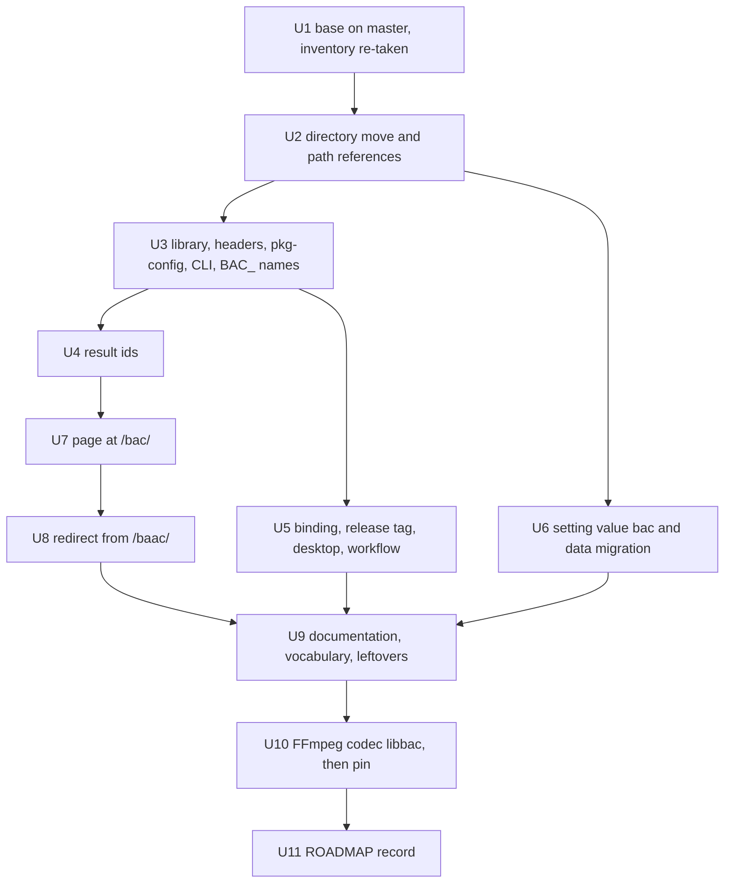
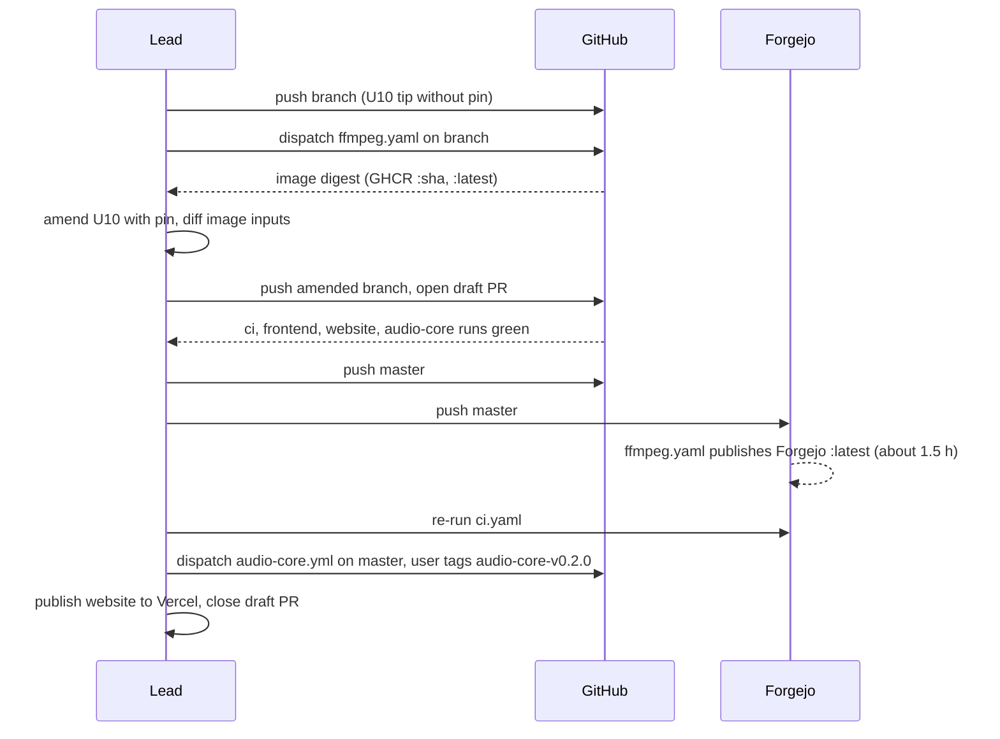

# Rename bAAC to Bånder Audio Core - Plan

## Goal Capsule

**Objective:** Wherever a developer, operator, desktop user or website reader meets Bånder's audio codec library, it is named Bånder Audio Core, or `bac` where a short identifier is needed. Everything that worked under the bAAC names works the same under the new ones: transcoding through FFmpeg, the desktop codec, the prebuilt binding, CI and the codec's website page.

**Means:** One token rule decides every identifier, path and display string (KTD1). Commits are ordered so that each one builds (KTD4). A forward data migration rewrites stored setting values (KTD3), and the commit that flips FFmpeg's codec name pins a new FFmpeg image (KTD5).

**Product authority:** The user's decisions of 2026-11-12, recorded in Key Decisions KD1 to KD3.

**Base:** The inventory was first taken on a branch cut from `baac-lossless` at `8248b0cdb`. The lossless work landed on `master` at `28866bf56` on 2026-11-12, under the current names. The landing brought the third held-out set (Avon Chang's recording of Bach's Cello Suite No. 6, the Tears of Steel 5.1 mix and Cloudkicker) and one failed held-out size gate, disclosed under the lossless plan's KD12. It recorded the rename decision as that plan's KD13, and it changed the `/baac` page text, the ROADMAP's rename item and the codec comparison. The branch `rename-audio-core` was then cut from `master` at `28866bf56`, with this plan as its first commit (`ce41378f1`), and U1 re-takes the inventory against `master`.

**Execution profile:** One branch with eleven units, landing as local commits in U-ID order. U10 must stay the last code commit: its image pin exists only after the image is built from it, and the pin is added by amending U10 at the branch tip (KTD5). U11 records the delivery.

**Authority and stop conditions:** Follow `AGENTS.md`, then the Product Contract, then the Planning Contract. Stop and report when any of these holds:

- `master` does not contain the lossless landing (U1).
- The lead announces a quiet window for a benchmark. No build, test or image build runs until it ends.
- A CTest suite, Node test or committed reference stream changes its output, apart from the FLAC vendor string of KTD7.
- At the end of U10, the residue gate in the Verification Contract finds an old-name token outside its allowlist.
- The renamed FFmpeg patch does not apply, or `configure` does not find the `bac` module.
- A renamed CMake option, environment variable or path filter is not read under its new name (the negative checks of KTD13).
- A step would read the follow-up's fourth held-out set before the rename lands (KD4).

**Who finishes:** `ce-work` implements on the branch, and the lead owns the commits and the ROADMAP record. The user asks for every push and dispatch, cuts `audio-core-v0.2.0` and publishes the website (KTD6). On 2026-11-12 the user authorized the persistent instance's `make dev-up` at the landing (KTD6 step 4). The lead runs it; implementation workers never touch that instance.

---

## Product Contract

### Summary

The plan renames the codec library and every surface that carries its name: the package directory, library, pkg-config module, headers, CLI and FLAC symbols; the Node binding, its npm name and its release tag; the FFmpeg wrapper's codec names and the image built from them; the server setting value; CI; the website page; and the documentation. A migration rewrites `baac` values stored on existing local instances. Historical records keep the names they were written with.

### Problem Frame

bAAC began as Bånder's AAC encoder and decoder, and the name says so. The library now covers AAC-LC, HE-AAC v1 and v2, xHE-AAC (USAC), the low-delay profiles including ELD, MPEG Surround, DRC and lossless FLAC, so "AAC" names one part of it. The user wants it named as an audio component, in the manner of Apple's audio toolkit.

The timing makes the rename cheap. No release of the binding exists: GitHub has no `aac-native-v*` tag or release (checked 2026-11-12), and the 0.2.0 tag is held so that the first release carries the new name. The project has no production deployments (AGENTS.md, temporary pre-release policy). Three things do exist under the old names: local instances that store the setting value `baac`, the published FFmpeg image whose codec is `libbaac`, and the public page `https://baander.app/baac/`, live since 2026-10-31.

The lossless plan's KD4 kept the names because FFmpeg's configure check, the Electron dependency and the prebuild assets referred to them. This plan changes all three together, which removes that reason. The lossless plan records the rename as its KD13, which supersedes KD4.

### Key Decisions

- KD1. **Full rename with no compatibility aliases.** (session-settled: user-directed — chosen over keeping the names, which the lossless plan's KD4 decided: the library has grown from one codec into an audio component, and there are no production deployments) This supersedes `docs/plans/2026-11-10-2313-feat-baac-lossless-flac-plan.md` KD4. Governs R1 to R12.
- KD2. **The user's name mapping.** (session-settled: user-directed — chosen over the existing names: the user supplied each new name on 2026-11-12) The mapping:
  - bAAC becomes Bånder Audio Core, short name `bac`.
  - `packages/baander-aac` becomes `packages/baander-audio-core`.
  - `libbaac` and `libbaac.pc` become `libbac` and `bac.pc`.
  - The CLI `baac` becomes `bac`, and `include/baac/` becomes `include/bac/`.
  - `baac_flac_*()` becomes `bac_flac_*()`; the `aac_*` API keeps its prefix.
  - `@baander/aac-native` becomes `@baander/audio-core`, and the tag `aac-native-v*` becomes `audio-core-v*`.
  - FFmpeg's `libbaac` becomes `libbac`, the setting value `baac` becomes `bac`, and the page `/baac` becomes `/bac`.

  Governs R1, R4 to R7, R9, R10.
- KD3. **The rename follows the lossless landing on its own branch, and the first release carries the new name.** (session-settled: user-directed — chosen over cutting `aac-native-v0.2.0` first or renaming inside the lossless branch: the lossless work lands tonight under the current names) The lossless work landed that night, at `28866bf56`. Governs R5.
- KD4. **The rename lands before the follow-up on hi-res compression.** (Lead decision, 2026-11-12, derived from the held-out rule; the user decided that the lossless mode lands first and that the follow-up is planned, not this order.) The lossless plan's KD12 opened a follow-up for material like the failed 96 kHz piano recording, and that follow-up ends with a fourth fresh held-out set and a new recorded run. The rename changes the binary, both its name and the FLAC vendor string (KTD7), and a held-out set that an earlier build has read is spent. So no tool reads the fourth set before the rename lands.

### Requirements

**Library, headers and tools**

- R1. The package lives at `packages/baander-audio-core`. It builds the archive `libbac.a` and the CLI `bac`, and installs its headers under `include/bac/` and the pkg-config module `bac` (`bac.pc`). The FLAC API is `bac_flac_*` with `BacFlac*` types and `BAC_FLAC_*` constants; the `aac_*` API is unchanged.
- R2. Codec output does not change: every CTest suite, Node test and committed reference stream gives the same bytes and samples as before, apart from the FLAC vendor string (KTD7).
- R3. Every CMake option, compile definition and build or test environment variable the package reads uses the `BAC_` prefix, and every caller sets the new name. The binding's loader and prebuild variables follow R4.

**Binding and desktop**

- R4. The npm package is `@baander/audio-core`. Its binding file, loader variables and prebuild asset names follow KTD1, and the desktop app depends on it, loads it and packages it under that name.
- R5. Binding releases are tagged `audio-core-v<version>`, and the install script fetches prebuilds from that tag. The version stays 0.2.0, so the first release is `audio-core-v0.2.0`.

**FFmpeg and server**

- R6. The FFmpeg image registers the encoder and decoder `libbac`, built with `--enable-libbac` against `bac.pc` and `<bac/aac.h>`, and passes its smoke and capability gate. The application image pins that image by digest.
- R7. The `transcode.aac_implementation` setting offers `bac` (label "Bånder Audio Core"), `fdk_aac` and `ffmpeg`, defaults to `bac`, and maps `bac` to FFmpeg's `libbac`.
- R8. A local instance that stored `baac` in the setting, in a failed audio rendition or in a transcode session's desired state reads `bac` there after its next migration, with no operator action and no data reset.

**CI**

- R9. Every workflow filters on, builds from and sets the new paths, names and variables. The binding workflow is `.github/workflows/audio-core.yml` and releases on `audio-core-v*` tags.

**Website and documentation**

- R10. The codec page is `https://baander.app/bac/`. Its header and footer links, assets, styles, chart ids and evidence ids use the new names.
- R11. Documentation, READMEs, `CONCEPTS.md` and the open ROADMAP items name Bånder Audio Core or `bac`. The `CONCEPTS.md` entry is renamed and carries an avoid-note for bAAC.
- R12. Historical records keep their names: commit messages, existing plans, completed ROADMAP entries, dated evidence in solution docs, and `migrations/Version20261107120000.php`. Links in them that point at moved files are repointed, as the previous move of this directory did (`166dec8e5`).
- R13. `/baac` and `/baac/` answer with a permanent redirect to `/bac/` (OQ1).

### Success Criteria

- The residue gate returns no hit outside its allowlist, and no tracked path outside `docs/plans/` carries an old name.
- `audio-core-v0.2.0` carries four prebuilds, and a clean desktop install fetches the one for its platform instead of compiling.
- A preview instance upgraded across the rename, with `baac` stored, transcodes AAC through `libbac` without a reset.

### Scope Boundaries

- AAC-format names stay, because they name the format the code handles: the `aac_*` C API and `include/aac*.h`, `AacImplementation`, the setting key `transcode.aac_implementation`, the Electron `AacService` and its `aac.*.ts` files, the tooling classes `AacEvidence` and `AacCharts`, and `scripts/tests/php/Fixtures/aac-lossless-result.json`.
- The FFmpeg image keeps its name, `ffmpeg-baander-static`.
- Codec behaviour, the package version and the measured figures do not change.
- `ui/rn` carries no old name and is not touched.
- No step on this branch reads held-out recordings. The only ones sit in the lossless worktree, and U4's ledger checks run on a made-up ledger. Benchmark data in other checkouts is moved at the landing, not on this branch (U4).
- `.idea/.name` holds the IDE project name `baander-aac`. It is the user's IDE metadata, and the main checkout has local `.idea` edits, so this plan leaves it alone.
- Considered and not built (KD1): a CMake alias target, a `libbaac.pc` shim, a symlink at the old directory, an FFmpeg codec alias, an npm alias package, runtime acceptance of the value `baac`, and a migration fallback in the application. A production deployment or a published release under the old names would change this; neither exists.

### Resolved Questions

Answered by the user on 2026-11-12:

- OQ1. **`/baac/` redirects to `/bac/`.** Chosen over no redirect: the page has been public since 2026-10-31, and the redirect is one generated Vercel route with no code path in the product (U8, KTD11). Links to the page's chart fragments lose their targets either way, since the chart ids are renamed.
- OQ2. **The landing opens a draft pull request on GitHub,** closed unmerged after the `master` push. Chosen over landing first: GitHub dispatches only workflows that exist on the default branch, so the pull request is the only way to run the renamed `audio-core.yml` on all four platforms before `master` moves.
- OQ3. **Machine-facing names use the ASCII spelling "Baander Audio Core":** FFmpeg's long codec name and the FLAC vendor string. Chosen over the UTF-8 "Bånder Audio Core" there, to match FFmpeg's ASCII long names and the package's ASCII identifiers. Prose, the website and the documentation use "Bånder Audio Core".

### Sources and Research

- `docs/solutions/best-practices/static-ffmpeg-build-silently-drops-components-the-application-uses.md`: the capability gate runs in the FFmpeg image and again in the application image.
- `docs/solutions/developer-experience/local-gate-images-and-webkit-harness-runs.md`: a preview whose applied migration was rewritten stops at "An applied migration changed" and needs a reset.
- `docs/solutions/developer-experience/one-workflow-tree-for-forgejo-and-github.md`: GitHub runs `workflow_dispatch` only for workflows on the default branch.
- `docs/solutions/best-practices/codec-output-that-must-be-identical-everywhere-needs-exact-arithmetic-and-ordered-sums.md`: a dropped compile flag is invisible to a single-compiler CI.
- `7cf6db42b` pinned the FFmpeg image by digest (catalog, image test and source exception together). `166dec8e5` is the previous move of this directory. `8248b0cdb` refreshed the desktop lockfile from a clean copy of the tracked files.
- `docs-book/part-2-developer-guide/contributing/continuous-integration.md`, sections "The desktop lockfile and the codec package" and "Images and their visibility".

---

## Planning Contract

### Key Technical Decisions

- KTD1. **One token rule decides every name.** Brand tokens take the short name, package tokens take the long name, and AAC-format tokens stay (Scope Boundaries). Matching is case-sensitive and by token, never a blanket text replace. Two kinds of false match must survive untouched: hexadecimal runs in `relay/third_party/inventory/`, `packages/swoole-bundle/upstream-review.json`, `packages/baander-tooling/src/Registry/StaticQualification.php` and the `yarn.lock` checksums; and `StubAacImplementationProbe` (31 occurrences in six test files), whose `bAac` a case-insensitive replace would turn into `StubacImplementationProbe`.

  | Old token | New token | Examples |
  |---|---|---|
  | `baac` | `bac` | CLI, `tools/baac*.{cpp,h}`, FLAC functions, setting value, page, assets, CSS classes, result ids, CI cache keys |
  | `BAAC_` | `BAC_` | CMake options and variables, compile definitions, environment variables (`BAC_REQUIRE_ORACLES`, `BAC_AAC_CPU`) |
  | `Baac` | `Bac` | C types (`BacFlacDecoder`), wrapper contexts, the PHP enum case `AacImplementation::Bac` |
  | `libbaac` | `libbac` | FFmpeg feature and codec, wrapper sources, patch |
  | `baander-aac`, `baander_aac`, `BAANDER_AAC_` | `baander-audio-core`, `baander_audio_core`, `BAANDER_AUDIO_CORE_` | Directory, CMake project and target, node-gyp target, include guards, prebuild variables |
  | `aac-native`, `AacNative`, `AAC_NATIVE` | `audio-core`, `AudioCore`, `AUDIO_CORE` | npm name, workflow file, tag prefix, Electron loader, `BAANDER_AAC_NATIVE_BINDING` → `BAANDER_AUDIO_CORE_BINDING` |
  | bAAC, "Baander AAC", "AAC native addon" in prose | Bånder Audio Core, "Audio Core binding"; "Baander Audio Core" in FFmpeg's long codec name and the FLAC vendor string (OQ3) | Documentation, comments and every display string, such as the pkg-config description, the npm description, the workflow name and the setting label |

  Documentation writes Bånder Audio Core in prose and `bac` in code font where it names the CLI, library, setting value or codec.
- KTD2. **Target and file names.** `project(baander-audio-core)`. The library target `baander-audio-core` sets its output name to `bac`, so the archive is `libbac.a` and `bac.pc` links `-lbac`. The CLI owns the target name `bac`, and `baander-aac-simdeps` becomes `baander-audio-core-simdeps`. CMake rejects two targets with one name, which is why the library keeps the package name and sets an output name. Every reference to either target moves with it: `tests/CMakeLists.txt` (link targets, `if(TARGET baac)` and `$<TARGET_FILE:baac>`), `tools/fuzz/CMakeLists.txt` and `bench/common.py`. `cmake/libbaac.pc.in` becomes `cmake/bac.pc.in`, its `Libs:` line becomes `-lbac`, and headers install to `${includedir}/bac`; the source tree keeps its flat `include/`. The node-gyp target and `NODE_API_MODULE` name `baander_audio_core` produce `baander_audio_core.node`, and the prebuild assets are `baander_audio_core-<platform>-<arch>.node`. The archive name reads the user's `libbac` at face value. The pkg-config module name follows FFmpeg's `require_pkg_config <feature> <module>` convention (feature `libbac`, module `bac`).
- KTD3. **A forward data migration rewrites stored values, and the applied migration stays as written.** A new migration in `migrations/`, landing with the enum change (U6), runs:
  1. `SET LOCAL lock_timeout = '2s'`.
  2. Drop `chk_audio_rendition_runtime_failed_aac_implementation`.
  3. Rewrite `baac` to `bac` in `system_settings` (key `transcode.aac_implementation`, a jsonb string), in `audio_rendition_runtime.failed_aac_implementation`, and in `transcode_runtime_state.desired->'aacImplementation'`, in every row whatever its state or outcome. The runtime readers hydrate up to 100 rows per poll, so one unmapped row fails the whole batch and stalls every worker poll; a failed rendition's value is mapped, not cleared, because NULL disables the retry after a switch.
  4. Re-add the constraint under the same name, allowing `bac`, `fdk_aac` and `ffmpeg`.

  `down()` reverses the rewrite and the constraint. `AacImplementation::from()` throws on an unknown value, so a `baac` left in either runtime table makes `AudioRenditionRuntime` and `TranscodeRuntimeState` fail to read the row. A `baac` left in `system_settings` falls back to the default through `SystemSettings::effective()`, and the admin page shows it as an invalid stored value. Editing `Version20261107120000` instead reaches only fresh installs: `packages/baander-tooling/src/Development/Database.php` hashes every applied migration and stops an instance whose migration changed ("An applied migration changed") until its data is reset, which AGENTS.md does not authorize. `.gitattributes` already preserves an applied migration's checksum for the same reason. The migration is a one-time rewrite, not a compatibility layer: the application never reads `baac` again. Its updates fire the query capture triggers on these tables. The postgres specialist owns the migration under the `postgres-remediation` skill and the database naming page.
- KTD4. **Names that must change together share a commit, and FFmpeg's codec name flips last.** The application image gates the pinned FFmpeg binary against `docker/ffmpeg/expected-capabilities.txt` from the tree (`Dockerfile:448-451`), and the FFmpeg image gates itself against the same file. FFmpeg's codec stays `libbaac` through U9 so that the pinned image keeps passing. U6 changes the setting value while `encoderName()` still returns `libbaac`, so it needs no new image. The coupling table in the High-Level Technical Design lists each group.
- KTD5. **The new FFmpeg image comes from a branch dispatch, and the flip commit carries its pin.**
  1. U10 is committed without the pin, as the branch tip.
  2. The branch is pushed to GitHub and `ffmpeg.yaml` is dispatched on it. The workflow exists on `master`, so dispatch works. The run builds the tip, passes the image's own smoke and gate, and publishes `:<sha>` and `:latest` to GHCR. Nothing reads GHCR's `:latest`: GitHub CI uses the digest, and Forgejo CI uses its own registry.
  3. U10 is amended with the digest in `packages/baander-tooling/resources/tooling-defaults.json`, `scripts/tests/php/ImageCatalogTest.php` and `packages/baander-tooling/src/Architecture/SourceExceptions.php`, as `7cf6db42b` did. A diff of the image inputs (`docker/ffmpeg/`, `packages/baander-audio-core/`, `scripts/ffmpeg-capability-gate.sh`) between the dispatched commit and the amended one is empty, and the commit message names the dispatched commit and run.

  `ce-code-review` runs, and its justified findings are applied, before the dispatch. Any later change to the image inputs, a review fix or a rebase onto a `master` that changed them, needs a new dispatch.

  Rejected: landing on `master` and pinning in a follow-up push, which leaves a `master` commit whose application image fails the gate; and a workflow change to publish a branch image without `:latest`, which is a mechanism for one run. The `master` push runs `ffmpeg.yaml` again through its path filter and publishes an equivalent image. The pin stays on the dispatched image, and the ROADMAP records both digests.
- KTD6. **Landing route.** Each step happens only when the user asks.
  1. Push the branch to GitHub, dispatch `ffmpeg.yaml` and amend U10 with the pin (KTD5). Commit U11, then push the rewritten branch.
  2. Open a draft pull request on GitHub (OQ2). It runs `ci.yaml`, `frontend.yaml`, `website.yaml` and `audio-core.yml` on the final tree, including MSVC, Apple clang and NEON.
  3. Push `master` to both forges. GitHub CI builds against the pinned digest. Forgejo's `ci.yaml` reads Forgejo's `ffmpeg-baander-static:latest` (`ci.yaml:16`), which keeps `libbaac` until Forgejo's own `ffmpeg.yaml`, started by the same push, publishes about 1.5 h later. `[skip ci]` on the landing push is no way out: it would also skip Forgejo's FFmpeg build. In that window, push to Forgejo's `master` only a commit whose message carries `[skip ci]`, such as a records-only commit. Forgejo honoured `[skip ci]` on the lossless landing's first push (the user checked on 2026-11-12), so such a push starts neither workflow, and `ffmpeg.yaml` cancels a running build only for a pull request. Then re-run Forgejo's `ci.yaml`.
  4. Restore the persistent instance. Its automatic update builds with the FFmpeg reference captured at its last `make dev-up` (`ToolingConfiguration::fromArray` over the saved selection in `packages/baander-tooling/src/Development/Cli.php`), so the update to the rename revision fails the application image gate and the instance stays on its old release. Run `make dev-up`, which targets `baander.test`, from a checkout of `master` that holds the new pin, such as the main checkout once it is on `master`; `make dev-update OPTIONS=--retry` from the same checkout also works. `configure` in `Cli.php` replaces the saved tooling selection and keeps the instance's own checkout, so the command does not move the persistent instance onto another branch. The updater then stops writers, migrates and starts the new release. The user authorized this `make dev-up` on 2026-11-12, and the lead runs it.
  5. Dispatch `audio-core.yml` on `master`. The user cuts `audio-core-v0.2.0`, and the release job attaches four prebuilds and `SHA256SUMS`.
  6. Build the website from `master`, publish it per `ui/site/README.md` (preview, then production) and check `/bac/` and, per OQ1, `/baac/`.
  7. Close the draft pull request unmerged, delete the GitHub branch, clean the developer checkouts after moving their benchmark data (System-Wide Impact, U4), and record the landing results in `ROADMAP.md` (U11). The lead moves the benchmark data and rewrites its ledger with the code U4 adds.
- KTD7. **The FLAC vendor string becomes "Baander Audio Core" (OQ3).** `src/flac_meta.cpp` writes `kVendor` (today `"bAAC"`) into the comment block of a tagged stream when the caller names no vendor. It is the only rename that changes encoded bytes, and only for tagged streams. `tests/test_flac_meta.cpp` and `tests/test_flac_cli.cpp` assert it and change with it. No committed stream contains it.
- KTD8. **Every commit that changes the package refreshes the desktop lockfile.** `ui/electron/yarn.lock` records a hash of the `file:` dependency's folder, and Frontend CI's immutable install rejects a stale one. The refresh runs `corepack yarn install --mode=update-lockfile` in `ui/electron` inside a clean copy of the tracked files, because untracked build trees (`cmake-build/`, `build/`, `prebuilds/`) change the hash. The same clean copy then accepts `corepack yarn install --immutable`. The copy keeps the tracked symlink `compile_commands.json`, which dangles there as it does in CI's checkout, because Yarn's hash covers it. The refreshes in `8248b0cdb` and `0b7520b9e` were taken from a copy without it, so the lockfile on `master` at `28866bf56` (`hash=695400`) is not the one Frontend CI computes (`hash=caf420`, U1). GitHub's Frontend CI has not run since `715eeb86e` (its run list, checked 2026-11-12). The lockfile it accepted there matches a copy with the symlink (`hash=3971d5`; `ea5b69` without it). U2's refresh corrects it.
- KTD9. **Result ids are renamed in the committed results, and every measured value stays.** The lossless harness emits the encoder id `baac` and rows `baac-0` to `baac-8`, and `AacEvidence::LOSSLESS_ENCODERS` accepts only known ids. U4 renames the ids, the revision key and the labels in `bench/results/lossless.json` and `bench/results/tables.md`, in the harness, in the validator and in the PHP fixture together. A comparison that maps old ids to new ones shows identical values. Two alternatives are rejected. Re-measuring would move figures the documentation quotes and needs the quiet host the benchmark needs. Keeping `baac` as a data key behind a new label would leave the old name in the format the harness writes from now on.
- KTD10. **The binding workflow is renamed and first runs on a pull request.** `.github/workflows/aac-native.yml` becomes `.github/workflows/audio-core.yml`, named "Audio Core binding". It lists itself in its path filters, releases on `audio-core-v*` tags, names artifacts `baander_audio_core-<target>` and titles releases `@baander/audio-core <version>`. Its first run before `master` moves is the pull request of KTD6 step 2. `tests/Unit/Shared/Infrastructure/Ci/PublicationWorkflowTest.php` moves with the file.
- KTD11. **The `/baac/` redirect is a moved-page entry read by both website routers.** A map of moved pages in `packages/baander-tooling/src/Website/Publication.php` gives `/baac/` → `/bac/`. It lives there rather than in `Command.php`, so the residue gate can exclude a file with no other old names while `Command.php`, which computes the codec's source revision from the package path, stays under the gate. `Publication::package` emits 308 routes for `/baac` and `/baac/` ahead of the filesystem handler, and `Preview::route` answers the same, so the browser tests exercise it. The sitemap lists `/bac/` only. This decision applies only if OQ1 is answered yes.
- KTD12. **Documentation lands with what it describes, and links move with the directory.** The website build fails on a docs-book link to a missing repository path (`WebsiteBuilder::checkedSource`), so U2 repoints every link into the package. Package docs change in the unit that renames what they describe (U3 to U5), which keeps lockfile refreshes to one per unit. Root and docs-book prose changes in U9, and text that names FFmpeg's codec changes in U10. `prose-fix` runs on changed prose.
- KTD13. **Renames that fail open get a check that fails.** A missed side of these renames passes silently:
  - CMake only warns about an unknown `-D` option, so a stale `-DBAAC_AAC_BUILD_TESTS=OFF` in `docker/ffmpeg/Dockerfile` builds the tests and CLI into the image.
  - A stale `BAAC_REQUIRE_ORACLES` or `BAAC_REQUIRE_KERNELS` in the workflow lets the oracle and kernel suites skip.
  - A stale `BAAC_AAC_CPU` in `tests/CMakeLists.txt` runs every per-level variant at the default level.
  - A stale `BAAC_FLAC_STRICT_MATH` drops the exact-math flags from the FLAC kernels.
  - `ui/electron/tests/aac-service.test.ts` skips every test when it cannot find the built binding, so a wrong `.node` name skips the suite instead of failing it.
  - Length-prefixed fixtures: replacing `"bAAC"` in the malformed comment blocks of `tests/test_flac_meta.cpp` with a string of another length shifts the later fields, and the cases pass through the wrong bound (U3).
  - The benchmark's generated `work/ext/env.sh` exports `BAAC_HELDOUT`, `BAAC_FLAC_REFERENCE` and `BAAC_FLAC_TESTBENCH` with old absolute paths; a renamed harness that finds no `BAC_` variable falls back to defaults and treats the held-out set as unseen.
  - A stale `BAAC_EXACT_MATH` turns `BAAC_REFERENCE_BUILD` (`tests/test_util.h`) to 0, so the byte comparison of committed streams quietly becomes a decode comparison.
  - A stale `BAAC_AAC_SSE2`, `BAAC_AAC_AVX2` or `BAAC_AAC_NEON` compiles the SIMD kernels out, and the scalar kernels still pass.
  - A stale path filter stops triggering, and a stale `electron-builder.yml` package glob packs the binding inside the asar.

  Each is covered by the residue gate and by a check that fails when the rename is one-sided:
  - The image's builder stage configures without CMake's "Manually-specified variables were not used" warning.
  - `ctest` with `BAC_REQUIRE_ORACLES=1` and no reference `flac` fails the oracle suites, and a run with the oracles present has no `SKIP:` line in `LastTest.log` (the check the workflow already makes on Linux).
  - The compile database and `binding.gyp`'s definitions match U1's apart from renamed tokens and paths, so `-DBAC_EXACT_MATH=1` and the SIMD definitions are still present.
  - The kernel line the workflow greps appears for each required level.
  - The Electron AAC service test reports zero skipped tests.
  - Each malformed comment-block case fails on the bound it names (U3).
  - `setup-refs.sh`, run again after the move, writes `work/ext/env.sh` with the `BAC_` names, and the next held-out run books itself after the moved ledger's entries (U4).
  - A packaged desktop build has the binding under `app.asar.unpacked`.

### High-Level Technical Design

Commit order. Each box is one local commit; U10 is amended with the pin after the dispatch.



Coupling groups. Everything in a row changes in one commit.

| Unit | Changes together | What breaks if split |
|---|---|---|
| U2 | Directory move; `docker/ffmpeg/Dockerfile` paths; workflow path filters, working directories, `hashFiles` and artifact paths; Electron `file:` dependency and lockfile; tooling website paths; docs-book links into the package | Image build, CI triggers (silently), desktop immutable install, website build |
| U3 | CMake options, definitions and targets; `bac.pc`; `include/bac`; FLAC symbols; the Dockerfile's `-D` options and pkg-config call; the wrapper's `#include <bac/aac.h>` and the patch's pkg-config module; `binding.gyp` definitions; workflow and test variables; the benchmark's CLI path | FFmpeg configure, binding compile, oracle and kernel suites (silently) |
| U4 | Result ids in the harness, committed results, validator and PHP fixture | Website build |
| U5 | npm name; binding file; loader and prebuild variables; fetch script; Electron dependency, Vite externals, `electron-builder.yml` and loader; workflow file and its contract test; lockfile | Desktop install, packaging (silently), workflow contract test |
| U6 | Enum value and label; setting definition; forward migration; tests | Transcoding on instances with stored values |
| U10 | Wrapper codec names, sources and patch; `--enable-libbac`; smoke; capability list; `encoderName()`; tests; codec-name docs, including the package README's FFmpeg paragraph and the lockfile it moves; digest pin | Application image gate, FFmpeg image gate, desktop immutable install |

Landing across the two forges (KTD6):



### Assumptions

These are the planner's readings, not confirmed by the user.

- Display strings use the UTF-8 name "Bånder Audio Core"; FFmpeg's long codec name and the FLAC vendor string use "Baander Audio Core" (OQ3, settled).
- The site's header and footer link reads "Audio Core", and the page title reads "Bånder Audio Core".
- `libbac` in the mapping names the archive (`libbac.a`) as well as the pkg-config module (KTD2).
- Environment variables, the binding file, include guards and the workflow file follow the token rule; the user named none of them (KTD1).
- The ROADMAP's open section "bAAC in the server transcoder" is renamed with the library, and the solution doc that cites it follows.

### System-Wide Impact

- **Local instances.** The persistent instance migrates once `make dev-up` has captured the new pin (KTD6 step 4); previews migrate on `make preview-up`, taking the pin from their own worktree. Running sessions keep their desired state, rewritten in place. Rendition keys do not include the implementation (`AudioRenditionInput::key()`), so no cached rendition is encoded again.
- **Previews between a pull and `make preview-up`.** A preview's web PHP reads the live worktree, so after pulling the rename it runs the new enum against unmigrated rows and fails transcode reads until `make preview-up` migrates. A worktree that has migrated cannot switch back to a pre-rename branch: the tooling refuses a database ahead of its migrations.
- **Developer checkouts.** After the move, each checkout keeps its ignored build trees (`build/`, `cmake-build*/`, `node_modules/`, `prebuilds/`) under `packages/baander-aac/`, and they turn untracked because the package's `.gitignore` moved. The preview build snapshot includes untracked files (`packages/baander-tooling/src/Build/Source.php`), so a stale tree, 459 MB for the lossless worktree's fuzz build, would enter the preview image, and `git add -A` would commit it. First move `bench/work/`, the benchmark's measurement data, to the new path and rewrite its ledger (U4); only the lossless worktree has one, and the lead does this at the landing. Then delete `packages/baander-aac/` once git tracks nothing under it, configure CMake afresh at the new path (a moved CMake cache is refused), and run `corepack yarn install` in `ui/electron` to drop `node_modules/@baander/aac-native`. Hosts that ran `cmake --install` keep the old installed files; the project has no uninstall step. A host whose `BAANDER_FFMPEG_IMAGE` names a local FFmpeg build must rebuild it after U10, or its application image fails the gate.
- **Prebuilt binding.** No release exists, so installs build from source until `audio-core-v0.2.0` is cut. `fetch-prebuilds.mjs` already falls back to node-gyp and exits zero.
- **FFmpeg image.** GHCR's `:latest` moves at the dispatch, and Forgejo's at the `master` push (KTD6).
- **Website.** The live site keeps `/baac/` until the manual Vercel deployment; `/bac/` exists only after it.
- **Lossless plan.** Its KD4 is superseded; U9 adds a one-line note under it.

### Risks

| Risk | Mitigation |
|---|---|
| The lossless landing (`28866bf56`) added names after `8248b0cdb` | U1 starts from `master` and re-takes the inventory |
| Another branch that touches the package lands after the rename and brings old names back | A branch that lands later rebases onto the renamed `master` and must pass the residue gate |
| A change to the image inputs after the dispatch leaves the pin describing another tree | KTD5: review before the dispatch, re-dispatch after any later change, and the image-input diff before the `master` push |
| The persistent instance's automatic update fails after the landing | KTD6 step 4; the failed update leaves the old release running |
| A one-sided rename passes silently | KTD13's residue gate and failing checks |
| The renamed patch no longer applies | Only names inside added lines change, so hunk line counts stay; `git apply --check` in the image build fails on drift |
| `bac` or `libbac` collides with a name in FFmpeg or Debian | `--enable-libbac` is explicit, so configure fails if the module is missing; not checked against the FFmpeg tree during planning |
| A text replace corrupts a hash | KTD1 matches by token and skips hexadecimal runs; the residue gate strips them |
| The migration's updates fire query capture triggers | The postgres specialist reviews U6 |
| Forgejo `master` CI fails until Forgejo's image publishes | KTD6 step 3; the ROADMAP records the window |
| The rename must be reverted after landing | Roll forward only: the tooling refuses a database whose applied migrations are unknown to the code, so a `git revert` that deletes U6's migration stops every migrated instance. A rollback is a new change with a reverse migration. U10 alone can be reverted without data changes, because `encoderName()` separates the setting value from FFmpeg's codec name and the previous digest `dbec52eb…4cd8aa` stays pullable. No tag or website deployment happens before the checks of KTD6 pass |

---

## Implementation Units

| U-ID | Title | Key files | Depends on |
|---|---|---|---|
| U1 | Start from master and re-take the inventory | this plan's Appendix | lossless landing |
| U2 | Move the package directory | `packages/baander-audio-core/`, `docker/ffmpeg/Dockerfile`, `.github/workflows/`, `ui/electron/` | U1 |
| U3 | Rename the library, headers, pkg-config module, CLI and build names | `packages/baander-audio-core/`, `docker/ffmpeg/` | U2 |
| U4 | Rename the benchmark result ids | `packages/baander-audio-core/bench/`, `packages/baander-tooling/src/Website/AacEvidence.php` | U3 |
| U5 | Rename the binding, its release and the desktop dependency | `packages/baander-audio-core/node/`, `.github/workflows/audio-core.yml`, `ui/electron/` | U3 |
| U6 | Rename the setting value and rewrite stored values | `src/Transcode/`, `migrations/`, `tests/` | U2 |
| U7 | Move the codec page to `/bac/` | `ui/site/`, `packages/baander-tooling/src/Website/` | U4 |
| U8 | Redirect the old page URL | `packages/baander-tooling/src/Website/Publication.php`, `Preview.php` | U7 |
| U9 | Rename the documentation, vocabulary and leftovers | `CONCEPTS.md`, `docs-book/`, `ROADMAP.md`, `docs/solutions/` | U5, U6, U8 |
| U10 | Flip the FFmpeg codec name and pin the new image | `docker/ffmpeg/`, `src/Transcode/Domain/ValueObject/AacImplementation.php`, `packages/baander-tooling/resources/tooling-defaults.json` | U9 |
| U11 | Record the delivery | `ROADMAP.md` | U10 |

### U1. Start from master and re-take the inventory

- **Goal:** The branch holds the lossless landing, and the inventory matches its tree.
- **Requirements:** KD3; the baseline for R2 and KTD13.
- **Dependencies:** The lossless work merged on `master`.
- **Files:** None change. The Appendix inventory is the comparison point.
- **Approach:**
  1. Confirm that `master` contains the lossless landing, then rebase `rename-audio-core` onto `master` or recreate it there. This plan file moves with it.
  2. Run the residue gate and the path gate from the Verification Contract. Assign every hit that the Appendix does not list to the unit that owns its area. New files under the package go to U3 to U5; the lossless ROADMAP record is history.
  3. Record the baseline: CTest and Node test counts, the compile database, `binding.gyp`'s effective flags, the measured values in `bench/results/lossless.json`, and the FFmpeg encoder and decoder listings of the pinned image.
- **Test expectation:** none -- no code changes; this unit fixes the baseline that U3, U4 and KTD13 compare against.
- **Verification:** The branch starts at `master`'s tip, every inventory delta has an owning unit, and the baseline is recorded outside `var/`.

### U2. Move the package directory

- **Goal:** The package lives at `packages/baander-audio-core` with its content unchanged, and every path that a build, workflow, test or website page reads follows it.
- **Requirements:** R1, R9, R12; KTD8, KTD12.
- **Dependencies:** U1.
- **Files:**
  - Move: `packages/baander-aac/` to `packages/baander-audio-core/`, including the `compile_commands.json` symlink.
  - Modify: `docker/ffmpeg/Dockerfile` (copy source and build directories), `.github/workflows/aac-native.yml` (paths, working directory, `node-version-file`, `hashFiles`, artifact paths), `.github/workflows/ffmpeg.yaml`, `.github/workflows/frontend.yaml`, `.github/workflows/website.yaml`.
  - Modify: `ui/electron/package.json` (the `file:` path), `ui/electron/yarn.lock`, `ui/electron/tests/aac-service.test.ts` (package path).
  - Modify: `packages/baander-tooling/src/Website/Command.php` (`SITE_SOURCES`, the codec revision path, page sources, `sourceBase`), `packages/baander-tooling/src/Website/AacEvidence.php` (package root), `scripts/tests/php/Website/AacEvidenceTest.php`, `scripts/tests/php/Website/WebsiteBuilderTest.php`.
  - Modify (links only): `docs-book/part-2-developer-guide/development/frontend-development.md`, `ROADMAP.md`, `THIRD_PARTY.md`. The package docs' references to their own path change in U3.
- **Approach:** Move the directory with no content edit inside it, so history follows each file. Use `166dec8e5`, the previous move of this directory, as the minimum checklist. Path mentions in prose that no build reads move in U9. Refresh the lockfile per KTD8.
- **Patterns to follow:** `166dec8e5`.
- **Test scenarios:**
  - The CTest suites and the Node smoke test pass from the new path with U1's counts.
  - The Electron AAC service test loads the binding from the new path.
  - The website build resolves the frontend guide's link to the package README.
  - In a clean copy, `ui/electron` accepts the refreshed lockfile with an immutable install.
  - The FFmpeg image's builder stage builds the package from the new path.
- **Verification:** No path filter, build step, test or website page reads `packages/baander-aac`.

### U3. Rename the library, headers, pkg-config module, CLI and build names

- **Goal:** The package builds `libbac`, installs `include/bac/` and `bac.pc`, provides the `bac` CLI and the `bac_flac_*` API, and every CMake option, compile definition and build or test variable it reads uses `BAC_`.
- **Requirements:** R1, R2, R3; KTD1, KTD2, KTD7, KTD13.
- **Dependencies:** U2.
- **Files:**
  - `packages/baander-audio-core/CMakeLists.txt`, `tests/CMakeLists.txt`, `tools/fuzz/CMakeLists.txt`, `cmake/libbaac.pc.in` → `cmake/bac.pc.in`, `binding.gyp` (definitions only), `.clang-tidy` (header comment).
  - `include/*.h` (guards, `flac.h` API), `src/*.cpp` and `src/simd/*.cpp` (definitions, guards, `aac_cpu.cpp`'s `BAC_AAC_CPU`, `flac_meta.cpp` vendor), `node/src/*.cc` and `*.h` (FLAC symbols, guards).
  - `tools/baac.cpp`, `tools/baac_common.h`, `tools/baac_flac*.{cpp,h}` → `tools/bac*.{cpp,h}`; `tools/fuzz/`.
  - `tests/*.cpp`, `tests/*.h`, `tests/flac-reference.sh`, `tests/flac-testbench.sh` (variable names), `bench/*.py`, `bench/*.sh` (CLI path, the `BAAC` variable and the others).
  - `docs/README.md`, `docs/codec-comparison.md`, `docs/reference-comparison.md`, `docs/apple-aac-probe.md`, `bench/README.md`, including their references to the package's own path.
  - `docker/ffmpeg/Dockerfile` (builder stage `bac-builder`, `-DBAC_AAC_*` options, `pkg-config --static --libs bac`).
  - `docker/ffmpeg/baac/libavcodec/libbaacenc.c` and `libbaacdec.c` (`#include <bac/aac.h>` only).
  - `docker/ffmpeg/baac/ffmpeg-8.1-libbaac.patch` (the configure check's module and header arguments only) and `docker/ffmpeg/baac/README.md` (the regeneration step).
  - `.github/workflows/aac-native.yml` (variables, cache keys, oracle directories, the kernel check).
  - `ui/electron/yarn.lock`.
- **Approach:**
  - Apply KTD1 token by token.
  - FFmpeg's feature and codec stay `libbaac` until U10. The configure check reads `require_pkg_config libbaac bac bac/aac.h aac_encoder_create` in this commit.
  - Change the vendor string per KTD7.
  - Three malformed comment-block fixtures in `tests/test_flac_meta.cpp` write a 4-byte length followed by the text `"bAAC"`, and later fields depend on that length. Replace the text with another 4-byte string such as `"test"`, not with the new name, so each case keeps testing the bound it names.
  - Rename the API, CLI, pkg-config and header names in the package docs in the same commit. The README's FFmpeg paragraph keeps `--enable-libbaac` and the link to `docker/ffmpeg/baac/README.md` until U10.
  - The renamed CI cache keys miss on their first run, so that run rebuilds the reference `flac` and fetches the testbench again.
- **Execution note:** Diff the compile database and `ctest -N` against U1's baseline, normalising only renamed tokens and paths, before running the suites.
- **Test scenarios:**
  - Every CTest suite passes with U1's counts, and each per-level variant runs under `BAC_AAC_CPU`.
  - With `BAC_REQUIRE_ORACLES=1` and no reference `flac`, the oracle suites fail instead of skipping.
  - With `BAC_REQUIRE_KERNELS=sse2,avx2`, `test_flac_dsp` prints its kernel line for each level.
  - `test_flac_meta` and `test_flac_cli` read the vendor "Baander Audio Core" from a tagged stream, and an untagged stream's bytes equal the baseline.
  - The `bac` CLI prefixes its errors with `bac:` (`test_flac_cli`).
  - An install into a scratch prefix yields `lib/libbac.a`, `lib/pkgconfig/bac.pc`, `include/bac/aac.h`, `include/bac/flac.h` and `bin/bac`, and `pkg-config --static --libs bac` names `-lbac`.
  - The compile database differs from the baseline only in renamed tokens and paths, and the strict-math flags still apply to `flac_lpc.cpp`, `flac_dsp.cpp` and the FLAC SIMD files.
  - The Node smoke test passes with the renamed `binding.gyp` definitions.
  - Each malformed comment-block case in `test_flac_meta` still fails on the bound it names (field count, field length) after the fixture text changes.
  - `./bench.py selftest` passes with the renamed CLI path and variables.
  - A local build of the full FFmpeg image configures against `bac` with no "Manually-specified variables were not used" warning, and passes its smoke and gate with the codec still named `libbaac`.
- **Verification:** R1 to R3 hold, and no output byte other than the vendor string changed.

### U4. Rename the benchmark result ids

- **Goal:** The harness emits `bac` ids, and the committed results and the website validator use them with every measured value unchanged.
- **Requirements:** R10; KTD9.
- **Dependencies:** U3.
- **Files:** `packages/baander-audio-core/bench/lossless.py`, `bench/bench.py`, `bench/common.py`, `bench/results/lossless.json`, `bench/results/tables.md`, `bench/README.md`, `packages/baander-tooling/src/Website/AacEvidence.php`, `scripts/tests/php/Website/AacEvidenceTest.php`, `scripts/tests/php/Fixtures/aac-lossless-result.json`, `ui/electron/yarn.lock`.
- **Approach:**
  - Rename the encoder id, the row ids, the `baac` revision key, the `baac_frame_bytes*` and `baac_sha*` fields and the labels. Run `.php-cs-fixer.tooling.php` on the tooling PHP.
  - The held-out ledger is local measurement data, not a build tree. Each checkout that ran the benchmark keeps it in the ignored `bench/work/` (3.9 GB in the lossless worktree: corpus, reference tools, held-out recordings and `work/heldout/runs.json`). The bench README's protocol counts held-out gates only on a run the ledger books as the first on its recordings. The ledger's entries carry `baac_sha256`, which this unit renames. So `bench/work/` moves to the new package path rather than being deleted, `baac_sha256` is rewritten to `bac_sha256` once in each moved `runs.json` (a one-time rewrite like KTD3's, with no reader fallback), and `setup-refs.sh` runs again so `work/ext/env.sh` exports the `BAC_` names. This applies to every checkout with a `bench/work/`. Today that is only the lossless worktree, `baander-baac-lossless`, whose untracked `bench/work/` holds the ledger and the 3.9 GB of data. This branch carries only the code that performs the rewrite. Moving `bench/work/`, running the rewrite on the moved ledger and running `setup-refs.sh` again are landing and cleanup steps for the lead (KTD6 step 7), and no worker modifies or moves anything in that checkout.
- **Test scenarios:**
  - The validator accepts the renamed committed results.
  - The validator rejects a results file that still carries a `baac-5` row.
  - `AacEvidenceTest` loads its fixture with `bac` ids and labels the default row "Bånder Audio Core level 5 (default)".
  - Mapping old ids to new ones, the old and new `lossless.json` hold identical values.
  - The website build renders the lossless table with the new labels.
  - `./bench.py selftest` passes with the renamed ids and fields.
  - On a moved and rewritten ledger, the held-out bookkeeping books the next run number and does not report a first run.
- **Verification:** The tooling suite, the harness self-test and the website build pass, and the value comparison is empty.

### U5. Rename the binding, its release and the desktop dependency

- **Goal:** The binding is `@baander/audio-core`, releases on `audio-core-v*`, and the desktop app installs, loads and packages it under that name.
- **Requirements:** R4, R5, R9; KTD1, KTD2, KTD10, KTD13.
- **Dependencies:** U3.
- **Files:**
  - `packages/baander-audio-core/package.json` (name, description), `binding.gyp` (target name), `node/src/addon.cc` (`NODE_API_MODULE` name), `node/index.js`, `node/index.d.ts`, `node/scripts/fetch-prebuilds.mjs`, `node/test/smoke.test.mjs`, `docs/README.md` (Node-API section).
  - `.github/workflows/aac-native.yml` → `.github/workflows/audio-core.yml`.
  - `tests/Unit/Shared/Infrastructure/Ci/PublicationWorkflowTest.php`.
  - `ui/electron/package.json` (dependency and `electron-rebuild` script), `ui/electron/yarn.lock`, `ui/electron/config/vite.config.mts`, `ui/electron/electron-builder.yml`, `ui/electron/src/main/services/aac.service.ts`, `ui/electron/src/ipc/modules/aac.ipc.ts`, `ui/electron/src/preload/bridges/aac.bridge.ts`, `ui/electron/src/ipc/channels.ts`, `ui/electron/tests/aac-service.test.ts`.
- **Approach:**
  - Variables: `BAANDER_AUDIO_CORE_BINDING`; `BAANDER_AUDIO_CORE_PREBUILD_REPO`, `_TAG` and `_API`; `BAANDER_AUDIO_CORE_BUILD_FROM_SOURCE`; Electron's `BAANDER_AUDIO_CORE_MODULE`.
  - Electron loader: `loadAacNative` becomes `loadAudioCore`, and `resetAacNativeForTests` becomes `resetAudioCoreForTests`. `AacService` keeps its name.
  - Workflow per KTD10: file name, display name, its own path filter, tag pattern, concurrency group, artifact and asset names, the tag-version check, release title and notes.
  - In `PublicationWorkflowTest`: the file name, the test method name and the tag ref `refs/tags/audio-core-v1.0.0`.
- **Test scenarios:**
  - The Node smoke test loads `build/Release/baander_audio_core.node`, and with `BAANDER_AUDIO_CORE_BINDING` naming a file it loads that file.
  - The workflow contract test reads `audio-core.yml`, and the release job's condition holds for `refs/tags/audio-core-v1.0.0` and fails for `refs/tags/aac-native-v1.0.0`.
  - The Electron AAC service test loads the binding through `BAANDER_AUDIO_CORE_MODULE` and reports zero skipped tests.
  - The Electron typecheck passes with the new module specifier.
  - A packaged desktop build (`electron-builder --dir`) holds the binding under `app.asar.unpacked/node_modules/@baander/audio-core/` and no C++ sources.
  - In a clean copy, `ui/electron` accepts the lockfile with an immutable install.
  - Pointed at a local stand-in through `BAANDER_AUDIO_CORE_PREBUILD_API`, the fetch script asks for release `audio-core-v0.2.0` and asset `baander_audio_core-<platform>-<arch>.node`. Without that release it builds from source and exits zero. This is a manual check: the script has no automated test.
- **Verification:** R4, R5 and R9 hold for the binding and its workflow.

### U6. Rename the setting value and rewrite stored values

- **Goal:** The setting offers `bac`, and an instance with stored `baac` values keeps transcoding after it migrates.
- **Requirements:** R7, R8; KTD3.
- **Dependencies:** U2 (ordering only; no code dependency).
- **Files:**
  - `src/Transcode/Domain/ValueObject/AacImplementation.php` (case `Bac = 'bac'` and its label; `encoderName()` keeps `libbaac` until U10), `src/Transcode/Application/Settings/TranscodeSettingDefinitions.php`.
  - New: a migration in `migrations/`, named by the repository's timestamp convention.
  - New: `tests/Integration/AacImplementationValueMigrationTest.php`, following `tests/Integration/CopyPresentationMigrationTest.php`.
  - Modify: `tests/Unit/Transcode/Domain/ValueObject/AacImplementationTest.php`, `tests/Functional/Controller/SystemSettingsControllerTest.php`, `tests/Integration/AudioRenditionFailedResetTest.php`, `tests/Integration/TranscodeExecutionIntentTest.php`, `tests/Support/FixedAacImplementationSetting.php`, `tests/Fixtures/Media/audio-rendition-worker.php`, `tests/Fixtures/Transcode/AdaptiveBrowserBootstrap.php`, `tests/Unit/Media/AudioRenditionCacheTest.php`, `tests/Unit/Media/AudioRenditionExecutorTest.php`, `tests/Unit/Transcode/Application/CommandHandler/CreateTranscodeSessionPolicyTest.php`, `tests/Unit/Transcode/Infrastructure/Swoole/TranscodeWorkerExecutionTest.php`, `tests/Unit/Transcode/Infrastructure/Transcode/OwnedTranscodeJobTest.php`, `tests/Unit/Shared/Interface/Console/SystemSettingsCommandsTest.php`, `tests/Unit/Transcode/Infrastructure/FFmpeg/HardwareTranscodeDiagnosticsTest.php`, `tests/Unit/Transcode/Interface/Console/DebugHwTranscodeCommandTest.php`, `scripts/test-transcode-adaptive-browser.sh`.
  - Docs: `docs-book/part-1-operator-guide/configuration/server-settings.md`, `docs-book/part-1-operator-guide/media/transcoding.md`, `docs-book/part-1-operator-guide/commands/debug-hw-transcode.md`, `docs-book/part-2-developer-guide/testing/media-and-playback.md` (value, label and the `BAANDER_TEST_AAC_IMPLEMENTATION` default).
- **Approach:**
  - The postgres specialist writes the migration per KTD3 and confirms what the query capture triggers record for its updates.
  - Tests that name the enum case or value change here. Assertions on FFmpeg's codec name keep `libbaac` until U10.
- **Execution note:** Write the migration test first, against a database that holds `baac` in all three places.
- **Test scenarios:**
  - After migrating, a database that held `"baac"` in `system_settings`, `'baac'` in a failed rendition and `"aacImplementation": "baac"` in a runtime row holds `bac` in all three, and each read through `AacImplementation::from()` succeeds.
  - Rows in every state are rewritten: pending, ready, failed and terminal runtime rows alike, so a batch read of up to 100 rows succeeds.
  - Rows with `fdk_aac`, `ffmpeg` or NULL are unchanged, and so is a desired state without `aacImplementation`.
  - A database with no setting row still has none afterwards, and the default `bac` applies.
  - After migrating, inserting a failed rendition with `baac` violates the constraint.
  - `down()` restores `baac` in all three places and the previous constraint.
  - On an empty database, the migrations end with the constraint allowing `bac`, `fdk_aac` and `ffmpeg`.
  - The settings API lists `bac`, `fdk_aac` and `ffmpeg`, with default `bac` and label "Bånder Audio Core".
  - Setting the value `baac` through the console or the API is rejected as not allowed.
  - A rendition that failed under `bac` is reset when `fdk_aac` is selected.
- **Verification:** R7's value side and R8 hold, and the postgres specialist's review is recorded.

### U7. Move the codec page to `/bac/`

- **Goal:** The website serves the codec page at `/bac/` under the new names.
- **Requirements:** R10.
- **Dependencies:** U4.
- **Files:** `ui/site/templates/baac.php` → `bac.php`, `ui/site/assets/baac.css` → `bac.css`, `ui/site/assets/baac-charts.js` → `bac-charts.js`, `ui/site/tests/baac.spec.ts` → `bac.spec.ts`, `ui/site/templates/header.php`, `ui/site/templates/footer.php`, `ui/site/tests/website.spec.ts`, `ui/site/tests/stability.spec.ts`, `ui/site/README.md`, `packages/baander-tooling/src/Website/Command.php` (page entry and its description), `packages/baander-tooling/src/Website/AacCharts.php` (classes, ids, custom properties), `scripts/tests/php/Website/WebsiteBuilderTest.php`.
- **Approach:** Read `.agents/rules/frontend.md` and `ui/DESIGN.md` first. The page title is "Bånder Audio Core" and the navigation label "Audio Core" (Assumptions). CSS classes take the `bac-` prefix and custom properties `--bac-series-*`. Run `prose-fix` on the page text and `.php-cs-fixer.tooling.php` on the tooling PHP.
- **Test scenarios:**
  - The sitemap lists `https://baander.app/bac/` and not `/baac/`.
  - The main navigation's "Audio Core" link leads to `/bac/` and is marked current there.
  - The renamed page spec's chart, tooltip and table checks pass against `/bac/`.
  - The stability and typography checks cover `/bac/`.
  - `WebsiteBuilderTest` renders the template `bac` at `/bac/`.
  - Without U8, `/baac/` returns the 404 page.
- **Verification:** The website build, `node --test scripts/*.test.mjs` and the Chromium suite pass in `ui/site`.

### U8. Redirect the old page URL

- **Goal:** `/baac` and `/baac/` redirect permanently to `/bac/`.
- **Requirements:** R13; KTD11; OQ1.
- **Dependencies:** U7.
- **Files:** `packages/baander-tooling/src/Website/Publication.php` (the moved-page map and its routes), `packages/baander-tooling/src/Website/Preview.php`, `scripts/tests/php/Website/PublicationTest.php`, `ui/site/tests/website.spec.ts`.
- **Approach:** Per KTD11. Keep this unit in its own commit.
- **Test scenarios:**
  - The generated `config.json` routes `/baac` and `/baac/` to `/bac/` with status 308, ahead of the filesystem handler.
  - The preview router answers `/baac/` with 308 to `/bac/`.
  - `/baac/anything` returns the 404 page.
  - The sitemap does not list `/baac/`.
- **Verification:** The tooling suite and the Chromium suite pass.

### U9. Rename the documentation, vocabulary and leftovers

- **Goal:** Documentation and vocabulary use the new name, historical records keep theirs, and two leftovers of the removed WebAssembly codec go.
- **Requirements:** R11, R12; KTD12.
- **Dependencies:** U5, U6, U8.
- **Files:**
  - `CONCEPTS.md`.
  - `docs-book/part-2-developer-guide/contributing/continuous-integration.md`, `contributing/contributing.md`, `getting-started/development-environment.md`, `development/frontend-development.md`, `development/README.md`, `README.md`, `testing/frontend-and-browser.md`, `testing/README.md`, `contexts/transcode.md` (enum case only), and `docs-book/part-1-operator-guide/media/README.md`.
  - `ROADMAP.md` (the open section heading, its open items and the maintenance list), `THIRD_PARTY.md`.
  - `docs/solutions/best-practices/codec-output-that-must-be-identical-everywhere-needs-exact-arithmetic-and-ordered-sums.md`, `docs/solutions/best-practices/static-ffmpeg-build-silently-drops-components-the-application-uses.md`, `docs/solutions/best-practices/ffmpeg-major-upgrades-break-shortest-and-guessed-frame-rates.md`.
  - `docs/plans/2026-11-10-2313-feat-baac-lossless-flac-plan.md` (one line under KD4).
  - `packages/dsp/dsp.d.ts`, `ui/electron/tests/dsp-regeneration.test.ts`.
- **Approach:**
  - `CONCEPTS.md`: rename `### bAAC` to `### Bånder Audio Core`. The definition names the short name `bac` and the library's scope, and the entry gains "*Avoid: bAAC, the library's name until 2026-11-12, which named its AAC codec only.*" Update the Lossless mode, AAC implementation setting, USAC, xHE-AAC encoder and Prebuilt binding entries.
  - The CI guide calls the binding workflow "AAC native addon" in its table and two paragraphs; it becomes "Audio Core binding".
  - Solution docs: update `module`, `tags` and references to current paths. Keep branch names, commits, dated evidence and quoted symptoms, such as the codec-output doc's frontmatter line about "The AAC native addon workflow". The landing's `3a38de9be` already corrected the codec-output doc's lines that called the FLAC work unmerged.
  - ROADMAP: rename the open section "bAAC in the server transcoder" and update its citations, including line 149 of the static-FFmpeg solution doc and the maintenance list. Completed entries keep their text, and U2 already repointed their links.
  - The lossless plan gets one line under KD4 naming this plan as its successor. Its KD13 already records the decision, so the line adds this plan's path.
  - `packages/dsp/dsp.d.ts` exports `./baander-aac/baander-aac`, a module that `fbf7e6964` deleted with the WebAssembly codec; remove the line. `dsp-regeneration.test.ts` lists the same module as a dormant package; remove it from that list.
  - Run `prose-fix` on changed prose.
- **Test scenarios:**
  - The Electron DSP regeneration test passes without the deleted module in its dormant list.
  - `packages/dsp/dsp.d.ts` exports only modules that exist.
  - The website build passes with the changed docs-book pages.
- **Verification:** In these files, the residue gate's remaining hits are history or the avoid-note.

### U10. Flip the FFmpeg codec name and pin the new image

- **Goal:** FFmpeg registers `libbac`, the server selects it, and the application image pins an image that has it.
- **Requirements:** R6, R7; KTD4, KTD5.
- **Dependencies:** U3, U6, U9. This is the last code commit.
- **Files:**
  - `docker/ffmpeg/baac/` → `docker/ffmpeg/bac/`, with `libavcodec/libbaacenc.c` → `libbacenc.c`, `libavcodec/libbaacdec.c` → `libbacdec.c`, `ffmpeg-8.1-libbaac.patch` → `ffmpeg-8.1-libbac.patch` and its `README.md`.
  - `docker/ffmpeg/Dockerfile` (copy paths, `--enable-libbac`), `docker/ffmpeg/smoke.sh`, `docker/ffmpeg/expected-capabilities.txt`.
  - `src/Transcode/Domain/ValueObject/AacImplementation.php` (`encoderName()` returns `libbac`).
  - Tests: `tests/Unit/Transcode/Domain/ValueObject/AacImplementationTest.php`, `tests/Unit/Transcode/Domain/Service/AudioProcessingRulesTest.php`, `tests/Unit/Transcode/Infrastructure/FFmpeg/SegmentEncoderStreamArgsTest.php`, `tests/Unit/Media/AudioRenditionExecutorTest.php`, `tests/Unit/Transcode/Infrastructure/FFmpeg/AacImplementationProbeTest.php`, `tests/Unit/Transcode/Infrastructure/FFmpeg/HardwareTranscodeDiagnosticsTest.php`, `tests/Support/StubAacImplementationProbe.php`, `tests/Unit/Transcode/Infrastructure/Swoole/TranscodeWorkerExecutionTest.php`, `tests/Integration/VideoCopyPresentationTest.php`.
  - Docs: `docs-book/part-2-developer-guide/contexts/transcode.md`, `docs-book/part-1-operator-guide/commands/debug-hw-transcode.md`, `docs-book/part-1-operator-guide/media/transcoding.md`, the FFmpeg image paragraph of `docs-book/part-2-developer-guide/contributing/continuous-integration.md`, and the ROADMAP open item that names `libbaac`.
  - Package: the FFmpeg paragraph of `packages/baander-audio-core/docs/README.md` (`--enable-libbac` and the link to `docker/ffmpeg/bac/README.md`), and `ui/electron/yarn.lock` refreshed per KTD8. The package is an image input, so this edit lands before the dispatch.
  - Docs: `docs-book/part-2-developer-guide/getting-started/quick-start.md` and `getting-started/development-environment.md`. Both tell a host to build `ffmpeg-baander-static:local` once; they gain that a local build must be rebuilt when the codec names change, since the gate compares it with the tree's list. `development-environment.md` also gains that automatic updates keep the image selection captured at `make dev-up` (KTD6 step 4).
  - Pin, added after the dispatch: `packages/baander-tooling/resources/tooling-defaults.json`, `scripts/tests/php/ImageCatalogTest.php`, `packages/baander-tooling/src/Architecture/SourceExceptions.php`.
- **Approach:**
  - Wrapper: the codec, class and wrapper names become `libbac`; the contexts become `BacEncContext` and `BacDecContext`; the statics take `bac_`; `BAAC_DEC_MAX_CHANNELS` becomes `BAC_DEC_MAX_CHANNELS`; the long name becomes "Bånder Audio Core".
  - Patch: the help line `--enable-libbac` (keep its column alignment), `libbac` in `EXTERNAL_LIBRARY_VERSION3_LIST`, `libbac_*_deps`, `libbac_encoder_select`, `require_pkg_config libbac bac bac/aac.h aac_encoder_create`, `ff_libbac_*`, `CONFIG_LIBBAC_*`, and `libbacdec.o` and `libbacenc.o`. Only names inside added lines change, so hunk line counts stay.
  - Build the FFmpeg image locally from the tree, commit without the pin, then follow KTD5.
- **Test scenarios:**
  - The local FFmpeg image build applies the renamed patch, configures with `--enable-libbac`, and passes the smoke (stereo and 5.1 encodes, decodes through `libbac`, the damaged frame) and the gate listing `encoder libbac` and `decoder libbac`.
  - The new image's encoder and decoder listings differ from U1's only by `libbaac` out and `libbac` in.
  - `AacImplementation::Bac` maps to `libbac` for encode and decode, and segment and rendition arguments carry `-c:a libbac` and `-c:a:0 libbac`.
  - The probe reports `bac` available when the listings show `libbac` for both, and unavailable when only the encoder is listed.
  - `debug:hw-transcode` lists the row `bac`, `libbac`.
  - With the local FFmpeg image, the application image builds and passes its gate.
  - After the dispatch (KTD5, at landing), `ImageCatalogTest` asserts the new digest, and the application image builds and passes its gate against the pinned image.
  - The suites that run real FFmpeg with the default implementation pass in the CI image built on the local FFmpeg image, and again on the pinned one at landing: `AudioTranscodeStreamTest` and `AudioTranscodeToggleTest` (through `tests/Functional/Media/AudioStreamTestCase.php`), `AudioRenditionWorkerHandoffTest`, `VideoCopyPresentationTest`, and `scripts/test-transcode-adaptive-browser.sh`.
- **Verification:** Before the landing, R6 and R7 hold on the local FFmpeg image. At the landing, the image-input diff of KTD5 is empty and the pinned-digest checks pass; until then they are recorded as not run.

### U11. Record the delivery

- **Goal:** `ROADMAP.md` records the rename, its checkpoint and its landing state.
- **Requirements:** AGENTS.md workflow.
- **Dependencies:** U10.
- **Files:** `ROADMAP.md`.
- **Approach:** U11 is committed after U10 is amended with the pin and before the `master` push. It records the delivered item with suite counts, gate results, the dispatched image digest, and every check not run, with evidence inline and no `var/` citation. The landing results (the `master`-built digest, the Forgejo re-run, the release and the website deployment) go into a follow-up ROADMAP commit after the landing.
- **Test expectation:** none -- a record, not a behaviour change.
- **Verification:** The record names every Verification Contract row as run or not run.

---

## Verification Contract

| Check | Command or source | Proves | Units |
|---|---|---|---|
| Residue gate | The command below, at U1 and after U10 | KD1, R11, R12 | U1, U10 |
| Path gate | `git ls-files` piped through the same `perl` filter prints only paths under `docs/plans/` | R1, R10 | U1, U10 |
| Native suites | `cmake -S packages/baander-audio-core -B packages/baander-audio-core/cmake-build -G Ninja -DCMAKE_BUILD_TYPE=Release`, build, `ctest --test-dir packages/baander-audio-core/cmake-build --output-on-failure` with `BAC_REQUIRE_ORACLES=1` and U1's counts | R1 to R3 | U2, U3 |
| Fail-closed variables | The negative checks of KTD13 | R3 | U3, U5 |
| Compile flags | Compile database and `binding.gyp` flags against U1's baseline | R2, R3 | U3 |
| Binding | `npx node-gyp rebuild` and `npm test` in `packages/baander-audio-core` | R4 | U3, U5 |
| Benchmark harness | `./bench.py selftest` in `packages/baander-audio-core/bench` (no codec runs, so it needs no quiet window) | R10 | U3, U4 |
| Desktop | In a clean copy: `corepack yarn install --immutable`, `corepack yarn tsc`, `corepack yarn test` in `ui/electron`; `electron-builder --dir` packaging check | R4 | U2 to U5, U10 |
| Backend suites | `bash scripts/test-backend-container.sh`, and `bash scripts/test-functional-container.sh` for the migration and transcoding tests | R7, R8 | U6, U10 |
| Static gates | `make ci`; `composer run-script --timeout=7200 test:tooling`; `composer analyse:tooling`; `composer check:tooling-architecture`; `.php-cs-fixer.tooling.php` on touched tooling and scripts | All | Each unit touching PHP |
| Website | `php scripts/build-website.php`; `node --test scripts/*.test.mjs` and `corepack yarn test:browser` in `ui/site` | R10, R13 | U2, U4, U7, U8, U9 |
| FFmpeg image | `docker buildx build -f docker/ffmpeg/Dockerfile -t ffmpeg-baander-static:local --load .`, run serially and outside any quiet window | R6 | U3, U10 |
| Application image | `php scripts/build-application.php` with `BAANDER_FFMPEG_IMAGE=ffmpeg-baander-static:local` | R6, R7 | U10 |
| Preview upgrade | A preview on the pre-rename tree with `transcode.aac_implementation` set to `baac`, then `make preview-up` on the branch: the setting reads `bac` and an AAC rendition encodes | R8 | U6, U10 |
| Workflows | `PublicationWorkflowTest` and the repository's workflow checks | R9 | U5 |
| Remote, before `master` | Dispatched `ffmpeg.yaml` green; image-input diff empty; the application image builds against the pinned digest; draft pull request runs of `ci.yaml`, `frontend.yaml`, `website.yaml` and `audio-core.yml` green (OQ2) | R4 to R9 | Landing |
| Remote, after `master` | GitHub CI green; Forgejo `ci.yaml` green after Forgejo's image publishes; `audio-core.yml` on `master` green; `audio-core-v0.2.0` has four prebuilds and `SHA256SUMS`; a clean desktop install fetches its prebuild | R5, R6, R9 | Landing |
| Website publication | Vercel preview, then production, per `ui/site/README.md`: `/bac/` answers 200 and, per OQ1, `/baac/` answers 308 | R10, R13 | Landing |

The residue gate matches the spaced forms too ("AAC native addon", "Baander AAC"). It strips hexadecimal runs and the identifier `StubAacImplementationProbe` before matching, so neither can fake a hit:

```bash
git grep -I -n -i -E 'baac|baander[-_ ]aac|aac[-_ ]?native' -- . \
  ':!docs/plans/' ':!docs/solutions/' ':!ROADMAP.md' ':!CONCEPTS.md' ':!.idea/' \
  ':!migrations/Version20261107120000.php' ':!migrations/<the U6 migration>' \
  ':!tests/Integration/AacImplementationValueMigrationTest.php' \
  ':!tests/Functional/Controller/SystemSettingsControllerTest.php' \
  ':!tests/Unit/Shared/Interface/Console/SystemSettingsCommandsTest.php' \
  ':!tests/Unit/Shared/Infrastructure/Ci/PublicationWorkflowTest.php' \
  ':!scripts/tests/php/Website/AacEvidenceTest.php' \
  ':!scripts/tests/php/Website/PublicationTest.php' ':!ui/site/tests/website.spec.ts' \
  ':!packages/baander-tooling/src/Website/Publication.php' \
  | perl -ne 's/[0-9a-f]{16,}//gi; s/StubAac//g; print if /baac|baander[-_ ]aac|aac[-_ ]?native/i'
```

After U10 the command prints nothing. The path gate runs `git ls-files` through the same `perl` filter and prints only paths under `docs/plans/`. Running the same filter on each excluded file must show only the hits listed here:

| Excluded file | Hits allowed to remain |
|---|---|
| `docs/plans/`, `docs/solutions/`, `ROADMAP.md` | Historical records (R12): existing plans, dated evidence, branch names, commits, quoted symptoms, completed ROADMAP entries |
| `CONCEPTS.md` | The avoid-note of the Bånder Audio Core entry |
| `.idea/` | `.idea/.name` (Scope Boundaries) |
| `migrations/Version20261107120000.php` | The original constraint's `baac` |
| The U6 migration and `tests/Integration/AacImplementationValueMigrationTest.php` | The `baac` value being rewritten, restored by `down()`, or seeded for the test |
| `tests/Functional/Controller/SystemSettingsControllerTest.php`, `tests/Unit/Shared/Interface/Console/SystemSettingsCommandsTest.php` | One rejected-value case each: setting `baac` is refused |
| `tests/Unit/Shared/Infrastructure/Ci/PublicationWorkflowTest.php` | One negative tag case: `refs/tags/aac-native-v1.0.0` does not release |
| `scripts/tests/php/Website/AacEvidenceTest.php` | One rejected-id case: a `baac-5` row is refused |
| `packages/baander-tooling/src/Website/Publication.php` | The moved-page entry for `/baac/` (U8) |
| `scripts/tests/php/Website/PublicationTest.php`, `ui/site/tests/website.spec.ts` | The `/baac` and `/baac/` redirect, 404 and sitemap-absence assertions (U7, U8) |


`ROADMAP.md` already records that `test_usac_enc`'s byte-identical fixture failed on this host's compiler before the exact-arithmetic fix. A failure that predates this branch is reported separately and does not count against R2.

---

## Definition of Done

- R1 to R13 hold.
- Before the landing, every Verification Contract row from "Residue gate" through "Workflows" passes, and the residue and path gates print nothing beyond their stated allowances.
- The pin-dependent checks (the application image on the pinned digest, the image-input diff) and the other landing rows pass when the user runs the landing (KTD5, KTD6). Until then they are recorded as not run, and the ROADMAP records each landing row as run or not run.
- `ce-simplify-code` has run at the phase boundaries and `ce-code-review` before shipping, with justified findings applied.
- No source, test or comment cites this plan's identifiers.
- Abandoned attempts are removed from the diff; the branch carries only the units' changes.
- Nothing is pushed, dispatched or tagged until the user asks.

---

## Appendix

### Surface inventory at `28866bf56` (U1)

Counted over every tracked file with the residue gate's pattern and stripping, `master` at `28866bf56` has 3,683 occurrences in 210 files. The same count at `8248b0cdb` reproduces the 3,657 occurrences in 210 files of the table below. The package still has 350 tracked files, nine with the old name in the file name. Outside the package, eleven tracked paths carry the old name at `28866bf56`, the same eleven as at `8248b0cdb`. The twelfth path of the earlier count is this plan's own file name, which the path gate allows under `docs/plans/`. Seven files changed their count, all in areas the table below already assigns:

| File | `8248b0cdb` | `28866bf56` | Disposition | Unit |
|---|---|---|---|---|
| `docs/plans/2026-11-10-2313-feat-baac-lossless-flac-plan.md` | 282 | 285 | History: KD11 to KD13. KD13 already supersedes KD4, so U9's line under KD4 only adds this plan's path | U9 |
| `ROADMAP.md` | 19 | 37 | The "bAAC lossless mode" record is history. Its open item on the rename is closed by the delivery record | U11 |
| `packages/baander-aac/bench/bench.py` | 24 | 25 | Change | U3, U4 |
| `packages/baander-aac/bench/README.md` | 13 | 15 | Change | U3, U4 |
| `packages/baander-aac/bench/results/tables.md` | 25 | 24 | Change; result ids per KTD9 | U4 |
| `packages/baander-aac/docs/codec-comparison.md` | 33 | 35 | Change | U3 |
| `ui/site/templates/baac.php` | 71 | 72 | Change | U7 |

The landing's `3a38de9be` already corrected the lines of the codec-output solution doc that called the FLAC work unmerged, so U9 has no correction to make there.

Baseline at `28866bf56`, taken with the package at its old path:

- CTest: 68 of 68 suites pass (Release, Ninja, GCC 16.2.1). The run sets `BAAC_REQUIRE_ORACLES=1` and `BAAC_REQUIRE_KERNELS=sse2,avx2`, uses the reference `flac` 1.4.3 from `tests/flac-reference.sh`, the testbench from `tests/flac-testbench.sh` and FFmpeg 8.1.3, and `LastTest.log` has no `SKIP:` line. `test_flac_dsp` prints its kernel lines for `sse2` (7 of the level's own), `avx2` (10, with a Rice reader and a Rice writer among them) and `avx2` without BMI2 and LZCNT (8).
- Compile database: 207 entries. Each defines `BAAC_AAC_AVX2`, `BAAC_AAC_HAVE_DECODER`, `BAAC_AAC_HAVE_ENCODER`, `BAAC_AAC_SSE2`, `BAAC_EXACT_MATH=1` and `NDEBUG`. Ninety-five define `BAAC_TEST_DATA_DIR`; `test_flac_cli.cpp` defines `BAAC_TOOL`, and `test_fuzz_smoke.cpp` the eight `BAAC_FUZZ_*` paths. `flac_lpc.cpp`, `flac_dsp.cpp`, `simd/flac_sse2.cpp` and `simd/flac_avx2.cpp` carry the strict-math flags (`-fno-associative-math -fno-reciprocal-math -fsigned-zeros -ftrapping-math -fno-finite-math-only -ffp-contract=off`).
- Binding: `node-gyp rebuild` builds `build/Release/baander_aac.node` with the definitions `NAPI_DISABLE_CPP_EXCEPTIONS`, `NAPI_VERSION=8`, `BAAC_AAC_HAVE_ENCODER`, `BAAC_AAC_HAVE_DECODER` and `BAAC_AAC_SSE2`, and `-std=c++17 -O3 -fvisibility=hidden -ffp-contract=off -msse2`. The smoke test passes 31 of 31, none skipped (Node 24.15.0).
- Install into a scratch prefix: `bin/baac`, `lib64/libbaander-aac.a`, `lib64/pkgconfig/libbaac.pc` and 42 headers under `include/baac/`. The module is named `libbaac`, and `pkg-config --static --libs libbaac` gives `-lbaander-aac -lstdc++ -lm`.
- Harness: `./bench.py selftest` reports 41 checks and 0 failures.
- Results: the measured values are those of `bench/results/lossless.json` at `28866bf56`.
- Pinned FFmpeg image `dbec52eb…4cd8aa`: the encoder listing has 235 lines and the decoder listing 568. Both list `libbaac` as "bAAC (Baander AAC) (codec aac)".
- Desktop: the tests read beyond `ui/electron`, so the clean copy holds the tracked files of the package, `ui/electron`, `ui/web`, `ui/shared`, `ui/design-tokens`, `packages/dsp` and `scripts`. With `ui/web` installed and the lockfile refreshed per KTD8, `corepack yarn install --immutable` builds the binding, `corepack yarn tsc` passes, and `corepack yarn test` passes 75 of 75, none skipped.

### Surface inventory at `8248b0cdb`

Counted with the residue gate's pattern and stripping: 3,657 occurrences in 210 files. In addition, the 350 tracked files of `packages/baander-aac/` move, nine of them carry the old name in their file name, and twelve tracked paths outside the package carry it. U1 re-counts on `master`.

| Area | Files | Occurrences | Disposition | Unit |
|---|---|---|---|---|
| `packages/baander-aac/tests` | 23 | 787 | Change | U3 |
| `packages/baander-aac/tools` (incl. `fuzz/`) | 16 | 408 | Change; eight files renamed | U3 |
| `packages/baander-aac/src` | 23 | 321 | Change; vendor string per KTD7 | U3 |
| `packages/baander-aac/include` | 42 | 287 | Change (guards, `flac.h` API) | U3 |
| `packages/baander-aac/bench` | 7 | 213 | Change; results ids per KTD9 | U3, U4 |
| `packages/baander-aac/docs` | 4 | 205 | Change | U3, U5 |
| `packages/baander-aac/node` | 6 | 109 | Change | U3, U5 |
| `packages/baander-aac/CMakeLists.txt`, `binding.gyp`, `cmake/`, `package.json`, `.clang-tidy` | 5 | 93 | Change | U3, U5 |
| `docs/plans` (lossless and exact-arithmetic plans) | 2 | 342 | History; one supersession line | U9 |
| `ui/site` (`baac.css` 126, `baac.php` 71, `baac.spec.ts` 56, `baac-charts.js` 28, README 12, others 11) | 9 | 304 | Change; four files renamed | U7, U8 |
| `docker/ffmpeg` (wrapper 83, Dockerfile 24, smoke 22, patch 19, README 15, capability list 2) | 7 | 165 | Change; directory and three files renamed | U2, U3, U10 |
| `tests/` (PHP, without `StubAacImplementationProbe`) | 20 | 96 | Change | U6, U10 |
| `scripts/tests/php` and `scripts/test-transcode-adaptive-browser.sh` | 4 | 90 | Change | U2, U4, U6, U7 |
| `.github/workflows` (`aac-native.yml` 49, `frontend.yaml` 2, `website.yaml` 2, `ffmpeg.yaml` 1) | 4 | 54 | Change; one file renamed | U2, U3, U5 |
| `ui/electron` | 10 | 45 | Change | U2, U5, U9 |
| `packages/baander-tooling/src/Website` | 3 | 39 | Change | U2, U4, U7 |
| `docs-book` (part 1: 4 files, part 2: 10 files) | 14 | 49 | Change; links in U2 | U2, U6, U9, U10 |
| `ROADMAP.md` | 1 | 19 | Open items change; completed entries are history; links repointed | U2, U9, U10 |
| `src/Transcode` | 2 | 11 | Change | U6, U10 |
| `CONCEPTS.md` | 1 | 7 | Change, plus avoid-note | U9 |
| `docs/solutions` | 3 | 8 | Frontmatter and current paths change; dated evidence and quoted symptoms stay | U9 |
| `packages/dsp/dsp.d.ts` | 1 | 2 | Remove the export of a deleted module | U9 |
| `THIRD_PARTY.md` | 1 | 1 | Change | U2 |
| `migrations/Version20261107120000.php` | 1 | 1 | History (KTD3) | none |
| `.idea/.name` | 1 | 1 | Out of scope | none |
| Hash false positives (`relay/third_party/inventory/` 3 files, `packages/swoole-bundle/upstream-review.json`, `StaticQualification.php`, `ui/site/yarn.lock`, `ui/web/yarn.lock`) | 7 | 0 | Untouched | none |
