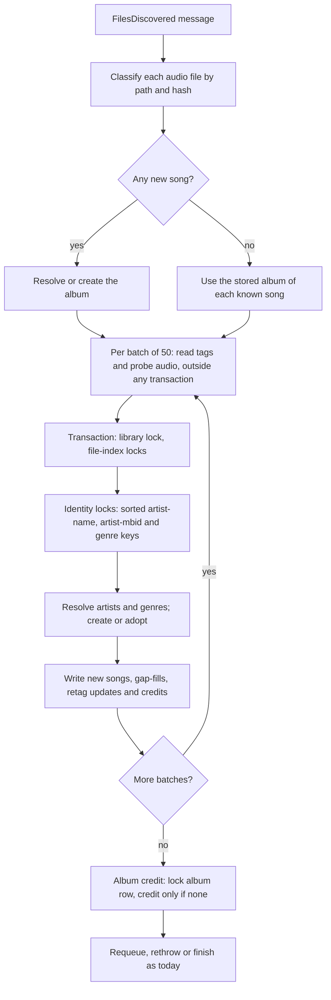
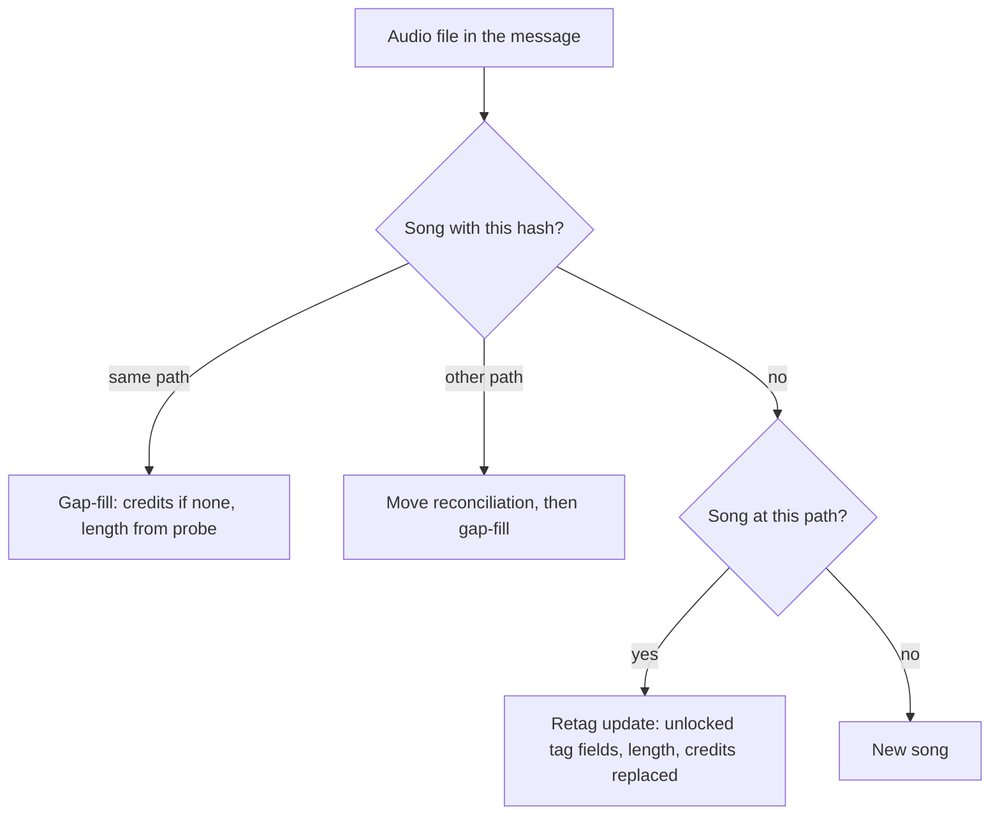
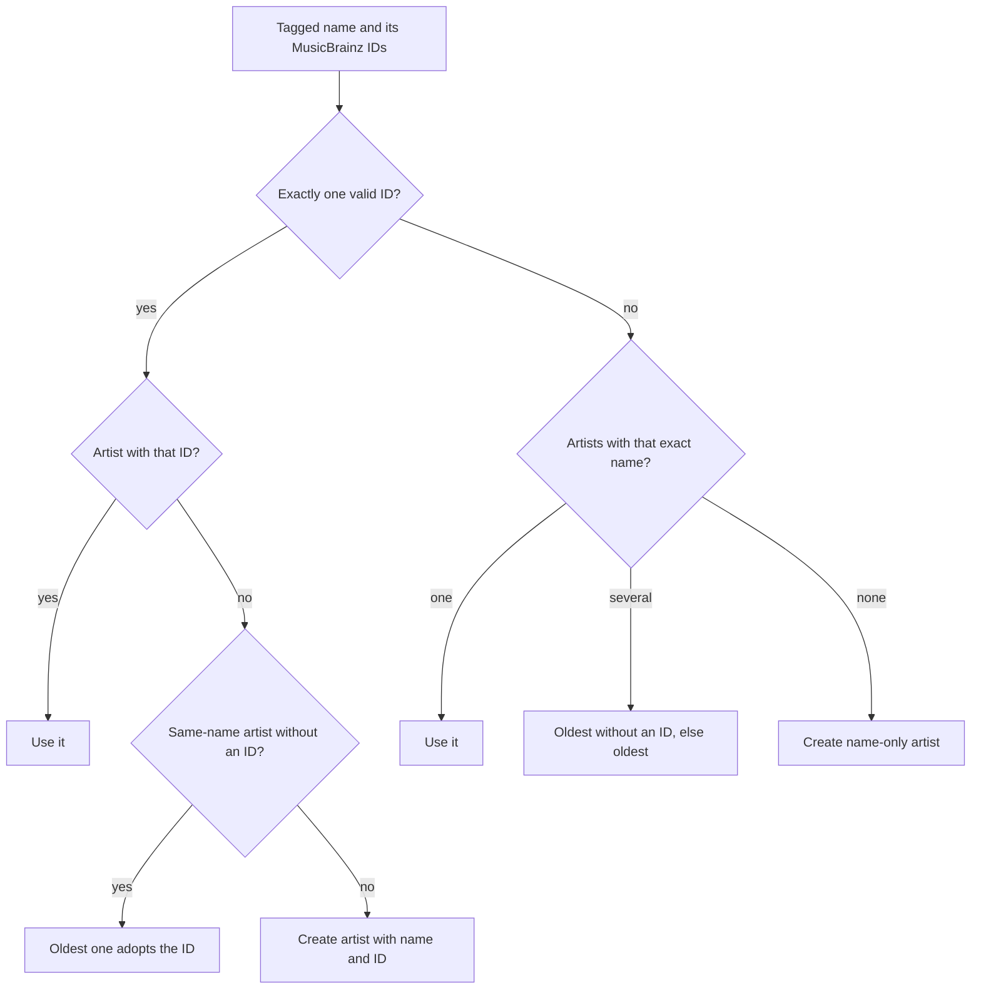

# Scan artist credits and file durations - Plan

## Goal Capsule

**Objective:** After a library scan or rescan, every song whose file names an artist is credited to that artist, every album is credited to its artist where the files settle one, every song's length matches its audio, and a lyrics fetch finds the lyrics LRCLIB holds for the song or says why it could not.

**Product authority:** The user reported that lyrics fetching failed and that metadata lookups did nothing. The diagnosis on the persistent instance on 2026-11-13 is in the Problem Frame. Planning on 2026-11-14 added the user's decisions on same-name artists, separate artist values and retagged files (Key Decisions). This plan covers the scan's artist credits, song lengths and lyrics outcomes only. The per-item MusicBrainz sync and the other areas under How This Work Fits Together are not active scope.

**Means:** Each import batch takes advisory locks on the artist and genre identities it touches before it writes, each credit stores the name it was tagged with, and every known file that reaches the importer is gap-filled or updated in place (KTD1, KTD5, KTD9).

**Execution profile:** One branch named after this plan, 14 units in four phases (Sequencing). Units land as local commits. Behaviour is verified on a worktree preview. The persistent instance is rescanned only after merge, as an operator step.

**Authority and stop conditions:** Follow `AGENTS.md`, then the Product Contract, then the Planning Contract. Stop and ask the user when a change would alter a Key Decision, when a race test shows the lock design cannot serialize a case KTD1 names, or when a step would require resetting the persistent instance's data.

**Finishing:** `ce-work` implements the units; `ce-code-review` runs before shipping and its justified findings are applied. Push only when the user asks.

**Open blockers:** None.

---

## Product Contract

**Product Contract preservation:** changed: R3 and R4 (same-name rule and tie-break, user decision); R7 (split: separate artist values moved to R21, user decision); R14 (limited to unchanged files, user decision on retagged files); R17 (narrowed to 4xx other than 404, 408 and 429, because the existing contract and tests treat server errors, timeouts and rate limiting as "unavailable"); R12 (states the container-duration fallback, which reads the file itself as the user's decision requires); R18 (rejected and unavailable counted apart from the skip causes, matching the outcome table). Added R20 to R22 and AE11 to AE13. The brainstorm's Outstanding Questions are resolved by KTD1 to KTD12.

### Summary

The scan creates artists from file tags and credits them to songs and albums. Credits group under one artist when the files carry the same MusicBrainz artist ID, and each credit keeps the name the song was tagged with. Song length comes from the audio itself. A rescan repairs songs that were imported without credits or with wrong lengths, and a retagged file updates its song instead of duplicating it. Lyrics fetches report why they found nothing.

### Problem Frame

The persistent instance's library holds 77 songs on 5 albums, all imported by one scan on 2026-11-09, and 0 artists, 0 song credits and 0 album credits. The scan reads the artist tag correctly: the FLAC reader returns "Disturbed" and "Headhunterz", and the ID3 reader returns "Bulldogg" and "Suspekt". The credit is then dropped. `SongRepository::linkArtistToSong` looks the artist up by name and returns without linking when none exists (`src/Catalog/Infrastructure/Doctrine/Repository/SongRepository.php:486-492`), and `AlbumRepository::linkArtistToAlbum` does the same (`src/Catalog/Infrastructure/Doctrine/Repository/AlbumRepository.php:450-456`). Nothing on the scan path creates an artist: the artist `findOrCreateByName` method has no caller under `src/`. This has held since the initial commit of 2026-08-01, so no version of this repository has created artists during a scan.

Lyrics fail as a direct result. `FetchLyricsHandler` returns "not found" before calling LRCLIB when the song has no artist (`src/Lyrics/Application/CommandHandler/FetchLyricsHandler.php:92-97`). A bulk run on 2026-11-09 recorded 78 finished jobs, 0 failed and 0 lyrics stored, so the failure looked like success. With the artist supplied, LRCLIB returned synced lyrics on 2026-11-13 for "Avarice" (Disturbed), "Rescue Me" (Headhunterz) and "Finer Things" (Post Malone), using the signatures the handler would send.

MP3 lengths are a second, independent fault. The ID3 reader derives duration only from the TLEN frame, divided by 1000 (`src/Metadata/Infrastructure/Reader/Id3Reader.php:94-99`). The 12 Bulldogg songs have no length, and the 14 Suspekt songs read 0.15 to 0.372 seconds. LRCLIB answers the Suspekt lookup with HTTP 400, which the client reports as "LRCLIB unavailable" (`src/Lyrics/Infrastructure/Api/LrclibClient.php:159-176`). The scan already probes every new song's audio, and the probe result carries a duration (`src/Transcode/Application/DTO/AudioProbeResult.php:17`), but the song length is taken from the tags (`src/Catalog/Application/CommandHandler/FilesDiscoveredHandler.php:229`). ID3 text values also keep a trailing NUL byte, as in `'Bulldogg\0'` (`src/Metadata/Infrastructure/Reader/Id3Parser.php:305-312`).

A rescan does not repair the stored library today. It skips a known song whose hash and path are unchanged and whose probe fields are complete, and it passes no artist when it does process one (`FilesDiscoveredHandler.php:180-196`).

The outbound network was ruled out. LRCLIB searches succeed from the app container and from both worker containers. MusicBrainz and the Cover Art Archive answer through the public destination policy. The lyrics client stays outside that policy by design (`CONCEPTS.md`, Public destination policy).

### Key Decisions

- **The scan fix is planned on its own; the MusicBrainz button follows in a separate brainstorm.** The button needs product decisions of its own, and its matching depends on the artists this plan creates. (session-settled: user-directed — chosen over planning both together or the button alone: lyrics stay broken until the scan creates artists)
- **Song length comes from the audio, never from tags.** Governs R12. (session-settled: user-directed — chosen over tag-derived lengths such as the ID3 TLEN frame: the tags were missing or wrong for all 26 MP3 songs)
- **Credits group by MusicBrainz artist ID at scan time.** Merging artists that a later MusicBrainz sync finds to share an ID belongs to the MusicBrainz button work. Governs R2, R4, R8. (session-settled: user-directed — chosen over grouping during both scan and sync now, or during sync only: the scan already reads the ID from FLAC and Ogg tags)
- **Each credit keeps the name the song was tagged with.** LRCLIB may file lyrics under the alias rather than the grouped artist's name. Governs R5. (session-settled: user-directed — chosen over showing and sending the grouped artist's name everywhere: lookups under an alias would miss)
- **An untagged file joins a same-name artist.** Tagged and untagged files of one artist then stay one artist. Governs R3, R4. (session-settled: user-directed — chosen over joining only an artist without an ID, or joining only when exactly one artist has the name: an untagged file of a tagged artist would otherwise split from it)
- **Separate artist values credit the first value's artist under the full credit text.** "Rescue Me" then groups with Headhunterz's other tracks, and LRCLIB matched the joined text on 2026-11-14. Governs R21. (session-settled: user-directed — chosen over one combined artist, the first value only, or one credit per value: grouping and the lyrics match both hold)
- **A retagged file updates its song in place, and its credits follow the new tags.** Governs R14, R20, R22. (session-settled: user-directed — chosen over keeping the song's credits, or leaving one duplicate song per retag as separate work: fixing a tag must fix the credit without losing play history)
- **An album without an album-artist tag takes the artist its tracks share.** Governs R11. (session-settled: user-directed — chosen over crediting "Various Artists" to mixed albums, using the album-artist tag only, or crediting every track artist: the Disturbed album tags only the track artist)
- **A rescan repairs by filling gaps, not by replacing.** Governs R13, R14, R15. (session-settled: user-directed — chosen over a one-off repair command, or deleting and rescanning the library: every library repairs on its next rescan, and deleting would lose play history, favorites and playlist entries)
- **Gap filling cannot tell a missing credit from a deliberately removed one.** A song or album whose credits were all removed gets the tagged artist back on the next rescan. Governs R13. (session-settled: user-approved — the refill was shown and accepted)
- **An artist created by name takes on a MusicBrainz ID from a file with exactly that name.** Tagged and untagged files of one artist then stay one artist, at the cost of merging two different artists that share a name until someone separates them. Governs R4. (session-settled: user-approved — the tradeoff was shown and accepted)
- **Fetch outcomes name their cause.** A silent "not found" hid this failure through 78 jobs. Governs R16, R17, R18.

### Requirements

**Artist credits**

- R1. When a scan imports a song whose tags name an artist, the song is credited to that artist, and the artist is created if the catalog has none that matches.
- R2. When the file carries exactly one MusicBrainz artist ID for the credit, the credit goes to the artist with that ID, so alias names group under one artist.
- R3. Without exactly one MusicBrainz artist ID, the credit goes to an artist whose name equals the tagged name exactly: the only such artist, or among several the oldest without an ID, else the oldest.
- R4. An artist without a MusicBrainz ID whose name equals the tagged name exactly takes on the file's ID instead of a second artist being created; among several such artists, the oldest does.
- R5. Each credit keeps the name the song was tagged with; the song shows that name, and lyrics lookups send it.
- R6. A grouped artist's own name is the first tagged name the scan saw, until someone renames it.
- R7. A single artist value such as "Post Malone feat. X" is credited as one name and not split.
- R21. Several separate artist values in one tag credit the first value's artist, with all values joined by "; " as the credited name.
- R8. MP3 files supply MusicBrainz artist IDs, as FLAC and Ogg files already do.
- R9. Tag text reaches the catalog without trailing NUL bytes or surrounding whitespace, so the same name read from an MP3 and from a FLAC is one artist.
- R10. Imports running at the same time never create two artists for the same MusicBrainz ID or, without an ID, for the same name.

**Album credits**

- R11. An album is credited from its album-artist tag; when its files carry none and every track has the same artist, the album is credited to that artist, and an album with mixed track artists gets no album credit.

**Song length**

- R12. Every audio song's length is measured from the file itself, both at import and on rescan: its audio stream's duration, else the container's duration minus its start time; tag length fields are never used.

**Repairing stored songs**

- R13. A rescan re-reads every file it knows, including unchanged ones, and credits each song or album that has no artist credit, following R1 to R11 and R21.
- R14. A rescan of an unchanged file never replaces or removes an existing credit.
- R15. A rescan sets every audio song's length per R12.

**Retagged files**

- R20. When the file at a known song's path has new content, the scan updates that song in place instead of creating a second song, so its play history, favorites and lyrics stay.
- R22. Such an update takes the song's unlocked tag fields, its length and its artist credits from the new tags, replacing credits edited by hand.

**Lyrics fetch outcomes**

- R16. A lyrics fetch that cannot be attempted because the song has no primary artist credit or no length reports that cause, apart from LRCLIB finding no match.
- R17. LRCLIB rejecting a request with a 4xx status other than 404, 408 or 429 is reported as a rejected request; server errors, timeouts and rate limiting still count as LRCLIB being unavailable.
- R18. A bulk lyrics run reports how many songs it skipped for each cause in R16, and how many requests were rejected or found LRCLIB unavailable, apart from its matches and its "no match" results.

**Verification**

- R19. A test imports real tagged FLAC and MP3 files through the scan and checks the artists, song and album credits, credited names and lengths that result.

### Acceptance Examples

- AE1. Track artist without an album-artist tag
  - **Covers R1, R3, R11.**
  - **Given** the Disturbed FLAC files, which tag ARTIST "Disturbed" and carry no album-artist tag or MusicBrainz ID,
  - **When** they are scanned,
  - **Then** one artist "Disturbed" exists, all 14 songs are credited to it, and the album "Ten Thousand Fists" is credited to it.
- AE2. Aliases grouped by MusicBrainz ID
  - **Covers R2, R5, R6.**
  - **Given** two FLAC files with the same MUSICBRAINZ_ARTISTID, tagged ARTIST "Headhunterz" and "HeadHunterz" and scanned in that order,
  - **When** they are scanned,
  - **Then** one artist named "Headhunterz" holds both credits, the second song shows "HeadHunterz", and its lyrics lookup sends "HeadHunterz".
- AE3. A name-only artist takes on an ID
  - **Covers R4.**
  - **Given** an artist "Headhunterz" without a MusicBrainz ID,
  - **When** a file tagged ARTIST "Headhunterz" with a MusicBrainz artist ID is scanned,
  - **Then** that artist takes on the ID, and no second artist is created.
- AE4. Several IDs on one credit
  - **Covers R3, R7.**
  - **Given** a file tagged ARTIST "A feat. B" with two MusicBrainz artist IDs,
  - **When** it is scanned,
  - **Then** the song is credited to the artist named exactly "A feat. B", matched by name.
- AE5. MP3 length and tag text
  - **Covers R9, R12.**
  - **Given** "13 - Amore Infelice.mp3", whose TLEN frame reads as 0.238 seconds and whose artist tag ends in a NUL byte,
  - **When** it is scanned,
  - **Then** its length equals the duration of its audio stream, and it is credited to "Suspekt" with no NUL byte.
- AE6. Mixed album
  - **Covers R11.**
  - **Given** an album directory whose tracks have different artists and no album-artist tag,
  - **When** it is scanned,
  - **Then** each song is credited to its own artist, and the album has no artist credit.
- AE7. Repairing the persistent library
  - **Covers R13, R15.**
  - **Given** the persistent instance's 77 songs with no credits and the MP3 lengths described in the Problem Frame,
  - **When** the library is rescanned,
  - **Then** every song whose file names an artist is credited, every song's length matches its audio, and each album is credited per R11.
- AE8. Edited credits survive a rescan
  - **Covers R14.**
  - **Given** a song whose credit was changed by hand to a different artist and whose file is unchanged,
  - **When** the library is rescanned,
  - **Then** the song keeps that credit and gains no tag credit.
- AE9. Removed credits come back
  - **Covers R13.**
  - **Given** a song whose credits were all removed by hand,
  - **When** the library is rescanned,
  - **Then** the song is credited to its tagged artist again.
- AE10. A fetch that cannot be attempted
  - **Covers R16, R18.**
  - **Given** a song whose file has no artist tag,
  - **When** its lyrics are fetched on their own and then in a bulk run,
  - **Then** the fetch reports the missing artist rather than "no lyrics found", and the bulk run counts the song as skipped for that cause.
- AE11. Same-name artists with IDs
  - **Covers R3.**
  - **Given** an artist "Nirvana" with MusicBrainz ID A, created first, and a later artist "Nirvana" with ID B,
  - **When** a file tagged ARTIST "Nirvana" without an ID is scanned,
  - **Then** the song is credited to the artist with ID A, and no artist is created.
- AE12. Separate artist values
  - **Covers R5, R21.**
  - **Given** "02 - Rescue Me.flac", which stores ARTIST as three fields: "Headhunterz", "Sound Rush" and "Eurielle",
  - **When** it is scanned,
  - **Then** the song is credited to the artist "Headhunterz" with the credited name "Headhunterz; Sound Rush; Eurielle", and its lyrics lookup sends that credited name.
- AE13. A retagged file
  - **Covers R20, R22.**
  - **Given** a song with play history whose credit was changed by hand to "X", and whose file is then retagged with ARTIST "Y" and a new title,
  - **When** the library is scanned,
  - **Then** the same song shows the new title, is credited only to "Y", and keeps its play history, and no second song exists for that path.

### Success Criteria

- After the fix lands and the persistent instance's library is rescanned, a bulk lyrics fetch stores lyrics for "Avarice", "Rescue Me" and "Finer Things", which LRCLIB held on 2026-11-13.
- After the same rescan, `app:lyrics:coverage` reports lyrics for more than 0 of the 77 tracks.

<!-- ce-section: work-relationships -->
### How This Work Fits Together

This plan covers artist credits, song lengths and lyrics outcomes at scan time. The breakdown below is the current understanding of the surrounding work, not a committed roadmap.

- **Per-item MusicBrainz sync.** The "Sync from MusicBrainz" button in the details panel renders with no click handler (`ui/web/src/features/catalog/components/metadata/InfoPanel.tsx:303-308`), and no route syncs a single album, song or artist.
  - Depends on this plan's artist credits: album and artist matching need artist names.
  - Shares the artist identity by MusicBrainz ID that R2 to R4 introduce. Merging artists that a sync later finds to share an ID belongs here.
  - Still to decide: whether the button applies the best match or offers candidates, which fields it may overwrite, and how locked fields hold.
  - Album matching searches MusicBrainz by album title alone (`src/Metadata/Application/AlbumMetadataEnricher.php:76-120`) and belongs with this work.
  - Artist matching takes the first search result. On 2026-11-14 a search for "Post Malone, Hank Williams Jr." returned Hank Williams, Jr. first, so combined credit names can match the featured artist's ID. Match quality belongs with this work.
  - The access check on `POST /api/metadata/extract` and `POST /api/metadata/match` belongs with this work, because it reworks those routes.
- **Transport monitor.** `app:monitor:transport` reported the async consumer as not running while `messenger:consume async` ran in the execution worker. Can proceed independently of this plan.

### Scope Boundaries

**Deferred to Follow-Up Work**

- The per-item MusicBrainz sync work: the button, per-item sync, merging artists that share an ID, album matching by title alone, artist match quality, and a MusicBrainz throttle response read as "no match" (`src/Metadata/Infrastructure/Api/MusicBrainz/MusicBrainzAdapter.php:221-247`), which was not observed in a live sync.
- The extract and match routes require only a signed-in user (`IS_AUTHENTICATED_FULLY`, `config/packages/security.yaml:57`), and their controller adds no role check (`src/Metadata/Interface/Controller/MetadataSyncController.php`). Any account can read the tags of an audio file the app container can reach, and can test whether a path exists. This was found by reading the code, not by a request, and it stays open until the per-item sync work.
- M4A tags. `MetadataContentReader` sends M4A files to the ID3 reader, which finds no ID3 tags (`src/Metadata/Infrastructure/Reader/MetadataContentReader.php:29-35`), so M4A songs get no artist. An MP4 atom reader is separate work; the persistent library has no M4A files.
- Album identity across directories. Albums have no uniqueness on title within a library (`src/Catalog/Infrastructure/Doctrine/Entity/AlbumEntity.php:15-19`), so two discs imported at the same time can each create the album. Existing duplicate detection and `app:album:merge` cover the outcome until album identity is planned.

**Considered and not built**

- Splitting single multi-artist values (R7 keeps them whole).
- Unicode normalization of names. NFC and NFD spellings of one name become two artists; evidence of such duplicates in real libraries would change this.
- Withdrawing an album credit derived from shared track artists when later files make the album mixed. It would need a stored credit source; evidence that incremental imports leave wrong album credits would change this.
- Remembering renamed or deleted artists. After a hand rename or delete, the next untagged file with the old name creates that artist again; alias memory belongs with the MusicBrainz work.
- Closing the window in which a credit added by hand commits between a gap-fill check and its insert, leaving both credits. The window is one transaction long and the result is fixed by hand.
- A canonical-form CHECK on `artists.mbid`. Every writer canonicalizes through `MusicbrainzId` (KTD3).
- Exact durations for VBR MP3 files without a Xing or Info header, which ffprobe estimates from the bitrate. Lyrics misses on such files would change this.
- Automatic lyrics fetch and automatic metadata sync keep their default of off.
- LRCLIB stays outside the public destination policy, so an operator can point it at a self-hosted LRCLIB.
- The transport monitor's stale consumer ID.

### Dependencies / Assumptions

- Rescanning the persistent instance is an operator step after merge, not part of the branch's verification, because agent work changes that instance only when the work explicitly targets it. The bulk lyrics fetch must wait until the rescan's queued imports have finished, or it counts those songs as missing an artist.
- A rescan reads tags and probes the audio of every known file (R13, R15), so it takes longer than today's rescan, which skips unchanged files. A normal scan still imports only new and changed files.
- The persistent library carries no MusicBrainz tags (read 2026-11-14), so its rescan exercises name resolution only. The ID paths of R2, R4 and R8 are proven by the R19 fixtures.
- The FLAC and Ogg readers already read MUSICBRAINZ_ARTISTID (`src/Metadata/Infrastructure/Reader/FlacReader.php:127`), but keep only the first value.
- Artist credits are not lockable fields on songs or albums (`src/Catalog/Domain/Model/Song.php:15-17`, `src/Catalog/Domain/Model/Album.php:15-18`), so R14 is what protects edited credits.

### Sources / Research

- Scan write path: `src/Catalog/Application/CommandHandler/FilesDiscoveredHandler.php:176-250` (reading tags, probing, building the song), `:357-363` (`writeSong` linking the artist), `:536-538` (album artist from the album-artist tag only); `ArtistPortInterface` is imported at line 8 and not injected.
- Artist find-or-create with no caller: `src/Catalog/Infrastructure/Doctrine/Repository/ArtistRepository.php:219-245`; it flushes and catches a unique-constraint violation, but no unique constraint covers the name.
- Tests stub the artist link (`tests/Unit/Catalog/Application/CommandHandler/FilesDiscoveredRenameTest.php:73`, `FilesDiscoveredTechnicalMetadataTest.php:89`); no test scans files and checks artists.
- Lyrics: `src/Lyrics/Application/CommandHandler/FetchLyricsHandler.php:92-110` (early "not found" without an artist or a length); `src/Lyrics/Infrastructure/Api/LrclibClient.php:159-176` (every status other than 404 reported as unavailable).
- Settings defaults: `src/Metadata/Application/Settings/MetadataSettingDefinitions.php:25` and `src/Lyrics/Application/Settings/LyricsSettingDefinitions.php:25`, both `false`.
- Persistent instance state, read on 2026-11-13: `app:lyrics:status` (last job 2026-11-09T15:14:51, 78 finished, 0 failed), `app:lyrics:coverage` (0 of 77), `app:metadata:status` (last sync never); albums carry no MusicBrainz, Discogs or Spotify IDs.
- Library files, read on 2026-11-14: 77 files in 6 directories; the Post Malone album spans `CD1/` and `CD2/`; three Headhunterz tracks store repeated ARTIST fields; fifteen Post Malone tracks hold one comma value such as "Post Malone, Hank Williams Jr."; the MP3s are ID3v2.3 and Suspekt's TLEN holds seconds; LRCLIB `/api/get` for "Rescue Me" answered 200 for "Headhunterz" and for the joined names, and 404 for "Eurielle".

---

## Planning Contract

### Key Technical Decisions

- KTD1. **Imports serialize artist and genre creation with transaction-scoped advisory locks, not unique indexes on names.** Each batch takes `pg_advisory_xact_lock(hashtextextended(key, seed))` on every identity it touches, under a new seed beside `IMPORT_LOCK_SEED` (`src/Library/Infrastructure/Doctrine/Repository/LibraryRepository.php:33`): `artist-name:<name>` always, `artist-mbid:<id>` when the credit carries exactly one valid ID, and `genre:<slug>`, the slug `GenreRepository` derives, because "Hip-Hop" and "Hip Hop" share a slug and `uniq_genres_slug` is the key they would collide on. Keys are sorted in PHP and taken one per statement, right after the existing library lock and file-index locks and before any write. The lookup after the locks runs as its own statement, so under READ COMMITTED (the server default, verified 2026-11-13) it sees a competing transaction's committed artist. Partial unique indexes with `ON CONFLICT` cannot serialize a name-only "H" against "H" with an ID, which land on different indexes, and a unique name would forbid same-name artists created by hand. Covers R10.
- KTD2. **A batch resolves every artist and genre before it writes any song or credit, and reuses them through a per-batch map.** Finders do not see unflushed rows, so without the map one 50-song batch would create an artist per song. New artists are persisted and flushed while the unit of work holds no song of the batch yet, and an adoption updates the artist under the same locks. Resolving first also keeps lock order free of cycles. Doctrine's catch-after-flush pattern is not used: in ORM 3.7.6 a failed flush closes the entity manager and the whole batch rolls back. Covers R1, R10.
- KTD3. **One artist per MusicBrainz ID becomes a database rule.** A unique index `uniq_artists_mbid` on `artists (mbid)` backs R2's "the artist with that ID". Every writer stores the canonical lowercase form through `MusicbrainzId`, and a malformed ID is ignored, so the credit resolves by name instead of failing the file. The artist metadata enricher (`src/Metadata/Application/ArtistMetadataEnricher.php:146-157`) assigns an ID through one Catalog port call that runs in its own transaction: it takes the artist's `artist-name:` key and the searched `artist-mbid:` key in sorted order, re-reads the artist, and writes the ID only when the artist has none, no other artist holds it, and the matched MusicBrainz name equals the artist's name, ignoring case. It never replaces a stored ID, even under force. The enricher runs without a transaction today, so a transaction-scoped lock taken there would release at once. The name check keeps a search hit such as Hank Williams, Jr. for "Post Malone, Hank Williams Jr." from binding a wrong ID that no command could correct. Covers R2, R4, R10.
- KTD4. **Identity resolution follows one order for song and album credits.** With exactly one valid ID: the artist holding it; else the oldest artist by `(created_at, id)` without an ID whose name equals the tagged name, which adopts the ID; else a new artist with the name and ID. Without exactly one ID: the artists whose name equals the tagged name, choosing the only one, else the oldest without an ID, else the oldest; else a new name-only artist. Album credits use the album-artist name and the album-artist ID. Implements R2 to R4.
- KTD5. **The credited name is a `NOT NULL` text column on both credit tables.** `credited_name text NOT NULL` with a not-blank CHECK goes on `artist_song` and `artist_album` in a new forward migration, which backfills existing rows from `artists.name` and then replaces the four capture triggers with the new column list. The credit unique keys stay `(artist_id, target, role)`. Credits added by hand record the artist's name at that moment. Readers of song names switch together: display, lyric signature, the artist sort key and the cursor extractor, which must agree for keyset paging (`SongRepository.php:680-724`). Among several primary credits, the shown one is the first by `(credited_name, artist id)`. A nullable column meaning "the artist's own name" was rejected: a later rename would change what R5 promises, and DQL rejects `COALESCE` in `ORDER BY`. Implements R5.
- KTD6. **Readers return every artist value and every MusicBrainz artist ID; the scan applies R7 and R21.** The ID3 parser converts ISO-8859-1 to UTF-8, splits multi-value frames on NUL (ID3v2.4), strips terminators and byte-order marks, and splits TXXX frames into description and values. `TXXX:MusicBrainz Artist Id` and `TXXX:MusicBrainz Album Artist Id` supply the IDs, and in ID3v2.3 their values are split on `/`, Picard's default join (read from Picard's source, `picard/options.py`, `id3v23_join_with`). The FLAC and Ogg readers return every value of ARTIST, ALBUMARTIST, MUSICBRAINZ_ARTISTID and MUSICBRAINZ_ALBUMARTISTID instead of the first. The extract route keeps its `mbArtistId` field, filled only when the file carries exactly one ID. Implements R7, R8, R9, R21.
- KTD7. **Genre creation inside the import uses the batch's locks instead of catching a unique violation.** `GenreRepository::findOrCreateByName` (`src/Catalog/Infrastructure/Doctrine/Repository/GenreRepository.php:305-352`) catches the violation after a failed flush, which closes the entity manager and fails the batch when two imports create one genre at once. This defect was found by reading source and vendor code. Genre keys, by slug, join the sorted set of KTD1, so per-song locks cannot deadlock.
- KTD8. **The album credit is decided after the message's last batch and before its requeue or rethrow exits, only for an album with no credit.** A message does not always carry a whole album: multi-disc subdirectories, incremental scans and requeues each deliver part of one. The decision locks the album row with `FOR NO KEY UPDATE`, which does not block the foreign-key locks that concurrent song inserts take. It credits the first album-artist tag found among the message's files in path order, or failing that among the files of the album's stored songs; else the artist that every song of the album is credited to, when every song has a credit; else nothing. A shared-artist credit records the credited name those songs share, else the artist's own name. Implements R11.
- KTD9. **Every audio file that reaches the importer is classified by path and hash, with no new message flag.** A known hash at the same path is a gap-fill. A known hash at another path keeps today's move reconciliation, plus gap-fill. An unknown hash at the path of a song in the library, available or not, is a retag update, because availability is decided by path alone (`src/Library/Infrastructure/Doctrine/Repository/LibraryFileIndexRepository.php:44-50`) and a second song at that path would also count as available. Anything else is a new song. Matching ignores the album the message resolved, and the handler creates an album only when the message holds at least one new song; this fixes the rescan that skipped songs of a renamed or merged album and left an empty album behind. Tags are read and audio probed outside the transaction. A probe failure on a known file is logged and leaves that song's length unchanged, without failing the message. A gap-fill or retag that gives a song without lyrics a primary credit or a length requests a fetch when automatic fetch is on. Implements R13 to R15, R20, R22.
- KTD10. **Song length is the probe's stream duration, else the container duration minus its start time, else none.** The probe result gains the container duration without changing the stream `duration` that transcoding reads. `Song` gains an explicit length update that can clear the value, because `updateAudioMetadata` treats null as "keep" (`src/Catalog/Domain/Model/Song.php:181`). A media test pins the ffprobe fields on the pinned FFmpeg image, since ffprobe output has changed between FFmpeg versions (`docs/solutions/best-practices/ffmpeg-major-upgrades-break-shortest-and-guessed-frame-rates.md`). Implements R12, R15.
- KTD11. **Fetch outcomes map onto the shared exceptions.** A fetch that cannot be attempted (no primary credit, or a length that is missing or not positive) and a rejected request each raise a conflict with its own error code, answered as 409 and exit 1. "No match" stays a 200 with `[]`, and "unavailable" stays 503. The client rounds the duration instead of truncating it (`LrclibClient.php:115-119`). A 200 carrying a reason was rejected because it changes the `oneOf` response every client reads. The web lyrics tab and dialog name each cause. Implements R16, R17.
- KTD12. **A bulk run's outcomes are tallied per run in Redis beside the existing run tracking.** The bulk handler counts songs it cannot attempt while it walks them and does not queue them. It records the run, its link to the job and its tally whenever the walk finishes, including a run that queues nothing; today a run is recorded only when it queued at least one fetch (`BulkFetchLyricsHandler.php:84-136`). Each queued fetch records found, no match, rejected or unavailable, keyed by run and song so a redelivered fetch is counted once. A fetch skipped because its run was cancelled is not counted. The tally expires with the run's tracking. `app:lyrics:fetch` prints the skipped counts, and `app:lyrics:status` with its admin route shows the latest run's tally. The job monitor stores no handler results, so it cannot hold the tally. Implements R18.

### High-Level Technical Design

One import message, from album resolution to the album credit:

How a file is classified (KTD9):

How one credit resolves its artist (KTD4):

| Outcome | Cause | HTTP | CLI exit | Bulk tally |
|---|---|---|---|---|
| Found | LRCLIB returned lyrics | 200, lyrics | 0 | found |
| No match | LRCLIB 404 | 200, `[]` | 0 | no match |
| Cannot attempt | no primary credit, or no positive length | 409, own code | 1 | skipped, per cause |
| Rejected | LRCLIB 4xx other than 404, 408, 429 | 409, own code | 1 | rejected |
| Unavailable | timeout, 408, 429, 5xx, transport failure, bad body | 503 | 1 | unavailable |

### Assumptions

- ffprobe reports a stream duration for every file in the persistent library; every file sampled on 2026-11-14 had one.
- The test image's FFmpeg build can encode MP3 with `libmp3lame`. Production encodes with it (`src/Transcode/Infrastructure/AudioRenditionExecutor.php:263`), but `docker/ffmpeg/expected-capabilities.txt` does not assert it; U13 checks it in the CI image.
- One import batch touches few identities: usually one album and one or two artists, at most about 100 lock keys for 50 songs.

### Sequencing

- **Phase A, foundations:** U1, U2, U3, U4, U5, U6. U1, U2 and U6 are independent; U3 needs U2; U4 and U5 need U3.
- **Phase B, import:** U7, then U8, then U9, then U14.
- **Phase C, readers and lyrics:** U10 after U2, then U11, then U12.
- **Phase D, proof:** U13 after U7 to U11 and U14.

Run `ce-simplify-code` at each phase boundary.

### System-Wide Impact

- **Catalog data:** every credit gains a stored name; one MusicBrainz ID maps to at most one artist; known songs are updated in place on retag instead of duplicated.
- **Live updates:** the capture triggers on `artist_song` and `artist_album` gain `credited_name`, so a change to it alone publishes an update.
- **Album name consumers:** the album name readers that U10 switches to credited names also feed album duplicate detection (`src/Catalog/Domain/Service/AlbumDuplicateDetector.php:42`, `src/Catalog/Infrastructure/AlbumDuplicateService.php:71`), recommendations (`src/Recommendation/Application/QueryHandler/GetRecommendationsForUserHandler.php:128`) and activity enrichment (`src/Activity/Infrastructure/ActivityEnrichmentService.php:81`). Activity's top-artist analytics keep grouping by artist ID and showing the artist's own name (`src/Activity/Infrastructure/Doctrine/Repository/ActivityAnalyticsRepository.php:50-55`).
- **Import concurrency:** imports of different directories now wait for each other on shared artist and genre keys, briefly, inside the batch transaction.
- **Rescan cost:** a rescan reads and probes every known file.
- **API contract:** the lyrics fetch route adds 409 responses with new error codes; `openapi.json` and the generated web client change. The admin lyrics status response gains the latest run's tally, which the hand-written admin client types must follow.
- **Metadata sync:** the artist enricher stops assigning IDs other artists hold and stops replacing stored IDs.
- **Operators:** the command pages for rescans, credit commands and lyrics commands change meaning or output.

### Risks

| Risk | Mitigation |
|---|---|
| Two consumers gap-fill the same song at once, and the second credit insert hits the credit unique key, closing the entity manager | The message retries and then finds the credit; the race needs the same file in two concurrent messages. U3's race tests measure it. |
| A lock-order slip deadlocks two batches | PostgreSQL detects it (40P01), DBAL maps it to `DeadlockException`, and the message retries. Keys are sorted in PHP (KTD1). |
| A migration on a database with duplicate artist IDs fails | The persistent instance has 0 artists; the migration fails loudly rather than merging, since merging belongs to the MusicBrainz work. |
| The PGroonga index on `artists.name` takes the name lookup on a near-empty table | Results stay correct; a test asserting the btree disables bitmap and index-only scans, as `tests/Integration/CoveredIndexPersistenceTest.php` does. |
| A retag that changes the album tag leaves the song in its old album | Album membership stays directory-based; the plan does not move songs between albums. |
| Probing every known file on rescan surfaces files ffprobe cannot read | KTD9 keeps such songs and their lengths and logs them instead of failing the message. |

### Alternatives Considered

- **Unique indexes plus `INSERT … ON CONFLICT` for artist identity.** Rejected: the name-only and with-ID paths land on different indexes, so the R4 race still creates two artists, and a unique name breaks artists created by hand (KTD1).
- **A rescan flag on `FilesDiscovered`.** Rejected: it touches the domain event, its codec, the outbox dispatcher and their tests, while classifying every known file (KTD9) needs no payload change; the cost is a re-read on Messenger retries.
- **One credit per artist value with a stored position.** Rejected by the user's decision on separate artist values (Key Decisions, R21).

### Deferred to Implementation

- Names of the lock helper, the resolver port and the new exceptions and error codes.
- Whether credit and adoption writes use the ORM or named native statements, under the reasons rule in `.agents/rules/ddd-repositories.md`.
- The exact version string of the new migration, after `Version20261113120000`.
- How the album-artist tag reaches the post-batch album credit when the anchor file is not in the message.

### Documentation / Operational Notes

- Update `docs-book/part-1-operator-guide/commands/app-library-scan.md` (what `--rescan` repairs, its cost, retag updates), `app-artist-song-add.md` and `app-artist-album-add.md` (the credited name a hand credit records), `app-song-lyrics-fetch.md`, `app-lyrics-fetch.md` and `app-lyrics-status.md` (outcomes and tallies).
- Update `src/Catalog/README.md` (credit model, import identity), `src/Lyrics/README.md` (outcome contract) and `src/Metadata/README.md` (reader output, enricher ID rule).
- Keep the `CONCEPTS.md` "Artist credit" entry in line with KTD4 and R21.
- Persistent instance after merge: run `app:library:scan --rescan` for the music library, wait until `app:monitor:transport` shows the async queue empty, then run `app:lyrics:fetch` and compare against the Success Criteria. This touches the persistent instance and needs the user's go-ahead.
- Record each delivered unit and its verification checkpoint in `ROADMAP.md`.

---

## Implementation Units

| U-ID | Title | Files touched | Depends on |
|---|---|---|---|
| U1 | Tag readers: clean text, every artist value and ID | `src/Metadata/Infrastructure/Reader/*`, `ExtractedMetadata.php` | — |
| U2 | Credited-name column, artist ID index and migration | `migrations/`, credit entities, `ArtistRepository.php` | — |
| U3 | Import identity locks and artist resolver | `src/Catalog/Infrastructure/Doctrine/`, `ArtistPortInterface.php` | U2 |
| U4 | Genre creation under the import locks | `GenreRepository.php` | U3 |
| U5 | Artist enricher ID guard | `ArtistMetadataEnricher.php` | U2, U3 |
| U6 | Song length from the audio probe | `AudioProbeResult.php`, `Song.php` | — |
| U7 | Import credits new songs | `FilesDiscoveredHandler.php` | U1, U3, U4, U6 |
| U8 | Album credit after the import | `FilesDiscoveredHandler.php`, `AlbumRepository.php` | U7 |
| U9 | Known files: gap-fill and renamed albums | `FilesDiscoveredHandler.php` | U7, U8 |
| U14 | Retagged files update their song | `FilesDiscoveredHandler.php`, `SongRepository.php`, `Song.php` | U9 |
| U10 | Song and album readers use credited names | `SongRepository.php`, `AlbumRepository.php` | U2 |
| U11 | Lyrics fetch outcomes | `src/Lyrics/`, lyrics web components | U10 |
| U12 | Bulk lyrics outcome tally and status | `BulkFetchLyricsHandler.php`, `RedisQueuedLyricsFetches.php`, admin lyrics status | U11 |
| U13 | Real tagged files through the scan | `tests/Functional/Library/`, `tests/Fixtures/` | U7, U8, U9, U10, U11, U14 |

### U1. Tag readers: clean text, every artist value and ID

**Goal:** The tag readers hand the scan UTF-8 text without terminators, every artist and album-artist value, and every MusicBrainz artist and album-artist ID.

**Requirements:** R7, R8, R9, R21; KTD6.

**Dependencies:** None.

**Files:**
- `src/Metadata/Infrastructure/Reader/Id3Parser.php`
- `src/Metadata/Infrastructure/Reader/Id3Reader.php`
- `src/Metadata/Infrastructure/Reader/FlacReader.php`
- `src/Metadata/Infrastructure/Reader/OggReader.php`
- `src/Metadata/Domain/Model/ExtractedMetadata.php`
- `src/Metadata/Interface/Controller/MetadataSyncController.php`
- Tests: `tests/Unit/Metadata/Infrastructure/Reader/Id3ParserTest.php`, `Id3ReaderTest.php`, `FlacReaderTest.php`, `OggReaderTest.php`, `tests/Unit/Metadata/Interface/Controller/MetadataSyncControllerTest.php`

**Approach:**
1. Decode ID3 text per encoding, then clean it:
   - convert ISO-8859-1 to UTF-8 and decode UTF-16 with or without a BOM;
   - split multi-value frames on U+0000 after decoding;
   - drop byte-order marks and empty trailing values, and trim each value.
2. Split each TXXX body into description and values on its encoding's terminator (one 0x00 byte for ISO-8859-1 and UTF-8, an aligned 0x00 0x00 pair for UTF-16), then decode each part. The COMM parser (`Id3Parser.php:202-223`) splits on the first 0x00 byte before decoding, which breaks inside a UTF-16 character; ID3v2.3 TXXX frames written by Picard are UTF-16.
3. Map the two MusicBrainz TXXX descriptions to ID lists; split ID3v2.3 values on `/`.
4. Return every value of ARTIST, ALBUMARTIST, MUSICBRAINZ_ARTISTID and MUSICBRAINZ_ALBUMARTISTID from the Vorbis readers.
5. Give `ExtractedMetadata` value lists for artists, album artists and both ID kinds; keep `getMbArtistId()` returning an ID only when exactly one exists, which keeps the extract route's field.

**Patterns to follow:** the frame builders in `Id3ParserTest.php:195-230` and the Vorbis block builders in `FlacReaderTest.php:158-239`.

**Test scenarios:**
- Covers AE5. An ID3v2.3 TPE1 frame in ISO-8859-1 ending in a NUL yields "Suspekt" with no NUL.
- An ISO-8859-1 value with "æ" (0xE6) yields valid UTF-8 "æ".
- An ID3v2.4 TPE1 frame holding "A\0B" in UTF-8 yields the two values "A" and "B".
- A UTF-16 frame with two BOM-prefixed values yields two values with no U+FEFF.
- A TXXX frame "MusicBrainz Artist Id" with one UUID yields that ID; in ID3v2.3 a value "id1/id2" yields two IDs.
- An ID3v2.3 tag with a UTF-16 TXXX "MusicBrainz Artist Id" frame holding "id1/id2" yields two IDs.
- A TXXX frame with another description yields no MusicBrainz ID.
- Covers AE12. A FLAC block with ARTIST three times yields three artist values in file order.
- A FLAC block with MUSICBRAINZ_ARTISTID twice yields two IDs, and `getMbArtistId()` returns null.
- An Ogg file with MUSICBRAINZ_ALBUMARTISTID yields the album-artist ID.
- The extract route still answers `mbArtistId` for a file with one ID.

**Verification:** The reader tests pass, and a file from each format yields clean UTF-8 values and complete ID lists.

### U2. Credited-name column, artist ID index and migration

**Goal:** Credits store their credited name, the catalog holds at most one artist per MusicBrainz ID, and hand-added credits record the artist's name.

**Requirements:** R5, R10; KTD3, KTD5.

**Dependencies:** None.

**Files:**
- `migrations/Version20261114…php` (new; exact version deferred)
- `src/Catalog/Infrastructure/Doctrine/Entity/ArtistSongEntity.php`
- `src/Catalog/Infrastructure/Doctrine/Entity/ArtistAlbumEntity.php`
- `src/Catalog/Infrastructure/Doctrine/Entity/ArtistEntity.php`
- `src/Catalog/Infrastructure/Doctrine/Repository/ArtistRepository.php` (`addSongToArtist`, `addAlbumToArtist`)
- `tests/Fixtures/LiveUpdates/capture-sources.json`
- `docs-book/part-1-operator-guide/commands/app-artist-song-add.md`, `app-artist-album-add.md`
- Tests: `tests/Integration/ArtistCreditedNameMigrationTest.php` (new), `tests/Integration/InitialSchemaMigrationTest.php`, `tests/Integration/LiveUpdates/CommittedCaptureTest.php`, `tests/Unit/Shared/LiveUpdates/CaptureCoverageTest.php`

**Approach:**
1. The migration runs, in order:
   - `SET LOCAL lock_timeout`;
   - add the two columns as nullable and backfill them from `artists.name`;
   - set `NOT NULL` and add `chk_artist_song_credited_name_not_blank` and `chk_artist_album_credited_name_not_blank`;
   - create `uniq_artists_mbid`;
   - replace the four capture triggers with the new column list, following `migrations/Version20261103120000.php:34-46`.

   Replacing the triggers after the backfill keeps the backfill from enqueuing one live update per credit.
2. `down()` refuses, as the initial migration's does, because dropping the column loses tagged names.
3. Map the column and the unique index on the entities; record the artist's current name as the credited name in the hand-credit repository methods.
4. Update `InitialSchemaMigrationTest`: 24 migrations, the new version in the list, 25 for the future probe.

**Patterns to follow:** `migrations/Version20261103120000.php` for trigger replacement; `tests/Integration/AacImplementationValueMigrationTest.php` for a per-migration test; index naming per `docs-book/part-2-developer-guide/development/database-naming.md`.

**Test scenarios:**
- A database with a hand-made song credit and album credit migrates, and both credits carry the artist's name.
- After migration, inserting a credit with a blank credited name fails the CHECK.
- Two artists with the same canonical ID cannot both be stored.
- Two artists without an ID can both be stored.
- An UPDATE that changes only `credited_name` publishes a live update.
- `app:artist:song:add` records the artist's current name; a later artist rename leaves that credit's name unchanged.
- The mapping-versus-catalog test and the naming convention test pass.

**Verification:** Migrations run on a fresh database and on a copy of the persistent schema, and the capture and schema tests pass.

### U3. Import identity locks and artist resolver

**Goal:** One service resolves a batch's artist identities under sorted advisory locks, implementing KTD4 race-free.

**Requirements:** R1, R2, R3, R4, R6, R10; KTD1, KTD2, KTD4.

**Dependencies:** U2.

**Files:**
- `src/Catalog/Infrastructure/Doctrine/` (new import identity lock helper and resolver implementation)
- `src/Catalog/Application/Port/ArtistPortInterface.php` (or a new resolver port beside it)
- `src/Catalog/Infrastructure/Doctrine/Repository/ArtistRepository.php` (lookups ordered by `(created_at, id)`; remove the dead catch in `findOrCreateByName`)
- `config/services.yaml`
- Tests: `tests/Integration/ArtistImportIdentityRaceTest.php` (new), `tests/Unit/Catalog/Infrastructure/` resolver tests (new)

**Approach:**
1. The helper takes a list of keys, sorts and deduplicates them, and runs one `pg_advisory_xact_lock` statement per key, each with a comment naming why it is SQL.
2. The resolver takes `(tagged name, IDs)` identities, normalizes names and IDs, locks all their keys, and re-reads in a separate statement, refreshing artists the entity manager already holds from an earlier batch of the same message.
3. It then resolves the identities one at a time per KTD4, against the re-read rows plus an index, by ID and by exact name, of the artists this batch has already created or adopted. Two aliases with one ID, or "H" without an ID beside "H" with ID X, therefore converge on one artist within a batch.
4. New artists are flushed before the caller persists any song (KTD2).

**Execution note:** Write the two-connection race tests first, following `tests/Integration/LibraryScanClaimTest.php:163-173` and `tests/Integration/LibraryAccessTransactionTest.php:43-44`; Functional tests share one connection and cannot prove these races.

**Test scenarios:**
- Covers AE3. Connection 1 resolves "H" without an ID while connection 2 resolves "H" with ID X; one artist "H" with ID X results.
- Two connections resolve two aliases with the same ID; one artist results, named after the first commit.
- Two name-only aliases adopting the same ID at once; one artist holds the ID and the other resolves to it.
- Covers AE11. With "Nirvana" holding ID A (older) and "Nirvana" holding ID B, an untagged "Nirvana" resolves to the artist with ID A.
- With two name-only "Nirvana" artists, an untagged "Nirvana" resolves to the older one.
- Covers AE4. "A feat. B" with two IDs resolves by name to an artist named "A feat. B".
- A malformed ID resolves by name instead of throwing.
- Fourteen identical identities in one batch resolve to one artist.
- In one batch, "Headhunterz" and "HeadHunterz" with one ID resolve to one artist.
- In one batch, "H" without an ID and "H" with ID X resolve to one artist holding X, in either order.
- A two-batch message on one connection, with an ID adoption committed from a second connection between its batches, leaves the adopted ID in place.
- The lock statements are taken in sorted key order, observed through `pg_locks`.

**Verification:** The race tests pass on disposable PostgreSQL with PGroonga, and no scenario yields two artists.

### U4. Genre creation under the import locks

**Goal:** A genre created by two imports at once no longer fails a batch.

**Requirements:** KTD7.

**Dependencies:** U3.

**Files:**
- `src/Catalog/Infrastructure/Doctrine/Repository/GenreRepository.php`
- `src/Catalog/Application/CommandHandler/FilesDiscoveredHandler.php` (genre keys join the batch's lock set)
- Tests: `tests/Integration/GenreImportRaceTest.php` (new)

**Approach:** The batch locks `genre:<slug>` keys with its other identities (U3), keys its per-batch genre map on the same slug, then finds or creates each genre without a catch-after-flush.

**Execution note:** Reproduce the defect first: a two-connection test in which both create "Rock" inside an import transaction, expected to fail the second batch before the fix.

**Test scenarios:**
- Two connections create the genre "Rock" in one import transaction each; both batches commit and one genre exists.
- Differently cased "rock" and "Rock" in one batch resolve to one genre.
- Two connections create "Hip-Hop" and "Hip Hop" in one import transaction each; both batches commit and one genre exists.
- A batch with genres in reverse order to a concurrent batch commits without deadlock.

**Verification:** The race test fails before the change and passes after it.

### U5. Artist enricher ID guard

**Goal:** Artist metadata sync keeps the one-artist-per-ID rule and never overwrites an ID from tags.

**Requirements:** R2, R10; KTD3.

**Dependencies:** U2, U3.

**Files:**
- `src/Metadata/Application/ArtistMetadataEnricher.php`
- `src/Catalog/Application/Port/ArtistPortInterface.php`, `src/Catalog/Infrastructure/ArtistService.php`, `src/Catalog/Infrastructure/Doctrine/Repository/ArtistRepository.php` (the guarded ID assignment)
- `src/Metadata/README.md`
- Tests: `tests/Unit/Metadata/Application/ArtistMetadataEnricherTest.php` (new), `tests/Integration/EnrichmentFreshStateTest.php`, `tests/Integration/ArtistImportIdentityRaceTest.php` (enricher case)

**Approach:** Canonicalize the searched ID through `MusicbrainzId`, then assign it through one Catalog port method that runs the locks, the re-read, the checks and the write in one transaction, per KTD3. Skip and log every case where the ID is not written, and leave the other enriched fields applied.

**Test scenarios:**
- An artist without an ID whose name matches the search hit gets the searched ID in lowercase form.
- An artist named "Post Malone, Hank Williams Jr." whose search hit is "Hank Williams, Jr." gets no ID.
- An artist without an ID whose searched ID another artist holds keeps no ID, and the other fields still update.
- A forced sync of an artist with an ID from tags keeps that ID.
- A searched ID in uppercase is stored lowercase and matches a tagged lowercase ID.
- Two connections: an import adopts ID X onto a name-only artist while the enricher assigns a different ID to the same artist; the artist ends with X, and neither side raises a unique violation.

**Verification:** Enricher tests pass, and no enrichment run raises a unique violation.

### U6. Song length from the audio probe

**Goal:** The probe yields a length for every readable audio file, and a song's length can be set or cleared from it.

**Requirements:** R12, R15; KTD10.

**Dependencies:** None.

**Files:**
- `src/Transcode/Application/DTO/AudioProbeResult.php`
- `src/Catalog/Domain/Model/Song.php`, `src/Catalog/Domain/Model/SongState.php`
- Tests: `tests/Unit/Transcode/Domain/ValueObject/AudioProbeResultTest.php`, `tests/Unit/Catalog/Domain/Model/` song tests, `tests/Functional/Media/AudioProbeDurationTest.php` (new)

**Approach:** Add the container duration and start time to the probe result and derive one song length per KTD10; keep the stream `duration` unchanged for transcoding; add a `Song` operation that sets the length, including to null.

**Test scenarios:**
- A probe with stream duration 176.657 yields length 176.657.
- A probe without stream duration, container duration 200.5 and start time 0.025 yields 200.475.
- A probe without either duration yields no length.
- The existing pin that the stream `duration` ignores container fields still holds.
- A song with length 0.238 gets 238.4 from the new operation; another gets its length cleared.
- On the pinned FFmpeg image, ffprobe of a generated MP3 with TLEN "238" reports the encoded length, not 0.238.

**Verification:** Unit and media tests pass in the CI image.

### U7. Import credits new songs

**Goal:** A new song is imported with its artist credit, credited name and probed length.

**Requirements:** R1 to R7, R9, R12, R21; KTD2, KTD6, KTD10.

**Dependencies:** U1, U3, U4, U6.

**Files:**
- `src/Catalog/Application/CommandHandler/FilesDiscoveredHandler.php`
- `src/Catalog/Application/Port/SongPortInterface.php`, `src/Catalog/Infrastructure/SongService.php`, `src/Catalog/Infrastructure/Doctrine/Repository/SongRepository.php` (credit write with credited name; `linkArtistToSong` removed)
- Every test that constructs the handler: `tests/Unit/Catalog/Application/CommandHandler/FilesDiscovered*Test.php`, `tests/Integration/NewAlbumMetadataSyncTest.php`, `tests/Integration/Library/LibraryDiscoveryObservationTest.php`, `tests/Integration/LiveUpdates/CapacityFixtureTest.php`, `tests/Fixtures/Library/library-discovery-observation.php`, `tests/Fixtures/Catalog/DiscoveredFileObservations.php`
- Tests: `tests/Unit/Catalog/Application/CommandHandler/FilesDiscoveredArtistCreditTest.php` (new)

**Approach:**
1. Build each song's identity from its tags per R7 and R21: the first artist value as the name, the value list joined by "; " as the credited name, and the ID list.
2. In `writeSongs`, after the existing locks, resolve the batch's artists and genres through U3 and U4, then persist songs and credits from the resolved map.
3. Set the length from the probe per KTD10.

**Patterns to follow:** the existing guarded write and `DoctrineTransaction` flow; keep ffprobe outside the transaction (`docs/solutions/architecture-patterns/state-set-when-work-is-queued-on-swoole-task-must-expire.md`).

**Test scenarios:**
- Covers AE1. Fourteen files tagged "Disturbed" in one batch produce one artist and fourteen primary credits named "Disturbed".
- Covers AE12. A file with ARTIST values "Headhunterz", "Sound Rush" and "Eurielle" is credited to "Headhunterz" with credited name "Headhunterz; Sound Rush; Eurielle".
- Covers AE2. Two files with one ID tagged "Headhunterz" and "HeadHunterz" credit one artist under two credited names.
- A file without an artist tag gets no credit, and the song is still imported.
- A new song's length comes from the probe even when TLEN disagrees.
- A batch that fails one file still commits the others and their credits.

**Verification:** Handler unit tests pass; U13 proves the same through the real scan.

### U8. Album credit after the import

**Goal:** An album without a credit gets one from its album-artist tag or from its tracks' shared artist after each import message.

**Requirements:** R11, R13; KTD4, KTD8.

**Dependencies:** U7.

**Files:**
- `src/Catalog/Application/CommandHandler/FilesDiscoveredHandler.php` (`resolveAlbum` stops linking; post-batch decision placed before the requeue and rethrow exits)
- `src/Catalog/Application/Port/AlbumPortInterface.php`, `src/Catalog/Infrastructure/AlbumService.php`, `src/Catalog/Infrastructure/Doctrine/Repository/AlbumRepository.php` (album row lock, credit check, credit write; `linkArtistToAlbum` removed)
- Tests: `tests/Unit/Catalog/Application/CommandHandler/FilesDiscoveredAlbumSyncRequestTest.php` (event order), `tests/Unit/Catalog/Application/CommandHandler/FilesDiscoveredAlbumCreditTest.php` (new), `tests/Integration/ArtistImportIdentityRaceTest.php` (album case)

**Approach:** After the last batch, in its own transaction: lock the album row `FOR NO KEY UPDATE`, return if it has a credit, otherwise resolve the album-artist identity through U3 or derive the shared artist per KTD8, and write the credit.

**Test scenarios:**
- Covers AE1. Disturbed's album, with no album-artist tag and every song credited to "Disturbed", is credited to "Disturbed".
- Covers AE6. An album whose songs credit two artists gets no credit.
- The Post Malone CD1 message credits the album from its album-artist tag; the CD2 message adds no second credit.
- An album whose songs carry two aliases of one artist is credited with the artist's own name.
- An album with one song that has no artist tag gets no shared-artist credit.
- An album whose second-disc message carries no album-artist tag is credited from the tag on its first disc's stored files.
- An album with a hand-made credit keeps it unchanged.
- A message with one failing file still decides the album credit before rethrowing.
- Two connections deciding the same album's credit at once leave one credit.

**Verification:** Album credit tests pass, including the two-connection case.

### U9. Known files: gap-fill and renamed albums

**Goal:** A rescan repairs known songs, including songs whose album was renamed or merged since the last scan.

**Requirements:** R13, R14, R15; KTD9.

**Dependencies:** U7, U8.

**Files:**
- `src/Catalog/Application/CommandHandler/FilesDiscoveredHandler.php` (classification, album creation only for new songs, gap-fill, lyrics request, corrected comment at `:157`)
- `docs-book/part-1-operator-guide/commands/app-library-scan.md`
- Tests: `tests/Unit/Catalog/Application/CommandHandler/FilesDiscoveredRenameTest.php`, `FilesDiscoveredTechnicalMetadataTest.php`, `FilesDiscoveredLyricsRequestTest.php`, `tests/Unit/Catalog/Application/CommandHandler/FilesDiscoveredGapFillTest.php` (new)

**Approach:**
1. Classify every audio file per KTD9 before album resolution, and create an album only when a new song needs it.
2. Gap-fill: add credits only when the song has none of any role; set the length from the probe; keep the length on a probe failure.
3. Request lyrics for a repaired song per KTD9.

**Execution note:** Start with a failing test for the renamed-album case: rename an album with `app:album:update --title`, rescan, and expect no new album and the songs gap-filled.

**Test scenarios:**
- Covers AE9. A song with no credits gets its tag credit on rescan.
- Covers AE8. A song with a hand-made credit and an unchanged file keeps that credit and gains none.
- A song whose only credit is featured gains no credit on rescan.
- A known song's length changes from 0.238 to its probed length on rescan.
- A probe failure on a known file leaves its stored length and does not fail the message.
- After an album title edit, a rescan creates no album and gap-fills that album's songs.
- After an album merge, a rescan gap-fills the moved songs in their new album.
- With automatic fetch on, a repaired song without lyrics requests a fetch; with it off, none is requested.
- A Messenger retry of a committed message changes nothing further.

**Verification:** Gap-fill and rename tests pass, and the rescan docs page describes what a rescan repairs and what it costs.

### U14. Retagged files update their song

**Goal:** A file whose content changed at a known song's path updates that song instead of creating a second one.

**Requirements:** R20, R22; KTD9.

**Dependencies:** U9.

**Files:**
- `src/Catalog/Application/CommandHandler/FilesDiscoveredHandler.php` (retag branch of the classification)
- `src/Catalog/Infrastructure/Doctrine/Repository/SongRepository.php` (lookup of a song by path within a library; replacement of a song's credits)
- `src/Catalog/Domain/Model/Song.php` (tag-field update that respects locked fields)
- `docs-book/part-1-operator-guide/commands/app-library-scan.md` (retag behaviour)
- Tests: `tests/Unit/Catalog/Application/CommandHandler/FilesDiscoveredRetagTest.php` (new), `tests/Unit/Catalog/Domain/Model/` song tests

**Approach:** For a retag, replace the song's hash, technical fields, unlocked tag fields (title, track, disc, year, comment), length and all credits; keep its ID, album and lyrics.

**Test scenarios:**
- Covers AE13. A retagged file updates the same song: new title, credits replaced by the new tag's, play history kept, no second song.
- A retag of a song with a locked title keeps the title and still replaces credits.
- A retag whose new tags carry no artist leaves the song without credits.
- A retagged file returning to a path whose song was marked unavailable updates that song, which becomes available again.

**Verification:** Retag tests pass, and no scan leaves two available songs at one path.

### U10. Song and album readers use credited names

**Goal:** Songs show and look up their credited name, and sorting and paging by artist stay consistent with it.

**Requirements:** R5; KTD5.

**Dependencies:** U2.

**Files:**
- `src/Catalog/Infrastructure/Doctrine/Repository/SongRepository.php` (`getArtistNameForSong`, `getArtistNamesForSongs`, `getVisibleArtistNamesForSongs`, `joinArtistForSort`, the cursor extractor)
- `src/Catalog/Infrastructure/Doctrine/Repository/AlbumRepository.php` (`getArtistNamesForAlbum`, `getArtistNamesForAlbums`)
- `src/Catalog/Infrastructure/SongLookupService.php`
- `src/Catalog/README.md`
- Tests: `tests/Integration/SongPrimaryArtistLookupTest.php`, `tests/Unit/Catalog/Infrastructure/SongLookupServiceTest.php`, the song list's artist sort and cursor tests

**Approach:** Replace `a.name` with the credit's `credited_name` in the four song readers and the two album readers, change the tie-break to `(credited_name, artist id)`, and keep the sort expression, its tie-break and the cursor extractor in step.

**Test scenarios:**
- Covers AE2. A song credited to "Headhunterz" under "HeadHunterz" shows "HeadHunterz", and its lyric signature carries "HeadHunterz".
- Renaming the artist leaves the song's shown name unchanged.
- A song with two primary credits shows the one whose credited name sorts first.
- Paging the song list sorted by artist across a page boundary returns every song once.
- The album resource lists the album credit's credited name.
- Album duplicate detection still pairs two albums whose credits name "Disturbed".

**Verification:** Reader and pagination tests pass.

### U11. Lyrics fetch outcomes

**Goal:** Every fetch surface tells found, no match, cannot attempt, rejected and unavailable apart.

**Requirements:** R16, R17; KTD11.

**Dependencies:** U10.

**Files:**
- `src/Lyrics/Application/DTO/LyricsFetchResult.php`, `src/Lyrics/Application/CommandHandler/FetchLyricsHandler.php`, `ApplyLyricsHandler.php`, `src/Lyrics/Application/QueryHandler/SearchLyricsHandler.php`
- `src/Lyrics/Application/Port/LrclibClientInterface.php`, `src/Lyrics/Infrastructure/Api/LrclibClient.php`, new result and exception types under `src/Lyrics/Application/`
- `src/Lyrics/Interface/Controller/LyricsController.php`, `src/Lyrics/Interface/Console/SongLyricsFetchCommand.php`
- `ui/web/src/features/layout/components/LyricsTab.tsx`, `ui/web/src/features/catalog/components/LyricsDialog.tsx`, `ui/web/src/features/catalog/components/lyrics-error-message.ts`
- `openapi.json`, `ui/web/src/shared/api-client/gen/` (regenerated)
- `src/Lyrics/README.md`, `docs-book/part-1-operator-guide/commands/app-song-lyrics-fetch.md`
- Tests: `tests/Unit/Lyrics/Application/CommandHandler/FetchLyricsHandlerTest.php`, `ApplyLyricsHandlerTest.php`, `tests/Unit/Lyrics/Infrastructure/Api/LrclibClientTest.php`, the lyrics controller tests under `tests/Functional/Lyrics/Interface/`, `tests/Functional/Lyrics/FakeLrclibClient.php`, `ui/web/src/features/layout/components/__tests__/LyricsTab.test.tsx`, `ui/web/src/features/catalog/components/__tests__/LyricsDialog.test.tsx`

**Approach:**
1. The client returns a rejected result for the R17 statuses and rounds the duration.
2. The handler distinguishes cannot-attempt causes (no primary credit; missing or non-positive length) from no match, and maps them with rejected and unavailable per the outcome table.
3. The route documents the 409 responses; regenerate the spec and the client.
4. The lyrics tab branches its fetch result: lyrics invalidate the lyrics query and toast "Lyrics fetched"; `[]` shows "No lyrics found" and never the success toast. Errors name their cause through `lyricsErrorMessage`, which dispatches on the error code; an unrecognized 409 gets a generic message, never today's "This song already has lyrics" fallback. The dialog uses the same helper.

**Test scenarios:**
- Covers AE10. Fetching a song without a primary credit answers 409 with the missing-artist code; the CLI exits 1 with that cause.
- A song whose length is 0 answers 409 with the missing-length code and sends no LRCLIB request.
- LRCLIB 400 answers 409 with the rejected code; 404 answers 200 `[]`; 429, 408 and 500 answer 503.
- A song of 176.657 s sends duration 177.
- The lyrics tab shows "No lyrics found" for `[]` without a "Lyrics fetched" toast, and a cause-specific message for each 409 code and for 503.
- An unrecognized 409 code shows the generic message, not "This song already has lyrics".
- Apply and search map a rejected request to the same 409.

**Verification:** Backend and web tests pass, and `yarn --cwd ui/web generate:check` is clean after regeneration.

### U12. Bulk lyrics outcome tally and status

**Goal:** A bulk run reports its skipped, rejected, unavailable, no-match and found counts.

**Requirements:** R18; KTD12.

**Dependencies:** U11.

**Files:**
- `src/Lyrics/Application/CommandHandler/BulkFetchLyricsHandler.php`, `FetchLyricsHandler.php`
- `src/Lyrics/Application/Port/QueuedLyricsFetchesInterface.php`, `src/Lyrics/Infrastructure/Redis/RedisQueuedLyricsFetches.php`
- `src/Lyrics/Infrastructure/Doctrine/Repository/LyricsAdminRepository.php`, `src/Lyrics/Interface/Controller/LyricsAdminController.php`, `src/Lyrics/Interface/Console/LyricsStatusCommand.php`, `LyricsFetchCommand.php`
- `ui/web/src/features/admin/api/lyrics-admin-api.ts`, `ui/web/src/features/admin/pages/LyricsAdminPage.tsx`
- `docs-book/part-1-operator-guide/commands/app-lyrics-fetch.md`, `app-lyrics-status.md`
- Tests: `tests/Unit/Lyrics/Application/CommandHandler/BulkFetchLyricsHandlerTest.php`, `FetchLyricsHandlerTest.php`, `tests/Integration/Lyrics/` tally test (new), the admin lyrics page tests

**Approach:**
1. Count cannot-attempt songs in the bulk walk without queuing them, and record the run and its tally when the walk finishes, even when it queued nothing (KTD12).
2. Record each queued fetch's outcome once per run and song in Redis.
3. Expose the latest run's tally through the status query that both the route and the command use, keeping CLI parity and the docs pages in step.
4. On the admin lyrics page, show the tally as rows under the existing sync status (found, no match, skipped for a missing artist, skipped for a missing length, rejected, unavailable), a muted "No recent run" line when no tally exists, and the skipped counts beside the "Enqueued N fetch jobs" feedback.

**Test scenarios:**
- Covers AE10. A bulk run over one song without an artist and one with lyrics on LRCLIB reports one skipped for a missing artist and one found.
- A redelivered fetch for the same run and song counts once.
- A fetch skipped because its run was cancelled is not counted.
- `app:lyrics:status --json` prints the same tally as the admin route.
- A bulk run over songs that all lack an artist queues nothing, and `app:lyrics:status --json` shows its skipped counts.
- The admin lyrics page shows the latest run's counts, and "No recent run" when the tally has expired.

**Verification:** Tally tests pass, and `tests/Integration/AdminCliParityTest.php` stays green.

### U13. Real tagged files through the scan

**Goal:** Real FLAC and MP3 files, tagged like the persistent library and like MusicBrainz-tagged files, prove the import end to end.

**Requirements:** R19, and through it R1 to R15 and R20 to R22.

**Dependencies:** U7, U8, U9, U10, U11.

**Files:**
- `tests/Functional/Library/ScannedArtistCreditsTest.php` (new)
- `tests/Fixtures/Audio/TaggedAudioFixture.php` (new: encodes audio with ffmpeg and splices in tag bytes)

**Approach:** Follow `tests/Functional/Media/ScannedTrackPlaybackTest.php:43-102,187-196`: encode short audio with ffmpeg (MP3 written with `-id3v2_version 0`, FLAC with `-map_metadata -1`), splice ID3 or Vorbis tags built with the reader-test builders, run `app:library:scan` and the outbox relay, and drive `FilesDiscoveredHandler`. Assert that the CI image's FFmpeg encodes `libmp3lame`.

**Test scenarios:**
- A replica library: one album split over `CD1/` and `CD2/` with an album-artist tag, an album without one, repeated ARTIST fields, a comma artist value, MP3s with ID3v2.3 TLEN in seconds, and no MusicBrainz tags. Covers AE1, AE5, AE12.
- MusicBrainz-tagged files with aliases and one ID, and a file with two IDs. Covers AE2, AE4.
- A first scan without credits restored, then a rescan. Covers AE7 and AE9.
- A retag between scans. Covers AE13.
- A lyrics fetch through `FakeLrclibClient` sends the credited name and the rounded duration.

**Verification:** The functional test passes in the CI image through `bash scripts/test-functional-container.sh tests/Functional/Library/ScannedArtistCreditsTest.php`.

---

## Verification Contract

| Gate | Command | Applies to |
|---|---|---|
| One functional or integration file | `bash scripts/test-functional-container.sh <file>` | each unit's new and changed Functional and Integration tests |
| Full backend suites | `bash scripts/test-backend-container.sh` | each phase boundary and before review |
| Static analysis | `make ci` (PHPStan, Deptrac, Composer validation) | each phase boundary |
| API contract | `composer openapi`, then `yarn --cwd ui/web generate:check` | U11, U12 |
| Web | `yarn --cwd ui/web typecheck`, `yarn --cwd ui/web lint`, `yarn --cwd ui/web test` | U11, U12 |
| Preview | `make preview-up`, then scan a replica library on the URL from `make preview-url` and fetch lyrics for one song | before merge |
| Review | `ce-code-review` on the branch | before shipping |

Race tests (U3, U4, U8) run as Integration tests on disposable PostgreSQL with the project's extensions. Media tests (U6, U13) run in the CI image with the pinned FFmpeg.

## Definition of Done

- Every requirement and acceptance example is covered by a passing test named in a unit, and U13 passes in the CI image.
- Every gate in the Verification Contract passes, and `ce-code-review` findings that are justified are applied.
- The operator pages, the three module READMEs and the `CONCEPTS.md` entry match the delivered behaviour.
- `ROADMAP.md` records each delivered unit and its verification checkpoint, with suite counts and static gates.
- No code from abandoned attempts remains in the diff.
- Per unit: its Verification line holds, and its tests fail without the change where the unit carries an execution note.
