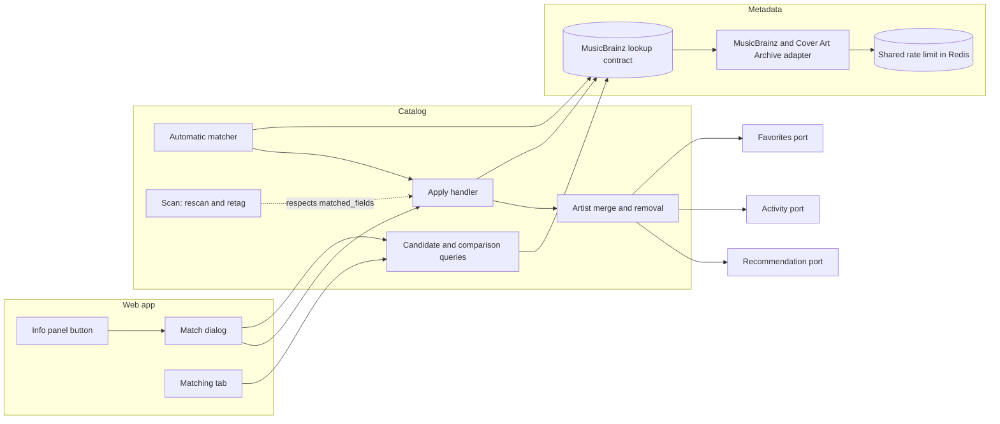
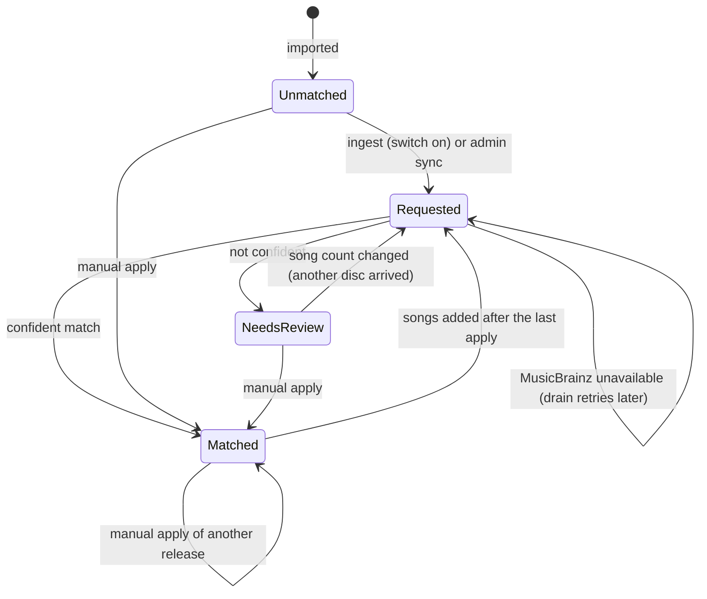

# MusicBrainz Matching - Plan

## Goal Capsule

- **Objective:** Albums, songs and artists in the library carry their MusicBrainz identity and correct artist credits with little or no hand work. Albums that clearly fit one MusicBrainz release are matched on their own, and an admin picks the right match for anything else from a scored list.
- **Product authority:** On 2026-11-14 the user reported that the "Sync from MusicBrainz" button does nothing and that tags such as "Post Malone, Luke Combs" made duplicate artists. The dialogue of the same day settled the shape (Key Decisions): behaviour modelled on iTunes with metadata fetching on, adapted to read-only media.
- **Means:** Catalog owns matching, scoring, comparison, apply and artist merges over a Metadata contract for the MusicBrainz web service, behind one shared rate limit (KTD1, KTD2).
- **Execution profile:** One branch named after this plan, 14 units in five phases (Sequencing). Units land as local commits. Behaviour is verified in the CI image and on a worktree preview against MusicBrainz itself; the persistent instance is touched only after merge, as an operator step with the user's go-ahead.
- **Authority and stop conditions:** Follow `AGENTS.md`, then the Product Contract, then the Planning Contract. Stop and ask the user when a change would alter a Key Decision, when a race test shows the lock order of KTD8 cannot serialize a case it names, or when MusicBrainz's real responses contradict KTD3 or KTD5.
- **Finishing:** `ce-work` implements the units; `ce-code-review` runs before shipping and its justified findings are applied. Push only when the user asks.
- **Open blockers:** None.

---

## Product Contract

### Summary

MusicBrainz matching has two halves. An opt-in background matcher applies confident album matches without asking and flags the rest for review. The "Sync from MusicBrainz" button on song, album and artist panels gives admins a scored candidate list and a per-field comparison before anything is written. Matches live in the catalog, never in the media files.

### Problem Frame

The library scan now credits every song to an artist (`docs/plans/2026-11-13-2034-fix-scan-artist-credits-plan.md`), but only from tags. A single tag value that names several artists stays whole by design, so "Post Malone, Luke Combs" is an artist of its own: the persistent instance holds 14 such "Post Malone, X" artists beside Post Malone. No artist, album or song there has a MusicBrainz ID, because the files carry no MusicBrainz tags, so the scan cannot group aliases or tell guests from main artists.

The "Sync from MusicBrainz" button in the info panel of songs, albums and artists has no action (`ui/web/src/features/catalog/components/metadata/InfoPanel.tsx`). The existing automatic album sync is off by default and, when on, searches MusicBrainz by album title alone and takes the first hit (`src/Metadata/Application/AlbumMetadataEnricher.php`), so turning it on risks writing another album's data. The two metadata operations that read a server file, extract and match, accept any signed-in user and take the file's path from the request (`src/Metadata/Interface/Controller/MetadataSyncController.php`).

### Key Decisions

- **Two halves, modelled on iTunes: confident automatic matches plus an on-demand pick.** A recognisable album should need no click, and a doubtful one should never be guessed. Governs R15 to R20. (session-settled: user-approved — chosen over building the button alone first, or letting a confident automatic match also overwrite values already set: matches without a click, and no guessing)
- **A manual apply shows a per-field comparison first.** Governs R5 to R8. (session-settled: user-directed — chosen over writing IDs, credits and empty fields without a preview, or MusicBrainz replacing every unlocked field: the admin decides which existing values change)
- **Searching and applying are admin-only, and so are extract and match.** Governs R26, R27. (session-settled: user-approved — chosen over open search with admin-only apply, or library members applying: a search spends the shared one-request-per-second MusicBrainz budget and serves only an apply, and every other catalog edit is admin-only)
- **Artists a manual apply would merge or remove appear in the comparison, ticked.** Governs R14. (session-settled: user-approved — chosen over merging and removing them silently, or leaving them for separate commands: the leftovers are visible and each can be kept)
- **Tags that carry MusicBrainz artist IDs win over a match; other retags keep it.** Governs R23. (session-settled: user-directed — chosen over keeping MusicBrainz credits through every retag, or every retag replacing them from tags: Picard-tagged files are authoritative, other tags are not)
- **Files are never written.** Media is mounted read-only, so unlike iTunes the match lives in the catalog. Governs R21. (session-settled: user-approved — chosen over writing tags back to the files: part of the adopted iTunes-like design)
- **Splitting a tag value that names several artists belongs to this work.** Governs R10. (session-settled: user-directed — chosen over splitting on an album-artist prefix in the scan: splitting tag text is unsafe for names with commas, and MusicBrainz knows the artists)
- **An artist a match replaces merges into the artist that took over its primary credits.** Its favorites and play history stay with the artist its songs now credit. Governs R13, R14. (session-settled: user-approved — chosen over removing it, which drops its favorites and play links, or keeping it: a replaced artist is the same performer under a tag spelling)
- **Editions whose tracks agree count as one automatic match.** Explicit and clean editions such as those of "F-1 Trillion: Long Bed" differ only in recording IDs the files cannot tell apart, so the match writes what they share. Governs R16, R30. (session-settled: user-approved — chosen over sending such twins to review until an admin picks the edition: albums MusicBrainz knows should fix themselves, as in iTunes)
- **Files tagged with an ID per artist credit every artist they name.** Tags with IDs then give the credits a match would, so they can win over one. Governs R23, R29. (session-settled: user-approved — chosen over letting such tags win only when they credit as many artists as the match, or never letting tags replace a match: Picard's output is authoritative)
- **A match resolves artists the way the scan does.** An artist without an ID whose name equals the credited name takes on the ID, so a match never creates a second "Post Malone". Governs R10.
- **Artists found to share a MusicBrainz ID are merged by this work.** Governs R12. (session-settled: user-approved — chosen over grouping during both scan and sync in the scan work, or during sync only: the scan already groups by an ID its files carry)
- **A match changes which artists a song is credited to, not the artist text it shows.** Lyrics lookups send that text, and LRCLIB found today's lyrics with it. Governs R11.
- **The relevancy score is Baander's own fit score, not MusicBrainz's text score.** A text score cannot tell two editions of an album apart; track count and lengths can. Governs R3, R16.
- **Automatic matching works per album and takes over the existing automatic album sync switch.** That leaves one switch, off by default; songs and artists get their IDs through their album's match or a manual lookup. Governs R15, R19.
- **A retag does not clear a value a match filled in; a value the new tags carry replaces it.** Otherwise a ReplayGain pass would empty a year or genre the match supplied. Governs R24.

### Actors

- A1. Admin: looks items up, applies matches, works through the review list; a super admin turns automatic matching on or off (Assumptions).
- A2. Background matcher: matches albums on import and rescan while automatic matching is on.
- A3. MusicBrainz: the external catalogue, answering at most one request per second.
- A4. Library member: sees the matched credits and fields like any other catalog data.

### Key Flows

- F1. Automatic album match
  - **Trigger:** An album without a match is imported or rescanned while automatic matching is on.
  - **Actors:** A2, A3
  - **Steps:** The matcher searches MusicBrainz for the album, scores the candidates, and either applies the confident winner or marks the album as needing review.
  - **Covered by:** R15 to R20
- F2. Manual album match
  - **Trigger:** An admin presses "Sync from MusicBrainz" on an album.
  - **Actors:** A1, A3
  - **Steps:** The candidate list opens, best first; the admin may refine the search, picks a candidate, reviews the per-field and per-track comparison with its artist merges and removals, adjusts the ticks, and applies.
  - **Covered by:** R1 to R14
- F3. Manual song or artist match
  - **Trigger:** An admin presses the button on a song or an artist.
  - **Actors:** A1, A3
  - **Steps:** As F2, with recording candidates for a song and artist candidates for an artist.
  - **Covered by:** R1 to R6, R8 to R14
- F4. Review
  - **Trigger:** An admin opens the list of albums needing review.
  - **Actors:** A1
  - **Steps:** Each listed album opens its candidate list as in F2; a manual apply removes it from the list.
  - **Covered by:** R18

### Requirements

**Candidates**

- R1. Pressing "Sync from MusicBrainz" on a song, album or artist lists MusicBrainz candidates for that item, best first, each with a relevancy score from 0 to 100.
- R2. Each candidate shows enough to tell close candidates apart: for an album its title, artist credit, release date, country, label, format, track count and cover; for a song its title, artist credit, length and the releases it appears on; for an artist its name, disambiguation, type, country and active years.
- R3. The relevancy score measures how well a candidate fits the local item by comparing their titles and artists and, for an album, their track counts and track lengths.
- R4. When the right candidate is not listed, the admin can search again with an edited title or artist.

**Comparison and apply**

- R5. Picking a candidate shows, before anything is written, the current and the MusicBrainz value of every field the match can set.
- R6. MusicBrainz IDs, artist credits and empty fields are ticked by default; fields that already hold a different value are unticked; locked fields are shown and cannot be ticked.
- R7. For an album, the comparison pairs each local track with a track of the chosen release by disc and position, then length, and shows unpaired tracks on both sides; an apply writes only paired tracks.
- R8. An apply writes exactly the ticked changes, and either all of them land or none do.
- R9. A song match sets fields of that song only and never moves it to another album.

**Artist credits and artists**

- R10. An apply credits each song to the artists MusicBrainz credits it to: the first as primary and the others as featured, each resolved to the local artist holding its MusicBrainz ID, else to the oldest artist without an ID whose name equals the credited name, which takes on the ID, else to a new artist.
- R11. A song keeps showing the artist text it was tagged with and keeps sending that text to lyrics lookups.
- R12. When an apply gives a local artist an ID another local artist already holds, the artist that received the ID merges into the holder: its credits and favorites move to the holder, its cover moves there when the holder has none, and it is removed.
- R13. An artist that an apply leaves with no credit merges into the artist that took over its primary credits; when no artist took them over, it is removed.
- R14. A manual apply lists each merge and removal in the comparison, ticked by default; unticking one keeps that artist as it is.

**Automatic matching**

- R15. While automatic matching is on, each album without a match is matched in the background when it is imported or rescanned.
- R16. An automatic match is applied only when one candidate is clearly ahead of the rest, has the same track count as the local album, and pairs every track within a few seconds of its length.
- R17. A confident automatic match writes the IDs, artist credits, merges and removals (R10 to R13), empty fields and a missing cover, and never changes a field that holds a value or is locked.
- R18. An album the matcher could not match confidently is marked as needing review, and admins can list those albums and open each one's candidates.
- R19. Automatic matching is off by default and replaces today's automatic album sync behind the same switch.
- R30. Editions whose tracks agree on titles, artist credits and lengths count as one candidate; matching them writes recording IDs only where the editions agree and records the earliest edition as the album's release.
- R20. Matching stays within MusicBrainz's one request per second; a large library is matched gradually in the background.

**Persistence**

- R21. A match is stored in the catalog only; no media file is written.
- R22. A rescan keeps the credits and values a match set, whether the file is unchanged or retagged, except as R23 and R24 state.
- R23. A retag whose tags carry MusicBrainz artist IDs replaces the song's credits with the credits those tags give.
- R24. A value the new tags carry replaces the matched value of that field; a field the tags leave empty keeps its matched value.
- R25. An item's MusicBrainz ID stays through rescans and retags.

**Scan**

- R29. When a file names its artists one by one (Picard's ARTISTS tag, or several ARTIST values) with one MusicBrainz artist ID each, the scan credits every named artist by its ID: the first as primary and the others as featured.

**Access**

- R26. Searching candidates, applying, the review list and the automatic matching switch are admin-only.
- R27. The metadata extract and match operations, which read a server file, are admin-only.
- R28. Library members see matched credits, IDs and fields like any other catalog data.

### Acceptance Examples

- AE1. **Covers R10, R11, R13, R17.** Given automatic matching on and the album "F-1 Trillion: Long Bed" (27 tracks on two discs, album artist "Post Malone", tracks tagged "Post Malone, Luke Combs" and the like), when a rescan matches it confidently, each duet is credited to Post Malone as primary and its guest as featured, still shows its own tagged text such as "Post Malone, Luke Combs", keeps its lyrics, and the 14 "Post Malone, X" artists are gone.
- AE2. **Covers R16, R18, R30.** Given an album whose two best candidates are editions that differ in a track's title, artist credit or length, or whose best candidate has a different track count, when automatic matching runs, nothing is written and the album is listed as needing review; editions that differ only in recording IDs match as one.
- AE3. **Covers R6, R8.** Given an album whose year is 2023 and whose genre is empty, when an admin picks a candidate with year 2024 and genre "Country", the year is unticked and the genre ticked; applying fills the genre and keeps 2023.
- AE4. **Covers R12, R14.** Given local artists "HeadHunterz" and "Headhunterz", one already holding the MusicBrainz ID the match gives the other, the comparison lists the merge, ticked; applying it leaves one artist with both artists' credits, and unticking it leaves both artists as they were.
- AE5. **Covers R22, R23.** Given a song whose credits came from a manual match, a ReplayGain pass keeps those credits, and a retag that writes MusicBrainz artist IDs into the file replaces them with the credits the tags give.
- AE6. **Covers R7.** Given a local album of 26 tracks and a release of 27, the comparison shows the release's extra track unpaired, and applying creates no song for it.
- AE7. **Covers R26, R27.** Given a signed-in library member who is not an admin, searching candidates, applying a match, and calling extract or match are refused.
- AE8. **Covers R23, R29.** Given a FLAC file tagged by Picard with ARTIST "Post Malone feat. Luke Combs", ARTISTS "Post Malone" and "Luke Combs", and one MusicBrainz artist ID each, a scan credits Post Malone as primary under "Post Malone feat. Luke Combs" and Luke Combs as featured, by those IDs, and a later retag of a matched song carrying the same tags leaves the same credits.

### Success Criteria

- With automatic matching on, one rescan of the persistent library matches every album that clearly fits one MusicBrainz release and lists the rest for review, and a hand check of its 5 albums finds none matched to the wrong release.
- An album needing review takes one pass to fix: open it, pick, apply.
- After matching, at least as many songs have lyrics as before (63 of 77 on the persistent instance).

### Scope Boundaries

- Other providers in the candidate list (Discogs, Spotify, Last.fm).
- Writing tags back to media files.
- Picking several albums to match at once, beyond the automatic matcher.
- Automatic matching of single songs or artists outside their album's match.
- Splitting multi-artist tag values in the scan (Key Decisions).
- Movies, and other media types.

Considered and not built:

- A "dismiss" action for albums MusicBrainz does not know: the review list stays accurate, and an unchanged song count stops the re-search (KTD10). It becomes worth building if the list fills with albums that can never match.
- An alias that keeps finding an album by its old title after an admin replaces the title: replacing a title is unticked by default (R6), and duplicate detection with `app:album:merge` catches a split. It becomes worth building if a split shows up in practice.
- New access rules for the generic `GET /api/metadata/search/*` and `/browse/*` routes: they stay open, but a per-user limit and a bounded wait (KTD2) keep a member from starving the matcher or an admin's lookup; the web app does not call them.
- A standalone artist merge command: merges happen inside an apply (R12, R13).

#### Deferred to Follow-Up Work

- Refreshing the Doctrine version list in `.agents/skills/postgres-remediation/references/doctrine.md` (DBAL 4.5.0, ORM 3.7.6); the postgres specialist owns that reference.
- `AlbumMergeService` runs without a transaction and leaves album favorites behind; it sits beside this work but is not changed by it.
- The bulk lyrics fetch's default 500 ms spacing draws LRCLIB rate limits (ROADMAP.md open item).

### Dependencies / Assumptions

- MusicBrainz credits the guests of a duet on its recordings; for "F-1 Trillion: Long Bed" this is unverified.
- The MusicBrainz client searches artists, release groups and recordings and looks up artists and release groups; it has no release search and no recording lookup, and matching an edition and its track list needs them (`src/Metadata/Infrastructure/Api/MusicBrainz/MusicBrainzAdapter.php`).
- Missing covers come from the Cover Art Archive, which the Metadata context already reaches.
- Artist write routes are admin-only through a per-route check, with no class-wide rule (`src/Catalog/Interface/Controller/ArtistController.php`), so new artist routes need their own check.
- Song sync writes no lockable field today, so no song code yet checks field locks during a sync; a match that writes song fields needs that check.

### Outstanding Questions

**Deferred to Implementation**

- The final confidence thresholds of R16 (lead over the runner-up, seconds of length tolerance), tuned against the persistent library from the defaults in KTD4.

### Sources / Research

- `docs/plans/2026-11-13-2034-fix-scan-artist-credits-plan.md` and its ROADMAP.md entry: the scan credits, the R7 rule that keeps one tag value whole, and the deferred MusicBrainz items.
- `src/Metadata/README.md`: how an artist sync assigns a MusicBrainz ID only under the import's guards.
- `src/Lyrics/Interface/Controller/LyricsController.php`: the existing search-then-apply flow for lyrics, open search and admin-only apply.
- `src/Catalog/Interface/Console/AlbumMergeCommand.php`: album merge exists; no artist merge exists.
- MusicBrainz web service documentation: https://musicbrainz.org/doc/MusicBrainz_API (search syntax, lookups with `inc`, artist credits) and https://musicbrainz.org/doc/MusicBrainz_API/Rate_Limiting (one request per second per IP, a 503 when over it, the User-Agent rule); Cover Art Archive: https://musicbrainz.org/doc/Cover_Art_Archive/API.
- `docs/solutions/architecture-patterns/concurrent-imports-find-or-create-identities-under-sorted-advisory-locks.md`: the lock pattern KTD8 extends.
- `docs/solutions/runtime-errors/doctrine-refuses-a-flush-after-the-database-cascaded-a-delete-under-managed-children.md`: why merges detach managed entities (KTD9).

**Product Contract preservation:** changed: R10 (an artist without an ID whose name matches takes on the ID, as in the scan), R12 (clarified: the surviving artist keeps its own cover), R13 (a replaced artist merges into the artist that took over its primary credits), R23 (made workable by the new R29), AE2 (editions differing only in recording IDs match as one), A1 (the switch is a super admin's); added R29, R30 and AE8. The user chose R13, R29 and R30 on 2026-11-14; R10 follows the import's identity rule; R12 and A1 align the contract with KTD9 and the existing settings rule.

---

## Planning Contract

### Key Technical Decisions

- KTD1. **Catalog owns matching; Metadata exposes the MusicBrainz web service through a contract port.** Catalog Application already depends on a Metadata contract layer (`deptrac.yaml`, `Metadata Album Sync Request Contract`), while Metadata Application may not depend on Catalog without adding to the baseline debt (`deptrac.baseline.yaml`), and every write a match makes is a Catalog write. A new single-class contract layer holds the lookup port and its DTOs; the adapter implements it in Metadata Infrastructure. The Lyrics port is the model for explicit outcomes: found, not found, unavailable and rejected, the last three mapped to 404, 503 and 409 (`src/Lyrics/Application/Port/LrclibClientInterface.php`, `src/Lyrics/Application/QueryHandler/SearchLyricsHandler.php`).
- KTD2. **One MusicBrainz rate limit shared by every process, in Redis.** The adapter's one-second sleep after each successful call is per process (`MusicBrainzAdapter.php`), so the async workers and web requests together exceed MusicBrainz's one request per second per IP. A Symfony rate limiter on the existing Redis storage (`src/Shared/Infrastructure/RateLimiter/RedisRateLimiter.php`, `config/packages/framework.yaml`) reserves a slot before every call, including Cover Art Archive calls. A web request waits at most 10 seconds for its slot and answers unavailable (503) beyond that; the background matcher waits as long as it must. The open `GET /api/metadata/search/*` and `/browse/*` routes first take a slot of a per-user limiter (one call per 10 seconds, 429 when spent), so one member cannot queue ahead of the matcher. A 503 from MusicBrainz counts as unavailable and is not retried inside the request. Covers R20.
- KTD3. **An album matches a release (an edition), not a release group.** Track counts and lengths exist only on releases, and a recording lookup cannot identify the release a file came from (MusicBrainz documents at most 25 releases per recording). Candidates come from one release search on title and artist with Lucene escaping, asking for 25 hits. MusicBrainz scores editions alike, so Baander ranks those hits by title and artist similarity and by whether their track count equals the local album's, and looks up the best five with recordings, artist credits, media, labels, release groups and genres. An album's genres come from its release group's genres, else the release's own. The release ID goes to a new `albums.release_mbid`; `albums.mbid` keeps its release-group meaning and takes the chosen release's group. A song matches a recording (`songs.mbid`) from a recording search on title and artist; an artist matches from an artist search. Covers R1 to R3, R7.
- KTD4. **The fit score is computed locally from the looked-up data.** Title and artist similarity (case- and punctuation-folded) combine with track count and length pairing into a weighted score from 0 to 100; a song scores title, artist and length; an artist scores name and disambiguation. A candidate is confident when it scores at least 90, leads the runner-up by at least 10, has the local album's track count, and pairs every track within 3 seconds. Editions that tie within that lead and agree on every paired track's title, artist credit and length count as one candidate (R30): the match takes the earliest-released of them for the release ID, writes recording IDs only where they agree, and writes only the fields they agree on. These defaults are tuned during implementation against the persistent library (Outstanding Questions). Covers R3, R16.
- KTD5. **MusicBrainz's ordered artist credit decides the roles.** MusicBrainz marks no roles, only join phrases, so the first credited artist becomes primary and the rest featured, as R10 states. The primary credit keeps the song's tagged credited name (R11); a featured credit takes the name MusicBrainz credits that artist under. An album's credit comes from the release's artist credit the same way and keeps the album's existing credited name for its primary artist. Only credits that change are written, which keeps live-update traffic to the changed rows.
- KTD6. **Artists resolve through the import's identity resolver.** The apply passes each credited artist to `ArtistIdentityResolver` as an identity with its one MusicBrainz ID, so it takes the same locks and follows the same order as the scan: the ID holder, else the oldest artist without an ID of exactly that name, which takes on the ID, else a new artist (R10). An artist-level apply that assigns an ID another artist holds becomes a merge (R12) rather than a refused assignment.
- KTD7. **Only songs record what a match set.** No import path rewrites album fields, album credits or any MusicBrainz ID, so albums and artists need no provenance. `songs.matched_fields` (jsonb, like `locked_fields`) lists the fields a match filled or replaced, plus `credits` when the match set the credits; a manual credit edit clears `credits`. The "needs review" mark is a row in a new `album_match_states` table rather than an album column, because the album capture trigger would broadcast an admin-only flag to every library reader. Covers R18, R22 to R24.
- KTD8. **One lock order for applies, merges and retags.** Every MusicBrainz call and the comparison run outside the transaction; the apply looks the chosen entity up again by ID, as the lyrics apply does, and rechecks under the locks that the values the admin saw are still current, answering 409 otherwise. In one transaction: album rows `FOR NO KEY UPDATE` ordered by ID, then every artist and genre key in one sorted `ImportIdentityLock::acquire`, then artist rows to merge or remove `FOR UPDATE`, then song rows `FOR NO KEY UPDATE` ordered by ID, then the recheck, then writes. The scan's retag path takes all its advisory keys before it locks the retagged song rows in the same order and rereads their provenance. A PostgreSQL deadlock (40P01) still retries the import message and answers a manual apply with a retryable 409. Covers R8, R22, R23.
- KTD9. **An artist merge is a set of statements across contexts on the shared connection.** Credits are deduplicated and then repointed, keeping the stronger role when the target already holds the song under another (primary over featured); favorites, play history and artist-typed recommendations move through ports owned by the Favorites, Activity and Recommendation contexts, dropping rows that would collide; the target keeps its cover, else takes the source's; the source is deleted last and its managed entities are detached first (`docs/solutions/runtime-errors/doctrine-refuses-a-flush-after-the-database-cascaded-a-delete-under-managed-children.md`). Removal (R13 with no taker, and the existing artist delete) discards the cover after commit and deletes the artist's favorites and recommendations, which today dangle. Covers R12, R13.
- KTD10. **Every album sync path feeds one matching queue, and the title-only album enricher goes.** `SyncAlbumMessage` has three producers: automatic sync, the admin library sync and the genre sync (`AlbumMetadataSyncRequester`, `SyncLibraryHandler`, `SyncGenresHandler`). The message joins a Metadata contract layer and its handler moves to Catalog, where it only records a match request; `AlbumMetadataEnricher`, which takes the first release group found by title, is removed under the pre-release policy, and with it the album Discogs fallback. Further rules:
  - Requests live in an `album_match_states` row (state `requested` or `needs_review`, with the request's source). One drain message on `async` matches the oldest due request, then re-dispatches itself after a short delay, so a library-wide rescan never holds the async stream for more than one album at a time and scans, covers and mail run in between.
  - Ingest requests a match only while automatic matching is on, after the message's last batch, for each touched album without a release ID and for each matched album that gained songs created after its last apply (`albums.matched_at`); the request falls due after a settling delay so that the album's other discs land first. The admin library sync and the genre sync request matches whatever the switch says, as today's sync does.
  - The drain rechecks the switch for ingest requests only, and drops them while the switch is off.
  - A matched album pairs its new songs against its stored release instead of searching again. This keeps a new track tagged "Post Malone, Luke Combs" from bringing that artist back. A new song that pairs with no track stays without a recording ID and is not marked for review.
  - A `needs_review` row stores the song count it was checked against; a request for an album whose count is unchanged is dropped.
  - A MusicBrainz outage or throttle leaves the request in place and reschedules the drain after 5, 15 and 60 minutes, then hourly; nothing is marked for review.
  - `SongMetadataEnricher` no longer writes recording IDs at all, keeping its genre fill; a song's recording ID comes only from a match.

  Covers R15, R17, R19.
- KTD11. **Matching lives under the admin metadata routes, with one command family, in Catalog's Interface layer.** Routes under `/api/admin/metadata/match/{album|song|artist}/{publicId}` (candidates, comparison, apply) and `/api/admin/metadata/match/reviews` sit behind the `^/api/admin` access rule, and each carries a `CliCounterpart`: `app:metadata:match:search`, `app:metadata:match:compare`, `app:metadata:match:apply` and `app:metadata:match:reviews`. Extract and match gain a method-level admin guard and the commands `app:metadata:file:extract` and `app:metadata:file:match`. Covers R1, R18, R26, R27.
- KTD12. **The album, song and artist resources return what the panel already reads.** `mbid` (and `releaseMbid` for albums) and `lockedFields` join the album and artist resources, and `mbid` the song resource; the comparison takes its locks from the item itself. Covers R6, R28.

### High-Level Technical Design

Which context owns what, and where the matcher's calls go:



A manual apply, with the lock order of KTD8:

```mermaid
sequenceDiagram
  participant Admin
  participant API as Apply route
  participant H as Apply handler
  participant MB as MusicBrainz (rate-limited)
  participant DB as PostgreSQL
  Admin->>API: apply(release ID, ticked changes, values seen)
  API->>H: ApplyMusicBrainzMatchCommand
  H->>MB: release lookup (again, by ID)
  H->>DB: begin
  H->>DB: album rows FOR NO KEY UPDATE (ordered)
  H->>DB: advisory keys: artist IDs, artist names, genres (one sorted call)
  H->>DB: artist rows to merge or remove FOR UPDATE, then song rows FOR NO KEY UPDATE (ordered)
  H->>DB: reread albums, songs, artists; compare with values seen
  alt changed since the comparison
    H->>DB: rollback
    H-->>API: 409 match_stale
  else current
    H->>DB: write fields, IDs, changed credits, merges, removals, matched_fields, matched_at; delete the album's match state
    H->>DB: commit
    H-->>API: applied
  end
```

An album's match state:



### Assumptions

- The automatic matching switch stays the `metadata.auto_sync` system setting, which only super admins change (`SystemSettingsController`); R26's "admin-only" holds as the stricter reading.
- The open `GET /api/metadata/search/*` and `/browse/*` routes keep their current access; the shared rate limit of KTD2 keeps them from exceeding MusicBrainz's budget.
- MusicBrainz credits the guests of "F-1 Trillion: Long Bed" in its recordings' artist credits; the preview check confirms or refutes it before merge (AE1).
- Removing the album enricher ends the Discogs fallback for album data; no other album provider is wired today.

### Sequencing

1. Foundations: U1 (MusicBrainz contract and rate limit), U2 (schema), U3 (scan credits every ID'd artist), U4 (rescan and retag keep a match).
2. Matching core in Catalog: U5 (score, pairing, confidence), U6 (artist merge and removal), U7 (candidates and comparison), U8 (apply).
3. Surfaces: U9 (admin API, commands, resources, extract and match), U10 (automatic matching), U11 (review list).
4. Web: U12 (match dialog), U13 (matching tab).
5. Documentation: U14.

U3 depends only on U2; U4 on U2 and U3; U5 on U1; U6 on U2; U7 on U1 and U5; U8 on U4, U6 and U7; U9 to U11 on U8; U12 on U9; U13 on U11 and U12.

### System-Wide Impact

- **Live updates:** new columns join the capture-trigger lists and `tests/Fixtures/LiveUpdates/capture-sources.json`; the match-state table gets its own trigger routed to admins only; the web registries need descriptors and coverage rows for every new reader (`ui/web/tests/live-updates/coverage.test.ts`, `descriptors.test.ts`).
- **Other contexts:** Favorites, Activity and Recommendation gain small ports for an artist merge (KTD9).
- **Shared budget:** every MusicBrainz and Cover Art Archive call, from workers and web requests alike, waits on one Redis limiter (KTD2).
- **Boundaries and parity:** new Deptrac contract layer; every new admin route has a command and a docs page (`.agents/rules/admin-cli-parity.md`, `tests/Integration/AdminCliParityTest.php`).
- **Generated client:** `openapi.json` and `ui/web/src/shared/api-client/gen` regenerate for the new routes and resource fields.

### Risks

| Risk | Mitigation |
|---|---|
| Listing album candidates takes about six seconds (five lookups at one per second, plus the search), longer while the matcher shares the limiter. | The candidate step shows one loading state while the list loads; lookups stop at five candidates; a web request gives up after 10 seconds with a 503 (KTD2). |
| Credit replacement on a 27-track album writes many capture rows inside one transaction. | Only changed credits are written (KTD5); a rollback removes them with the transaction. |
| An admin who ticks a new album title splits later imports of that directory into a second album, since ingest finds albums by title. | Titles with a value are unticked by default (R6); duplicate detection and `app:album:merge` catch the split. Not built: an album title alias (Scope Boundaries). |
| "F-1 Trillion: Long Bed" may still go to review if MusicBrainz's twin editions differ in a track length beyond the tolerance. | The preview check records the outcome; one manual apply resolves it (Definition of Done). |
| A guarded delete cascades away a credit committed during its lock wait (shown on PostgreSQL 18.7). | Artist rows are locked `FOR UPDATE` and their credits counted in a separate statement before removal (KTD8, KTD9); a race test covers it. |

---

## Implementation Units

| U-ID | Title | Key files | Depends on |
|---|---|---|---|
| U1 | MusicBrainz lookup contract and shared rate limit | `src/Metadata/Application/Port/MusicBrainzLookupInterface.php`, `src/Metadata/Infrastructure/Api/MusicBrainz/MusicBrainzAdapter.php`, `config/packages/framework.yaml`, `deptrac.yaml` | — |
| U2 | Schema for release IDs, song match provenance and match states | `migrations/Version<timestamp>.php`, `src/Catalog/Infrastructure/Doctrine/Entity/*`, `tests/Fixtures/LiveUpdates/capture-sources.json` | — |
| U3 | The scan credits every artist value a file carries an ID for | `src/Catalog/Application/CommandHandler/FilesDiscoveredHandler.php`, `src/Catalog/Application/Port/ArtistIdentity.php` | U2 |
| U4 | Rescans and retags keep a match | `FilesDiscoveredHandler.php`, `src/Catalog/Domain/Model/Song.php` | U2, U3 |
| U5 | Fit score, track pairing and confidence | `src/Catalog/Application/Service/MusicBrainzMatch/*` | U1 |
| U6 | Artist merge and removal | `src/Catalog/Infrastructure/ArtistMergeService.php`, Favorites, Activity and Recommendation ports | U2 |
| U7 | Candidate and comparison queries | `src/Catalog/Application/QueryHandler/MusicBrainzMatch/*` | U1, U5 |
| U8 | Apply a match | `src/Catalog/Application/CommandHandler/MusicBrainzMatch/ApplyMatchHandler.php` | U4, U6, U7 |
| U9 | Admin routes, commands and resources | `src/Catalog/Interface/Controller/MusicBrainzMatchController.php`, `src/Catalog/Interface/Console/MusicBrainzMatch*Command.php`, `src/Catalog/Interface/Resource/*`, `src/Metadata/Interface/Controller/MetadataSyncController.php` | U8 |
| U10 | Automatic matching | `src/Catalog/Application/MessageHandler/DrainAlbumMatchesHandler.php`, `RequestAlbumMatchHandler.php`, `FilesDiscoveredHandler.php` | U8 |
| U11 | Review list | `src/Catalog/Interface/Controller/MusicBrainzMatchController.php`, `src/Catalog/Interface/Console/MusicBrainzMatchReviewsCommand.php` | U8 |
| U12 | Web match dialog | `ui/web/src/features/catalog/components/metadata/MusicBrainzMatchDialog.tsx` | U9 |
| U13 | Web matching tab | `ui/web/src/features/admin/pages/AdminLibraryPage.tsx` | U11, U12 |
| U14 | Documentation and vocabulary | `docs-book/...`, `src/Metadata/README.md`, `CONCEPTS.md` | U9 to U13 |

### U1. MusicBrainz lookup contract and shared rate limit

- **Goal:** Catalog can search and look up MusicBrainz releases, recordings and artists, and fetch front covers, through one port that tells "not found" from "unavailable" and keeps every process within one request per second.
- **Requirements:** R1, R2, R20; KTD1, KTD2, KTD3.
- **Dependencies:** none.
- **Files:**
  - create `src/Metadata/Application/Port/MusicBrainzLookupInterface.php` and DTOs under `src/Metadata/Application/DTO/MusicBrainz/` (release summary, release with media and tracks, recording, artist, structured artist credit with name, join phrase and artist ID, outcome types);
  - modify `src/Metadata/Infrastructure/Api/MusicBrainz/MusicBrainzAdapter.php` (release search with 25 hits and their track counts, release lookups including release-group genres, recording lookups, Lucene escaping inside `query`, structured credits, 503 and 404 told apart, limiter instead of the sleep, a 10-second limit on a web request's wait);
  - modify `src/Metadata/Interface/Controller/MetadataSearchController.php` and `MetadataBrowseController.php` (a per-user limiter before the shared one, 429 when spent);
  - modify `src/Metadata/Infrastructure/Api/CoverArtArchive/CoverArtArchiveAdapter.php` (front cover bytes for a release, following the redirect to the archive hosts, 404 as no cover);
  - modify `config/packages/framework.yaml` (a `musicbrainz` limiter on Redis storage, test override), `config/services.yaml` (port alias), `deptrac.yaml` (contract layer `Metadata MusicBrainz Lookup Contract`, ruleset entry for Catalog Application);
  - tests: `tests/Unit/Metadata/Infrastructure/Api/MusicBrainz/MusicBrainzAdapterTest.php`, `tests/Unit/Metadata/Infrastructure/Api/CoverArtArchive/CoverArtArchiveAdapterTest.php`, `tests/Integration/Metadata/MusicBrainzRateLimitTest.php`.
- **Approach:**
  1. Keep the existing search methods the remaining enrichers use; add the new ones behind the port only.
  2. Escape Lucene specials and quote phrases in every field query; drop the ignored `artist=` parameter.
  3. Map a 503 or transport failure to unavailable, 404 to not found, and any other 4xx to rejected.
  4. Extend the destination allow-list for covers to the hosts the Cover Art Archive redirects to.
- **Patterns to follow:** `src/Lyrics/Application/Port/LrclibClientInterface.php` and its outcome types; `src/Shared/Infrastructure/RateLimiter/RedisRateLimiter.php`; limiter declarations such as `batch_cover_extract` in `config/packages/framework.yaml`.
- **Test scenarios:**
  - A release search for title "F-1 Trillion: Long Bed" and artist "Post Malone" sends one `query` with both fields escaped and quoted, and returns summaries with score, date, country, label, format and track count.
  - A release lookup returns media in order with each track's position, length in milliseconds and recording ID, and an artist credit as an ordered list of name, join phrase and artist ID.
  - A title containing `:` and `!` is escaped so the request is valid Lucene.
  - A 503 yields unavailable, a 404 not found, a 400 rejected; none of them reads as an empty candidate list.
  - The front cover of a release follows the redirect and returns bytes; a release without a cover returns none.
  - Two processes calling the limiter at once are spaced at least one second apart (integration, Redis).
  - A web request whose slot would come after more than 10 seconds answers unavailable instead of waiting.
  - A member calling the open search route in a loop gets 429 after the first call in 10 seconds, and an admin lookup still gets a slot within the wait limit.
  - A release lookup returns the release group's genres.
- **Verification:** the adapter tests and the rate-limit integration test pass; Deptrac reports no new violation.

### U2. Schema for release IDs, song match provenance and match states

- **Goal:** the catalog can store an album's release ID, which song fields and credits a match set, and which albums need review, with live updates intact.
- **Requirements:** R18, R21 to R25; KTD3, KTD7.
- **Dependencies:** none.
- **Files:**
  - create `migrations/Version<timestamp>.php`;
  - modify `src/Catalog/Infrastructure/Doctrine/Entity/AlbumEntity.php`, `SongEntity.php`, `src/Catalog/Domain/Model/AlbumState.php`, `SongState.php`, `Album.php`, `Song.php`;
  - create `src/Catalog/Infrastructure/Doctrine/Entity/AlbumMatchStateEntity.php` and its repository;
  - modify `tests/Fixtures/LiveUpdates/capture-sources.json`;
  - tests: `tests/Integration/MusicBrainzMatchMigrationTest.php`, `tests/Unit/Shared/LiveUpdates/CaptureCoverageTest.php`, `tests/Integration/LiveUpdates/CommittedCaptureTest.php`.
- **Approach:**
  1. `albums.release_mbid text NULL` with `chk_albums_release_mbid_format` on the canonical lowercase UUID, and `albums.matched_at timestamptz NULL`; `songs.matched_fields jsonb NOT NULL DEFAULT '[]'`.
  2. `album_match_states (album_id uuid PRIMARY KEY, state text, source text, due_at timestamptz, reason text NULL, checked_song_count int NULL, checked_at timestamptz NULL, best_score smallint NULL)` with `fk_album_match_states_album_id` `ON DELETE CASCADE` and CHECKs listing the states (`requested`, `needs_review`), the sources (`ingest`, `admin`) and the reasons the matcher writes; `idx_album_match_states_state_due_at` serves the drain.
  3. Add `release_mbid`, `matched_at` and `matched_fields` to the album and song capture-trigger column lists with `CREATE OR REPLACE TRIGGER`; give the state table its own trigger routed to admins (`admin-metadata`); declare them all in `capture-sources.json`.
  4. `SET LOCAL lock_timeout` and a `down()` that refuses, as `migrations/Version20261114120000.php` does.
- **Patterns to follow:** `migrations/Version20261114120000.php`; names per `docs-book/part-2-developer-guide/development/database-naming.md`.
- **Test scenarios:**
  - On a migrated database the new columns and table exist with the named constraints, and an album with a malformed release ID or a state outside the list is refused.
  - Changing an album's `release_mbid` emits a capture row for the album; inserting a match-state row reaches only the admin audience.
  - The capture coverage test lists every new column and the new table.
- **Verification:** migration and capture tests pass in the CI image; `doctrine:schema:validate` reports the mapping in sync.

### U3. The scan credits every artist value a file carries an ID for

- **Goal:** a Picard-tagged file credits each of its artists by MusicBrainz ID, so tags with IDs give the credits a match would.
- **Requirements:** R29, AE8; supports R23.
- **Dependencies:** U2.
- **Files:**
  - modify `src/Metadata/Infrastructure/Reader/VorbisCommentFields.php`, `FlacReader.php`, `OggReader.php`, `Id3Parser.php`, `Id3Reader.php` and `src/Metadata/Domain/Model/ExtractedMetadata.php` to read the per-artist ARTISTS values (Vorbis `ARTISTS`, ID3 `TXXX:ARTISTS`);
  - modify `src/Catalog/Application/CommandHandler/FilesDiscoveredHandler.php` (`taggedCredit` and the credit writes for new, repaired and retagged songs);
  - tests: `tests/Unit/Metadata/Infrastructure/Reader/FlacReaderTest.php`, `Id3ParserTest.php`, `tests/Unit/Catalog/Application/CommandHandler/FilesDiscoveredArtistCreditTest.php`, `tests/Functional/Library/ScannedArtistCreditsTest.php`.
- **Approach:**
  1. The per-artist list is ARTISTS when present, else the ARTIST values; it qualifies when its length equals the number of valid MusicBrainz artist IDs.
  2. A qualifying file credits the first name as primary under the ARTIST text joined by "; ", and every other name as featured under its own name, each resolved by its ID in the batch's single resolver call.
  3. Anything else keeps today's rule (first value, one credit).
- **Patterns to follow:** the existing `taggedCredit` and `ArtistIdentity` handling in `FilesDiscoveredHandler.php`; `tests/Fixtures/Audio/TaggedAudioFixture.php` for real tagged files.
- **Test scenarios:**
  - Covers AE8. A FLAC with ARTIST "Post Malone feat. Luke Combs", ARTISTS "Post Malone" and "Luke Combs" and two IDs yields a primary credit to the Post Malone ID under "Post Malone feat. Luke Combs" and a featured credit to the Luke Combs ID under "Luke Combs".
  - An MP3 with `TXXX:ARTISTS` and two `TXXX:MusicBrainz Artist Id` values gives the same credits.
  - Two ARTIST values with one ID keep today's single primary credit, resolved by that ID.
  - Two ARTIST values without IDs keep today's credit under the "; "-joined text.
- **Verification:** reader and handler unit tests and the real-file functional test pass.

### U4. Rescans and retags keep a match

- **Goal:** a rescan never undoes a match, except where the new tags carry MusicBrainz artist IDs or a value for the field.
- **Requirements:** R22 to R25; KTD7, KTD8.
- **Dependencies:** U2, U3.
- **Files:**
  - modify `src/Catalog/Application/CommandHandler/FilesDiscoveredHandler.php` (`readTags`, `readRetaggedSong`, `writeSongs`, `retagSong`);
  - modify `src/Catalog/Domain/Model/Song.php` (`updateFromTags` takes the matched fields into account);
  - modify `src/Catalog/Application/Port/SongPortInterface.php` and `SongRepository.php` (lock songs in ID order, read provenance);
  - tests: `tests/Unit/Catalog/Application/CommandHandler/FilesDiscoveredRetagTest.php`, `tests/Unit/Catalog/Domain/Model/SongTest.php`, `tests/Integration/RetaggedFileScanTest.php`.
- **Approach:**
  1. `readTags` reports which fields the tags themselves carry, before the file-name fallbacks for title and track.
  2. In `writeSongs`, take every artist and genre key of the batch in one sorted call, then lock the retagged songs `FOR NO KEY UPDATE` in ID order, then reread their `matched_fields`.
  3. A retagged song whose `matched_fields` has `credits` and whose tags carry no MusicBrainz artist IDs keeps its credits, and its tag credit is dropped before artist resolution, so a removed artist is not re-created.
  4. Tags with MusicBrainz artist IDs replace the credits (U3's rule) and remove `credits` from `matched_fields`.
  5. A matched field is replaced only by a value the tags carry; a replaced field leaves `matched_fields`.
- **Patterns to follow:** the existing retag flow and `withTagCreditsOfUncreditedSongsOnly`; `tests/Integration/AlbumCreditRaceTest.php` for a two-session race.
- **Test scenarios:**
  - Covers AE5. A matched song retagged by a ReplayGain pass keeps its primary and featured credits and its matched year.
  - Covers AE5. A matched song retagged with MusicBrainz artist IDs takes the credits those tags give, and `credits` leaves its `matched_fields`.
  - A matched song whose retag adds a year tag takes that year; a retag without a title tag keeps the matched title instead of the file name.
  - A retag of a matched song tagged "Post Malone, Luke Combs" creates no artist of that name.
  - An unmatched song still follows today's retag rules.
  - A retag takes the batch's advisory keys before it locks the retagged song rows, and locks them in ID order (integration, one session).
- **Verification:** unit, integration and race tests pass in the CI image.

### U5. Fit score, track pairing and confidence

- **Goal:** one Catalog service scores any candidate against the local album, song or artist, pairs tracks, and decides whether an album match is confident.
- **Requirements:** R3, R7, R16, AE2, AE6; KTD4.
- **Dependencies:** U1.
- **Files:**
  - create `src/Catalog/Application/Service/MusicBrainzMatch/CandidateScorer.php`, `TrackPairing.php`, `MatchConfidence.php`;
  - tests: `tests/Unit/Catalog/Application/Service/MusicBrainzMatch/CandidateScorerTest.php`, `TrackPairingTest.php`, `MatchConfidenceTest.php`.
- **Approach:**
  1. Fold case, punctuation and "feat."-style joiners before comparing titles and names.
  2. Pair by disc and position first, then by length within the tolerance, leaving the rest unpaired on both sides.
  3. Twin editions (R30) collapse into one candidate before confidence is decided (KTD4).
- **Patterns to follow:** `src/Metadata/Infrastructure/Matching/MatchingStrategy.php` for weights; the pure-service style of `src/Catalog/Infrastructure/Doctrine/ImportIdentity/ArtistIdentityIndex.php`.
- **Test scenarios:**
  - A 27-track two-disc release with every length within 2 s of the local files scores at least 90 and pairs all 27.
  - Covers AE6. A local album of 26 tracks against a release of 27 pairs 26 and leaves one release track unpaired.
  - Covers AE2. Explicit and clean editions whose tracks agree on titles, credits and lengths but differ in five recording IDs collapse into one confident candidate that keeps recording IDs only for the 22 shared tracks; two editions that differ in one track's title or length stay two, and neither is confident.
  - A best candidate with one track 5 s off is not confident.
  - A song candidate with the same title and artist and a length 40 s off scores lower than one within 2 s.
  - An artist candidate with the exact name and a disambiguation scores above one with a similar name.
- **Verification:** the unit tests pass; the scores of the persistent library's five albums are recorded during implementation to tune KTD4.

### U6. Artist merge and removal

- **Goal:** an apply can merge one artist into another or remove a credit-less artist, keeping favorites and play history with the surviving artist and leaving no dangling rows.
- **Requirements:** R12, R13, AE4; KTD8, KTD9.
- **Dependencies:** U2.
- **Files:**
  - create `src/Catalog/Infrastructure/ArtistMergeService.php` behind a Catalog Application port;
  - create ports and implementations in `src/Favorites/` (retarget artist favorites), `src/Activity/` (repoint play history) and `src/Recommendation/` (retarget or drop artist-typed rows), each with a Deptrac contract layer;
  - modify `src/Catalog/Infrastructure/ArtistService.php` and `src/Catalog/Application/CommandHandler/Artist/DeleteArtistHandler.php` (cover discard, favorites and recommendations cleanup on delete);
  - tests: `tests/Integration/ArtistMergeTest.php`, `tests/Integration/ArtistMergeRaceTest.php`, `tests/Unit/Catalog/Application/CommandHandler/Artist/DeleteArtistHandlerTest.php`.
- **Approach:**
  1. The merge runs inside the caller's transaction after the album, advisory and artist-row locks of KTD8; it never opens its own.
  2. Credits: delete the source's credits the target already holds for the same song and role, upgrade the target to primary where the source was primary, then repoint the rest.
  3. Favorites: drop the source's favorites for users who favorited the target, then repoint; activity rows repoint; artist-typed recommendations drop on collision or self-reference, else repoint.
  4. Cover: the target keeps its own, else takes the source's; other images are discarded after commit.
  5. Detach the managed entities of the source before deleting it.
- **Patterns to follow:** `AlbumRepository::delete` for detaching; `CoverImageDiscarder` for after-commit file deletes; `docs/solutions/runtime-errors/doctrine-refuses-a-flush-after-the-database-cascaded-a-delete-under-managed-children.md`.
- **Test scenarios:**
  - Covers AE4. Merging "HeadHunterz" into "Headhunterz" moves its credits, favorites, play history and cover, and leaves one artist.
  - A song credited to both artists as primary keeps one primary credit to the target; one credited primary to the source and featured to the target ends with the target as primary.
  - A user who favorited both artists ends with one favorite of the target.
  - Two merges in one process both succeed (no flush refused after the first).
  - Removing a credit-less artist deletes its cover file after commit and its favorites and recommendations rows.
  - A credit inserted for the source while the merge holds its row fails loudly instead of being cascaded away (integration, two sessions).
  - Deleting an artist through `app:artist:delete` also clears its favorites and recommendations.
- **Verification:** integration and race tests pass in the CI image; Deptrac reports no new violation.

### U7. Candidate and comparison queries

- **Goal:** an admin gets a scored candidate list for an album, song or artist, and for a chosen candidate a per-field and per-track comparison with its artist merges and removals.
- **Requirements:** R1 to R7, R9, R14; KTD3, KTD4, KTD5.
- **Dependencies:** U1, U5.
- **Files:**
  - create `src/Catalog/Application/Query/MusicBrainzMatch/SearchMatchCandidatesQuery.php`, `CompareMatchQuery.php` and handlers under `src/Catalog/Application/QueryHandler/MusicBrainzMatch/`;
  - create the comparison DTOs (field rows with current value, new value, default tick, locked flag; track pairs; artist actions);
  - tests: `tests/Unit/Catalog/Application/QueryHandler/MusicBrainzMatch/SearchMatchCandidatesHandlerTest.php`, `CompareMatchHandlerTest.php`.
- **Approach:**
  1. Search uses the item's title and primary artist, or the admin's edited title and artist (R4); albums rank the 25 hits locally and look up the best five (KTD3).
  2. The comparison sets default ticks per R6 and lists the merges and removals that the ticked credits would cause (R13, R14); unticking the credits removes those merges and removals.
  3. Every row carries the current value the admin saw, which the apply rechecks (KTD8).
  4. Unavailable answers 503; an unknown item 404.
- **Patterns to follow:** `src/Lyrics/Application/QueryHandler/SearchLyricsHandler.php`.
- **Test scenarios:**
  - An album search returns at most five candidates, best first, each with score and the R2 details.
  - A refined search with an edited title replaces the candidates.
  - Covers AE3. For an album with year 2023 and no genre against a candidate with 2024 and "Country", the year row is unticked and the genre row ticked.
  - A locked title shows the MusicBrainz title but cannot be ticked.
  - Covers AE1. The comparison for "F-1 Trillion: Long Bed" lists each duet's new primary and featured artists and a ticked merge of each "Post Malone, X" artist into Post Malone.
  - A song comparison offers only that song's fields and never another album.
  - MusicBrainz unavailable answers 503 instead of an empty list.
- **Verification:** handler tests pass with a fake lookup port.

### U8. Apply a match

- **Goal:** applying writes exactly the ticked changes, or nothing, and leaves the item matched.
- **Requirements:** R5 to R14, R17, R21, R25; KTD5, KTD6, KTD8.
- **Dependencies:** U4, U6, U7.
- **Files:**
  - create `src/Catalog/Application/Command/MusicBrainzMatch/ApplyMatchCommand.php` and `src/Catalog/Application/CommandHandler/MusicBrainzMatch/ApplyMatchHandler.php` (manual and fill-only automatic modes);
  - modify `src/Catalog/Application/Port/AlbumPortInterface.php`, `SongPortInterface.php`, `ArtistPortInterface.php` and their repositories (album credit replacement, ordered row locks, provenance writes);
  - tests: `tests/Unit/Catalog/Application/CommandHandler/MusicBrainzMatch/ApplyMatchHandlerTest.php`, `tests/Integration/MusicBrainzMatchApplyTest.php`, `tests/Integration/MusicBrainzMatchApplyRaceTest.php`, `tests/Integration/MatchedSongRetagRaceTest.php`.
- **Approach:**
  1. Look the chosen entity up again by ID and compute the changes from it, never from client values (KTD8).
  2. Download a missing cover before the transaction; store it only on commit.
  3. In one transaction, take every KTD8 lock, then recheck the values the admin saw (409 `match_stale` on a difference), then resolve artists through the resolver (KTD6) and write fields, IDs, changed credits (KTD5), merges and removals (U6), `matched_fields` and `matched_at`, and delete the album's match state.
  4. Automatic mode ticks only IDs, credits, empty fields and a missing cover, with merges and removals, and aborts if the album gained a release ID meanwhile.
- **Patterns to follow:** `src/Lyrics/Application/CommandHandler/ApplyLyricsHandler.php` (refetch and recheck); `src/Metadata/Application/CommandHandler/ExtractAlbumCoverHandler.php` (cover storage and rollback cleanup).
- **Test scenarios:**
  - Covers AE1. Applying the release to "F-1 Trillion: Long Bed" credits each duet to Post Malone (primary, credited name unchanged) and its guest (featured), merges the 14 "Post Malone, X" artists into Post Malone, keeps every song's lyrics, and sets the release and recording IDs.
  - Covers AE3. With the year unticked and the genre ticked, the genre is filled and 2023 kept.
  - Covers AE4. Unticking a merge leaves both artists as they were.
  - An ID-less "Post Malone" takes on the MusicBrainz ID instead of a second Post Malone being created.
  - A field changed between comparison and apply answers 409 and writes nothing.
  - A failure in the middle (a constraint violation) leaves every song, credit and artist as before.
  - A song apply sets the song's recording ID and fields only.
  - An artist apply assigning an ID another artist holds merges the two.
  - A concurrent import creating an artist the apply removes ends with the artist present and credited, or absent and uncredited, never a credit to a deleted artist (integration, two sessions).
  - A retag and a concurrent apply on the same song serialize: the later one sees the earlier one's credits (integration, two sessions).
- **Verification:** unit, integration and race tests pass in the CI image.

### U9. Admin routes, commands and resources

- **Goal:** admins can search, compare and apply from the API and the console alike, extract and match are admin-only, and the resources return the IDs and locks the panel reads.
- **Requirements:** R1, R5, R8, R26 to R28, AE7; KTD11, KTD12.
- **Dependencies:** U8.
- **Files:**
  - create `src/Catalog/Interface/Controller/MusicBrainzMatchController.php` with request DTOs and resources;
  - create `src/Catalog/Interface/Console/MusicBrainzMatchSearchCommand.php`, `MusicBrainzMatchCompareCommand.php`, `MusicBrainzMatchApplyCommand.php`;
  - modify `src/Metadata/Interface/Controller/MetadataSyncController.php` (method-level `IsGranted('ROLE_ADMIN')`, `CliCounterpart`) and create `src/Metadata/Interface/Console/MetadataFileExtractCommand.php` and `MetadataFileMatchCommand.php`;
  - modify `src/Catalog/Interface/Resource/AlbumResource.php`, `ArtistResource.php`, `SongResource.php`;
  - regenerate `openapi.json` and `ui/web/src/shared/api-client/gen/`;
  - docs pages under `docs-book/part-1-operator-guide/commands/` for the five commands, with rows in its `README.md`;
  - tests: `tests/Functional/Catalog/Interface/Controller/MusicBrainzMatchControllerTest.php`, `tests/Functional/Catalog/Interface/Console/MusicBrainzMatchCliParityTest.php`, `tests/Integration/MusicBrainzMatchFirewallTest.php`, `tests/Functional/Metadata/MetadataSyncControllerAccessTest.php`.
- **Approach:**
  1. Routes per KTD11; apply takes the candidate ID, the ticked rows, the kept artists and the values seen.
  2. Commands print the IDs that `apply` takes, and `--json` prints exactly the API's `data`.
  3. Errors use the shared exceptions, told apart by `details.reason`: 404 for an unknown item or candidate; 409 `match_stale` when the item changed since the comparison, `match_busy` when a deadlock interrupted the apply (retry), `musicbrainz_rejected` when MusicBrainz refused the request; 422 for invalid input; 503 `musicbrainz_unavailable`.
- **Patterns to follow:** `src/Lyrics/Interface/Controller/LyricsController.php`, `src/Lyrics/Interface/Console/LyricsSearchCommand.php`, `LyricsApplyCommand.php`; `tests/Integration/LyricsFirewallTest.php`.
- **Test scenarios:**
  - Covers AE7. A library member who is not an admin gets 403 from candidates, comparison, apply, extract and match.
  - An admin's candidates call for an album answers 200 with scored candidates; MusicBrainz unavailable answers 503 with `details.reason`.
  - A stale apply answers 409 `match_stale`; the matching command exits with the 409 code.
  - The album, artist and song resources include `mbid` (and `releaseMbid`) and `lockedFields`.
  - The admin/CLI parity test and the command docs coverage test pass.
- **Verification:** functional, firewall and parity tests pass; `yarn --cwd ui/web generate:check` is clean after regeneration.

### U10. Automatic matching

- **Goal:** every album sync path, and ingest while automatic matching is on, feeds one matching queue that matches confident albums on its own, marks the rest for review, and never holds the async stream for long.
- **Requirements:** R15 to R20, R30, AE1, AE2; KTD10.
- **Dependencies:** U8.
- **Files:**
  - create `src/Catalog/Application/MessageHandler/RequestAlbumMatchHandler.php` (handles `SyncAlbumMessage`, which moves into a Metadata contract layer, by recording an `admin` request) and `src/Catalog/Application/MessageHandler/DrainAlbumMatchesHandler.php` with its message;
  - delete `src/Metadata/Application/AlbumMetadataEnricher.php`, `src/Metadata/Application/MessageHandler/SyncAlbumHandler.php` and, once ingest no longer uses it, `src/Metadata/Application/Service/AlbumMetadataSyncRequester.php` with its port;
  - modify `src/Metadata/Application/SongMetadataEnricher.php` (no recording IDs);
  - modify `src/Catalog/Application/CommandHandler/FilesDiscoveredHandler.php` (record `ingest` requests after the last batch, due after the settling delay);
  - modify `src/Metadata/Infrastructure/Messaging/MetadataMessagePayloadCodec.php`, `deptrac.yaml`, `config/packages/messenger.php` and the workload catalog for the new message;
  - tests: `tests/Unit/Catalog/Application/MessageHandler/DrainAlbumMatchesHandlerTest.php`, `RequestAlbumMatchHandlerTest.php`, `tests/Integration/NewAlbumMetadataSyncTest.php`, `tests/Unit/Catalog/Application/CommandHandler/FilesDiscoveredAlbumSyncRequestTest.php`, `tests/Unit/Metadata/Application/SongMetadataEnricherTest.php`, `tests/Integration/MessengerJsonDeliveryTest.php`.
- **Approach:**
  1. Requests upsert an `album_match_states` row in state `requested` and make sure a drain message is queued; a drain that cannot take its session-level advisory lock exits, so at most one drain runs.
  2. The drain takes the oldest due request, rechecks the switch for `ingest` requests, and then: confident, apply in automatic mode (U8); not confident, set `needs_review` with reason and song count; unavailable, keep the request and reschedule per KTD10.
  3. A matched album's request pairs only songs created after `matched_at` against the stored release.
  4. The drain re-dispatches itself after a short delay while due requests remain.
- **Patterns to follow:** `docs/solutions/runtime-errors/inline-messenger-run-must-name-the-routed-transport.md`; `FilesDiscoveredHandler::creditAlbum` for running after the last batch; `LyricsFetchRequester` for `DelayStamp` use.
- **Test scenarios:**
  - Covers AE1. With the switch on, an ingest request for "F-1 Trillion: Long Bed" with confident fake twin editions applies the match in automatic mode and leaves recording IDs empty only where the twins differ.
  - Covers AE2. A best candidate with a different track count writes nothing to the album and sets `needs_review` with that reason.
  - With the switch off, ingest records no request, a queued ingest request is dropped, and an admin library sync still matches an album.
  - MusicBrainz unavailable keeps the request, writes no review mark, and reschedules the drain after 5 minutes.
  - A second disc arriving for a reviewed album requests a match again; an unchanged song count does not.
  - A rescan of a manually matched album with an unpaired song requests nothing; a new track added after the apply is paired against the stored release and credited from it.
  - Two drain messages at once process one album at a time.
  - A forced genre sync writes no recording ID and leaves matched fields alone.
- **Verification:** unit and integration tests pass; the capacity fixture and JSON delivery tests still pass.

### U11. Review list

- **Goal:** admins can list the albums that need review and open each one's candidates.
- **Requirements:** R18, R26.
- **Dependencies:** U8.
- **Files:**
  - modify `src/Catalog/Interface/Controller/MusicBrainzMatchController.php` (`GET /api/admin/metadata/match/reviews`, `needs_review` rows keyset by `checked_at` and album ID);
  - create `src/Catalog/Application/Query/MusicBrainzMatch/ListMatchReviewsQuery.php` and handler, and `src/Catalog/Interface/Console/MusicBrainzMatchReviewsCommand.php` with its docs page;
  - tests: `tests/Functional/Catalog/Interface/Controller/MusicBrainzMatchReviewsTest.php`.
- **Approach:** the list returns album public ID, title, reason, checked time and best candidate score; an apply removes the row (U8).
- **Patterns to follow:** `src/Metadata/Interface/Controller/MetadataAdminController.php`; keyset paging elsewhere in Catalog repositories.
- **Test scenarios:**
  - Two reviewed albums list newest first with their reasons; paging returns the next page without repeats.
  - Applying a match to a listed album removes it from the list.
  - A non-admin gets 403.
- **Verification:** functional tests and the parity test pass.

### U12. Web match dialog

- **Goal:** the "Sync from MusicBrainz" button opens a dialog where an admin picks a candidate, reviews the comparison and applies it.
- **Requirements:** R1 to R8, R14, AE3; KTD5, KTD12.
- **Dependencies:** U9.
- **Files:**
  - create `ui/web/src/features/catalog/components/metadata/MusicBrainzMatchDialog.tsx` and its candidate, comparison and track-pairing parts;
  - create `ui/web/src/shared/components/ui/checkbox.tsx` over the installed `radix-ui` Checkbox;
  - modify `ui/web/src/features/catalog/components/metadata/InfoPanel.tsx` (button opens the dialog, admins only);
  - modify `ui/web/src/features/catalog/live-descriptors.ts` and `live-coverage.ts` (demand descriptors for candidates and comparison);
  - tests: `ui/web/src/features/catalog/components/metadata/__tests__/MusicBrainzMatchDialog.test.tsx`, `InfoPanel.test.tsx`.
- **Approach:**
  1. Step one lists candidates with score badge and R2 details, with a refine form (title, artist, submit).
  2. Step two shows field rows with checkboxes (locked rows disabled), the track pairing table (virtualized above 50 rows), and the merge and removal lines.
  3. States: an empty candidate list names the searched title and artist and points to the refine form; a refined search keeps the old list visible but disabled while it loads, and keeps the form values on failure; during an apply the ticks and the button are disabled.
  4. A successful apply closes the dialog, invalidates the item's queries and shows a toast naming what changed; 409 and 503 show their messages, as the lyrics dialog does.
  5. Reloading after a 409 recomputes the comparison and resets every tick to its default, with a notice listing the rows whose current value changed.
- **Patterns to follow:** `ui/web/src/features/catalog/components/LyricsDialog.tsx` and `lyrics-error-message.ts`; `ui/web/src/shared/components/ui/switch.tsx` for the primitive wrapper; `ui/DESIGN.md` (no raw buttons; virtualize long lists).
- **Test scenarios:**
  - The button is hidden for a non-admin and opens the dialog for an admin.
  - Candidates render best first with scores; a refined search replaces them.
  - Covers AE3. In the comparison, the differing year is unticked and the empty genre ticked; a locked title's checkbox is disabled.
  - Unticking the credits row removes the merge lines.
  - A 409 `match_stale` shows "This item changed since you opened the comparison" and offers to reload it; the reload resets the ticks and lists the changed rows; a 503 says MusicBrainz is unavailable.
  - No candidates shows the searched title and artist and the refine form; the apply button is disabled while an apply runs; success closes the dialog with a toast.
- **Verification:** `yarn --cwd ui/web test`, `typecheck` and `lint` pass, including the live-update registry tests.

### U13. Web matching tab

- **Goal:** the admin library page gains a "Matching" tab listing albums that need review, each opening the match dialog.
- **Requirements:** R18.
- **Dependencies:** U11, U12.
- **Files:**
  - modify `ui/web/src/features/admin/pages/AdminLibraryPage.tsx` (tab), create `ui/web/src/features/admin/components/matching/MatchReviewTable.tsx` and `ui/web/src/features/admin/api/match-reviews-api.ts`;
  - modify `ui/web/src/features/admin/live-descriptors.ts` and `live-coverage.ts`;
  - tests: `ui/web/src/features/admin/components/matching/__tests__/MatchReviewTable.test.tsx`.
- **Approach:** follow the paged table of `AdminUsersPage`, with the album title, reason, checked time and best score per row.
- **Patterns to follow:** `ui/web/src/features/admin/pages/AdminUsersPage.tsx`; `admin/api/lyrics-admin-api.ts`.
- **Test scenarios:**
  - Rows render with reason and score; "Load more" fetches the next page.
  - An empty list shows the empty state; an error offers retry.
  - Opening a row's album opens the match dialog for it.
- **Verification:** web tests pass.

### U14. Documentation and vocabulary

- **Goal:** the operator manual, developer guide and vocabulary describe matching as built.
- **Requirements:** all; Documentation / Operational Notes.
- **Dependencies:** U9 to U13.
- **Files:**
  - modify `docs-book/part-1-operator-guide/media/external-apis.md` (matching, shared rate limit, User-Agent, Cover Art Archive, end of the album Discogs fallback);
  - modify `docs-book/part-1-operator-guide/media/library-management.md` and `docs-book/part-1-operator-guide/commands/app-library-scan.md` (what a rescan keeps of a match);
  - modify `docs-book/part-2-developer-guide/contexts/catalog.md`, `contexts/metadata.md`, `src/Catalog/README.md`, `src/Metadata/README.md`;
  - modify `CONCEPTS.md` ("Artist credit": retags of matched songs; "MusicBrainz match" as built);
  - modify `ROADMAP.md` (delivered items and checkpoints).
- **Approach:** state behaviour in plain words without plan IDs; run `prose-fix` on every changed page.
- **Test expectation:** none -- documentation only; `CommandDocsCoverageTest` already covers the command pages in U9 and U11.
- **Verification:** `make website-build` succeeds and the docs pages read as built behaviour.

---

## Verification Contract

| Gate | Command | Applies to |
|---|---|---|
| Unit tests on the host | `vendor/bin/phpunit -c phpunit.xml.dist <path>` | every unit's unit tests |
| Functional and integration files | `BAANDER_TEST_IMAGE=baander-ci:u10 bash scripts/test-functional-container.sh <files>` | U1 to U4, U6, U8 to U11 |
| Full backend suite | `bash scripts/test-backend-container.sh` | each phase boundary and before review |
| Static analysis | `make phpstan`; Deptrac via `php scripts/check-backend-container.php --image baander-ci:u10 -- vendor/bin/deptrac analyse --no-cache --no-progress`; `bin/console lint:container` | each phase boundary |
| API contract | `composer openapi`, then `yarn --cwd ui/web generate:check` | U9, U11 |
| Web | `yarn --cwd ui/web typecheck`, `lint`, `test` | U12, U13 |
| Preview | `make preview-up`; with automatic matching on, rescan the music library and check AE1 on "F-1 Trillion: Long Bed"; then match another album by hand through the dialog | before merge |
| Review | `ce-code-review` on the branch | before shipping |

Race tests (U4, U6, U8) run as Integration tests on disposable PostgreSQL and copy tables without their PGroonga indexes (`docs/solutions/developer-experience/pgroonga-indexes-in-throwaway-test-schemas-break-later-suites.md`). No test calls MusicBrainz; the preview check does.

## Implementation Amendments

Recorded during implementation on 2026-11-14. Each replaces the plan text it names; the decisions it does not mention stand as planned.

- **Drain serialization (KTD10 step 1, U10 approach 1).** A session-level advisory lock is not pool-safe behind the transaction-mode connection pooler, and the project's pool-safe SQL convention test forbids it. The drain instead claims the oldest due request with `FOR UPDATE SKIP LOCKED`, using the request's due time as the claim token, so no album is matched by two runs at once. One chain of runs is held by a token in the application cache: a run without a token starts a chain in place of any other, and a run of a replaced chain ends. A scheduled job, "Recover the album match queue" (every ten minutes), starts a chain when a request is due and no chain holds the queue, so a lost run or a message out of retries no longer leaves requests waiting. The U10 scenario "two drain messages at once process one album at a time" becomes "two runs never take the same album".
- **Per-album retry (KTD10 outage rule).** Only a MusicBrainz outage pauses the whole queue (5, 15, 60 minutes, then hourly). An apply that met changed rows or a deadlock gives back only that album's request for 15 minutes, and a MusicBrainz refusal for 6 hours. A Cover Art Archive refusal during the apply still counts as an outage; splitting it needs a separate apply outcome.
- **Which songs are new (KTD10, R22).** `albums.matched_at` no longer decides which songs a matched album holds that no match has seen: a song committed between the candidate snapshot and the apply was neither paired nor newer. Each song carries `songs.match_checked_at`, set by the apply for every song it compared, under its locks; the requester and the matcher look for songs without it. `matched_at` stays as the album's last match time.
- **Match state on apply (KTD8, U8 approach 3).** A manual apply deletes the album's match state; an automatic apply leaves it to the drain, which removes the request it claimed, so a request made while the match ran (a second disc arriving) survives.
- **Manual edits (R24, KTD7).** An admin's edit that changes a matched song field, and any hand change to a song's credits, drop that field or `credits` from `matched_fields`, so a later retag treats them as hand-made rather than matched.
- **Rate limit spacing (KTD2).** The fixed-window limiter kept the average at one request per second but let two requests out milliseconds apart at a window boundary. The shared limit now spaces every MusicBrainz and Cover Art Archive request at least one second apart.
- **Asking again after a 503 (KTD2).** On the preview, MusicBrainz answered 503 intermittently to single, well-spaced requests: the same release lookup answered 503, then 200, then 200. The adapter now sends a request answered with 503 again up to twice, after 1 and then 3 seconds, each on a fresh turn under the shared limit; a web request asks again only within its 10-second wait. Only a 503 that survives those attempts counts as an outage.
- **Cover row and error messages (KTD12, U9).** The comparison's cover row carries whether the album has a cover (`true`/`null`), and the apply rechecks that presence, so no image ID crosses the API. Unknown-candidate and gone-item messages carry no ID, because the API redacts UUID-shaped text and the console must say the same thing.

## Definition of Done

- Every requirement and acceptance example is covered by a passing test named in a unit, and the preview check shows AE1 on the real album, or records why MusicBrainz's data prevents it.
- Every gate in the Verification Contract passes, and justified `ce-code-review` findings are applied.
- The operator pages, the two module READMEs and the `CONCEPTS.md` entries match the delivered behaviour.
- `ROADMAP.md` records each delivered unit and its verification checkpoint, with suite counts and static gates.
- No code from abandoned attempts remains in the diff, and the removed album enricher leaves no dead references.
- Per unit: its Verification line holds, and race tests fail without the lock order they protect.
