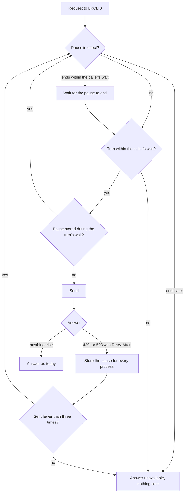
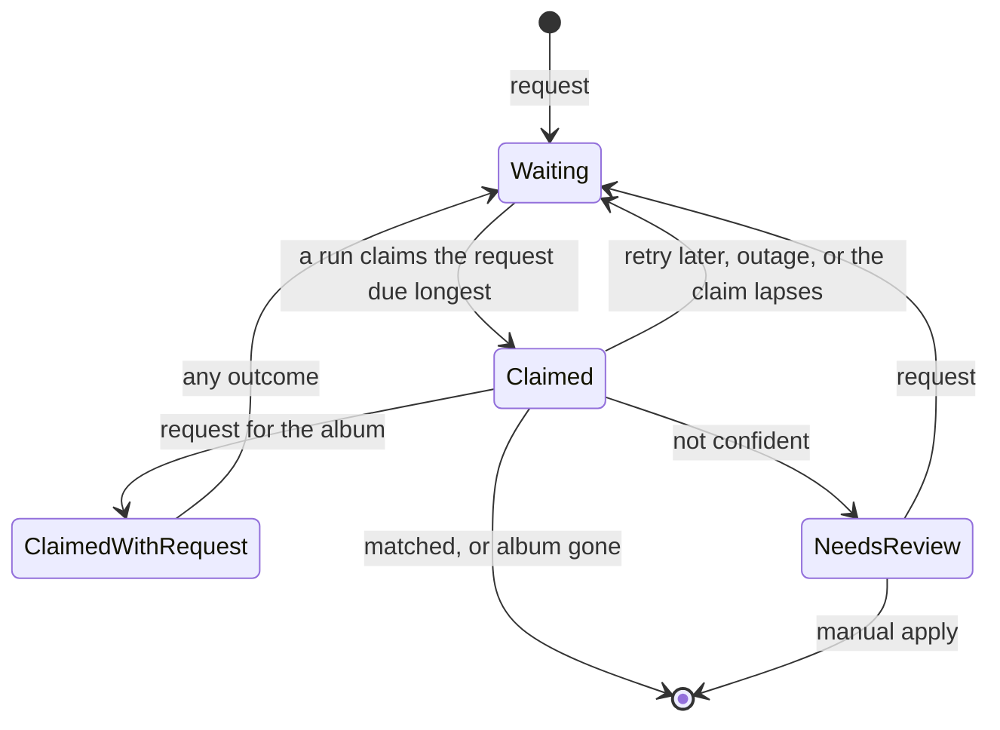

# Matching Follow-ups - Plan

## Goal Capsule

- **Objective:** A bulk lyrics run fetches every song it queued in one pass. The album match queue asks MusicBrainz once for each album, is not paused by one refused cover, and finds candidates for an album whose title carries release text. A qualification run completes its metadata work again.
- **Product authority:** The open items under "Scan artist credits, song lengths and lyrics outcomes" and "MusicBrainz matching" in `ROADMAP.md`. On 2026-11-15 the user took the four main items into one plan and asked for each smaller item to be weighed.
- **Means:** One shared LRCLIB pace with a pause every process honors (KTD1, KTD2); a match claim stored in its own columns (KTD5, KTD6); a refused cover recorded in the apply's result (KTD8); a second search with a shortened title (KTD9).
- **Execution profile:** One branch named after this plan, 12 units in six phases (Sequencing). Units land as local commits. Behaviour is verified in the CI image and on a worktree preview against LRCLIB and MusicBrainz themselves. The persistent instance is touched only after merge, as an operator step with the user's go-ahead.
- **Authority and stop conditions:** Follow `AGENTS.md`, then the Product Contract, then the Planning Contract. Stop and ask the user when the race test of U4 shows that a claim outcome can lose a request made during the claim, when LRCLIB's real answers contradict KTD2 (no `Retry-After`, or a limit below the pace of KTD1), or when the user answers an Outstanding Question against its default.
- **Finishing:** `ce-work` implements the units, with `ce-simplify-code` at phase boundaries. `ce-code-review` runs before shipping and its justified findings are applied. Push only when the user asks.
- **Open blockers:** None. The three Outstanding Questions for the user each carry a default and block nothing.

---

## Product Contract

### Summary

This plan closes the open items that the scan artist credits and MusicBrainz matching deliveries of 2026-11-14 left behind. Every LRCLIB request takes a turn under one shared pace and waits out a rate limit instead of failing. The album match queue keeps its claim on an album while a new request for that album arrives, goes on when the Cover Art Archive refuses one cover, and searches a second time without the release text at the end of a title. Smaller corrections sit beside that work: match dialog messages that name their cause, the per-user MusicBrainz allowance keyed by user ID, album merges that leave moved songs open to a match, and a qualification harness that follows matching.

### Problem Frame

**Lyrics.** At its default spacing of 500 ms, `app:lyrics:fetch` drew HTTP 429 from LRCLIB for 34 of 77 songs on the persistent instance, each counted as unavailable; a second run with `--delay=4000` fetched the other 40 without a 429 (`ROADMAP.md`). LRCLIB documents about 45 requests a minute per address for a client it cannot identify and about 90 for one whose User-Agent names the application, and requires clients to honor the `Retry-After` header of a 429 (https://lrclib.net/docs, modified 2026-11-07). Baander sends the User-Agent `Baander` and two requests per fetch (`FetchLyricsHandler`), so 500 ms between fetches is 240 requests a minute. The first of the two goes to `/api/get-cached`, a route LRCLIB no longer serves: on 2026-11-15 it answered 404 for the example LRCLIB's documentation gives, for which `/api/get` returned the lyrics. Nothing but the `DelayStamp` of each queued fetch paces them. A bulk run, the automatic fetches after an import (`LyricsFetchRequester`, a schedule per process) and the per-song fetch, search and apply routes each send without regard for the others, and a worker that falls behind sends its due fetches back to back. The lyrics dialog's search sends a request for every keystroke from the second character on (`LyricsDialog.tsx`). `LrclibClient` reports a 429 as unavailable at once.

**Waits in a worker.** The workers run `messenger:consume async --keepalive=30` (`WorkerSupervisorRunner`), whose alarm arrives every 30 seconds, and a signal ends a blocking `usleep` early: with a one-second alarm set, a three-second `usleep` returned after 1.00 s on PHP 8.5.12. `Async::sleep()` is one `usleep` outside a coroutine. A worker's wait for its MusicBrainz turn can therefore end before its time today, and a wait for an LRCLIB pause would too.

**Match claim.** A queue run claims the request that has been due longest by moving its `due_at` an hour ahead, and that value also identifies the claim (`AlbumMatchStateRepository`). A request for the same album lowers `due_at` again, which ends the claim: the requester may queue a second run that matches the album while the first still does. Each apply's row lock and recheck keep the second write out, but MusicBrainz is asked twice, and the second run can leave a review mark on an album the first one matched. Because `due_at` is a captured column, every claim also publishes a live update to the admin pages.

**Cover Art Archive.** An automatic apply downloads a missing front cover before its transaction. A refusal of that download (a 4xx other than 404, 408 and 429) is mapped to the same outcome as an outage (`ApplyMatchHandler::applyAutomatically`), so the queue pauses for 5, 15 and 60 minutes, then hourly, and starts again with the same album.

**Search title.** "Ten Thousand Fists [Reprise Records,9362-49433-2,EU]" finds no candidates. Checked against MusicBrainz on 2026-11-15 with the adapter's own query shape: `release:"Ten Thousand Fists \[Reprise Records,9362\-49433\-2,EU\]" AND artist:"Disturbed"` returns no release, and `release:"Ten Thousand Fists" AND artist:"Disturbed"` returns 11, among them the edition with catalogue number 9362-49433-2. A quoted phrase must appear whole in the indexed title, so text the title does not carry at MusicBrainz prevents every hit. The duplicate detector already knows this naming habit: `TitleNormalizer` drops a trailing `[Label, catalog, country]` group before it compares titles.

**Smaller items.** The match dialog shows "The match could not be applied." for every 404 and 422, because no such answer carries a reason. The `musicbrainz_user` limiter is keyed by `getUserIdentifier()`, the email address, where the other per-user limiters use the user ID. An album merge moves songs with the `match_checked_at` mark their old album's match set, so a matched target never compares them with its own release, and nothing requests the target. A song that joins a matched album is paired by disc and track number whatever its length (`TrackPairing`), and that path applies every pair (`AutomaticAlbumMatcher::newSongs`). The qualification harness cannot finish its metadata work on `master`: it requires 2,000 songs and 100 albums with MusicBrainz IDs (`Qualification.php`), only an album match writes those IDs since the album enricher was removed, and its metadata transport answers no `/ws/2/release` request, so the first album ends as an outage and the queue pauses until the cold start times out.

### Requirements

**Lyrics**

- R1. A bulk lyrics run with default settings fetches every song it queued: a rate limit that ends within a fetch's 30-second wait delays the fetch instead of ending it as unavailable.
- R2. Every request Baander sends to LRCLIB, from any process and for any purpose, takes a turn under one shared pace of one request every two seconds.
- R3. When LRCLIB answers 429, or 503 with a `Retry-After` header, no process sends it anything until the time it names has passed; the request that drew the answer is then sent again, at most twice.
- R4. A lyrics request someone waits on (the per-song fetch, the search, the apply) answers "LRCLIB is unavailable" when it cannot be sent within 10 seconds. A queued fetch waits up to 30 seconds and is counted as unavailable beyond that, without a request being sent.
- R5. Baander identifies itself to LRCLIB by name, version and contact address.
- R21. A lyrics search typed into the lyrics dialog sends one request, when the admin submits it.

**Album match queue**

- R6. While a queue run matches an album, no other run takes that album, whatever requests arrive for it.
- R7. A request made for an album while a run matches it is kept. When the run ends, the album waits for a match again from that request's due time; after an outage it keeps its earlier due time instead.
- R8. A run that died leaves its album to be matched again once its claim lapses, 15 minutes after it was taken.
- R9. When the Cover Art Archive refuses the cover during an automatic match, the match is applied without the cover, the refusal is recorded with the album and the release, and the queue goes on with the next album.
- R10. A manual apply whose ticked cover the Cover Art Archive refuses writes nothing and says that the cover was refused and that the rest applies once the cover is unticked.

**Search**

- R11. An album search that finds no release is repeated once with the title cut before a group in square brackets at its end that lists its parts with commas, the form `[label, catalogue number, country]`. "Ten Thousand Fists [Reprise Records,9362-49433-2,EU]" then lists the releases of "Ten Thousand Fists".
- R12. Candidates are scored against the title that found them, in the dialog and in automatic matching alike, so such an album can match without an admin.
- R13. A search never changes the stored album title.
- R14. The candidate list reports the title it searched last. A title the admin typed is searched as typed, without the second search.

**Smaller corrections**

- R15. The match dialog says why a search, comparison or apply answered 404 (the item no longer exists, or MusicBrainz no longer has the candidate) and what to do after a 422.
- R16. The per-user MusicBrainz allowance on the open metadata routes follows the user's ID.
- R17. Songs that an album merge moves are compared with the target album's release at the target's next match, and the merge requests that match while automatic matching is on.
- R18. A song that joins a matched album, by an import or a merge, takes a track's recording ID and credits only when its length is within the pairing tolerance of that track.
- R19. A qualification run can complete its metadata work: the fixture answers the match queue's requests, every album of the dataset is matched, and queue runs count as metadata work in the harness's proofs.
- R20. The operator pages, the context guides, the module READMEs and `CONCEPTS.md` describe the delivered behaviour, and no page says that artist sync runs.

### Acceptance Examples

- AE1. **Covers R1 to R4.** Given 77 songs without lyrics and LRCLIB answering the 30th request with 429 and `Retry-After: 20`, when one bulk run with default settings is handled, no request leaves any process for at least 20 seconds, the 30th request is sent again, and the run's tally counts no song as unavailable.
- AE2. **Covers R6, R7.** Given a run that has claimed album A, when an admin sync requests A and the run then matches A, no second run takes A meanwhile, MusicBrainz is searched once, and A afterwards waits for a match again, due at the time of the admin's request.
- AE3. **Covers R9.** Given a confident candidate for an album without a cover, when the Cover Art Archive answers the cover download with 403, the album is matched with its IDs and credits and without a cover, and the next run matches the next album after the usual pause of a second.
- AE4. **Covers R11 to R14.** Given the album "Ten Thousand Fists [Reprise Records,9362-49433-2,EU]" by Disturbed, when an admin opens the match dialog, the first search finds nothing, the second searches "Ten Thousand Fists", the dialog lists its releases and shows "Ten Thousand Fists" in the refine form, and the album's title is unchanged.
- AE5. **Covers R17, R18.** Given a matched album and a second album whose songs a match has compared, when the second is merged into the first while automatic matching is on, the moved songs have no `match_checked_at` and the target has a match request due five minutes later. When that request is matched, a moved song whose length is 40 seconds off the track at its number keeps its credits and takes no recording ID.

### Success Criteria

- On the preview, one `app:lyrics:fetch` run with default settings over the music library ends with no fetch counted as unavailable.
- On the preview, "Ten Thousand Fists [Reprise Records,9362-49433-2,EU]" lists candidates in the dialog, and the queue either matches it or leaves it for review with a reason other than `no_candidates`.
- `composer test:tooling` proves that the qualification transport answers a release search and a release lookup through the real adapter. The 4 GB qualification run itself belongs to the capability plan.

### Scope Boundaries

Out by the user's choice of 2026-11-15: album identity across directories, a file's song found by hash across libraries, genre slugs and Unicode spellings, M4A tags, the forced-sync rename, the import handler split, genre creation locks in the metadata enrichers, and the settled retag decision.

Not taken up from the same roadmap sections: the stale version list in the postgres-remediation `doctrine.md`, the PGroonga throwaway-schema failure and `composer normalize` failing on `master`. None concerns matching or lyrics. The race tests of U4 copy tables without their PGroonga indexes, as the documented learning prescribes, and do not isolate that failure's cause.

Considered and not built:

- A Cover Art Archive outage (no answer, 408, 429, a server error) still pauses the queue. It is transient, and parking each album instead would search MusicBrainz again for every album without a cover on every retry. An outage that holds the queue for long in practice would change this.
- No scheduled second try for a cover a refusal held back. A later automatic match of the album's new songs asks for the cover again, and an admin gets it by applying the same release with only the cover ticked.
- Only a comma-separated list in square brackets is cut from a search title. Other bracketed text can name another release: "[Instrumentals]", "(Live)" and "(Deluxe Edition)" may be part of a MusicBrainz title or mark a different edition, and an instrumental edition has the lengths of the album it would wrongly match. An admin refines such a search by hand.
- The label, catalogue number and country in the cut text are not used to prefer an edition. The twin rule already matches editions whose tracks agree, and writes label, catalogue number and country only where they agree; picking the exact edition needs its own parsing rules.
- A release ID in the files' tags (`MUSICBRAINZ_ALBUMID`, which `FlacReader` and `OggReader` already extract) is not used as a match's first candidate either. The persistent library's files carry no MusicBrainz tags; a library tagged by Picard would change this.
- The claim's lease is not renewed. One album's match is at most eight requests, each bounded by a 10-second timeout, far inside 15 minutes.
- A run that outlives its lease can still leave a review mark on an album a second run matched. A mark seen in practice would justify one more predicate on the mark's statement.
- Baander does not register as an LRCLIB application for the higher documented limits; the shared pace stays under the limit for unregistered clients.
- No jitter on a pause. LRCLIB suggests up to 30 percent for clients that would otherwise retry together; Baander's processes already take turns under one limiter.
- A no-match is not remembered: every later run asks LRCLIB again for each song it lacks, 14 songs on the persistent instance. A library where those repeats make scheduled runs overlap would justify remembering a no-match for a period.
- No allowance per user for the open lyrics search. The general API limit bounds it, and a member's searches can at worst slow a bulk run.
- The lyrics status keeps reporting the run whose walk finished last, also when that walk queued nothing because a longer run still holds every song. A library large enough for scheduled runs to overlap would change this.

#### Deferred to Follow-Up Work

- **Hand changes to a song's credits.** The credit write and the drop of the song's `credits` matched mark are two writes in `AddArtistCreditHandler`, `RemoveArtistCreditHandler` and `ChangeArtistCreditRoleHandler`, and the handlers take no song row lock, so a hand change can interleave with a match apply. No unit of this plan touches those handlers, and the complete repair joins hand edits to the catalog lock order, which needs its own race tests. The narrow failure today: a hand-made credit keeps the matched mark and survives one retag.
- **Artist sync.** `SyncArtistMessage` has no producer, route or payload codec. `ArtistMetadataEnricher` searches by name and writes the top hit's fields even onto an artist that already holds a MusicBrainz ID, so queuing it as it stands can put another artist's data on a matched artist. What artist sync should do now that a match gives artists their IDs is a product decision of its own. This plan only corrects the two pages that say it runs (U12).
- **Album merge atomicity.** `AlbumMergeService` runs without a transaction and leaves album favorites behind. A transaction needs the source cover discarded after the commit, the album and song locks an apply takes, and a favorites port for albums; none of that concerns matching.
- **A manual apply beside a run in flight.** Two effects were read from `ApplyMatchHandler` while planning and not reproduced. A manual apply removes the album's match state, and with it a request for a song committed after the apply read the album. An automatic match of new songs writes its pairs even when an admin applied the same release in the seconds between its read and its locks. Both predate this plan and need a reproduction first.

### Outstanding Questions

**For the user, each with the default this plan builds**

- **A refused cover during an automatic match.** Default: apply the match without the cover (R9). The alternative parks the album for six hours, as a MusicBrainz refusal during the search does. Choosing it replaces R9 and AE3 in U5 with a retry outcome, and an album whose cover is refused every time is then never matched.
- **Whether the qualification harness repair rides in this plan.** Default: yes, as U10 and U11, because matching broke the harness and the roadmap asks for the check before the 4 GB qualification. The two units touch only `packages/baander-tooling` and share no file with U1 to U9. The alternative moves R19, KTD13, U10 and U11 to a plan of their own and drops the Objective's last sentence; nothing else changes.
- **What a qualification scenario proves about metadata**, if the repair stays. Default: every song identity inside each scenario's window, while the cold start's evidence of 100 albums with a MusicBrainz ID proves that every album was matched (KTD13). A matched album is not requested again, so the present rule, every album identity in every window, cannot be met. The alternative clears the matches before each scenario, which measures a state no installation is in and changes U11 and each scenario's runtime.

**Deferred to implementation**

- The statement form of the "matched" outcome: one `MERGE`, or a `DELETE` followed by an `UPDATE` (KTD6). The postgres specialist decides with the race test of U4.
- Whether "Ten Thousand Fists" then matches automatically. MusicBrainz lists several 14-track editions; the preview check records the outcome.

### Sources / Research

- The retired plans, readable with `git show d4a938b74:docs/plans/2026-11-14-1219-feat-musicbrainz-matching-plan.md` and `git show d4a938b74:docs/plans/2026-11-13-2034-fix-scan-artist-credits-plan.md`, and their delivery records in `git show d4a938b74:ROADMAP.md`.
- LRCLIB: https://lrclib.net/docs (limits per address, `Retry-After`, the User-Agent form). MusicBrainz search: https://musicbrainz.org/doc/MusicBrainz_API/Search and https://musicbrainz.org/doc/Indexed_Search_Syntax. Cover Art Archive: https://musicbrainz.org/doc/Cover_Art_Archive/API (307, 400, 404, 405 and 503 for a front cover).
- `docs/solutions/architecture-patterns/state-set-when-work-is-queued-on-swoole-task-must-expire.md`: a claim is an ID and an expiry in their own columns, on the database clock, and every outcome matches on the ID.
- `docs/solutions/runtime-errors/fenced-completion-retry-must-not-redo-one-shot-steps.md`: a fence built on a value other writers change in normal use refuses writes that are no lost claim; test the race at the fence.
- `docs/solutions/runtime-errors/doctrine-cannot-update-a-loaded-entity-keyed-by-its-association-under-the-strict-uuid-type.md`: `album_match_states` is written through DBAL statements only.
- `docs/solutions/developer-experience/local-gate-images-and-webkit-harness-runs.md`: an instance that applied a migration refuses to start once that file is rewritten.
- `docs/solutions/developer-experience/in-memory-transport-get-hands-out-one-message-per-call.md`: tests read `getSent()` and assert the `DelayStamp`.
- `docs/solutions/runtime-errors/doctrine-refuses-a-flush-after-the-database-cascaded-a-delete-under-managed-children.md`: the album merge changes songs through the aggregate, never with a raw update beside managed songs.
- PostgreSQL manual, section 13.2.1 (Read Committed): a `MERGE` that waited on a concurrently updated row evaluates its `WHEN` clauses again on the new row version.

---

## Planning Contract

### Key Technical Decisions

- KTD1. **Every LRCLIB request takes a turn under one limiter, inside the client.** A new `lrclib` limiter on the Redis store, a token bucket of one that refills every two seconds, is reserved by `LrclibClient` before each request, as `MusicBrainzAdapter::takeTurn` reserves `musicbrainz`. Two seconds is 30 requests a minute, under the 45 that LRCLIB documents for a client it cannot identify, and matches the observed safe case of two requests per fetch at `--delay=4000`. The client also sends `Baander/1.0 (https://baander.app; contact@baander.app)`, the form LRCLIB asks for and the MusicBrainz adapter already sends. A larger default delay alone was rejected: two overlapping runs, a worker catching up, or the routes would still exceed the limit. The lyrics dialog searches when the admin submits the query, as the match dialog's refine form does, because a request per keystroke would queue a turn for every prefix and the full query would miss its wait. Covers R2, R5, R21.
- KTD2. **A rate-limit answer pauses every process.** On 429, or 503 with `Retry-After`, the client stores a pause in Redis, beside the queue state `RedisQueuedLyricsFetches` keeps there: until now plus the header's seconds, or 5 and then 15 seconds when the header is missing. A later answer never shortens a stored pause. Every request waits for the pause to end, takes its turn, and checks the pause once more before it is sent, so a pause another process stored during the turn's wait is honored too. The request that drew the answer is sent again afterwards, at most twice. MusicBrainz's 503 retry, one request repeated after 1 and 3 seconds, was rejected here: LRCLIB limits per address and names the wait, which other workers sending meanwhile would not honor. The application cache was rejected as the store: its key namespace follows the kernel's environment and debug flag, which web and workers need not share, and a cache clear would end the pause. Covers R1, R3.
- KTD3. **A fetch sends one request, and a caller says how long it may wait.** `FetchLyricsHandler` asks `/api/get` only, and `getBySignatureCached` leaves the port, since its route is gone (Problem Frame). The port takes a wait value, as `MusicBrainzLookupInterface` takes `MusicBrainzSlotWait`: 10 seconds by default, 30 seconds for a queued fetch. Each client call has one deadline, its resends included; when the pause and the turn lie beyond it, the client answers unavailable without sending. `FetchLyricsCommand` says whether it was queued, so the handler picks the wait. Thirty seconds, not longer, because one consumer serves all `async` work by default (`WorkerAutoscalingProfile`) and a waiting fetch holds it: scans, match runs, mail and push wait as long. The default spacing of queued fetches becomes 3,000 ms, one turn plus the request's own time, so a backlog drains, and a smaller requested delay is raised to it. Retries stay inside one handler run, so the run's tally still counts each song once. Covers R1, R4.
- KTD4. **A wait in a worker lasts its full time.** `Async` gains a sleep that goes back to sleep until its time has passed when a signal ends it early, and `LrclibClient` and `MusicBrainzAdapter` wait through it. `Async::sleep()` itself keeps its behaviour for its other callers, some of which may rely on waking at a signal. Without this, the keepalive alarm ends a pause wait within 30 seconds and the request is sent during the pause; the same change gives MusicBrainz its full second between turns in a worker. Covers R2, R3.
- KTD5. **The match claim is a claim ID and an expiry in their own columns.** `album_match_states` gains `claim_id` and `claim_expires_at`, as `libraries` has them for the scan claim. The claim statement writes the expiry from the database clock (`clock_timestamp()` plus the lease) and never touches `due_at`, and every outcome statement matches on `claim_id`. The handler mints the ID, which leaves `DrainAlbumMatchesMessage` and its wire shape as they are; a run that Messenger retries therefore takes a new claim, and the album of its first attempt waits out the lease. A request is claimable when it is due by the application clock, which also wrote its due time, and its claim is absent or lapsed by the database clock. The lease drops from an hour to 15 minutes, the scan claim's length: a request for an album whose run died now waits for the lapse instead of ending the claim, at most 25 minutes with the recovery job's ten. Keeping the claim in `due_at` and teaching `request()` to leave a future due time alone was rejected: a request parked for a retry also has a future due time, and a new request must bring that one forward. The columns arrive in a new migration, because every instance that ran `Version20261115090000` refuses to start once that file changes. Covers R6, R8.
- KTD6. **A request made during a claim waits beside it in `next_due_at`.** While a row holds a live claim, a request records only the earliest due time asked for and the source rule, and queues no run. Each outcome decides on `next_due_at` in the statement that writes it, as the table under High-Level Technical Design lists, so a request that commits between the decision and the write is not lost. For "matched" that is one `MERGE`, or a `DELETE` followed by an `UPDATE`; an `UPDATE` before the `DELETE`, or both as CTEs of one statement, would skip a row a request changed meanwhile and leave the claim for its lease. A run whose outcome leaves the album waiting makes sure a run is on its way to the album's due time: its own chain's next run, or a new chain when its own was replaced meanwhile. A boolean mark with the new due time written into `due_at` was rejected: an outage would have to restore the earlier due time from the run's memory. A separate claims table was rejected: the queue's decisions would span two rows. No bake-off was run, since the shapes differ by one column and reading the statements decides. Covers R6, R7.
- KTD7. **A claim publishes no live update.** The three new columns go under `excluded_columns` in `tests/Fixtures/LiveUpdates/capture-sources.json`, as `songs.match_checked_at` does, and the capture trigger keeps its column list. The review list reads none of them. Outcomes still publish: a review mark, a removed row, a changed due time.
- KTD8. **A refused cover is part of an apply's result, not an outcome of its own kind.** `MatchCovers` tells a refusal from "no cover" and raises it under its own reason, `cover_refused`, because a manual apply can also meet `musicbrainz_rejected` from its release lookup. An automatic apply goes on without the cover and its `MatchApplyResult` says the cover was refused; the queue acts on `Applied` as before, so no consumer needs a new case, and the flag stays out of the API resource. A manual apply answers 409 with `cover_refused`. The mapping of `musicbrainz_rejected` to an outage in `applyAutomatically` goes: nothing else in an automatic apply asks MusicBrainz. Parking the album as a refused search does was rejected: a refusal that repeats would park it forever and search MusicBrainz again every six hours. Covers R9, R10.
- KTD9. **The second search lives in one Catalog Application service, used by the dialog and the matcher.** `SearchMatchCandidatesHandler` and `AutomaticAlbumMatcher` both call it and score against the title it reports. It searches the stored title first and, only when that search returns no hit and the title ends in a comma-separated list in square brackets, the shortened one; whenever the second search ran, it reports the shortened title, whatever that found. Searching the shortened title first was rejected: it would change the ranking of albums that find their release today and lower the title fit of a release whose own title ends in brackets. The shortened title is a prefix of the stored one, so its phrase matches every title the full phrase would. Cutting the title is a pure function next to the scorer. `TitleNormalizer` keeps its own rule on purpose: it cuts any one square-bracket group and also folds case and punctuation, for duplicate detection, where a wrong cut costs a false suggestion and not a wrong match. Covers R11 to R14.
- KTD10. **A 404 names its cause in `details.reason`, as a 409 does.** `item_not_found` covers an unknown and a deleted item, `candidate_not_found` a candidate MusicBrainz no longer has. The messages stay as they are, so the console prints what the API answers and `MusicBrainzMatchCliParityTest` holds. Telling the causes apart by message text in the web app was rejected. Covers R15.
- KTD11. **A moved song loses its mark in the aggregate, the merge requests as an import does, and a new song's pair needs the length tolerance.** `Song::moveToAlbum()` clears `match_checked_at`; the merge's existing save persists it, with no raw statement beside managed songs. `AlbumMergeService` then calls `AlbumMatchRequestInterface::requestAfterImport()` for the target, which does nothing while automatic matching is off; a failure of that call is logged and does not fail the finished merge. `AutomaticAlbumMatcher::newSongs()` keeps a new song's pair only within the tolerance `MatchConfidence` already demands of every pair of a searched match, and the song is marked checked either way. Without that guard the first two steps would let a moved song take the credits of whatever track holds its number. Covers R17, R18.
- KTD12. **The user limiter takes the user ID through the Auth identity contract.** Both metadata controllers key `musicbrainz_user` by `AuthenticatedUserIdentityInterface::getId()`, which needs `'Auth Identity Contract'` among the layers `'Metadata Interface'` may use in `deptrac.yaml`. The Interface layers of other contexts already hold that allowance. The key is hashed before it reaches Redis and shown nowhere, so this is consistency with `authenticated_api`, not a leak repaired; the unit rides here because it sits beside the limiter list and the documentation table that U2 and U12 change. Covers R16.
- KTD13. **The qualification transport answers a release search and a release lookup from its dataset.** One release per album, with the album's 20 tracks, their planned lengths and recording IDs, and a release group, gives every album a confident match. The release answer names no front cover, so no run asks the Cover Art Archive, whose host the fixture does not resolve. The album's existing ID stays the release group's, which keeps the `albums.mbid` count; the release ID is derived beside it. The helpers stay inside `MetadataTransport.php`, the only fixture file the application image loads. The proofs then follow matching: queue runs count as metadata work, a scenario's window requires song identities only, and the cold start's count of 100 albums with a MusicBrainz ID proves the album matches. Covers R19.

### High-Level Technical Design

A request to LRCLIB, from any process. "The caller's wait" is the deadline of KTD3.

A match request's states once the claim has its own columns:

What each queue statement does to a row. A live claim is a claim whose expiry lies ahead on the database clock.

| Statement | Applies to | `due_at` | Claim | `next_due_at` |
|---|---|---|---|---|
| Request | a row without a live claim, or no row | as today: the earlier due time for a waiting album, the requested one otherwise | cleared | cleared |
| Request | a row with a live claim | unchanged | unchanged | the earlier of the stored and the requested due time |
| Claim | the request due longest without a live claim | unchanged | set, expiring 15 minutes later | cleared |
| Matched, album gone | the row of this claim | `next_due_at` when set; otherwise the row is deleted | cleared | cleared |
| Needs review | the row of this claim | `next_due_at` when set, and the row stays requested; otherwise the time of the check, and the row becomes a review | cleared | cleared |
| Retry later | the row of this claim | `next_due_at` when set, otherwise the retry time | cleared | cleared |
| Outage | the row of this claim | unchanged | cleared | cleared |
| Remove import requests | every import request, claimed or not | row deleted | | |
| Manual apply | the album's row | row deleted | | |

`nextRequestDueAt()` and `hasRequestsDueBy()` count a row with a live claim from the claim's expiry, the moment another run could take it.

### Assumptions

These are this plan's own choices. The user has confirmed none of them; the first and the last two are also Outstanding Questions.

- An automatic match is worth applying without its cover (R9), because a match already applies without one when the release has none.
- Only a comma-separated list in square brackets at the end of a title is release text (R11). The persistent library's one failing title has that form, and the duplicate detector's docblock names it: `[Label, catalog, country]`.
- Two seconds between LRCLIB requests is an acceptable pace (R2): a library of 10,000 songs without lyrics takes about eight hours in the background, and each later run asks again for every song LRCLIB lacks.
- A queued fetch may hold a consumer for at most 30 seconds (R4). A pause LRCLIB sets for longer ends the fetches that fall due in it as unavailable, and a later run fetches them.
- A merge should not spend MusicBrainz requests for an operator who left automatic matching off (R17); the target is then matched by the next admin sync.
- The qualification work belongs in this plan (R19), because matching broke the harness and the roadmap asks for the check before the 4 GB qualification. U10 and U11 depend on no other unit and can move to a plan of their own.
- A qualification scenario proves song identities in its own window, and the cold start proves the album matches (KTD13).

### Sequencing

1. Lyrics pacing: U1, U2, U3.
2. Match claim: U4.
3. Apply and search: U5, U6, U7.
4. Smaller corrections: U8, U9.
5. Qualification harness: U10, U11.
6. Documentation: U12.

Phases 1, 2 and 5 and U9 share no file and can run side by side. Within phase 3 the units follow each other: U5 and U7 both regenerate `openapi.json`, and U5, U6 and U8 all change `AutomaticAlbumMatcher`. U8 also follows U4, because a merge into an album that a run is matching relies on the claim. U4 holds the plan's only migration, and its PostgreSQL work goes to the postgres specialist (`.agents/agents/postgres.md`).

### System-Wide Impact

- **Rate limiters:** `lrclib` joins the three aligned lists in `config/packages/framework.yaml` (description, limiter, test override) and the limiter table in the operator guide. Unlike the listener-enforced limiters it applies in `dev` too, since the client reserves it. `app:rate-limiter:clear lrclib` clears the turns, not a stored pause.
- **Waits:** the full-length sleep of KTD4 changes how long a worker waits for a MusicBrainz turn, to the time the limiter named.
- **Schema:** one new migration adds three columns and one CHECK to `album_match_states`. It changes four pins in `tests/Integration/InitialSchemaMigrationTest.php`: the migration count, the version list, the newest `down()` refusal text and the count after the fixture migration.
- **Scheduled jobs:** none is added or changed. "Recover the album match queue" keeps its expression and seed, so the drills that count scheduler rows (`tests/Fixtures/Worker/worker-command-check.php`) are unaffected.
- **Messages and routes:** no message and no route is added, so the messenger routing, async workload and mutation route inventories keep their counts. `FetchLyricsCommand` gains a payload field, which changes `LyricsMessagePayloadCodec` and its tests, and the lyrics port loses `getBySignatureCached`.
- **API contract:** the apply's 409 gains `cover_refused`, and the 404 of the three match routes gains its reasons. `openapi.json` and `ui/web/src/shared/api-client/gen` are regenerated in U5 and U7.
- **Live updates:** a claim no longer wakes the admin pages (KTD7).
- **Tooling package:** U10 and U11 change `packages/baander-tooling`, which has its own format, analysis, architecture and test gates (Verification Contract).

### Risks

| Risk | Mitigation |
|---|---|
| LRCLIB's limits are approximate and may change without notice. | The pause of KTD2 follows whatever LRCLIB names; the pace is one limiter entry. |
| The pause is proved against a mocked LRCLIB only; the `Retry-After` values LRCLIB really sends stay unobserved until a 429 arrives. | Each stored pause is logged at warning level with its end time, and the Goal Capsule's stop condition applies when the first real one contradicts KTD2. Drawing a 429 on purpose was rejected. |
| A waiting fetch holds the one default consumer. | A queued fetch waits at most 30 seconds (KTD3); the spacing lets a backlog drain. |
| A claim outcome and a request race on one row. | Each outcome decides in the statement that writes (KTD6); U4 tests the race at the fence with two sessions. |
| A run outlives its lease and a second run takes the album. | The second run's outcome matches its own claim ID, and the apply's row lock and release recheck keep a second write out, as today. |
| The Cover Art Archive refuses every cover, for a blocked address or User-Agent. | Albums are matched without covers and each refusal is logged at warning level; this is the trade against a queue paused for good. |
| The shortened title finds a release that is another album. | Only a label, catalogue number and country list is cut; confidence still needs the track count, every track paired within 3 seconds and a lead of 10. |
| Guard tests that only the full suite selects fail late, as on 2026-11-14. | The full backend suite runs at each phase boundary (Verification Contract). |

### Documentation / Operational Notes

- A lyrics fetch queued before the upgrade carries no queued flag and fails to decode; its song stays marked for a day. The pre-release policy adds no fallback. Upgrade the persistent instance when no bulk run is in flight.
- A match request that a run held at the upgrade keeps its `due_at`, the old claim's end, and is matched when that time comes, within the hour.

---

## Implementation Units

| U-ID | Title | Key files | Depends on |
|---|---|---|---|
| U1 | A wait in a worker lasts its full time | `src/Shared/Infrastructure/Swoole/Async.php`, `src/Metadata/Infrastructure/Api/MusicBrainz/MusicBrainzAdapter.php` | none |
| U2 | Shared LRCLIB pace and pause | `src/Lyrics/Infrastructure/Api/LrclibClient.php`, `config/packages/framework.yaml`, `ui/web/src/features/catalog/components/LyricsDialog.tsx` | U1 |
| U3 | Queued fetches wait and are spaced to drain | `src/Lyrics/Application/CommandHandler/BulkFetchLyricsHandler.php`, `FetchLyricsHandler.php` | U2 |
| U4 | The match claim in its own columns | `migrations/`, `src/Catalog/Infrastructure/Doctrine/Repository/AlbumMatchStateRepository.php`, `DrainAlbumMatchesHandler.php` | none |
| U5 | A refused cover no longer pauses the queue | `src/Catalog/Application/CommandHandler/MusicBrainzMatch/ApplyMatchHandler.php`, `MatchCovers.php` | none |
| U6 | Second search with the shortened title | `src/Catalog/Application/Service/MusicBrainzMatch/`, `SearchMatchCandidatesHandler.php` | U5 |
| U7 | Match errors name their cause | `MusicBrainzAnswer.php`, `ui/web/src/features/catalog/components/metadata/musicbrainz/match-error-message.ts` | U5 |
| U8 | Moved and new songs of a matched album | `src/Catalog/Domain/Model/Song.php`, `src/Catalog/Infrastructure/AlbumMergeService.php`, `AutomaticAlbumMatcher.php` | U4, U6 |
| U9 | MusicBrainz user allowance keyed by user ID | `src/Metadata/Interface/Controller/MetadataSearchController.php`, `deptrac.yaml` | none |
| U10 | Qualification transport answers the match queue | `packages/baander-tooling/src/Fixtures/Qualification/MetadataTransport.php` | none |
| U11 | Qualification proofs follow matching | `packages/baander-tooling/src/Fixtures/Qualification/Qualification.php` | U10 |
| U12 | Documentation and vocabulary | `docs-book/`, `src/*/README.md`, `CONCEPTS.md` | U1 to U11 |

### U1. A wait in a worker lasts its full time

- **Goal:** a wait for a turn or a pause is not cut short by the consumer's keepalive alarm.
- **Requirements:** R2, R3; KTD4.
- **Dependencies:** none.
- **Files:**
  - modify `src/Shared/Infrastructure/Swoole/Async.php` and `src/Metadata/Infrastructure/Api/MusicBrainz/MusicBrainzAdapter.php`;
  - tests: new `tests/Unit/Shared/Infrastructure/Swoole/AsyncSleepTest.php`; `tests/Unit/Metadata/Infrastructure/Api/MusicBrainz/MusicBrainzAdapterTest.php`.
- **Approach:**
  1. The new sleep reads a monotonic clock after each wake and sleeps again for what is left. In a coroutine it behaves as `Async::sleep()` does, cancellation included.
  2. `MusicBrainzAdapter::takeTurn()` and `backOff()` wait through it.
- **Patterns to follow:** `Async::sleep()` and its coroutine branch; `tests/Integration/Metadata/MusicBrainzRateLimitTest.php` for a child process.
- **Test scenarios:**
  - A child process with an alarm every second and a signal handler installed asks for three seconds and returns after at least three.
  - A wait of zero or less returns at once.
  - In a coroutine a cancelled wait still throws `CoroutineCanceledException`.
  - The MusicBrainz adapter's turn and back-off use the new sleep (its existing spacing tests pass unchanged).
- **Verification:** the new test fails against `Async::sleep()` and passes against the new sleep.

### U2. Shared LRCLIB pace and pause

- **Goal:** every LRCLIB request, from any process, takes a turn two seconds after the previous one and waits out a rate limit LRCLIB names; a fetch and a typed search each send one request.
- **Requirements:** R2, R3, R4, R5, R21; KTD1, KTD2, KTD3.
- **Dependencies:** U1.
- **Files:**
  - modify `src/Lyrics/Infrastructure/Api/LrclibClient.php`, `src/Lyrics/Application/Port/LrclibClientInterface.php` and `src/Lyrics/Application/CommandHandler/FetchLyricsHandler.php`;
  - create the wait value under `src/Lyrics/Application/DTO/` and the pause store under `src/Lyrics/Infrastructure/Redis/`;
  - modify `config/packages/framework.yaml` (description, limiter, test override) and `config/services.yaml` (the limiter argument of `LrclibClient`);
  - modify `ui/web/src/features/catalog/components/LyricsDialog.tsx`;
  - modify `tests/Functional/Lyrics/FakeLrclibClient.php` and the direct constructions in `tests/Unit/Lyrics/Infrastructure/Api/LrclibTransportSecurityTest.php`, `tests/Functional/Lyrics/Interface/Controller/LyricsControllerTest.php` and `tests/Functional/Library/ScannedArtistCreditsTest.php`;
  - tests: `tests/Unit/Lyrics/Infrastructure/Api/LrclibClientTest.php`, `tests/Unit/Lyrics/Application/CommandHandler/FetchLyricsHandlerTest.php`, new `tests/Unit/Shared/Infrastructure/RateLimiter/LrclibLimiterSpacingTest.php`, new `tests/Integration/Lyrics/LrclibRateLimitTest.php`, `ui/web/src/features/catalog/components/__tests__/LyricsDialog.test.tsx`.
- **Approach:**
  1. `getBySignatureCached` leaves the port, the client and the fake, and `FetchLyricsHandler` asks `/api/get` once.
  2. Every remaining port method takes the wait value, defaulting to the 10-second one, so `SearchLyricsHandler` and `ApplyLyricsHandler` need no change.
  3. The order of a request follows the flowchart under High-Level Technical Design. A limiter that cannot be reached answers unavailable, as in the MusicBrainz adapter.
  4. `Retry-After` is read as whole seconds; a value that is missing or not a number takes the fallback of KTD2. A 503 without the header stays unavailable at once, with no pause.
  5. Each stored pause is logged at warning level with its end time, and the unavailable answer's reason says "paused" when nothing was sent.
  6. The pause store sits behind a small interface, so the client's unit tests use a double and no test waits.
  7. The lyrics dialog keeps the typed text as a draft and searches on Enter or its search button; "Auto" still searches for the song's own title and artist at once.
- **Patterns to follow:** `MusicBrainzAdapter::takeTurn()`, `get()` and `backOff()`; `MusicBrainzSlotWait`; the `musicbrainz` entries in `config/packages/framework.yaml`; the scripts and key prefix of `RedisQueuedLyricsFetches`; the draft and submit of `MatchCandidateStep.tsx`; `ui/DESIGN.md` and `.agents/rules/frontend.md`.
- **Test scenarios:**
  - Two requests in a row are sent two seconds apart by the shipped limiter configuration.
  - A fetch sends one request, to `/api/get`; a 404 is a no-match.
  - A 429 with `Retry-After: 20` stores a pause of 20 seconds, and the same request is sent again after it and returns its lyrics.
  - A 429 without `Retry-After` pauses 5 seconds, a second one 15; a third answer of 429 returns unavailable after three sends.
  - A second 429 with a shorter `Retry-After` does not shorten the stored pause.
  - A 503 with `Retry-After: 1` pauses and retries; a 503 without the header returns unavailable at once.
  - With a pause of 60 seconds stored, a call returns unavailable without a request, for the 10-second and the 30-second wait alike; with a pause of 20 seconds, the 30-second wait sends after it and the 10-second wait does not.
  - A pause stored while the call waits for its turn is waited out before the request is sent.
  - A resend whose pause would end after the call's deadline returns unavailable instead.
  - Every request carries the new User-Agent.
  - Covers AE1. Two processes sharing only Redis send two seconds apart, and a pause stored by one holds the other (integration).
  - A rejected request and a timeout answer as before.
  - Typing in the lyrics dialog's search sends no request; Enter or the search button sends one for the typed text, and a failed search keeps the typed text.
- **Verification:** the client, handler and limiter tests pass; `RateLimiterMonitorControllerTest` and `RateLimiterCommandsTest` list `lrclib` with its description; `yarn --cwd ui/web typecheck`, `lint` and `test` pass.

### U3. Queued fetches wait and are spaced to drain

- **Goal:** a bulk run and the automatic fetches queue their fetches at LRCLIB's pace, and a queued fetch waits for its turn instead of ending as unavailable.
- **Requirements:** R1, R4; KTD3.
- **Dependencies:** U2.
- **Files:**
  - modify `src/Lyrics/Application/Command/FetchLyricsCommand.php`, `BulkFetchLyricsCommand.php`, `BulkFetchLyricsSchedulerParams.php`;
  - modify `src/Lyrics/Application/CommandHandler/BulkFetchLyricsHandler.php`, `FetchLyricsHandler.php` and `src/Lyrics/Application/Service/LyricsFetchRequester.php`;
  - modify `src/Lyrics/Infrastructure/Messaging/LyricsMessagePayloadCodec.php` and `src/Lyrics/Interface/Console/LyricsFetchCommand.php`;
  - modify `docs-book/part-1-operator-guide/commands/app-lyrics-fetch.md`;
  - tests: `tests/Unit/Lyrics/Application/CommandHandler/BulkFetchLyricsHandlerTest.php`, `FetchLyricsHandlerTest.php`, `tests/Unit/Lyrics/Application/LyricsFetchRequestTest.php`, `tests/Unit/Lyrics/Infrastructure/Messaging/LyricsMessagePayloadCodecTest.php`, `InlineRunPayloadTest.php`, `tests/Unit/Lyrics/Interface/Console/LyricsCommandsTest.php`, `tests/Unit/Catalog/Application/CommandHandler/FilesDiscoveredLyricsRequestTest.php`.
- **Approach:**
  1. The bulk run and `LyricsFetchRequester` mark their fetches as queued; the per-song route and `app:song:lyrics:fetch` do not. `FetchLyricsHandler` passes the 30-second wait for a queued fetch.
  2. `BulkFetchLyricsHandler` raises a delay below the minimum to it and logs the spacing it used; the command prints that spacing and the time the run will take. The route, the command and a schedule's stored `delayMs` all pass through the handler.
  3. `--delay` and the scheduler parameter `delayMs` keep their names; their default and description change.
- **Patterns to follow:** the existing `DelayStamp` spacing and mark TTLs in `BulkFetchLyricsHandler`; `tests/Integration/NewAlbumMetadataSyncTest.php` for reading queued messages from `getSent()`.
- **Test scenarios:**
  - A bulk run without a delay queues its fetches 3,000 ms apart, each marked as queued; a run with `--delay=500` does the same and reports 3,000 ms; a run with `--delay=10000` keeps 10,000 ms.
  - A schedule whose stored parameters say `delayMs: 500` runs with 3,000 ms.
  - A queued fetch passes the 30-second wait to the client; a fetch from the route passes the 10-second one.
  - A queued fetch that could not be sent within its wait is counted as unavailable once and clears its queued mark.
  - Covers AE1. A fetch whose request was paused and then answered is counted as found, once.
  - The payload codec round-trips the queued flag, and an inline run carries it.
  - Automatic fetches after an import are spaced 3,000 ms apart within one process.
- **Verification:** the Lyrics unit suites and `LyricsAdminControllerTest` pass; the command page states the new default and the minimum.

### U4. The match claim in its own columns

- **Goal:** a run holds its album from claim to outcome whatever requests arrive, and a request made meanwhile takes effect when the run ends.
- **Requirements:** R6, R7, R8; KTD5, KTD6, KTD7.
- **Dependencies:** none.
- **Files:**
  - create a migration under `migrations/` that sorts after `Version20261115110000`;
  - modify `src/Catalog/Infrastructure/Doctrine/Entity/AlbumMatchStateEntity.php`, `src/Catalog/Infrastructure/Doctrine/Repository/AlbumMatchStateRepository.php`, `src/Catalog/Domain/Repository/AlbumMatchStateRepositoryInterface.php`;
  - modify `src/Catalog/Application/MessageHandler/DrainAlbumMatchesHandler.php`, `src/Catalog/Application/Service/MusicBrainzMatch/AlbumMatchRequester.php`, and the docblock of `src/Catalog/Application/CommandHandler/RecoverAlbumMatchQueueHandler.php`;
  - modify `tests/Fixtures/Catalog/InMemoryAlbumMatchStates.php` and `tests/Fixtures/LiveUpdates/capture-sources.json`;
  - tests: new `tests/Integration/AlbumMatchClaimMigrationTest.php` and `tests/Integration/AlbumMatchClaimRaceTest.php`; modify `tests/Integration/InitialSchemaMigrationTest.php`, `tests/Functional/Catalog/Infrastructure/Doctrine/Repository/AlbumMatchQueueStatementsTest.php`, `MusicBrainzMatchPersistenceTest.php`, `tests/Unit/Catalog/Application/MessageHandler/DrainAlbumMatchesHandlerTest.php`, `RequestAlbumMatchHandlerTest.php`, `tests/Unit/Catalog/Application/CommandHandler/RecoverAlbumMatchQueueHandlerTest.php`, `tests/Integration/NewAlbumMetadataSyncTest.php`.
- **Approach:**
  1. The migration adds `claim_id uuid`, `claim_expires_at timestamptz` and `next_due_at timestamptz`, all nullable, with `SET LOCAL lock_timeout` and a `down()` that refuses. One CHECK, `chk_album_match_states_claim`, ties the two claim columns together, allows a claim only on a requested row and `next_due_at` only beside a claim. Existing rows need no backfill.
  2. `idx_album_match_states_state_due_at` stays; the claim's inner query filters the claim columns on the few rows that are due.
  3. The repository's statements follow the table under High-Level Technical Design. The claim method takes the claim ID and the lease in seconds, and each outcome reports whether it removed, marked or left the row waiting. `save()`, which only a test calls and which would leave a claim on the row it replaces, is removed.
  4. `request()` returns false for a row with a live claim, so the requester queues no run for it.
  5. After an outcome that left the album waiting (a waiting request, or retry later), `DrainAlbumMatchesHandler` queues its chain's next run as usual. When its chain was replaced, it queues a chainless run for the album's due time unless another request falls due at or before it, the rule `AlbumMatchRequester` applies. An outage queues nothing more than today.
  6. The branch that removes import requests while automatic matching is off then runs the "album gone" outcome for its own claim: a row that an admin request turned into an admin request meanwhile survives the removal and must not keep the claim.
  7. A matcher failure gives the request back due an hour later, where it waited for the lapse before, so a failing album is still tried hourly.
  8. The hold a run takes on its chain while it matches, today the same constant as the claim, drops to the 15-minute lease with it, so the recovery job can start the queue once a dead run's claim has lapsed.
  9. The entity stays read-only mapping; no code loads it. The in-memory fake keeps its own clock for a claim's expiry.
- **Execution note:** write the two-session race test before the outcome statements, and let it choose the statement form of "matched". The unit is one commit because the repository's interface and its two callers change together. Two workers can still share it once the interface is agreed: the postgres specialist takes the migration, the statements and their tests, a second worker the handler, the requester and the in-memory fake.
- **Patterns to follow:** the scan claim statements in `src/Library/Infrastructure/Doctrine/Repository/LibraryRepository.php` and `tests/Integration/LibraryScanClaimTest.php`; `migrations/Version20261115090000.php`; `tests/Fixtures/Catalog/MatchApplyRace.php` and `ArtistImportIdentityRace::copyTableWithoutPgroonga` for a second session; names per `docs-book/part-2-developer-guide/development/database-naming.md`; `.agents/skills/postgres-remediation/SKILL.md`.
- **Test scenarios:**
  - A claim sets the claim ID and an expiry 15 minutes ahead on the database clock and leaves `due_at` as it was.
  - Covers AE2. A request for a claimed album changes neither `due_at` nor the claim, stores `next_due_at`, and reports that no run is needed; a second, later request keeps the earlier `next_due_at`.
  - A second run at the same time takes another due album, or none when the claimed one is the only one, and then queues its next run as today: a second later while another request is due, otherwise for the earliest time a request can be taken, the claim's expiry when the claimed album is the only one.
  - Matched with no waiting request deletes the row; with one, the row stays requested, due at `next_due_at`, without a claim.
  - Needs review with no waiting request marks the row; with one, the row stays requested and no review is written.
  - Retry later takes the retry time, or `next_due_at` when a request waits.
  - An outage clears the claim, keeps `due_at` and drops `next_due_at`.
  - A row whose `claim_expires_at` has passed is taken by the next run, its `next_due_at` is cleared, and the earlier run's outcome then changes nothing.
  - A request for a row whose claim has lapsed clears the claim and behaves as for an unclaimed row.
  - A manual apply, an album delete and a merge that removes the album during a claim each leave nothing for the run's outcome to change.
  - Removing import requests deletes a claimed import request; a claimed import request that became an admin request survives it without a claim, due at the admin's time.
  - `nextRequestDueAt()` and `hasRequestsDueBy()` count a claimed row from its claim's expiry; the recovery job answers "no match due" while the only due row is claimed and starts the queue after the lapse.
  - Covers AE2. A run that left its album waiting queues its chain's next run for the album's due time; a run of a replaced chain queues a chainless run instead, for a waiting request and for retry later; neither queues one when another request is due first.
  - A failing matcher leaves its album due an hour later, and the queue goes on.
  - A run holds its chain for the lease's length; after a run that died without queuing a successor, the recovery job starts the queue once that hold and the claim have lapsed.
  - With a request uncommitted on the row, a matched outcome waits, and after the request commits the row is left waiting, not deleted, and holds no claim; in the opposite order the request inserts a new row (integration, two sessions, the lock observed while the second session waits).
  - On a database migrated from the release before, existing requests and reviews keep their state, the new columns are null, the CHECK refuses a claim on a review, and no live update is published.
  - A claim publishes no capture row; a review mark and a changed due time do.
- **Verification:** the migration, statement, handler and race tests pass in the CI image; `doctrine:schema:validate` reports the mapping in sync; `CaptureCoverageTest` and `CommittedCaptureTest` pass with the trigger unchanged.

### U5. A refused cover no longer pauses the queue

- **Goal:** an automatic match whose cover the Cover Art Archive refuses is applied without the cover, and a manual apply names the refusal.
- **Requirements:** R9, R10; KTD8.
- **Dependencies:** none.
- **Files:**
  - modify `src/Catalog/Application/CommandHandler/MusicBrainzMatch/ApplyMatchHandler.php`, `MatchCovers.php`, `src/Catalog/Application/Command/MusicBrainzMatch/MatchApplyResult.php`, and the docblocks of `MatchApplyOutcome.php`, `AutomaticMatchOutcomeKind.php` and `AutomaticAlbumMatcher.php`;
  - modify `src/Catalog/Interface/Controller/MusicBrainzMatchController.php` (the 409 description) and `docs-book/part-1-operator-guide/commands/app-metadata-match-apply.md`;
  - regenerate `openapi.json` and `ui/web/src/shared/api-client/gen/`;
  - modify `ui/web/src/features/catalog/components/metadata/musicbrainz/match-error-message.ts`;
  - tests: `tests/Unit/Catalog/Application/CommandHandler/MusicBrainzMatch/ApplyMatchHandlerTest.php`, `tests/Unit/Catalog/Application/Service/MusicBrainzMatch/AutomaticAlbumMatcherTest.php`, `tests/Unit/Catalog/Application/MessageHandler/DrainAlbumMatchesHandlerTest.php`, `tests/Integration/MusicBrainzMatchApplyTest.php`, `tests/Functional/Catalog/Interface/Controller/MusicBrainzMatchControllerTest.php`, `tests/Functional/Catalog/Interface/Console/MusicBrainzMatchCliParityTest.php`, `ui/web/src/features/catalog/components/metadata/musicbrainz/__tests__/match-error-message.test.ts`.
- **Approach:**
  1. `MatchCovers::fetch()` reports a refusal apart from "no cover"; an outage still throws.
  2. An automatic apply treats a refusal as no cover, flags its result and names the album and the release in the "Applied a MusicBrainz match" log entry.
  3. A manual apply throws before its transaction, so nothing is written and no file is left. The dialog keeps the comparison open after a failed apply, so the admin can untick the cover and apply again.
  4. `applyAutomatically` no longer maps `musicbrainz_rejected`; an unexpected conflict is rethrown as before.
  5. The web helper gains the message for `cover_refused` in its 409 map.
- **Patterns to follow:** the reason constants `MatchTicks::STALE_REASON` and `ApplyMatchHandler::BUSY_REASON`; the existing "release has no front cover" path in `MatchCovers`; `CONFLICT_MESSAGES` in `match-error-message.ts`.
- **Test scenarios:**
  - Covers AE3. An automatic apply whose cover download answers 403 commits the IDs, credits and fields, stores no image, leaves no file, and returns an applied result that says the cover was refused.
  - The queue removes that album's request and queues the next run after one second, with no outage counted.
  - An automatic apply whose cover download answers 503 or 429, or times out, still returns unavailable, and the queue pauses five minutes.
  - A manual apply with the cover ticked and a 403 answers 409 with `cover_refused` and writes nothing; the same apply with the cover unticked applies.
  - A manual apply whose release lookup MusicBrainz refuses still answers `musicbrainz_rejected`.
  - A manual apply of the release an album already holds, with only the cover ticked, saves the cover.
  - The console prints the same message as the API for `cover_refused` and exits 1.
  - The dialog shows that the cover was refused and that unticking it applies the rest.
- **Verification:** the listed suites pass; `yarn --cwd ui/web generate:check` is clean after regeneration.

### U6. Second search with the shortened title

- **Goal:** an album whose title ends in release text finds its candidates, in the dialog and in the queue.
- **Requirements:** R11, R12, R13, R14; KTD9.
- **Dependencies:** U5.
- **Files:**
  - create the search service and the title function under `src/Catalog/Application/Service/MusicBrainzMatch/`;
  - modify `src/Catalog/Application/QueryHandler/MusicBrainzMatch/SearchMatchCandidatesHandler.php`, `src/Catalog/Application/Service/MusicBrainzMatch/AutomaticAlbumMatcher.php`, the docblock of `src/Catalog/Application/Query/MusicBrainzMatch/SearchMatchCandidatesQuery.php`;
  - modify `docs-book/part-1-operator-guide/commands/app-metadata-match-search.md`;
  - tests: new unit tests for the service and the title function beside `tests/Unit/Catalog/Application/Service/MusicBrainzMatch/CandidateScorerTest.php`; modify `tests/Unit/Catalog/Application/QueryHandler/MusicBrainzMatch/SearchMatchCandidatesHandlerTest.php`, `AutomaticAlbumMatcherTest.php`, `tests/Functional/Catalog/Interface/Console/MusicBrainzMatchCliParityTest.php`.
- **Approach:**
  1. The title function removes a group in square brackets at the end of the title, with the white space before it, when the group holds a comma, and returns the title unchanged when no letter or digit would remain.
  2. "Finds no release" means a search that returns no hit, not a list left empty by the lookups.
  3. The handler calls the service only when the admin gave no title; the matcher always does, with the unbounded wait.
  4. Songs and artists keep their single search.
  5. Test doubles key their searches by title and artist, so a test of the second search registers both.
- **Patterns to follow:** `CandidateScorer`'s folding constants for a pure text rule; `FakeMusicBrainzLookup` for counting searches.
- **Test scenarios:**
  - Covers AE4. "Ten Thousand Fists [Reprise Records,9362-49433-2,EU]" finds nothing, then searches "Ten Thousand Fists"; the candidates are scored against "Ten Thousand Fists", and the list reports that title.
  - A title that finds releases is searched once.
  - "Album (Deluxe Edition) [Label, CAT-1, EU]" becomes "Album (Deluxe Edition)"; "Album [FLAC]", "Album [Instrumentals]", "Album {Label,CAT-1,EU}", "Album [Label,CAT-1,EU] (Live)", "(What's the Story) Morning Glory?" and "[a,b]" stay as they are and are searched once.
  - An admin's typed title that finds nothing is not searched again, even when it ends in brackets.
  - Both searches empty: the dialog list is empty and reports the shortened title, and the matcher leaves the album for review with `no_candidates`.
  - A candidate found through the shortened title with the album's track count and lengths is confident, and the automatic apply leaves the stored title as it was.
  - A MusicBrainz outage on the second search answers unavailable, and a refusal parks the album, as for the first search.
  - The route and the command answer alike for the album of AE4.
- **Verification:** the unit suites pass; on the preview the dialog and `app:metadata:match:search` list candidates for the album of AE4.

### U7. Match errors name their cause

- **Goal:** the match dialog tells an admin what went wrong and what to do for a 404 and a 422.
- **Requirements:** R15; KTD10.
- **Dependencies:** U5.
- **Files:**
  - modify `src/Catalog/Application/QueryHandler/MusicBrainzMatch/MatchSnapshots.php`, `MusicBrainzAnswer.php`, `src/Catalog/Application/CommandHandler/MusicBrainzMatch/ApplyMatchHandler.php`, `src/Catalog/Interface/Controller/MusicBrainzMatchController.php` (the 404 descriptions of the three routes);
  - regenerate `openapi.json` and `ui/web/src/shared/api-client/gen/`;
  - modify `ui/web/src/features/catalog/components/metadata/musicbrainz/match-error-message.ts`;
  - tests: `ui/web/src/features/catalog/components/metadata/musicbrainz/__tests__/match-error-message.test.ts`, `ui/web/src/features/catalog/components/metadata/__tests__/MusicBrainzMatchDialog.test.tsx`, `tests/Functional/Catalog/Interface/Controller/MusicBrainzMatchControllerTest.php`, `tests/Unit/Catalog/Application/CommandHandler/MusicBrainzMatch/ApplyMatchHandlerTest.php`.
- **Approach:**
  1. The three `NotFoundException` sites carry `details.reason`; their messages do not change.
  2. The web helper maps the two 404 reasons and one 422 message beside its 409 map, and keeps the fallback for anything else.
  3. The test helper sends the numeric status the API sends, as the dialog test's helper does.
- **Patterns to follow:** `CONFLICT_MESSAGES` in `match-error-message.ts`; `ui/DESIGN.md` on error messages; `.agents/rules/frontend.md`.
- **Test scenarios:**
  - An apply for a deleted album answers 404 with `item_not_found`, and the dialog says the item no longer exists.
  - An apply for a candidate MusicBrainz no longer has answers 404 with `candidate_not_found`, and the dialog says to go back and search again.
  - A comparison that answers 404 shows the same messages inline.
  - A 422 shows that the server did not accept the selection and to reload the page.
  - A 404 without a reason and a 500 keep the fallback message.
  - The console's messages for the three 404 causes are unchanged.
- **Verification:** `yarn --cwd ui/web typecheck`, `lint` and `test` pass; `generate:check` is clean; the parity test passes unchanged.

### U8. Moved and new songs of a matched album

- **Goal:** songs moved by a merge are compared with their new album's release, and a song that joins a matched album takes a track's data only when it fits that track.
- **Requirements:** R17, R18; KTD11.
- **Dependencies:** U4, U6.
- **Files:**
  - modify `src/Catalog/Domain/Model/Song.php`, `src/Catalog/Infrastructure/AlbumMergeService.php` and `src/Catalog/Application/Service/MusicBrainzMatch/AutomaticAlbumMatcher.php`;
  - modify `docs-book/part-1-operator-guide/commands/app-album-merge.md`;
  - tests: `tests/Unit/Catalog/Domain/Model/SongTest.php`, `tests/Unit/Catalog/Infrastructure/AlbumMergeServiceTest.php`, `tests/Functional/Controller/AlbumMergeTest.php`, `tests/Unit/Catalog/Application/Service/MusicBrainzMatch/AutomaticAlbumMatcherTest.php`.
- **Approach:**
  1. The request sits in the service, which the route and `app:album:merge` both call, and follows the target's save, when every moved song is committed, as the port requires. The target's own songs keep their marks.
  2. A failed request is caught and logged in the service, as `FilesDiscoveredHandler` does for its own.
  3. `newSongs()` drops a new song's pair outside the tolerance and leaves the song unpaired; the apply still marks it checked. The docblock's claim that the album's other songs pair first is corrected to what `TrackPairing` does.
- **Patterns to follow:** `FilesDiscoveredHandler`'s call of `requestAfterImport()` after its last batch and its handling of a failed request; `TrackPair::isWithinLengthTolerance()` as `MatchConfidence` uses it.
- **Test scenarios:**
  - A song moved to another album has no `match_checked_at`; its matched fields and recording ID stay.
  - Covers AE5. After `POST /api/albums/merge` and after `app:album:merge`, the moved songs carry no mark, the target's own songs keep theirs, and with automatic matching on the target has a request due five minutes later.
  - With automatic matching off the merge records no request and succeeds.
  - A merge whose request throws still answers 200 and has moved the songs.
  - A merge into a target in review requests it again when the song count changed, and not when only duplicates were removed.
  - Merging two source albums into one target, one after the other in one process, succeeds.
  - Covers AE5. On a matched album, a new song at a number the release has and within the tolerance takes the track's recording ID and credits; one 40 seconds off stays unpaired, keeps its credits, and is marked checked.
  - A new song that already holds a recording ID keeps it.
- **Verification:** the listed suites pass in the CI image.

### U9. MusicBrainz user allowance keyed by user ID

- **Goal:** the `musicbrainz_user` allowance follows the user, not the address.
- **Requirements:** R16; KTD12.
- **Dependencies:** none.
- **Files:**
  - modify `src/Metadata/Interface/Controller/MetadataSearchController.php`, `MetadataBrowseController.php` and `deptrac.yaml`;
  - modify the limiter table in `docs-book/part-1-operator-guide/configuration/authentication-and-limits.md`;
  - tests: `tests/Unit/Metadata/Interface/Controller/MetadataMusicBrainzUserLimitTest.php`.
- **Approach:** take the ID as `ApiRateLimitListener` does; the test builds `SecurityUser` in place of `InMemoryUser`.
- **Patterns to follow:** `src/Auth/Infrastructure/Security/ApiRateLimitListener.php`; `#[CurrentUser] AuthenticatedUserIdentityInterface` in `src/Transcode/Interface/Controller/TranscodeJobController.php`.
- **Test scenarios:**
  - Two calls by one user ID under two email addresses share one allowance; the second answers 429.
  - Two users with different IDs each get their own allowance.
- **Verification:** the test passes; Deptrac reports no violation.

### U10. Qualification transport answers the match queue

- **Goal:** the fixture's MusicBrainz answers let the queue match every album of the dataset.
- **Requirements:** R19; KTD13.
- **Dependencies:** none.
- **Files:**
  - modify `packages/baander-tooling/src/Fixtures/Qualification/MetadataTransport.php`;
  - tests: `scripts/tests/php/QualificationMetadataTransportTest.php`.
- **Approach:**
  1. A release search parses the adapter's fielded query, two quoted phrases with the artist optional, with the unescaping `luceneText()` already does, and answers the one release of that album.
  2. A release lookup answers that release with one medium of 20 tracks, each with its recording ID, title, position, length in milliseconds and artist credit, and with its release group; it names no front cover.
  3. Every credited artist carries its ID, because the adapter drops a credit entry without one.
  4. Each answered request is audited as matched; a release search and a release lookup record the album's existing ID as their identity.
  5. Run `.php-cs-fixer.tooling.php` on the touched files.
- **Patterns to follow:** `testRealAdaptersAcceptTheRecordedSearchAndLookupContracts` in the transport test, which builds the real adapter over the transport; commit `841db23a7` for why.
- **Test scenarios:**
  - `MusicBrainzAdapter::findReleases()` with an album's title and artist returns one summary with 20 tracks and the album's release group.
  - A title with a hyphen, which the adapter escapes, finds its release.
  - `fetchRelease()` returns 20 tracks whose recording IDs are the dataset's and whose lengths are within three seconds of the planned ones, and reports no front cover.
  - A release search for a title the dataset lacks returns no release and is audited as matched with no identity.
  - A recording search by bare title answers as before.
- **Verification:** `composer test:tooling`, `composer analyse:tooling`, `composer check:tooling-architecture` and `composer check:tooling-format` pass.

### U11. Qualification proofs follow matching

- **Goal:** the harness counts queue runs as metadata work and no longer requires an album identity that matching never requests again.
- **Requirements:** R19; KTD13.
- **Dependencies:** U10.
- **Files:**
  - modify `packages/baander-tooling/src/Fixtures/Qualification/Qualification.php`;
  - tests: `scripts/tests/php/QualificationTest.php`.
- **Approach:**
  1. `copyOverlapProof()` adds `DrainAlbumMatchesMessage` to the job groups whose queued or running rows keep metadata work pending.
  2. `metadataCoverage()` requires every song identity in a scenario's window and no album identity.
  3. `maintenanceEvidence()` keeps its counts of 2,000 songs and 100 albums with IDs, which the cold start's matches now fill and which stand as the proof that every album was matched.
- **Patterns to follow:** the existing cases for `metadataCoverage`, `maintenanceEvidence` and `copyOverlapProof` in `QualificationTest.php`.
- **Test scenarios:**
  - A scenario window with every song identity and no album identity is complete; one that lacks a song identity is not.
  - Maintenance evidence with 99 albums holding an ID is not complete.
  - An unmatched request inside a window still fails it.
  - A queued `DrainAlbumMatchesMessage` group extends the pending window; a finished one does not.
- **Verification:** the tooling gates of U10 pass.

### U12. Documentation and vocabulary

- **Goal:** the manual, the guides and the vocabulary describe the behaviour as built.
- **Requirements:** R20.
- **Dependencies:** U1 to U11.
- **Files:**
  - modify `docs-book/part-1-operator-guide/media/external-apis.md` (LRCLIB pace and pause, a refused cover, the second search) and `configuration/authentication-and-limits.md` (the `lrclib` row, the count of fixed limiters, the `dev` sentence, what clearing `lrclib` does);
  - modify `docs-book/part-2-developer-guide/contexts/lyrics.md`, `contexts/catalog.md`, `contexts/metadata.md`, `src/Lyrics/README.md`, `src/Catalog/README.md`, `src/Metadata/README.md` (artist sync has no producer);
  - modify `CONCEPTS.md`: "Album match queue" (a refused cover, the request during a claim), "Match claim" as built, "MusicBrainz match" (the second search);
  - modify `ROADMAP.md`: the delivered items with their verification checkpoints, and the open items this plan leaves.
- **Approach:** state behaviour in plain words without plan IDs, and run `prose-fix` on every changed page.
- **Test expectation:** none -- documentation only; `CommandDocsCoverageTest` covers the command pages changed in U3, U5, U6 and U8.
- **Verification:** `make website-build` succeeds, and the pages read as built behaviour.

---

## Verification Contract

| Gate | Command | Applies to |
|---|---|---|
| Unit tests on the host | `vendor/bin/phpunit -c phpunit.xml.dist <path>` | every unit's unit tests |
| Functional and integration files | `BAANDER_TEST_IMAGE=<ci image> bash scripts/test-functional-container.sh <files>` | U1 to U9 |
| Full backend suite | `bash scripts/test-backend-container.sh` | each phase boundary and before review |
| Static analysis | `make phpstan`; Deptrac via `php scripts/check-backend-container.php --image <ci image> -- vendor/bin/deptrac analyse --no-cache --no-progress`; `bin/console lint:container` | each phase boundary |
| API contract | `composer openapi`, then `yarn --cwd ui/web generate:check` | U5, U7 |
| Web | `yarn --cwd ui/web typecheck`, `lint`, `test` | U2, U5, U7 |
| Tooling package | `composer tooling:autoload`, then `composer run-script --timeout=7200 test:tooling`, `composer analyse:tooling`, `composer check:tooling-architecture`, `composer check:tooling-format` | U10, U11 |
| Preview | `make preview-up`; one `app:lyrics:fetch` run with default settings; one search in the lyrics dialog; the match dialog and the queue on the album of AE4; one merge with automatic matching on | before merge |
| Review | `ce-code-review` on the branch | before shipping |

The CI image is built as the testing guide describes (`docs-book/part-2-developer-guide/testing/README.md`). Race and migration tests run on disposable PostgreSQL and copy `albums` and `songs` without their PGroonga indexes. No test calls LRCLIB, MusicBrainz or the Cover Art Archive; the preview check does. The full suite at each phase boundary is the gate that selects the inventory and schema pins a targeted run misses.

## Definition of Done

- Every requirement except R20, and every acceptance example, is covered by a passing test named in a unit; R20 is met by the Verification line of U12. The preview check shows AE1 and AE4 against the real services or records why their data prevents it.
- Every gate in the Verification Contract passes, and justified `ce-code-review` findings are applied.
- The pages, READMEs and `CONCEPTS.md` entries of U12 match the delivered behaviour.
- `ROADMAP.md` records each delivered unit with its verification checkpoint, suite counts and static gates, and keeps the items under Deferred to Follow-Up Work open.
- No code from abandoned attempts remains in the diff, and the removed outage mapping of U5 and the removed `save()` of U4 leave no dead reference.
- Per unit: its Verification line holds, and the race test of U4 fails without the statement form it protects.
