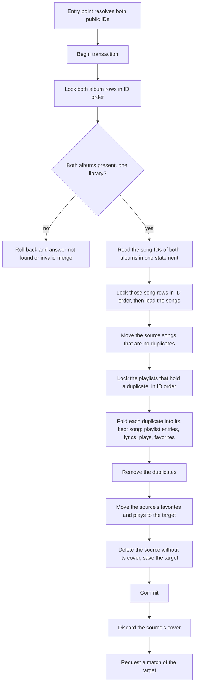

# Matching Leftovers - Plan

## Goal Capsule

- **Objective:** A change an admin makes by hand to a song's or album's credits, and a merge of two albums, take effect whole or not at all, whatever a match, an import or another admin does at the same moment. What users hold on a merged album, or on a duplicate song the merge removes, follows the kept album and song: favorites, plays, playlist entries and lyrics. On an album that holds a release, the album match queue leaves the album's own credits and every song a match has already compared as an admin left them, and it still matches a song that arrived while an admin applied a match. An artist that holds a MusicBrainz ID gets its missing details from MusicBrainz by that ID, as soon as an album or song match or an import gives it the ID, and never another artist's by name.
- **Product authority:** The open items under "MusicBrainz matching" and "Matching follow-ups" in `ROADMAP.md`, and "Deferred to Follow-Up Work" in `docs/plans/2026-11-15-1038-fix-matching-follow-ups-plan.md`. On 2026-11-15 the user chose them as the next roadmap item, named the first two (hand changes to credits, album merge atomicity) and asked for the others to be weighed. On the same day the user answered the plan's questions in two rounds (Key Decisions): artist sync is rebuilt as a fill by stored ID that starts as soon as an artist gets its ID and asks about an artist at most once in 30 days, and a duplicate song is folded into the kept copy.
- **Means:** Hand changes and merges take the catalog lock order inside one transaction (KTD1, KTD5). Each effect of an apply beside the queue is reproduced by a test before it is repaired (KTD8). Artist sync looks an artist up by its stored ID and writes under the artist's row lock (KTD14, KTD16); a match, an import and the admin sync queue it through one store of marks and one shared pace (KTD15, KTD21, KTD22). A merge folds each duplicate through ports of Playlist, Lyrics, Activity and Favorites inside its transaction (KTD19).
- **Execution profile:** One branch named after this plan, fifteen units in four phases (Sequencing). Units land as local commits. The lock design, the statements and the two-session tests of U2 to U6, U11, U14 and U15 go to the postgres specialist (`.agents/agents/postgres.md`). The plan holds no migration. U13 changes `packages/baander-tooling`, which has gates of its own.
- **Authority and stop conditions:** Follow `AGENTS.md`, then the Product Contract, then the Planning Contract. Stop and ask the user when a race test shows a deadlock between writers that KTD1 or KTD5 says cannot wait on each other in a cycle, when a reproduction of U5 or U6 shows an effect this plan does not list, when MusicBrainz answers the lookup of a merged ID in a way KTD16 does not cover.
- **Finishing:** `ce-work` implements the units, with `ce-simplify-code` at phase boundaries. `ce-code-review` runs before shipping and its justified findings are applied. Push only when the user asks.
- **Open blockers:** None. No question for the user is open.

---

## Product Contract

### Summary

This plan closes what the matching follow-ups deferred. A hand change to credits runs in one transaction under the locks a match apply takes, so it waits for an apply, a retag or a merge and then acts on what they committed. An album merge commits whole or not at all, moves every song the source holds, deletes the source's cover only after the commit, and carries the source's favorites and plays to the target. Four effects of a match apply beside a queue run are reproduced first and repaired only where the reproduction fails. Test leftovers of the match queue and the match dialog are added, and the pages describe the result. Artist sync becomes a fill by stored ID that a match or an import queues as soon as it gives an artist its ID, and that an administrator's metadata sync queues for the rest; an artist is asked about at most once in 30 days, and the name search behind the old path goes. A merge folds each duplicate song into the kept copy, so its playlist entries, lyrics, plays and favorites move instead of being lost.

### Problem Frame

**Hand changes.** `AddArtistCreditHandler`, `RemoveArtistCreditHandler` and `ChangeArtistCreditRoleHandler` write a credit and then, in a second write, drop `credits` from the song's `matched_fields` (`ArtistCreditInput::creditsChangedByHand`). None opens a transaction or takes a lock, and the bus wraps no handler in one (`config/packages/messenger.php`). The song that the second write saves is the copy the handler loaded when it resolved the public ID. A match apply that commits between that read and the credit write therefore leaves the mark in place: the hand-made credit counts as a match's and survives the next retag (`FilesDiscoveredHandler::withMatchedCreditsKept`). The credit's foreign key also takes the artist's row `FOR KEY SHARE` at the insert, after anything the handler could lock on the song, which is the reverse of an apply's order. When an apply removes the artist meanwhile, the insert fails on its foreign key inside a flush, the flush closes the entity manager, and the admin gets a 500. `UpdateSongHandler` saves `matched_fields` from a song it read without a lock as well, so a title edit that read the song before a credit change writes the `credits` mark back.

**Album merge.** `AlbumMergeService::mergeAlbums` flushes once per moved or deleted song, then deletes the source and saves the target, without a transaction, so a failure midway leaves songs on both albums. `AlbumService::delete` deletes the source's cover record and file at once. The merge reads the source's songs once, before anything is locked and capped at 10,000. A song it did not read, one an import added meanwhile or one beyond the cap, is deleted with the source through `fk_songs_album_id` (`ON DELETE CASCADE`). Nothing follows the source: `user_favorites` rows of type `album` keep the public ID of an album that no longer exists, because the table has no foreign key to albums, and `media_activities.album_id` is set to null, so the plays of the moved songs count for no album (`ActivityAnalyticsRepository` joins on that column).

**An apply beside the queue.** Four effects follow from the code and are not reproduced yet (High-Level Technical Design lists their windows). A manual album apply deletes the album's match state unconditionally (`AlbumMatchStateRepository::removeByAlbum`), and with it a request an import made for a song that arrived after the apply read the album. An automatic match of a matched album's new songs checks under its locks only that the album still holds the release (`ApplyMatchHandler::assertReleaseUnchanged`): it writes a song an admin compared by hand in the seconds before, and it keeps the pairs the matcher computed although a retag changed a song's track number meanwhile. Found while planning: `MatchTicks::automatic` writes every credits row that changes, the album's own row included, so every automatic match of a matched album replaces album credits an admin kept or changed by hand, with no race needed. `docs-book/part-2-developer-guide/contexts/catalog.md` describes that rule for automatic applies in general and makes no exception for a matched album.

**Artist sync.** `SyncArtistMessage` has no producer, route or payload codec. Its handler runs `ArtistMetadataEnricher`, which takes the top hit of a MusicBrainz name search, or of a Discogs name search when MusicBrainz finds nothing, and fills the artist from it, also when the artist already holds an ID from a match or from tags. A match gives artists their IDs and nothing else: sort name, type, country, disambiguation and life span stay empty unless an admin matches each artist by hand. No entry point reaches the path. The admin sync, its route, its console command and the web page carry no artist option, and the `includeArtists` flag of `SyncLibraryMessage` is never true in production and never read.

**Duplicate songs.** A source song whose file hash the target holds is deleted by the merge. Its playlist entries and its lyrics row are deleted with it (`fk_playlist_song_song_id`, `fk_lyrics_song_id`, both `ON DELETE CASCADE`), its plays and its "loved" flag stay on a row without a song (`fk_media_activities_song_id`, `SET NULL`), and its favorites keep a public ID that no longer exists. The merge compares hashes only: its map records no song, two songs without a hash count as duplicates of each other, and several source songs can match one target song.

**Tests and pages.** `DrainAlbumMatchesHandlerTest` covers a run whose chain was replaced for two outcomes; four more paths have no case. `InMemoryAlbumMatchStates`, the double behind five unit test files, is checked against the SQL repository by no test. No dialog test covers an apply that answers 409 `cover_refused`. The operator pages do not say that a new song without a measured length never pairs on a matched album.

### Key Decisions

The user decided all but the last on 2026-11-15, in two rounds, each against the alternatives this plan had set out.

- **Artist sync is rebuilt in this plan as a fill by stored ID.** Governs R20 to R24, R32, R35. (session-settled: user-directed — chosen over keeping the unreachable path as groundwork, and over removing it: a match gives artists their IDs but not their details, and the old path fills an identified artist from the top hit of a name search)
- **Favorites and plays follow a merged album; recommendations stay as they are.** Governs R9, R10. (session-settled: user-directed — chosen over favorites only, and over moving recommendations as well: plays cannot be regenerated, and the recommendation job rewrites its rows)
- **A duplicate song is folded into the kept copy during the merge.** Governs R25 to R31. (session-settled: user-directed — chosen over deleting it as today and stating the loss on the merge page: playlist entries, lyrics, plays and favorites are what users stored)
- **An automatic match of a matched album's new songs fills gaps and never writes the album's credits.** Governs R12. (session-settled: user-directed — chosen over writing nothing on the album, which ends the second try for a refused cover, and over today's behaviour)
- **An artist is filled as soon as a match or an import gives it a MusicBrainz ID.** Governs R33. (session-settled: user-directed — chosen over leaving the fill to the next admin sync: on a library without tagged artist IDs every artist ID comes from a match, and an admin's first sync would fill none of the artists its own matches identify)
- **A playlist entry, lyrics or a first play that names no album, stored for a duplicate while its merge runs, goes with the duplicate.** Governs R36. (session-settled: user-directed — chosen over locking the duplicates so that such a write fails: the window is the merge's length, and the failure would reach the user as an error Playlist and Lyrics do not map)
- **An artist asked about is not asked again for 30 days.** Governs R21, R34. (session-settled: user-directed — chosen over asking every identified artist again at every sync: MusicBrainz has no disambiguation and no end of life span for most artists, so nearly every identified artist would be asked again each time)
- **The song field edit rides in this plan.** Governs R4. Settled by `AGENTS.md`: a defect beside code a plan touches joins the plan's units.

### Requirements

**Hand changes**

- R1. A hand change to a song's credits and the drop of the song's `credits` mark are committed together or not at all.
- R2. A hand change to credits waits for a match apply, a retag, an artist merge or removal, or an album merge that holds the same album, artist or song, and then acts on the catalog as that writer left it; each of those writers waits for a hand change the same way.
- R3. A hand change whose artist, song or album is gone by then answers "not found". One that the database ended to break a deadlock, or whose artist changed its name or MusicBrainz ID while it waited, answers a conflict that says to make the change again. The API and the console answer alike.
- R4. A hand edit of a song's fields writes the song as it is under its lock: it neither restores a matched mark a credit change dropped nor drops a mark an apply set meanwhile.

**Album merge**

- R5. A merge commits all of its changes or none: the moved songs, the removed duplicates, the target's merged fields, the removed source, what R9 and R10 carry over and what R26 to R29 fold.
- R6. The source's cover image is deleted only after the merge committed; a merge that fails leaves the source with its cover.
- R7. A merge waits for a match apply, a retag or a hand change that holds the same albums or songs and then merges what they committed. Every song the source holds when the merge has taken it is moved or removed as a duplicate, whatever their number. A song an import adds to the source after that is refused, not deleted with the source.
- R8. A merge answers "not found" when an album is gone by the time it holds its locks, and a conflict that says to merge again when the database ended it to break a deadlock. The API, the console and the two merge dialogs of the web app say so.
- R9. A user's favorite of the source album becomes a favorite of the target; a user who favorited both keeps one.
- R10. The plays recorded for the source album's songs count for the target album.

**An apply beside the queue**

- R11. Each of the four effects is reproduced by a test that fails for the stated reason before any repair. An effect whose test passes unrepaired keeps the test, gets no production change, and is reported.
- R12. An automatic match of a matched album's new songs leaves the album's own artist credits, and the artists those credits keep, as they are. It still fills the album's empty fields and a missing cover.
- R13. An automatic match of a matched album's new songs writes nothing when a match compared one of those songs after the matcher read the album; the album is matched again later.
- R14. An automatic match of a matched album's new songs writes nothing when a song's disc, track number or length changed after the matcher read it so that the songs pair differently; the album is matched again later.
- R15. After a manual album apply, an album that holds a release and a song no match has compared waits for a match again, as after an import.

**Tests and pages**

- R16. `DrainAlbumMatchesHandlerTest` pins what a run whose chain was replaced during its match does after an outage, after a review outcome with a request beside the claim, after a failed matcher, and when it removes import requests.
- R17. The in-memory match states and the SQL repository pass one shared set of cases.
- R18. The match dialog test covers an apply that answers 409 `cover_refused`: the dialog says the cover was refused, stays open, and applies the rest once the cover is unticked.
- R19. The operator pages, the context guides, the module READMEs and `CONCEPTS.md` describe the delivered behaviour, among it that a new song without a measured length never pairs on a matched album.

**Artist sync**

- R20. An artist that holds a MusicBrainz ID takes its empty, unlocked fields from a lookup by that stored ID: sort name, type, country, disambiguation and the two ends of its life span. Its name, its ID and every field that holds a value stay as they are. An artist without a stored ID is left alone, and nothing fills an artist from a search by its name.
- R21. An administrator's metadata sync, from the admin page or `app:metadata:sync`, queues that fill for every artist with a stored ID and an empty field among those six, except an artist asked about that ID within the last 30 days (R34).
- R22. An artist that was removed, merged or given another ID while its lookup ran is not written, and neither is a field that was filled or locked meanwhile. A stored ID MusicBrainz no longer has, a refusal, an outage and an answer for another ID each write nothing and are logged. A fill that meets an outage queues itself again after a pause, up to three times in a row, and after that the next admin sync asks again; a refusal is asked again by the next producer that queues the artist.
- R23. `app:metadata:status` and the admin page count the artist syncs that ran.
- R24. A qualification run still completes its metadata work once the admin sync queues artist syncs.
- R32. An artist whose fill is queued is not queued again, whether a match, an import or an admin sync would queue it, and cancelling an admin sync's job, also after it finished, ends the lookups it queued without a request.
- R33. An artist is filled as soon as an album or song match apply gives it a MusicBrainz ID or creates it with one, and as soon as an import batch does while automatic matching is on. The fill is queued after their commit, and a failure to queue it is logged and changes nothing they wrote.
- R34. An artist whose stored ID MusicBrainz answered within the last 30 days, with a record or a 404, is not asked about that ID again by any producer; a refusal and an outage do not count as answers. An artist given another ID is asked about the new one.
- R35. Artist fills fall due at least two seconds apart, whoever queued them, so the album match queue keeps at least every other MusicBrainz turn and a backlog of fills waits in the queue rather than in a worker. Right after an admin sync is cancelled two fills may fall due closer together; the shared MusicBrainz limit still keeps their requests a second apart.

**Duplicate songs**

- R25. A source song is a duplicate when its file hash is set and a song of the target holds the same hash. The kept song is the target's oldest song with that hash; a source song without a hash is moved.
- R26. A playlist entry of the duplicate becomes an entry of the kept song at the same position. A playlist that holds both keeps the kept song's entry where it is and loses the duplicate's.
- R27. The duplicate's lyrics move to the kept song when the kept song has none. When both have lyrics, the kept song's stay.
- R28. A user's plays of the duplicate count for the kept song: the play counts add up, the later last-played time stays with its platform and player, and the song is loved when either was. A user who only played the duplicate keeps that play, now naming the kept song.
- R29. A user's favorite of the duplicate becomes a favorite of the kept song; a user who favorited both keeps one.
- R30. Everything else of the duplicate goes with it: its own fields, credits, genres and matched marks, and the recommendations, queue entries and cached renditions that name it. Its audio file stays on disk untouched.
- R31. The fold is part of the merge's transaction: a merge that fails leaves the duplicate, and everything users hold on it, as before.
- R36. A playlist entry, lyrics or a first play that names no album, stored for a duplicate while its merge runs, goes with the duplicate. A first play that names the source album, as every play from the web player does, waits for the merge and then fails.

### Acceptance Examples

- AE1. **Covers R1, R2.** Given a song whose credits a match set and an artist whose name and MusicBrainz ID the apply leaves as they are, when an admin adds a credit for that artist while a manual apply to the song's album holds its locks, the add waits. After the apply commits, the add writes its credit and the song's `matched_fields` no longer lists `credits`, so the next retag replaces the song's credits with the tags'.
- AE2. **Covers R5, R6, R9, R10, R26 to R29, R31.** Given a source album with a cover, a favorite by one user and plays, a song the target does not hold, and a duplicate of a target song that one user holds in a playlist, has played and favorited and that has lyrics the target's copy lacks, when the merge commits, the target holds the other song, the playlist entry, the lyrics, the plays and the favorite are on the target's copy, the album favorite and the album's plays name the target, and the cover's record and file are gone. When the merge fails before its commit, the source, its songs, its cover and everything users hold on the source and on the duplicate are as before.
- AE3. **Covers R7.** Given a merge that holds its locks, when an import inserts a song into the source, the insert waits and fails on its foreign key once the merge commits; the same insert into the target does not wait.
- AE4. **Covers R12.** Given a matched album whose album credits an admin changed by hand, when a new song arrives and the queue matches the album, the new song takes its track's recording ID and credits and the album's credits stay as the admin left them.
- AE5. **Covers R15.** Given automatic matching on and a manual apply that has read its album, when an import commits a new song and its match request before the apply removes the album's match state, the album waits for a match again after the apply, and the run that follows writes only the new song.
- AE6. **Covers R20, R22.** Given an artist with a MusicBrainz ID, no country, a type an admin set and a locked sort name, when an artist sync runs and MusicBrainz answers that ID with a country, another type and a sort name, the artist has the country and keeps its type, its sort name, its name and its ID. An artist without an ID causes no request.
- AE7. **Covers R26, R28.** Given a playlist that holds a duplicate and the target's copy, and a user who played the duplicate three times and the copy twice and loved only the duplicate, when the merge commits, the playlist holds the copy once at the position the copy had, and the user has one play of the copy with five plays, the later of the two last-played times and the loved flag.
- AE8. **Covers R33, R34.** Given automatic matching on, when an import batch credits an artist by a MusicBrainz ID new to the catalog, one fill of that artist is queued after the batch commits, and its lookup fills the artist's empty fields. When a later admin sync runs within 30 days, it queues no fill for that artist. Had the lookup met an outage, the fill would have queued itself again five minutes later.

### Success Criteria

- Each new two-session test is counted as run, not skipped, in the full suite in the CI image; they skip without `OUTBOX_TEST_DATABASE_URL`.
- Each reproduction of U5 and U6 is recorded as failing before its repair and passing after it, or as passing unrepaired.

### Scope Boundaries

Out by the user's choice of scope: the PGroonga failure of throwaway test schemas, the 4 GB qualification, the LRCLIB items (a `Retry-After` in date form, a recipe for ending a pause), the webhook back-off sleep, the simplification leftovers (a shared User-Agent constant, the ranking written twice, the scan in `nextRequestDueAt()`), and everything the roadmap lists as deferred separate work under "Scan artist credits, song lengths and lyrics outcomes".

Considered and not built:

- **An artist match apply queues no fill and records no answer.** The admin compared the artist's fields with the candidate in the same dialog and chose; a field meant to stay empty is locked (R20), or the next admin sync fills it.
- **An album artist that only the album credit decision of an import creates is filled by the next admin sync.** `AlbumService::creditArtistIfUncredited` resolves it in a transaction of its own after the batch, and reports nothing; an album artist that a song of the batch also credits is filled with the batch.
- **No import queues a fill while automatic matching is off**, as no import requests an album match then. An operator who keeps the switch off gets no MusicBrainz request from a scan; the admin sync and an admin's apply still queue fills.
- **No way to ask about an artist again before its 30 days end.** The artist match dialog, and `app:metadata:match:compare` with `app:metadata:match:apply`, show and write MusicBrainz's current values for one artist at any time. An answer mark ends early only when its Redis key is deleted. No admin action is added, so the console counterpart rule is unaffected.
- **Biography, Discogs ID and gender are not filled.** A lookup by ID gives none of them: the old path took the biography from its Discogs name search only, and the MusicBrainz port carries no gender.
- **A MusicBrainz ID that MusicBrainz merged into another artist is not followed.** The sync writes nothing and logs both IDs; an admin re-identifies the artist from the match dialog, which handles the merge it can cause.
- **No sync of one artist from the admin page or the console.** The admin sync reaches every artist; a route for one artist needs a command and an operator page of its own.
- **Recommendations, listening session queues and cached renditions that name a duplicate are not rewritten** (R30). A recommendation whose end no longer resolves is hidden from every reader (`RecommendationPublicIdentity`), a queue entry fails its access check at the next control, and the rendition cache is swept. Rewriting a session's queue needs a port into Session and a revision bump per session.
- **The duplicate's file is not removed.** The merge has never touched files, and a later scan neither re-creates a song for the copy nor moves the kept song onto it (`FilesDiscoveredHandler::knownSongs`). The merge page says that the copy stays on disk.
- **The library claim for a merge.** `DeleteAlbumHandler` claims the album's library so that no import writes meanwhile. A merge would then be refused while a scan runs. The merge accepts a deadlock with an import instead (KTD5). Deadlocks seen in practice during rescans would change this.
- **The target does not take the source's cover** when it has none; `ExtractAlbumCoverHandler` gives a coverless album a cover from its files. The artist merge keeps the source's cover; an admin asking for the same on albums would change this.
- **Recommendations that name the source album** stay as they are. The recommendation job rewrites a source's recommendations when it next runs for it (`RecommendationRepository::deleteBySource`). A recommendation that fails to open in a client would change this.
- **No check in an automatic apply to an album without a release** for a song an admin matched by hand in the seconds before. The first automatic match of an album writes every song it pairs, whenever that song was matched by hand, so a check would only delay the write by 15 minutes.
- **The match claim is not checked inside the apply's transaction.** A song apply by hand leaves the claim in place, so the claim does not tell that a song was compared meanwhile; KTD9 checks the songs.
- **The test that fails when the MusicBrainz adapter goes back to an interruptible sleep** is not taken up: no unit touches the adapter.
- **The merge's 400 for the same album or two libraries stays**, although the shared outcomes give 422 for invalid input: `AlbumMergeTest` pins it and no user asked for the change.

#### Deferred to Follow-Up Work

- **Other hand edits that save a copy read before a concurrent commit.** `UpdateAlbumHandler` can drop field locks a merge added, and `SetCoverHandler` and `RemoveCoverHandler` can orphan a cover an apply set meanwhile. They write no matched mark and no credit, and each needs the album's lock and tests of its own.
- **The import's repair of a known song takes no song row lock** (`FilesDiscoveredHandler::repairSong`), so a hand credit committed between its read and its flush gets the tagged credit added beside it. This is import handler work, which the roadmap already lists as unsplit.
- **Deleting an artist leaves the `credits` mark** on the songs it uncredits (`ArtistMergeService::remove`). Same family as R1, another entry point.
- **One failed match request ends the others of the same import** (`AlbumMatchRequester::request` filters in one pass), for example when a merge deleted an album the import still holds.
- **Favorites of an album or song deleted outright** dangle on every delete path, the database's cascades included. No port call can cover a cascade, so this needs a design of its own. A favorite of a duplicate that a user adds while its merge runs is such a case: favorites reference no song row, so no lock can make it wait.
- **`MovieRepository::delete`** has the gaps U3 closes in `AlbumRepository::delete` (`ROADMAP.md`, "Associations with a database cascade").

### Outstanding Questions

**For the user**

None is open. The user answered every question this plan asked on 2026-11-15 (Key Decisions).

**Deferred to implementation**

- The statement form that locks the source `FOR UPDATE` and the target `FOR NO KEY UPDATE` in ID order (KTD5). The postgres specialist decides with the race tests of U3.
- Whether a hand change takes the artist's row through `ArtistMergePortInterface::lock()` or through a lighter port method with the same mode (KTD1).
- The statement form that moves favorites (KTD7): it must not fail on `uniq_user_favorites_user_id_entity_type_entity_public_id` when a user favorites the target between two statements.
- How MusicBrainz answers the lookup of an ID it merged into another artist (KTD16). The adapter follows no redirect and no fixture covers the case; one live request in U11 settles it.
- The statement forms of the fold (KTD19). Each has to hold for several duplicates of one kept song and must not fail on `uniq_playlist_song_playlist_id_song_id`, the unique index on `lyrics.song_id` or the favorites index when a user writes beside the merge.
- The spacing of artist fills (KTD22): 2,000 ms unless the preview shows the album match queue held back.
- Whether the resolver reports the artists it identified through a second port method or a result its `resolve()` returns (KTD21). The callers that build or stub the resolver are listed under U15's guards.
- The atomic form of the shared due time in Redis (KTD22).

### Sources / Research

- `docs/solutions/architecture-patterns/concurrent-imports-find-or-create-identities-under-sorted-advisory-locks.md`: the import's identity keys, read-after-lock under READ COMMITTED, `FOR NO KEY UPDATE` for a parent whose children must not wait, and the two-session test recipe. It predates the apply, so it names only the import's half of the order; the whole order is in `ApplyMatchHandler`'s class docblock, `ArtistMergePortInterface` and `docs-book/part-2-developer-guide/contexts/catalog.md` ("Apply").
- `docs/solutions/runtime-errors/doctrine-refuses-a-flush-after-the-database-cascaded-a-delete-under-managed-children.md`: release managed children before the parent's flush, skip uninitialized ones. `ROADMAP.md` lists `AlbumRepository::delete` as one change away from that failure.
- `docs/solutions/architecture-patterns/state-set-when-work-is-queued-on-swoole-task-must-expire.md` and `docs/solutions/runtime-errors/fenced-completion-retry-must-not-redo-one-shot-steps.md`: a check made only when the outcome is recorded lets the writes commit first; test the race at the fence.
- `docs/solutions/runtime-errors/doctrine-cannot-update-a-loaded-entity-keyed-by-its-association-under-the-strict-uuid-type.md`: `album_match_states` is written through DBAL statements only.
- `docs/solutions/developer-experience/pgroonga-4-0-cleanup-deletes-indexes-of-uncommitted-transactions.md`: race tests copy tables with `ArtistImportIdentityRace::copyTableWithoutPgroonga`. The copy carries no foreign key and no trigger, so a test about a foreign-key wait adds the key back, and the fixture copies every table the code under test writes, since the search path falls through to `public`.
- `docs/solutions/developer-experience/in-memory-transport-get-hands-out-one-message-per-call.md`: queue assertions read `getSent()` and the `DelayStamp`.
- `.agents/skills/postgres-remediation/references/doctrine.md`: a failed flush closes the entity manager; `find` and `findBy` return the managed copy without refreshing it; deadlock 40P01 and serialization failure 40001 both become `DeadlockException`.
- `.agents/rules/admin-cli-parity.md`: outcomes come from the shared exceptions (`NotFoundException` 404 and exit 1, `ConflictException` 409 and exit 1); controllers do not catch them.
- Existing harness: `tests/Fixtures/Catalog/MatchApplyRace.php` builds the production `ApplyMatchHandler` over a throwaway schema, with a hook before the commit, and `tests/Fixtures/Catalog/match-apply.php` runs an apply, an import or a retag in a second process.
- Commit `28b76872a` moved the album sync the way KTD14 moves the artist sync: Metadata keeps the message in a contract layer, Catalog handles it, and the baseline shrinks. `ApplyMatchHandler::applyArtist` is the existing "look up, lock, read again, write" on an artist.
- `MatchTicks::automatic` over `MatchComparisonBuilder::artist` already yields the rows of empty, unlocked fields MusicBrainz has a value for, and never the name or a held ID. It also returns a merge action when another artist holds the answer's ID.
- `PlaylistRepository::guardExistingWrite`: a playlist save raises `persistence_version` with a compare-and-swap, locks the entries, and answers 409 "The playlist has changed" when either differs. `PlaylistConcurrencyTest` pins that a gap in positions is tolerated.
- `media_activities` has a unique index on `public_id` only; one row per user and song is what `RecordPlayHandler` does by find-then-insert, so two rows can exist. A lyrics row never records who stored it: a fetch and an admin's apply both write `source = 'lrclib'` through `LyricsRepository::add`.

---

## Planning Contract

### Key Technical Decisions

- KTD1. **A hand change to credits takes the locks an apply takes for an artist it credits.** In one transaction and in this order: the album's row for an album target (`AlbumPortInterface::lockInIdOrder`), the import identity keys of the artist's stored name and MusicBrainz ID (`SongPortInterface::lockImportIdentities`), the artist's row (`ArtistMergePortInterface::lock`), and the song's row for a song target (`SongPortInterface::lockInIdOrder`). Rejected: the song's row alone, because the credit's foreign key then takes the artist's row after the song's, a cycle with an apply that holds the artist and waits for the song. Rejected: the artist's row `FOR KEY SHARE` without the keys, because a retag that gives the artist its MusicBrainz ID updates `artists.mbid`, a column of the unique index `uniq_artists_mbid`, after its batch holds its song rows (`ArtistIdentityResolver`, `FilesDiscoveredHandler::writeSongs`), and that update needs the row `FOR UPDATE`. With the keys the import and the hand change meet at a key before either holds a row. No bake-off was run: the variants differ in lock modes, which reading and the race tests of U2 decide. Covers R2.
- KTD2. **What a writer saves is what it read under its locks.** A handler reads nothing before its transaction beyond resolving public IDs to IDs and, for KTD1, the artist's name and MusicBrainz ID. Under the locks it reads through the refreshing finders (`findFreshByUuid`), or loads an entity for the first time. `SongRepository::syncToEntity` and `AlbumRepository::syncToEntity` copy every field, so saving a copy read earlier onto a refreshed entity writes stale values back; `find`, `findBy` and `findByAlbum` return the managed copy unrefreshed. The credit roles a handler decides on are read only inside the transaction, since no refreshing finder exists for credits. Covers R1, R4, R5, R7.
- KTD3. **A hand change answers from what it reads under the locks.** A missing artist, song or album raises `NotFoundException` with today's messages, before any flush. A `TransactionDeadlockException`, and an artist whose name or MusicBrainz ID differs from the one whose keys were taken, raise `ConflictException` with the reason `credit_busy`. The second case is the hand change's form of an apply's rule: a writer whose read under the locks needs a key its set left out writes nothing (`MatchLocks::covers`), because taking that key late could close a cycle with an import that reaches the artist by its new ID under another tagged name. The handlers convert the deadlock themselves, because no global mapping exists for `TransactionDeadlockException`. Covers R3.
- KTD4. **A hand edit of a song's fields takes the song's row.** `UpdateSongHandler` runs in one transaction, locks the row, reads the song through the refreshing finder, edits and saves it. It takes one lock, so it cannot wait in a cycle and needs no conflict answer. Covers R4.
- KTD5. **The merge's transaction lives in `AlbumMergeService` and locks the source for deletion.** Both entry points call the port, so the transaction covers both. Locks: both album rows in ID order, the source `FOR UPDATE` and the target `FOR NO KEY UPDATE`; then one statement reads the song IDs of both albums; then those song rows in ID order; then the songs are loaded. No song is read before the transaction and no cap applies, so the source's set is complete: with the source `FOR UPDATE` an insert's foreign key waits, and only a merge moves a song between albums. The target's song locks keep a retag from changing a hash the deduplication just read. Rejected: `FOR NO KEY UPDATE` on both rows, as an apply takes, because a song an import adds to the source during the merge is then deleted with it; the artist merge locks the rows it deletes `FOR UPDATE` for the same reason. Rejected: the library claim (Scope Boundaries). Accepted: an import that holds a retagged song of either album and then inserts a song into the source deadlocks with the merge; the database ends one of them, the merge answers `merge_busy` or the import's message is retried. Covers R5, R7.
- KTD6. **Side effects follow the commit, and outcomes use the shared exceptions.** The transaction returns the source's cover ID as read under the lock; the merge discards the cover and then requests the target's match after the commit, as today best-effort. A `TransactionDeadlockException` becomes `ConflictException` with the reason `merge_busy`. An album gone under the locks raises `NotFoundException` with the message the lookup before the merge uses, so the API answers 404 and the console exits with 1 either way. Covers R6, R8.
- KTD7. **Favorites and plays move through one port each, as statements inside the merge's transaction.** `AlbumFavoriteMergePortInterface` in Favorites and `AlbumActivityMergePortInterface` in Activity each form a single-class contract layer that `Catalog Infrastructure` may use, as the three artist merge contracts do (`deptrac.yaml`). They take `PublicId` or `Uuid` and no Catalog type, run before the source is deleted, load no entity, and release what the unit of work holds for the source. `AlbumRepository::delete` releases the managed children of the album before its flush and skips uninitialized ones. Widening the existing artist contracts to albums was rejected: a port per merged thing is what Activity and Recommendation already have. Covers R9, R10.
- KTD8. **A reproduction injects the competing commit at the MusicBrainz lookup.** Three of the four effects sit between a read and the locks, where no session waits, so the wait-for-a-lock recipe cannot hold them. Every MusicBrainz call runs before the transaction, so a hook on `FakeMusicBrainzLookup::fetchRelease` is the point between the read and the locks: it runs a second process to completion (`match-apply.php`) or commits through a second connection, then answers. Both handlers under test are the production ones over a throwaway schema. Covers R11.
- KTD9. **An automatic apply to a matched album checks its songs under the locks.** When the album held the release as the matcher read it (`releaseIdSeen` is set), every song the candidate compared was uncompared then. If one carries `match_checked_at` under the locks, the apply answers stale, writes nothing, and the queue retries after 15 minutes; the next read no longer counts that song as new, so the retry ends. Rejected: carrying the matcher's `match_checked_at` values in the command to cover albums without a release (Scope Boundaries). Covers R13.
- KTD10. **In that mode the apply leaves the album's own credits row out.** `MatchTicks::automatic` gets the mode and drops the album's credits row; the merges and removals that need that row fall away through the existing rule that an action stands only while its rows are written. Field rows and the cover stay fill-only as today. Covers R12.
- KTD11. **A manual album apply requests the album again after its commit.** When the album holds a release after the apply, the handler calls `AlbumMatchRequestInterface::requestAfterImport()`, which requests only while automatic matching is on and only when a song is uncompared; a failure is logged and does not fail the apply. Rejected: a `NOT EXISTS` on songs inside the `DELETE`, because after a wait PostgreSQL checks the row again but reads the subquery from the statement's first snapshot. Rejected: deleting only review marks, because a stale search request for an album the admin just applied without a release ID would then match over the admin's choice. This repair ships after KTD10: the run it queues would otherwise replace the album credits the admin just kept. Covers R15.
- KTD12. **An automatic apply to a matched album pairs again under the locks.** It pairs the songs as read under the locks against the release, without a MusicBrainz call, and answers stale when the pairs differ from the candidate's. Effect D reproduced in U5, so the check is built. Covers R14.
- KTD13. **The contract cases are one abstract case class with two subclasses.** The in-memory subclass runs in the unit lane and the SQL subclass in the functional lane. Cases use whole-second instants and real album rows, the rows because `fk_album_match_states_album_id` requires them; both stores keep a due time to the microsecond. A lapsed claim is a live claim followed by one abstract hook of the shared class that makes live claims lapse: the SQL subclass runs the update of the statements test's `lapse()` helper, and the in-memory subclass advances its clock. A lease of zero seconds was rejected: the interface documents the lease as at least one second, and it cannot produce a request parked beside a claim that then lapses. What the double cannot express stays where it is: `SKIP LOCKED`, the `MERGE` evaluated again after a wait and the check constraints, in `AlbumMatchQueueStatementsTest` and `AlbumMatchClaimRaceTest`. Covers R17.
- KTD14. **Artist sync lives in Catalog and fills with the match's own rule.** A Catalog Application handler handles `SyncArtistMessage`, which joins the Metadata contract layer that holds `SyncAlbumMessage`. Metadata's `SyncArtistHandler` and `ArtistMetadataEnricher` go, and with them their two blocks in `deptrac.baseline.yaml`. The fill is `MatchTicks::automatic` over `MatchComparisonBuilder::artist`. The handler writes those field rows through the writer an artist match uses and ignores the comparison's actions, so a sync never merges an artist. Rejected: a handler in Metadata, where every use of a Catalog port is baseline debt and a new one is a violation. Covers R20.
- KTD15. **The administrator's metadata sync queues the fills of the artists no producer reached, once for the catalog.** `SyncMetadataHandler` dispatches one `SyncArtistsMessage`, a second message in the same contract layer. Its Catalog handler reads, through a new Catalog query, the IDs and MusicBrainz IDs of the artists that hold a MusicBrainz ID and an empty field among the six, skips those with a queued or an answer mark (KTD22), and dispatches one `SyncArtistMessage` each, due at the shared pace, with a cancellation check between artists. It keeps run records, as the lyrics bulk fetch does: each message it queues names its run, and the job is recorded against its run, so cancelling the job, also after it finished, makes the syncs still queued end without a request. The cancellation check alone would cover only the seconds the dispatch takes. No route, option or command is added, so the admin page and `app:metadata:sync` stay alike. Rejected: making `includeArtists` of `SyncLibraryMessage` real. `SyncLibraryHandler` may use no further Catalog port, a second handler on that message ties two contexts to one delivery, and an artist credited in two libraries would be asked about twice. Covers R21, R32.
- KTD16. **The sync looks up first, writes under the artist's row lock, and ends quietly on every expected outcome.** It sends no request for an artist without an ID, without an empty, unlocked field among the six, or with an answer mark for its stored ID, and it asks with `MusicBrainzSlotWait::Unbounded`, as the matcher does. Then, in one transaction, it locks the artist's row and reads the artist through the refreshing finder. It writes only when the artist exists, still holds the ID that was looked up and the answer carries that same ID, and it decides the fill from that read (KTD2). The row is its only lock, so it cannot wait in a cycle and needs no conflict answer. When MusicBrainz answered with a record or a 404, the handler sets the answer mark once its outcome is settled: after its write commits, or at once when it writes nothing. A write that rolls back sets none, so the retry of its message asks again. A refusal sets none, since a 401 or a 403 can end when a ban is lifted, and a mark would stop every fill for 30 days. An outage, or a lookup that got no turn, sets none either: the handler dispatches its message again, due at the shared pace and no sooner than a pause of 5, then 15, then 60 minutes, as the album match queue pauses, and the message counts the outages in a row. It queues itself again at most three times in a row; at a fourth outage it ends, and the next admin sync asks again. The fill queued again keeps its run and its artist's queued mark, renewed to the new due time, so a cancel still ends it and no producer queues the artist twice. Every other outcome clears the queued mark. A missing artist, another stored ID, an answer for another ID, a 404, a refusal and an outage each end the message with a log entry and without an exception: a handler that throws would add one failed job per artist to the status' failed count. Covers R22, R34.
- KTD17. **The name search path is removed.** With the enricher go `ArtistPortInterface::assignMusicbrainzId()`, `ArtistMusicbrainzIdAssigner` and `MusicbrainzIdAssignment`, whose one purpose was to guard an ID a name search found, `MetadataSyncOrchestrator::syncArtist()`, and the `includeArtists` flag with its wire field. `SyncArtistMessage` loses `forceUpdate`, since a fill has nothing to force. Both `searchArtist` adapters stay: the open search routes call them. Covers R20.
- KTD18. **A merge keeps every song row `FOR NO KEY UPDATE`.** (session-settled: user-directed — chosen over locking the duplicates `FOR UPDATE` so that a write stored for one during the merge fails: the user kept today's behaviour for that window) The fold moves what exists when its statements run. A playlist entry, a lyrics row or a first play that names no album, stored for a duplicate after that, commits beside the merge and goes with the duplicate, as today. A first play that names the source album already waits on the album's row and fails (KTD5), whichever way the song is locked. Rejected: locking the duplicates `FOR UPDATE` so that the other writes wait and fail. A playlist save takes the playlist's row, then its entries, then the song through the entry's foreign key, the reverse of a merge that holds the song and then takes playlist rows, so the two could wait in a cycle. Playlist and Lyrics map neither a foreign-key failure nor a deadlock, so the user would get a 500. And one statement cannot lock some songs in one mode and the rest in another, which gives up the single ID order across both albums. Covers R31, R36.
- KTD19. **The fold runs through each context's album merge port, as statements, before the duplicate is deleted.** The ports of KTD7 in Favorites and Activity gain the fold of one song into another, and Playlist and Lyrics each gain a port in a single-class contract layer of the same shape. Inside the transaction, once the songs are loaded and the moves flushed, the Playlist port first locks, in one pass and in ID order, the rows of every playlist that holds a duplicate of this merge and raises their `persistence_version`, so a save that began earlier answers its existing 409. Then each duplicate is folded into its kept song, duplicates in ID order, and then the duplicates are deleted. Playlist rows are the merge's last lock kind, after its song rows; a playlist save never waits on a song a merge holds `FOR NO KEY UPDATE`, so the two cannot wait in a cycle. The Activity port locks the play rows of both songs before it adds them up, so a play that commits meanwhile is counted. Each port releases what the unit of work holds for the duplicate. Rejected for playlists: the aggregate's `save`, which flushes the whole unit of work and clears the entity manager on a conflict. Covers R26 to R29, R31.
- KTD20. **The kept song is chosen once, under the locks.** The merge maps each hash to the target's oldest song that holds it and treats a source song as a duplicate only when its hash is set and in the map. Several duplicates of one kept song are folded pair by pair. Covers R25.
- KTD21. **An album or song apply and an import batch queue the fill of the artists they identify, after their commit.** (session-settled: user-directed — chosen over leaving the fill to the next admin sync; instantiates the Key Decision that governs R33) The artist identity resolver is the one writer that creates an artist with an ID or gives an artist without one an ID, inside its caller's transaction (`ArtistIdentityResolver::write`), so it reports those artists at that moment; no second read is made. `ApplyMatchHandler` carries them out of its transaction closure beside the images to discard, and passes them on after its commit and its existing post-commit steps. `FilesDiscoveredHandler` carries them out of each batch's `writeSongs` and passes them on right after that batch commits, beside its lyrics request: a later batch of the same message can fail, and its retry finds these artists holding their IDs and reports none. Both pass them to one Catalog Application requester, which checks the marks of KTD22 and dispatches one `SyncArtistMessage` each, without a run. An import's call does nothing while automatic matching is off, as its album match requests do; an apply's call queues whatever the switch says, as an admin's sync does. The switch is read when a fill is queued: a fill an import queued still runs after the switch is turned off, where the queue drops an import's album match request. A rolled-back transaction reports nothing, since its closure never returns. A failure to queue is logged with the artist IDs and changes nothing the apply or batch wrote, as a merge's match request; an artist whose fill was never queued, such as one identified just before its process died, is filled by the next admin sync. The requester runs outside any transaction and reads no catalog row, so it takes no lock and changes no lock order. Rejected: reading the artists back after the commit, which cannot tell an ID the transaction gave from one the artist already held. Rejected: dispatching inside the transaction, which could queue a fill for a rollback and run it before the commit. Covers R33.
- KTD22. **One Catalog store in Redis keeps the queued marks, the answer marks and the shared pace.** (session-settled: user-directed — chosen over asking every identified artist again at every sync; instantiates the Key Decision that governs R34) It has the shape of the lyrics bulk fetch's run records (`QueuedLyricsFetchesInterface`) and is Catalog's own, behind a Catalog Application port. It holds:
  - a queued mark per artist, from queuing until its sync has run, plus a margin, so no producer queues an artist twice (R32);
  - an answer mark per artist and MusicBrainz ID, for 30 days from the lookup MusicBrainz answered, keyed by the ID so that an artist given another ID is asked about the new one (R34);
  - the run records of KTD15, for the admin sync's cancel;
  - one shared due time: each fill falls due two seconds after the latest fill queued before it, or at once when none is pending, whoever queues it (R35). Two seconds is one turn of the shared MusicBrainz limit plus the request's own time, so the album match queue keeps every other turn, and a backlog waits in the transport instead of in a worker that holds its consumer while it waits for a turn.

  The 30 days count from the answered lookup and not from a write, since a lookup that finds nothing new is still an answer; a 404 counts, since MusicBrainz answers it the same way the next time. Cancelling an admin sync's run sets the shared due time back to now, since the run's fills still queued make no request; a fill another producer queued meanwhile may then share a two-second step with a new one, which the shared MusicBrainz limit still spaces a second apart. Every entry expires on its own. A lost store asks every artist again at its next producer, which costs requests and writes nothing wrong. Rejected: a column on `artists` for the time of the last answer, which needs a migration and a capture exclusion for bookkeeping. Rejected: spacing each producer's dispatches on their own, which lets an import and an admin sync together exceed the pace. Covers R32, R34, R35.

### High-Level Technical Design

What each writer locks, left to right. A writer takes only the kinds it needs and never goes back to an earlier one.

| Writer | Album rows | Import identity keys | Artist rows | Song rows |
|---|---|---|---|---|
| Album apply | the album, `FOR NO KEY UPDATE` | every artist and genre it names | the artists it may credit, merge or remove, `FOR UPDATE` | the songs it compared, `FOR NO KEY UPDATE` |
| Song apply | | every artist it names | as above | the song |
| Retag import | | every artist and genre of the batch | | the retagged songs |
| Album credit decision of an import | the album, `FOR NO KEY UPDATE` | the tagged album artist | | |
| Hand change, song credit (U2) | | the artist's name and ID | the artist, `FOR UPDATE` | the song, `FOR NO KEY UPDATE` |
| Hand change, album credit (U2) | the album, `FOR NO KEY UPDATE` | the artist's name and ID | the artist, `FOR UPDATE` | |
| Hand edit of a song's fields (U2) | | | | the song |
| Album merge (U3, U14) | source `FOR UPDATE`, target `FOR NO KEY UPDATE`, in ID order | | | the songs of both albums, `FOR NO KEY UPDATE` |
| Artist sync (U11) | | | the artist, `FOR UPDATE` | |

The fill requesters of KTD15 and KTD21 run after their producers' commits, outside any transaction, and take no catalog lock. A merge that folds duplicates takes one more kind after its song rows: the rows of the playlists that hold a duplicate, in ID order (KTD19). No other writer in this table takes a playlist row.

The merge:

What each kind of apply writes. The entries "after U5" and "after U6" hold for each effect that reproduces (R11):

| Apply | Album fields and cover | Album credits | Songs | Match state |
|---|---|---|---|---|
| Manual | the ticked rows | when ticked | the ticked rows of paired songs | removed; after U6 the album is requested again when it holds a release and an uncompared song |
| Automatic, album without a release | empty unlocked fields, a missing cover | written when they differ | every paired song | left to the queue run |
| Automatic, album that held the release | empty unlocked fields, a missing cover | today written when they differ; after U5 never | the uncompared songs it pairs; after U5 none when one was compared or pairs differently by then | left to the queue run |

The four effects:

| Effect | Window | Competing commit | Today, read from the code | Repair |
|---|---|---|---|---|
| A | a manual apply, from its read of the album before the MusicBrainz lookup to its delete of the match state | an import adds a song and requests a match | the request is deleted, the song stays uncompared, nothing asks for the album | KTD11 |
| B | a queue run, from the matcher's read to the automatic apply's locks | an admin applies the same release by hand with a song's credits unticked | the song's credits are written anyway | KTD9 |
| C | none: every automatic match of a matched album | none | the album's credits are replaced by the release's when they differ | KTD10 |
| D | as B | a retag changes a new song's disc, track number or length | the song takes the track it paired with before | KTD12 |

### Assumptions

These are this plan's own choices. The user has confirmed none of them.

- A hand change may wait a few seconds for an import batch that names the same artist, and such a batch for a hand change (KTD1).
- A merge during a rescan of the same albums may answer `merge_busy`, or end the import's batch, whose retry files new files of the source's directory under a new album of the source's title (KTD5). A rescan after any merge already does that for new files.
- A request restored after a manual apply follows an import's rules: only while automatic matching is on, and due after the settling delay (KTD11). A request an admin's sync made is then restored only while the setting is on.
- Adding a credit of another role, such as producer, keeps counting as a hand change that drops the `credits` mark, as today.
- A fill never replaces a value, also when a sync is forced; only an admin's ticks in the artist match dialog replace one (R20).
- When the kept song and the duplicate both have lyrics, the kept song's stay (R27). Nothing records which of the two an admin chose, and no code path replaces a stored lyrics row.
- A playlist that held both songs keeps the kept song's entry at its own position (R26), which is what the cascade leaves today.
- The duplicate's own row goes with it, the lyrics text stored on the song row included (R30). That text comes from a sidecar file or a hand edit, and no API serves it.
- The 30 days count from the answered lookup, a 404 counts as an answer and a refusal does not (KTD16, KTD22).
- A fill queued while an admin sync's backlog is pending waits behind it, two seconds per artist ahead of it (KTD22).
- A fill that meets four outages in a row is left to the next admin sync (KTD16).
- An import queues fills only while automatic matching is on, and an admin's apply queues them whatever the switch says (KTD21).
- An artist match apply queues no fill and records no answer (Scope Boundaries).

### Sequencing

1. Groundwork: U1.
2. Side by side: U2; U3, then U4, then U14; U5 then U6; U8 then U7; U9; U13.
3. After U6: U11, then U12, then U15.
4. Documentation: U10, after every other unit.

Files that more than one unit touches:

- `openapi.json` and `ui/web/src/shared/api-client/gen`: U2 and U3 each add a 409 to routes. The lead regenerates both once, after both units.
- `src/Catalog/Infrastructure/AlbumMergeService.php` and `tests/Fixtures/Catalog/AlbumMergeRace.php`: U3, then U4, then U14. U14 also changes the two ports U4 creates.
- `src/Catalog/Application/CommandHandler/MusicBrainzMatch/ApplyMatchHandler.php` and its unit test: U5, then U6, then U11, which shares the apply's artist field writer and builds on the mode U5 gives `MatchTicks::automatic`, then U15, which adds the fill requester after the commit.
- `src/Catalog/Application/CommandHandler/FilesDiscoveredHandler.php` and the unit tests that build it: U15 only.
- `tests/Fixtures/Catalog/MatchApplyRace.php`: U1, then U6, then U12, which drops an argument of the `ArtistService` it builds, then U15, which adds the requester to the `ApplyMatchHandler` it builds. U2, U3, U5 and U14 call it and do not change it; `QueueRunRace.php` builds its apply through it.
- `tests/Integration/ArtistImportIdentityRaceTest.php`: U12 removes its two assigner cases, then U15 adds the race on the resolver's report.
- `tests/Fixtures/Catalog/InMemoryAlbumMatchStates.php`: U8 may change it; U7 only uses it, so U7 follows U8.
- `deptrac.yaml` and `config/services.yaml`: U4, then U14, in one chain; U11 changes other lines of `deptrac.yaml` (the Metadata contract layer) and of `config/packages/messenger.php`. The lead merges them.

### System-Wide Impact

- **Schema:** none. No migration, column, index or constraint is added, so the migration and naming pins keep their values.
- **API contract:** the six artist credit routes and `POST /api/albums/merge` gain a documented 409; the merge's 404 also covers an album gone under the locks. No route is added or removed.
- **Lock waits:** hand changes and merges now wait for applies, retags and each other. The source album is held `FOR UPDATE` for the merge's length: a song insert, a play or a cover written for the source meanwhile waits and then fails on its foreign key.
- **Cross-context ports:** Catalog Infrastructure gains dependencies on Favorites, Activity, Playlist and Lyrics, through four new single-class contract layers in `deptrac.yaml` and four aliases in `config/services.yaml`. Playlist and Lyrics are new to it. Catalog Application handles two Metadata messages more, through the contract layer `SyncAlbumMessage` is in.
- **Live updates:** `user_favorites`, `media_activities`, `playlist_song` and `lyrics` are captured tables, so what a merge moves reaches clients through the capture and needs no web change. A raised `persistence_version` alone publishes nothing; the changed entry does.
- **Messages:** `SyncArtistsMessage` and `SyncArtistMessage` are routed on `async` with payload codecs, which moves the pinned counts U11 lists. `SyncLibraryMessage` loses a wire field: a library sync queued before the update fails to decode, and its albums are requested by the next sync. A manual album apply can dispatch a `DrainAlbumMatchesMessage` through the requester (KTD11), which starts a new chain when no other request is due; the cases of U7 are then ordinary.
- **Documented behaviour:** the catalog guide's sentence that an automatic apply writes every credits row that changes gains the exception of R12.
- **MusicBrainz traffic:** a match or an import adds one request per artist it identifies, and an admin sync one per identified artist with an empty field that no lookup answered within 30 days; all fall due at least two seconds apart, on the limit the album match queue shares.
- **Redis:** a Catalog store of queued marks, answer marks and one shared due time; every entry expires on its own.
- **Playlists:** a merge holds the rows of the playlists that hold a duplicate until it commits. A playlist save that meets it waits and then answers its existing 409.
- **Tooling package:** U13 changes `packages/baander-tooling`, which has its own format, analysis, architecture and test gates (Verification Contract).

### Risks

| Risk | Mitigation |
|---|---|
| A race test passes because it was skipped. | The Verification Contract counts the new two-session tests as run in the CI image. |
| A new file under `tests/Integration` or `tests/Functional` shifts every later file to another stack, and the PGroonga failure of throwaway schemas can surface in an unrelated suite. | Known and out of scope: rerun the named suite alone and record it, as the roadmap did. The new race tests copy tables without PGroonga indexes. |
| A reproduction does not fail. | R11: the test stays, no production change, and the report says so. |
| A constructor change breaks a hand-built construction in a test or fixture. | PHPStan analyses `tests/` without a baseline; each unit lists its constructions under Guards. |
| The deadlock between a merge and an import (KTD5) proves frequent. | The log entry of each `merge_busy` names both albums; the library claim is the recorded alternative. |
| The post-commit request of KTD11 fails or the process dies before it. | As with a merge's request: logged, and a metadata sync from the admin panel requests the album again. |
| Artist fills hold the album match queue back on a large library, such as at the first import of a library tagged with artist IDs. | The shared pace of KTD22 leaves every other turn to the queue, and the answer marks keep later syncs from asking again for 30 days. |
| The fill of an artist identified just before its process died is never queued. | The next admin sync queues it (KTD21). |
| A MusicBrainz outage outlasts a fill's three pauses. | The fill ends at its fourth outage in a row and the next admin sync asks again (KTD16). |
| MusicBrainz answers the lookup of a merged ID in a way the sync does not expect. | One live request in U11; the Goal Capsule's stop condition applies. |
| A user holds several play rows for one song, since no unique index forbids it. | The fold's statement adds up every row of the user for both songs; U14 has the scenario. |
| A fold race test on copied tables passes without testing anything. | The fixture adds back the three foreign keys onto `songs` that the copy drops (U14, Guards). |

---

## Implementation Units

| U-ID | Title | Key files | Depends on |
|---|---|---|---|
| U1 | Shared wiring for the race fixtures | `tests/Fixtures/Catalog/MatchApplyRace.php` | none |
| U2 | Hand changes under the catalog lock order | `src/Catalog/Application/CommandHandler/Artist/`, `Song/UpdateSongHandler.php`, `ArtistCreditInput.php` | U1 |
| U3 | The album merge in one transaction | `src/Catalog/Infrastructure/AlbumMergeService.php`, `AlbumRepository.php` | U1 |
| U4 | A merge carries favorites and plays | `src/Favorites/`, `src/Activity/`, `deptrac.yaml`, `config/services.yaml` | U3 |
| U5 | An automatic match of a matched album's new songs | `ApplyMatchHandler.php`, `MatchTicks.php` | U1 |
| U6 | A manual apply keeps the request for an uncompared song | `ApplyMatchHandler.php` | U5 |
| U7 | Queue run cases for a replaced chain | `DrainAlbumMatchesHandlerTest.php` | U8 |
| U8 | One set of cases for both match state stores | `tests/Fixtures/Catalog/InMemoryAlbumMatchStates.php`, `AlbumMatchQueueStatementsTest.php` | none |
| U9 | Dialog test for a refused cover | `MusicBrainzMatchDialog.test.tsx` | none |
| U11 | Artist sync fills an artist by its stored ID | `src/Catalog/Application/MessageHandler/`, `src/Metadata/Application/`, `config/packages/messenger.php` | U6 |
| U12 | The guard of a searched ID goes | `src/Catalog/Application/Port/ArtistPortInterface.php`, `ArtistService.php` | U11 |
| U13 | The qualification harness answers artist lookups | `packages/baander-tooling/src/Fixtures/Qualification/` | none |
| U15 | An artist is filled as soon as it gets an ID | `ArtistIdentityResolver.php`, `ApplyMatchHandler.php`, `FilesDiscoveredHandler.php` | U11 |
| U14 | A merge folds a duplicate into the kept song | `src/Playlist/`, `src/Lyrics/`, `src/Activity/`, `src/Favorites/`, `AlbumMergeService.php` | U4 |
| U10 | Documentation, vocabulary and roadmap | `docs-book/`, `src/*/README.md`, `CONCEPTS.md`, `ROADMAP.md` | every other unit |

### U1. Shared wiring for the race fixtures

- **Goal:** the units that follow build their own fixtures on the production services `MatchApplyRace` already wires, without each editing that file.
- **Requirements:** none of its own; enables the race tests of R2, R7 and R11.
- **Dependencies:** none.
- **Files:** modify `tests/Fixtures/Catalog/MatchApplyRace.php`.
- **Approach:** `MatchApplyRace::services()` and its transaction port, with the hook before the commit, become usable from other fixtures, and the returned services include the artist merge port. Nothing else changes.
- **Patterns to follow:** `ArtistMergeRace::merges()`, which other fixtures already call.
- **Test expectation:** none -- fixture visibility only; `MusicBrainzMatchApplyRaceTest` and `MatchedSongRetagRaceTest` pass unchanged.
- **Verification:** the two race tests named above pass in the CI image, and PHPStan is clean.

### U2. Hand changes under the catalog lock order

- **Goal:** a hand change to credits, and a hand edit of a song's fields, is one transaction that waits for other catalog writers and acts on what they committed.
- **Requirements:** R1 to R4; KTD1 to KTD4. Covers AE1.
- **Dependencies:** U1.
- **Files:**
  - modify `src/Catalog/Application/CommandHandler/Artist/AddArtistCreditHandler.php`, `RemoveArtistCreditHandler.php`, `ChangeArtistCreditRoleHandler.php` and `src/Catalog/Application/Service/ArtistCreditInput.php`;
  - modify `src/Catalog/Application/CommandHandler/Song/UpdateSongHandler.php`;
  - modify `src/Catalog/Interface/Controller/ArtistController.php` (the 409 of the six credit routes in their OpenAPI attributes);
  - create `tests/Fixtures/Catalog/HandChangeRace.php` and its child script `tests/Fixtures/Catalog/hand-change.php`;
  - tests: `tests/Unit/Catalog/Application/CommandHandler/Artist/ArtistCreditHandlersTest.php`, `tests/Unit/Catalog/Interface/Console/ArtistCreditCommandsTest.php`, `tests/Functional/Catalog/Interface/Console/ArtistCreditCommandsTest.php`, new `tests/Unit/Catalog/Application/CommandHandler/Song/UpdateSongHandlerTest.php`, `tests/Functional/Catalog/Interface/Console/CatalogMetadataCommandsTest.php`, new `tests/Integration/HandChangeRaceTest.php`.
- **Approach:**
  1. `ArtistCreditInput` gains the shared step the three handlers run inside `TransactionPortInterface::run`: take the locks of KTD1, read artist and target again, and compare the artist's name and MusicBrainz ID with the ones whose keys were taken.
  2. Each handler reads the credit roles, decides, writes the credit and, for a song, drops the `credits` mark on the song it read under the lock, all inside that transaction (KTD2).
  3. Outcomes follow KTD3. The conflict's message says that another change to the same artist, song or album ran at the same time and that the change should be made again.
  4. `UpdateSongHandler` follows KTD4.
- **Patterns to follow:** `ApplyMatchHandler::lock()` and its read-again step; `ApplyMatchHandler::applyArtist` for the check, after the keys and the row, that the lock set still covers the artist as read; `tests/Fixtures/Catalog/PassThroughTransaction.php` for the unit tests; `MusicBrainzMatchApplyRaceTest` and `RetagLockOrderTest` for the race tests.
- **Test scenarios:**
  - Unit: each handler runs one transaction and asks for its locks in the order of KTD1, for a song target and for an album target.
  - Unit: adding a credit to a song with matched credits writes the credit and drops the mark inside the same transaction; adding a credit the song holds already keeps the mark.
  - Unit: the roles a handler decides on are the ones read after the locks, when the fake port answers differently before and after.
  - Unit: an artist, song or album missing under the locks is "not found" and nothing is written.
  - Unit: a deadlock from the transaction port, and an artist renamed since its keys were taken, each answer `credit_busy` and write nothing.
  - Unit: the song field edit locks the song's row, saves the song read under the lock, and forgets only the marks of the fields it replaced.
  - Functional: the API answers 409 with `details.reason` `credit_busy` and the console exits with 1 and the same message, for a transaction port that reports a deadlock.
  - Race, covers AE1: an add for an artist that already holds the MusicBrainz ID the release credits it under, started while a manual apply holds its locks before its commit, waits on an import key; after the commit the song has the new credit and no `credits` mark. The shared seed's artist holds no ID, so the fixture seeds one.
  - Race: a manual apply started while a hand change holds its locks waits, then finds the song's credits changed and answers `match_stale`, writing nothing.
  - Race, lock order: with the song's row held by the test, the hand change waits on the row while it holds an import key and the artist's row; with the artist's name key held, it waits on the key and holds no row.
  - Race: an artist removed while the hand change waited for its row answers "not found", the process ends normally and no credit exists.
  - Race: an import that gives the artist its MusicBrainz ID in a batch holding the song's row, and a hand change on that artist and song: neither is ended as a deadlock victim. When the hand change takes the artist's name key first, both write. When the import takes it first, the import writes and the hand change answers `credit_busy` and writes nothing; made again, it writes its credit.
  - Race: a role another session changed and committed after the handler resolved its IDs, and before its locks, is the role the handler acts on.
  - Race: a title edit that waits for the song's row behind a committed credit change keeps the `credits` mark dropped.
- **Guards likely to trip:** the three handlers are built with three positional arguments in 13 places in the two unit test files above; the OpenAPI drift check and `yarn --cwd ui/web generate:check` (the 409s); `ArtistMutationFirewallTest` (real kernel, committed writes); `PoolSafeSqlConventionTest` if a `SET` without `LOCAL` enters `src`.
- **Verification:** the first race scenario fails on `master` and passes with the unit; the lock order scenario fails when the song's row is taken before the artist's.

### U3. The album merge in one transaction

- **Goal:** a merge commits whole or not at all, moves every song the source holds, and deletes the source's cover after the commit.
- **Requirements:** R5 to R8; KTD2, KTD5, KTD6. Covers AE3 and the parts of AE2 that concern songs and the cover.
- **Dependencies:** U1.
- **Files:**
  - modify `src/Catalog/Infrastructure/AlbumMergeService.php` and the docblock of `src/Catalog/Application/Port/AlbumMergePortInterface.php`;
  - modify `src/Catalog/Application/Port/AlbumPortInterface.php`, `src/Catalog/Infrastructure/AlbumService.php`, `src/Catalog/Domain/Repository/AlbumRepositoryInterface.php` and `src/Catalog/Infrastructure/Doctrine/Repository/AlbumRepository.php` (the merge's album locks; `delete` releasing managed children);
  - modify `src/Catalog/Application/Port/SongPortInterface.php`, `src/Catalog/Infrastructure/SongService.php`, `src/Catalog/Domain/Repository/SongRepositoryInterface.php` and `src/Catalog/Infrastructure/Doctrine/Repository/SongRepository.php` (the song IDs of albums, uncapped);
  - modify `src/Catalog/Interface/Controller/AlbumController.php` (the 409 in the route's OpenAPI attributes);
  - modify `ui/web/src/features/catalog/components/MergeAlbumsDialog.tsx` and `ui/web/src/features/admin/components/media/DuplicateGroupCard.tsx`;
  - create `tests/Fixtures/Catalog/AlbumMergeRace.php` and its child script `tests/Fixtures/Catalog/album-merge.php`;
  - tests: `tests/Unit/Catalog/Infrastructure/AlbumMergeServiceTest.php`, `tests/Functional/Controller/AlbumMergeTest.php`, `tests/Unit/Catalog/Interface/Console/AlbumDuplicateCommandsTest.php`, new `tests/Integration/AlbumMergeRaceTest.php`, `ui/web/src/features/admin/components/media/__tests__/DuplicateGroupCard.test.tsx`, new `ui/web/src/features/catalog/components/__tests__/MergeAlbumsDialog.test.tsx`.
- **Approach:**
  1. The steps and their order are the flowchart under High-Level Technical Design; the same-album check stays before the transaction.
  1a. The hash map names the kept song of each hash (KTD20), and a source song without a hash is moved. Until U14 a duplicate is removed as today.
  2. Moves are persisted and flushed together, not one flush per song, since every flush walks all managed entities while the source is held.
  3. `AlbumRepository::delete` releases the album's managed children before its flush, skipping uninitialized ones, as `ArtistMergeService::deleteArtist` does; its song loop no longer loads an uninitialized song.
  4. Outcomes follow KTD6. The conflict's message names both albums' titles and says to merge again; each `merge_busy` is logged with both album IDs.
  5. The two web entry points show the API's message for a 409 instead of the request error's text.
- **Patterns to follow:** `DeleteAlbumHandler` (a delete inside `transaction->run` with `deleteCover: false`, the cover discarded after it); `ApplyMatchHandler::applyAlbum` (the closure returns the image IDs to discard); `ArtistMergeService` (statements beside managed entities); `ArtistMergeRaceTest::testACreditInsertedWhileTheArtistsRowIsLockedFailsInsteadOfBeingDeletedWithIt`.
- **Test scenarios:**
  - Unit: the cover is discarded and the match requested only after the transaction returned; neither happens when the transaction fails.
  - Unit: the merge never calls the capped song read, and a deadlock from the transaction port answers `merge_busy`.
  - Unit: a source song without a hash is moved, also when the target holds a song without one; with two target songs of one hash the map names the older.
  - Functional: the existing cases pass unchanged, among them two merges into one target in one process and the 400 answers.
  - Functional: a merge succeeds after the same entity manager loaded the source's credits, genre links and cover.
  - Functional: API and console answer a conflict alike, 409 with `merge_busy` and exit code 1 with the same message.
  - Race, covers AE2 in part: a merge that fails in the hook before its commit leaves the source, its songs, the cover's record and file, and the target as they were.
  - Race, covers AE3: a song inserted into the source while the merge holds its locks waits and fails with SQLSTATE 23503 after the commit; the same insert into the target completes without waiting.
  - Race: a merge started while another session holds a source song's row waits on that row holding both album rows, and then moves the song with the title that session committed.
  - Race: a target whose `release_mbid` another session set and committed after the entry point's lookup, and before the merge's locks, keeps it after the merge.
  - Race: two merges of one source at once: one merges, the other answers "not found" and changes nothing.
  - Web: each merge entry point shows the conflict's message for a 409.
- **Guards likely to trip:** `AlbumMergeServiceTest` builds the service with four arguments; `CatalogMutationFirewallTest` (the `album_merge` row: real second connection, source gone, nothing queued); `AlbumMergeTest`'s 400 pins; the hand-built `AlbumService` in `AlbumCreditRace.php`, `MatchApplyRace.php` and `FilesDiscoveredAlbumCreditTest.php` if its constructor changes; the OpenAPI drift check; the web tests of the merge entry points (`DuplicateWarningBanner.test.tsx`, both `AlbumDetailPage.test.tsx`).
- **Verification:** the AE3 scenario fails when the source is locked `FOR NO KEY UPDATE`, and the failed-merge scenario fails on `master`.

### U4. A merge carries favorites and plays

- **Goal:** the source album's favorites and plays belong to the target after a merge, and stay with the source when the merge fails.
- **Requirements:** R9, R10; KTD7. Completes AE2.
- **Dependencies:** U3.
- **Files:**
  - create `src/Favorites/Application/Port/AlbumFavoriteMergePortInterface.php` and `src/Favorites/Infrastructure/Doctrine/AlbumFavoriteMerge.php`;
  - create `src/Activity/Application/Port/AlbumActivityMergePortInterface.php` and `src/Activity/Infrastructure/Doctrine/AlbumActivityMerge.php`;
  - modify `deptrac.yaml` (two single-class contract layers, their exclusion from the two Application layers, the allowance for `Catalog Infrastructure`, the graph groups) and `config/services.yaml` (two aliases);
  - modify `src/Catalog/Infrastructure/AlbumMergeService.php` and `tests/Fixtures/Catalog/AlbumMergeRace.php`;
  - tests: `tests/Unit/Catalog/Infrastructure/AlbumMergeServiceTest.php`, `tests/Functional/Controller/AlbumMergeTest.php`, new `tests/Functional/Favorites/Infrastructure/Doctrine/AlbumFavoriteMergeTest.php`, new `tests/Functional/Activity/Infrastructure/Doctrine/AlbumActivityMergeTest.php`, `tests/Integration/AlbumMergeRaceTest.php`.
- **Approach:** both ports run after the songs are moved and before the source is deleted. The plays are one statement that points every activity of the source album at the target. That statement changes only the album a play names, so no two rows collide; folding the plays of a duplicate song is U14's.
- **Patterns to follow:** `ArtistFavoriteMergePortInterface` with `ArtistFavoriteMerge`, `ArtistActivityMergePortInterface` with `ArtistActivityMerge`, and their layers `Favorites Artist Merge Contract` and `Activity Artist Merge Contract` in `deptrac.yaml`.
- **Test scenarios:**
  - A user who favorited the source only holds a favorite of the target afterwards, with its creation time.
  - A user who favorited both holds one favorite of the target; a user who favorited the target only is unchanged; song and artist favorites are untouched.
  - A play of a moved song names the target album afterwards.
  - Covers AE2: a merge that fails in the hook before its commit leaves favorites and plays with the source.
  - A user who favorites the target while the merge moves that user's source favorite ends with one favorite of the target, and the merge completes.
  - A favorite of the source that the unit of work holds leaves it, so a later flush in the same process writes nothing stale.
  - API and console: the merge's answer is unchanged, and both leave the same favorites and plays.
- **Guards likely to trip:** Deptrac (a port outside a contract layer falls into the Application layer, which Catalog may not use); `lint:container` (the aliases); `ArtistMergeRace.php` builds `ArtistFavoriteMerge` by hand if that class is touched; the race fixture must copy `user_favorites` and `media_activities`.
- **Verification:** Deptrac reports no violation without a baseline change, and the favorites scenarios fail on the tree of U3.

### U5. An automatic match of a matched album's new songs

- **Goal:** such a match leaves the album's credits alone and writes no song that was compared or re-paired since the matcher read it.
- **Requirements:** R11 to R14; KTD8, KTD9, KTD10, KTD12. Covers AE4.
- **Dependencies:** U1.
- **Execution note:** write each reproduction first and see it fail for the reason the effects table states. An effect whose reproduction passes gets no production change.
- **Files:**
  - modify `src/Catalog/Application/CommandHandler/MusicBrainzMatch/ApplyMatchHandler.php` and `MatchTicks.php`;
  - modify `tests/Unit/Catalog/Application/QueryHandler/MusicBrainzMatch/FakeMusicBrainzLookup.php` (the hook of KTD8);
  - create `tests/Fixtures/Catalog/QueueRunRace.php` (the production `AutomaticAlbumMatcher` over the throwaway schema, with an in-process bus that calls the apply handler);
  - tests: `tests/Unit/Catalog/Application/CommandHandler/MusicBrainzMatch/ApplyMatchHandlerTest.php`, `tests/Unit/Catalog/Application/Service/MusicBrainzMatch/AutomaticAlbumMatcherTest.php`, `tests/Integration/NewAlbumMetadataSyncTest.php`, new `tests/Integration/QueueRunBesideWriterRaceTest.php`.
- **Approach:**
  1. Effect C first: it needs no second session and the repairs of B and of U6 depend on it.
  2. The checks of KTD9 and KTD12 run under the locks, beside the existing check that the lock set covers the plan, and end as that check does: stale, nothing written, a cover downloaded before the transaction discarded.
  3. The hook of KTD8 is optional on the fake and changes no existing test.
- **Patterns to follow:** `ApplyMatchHandler::assertReleaseUnchanged` and the stale path of `MatchTicks`; `AutomaticAlbumMatcherTest`'s stub bus; `MusicBrainzMatchApplyRaceTest` for the child process.
- **Test scenarios:**
  - Covers AE4, effect C: a matched album whose album credits differ from the release's gains a new song; after the queue run the new song is paired and credited and the album's credits are unchanged.
  - Effect C without a new song: an empty candidate renews the match time and leaves the album's credits unchanged.
  - Effect C: an artist that only the album's credits row would leave without a credit is neither merged nor removed.
  - The first automatic match of an album without a release still writes the album's credits.
  - A matched album's empty field and missing cover are still filled by a match of its new songs.
  - Effect B: while the matcher waits for its release lookup, a second process applies the same release by hand with the new song's credits unticked. The run ends as "retry later", the song's credits are as the admin left them, and the next run ends as matched and writes nothing to that song.
  - Effect D: while the matcher waits for its release lookup, a second connection swaps the track numbers of two new songs. The run ends as "retry later" and writes nothing; the next run pairs each song by its new number.
  - Unit: an automatic apply with a release ID seen and a compared song that carries `match_checked_at` under the locks reports stale and persists nothing.
  - Unit: `MatchTicks::automatic` for a matched album holds no album credits row and no action that requires it.
- **Guards likely to trip:** `NewAlbumMetadataSyncTest::testATrackAddedAfterAnApplyIsPairedAgainstTheStoredReleaseAndCreditedFromIt` and `ApplyMatchHandlerTest::testAMatchedAlbumPairedAgainstItsStoredReleaseTakesANewMatchTimeEvenWithoutANewSong` must pass unchanged; `MusicBrainzMatchCliParityTest`; the positional and named constructions of `ApplyMatchHandler` and `AutomaticAlbumMatcher` in their unit tests and in `MatchApplyRace.php`.
- **Verification:** each reproduction's result before the repair is recorded, with the reason it failed.

### U6. A manual apply keeps the request for an uncompared song

- **Goal:** a song that reached an album while an admin applied a match to it is still matched.
- **Requirements:** R11, R15; KTD8, KTD11. Covers AE5.
- **Dependencies:** U5.
- **Execution note:** reproduce effect A first, as in U5.
- **Files:**
  - modify `src/Catalog/Application/CommandHandler/MusicBrainzMatch/ApplyMatchHandler.php`;
  - modify `tests/Fixtures/Catalog/MatchApplyRace.php` (the handler's new collaborator);
  - tests: `tests/Unit/Catalog/Application/CommandHandler/MusicBrainzMatch/ApplyMatchHandlerTest.php`, `tests/Functional/Catalog/Interface/Console/MusicBrainzMatchCliParityTest.php`, `tests/Integration/QueueRunBesideWriterRaceTest.php`.
- **Approach:** the request follows the commit and the discard of freed covers, and a failure of it is logged with the album's ID and does not change the apply's result.
- **Patterns to follow:** `AlbumMergeService::requestMatch`.
- **Test scenarios:**
  - Covers AE5, effect A: with automatic matching on, while a manual apply waits for its release lookup a second connection commits a new song and the import's request for the album. After the apply the album has a `requested` state and one run is on its way; the song is uncompared.
  - A request that commits while the apply's delete is uncommitted survives without the repair: the test passes before and after it.
  - With automatic matching off, the apply leaves no request.
  - A manual apply that leaves the album without a release, and one whose album holds no uncompared song, leave no request.
  - A failing request is logged and the apply answers as it does today.
  - API and console leave the same match state after the same apply.
- **Guards likely to trip:** `ApplyMatchHandler` is built with 17 named arguments in `ApplyMatchHandlerTest` and in `MatchApplyRace.php`; `CatalogMutationFirewallTest` and `MusicBrainzMatchFirewallTest` expect no queued message from an apply while automatic matching is off.
- **Verification:** the AE5 scenario fails on the tree of U5 and passes with the unit.

### U7. Queue run cases for a replaced chain

- **Goal:** the four untested paths of a run whose chain was replaced during its match are pinned as they behave.
- **Requirements:** R16.
- **Dependencies:** U8.
- **Files:** modify `tests/Unit/Catalog/Application/MessageHandler/DrainAlbumMatchesHandlerTest.php` and the class docblock of `src/Catalog/Application/MessageHandler/DrainAlbumMatchesHandler.php`.
- **Approach:** the cases extend the existing data provider where an outcome object expresses them and stand alone where the matcher throws or the import removal runs. The docblock gains what the outage path does; no behaviour changes, because the album is not stranded: the newer chain keeps a run on its way while the request exists.
- **Patterns to follow:** `outcomesThatLeaveTheAlbumWaiting` and `testAnImportRequestAnAdminRequestedDuringItsClaimOutlivesTheRemovalWithoutAClaim`.
- **Test scenarios:**
  - After an outage the run queues nothing; the album stays requested with its earlier due time and no claim, and a request made beside the claim is dropped.
  - After a review outcome with a request made five minutes ahead beside the claim, the album stays requested from that time with no review fields, and one run without a chain is queued 300,000 ms ahead; behind another request due earlier, none.
  - After a failing matcher the album falls due an hour later and one run without a chain is queued 3,600,000 ms ahead; behind another request due earlier, none.
  - With automatic matching off and an admin request made during the claim, the album is left as an admin request and one run without a chain is queued 1,000 ms ahead.
- **Guards likely to trip:** JUnit validation requires each dataset label once; the test fails on notices and deprecations.
- **Verification:** each case fails when its expected queue or state is altered by one value.

### U8. One set of cases for both match state stores

- **Goal:** the double the queue's unit tests rely on behaves as the SQL repository does.
- **Requirements:** R17; KTD13.
- **Dependencies:** none.
- **Files:**
  - create the shared case class `tests/Support/Catalog/AlbumMatchStatesContractCases.php`;
  - create `tests/Unit/Catalog/Infrastructure/InMemoryAlbumMatchStatesTest.php` and `tests/Functional/Catalog/Infrastructure/Doctrine/Repository/AlbumMatchStatesContractTest.php`;
  - modify `tests/Functional/Catalog/Infrastructure/Doctrine/Repository/AlbumMatchQueueStatementsTest.php` (the cases that move to the shared class) and `tests/Fixtures/Catalog/InMemoryAlbumMatchStates.php` (its docblock, and its behaviour where a case shows a difference).
- **Approach:** a case that both stores can express moves to the shared class; a difference a case shows is repaired in the double, and in the repository only when the double shows what the queue needs. The double's docblock says that both stores keep a due time to the microsecond.
- **Patterns to follow:** `AlbumMatchQueueStatementsTest` and its `lapse()` helper.
- **Test scenarios:**
  - A request for an album without a state reports that it falls due sooner; a request for a waiting album keeps the earlier due time and an admin request stays an admin request.
  - A request for a review mark makes it a request and clears the review fields.
  - A request beside a live claim leaves the due time and the claim, keeps the earliest due time asked for, and reports nothing sooner.
  - A request on a lapsed claim ends the claim and drops a request parked beside it; a new claim clears a parked request.
  - Runs claim by due time, then album ID, for two requests due at one instant; a live claim is passed over.
  - Each statement that ends a claim acts by the claim ID alone, lapsed or not, and with another ID changes nothing: removed or left waiting, marked for review or left requested, postponed, released.
  - `removeIngestRequests` removes claimed import requests too; `removeByAlbum` removes the claim with the state.
  - `hasRequestsDueBy` and `nextRequestDueAt` count a live claim from its expiry.
- **Guards likely to trip:** the shared class must not be collected as a test of its own; the functional subclass runs inside DAMA's transaction and needs album rows; `InMemoryAlbumMatchStates` is used by five test files, which must pass after any change to it.
- **Verification:** both subclasses run the same number of cases, and a deliberate difference in the double fails its subclass.

### U9. Dialog test for a refused cover

- **Goal:** the match dialog's handling of a refused cover is covered where the admin meets it.
- **Requirements:** R18.
- **Dependencies:** none.
- **Files:** modify `ui/web/src/features/catalog/components/metadata/__tests__/MusicBrainzMatchDialog.test.tsx`.
- **Approach:** one case beside the 503 case, with the file's `httpError` helper.
- **Test scenarios:** an apply that answers 409 `cover_refused` shows "The Cover Art Archive refused the cover. Nothing was written; untick the cover to apply the rest.", leaves the dialog open with its ticks and the Apply button enabled; after the cover is unticked, a second apply sends a body without the cover row and closes the dialog.
- **Guards likely to trip:** `ui/web/tests/live-updates/coverage.test.ts` names this test file as a proof and fails when it is renamed.
- **Verification:** the case fails when the conflict message map loses `cover_refused`.

### U11. Artist sync fills an artist by its stored ID

- **Goal:** an administrator's metadata sync fills every identified artist's empty fields from MusicBrainz by ID, at most once in 30 days, and nothing fills an artist from a name search.
- **Requirements:** R20 to R23, R32, R34, R35; KTD14 to KTD17, KTD22. Covers AE6.
- **Dependencies:** U6.
- **Files:**
  - modify `src/Metadata/Application/Message/SyncArtistMessage.php` and create `src/Metadata/Application/Message/SyncArtistsMessage.php`;
  - create the two handlers under `src/Catalog/Application/MessageHandler/`, and the query for the artist IDs through `src/Catalog/Application/Port/ArtistPortInterface.php`, `src/Catalog/Infrastructure/ArtistService.php`, `src/Catalog/Domain/Repository/ArtistRepositoryInterface.php` and `src/Catalog/Infrastructure/Doctrine/Repository/ArtistRepository.php`;
  - modify `src/Catalog/Application/CommandHandler/MusicBrainzMatch/ApplyMatchHandler.php` (its artist field writer becomes a class both callers use);
  - create the store of KTD22: its port under `src/Catalog/Application/Port/`, its Redis adapter under `src/Catalog/Infrastructure/Redis/`, and its alias in `config/services.yaml`;
  - modify `src/Metadata/Application/CommandHandler/SyncMetadataHandler.php`, `src/Metadata/Application/MetadataSyncOrchestrator.php`, `src/Metadata/Application/Message/SyncLibraryMessage.php`, `src/Metadata/Infrastructure/Messaging/MetadataMessagePayloadCodec.php`, `src/Metadata/Infrastructure/Admin/MetadataAdminService.php`, `config/packages/messenger.php`, `deptrac.yaml` and `deptrac.baseline.yaml`;
  - delete `src/Metadata/Application/MessageHandler/SyncArtistHandler.php`, `src/Metadata/Application/ArtistMetadataEnricher.php`, `tests/Unit/Metadata/Application/ArtistMetadataEnricherTest.php`, `tests/Unit/Metadata/Application/MetadataEnricherLockedFieldsTest.php` and the five artist cases of `tests/Integration/EnrichmentFreshStateTest.php`;
  - tests: new unit tests for the two handlers under `tests/Unit/Catalog/Application/MessageHandler/`, `tests/Unit/Metadata/Application/CommandHandler/SyncMetadataHandlerTest.php`, `tests/Unit/Metadata/Application/MessageHandler/SyncLibraryHandlerTest.php`, `tests/Functional/Controller/MetadataAdminControllerTest.php`, `tests/Unit/Metadata/Interface/Console/MetadataCommandsTest.php`, new `tests/Integration/ArtistSyncRaceTest.php`, and the messenger and boundary pins named under Guards.
- **Approach:**
  1. The per-artist handler follows KTD16 in its order: decide from the stored artist and its answer mark whether to ask, ask, then lock, read again and write, and set the mark when MusicBrainz answered once that write committed, or at once when nothing is written. It saves nothing when nothing is filled, so a sync does not move the artist's update time.
  2. The enumeration handler follows KTD15, run records included. It queues an artist once, however many libraries credit it, takes each due time from the shared pace, and records the run against its job.
  3. `SyncMetadataHandler` dispatches the enumeration beside the library syncs when no source is named, and the sync's answer counts it as one more queued job. The `genres` source queues none.
  4. `SyncArtistsMessage` joins `JOB_CLASSES`, so the status lists both artist jobs.
  5. Both messages are routed like `SyncAlbumMessage`: `async`, resource class `io`, default route, wire names `metadata.sync_artists` and `metadata.sync_artist`; the artist message carries the artist's ID and, for a fill an admin sync queued, its run's ID. A fill a match or an import queued has no run, so that wire field may be null. The message also counts the outages its fill met in a row.
  6. One request against MusicBrainz for an ID it merged, made by hand on the preview, is recorded in the roadmap with what the adapter returned.
- **Patterns to follow:** `RequestAlbumMatchHandler` and commit `28b76872a` for the move into Catalog; `ApplyMatchHandler::applyArtist` for the write; `BulkFetchLyricsHandler` with `QueuedLyricsFetchesInterface` and `RedisQueuedLyricsFetches` for spaced dispatch, the queued marks, expiring entries and cancelling a run after its job finished; `FetchLyricsHandler` for a handler that ends on every outcome.
- **Test scenarios:**
  - Covers AE6: an empty, unlocked field takes MusicBrainz's value; a field that holds a value, a locked field, the name and the ID stay.
  - An artist whose six fields all hold a value, and an artist without an ID, cause no request and no write.
  - A 404, a refusal and an outage each write nothing, end the handler without an exception and are logged with the artist's ID.
  - An outage queues the same fill again five minutes later at the earliest, with its run and its queued mark kept and no failed job; the second and third outages in a row wait 15 and 60 minutes, and the fourth queues nothing.
  - An answer whose ID differs from the stored one writes nothing and logs both IDs, also when another artist holds the answer's ID: no artist is merged.
  - An artist deleted before the write is not created again; an artist given another ID meanwhile, and a field filled or locked meanwhile, are not written.
  - An artist with an answer mark for its stored ID causes no request; a record and a 404 set the mark for 30 days, and a refusal and an outage set none.
  - An artist with an answer mark for an earlier ID is asked about its new one.
  - A write that fails after an answered lookup leaves no mark, and the retry of the message fills the artist.
  - The enumeration queues one sync per artist with an ID and an empty field among the six, in two-second steps, none for other artists, none for an artist with a queued or an answer mark, one for an artist two libraries credit, and stops between artists when the job is cancelled.
  - Covers R32: a second sync started while the first one's syncs are queued queues none of those artists again; cancelling the first sync's job after it finished makes its queued syncs end without a request, and a fill queued after the cancel falls due at once.
  - The admin route and `app:metadata:sync` each queue one enumeration beside the library syncs and report the same number of jobs; the `genres` source queues none.
  - `GET /api/admin/metadata/sync-status` and `app:metadata:status` list a finished `SyncArtistMessage` job alike.
  - Both messages survive the codec round trip and reach their Catalog handlers from `async`.
  - Race, with the competing commit at the lookup (KTD8): an artist merged into another while the lookup runs is not written and its row does not come back; a manual artist match that gives the artist another ID meanwhile leaves that match's values.
  - Race: a sync that starts while an apply holds the artist's row waits, then reads the artist as the apply left it.
- **Guards likely to trip:** `MessengerRoutingTest` (16 routes, 15 on `async`, 18 workloads become 18, 17 and 20); `AsyncWorkloadWiringTest` (19 and 17 become 21 and 19); `MessagingCodecWiringTest` (a list of 19 becomes 21); `JsonMessageCodecTest`, `SwooleFallbackHandlerRegistrationTest` and `MessengerJsonDeliveryTest` each take the new messages, and the last three build `SyncLibraryMessage` with the removed flag; `MetadataContractBoundaryTest`; a baseline entry for a deleted class fails Deptrac; `MetadataAdminControllerTest` pins the number of queued jobs; `NewAlbumMetadataSyncTest` calls `syncLibrary()`; `InstantBindConventionTest` allows `MetadataAdminService` one output format use.
- **Verification:** the AE6 test fails against a handler that writes a field holding a value, the answer mark scenario fails against a handler that asks again, and the first race scenario fails when the write runs without the row lock and the second read.

### U12. The guard of a searched ID goes

- **Goal:** no code is left whose only purpose was to guard an ID that a name search found.
- **Requirements:** R20; KTD17.
- **Dependencies:** U11, and U6 for the fixture both change.
- **Files:**
  - modify `src/Catalog/Application/Port/ArtistPortInterface.php` and `src/Catalog/Infrastructure/ArtistService.php`;
  - delete `src/Catalog/Infrastructure/Doctrine/ImportIdentity/ArtistMusicbrainzIdAssigner.php`, `src/Catalog/Infrastructure/Doctrine/ImportIdentity/MusicbrainzIdAssignment.php` and `tests/Fixtures/Catalog/artist-musicbrainz-id.php`;
  - modify `tests/Integration/ArtistImportIdentityRaceTest.php` (its two assigner cases and their helper go), `tests/Fixtures/Catalog/MatchApplyRace.php` and `tests/Unit/Catalog/Application/CommandHandler/Artist/DeleteArtistHandlerTest.php` (the `ArtistService` they build).
- **Approach:** `ArtistService` loses the assigner and, when nothing else logs through it, the logger it used for a refusal.
- **Test expectation:** none -- removal only; the resolver cases of `ArtistImportIdentityRaceTest` pass unchanged, among them the refusal to resolve outside a transaction.
- **Guards likely to trip:** every race fixture reaches `ArtistService` through `MatchApplyRace::services()`; PHPStan and `lint:container` catch a missed construction.
- **Verification:** no reference to the three removed names is left under `src/` or `tests/`, and the suite passes.

### U13. The qualification harness answers artist lookups

- **Goal:** a qualification run completes its metadata work when its admin sync queues artist syncs.
- **Requirements:** R24.
- **Dependencies:** none; the request it answers exists today (`GET /ws/2/artist/<id>` with `fmt=json` and no `inc`).
- **Files:**
  - modify `packages/baander-tooling/src/Fixtures/Qualification/MetadataTransport.php` and `packages/baander-tooling/src/Fixtures/Qualification/Qualification.php`;
  - tests: `scripts/tests/php/QualificationMetadataTransportTest.php`, `scripts/tests/php/QualificationTest.php`.
- **Approach:** the transport answers that request for the artists its releases credit, from its dataset, and `METADATA_JOBS` gains the two artist job names, so queued artist syncs keep metadata work pending in a window. The helpers stay inside `MetadataTransport.php`, the one fixture file the application image loads.
- **Patterns to follow:** the release search and lookup answers in `MetadataTransport.php`, and their cases in `QualificationMetadataTransportTest.php`.
- **Test scenarios:**
  - The real adapter's lookup of a dataset artist's ID returns that artist with the requested ID, a sort name and a type.
  - A lookup of an ID outside the dataset answers 404, not an unmatched request.
  - A queued `SyncArtistMessage` group extends the pending window; a finished one does not.
- **Guards likely to trip:** the tooling format check (`.php-cs-fixer.tooling.php`), the tooling analysis and architecture checks.
- **Verification:** the tooling gates of the Verification Contract pass.

### U15. An artist is filled as soon as it gets an ID

- **Goal:** an artist a match or an import identifies gets its details without waiting for an admin sync.
- **Requirements:** R33; KTD21. Covers AE8.
- **Dependencies:** U11, for the message, its handler and the store; U6, for `ApplyMatchHandler.php`; U12, for `MatchApplyRace.php` and `ArtistImportIdentityRaceTest.php`.
- **Files:**
  - modify `src/Catalog/Application/Port/ArtistIdentityResolverInterface.php` and `src/Catalog/Infrastructure/Doctrine/ImportIdentity/ArtistIdentityResolver.php`;
  - create the requester and its interface under `src/Catalog/Application/Service/` and `src/Catalog/Application/Port/`;
  - modify `src/Catalog/Application/CommandHandler/MusicBrainzMatch/ApplyMatchHandler.php` and `src/Catalog/Application/CommandHandler/FilesDiscoveredHandler.php`;
  - tests: a new unit test of the requester, `tests/Unit/Catalog/Application/CommandHandler/MusicBrainzMatch/ApplyMatchHandlerTest.php`, `tests/Unit/Catalog/Application/CommandHandler/FilesDiscoveredArtistCreditTest.php`, `tests/Integration/ArtistImportIdentityRaceTest.php`, `tests/Integration/NewAlbumMetadataSyncTest.php`, and the constructions named under Guards.
- **Approach:**
  1. The resolver reports the artists it created with an ID and those it gave an ID, from its write; an artist that already held its ID is not reported.
  2. Album and song applies carry the report out of their transaction and pass it to the requester after the commit and their existing post-commit steps, the cover discard and the album match request. The import passes each batch's report right after that batch commits, beside its lyrics request (KTD21).
  3. The requester follows KTD21 and KTD22 and logs a failure with the artist IDs.
- **Patterns to follow:** `AlbumMatchRequester` with `requestAfterImport` and `requestForAdmin` for two entry points that differ by the switch; `FilesDiscoveredHandler::requestAlbumMatches` and `AlbumMergeService::requestMatch` for best-effort steps after a commit.
- **Test scenarios:**
  - Covers AE8: an import batch that credits an artist by an ID new to the catalog queues one fill for it after the commit, however many songs of the batch credit it; a later batch crediting the same artist queues none.
  - An album apply that creates a credited artist with its ID, and one that gives a stored artist without an ID its ID, each queue one fill; an artist that already held the ID queues none.
  - An apply or a batch whose transaction fails queues nothing.
  - A message whose second batch fails after its first batch committed has queued the fills of the artists the first batch identified.
  - With automatic matching off, an import batch queues no fill and an admin's apply still does.
  - A requester that fails is logged; the apply answers as it would without it, and the batch's songs are committed.
  - An artist with a queued fill, or with an answer mark for that ID, is not queued.
  - An artist match apply queues no fill.
  - Fills queued by an import and by an admin sync at the same time fall due at least two seconds apart.
  - Race: two import batches that resolve the same new artist at once report it once, from the batch that created it, so one fill is queued.
- **Guards likely to trip:** the resolver is stubbed in `ApplyMatchHandlerTest`, `FilesDiscoveredGapFillTest`, `FilesDiscoveredArtistCreditTest`, `FilesDiscoveredRetagTest`, `FilesDiscoveredAlbumCreditTest` and `tests/Fixtures/Catalog/DiscoveredFileObservations.php`, and called in `tests/Fixtures/Catalog/match-apply.php` and `MusicBrainzMatchApplyRaceTest`; `FilesDiscoveredHandler` is built in 18 places under `tests/`, and `ApplyMatchHandler` by name in `ApplyMatchHandlerTest` and `MatchApplyRace.php`; `MusicBrainzMatchFirewallTest` and `CatalogMutationFirewallTest` assert what an apply or a merge queues; `MessengerJsonDeliveryTest` delivers a `FilesDiscovered` message to its real handler.
- **Verification:** the AE8 scenario fails on the tree of U11, and the failing-transaction scenario fails against a requester called inside the transaction.

### U14. A merge folds a duplicate into the kept song

- **Goal:** what users hold on a duplicate song is on the kept song after a merge.
- **Requirements:** R25 to R31, R36; KTD18, KTD19, KTD20. Covers AE7 and completes AE2.
- **Dependencies:** U4.
- **Files:**
  - modify the two ports U4 creates and their adapters: `src/Favorites/Application/Port/AlbumFavoriteMergePortInterface.php`, `src/Favorites/Infrastructure/Doctrine/AlbumFavoriteMerge.php`, `src/Activity/Application/Port/AlbumActivityMergePortInterface.php`, `src/Activity/Infrastructure/Doctrine/AlbumActivityMerge.php`;
  - create `src/Playlist/Application/Port/AlbumPlaylistMergePortInterface.php`, `src/Playlist/Infrastructure/Doctrine/AlbumPlaylistMerge.php`, `src/Lyrics/Application/Port/AlbumLyricsMergePortInterface.php` and `src/Lyrics/Infrastructure/Doctrine/AlbumLyricsMerge.php`;
  - modify `deptrac.yaml` (two more contract layers, as U4 adds them), `config/services.yaml`, `src/Catalog/Infrastructure/AlbumMergeService.php` and `tests/Fixtures/Catalog/AlbumMergeRace.php`;
  - tests: `tests/Unit/Catalog/Infrastructure/AlbumMergeServiceTest.php`, `tests/Functional/Controller/AlbumMergeTest.php`, `tests/Functional/Favorites/Infrastructure/Doctrine/AlbumFavoriteMergeTest.php`, `tests/Functional/Activity/Infrastructure/Doctrine/AlbumActivityMergeTest.php`, new `tests/Functional/Playlist/Infrastructure/Doctrine/AlbumPlaylistMergeTest.php`, new `tests/Functional/Lyrics/Infrastructure/Doctrine/AlbumLyricsMergeTest.php`, `tests/Integration/AlbumMergeRaceTest.php`.
- **Approach:**
  1. The order inside the transaction is KTD19's and the merge flowchart's; the kept song of each duplicate comes from U3's map.
  2. The race fixture copies `playlists`, `playlist_song`, `playlist_collaborators`, `lyrics`, `media_activities` and `user_favorites`, and adds back `fk_playlist_song_song_id`, `fk_lyrics_song_id` and `fk_media_activities_song_id`.
- **Patterns to follow:** `ArtistFavoriteMerge`, `ArtistActivityMerge` and `ArtistRecommendationMerge` for statements that release what the unit of work holds; `PlaylistRepository::guardExistingWrite` for the playlist's row and version; `LyricsRepository::add` for an insert that yields to an existing row; `tests/Integration/ArtistMergeTest.php` for testing the ports through the merge.
- **Test scenarios:**
  - A playlist that holds only the duplicate holds the kept song at the same position, with the entry's creation time, and its revision has changed.
  - Covers AE7: a playlist that holds both keeps one entry, the kept song's, at the position it had.
  - A playlist save that read the playlist before the merge and saves after it answers 409 "The playlist has changed".
  - Race: a playlist save in flight when the merge reaches the playlist's row completes first, and the fold acts on the entries it left.
  - The duplicate's lyrics are the kept song's afterwards when the kept song had none, with their LRCLIB ID, both texts and the instrumental flag; when both had lyrics the kept song's are unchanged.
  - Race: a fetch that stores lyrics for the kept song while the merge moves the duplicate's leaves the kept song with one lyrics row, and the merge completes.
  - Covers AE7: the plays of both songs by one user become one play of the kept song with the counts added, the later last-played time with its platform and player, and the loved flag when either had it; the row that stays is the kept song's.
  - A user who only played the duplicate keeps that row, its public ID and its loved flag, now naming the kept song; a user with two rows for one song ends with one.
  - Race: a play of the kept song that commits while the merge waits for its play row is counted.
  - A favorite of the duplicate names the kept song afterwards; a user who favorited both holds one.
  - Race: a user who favorites the kept song while the merge moves that user's favorite of the duplicate ends with one favorite, and the merge completes.
  - Two source duplicates of one target song both fold into it; a user who holds both in one playlist and favorited both ends with one entry and one favorite.
  - Covers AE2: a merge that fails in the hook before its commit leaves the entries, lyrics, plays and favorites on the duplicate.
  - A merge succeeds after the same entity manager loaded an entry, a lyrics row, a play and a favorite of the duplicate, and a later flush in the process writes nothing stale.
  - After the merge the duplicate's own row, credits and genres are gone, and its audio file and its file index row are untouched.
  - The API and the console leave the same entries, lyrics, plays and favorites.
- **Guards likely to trip:** Deptrac (a port outside a contract layer falls into its context's Application layer, which Catalog may not use; Lyrics Infrastructure lists no Lyrics contract today); `lint:container`; `PlaylistConcurrencyTest` (the gap after a cascade and the conflict pins must still hold); `CatalogMutationFirewallTest` (`album_merge`); the service's hand-built construction in `AlbumMergeServiceTest`; a race fixture without the three foreign keys passes without testing anything.
- **Verification:** the AE7 scenarios fail on the tree of U4, and the scenario with two duplicates of one song fails against a fold that re-points all of them in one statement.

### U10. Documentation, vocabulary and roadmap

- **Goal:** the manual, the guides and the vocabulary describe the behaviour as built.
- **Requirements:** R19.
- **Dependencies:** every other unit.
- **Files:**
  - modify `docs-book/part-1-operator-guide/commands/app-album-merge.md` (all or nothing, favorites and plays, what follows a duplicate to the kept song and what goes with it, the copy left on disk, the conflict, the exit codes), `app-artist-song-add.md`, `app-artist-song-remove.md`, `app-artist-song-role.md` and the three `app-artist-album-*` pages (the conflict), and `app-library-scan.md` where it describes hand-made credits;
  - modify `docs-book/part-1-operator-guide/media/external-apis.md` (a song without a measured length never pairs on a matched album; album credits and a later automatic match; the request after a manual apply) and `commands/app-metadata-match-apply.md`;
  - modify `docs-book/part-1-operator-guide/commands/app-metadata-sync.md`, `app-metadata-status.md` and `app-monitor-job-cancel.md` (what an admin sync queues for artists and that a match or an import queues the fill of an artist it identifies, that an artist is asked about at most once in 30 days and how an admin sees MusicBrainz's current values sooner, what an artist sync writes and never writes, the job types counted, and that cancelling a sync's job, also after it finished, ends the artist lookups it queued), and `app-library-scan.md` (an import queues the fill of the artists it identifies while automatic matching is on), and the artist sync passages of `media/external-apis.md`;
  - modify `docs-book/part-2-developer-guide/contexts/metadata.md`, `contexts/playlist.md`, `contexts/lyrics.md`, `docs-book/part-2-developer-guide/testing/workers-and-messaging.md`, `src/Metadata/README.md`, `src/Lyrics/README.md` and `dev-docs/worker-runtime-inventory.md` (the artist sync as built, the merge's ports, the workload counts, and the inventory's link to the deleted `SyncAlbumHandler.php`);
  - modify `docs-book/part-2-developer-guide/contexts/catalog.md` (hand changes and the merge in the lock order, the apply's new checks, the merge's ports), `contexts/favorites.md`, `contexts/activity.md`, `src/Catalog/README.md`, `src/Activity/README.md` and `dev-docs/context-map.md`;
  - modify `CONCEPTS.md`: "Catalog lock order" (hand changes, merges and the artist sync), "Artist sync", "Duplicate song", "Artist credit", "MusicBrainz match" and "Album match queue";
  - modify `ROADMAP.md`: the delivered items with their verification checkpoints, each reproduction's result, how MusicBrainz answered a merged ID, the open items this plan leaves, and point 2 of `docs/solutions/architecture-patterns/concurrent-imports-find-or-create-identities-under-sorted-advisory-locks.md` as stale for the next learnings refresh, since it cites the removed assigner.
- **Approach:** state behaviour in plain words without plan IDs, and run `prose-fix` on every changed page.
- **Test expectation:** none -- documentation only; `CommandDocsCoverageTest` covers the command pages.
- **Verification:** `make website-build` succeeds, and the pages read as built behaviour.

---

## Verification Contract

| Gate | Command | Applies to |
|---|---|---|
| Unit tests | `bash scripts/test-unit-container.sh <path>` or `vendor/bin/phpunit -c phpunit.xml.dist <path>` on the host | every unit's unit tests |
| Functional and integration files | `BAANDER_TEST_IMAGE=<ci image> bash scripts/test-functional-container.sh <files>` | U1 to U8, U11, U12, U14, U15 |
| Full backend suite | `BAANDER_TEST_IMAGE=<ci image> bash scripts/test-backend-container.sh` | each phase boundary and before review |
| PHPStan | `make phpstan` | each phase boundary |
| Deptrac | `php scripts/check-backend-container.php --image <ci image> -- vendor/bin/deptrac analyse --no-cache --no-progress` | each phase boundary; U4, U11, U14 |
| Container lint | `php scripts/check-backend-container.php --image <ci image> -- php bin/console lint:container --env=test --no-debug` | each phase boundary; U4, U6, U11, U12, U14, U15 |
| API contract | `composer openapi`, then `php scripts/check-backend-container.php --image <ci image> -- php bin/console app:export-openapi-spec --env=test --no-debug --check`, then `yarn --cwd ui/web generate` and `generate:check` | U2, U3 |
| Web | `yarn --cwd ui/web typecheck`, `lint`, `test` | U3, U9, and after the client is regenerated |
| Tooling package | `composer tooling:autoload`, then `composer run-script --timeout=7200 test:tooling`, `composer analyse:tooling`, `composer check:tooling-architecture`, `composer check:tooling-format` | U13 |
| Documentation | `make website-build` | U10 |
| Preview | `make preview-up`; one credit added and removed through the console and the API; one album merge when the preview's library holds a pair, else recorded as not run; one metadata sync from the admin page and one from `app:metadata:sync` with an artist that holds an ID and no country, after which the artist has MusicBrainz's country and `app:metadata:status` lists `SyncArtistMessage` jobs, and a second sync right after it queues no fill for that artist; one manual album apply that identifies a new artist, after which the artist's fill runs without an admin sync; one lookup of a merged MusicBrainz ID | before merge |
| Simplification | `ce-simplify-code` | each phase boundary |
| Review | `ce-code-review` on the branch | before shipping |

The CI image is `baander-ci-prewarm:local`, built as `docs/solutions/developer-experience/local-gate-images-and-webkit-harness-runs.md` describes. The container lint and the OpenAPI check are in neither `make ci` nor CI, so they run by hand. The full suite is the gate that selects the guards a targeted run misses: `CatalogMutationFirewallTest`, `ArtistMutationFirewallTest`, `AdminCliParityTest`, `MutationRouteInventoryTest`, `PoolSafeSqlConventionTest`, `CaptureCoverageTest`, `MessengerRoutingTest`, `AsyncWorkloadWiringTest`, `MessagingCodecWiringTest`, `MetadataContractBoundaryTest`, `PlaylistConcurrencyTest`, and for the web `ui/web/tests/live-updates/coverage.test.ts`. The run's report counts `HandChangeRaceTest`, `AlbumMergeRaceTest`, `QueueRunBesideWriterRaceTest` and `ArtistSyncRaceTest` as executed. No test calls MusicBrainz or the Cover Art Archive; the preview check does.

## Definition of Done

- Every requirement except R19 is covered by a passing test named in a unit, or, for R12 to R15, by a reproduction recorded as passing unrepaired; R19 is met by the Verification line of U10.
- Every gate in the Verification Contract passes, the four race test classes are counted as run, and justified `ce-code-review` findings are applied.
- The pages, READMEs and `CONCEPTS.md` entries of U10 match the delivered behaviour.
- `ROADMAP.md` records each delivered unit with its verification checkpoint, suite counts and static gates, the result of each reproduction, and the items under Deferred to Follow-Up Work as open.
- No code from abandoned attempts remains in the diff: no repair of an effect that did not reproduce, no capped song read left in the merge, no second write of the `credits` mark outside the transaction, and no name search, assigner or `includeArtists` flag left behind the artist sync.
- Per unit: its Verification line holds.
