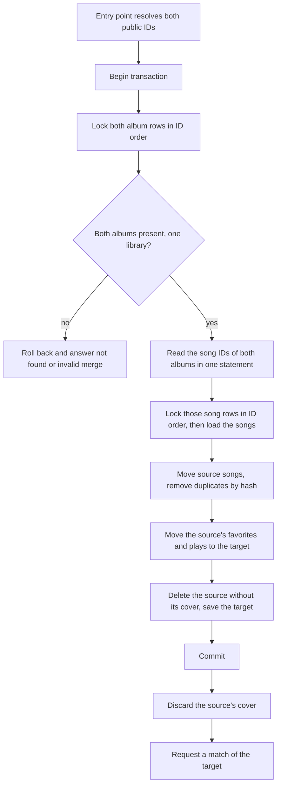

# Matching Leftovers - Plan

## Goal Capsule

- **Objective:** A change an admin makes by hand to a song's or album's credits, and a merge of two albums, take effect whole or not at all, whatever a match, an import or another admin does at the same moment. A user's favorite and plays of a merged album follow the album. On an album that holds a release, the album match queue leaves the album's own credits and every song a match has already compared as an admin left them, and it still matches a song that arrived while an admin applied a match.
- **Product authority:** The open items under "MusicBrainz matching" and "Matching follow-ups" in `ROADMAP.md`, and "Deferred to Follow-Up Work" in `docs/plans/2026-11-15-1038-fix-matching-follow-ups-plan.md`. On 2026-11-15 the user chose them as the next roadmap item, named the first two (hand changes to credits, album merge atomicity) and asked for the others to be weighed.
- **Means:** Hand changes and merges take the catalog lock order inside one transaction (KTD1, KTD5). Each effect of an apply beside the queue is reproduced by a test before it is repaired (KTD8).
- **Execution profile:** One branch named after this plan, ten units in three phases (Sequencing). Units land as local commits. The lock design, the statements and the two-session tests of U2 to U6 go to the postgres specialist (`.agents/agents/postgres.md`). The plan holds no migration.
- **Authority and stop conditions:** Follow `AGENTS.md`, then the Product Contract, then the Planning Contract. Stop and ask the user when a race test shows a deadlock between writers that KTD1 or KTD5 says cannot wait on each other in a cycle, when a reproduction of U5 or U6 shows an effect this plan does not list, or when the user answers an Outstanding Question against its default.
- **Finishing:** `ce-work` implements the units, with `ce-simplify-code` at phase boundaries. `ce-code-review` runs before shipping and its justified findings are applied. Push only when the user asks.
- **Open blockers:** None. The five Outstanding Questions for the user each carry a default and block nothing.

---

## Product Contract

### Summary

This plan closes what the matching follow-ups deferred. A hand change to credits runs in one transaction under the locks a match apply takes, so it waits for an apply, a retag or a merge and then acts on what they committed. An album merge commits whole or not at all, moves every song the source holds, deletes the source's cover only after the commit, and carries the source's favorites and plays to the target. Four effects of a match apply beside a queue run are reproduced first and repaired only where the reproduction fails. Test leftovers of the match queue and the match dialog are added, and the pages describe the result.

### Problem Frame

**Hand changes.** `AddArtistCreditHandler`, `RemoveArtistCreditHandler` and `ChangeArtistCreditRoleHandler` write a credit and then, in a second write, drop `credits` from the song's `matched_fields` (`ArtistCreditInput::creditsChangedByHand`). None opens a transaction or takes a lock, and the bus wraps no handler in one (`config/packages/messenger.php`). The song that the second write saves is the copy the handler loaded when it resolved the public ID. A match apply that commits between that read and the credit write therefore leaves the mark in place: the hand-made credit counts as a match's and survives the next retag (`FilesDiscoveredHandler::withMatchedCreditsKept`). The credit's foreign key also takes the artist's row `FOR KEY SHARE` at the insert, after anything the handler could lock on the song, which is the reverse of an apply's order. When an apply removes the artist meanwhile, the insert fails on its foreign key inside a flush, the flush closes the entity manager, and the admin gets a 500. `UpdateSongHandler` saves `matched_fields` from a song it read without a lock as well, so a title edit that read the song before a credit change writes the `credits` mark back.

**Album merge.** `AlbumMergeService::mergeAlbums` flushes once per moved or deleted song, then deletes the source and saves the target, without a transaction, so a failure midway leaves songs on both albums. `AlbumService::delete` deletes the source's cover record and file at once. The merge reads the source's songs once, before anything is locked and capped at 10,000. A song it did not read, one an import added meanwhile or one beyond the cap, is deleted with the source through `fk_songs_album_id` (`ON DELETE CASCADE`). Nothing follows the source: `user_favorites` rows of type `album` keep the public ID of an album that no longer exists, because the table has no foreign key to albums, and `media_activities.album_id` is set to null, so the plays of the moved songs count for no album (`ActivityAnalyticsRepository` joins on that column).

**An apply beside the queue.** Four effects follow from the code and are not reproduced yet (High-Level Technical Design lists their windows). A manual album apply deletes the album's match state unconditionally (`AlbumMatchStateRepository::removeByAlbum`), and with it a request an import made for a song that arrived after the apply read the album. An automatic match of a matched album's new songs checks under its locks only that the album still holds the release (`ApplyMatchHandler::assertReleaseUnchanged`): it writes a song an admin compared by hand in the seconds before, and it keeps the pairs the matcher computed although a retag changed a song's track number meanwhile. Found while planning: `MatchTicks::automatic` writes every credits row that changes, the album's own row included, so every automatic match of a matched album replaces album credits an admin kept or changed by hand, with no race needed. `docs-book/part-2-developer-guide/contexts/catalog.md` describes that rule for automatic applies in general and makes no exception for a matched album.

**Tests and pages.** `DrainAlbumMatchesHandlerTest` covers a run whose chain was replaced for two outcomes; four more paths have no case. `InMemoryAlbumMatchStates`, the double behind five unit test files, is checked against the SQL repository by no test. No dialog test covers an apply that answers 409 `cover_refused`. The operator pages do not say that a new song without a measured length never pairs on a matched album.

### Requirements

**Hand changes**

- R1. A hand change to a song's credits and the drop of the song's `credits` mark are committed together or not at all.
- R2. A hand change to credits waits for a match apply, a retag, an artist merge or removal, or an album merge that holds the same album, artist or song, and then acts on the catalog as that writer left it; each of those writers waits for a hand change the same way.
- R3. A hand change whose artist, song or album is gone by then answers "not found". One that the database ended to break a deadlock, or whose artist changed its name or MusicBrainz ID while it waited, answers a conflict that says to make the change again. The API and the console answer alike.
- R4. A hand edit of a song's fields writes the song as it is under its lock: it neither restores a matched mark a credit change dropped nor drops a mark an apply set meanwhile.

**Album merge**

- R5. A merge commits all of its changes or none: the moved songs, the removed duplicates, the target's merged fields, the removed source and what R9 and R10 carry over.
- R6. The source's cover image is deleted only after the merge committed; a merge that fails leaves the source with its cover.
- R7. A merge waits for a match apply, a retag or a hand change that holds the same albums or songs and then merges what they committed. Every song the source holds when the merge has taken it is moved or removed as a duplicate, whatever their number. A song an import adds to the source after that is refused, not deleted with the source.
- R8. A merge answers "not found" when an album is gone by the time it holds its locks, and a conflict that says to merge again when the database ended it to break a deadlock. The API, the console and the two merge dialogs of the web app say so.
- R9. A user's favorite of the source album becomes a favorite of the target; a user who favorited both keeps one.
- R10. The plays recorded for the source album's songs count for the target album.

**An apply beside the queue**

- R11. Each of the four effects is reproduced by a test that fails for the stated reason before any repair. An effect whose test passes unrepaired keeps the test, gets no production change, and is reported.
- R12. An automatic match of a matched album's new songs leaves the album's own artist credits, and the artists those credits keep, as they are. It still fills the album's empty fields and a missing cover.
- R13. An automatic match of a matched album's new songs writes nothing when a match compared one of those songs after the matcher read the album; the album is matched again later.
- R14. An automatic match of a matched album's new songs writes nothing when a song's disc, track number or length changed after the matcher read it so that the songs pair differently; the album is matched again later.
- R15. After a manual album apply, an album that holds a release and a song no match has compared waits for a match again, as after an import.

**Tests and pages**

- R16. `DrainAlbumMatchesHandlerTest` pins what a run whose chain was replaced during its match does after an outage, after a review outcome with a request beside the claim, after a failed matcher, and when it removes import requests.
- R17. The in-memory match states and the SQL repository pass one shared set of cases.
- R18. The match dialog test covers an apply that answers 409 `cover_refused`: the dialog says the cover was refused, stays open, and applies the rest once the cover is unticked.
- R19. The operator pages, the context guides, the module READMEs and `CONCEPTS.md` describe the delivered behaviour, among it that a new song without a measured length never pairs on a matched album.

### Acceptance Examples

- AE1. **Covers R1, R2.** Given a song whose credits a match set and an artist whose name and MusicBrainz ID the apply leaves as they are, when an admin adds a credit for that artist while a manual apply to the song's album holds its locks, the add waits. After the apply commits, the add writes its credit and the song's `matched_fields` no longer lists `credits`, so the next retag replaces the song's credits with the tags'.
- AE2. **Covers R5, R6, R9, R10.** Given a source album with a cover, a song the target also holds, a song it does not, a favorite by one user and plays, when the merge commits, the target holds the other song, the user's favorite names the target, the plays name the target, and the cover's record and file are gone. When the merge fails before its commit, the source, its songs, its cover, the favorite and the plays are as before.
- AE3. **Covers R7.** Given a merge that holds its locks, when an import inserts a song into the source, the insert waits and fails on its foreign key once the merge commits; the same insert into the target does not wait.
- AE4. **Covers R12.** Given a matched album whose album credits an admin changed by hand, when a new song arrives and the queue matches the album, the new song takes its track's recording ID and credits and the album's credits stay as the admin left them.
- AE5. **Covers R15.** Given automatic matching on and a manual apply that has read its album, when an import commits a new song and its match request before the apply removes the album's match state, the album waits for a match again after the apply, and the run that follows writes only the new song.

### Success Criteria

- Each new two-session test is counted as run, not skipped, in the full suite in the CI image; they skip without `OUTBOX_TEST_DATABASE_URL`.
- Each reproduction of U5 and U6 is recorded as failing before its repair and passing after it, or as passing unrepaired.

### Scope Boundaries

Out by the user's choice of scope: the PGroonga failure of throwaway test schemas, the 4 GB qualification, the LRCLIB items (a `Retry-After` in date form, a recipe for ending a pause), the webhook back-off sleep, the simplification leftovers (a shared User-Agent constant, the ranking written twice, the scan in `nextRequestDueAt()`), and everything the roadmap lists as deferred separate work under "Scan artist credits, song lengths and lyrics outcomes".

Considered and not built:

- **Artist sync** is neither built nor removed (Outstanding Questions). `app:metadata:status` therefore keeps `SyncArtistMessage` in its job list; the entry matches no job row, since nothing queues one, and it goes or stays with the path.
- **The library claim for a merge.** `DeleteAlbumHandler` claims the album's library so that no import writes meanwhile. A merge would then be refused while a scan runs. The merge accepts a deadlock with an import instead (KTD5). Deadlocks seen in practice during rescans would change this.
- **The target does not take the source's cover** when it has none; `ExtractAlbumCoverHandler` gives a coverless album a cover from its files. The artist merge keeps the source's cover; an admin asking for the same on albums would change this.
- **Recommendations that name the source album** stay as they are. The recommendation job rewrites a source's recommendations when it next runs for it (`RecommendationRepository::deleteBySource`). A recommendation that fails to open in a client would change this.
- **No check in an automatic apply to an album without a release** for a song an admin matched by hand in the seconds before. The first automatic match of an album writes every song it pairs, whenever that song was matched by hand, so a check would only delay the write by 15 minutes.
- **The match claim is not checked inside the apply's transaction.** A song apply by hand leaves the claim in place, so the claim does not tell that a song was compared meanwhile; KTD9 checks the songs.
- **The test that fails when the MusicBrainz adapter goes back to an interruptible sleep** is not taken up: no unit touches the adapter.
- **The merge's 400 for the same album or two libraries stays**, although the shared outcomes give 422 for invalid input: `AlbumMergeTest` pins it and no user asked for the change.

#### Deferred to Follow-Up Work

- **A merge of duplicate songs.** The merge deletes a source song whose hash the target holds. Its playlist entries and lyrics are deleted with it (`fk_playlist_song_song_id`, `fk_lyrics_song_id`, both `ON DELETE CASCADE`), its plays and "loved" flag stay without a song (`fk_media_activities_song_id`, `SET NULL`), and its favorites keep a public ID that no longer exists. Folding a duplicate into the kept copy spans Playlist, Lyrics, Activity and Favorites and has to merge per-user rows: `media_activities` holds one row per user and song. The merge page states today's behaviour (U10).
- **Other hand edits that save a copy read before a concurrent commit.** `UpdateAlbumHandler` can drop field locks a merge added, and `SetCoverHandler` and `RemoveCoverHandler` can orphan a cover an apply set meanwhile. They write no matched mark and no credit, and each needs the album's lock and tests of its own.
- **The import's repair of a known song takes no song row lock** (`FilesDiscoveredHandler::repairSong`), so a hand credit committed between its read and its flush gets the tagged credit added beside it. This is import handler work, which the roadmap already lists as unsplit.
- **Deleting an artist leaves the `credits` mark** on the songs it uncredits (`ArtistMergeService::remove`). Same family as R1, another entry point.
- **One failed match request ends the others of the same import** (`AlbumMatchRequester::request` filters in one pass), for example when a merge deleted an album the import still holds.
- **Favorites of an album or song deleted outright** dangle on every delete path, the database's cascades included. No port call can cover a cascade, so this needs a design of its own.
- **`MovieRepository::delete`** has the gaps U3 closes in `AlbumRepository::delete` (`ROADMAP.md`, "Associations with a database cascade").

### Outstanding Questions

**For the user, each with the default this plan builds**

- **What artist sync should be.** Default: keep the path as it is, unreachable and documented as such, and build nothing. Recommended direction for a later plan: an artist that holds a MusicBrainz ID takes its empty fields from a lookup by that ID (`MusicBrainzLookupInterface::fetchArtist`), never from a name search; a match gives artists their IDs but not their country, type, life span or sort name. The alternative removes the path now. That adds a unit: `SyncArtistMessage`, `SyncArtistHandler`, `ArtistMetadataEnricher`, `MetadataSyncOrchestrator::syncArtist()`, the `JOB_CLASSES` entry with a test of the list, the entries in `deptrac.baseline.yaml` (a stale entry fails Deptrac), `ArtistMetadataEnricherTest`, the artist cases of `MetadataEnricherLockedFieldsTest` and `EnrichmentFreshStateTest`, and a decision on `ArtistPortInterface::assignMusicbrainzId()` with `ArtistMusicbrainzIdAssigner`, which only the enricher calls. The `includeArtists` flag that `SyncLibraryHandler` ignores is a wire field: a message queued before its removal fails to decode. Evidence for removal beyond "no callers": the enricher writes the top hit of a name search onto an artist a match already identified, and the title-only album enricher was removed for that reason. Evidence against: its fill-only and locked-field rules are what a sync by ID would reuse.
- **What else follows a merged album.** Default: the plays (R10) as well as the favorites; recommendations stay as they are. Answering "favorites only" drops R10 and the Activity half of U4. Answering "recommendations too" adds a port in Recommendation, as the artist merge has.
- **What happens to what users hold on a duplicate song the merge deletes.** Default: as today (see Deferred to Follow-Up Work), stated on the merge page. The alternative is the song merge, a plan of its own.
- **What an automatic match of a matched album's new songs writes on the album itself.** Default: empty fields and a missing cover as today, never the album's credits (R12). The follow-ups rely on the cover part: a cover the Cover Art Archive refused is asked for again by such a match. Answering "nothing on the album" drops the fill from U5 and ends that second try; answering "as today" drops R12.
- **Whether the song field edit rides in this plan.** Default: yes (R4), because `UpdateSongHandler` writes the same column the credit handlers do and can restore the mark U2 drops. Answering "no" drops R4 and its part of U2.

**Deferred to implementation**

- The statement form that locks the source `FOR UPDATE` and the target `FOR NO KEY UPDATE` in ID order (KTD5). The postgres specialist decides with the race tests of U3.
- Whether a hand change takes the artist's row through `ArtistMergePortInterface::lock()` or through a lighter port method with the same mode (KTD1).
- The statement form that moves favorites (KTD7): it must not fail on `uniq_user_favorites_user_id_entity_type_entity_public_id` when a user favorites the target between two statements.
- Whether effect D reproduces; it is the one effect marked as a suspicion.

### Sources / Research

- `docs/solutions/architecture-patterns/concurrent-imports-find-or-create-identities-under-sorted-advisory-locks.md`: the import's identity keys, read-after-lock under READ COMMITTED, `FOR NO KEY UPDATE` for a parent whose children must not wait, and the two-session test recipe. It predates the apply, so it names only the import's half of the order; the whole order is in `ApplyMatchHandler`'s class docblock, `ArtistMergePortInterface` and `docs-book/part-2-developer-guide/contexts/catalog.md` ("Apply").
- `docs/solutions/runtime-errors/doctrine-refuses-a-flush-after-the-database-cascaded-a-delete-under-managed-children.md`: release managed children before the parent's flush, skip uninitialized ones. `ROADMAP.md` lists `AlbumRepository::delete` as one change away from that failure.
- `docs/solutions/architecture-patterns/state-set-when-work-is-queued-on-swoole-task-must-expire.md` and `docs/solutions/runtime-errors/fenced-completion-retry-must-not-redo-one-shot-steps.md`: a check made only when the outcome is recorded lets the writes commit first; test the race at the fence.
- `docs/solutions/runtime-errors/doctrine-cannot-update-a-loaded-entity-keyed-by-its-association-under-the-strict-uuid-type.md`: `album_match_states` is written through DBAL statements only.
- `docs/solutions/developer-experience/pgroonga-indexes-in-throwaway-test-schemas-break-later-suites.md`: race tests copy tables with `ArtistImportIdentityRace::copyTableWithoutPgroonga`. The copy carries no foreign key and no trigger, so a test about a foreign-key wait adds the key back, and the fixture copies every table the code under test writes, since the search path falls through to `public`.
- `docs/solutions/developer-experience/in-memory-transport-get-hands-out-one-message-per-call.md`: queue assertions read `getSent()` and the `DelayStamp`.
- `.agents/skills/postgres-remediation/references/doctrine.md`: a failed flush closes the entity manager; `find` and `findBy` return the managed copy without refreshing it; deadlock 40P01 and serialization failure 40001 both become `DeadlockException`.
- `.agents/rules/admin-cli-parity.md`: outcomes come from the shared exceptions (`NotFoundException` 404 and exit 1, `ConflictException` 409 and exit 1); controllers do not catch them.
- Existing harness: `tests/Fixtures/Catalog/MatchApplyRace.php` builds the production `ApplyMatchHandler` over a throwaway schema, with a hook before the commit, and `tests/Fixtures/Catalog/match-apply.php` runs an apply, an import or a retag in a second process.

---

## Planning Contract

### Key Technical Decisions

- KTD1. **A hand change to credits takes the locks an apply takes for an artist it credits.** In one transaction and in this order: the album's row for an album target (`AlbumPortInterface::lockInIdOrder`), the import identity keys of the artist's stored name and MusicBrainz ID (`SongPortInterface::lockImportIdentities`), the artist's row (`ArtistMergePortInterface::lock`), and the song's row for a song target (`SongPortInterface::lockInIdOrder`). Rejected: the song's row alone, because the credit's foreign key then takes the artist's row after the song's, a cycle with an apply that holds the artist and waits for the song. Rejected: the artist's row `FOR KEY SHARE` without the keys, because a retag that gives the artist its MusicBrainz ID updates `artists.mbid`, a column of the unique index `uniq_artists_mbid`, after its batch holds its song rows (`ArtistIdentityResolver`, `FilesDiscoveredHandler::writeSongs`), and that update needs the row `FOR UPDATE`. With the keys the import and the hand change meet at a key before either holds a row. No bake-off was run: the variants differ in lock modes, which reading and the race tests of U2 decide. Covers R2.
- KTD2. **What a writer saves is what it read under its locks.** A handler reads nothing before its transaction beyond resolving public IDs to IDs and, for KTD1, the artist's name and MusicBrainz ID. Under the locks it reads through the refreshing finders (`findFreshByUuid`), or loads an entity for the first time. `SongRepository::syncToEntity` and `AlbumRepository::syncToEntity` copy every field, so saving a copy read earlier onto a refreshed entity writes stale values back; `find`, `findBy` and `findByAlbum` return the managed copy unrefreshed. The credit roles a handler decides on are read only inside the transaction, since no refreshing finder exists for credits. Covers R1, R4, R5, R7.
- KTD3. **A hand change answers from what it reads under the locks.** A missing artist, song or album raises `NotFoundException` with today's messages, before any flush. A `TransactionDeadlockException`, and an artist whose name or MusicBrainz ID differs from the one whose keys were taken, raise `ConflictException` with the reason `credit_busy`. The second case is the hand change's form of an apply's rule: a writer whose read under the locks needs a key its set left out writes nothing (`MatchLocks::covers`), because taking that key late could close a cycle with an import that reaches the artist by its new ID under another tagged name. The handlers convert the deadlock themselves, because no global mapping exists for `TransactionDeadlockException`. Covers R3.
- KTD4. **A hand edit of a song's fields takes the song's row.** `UpdateSongHandler` runs in one transaction, locks the row, reads the song through the refreshing finder, edits and saves it. It takes one lock, so it cannot wait in a cycle and needs no conflict answer. Covers R4.
- KTD5. **The merge's transaction lives in `AlbumMergeService` and locks the source for deletion.** Both entry points call the port, so the transaction covers both. Locks: both album rows in ID order, the source `FOR UPDATE` and the target `FOR NO KEY UPDATE`; then one statement reads the song IDs of both albums; then those song rows in ID order; then the songs are loaded. No song is read before the transaction and no cap applies, so the source's set is complete: with the source `FOR UPDATE` an insert's foreign key waits, and only a merge moves a song between albums. The target's song locks keep a retag from changing a hash the deduplication just read. Rejected: `FOR NO KEY UPDATE` on both rows, as an apply takes, because a song an import adds to the source during the merge is then deleted with it; the artist merge locks the rows it deletes `FOR UPDATE` for the same reason. Rejected: the library claim (Scope Boundaries). Accepted: an import that holds a retagged song of either album and then inserts a song into the source deadlocks with the merge; the database ends one of them, the merge answers `merge_busy` or the import's message is retried. Covers R5, R7.
- KTD6. **Side effects follow the commit, and outcomes use the shared exceptions.** The transaction returns the source's cover ID as read under the lock; the merge discards the cover and then requests the target's match after the commit, as today best-effort. A `TransactionDeadlockException` becomes `ConflictException` with the reason `merge_busy`. An album gone under the locks raises `NotFoundException` with the message the lookup before the merge uses, so the API answers 404 and the console exits with 1 either way. Covers R6, R8.
- KTD7. **Favorites and plays move through one port each, as statements inside the merge's transaction.** `AlbumFavoriteMergePortInterface` in Favorites and `AlbumActivityMergePortInterface` in Activity each form a single-class contract layer that `Catalog Infrastructure` may use, as the three artist merge contracts do (`deptrac.yaml`). They take `PublicId` or `Uuid` and no Catalog type, run before the source is deleted, load no entity, and release what the unit of work holds for the source. `AlbumRepository::delete` releases the managed children of the album before its flush and skips uninitialized ones. Widening the existing artist contracts to albums was rejected: a port per merged thing is what Activity and Recommendation already have. Covers R9, R10.
- KTD8. **A reproduction injects the competing commit at the MusicBrainz lookup.** Three of the four effects sit between a read and the locks, where no session waits, so the wait-for-a-lock recipe cannot hold them. Every MusicBrainz call runs before the transaction, so a hook on `FakeMusicBrainzLookup::fetchRelease` is the point between the read and the locks: it runs a second process to completion (`match-apply.php`) or commits through a second connection, then answers. Both handlers under test are the production ones over a throwaway schema. Covers R11.
- KTD9. **An automatic apply to a matched album checks its songs under the locks.** When the album held the release as the matcher read it (`releaseIdSeen` is set), every song the candidate compared was uncompared then. If one carries `match_checked_at` under the locks, the apply answers stale, writes nothing, and the queue retries after 15 minutes; the next read no longer counts that song as new, so the retry ends. Rejected: carrying the matcher's `match_checked_at` values in the command to cover albums without a release (Scope Boundaries). Covers R13.
- KTD10. **In that mode the apply leaves the album's own credits row out.** `MatchTicks::automatic` gets the mode and drops the album's credits row; the merges and removals that need that row fall away through the existing rule that an action stands only while its rows are written. Field rows and the cover stay fill-only as today. Covers R12.
- KTD11. **A manual album apply requests the album again after its commit.** When the album holds a release after the apply, the handler calls `AlbumMatchRequestInterface::requestAfterImport()`, which requests only while automatic matching is on and only when a song is uncompared; a failure is logged and does not fail the apply. Rejected: a `NOT EXISTS` on songs inside the `DELETE`, because after a wait PostgreSQL checks the row again but reads the subquery from the statement's first snapshot. Rejected: deleting only review marks, because a stale search request for an album the admin just applied without a release ID would then match over the admin's choice. This repair ships after KTD10: the run it queues would otherwise replace the album credits the admin just kept. Covers R15.
- KTD12. **An automatic apply to a matched album pairs again under the locks.** It pairs the songs as read under the locks against the release, without a MusicBrainz call, and answers stale when the pairs differ from the candidate's. Built only if effect D reproduces. Covers R14.
- KTD13. **The contract cases are one abstract case class with two subclasses.** The in-memory subclass runs in the unit lane and the SQL subclass in the functional lane. Cases use whole-second instants, because the repository binds due times to the second, and real album rows, because `fk_album_match_states_album_id` requires them. A lapsed claim is a claim taken with a lease of zero seconds, which both implementations judge as lapsed without moving a clock. What the double cannot express stays where it is: `SKIP LOCKED`, the `MERGE` evaluated again after a wait and the check constraints, in `AlbumMatchQueueStatementsTest` and `AlbumMatchClaimRaceTest`. Covers R17.

### High-Level Technical Design

What each writer locks, left to right. A writer takes only the kinds it needs and never goes back to an earlier one.

| Writer | Album rows | Import identity keys | Artist rows | Song rows |
|---|---|---|---|---|
| Album apply | the album, `FOR NO KEY UPDATE` | every artist and genre it names | the artists it may credit, merge or remove, `FOR UPDATE` | the songs it compared, `FOR NO KEY UPDATE` |
| Song apply | | every artist it names | as above | the song |
| Retag import | | every artist and genre of the batch | | the retagged songs |
| Album credit decision of an import | the album, `FOR NO KEY UPDATE` | the tagged album artist | | |
| Hand change, song credit (U2) | | the artist's name and ID | the artist, `FOR UPDATE` | the song, `FOR NO KEY UPDATE` |
| Hand change, album credit (U2) | the album, `FOR NO KEY UPDATE` | the artist's name and ID | the artist, `FOR UPDATE` | |
| Hand edit of a song's fields (U2) | | | | the song |
| Album merge (U3) | source `FOR UPDATE`, target `FOR NO KEY UPDATE`, in ID order | | | the songs of both albums |

The merge:

What each kind of apply writes. The entries "after U5" and "after U6" hold for each effect that reproduces (R11):

| Apply | Album fields and cover | Album credits | Songs | Match state |
|---|---|---|---|---|
| Manual | the ticked rows | when ticked | the ticked rows of paired songs | removed; after U6 the album is requested again when it holds a release and an uncompared song |
| Automatic, album without a release | empty unlocked fields, a missing cover | written when they differ | every paired song | left to the queue run |
| Automatic, album that held the release | empty unlocked fields, a missing cover | today written when they differ; after U5 never | the uncompared songs it pairs; after U5 none when one was compared or pairs differently by then | left to the queue run |

The four effects:

| Effect | Window | Competing commit | Today, read from the code | Repair |
|---|---|---|---|---|
| A | a manual apply, from its read of the album before the MusicBrainz lookup to its delete of the match state | an import adds a song and requests a match | the request is deleted, the song stays uncompared, nothing asks for the album | KTD11 |
| B | a queue run, from the matcher's read to the automatic apply's locks | an admin applies the same release by hand with a song's credits unticked | the song's credits are written anyway | KTD9 |
| C | none: every automatic match of a matched album | none | the album's credits are replaced by the release's when they differ | KTD10 |
| D | as B | a retag changes a new song's disc, track number or length | the song takes the track it paired with before | KTD12 |

### Assumptions

These are this plan's own choices. The user has confirmed none of them; the third to the fifth are also Outstanding Questions.

- A hand change may wait a few seconds for an import batch that names the same artist, and such a batch for a hand change (KTD1).
- A merge during a rescan of the same albums may answer `merge_busy`, or end the import's batch, whose retry files new files of the source's directory under a new album of the source's title (KTD5). A rescan after any merge already does that for new files.
- The song field edit belongs in this plan (R4).
- The plays of a merged album follow it (R10).
- Replacing album credits at every automatic match of a matched album is a defect, not intended behaviour (R12).
- A request restored after a manual apply follows an import's rules: only while automatic matching is on, and due after the settling delay (KTD11). A request an admin's sync made is then restored only while the setting is on.
- Adding a credit of another role, such as producer, keeps counting as a hand change that drops the `credits` mark, as today.

### Sequencing

1. Groundwork: U1.
2. Side by side: U2; U3 then U4; U5 then U6; U8 then U7; U9.
3. Documentation: U10.

Files that more than one unit touches:

- `openapi.json` and `ui/web/src/shared/api-client/gen`: U2 and U3 each add a 409 to routes. The lead regenerates both once, after both units.
- `src/Catalog/Infrastructure/AlbumMergeService.php` and `tests/Fixtures/Catalog/AlbumMergeRace.php`: U3, then U4.
- `src/Catalog/Application/CommandHandler/MusicBrainzMatch/ApplyMatchHandler.php` and its unit test: U5, then U6.
- `tests/Fixtures/Catalog/MatchApplyRace.php`: U1, then U6 only. U2, U3 and U5 call it and do not change it.
- `tests/Fixtures/Catalog/InMemoryAlbumMatchStates.php`: U8 may change it; U7 only uses it, so U7 follows U8.

### System-Wide Impact

- **Schema:** none. No migration, column, index or constraint is added, so the migration and naming pins keep their values.
- **API contract:** the six artist credit routes and `POST /api/albums/merge` gain a documented 409; the merge's 404 also covers an album gone under the locks. No route is added or removed.
- **Lock waits:** hand changes and merges now wait for applies, retags and each other. The source album is held `FOR UPDATE` for the merge's length: a song insert, a play or a cover written for the source meanwhile waits and then fails on its foreign key.
- **Cross-context ports:** Catalog Infrastructure gains two dependencies, on Favorites and Activity, through two new single-class contract layers in `deptrac.yaml` and two aliases in `config/services.yaml`.
- **Live updates:** `user_favorites` and `media_activities` are captured tables, so moved favorites and plays reach clients through the capture and need no web change.
- **Messages:** no message, route or payload codec is added. A manual album apply can dispatch a `DrainAlbumMatchesMessage` through the requester (KTD11), which starts a new chain when no other request is due; the cases of U7 are then ordinary.
- **Documented behaviour:** the catalog guide's sentence that an automatic apply writes every credits row that changes gains the exception of R12.

### Risks

| Risk | Mitigation |
|---|---|
| A race test passes because it was skipped. | The Verification Contract counts the new two-session tests as run in the CI image. |
| A new file under `tests/Integration` or `tests/Functional` shifts every later file to another stack, and the PGroonga failure of throwaway schemas can surface in an unrelated suite. | Known and out of scope: rerun the named suite alone and record it, as the roadmap did. The new race tests copy tables without PGroonga indexes. |
| A reproduction does not fail. | R11: the test stays, no production change, and the report says so. |
| A constructor change breaks a hand-built construction in a test or fixture. | PHPStan analyses `tests/` without a baseline; each unit lists its constructions under Guards. |
| The deadlock between a merge and an import (KTD5) proves frequent. | The log entry of each `merge_busy` names both albums; the library claim is the recorded alternative. |
| The post-commit request of KTD11 fails or the process dies before it. | As with a merge's request: logged, and a metadata sync from the admin panel requests the album again. |

---

## Implementation Units

| U-ID | Title | Key files | Depends on |
|---|---|---|---|
| U1 | Shared wiring for the race fixtures | `tests/Fixtures/Catalog/MatchApplyRace.php` | none |
| U2 | Hand changes under the catalog lock order | `src/Catalog/Application/CommandHandler/Artist/`, `Song/UpdateSongHandler.php`, `ArtistCreditInput.php` | U1 |
| U3 | The album merge in one transaction | `src/Catalog/Infrastructure/AlbumMergeService.php`, `AlbumRepository.php` | U1 |
| U4 | A merge carries favorites and plays | `src/Favorites/`, `src/Activity/`, `deptrac.yaml`, `config/services.yaml` | U3 |
| U5 | An automatic match of a matched album's new songs | `ApplyMatchHandler.php`, `MatchTicks.php` | U1 |
| U6 | A manual apply keeps the request for an uncompared song | `ApplyMatchHandler.php` | U5 |
| U7 | Queue run cases for a replaced chain | `DrainAlbumMatchesHandlerTest.php` | U8 |
| U8 | One set of cases for both match state stores | `tests/Fixtures/Catalog/InMemoryAlbumMatchStates.php`, `AlbumMatchQueueStatementsTest.php` | none |
| U9 | Dialog test for a refused cover | `MusicBrainzMatchDialog.test.tsx` | none |
| U10 | Documentation, vocabulary and roadmap | `docs-book/`, `src/*/README.md`, `CONCEPTS.md`, `ROADMAP.md` | U1 to U9 |

### U1. Shared wiring for the race fixtures

- **Goal:** the units that follow build their own fixtures on the production services `MatchApplyRace` already wires, without each editing that file.
- **Requirements:** none of its own; enables the race tests of R2, R7 and R11.
- **Dependencies:** none.
- **Files:** modify `tests/Fixtures/Catalog/MatchApplyRace.php`.
- **Approach:** `MatchApplyRace::services()` and its transaction port, with the hook before the commit, become usable from other fixtures, and the returned services include the artist merge port. Nothing else changes.
- **Patterns to follow:** `ArtistMergeRace::merges()`, which other fixtures already call.
- **Test expectation:** none -- fixture visibility only; `MusicBrainzMatchApplyRaceTest` and `MatchedSongRetagRaceTest` pass unchanged.
- **Verification:** the two race tests named above pass in the CI image, and PHPStan is clean.

### U2. Hand changes under the catalog lock order

- **Goal:** a hand change to credits, and a hand edit of a song's fields, is one transaction that waits for other catalog writers and acts on what they committed.
- **Requirements:** R1 to R4; KTD1 to KTD4. Covers AE1.
- **Dependencies:** U1.
- **Files:**
  - modify `src/Catalog/Application/CommandHandler/Artist/AddArtistCreditHandler.php`, `RemoveArtistCreditHandler.php`, `ChangeArtistCreditRoleHandler.php` and `src/Catalog/Application/Service/ArtistCreditInput.php`;
  - modify `src/Catalog/Application/CommandHandler/Song/UpdateSongHandler.php`;
  - modify `src/Catalog/Interface/Controller/ArtistController.php` (the 409 of the six credit routes in their OpenAPI attributes);
  - create `tests/Fixtures/Catalog/HandChangeRace.php` and its child script `tests/Fixtures/Catalog/hand-change.php`;
  - tests: `tests/Unit/Catalog/Application/CommandHandler/Artist/ArtistCreditHandlersTest.php`, `tests/Unit/Catalog/Interface/Console/ArtistCreditCommandsTest.php`, `tests/Functional/Catalog/Interface/Console/ArtistCreditCommandsTest.php`, new `tests/Unit/Catalog/Application/CommandHandler/Song/UpdateSongHandlerTest.php`, `tests/Functional/Catalog/Interface/Console/CatalogMetadataCommandsTest.php`, new `tests/Integration/HandChangeRaceTest.php`.
- **Approach:**
  1. `ArtistCreditInput` gains the shared step the three handlers run inside `TransactionPortInterface::run`: take the locks of KTD1, read artist and target again, and compare the artist's name and MusicBrainz ID with the ones whose keys were taken.
  2. Each handler reads the credit roles, decides, writes the credit and, for a song, drops the `credits` mark on the song it read under the lock, all inside that transaction (KTD2).
  3. Outcomes follow KTD3. The conflict's message says that another change to the same artist, song or album ran at the same time and that the change should be made again.
  4. `UpdateSongHandler` follows KTD4.
- **Patterns to follow:** `ApplyMatchHandler::lock()` and its read-again step; `ArtistMusicbrainzIdAssigner::assign` for the name check after the keys; `tests/Fixtures/Catalog/PassThroughTransaction.php` for the unit tests; `MusicBrainzMatchApplyRaceTest` and `RetagLockOrderTest` for the race tests.
- **Test scenarios:**
  - Unit: each handler runs one transaction and asks for its locks in the order of KTD1, for a song target and for an album target.
  - Unit: adding a credit to a song with matched credits writes the credit and drops the mark inside the same transaction; adding a credit the song holds already keeps the mark.
  - Unit: the roles a handler decides on are the ones read after the locks, when the fake port answers differently before and after.
  - Unit: an artist, song or album missing under the locks is "not found" and nothing is written.
  - Unit: a deadlock from the transaction port, and an artist renamed since its keys were taken, each answer `credit_busy` and write nothing.
  - Unit: the song field edit locks the song's row, saves the song read under the lock, and forgets only the marks of the fields it replaced.
  - Functional: the API answers 409 with `details.reason` `credit_busy` and the console exits with 1 and the same message, for a transaction port that reports a deadlock.
  - Race, covers AE1: an add for an artist that already holds the MusicBrainz ID the release credits it under, started while a manual apply holds its locks before its commit, waits on an import key; after the commit the song has the new credit and no `credits` mark. The shared seed's artist holds no ID, so the fixture seeds one.
  - Race: a manual apply started while a hand change holds its locks waits, then finds the song's credits changed and answers `match_stale`, writing nothing.
  - Race, lock order: with the song's row held by the test, the hand change waits on the row while it holds an import key and the artist's row; with the artist's name key held, it waits on the key and holds no row.
  - Race: an artist removed while the hand change waited for its row answers "not found", the process ends normally and no credit exists.
  - Race: an import that gives the artist its MusicBrainz ID in a batch holding the song's row, and a hand change on that artist and song: neither is ended as a deadlock victim. When the hand change takes the artist's name key first, both write. When the import takes it first, the import writes and the hand change answers `credit_busy` and writes nothing; made again, it writes its credit.
  - Race: a role another session changed and committed after the handler resolved its IDs, and before its locks, is the role the handler acts on.
  - Race: a title edit that waits for the song's row behind a committed credit change keeps the `credits` mark dropped.
- **Guards likely to trip:** the three handlers are built with three positional arguments in 13 places in the two unit test files above; the OpenAPI drift check and `yarn --cwd ui/web generate:check` (the 409s); `ArtistMutationFirewallTest` (real kernel, committed writes); `PoolSafeSqlConventionTest` if a `SET` without `LOCAL` enters `src`.
- **Verification:** the first race scenario fails on `master` and passes with the unit; the lock order scenario fails when the song's row is taken before the artist's.

### U3. The album merge in one transaction

- **Goal:** a merge commits whole or not at all, moves every song the source holds, and deletes the source's cover after the commit.
- **Requirements:** R5 to R8; KTD2, KTD5, KTD6. Covers AE3 and the parts of AE2 that concern songs and the cover.
- **Dependencies:** U1.
- **Files:**
  - modify `src/Catalog/Infrastructure/AlbumMergeService.php` and the docblock of `src/Catalog/Application/Port/AlbumMergePortInterface.php`;
  - modify `src/Catalog/Application/Port/AlbumPortInterface.php`, `src/Catalog/Infrastructure/AlbumService.php`, `src/Catalog/Domain/Repository/AlbumRepositoryInterface.php` and `src/Catalog/Infrastructure/Doctrine/Repository/AlbumRepository.php` (the merge's album locks; `delete` releasing managed children);
  - modify `src/Catalog/Application/Port/SongPortInterface.php`, `src/Catalog/Infrastructure/SongService.php`, `src/Catalog/Domain/Repository/SongRepositoryInterface.php` and `src/Catalog/Infrastructure/Doctrine/Repository/SongRepository.php` (the song IDs of albums, uncapped);
  - modify `src/Catalog/Interface/Controller/AlbumController.php` (the 409 in the route's OpenAPI attributes);
  - modify `ui/web/src/features/catalog/components/MergeAlbumsDialog.tsx` and `ui/web/src/features/admin/components/media/DuplicateGroupCard.tsx`;
  - create `tests/Fixtures/Catalog/AlbumMergeRace.php` and its child script `tests/Fixtures/Catalog/album-merge.php`;
  - tests: `tests/Unit/Catalog/Infrastructure/AlbumMergeServiceTest.php`, `tests/Functional/Controller/AlbumMergeTest.php`, `tests/Unit/Catalog/Interface/Console/AlbumDuplicateCommandsTest.php`, new `tests/Integration/AlbumMergeRaceTest.php`, `ui/web/src/features/admin/components/media/__tests__/DuplicateGroupCard.test.tsx`, new `ui/web/src/features/catalog/components/__tests__/MergeAlbumsDialog.test.tsx`.
- **Approach:**
  1. The steps and their order are the flowchart under High-Level Technical Design; the same-album check stays before the transaction.
  2. Moves are persisted and flushed together, not one flush per song, since every flush walks all managed entities while the source is held.
  3. `AlbumRepository::delete` releases the album's managed children before its flush, skipping uninitialized ones, as `ArtistMergeService::deleteArtist` does; its song loop no longer loads an uninitialized song.
  4. Outcomes follow KTD6. The conflict's message names both albums' titles and says to merge again; each `merge_busy` is logged with both album IDs.
  5. The two web entry points show the API's message for a 409 instead of the request error's text.
- **Patterns to follow:** `DeleteAlbumHandler` (a delete inside `transaction->run` with `deleteCover: false`, the cover discarded after it); `ApplyMatchHandler::applyAlbum` (the closure returns the image IDs to discard); `ArtistMergeService` (statements beside managed entities); `ArtistMergeRaceTest::testACreditInsertedWhileTheArtistsRowIsLockedFailsInsteadOfBeingDeletedWithIt`.
- **Test scenarios:**
  - Unit: the cover is discarded and the match requested only after the transaction returned; neither happens when the transaction fails.
  - Unit: the merge never calls the capped song read, and a deadlock from the transaction port answers `merge_busy`.
  - Functional: the existing cases pass unchanged, among them two merges into one target in one process and the 400 answers.
  - Functional: a merge succeeds after the same entity manager loaded the source's credits, genre links and cover.
  - Functional: API and console answer a conflict alike, 409 with `merge_busy` and exit code 1 with the same message.
  - Race, covers AE2 in part: a merge that fails in the hook before its commit leaves the source, its songs, the cover's record and file, and the target as they were.
  - Race, covers AE3: a song inserted into the source while the merge holds its locks waits and fails with SQLSTATE 23503 after the commit; the same insert into the target completes without waiting.
  - Race: a merge started while another session holds a source song's row waits on that row holding both album rows, and then moves the song with the title that session committed.
  - Race: a target whose `release_mbid` another session set and committed after the entry point's lookup, and before the merge's locks, keeps it after the merge.
  - Race: two merges of one source at once: one merges, the other answers "not found" and changes nothing.
  - Web: each merge entry point shows the conflict's message for a 409.
- **Guards likely to trip:** `AlbumMergeServiceTest` builds the service with four arguments; `CatalogMutationFirewallTest` (the `album_merge` row: real second connection, source gone, nothing queued); `AlbumMergeTest`'s 400 pins; the hand-built `AlbumService` in `AlbumCreditRace.php`, `MatchApplyRace.php` and `FilesDiscoveredAlbumCreditTest.php` if its constructor changes; the OpenAPI drift check; the web tests of the merge entry points (`DuplicateWarningBanner.test.tsx`, both `AlbumDetailPage.test.tsx`).
- **Verification:** the AE3 scenario fails when the source is locked `FOR NO KEY UPDATE`, and the failed-merge scenario fails on `master`.

### U4. A merge carries favorites and plays

- **Goal:** the source album's favorites and plays belong to the target after a merge, and stay with the source when the merge fails.
- **Requirements:** R9, R10; KTD7. Completes AE2.
- **Dependencies:** U3.
- **Files:**
  - create `src/Favorites/Application/Port/AlbumFavoriteMergePortInterface.php` and `src/Favorites/Infrastructure/Doctrine/AlbumFavoriteMerge.php`;
  - create `src/Activity/Application/Port/AlbumActivityMergePortInterface.php` and `src/Activity/Infrastructure/Doctrine/AlbumActivityMerge.php`;
  - modify `deptrac.yaml` (two single-class contract layers, their exclusion from the two Application layers, the allowance for `Catalog Infrastructure`, the graph groups) and `config/services.yaml` (two aliases);
  - modify `src/Catalog/Infrastructure/AlbumMergeService.php` and `tests/Fixtures/Catalog/AlbumMergeRace.php`;
  - tests: `tests/Unit/Catalog/Infrastructure/AlbumMergeServiceTest.php`, `tests/Functional/Controller/AlbumMergeTest.php`, new `tests/Functional/Favorites/Infrastructure/Doctrine/AlbumFavoriteMergeTest.php`, new `tests/Functional/Activity/Infrastructure/Doctrine/AlbumActivityMergeTest.php`, `tests/Integration/AlbumMergeRaceTest.php`.
- **Approach:** both ports run after the songs are moved and before the source is deleted. The plays are one statement that points every activity of the source album at the target; activities are kept per user and song, so none collide.
- **Patterns to follow:** `ArtistFavoriteMergePortInterface` with `ArtistFavoriteMerge`, `ArtistActivityMergePortInterface` with `ArtistActivityMerge`, and their layers `Favorites Artist Merge Contract` and `Activity Artist Merge Contract` in `deptrac.yaml`.
- **Test scenarios:**
  - A user who favorited the source only holds a favorite of the target afterwards, with its creation time.
  - A user who favorited both holds one favorite of the target; a user who favorited the target only is unchanged; song and artist favorites are untouched.
  - A play of a moved song names the target album afterwards; a play of a removed duplicate keeps no song and names the target.
  - Covers AE2: a merge that fails in the hook before its commit leaves favorites and plays with the source.
  - A user who favorites the target while the merge moves that user's source favorite ends with one favorite of the target, and the merge completes.
  - A favorite of the source that the unit of work holds leaves it, so a later flush in the same process writes nothing stale.
  - API and console: the merge's answer is unchanged, and both leave the same favorites and plays.
- **Guards likely to trip:** Deptrac (a port outside a contract layer falls into the Application layer, which Catalog may not use); `lint:container` (the aliases); `ArtistMergeRace.php` builds `ArtistFavoriteMerge` by hand if that class is touched; the race fixture must copy `user_favorites` and `media_activities`.
- **Verification:** Deptrac reports no violation without a baseline change, and the favorites scenarios fail on the tree of U3.

### U5. An automatic match of a matched album's new songs

- **Goal:** such a match leaves the album's credits alone and writes no song that was compared or re-paired since the matcher read it.
- **Requirements:** R11 to R14; KTD8, KTD9, KTD10, KTD12. Covers AE4.
- **Dependencies:** U1.
- **Execution note:** write each reproduction first and see it fail for the reason the effects table states. An effect whose reproduction passes gets no production change.
- **Files:**
  - modify `src/Catalog/Application/CommandHandler/MusicBrainzMatch/ApplyMatchHandler.php` and `MatchTicks.php`;
  - modify `tests/Unit/Catalog/Application/QueryHandler/MusicBrainzMatch/FakeMusicBrainzLookup.php` (the hook of KTD8);
  - create `tests/Fixtures/Catalog/QueueRunRace.php` (the production `AutomaticAlbumMatcher` over the throwaway schema, with an in-process bus that calls the apply handler);
  - tests: `tests/Unit/Catalog/Application/CommandHandler/MusicBrainzMatch/ApplyMatchHandlerTest.php`, `tests/Unit/Catalog/Application/Service/MusicBrainzMatch/AutomaticAlbumMatcherTest.php`, `tests/Integration/NewAlbumMetadataSyncTest.php`, new `tests/Integration/QueueRunBesideWriterRaceTest.php`.
- **Approach:**
  1. Effect C first: it needs no second session and the repairs of B and of U6 depend on it.
  2. The checks of KTD9 and KTD12 run under the locks, beside the existing check that the lock set covers the plan, and end as that check does: stale, nothing written, a cover downloaded before the transaction discarded.
  3. The hook of KTD8 is optional on the fake and changes no existing test.
- **Patterns to follow:** `ApplyMatchHandler::assertReleaseUnchanged` and the stale path of `MatchTicks`; `AutomaticAlbumMatcherTest`'s stub bus; `MusicBrainzMatchApplyRaceTest` for the child process.
- **Test scenarios:**
  - Covers AE4, effect C: a matched album whose album credits differ from the release's gains a new song; after the queue run the new song is paired and credited and the album's credits are unchanged.
  - Effect C without a new song: an empty candidate renews the match time and leaves the album's credits unchanged.
  - Effect C: an artist that only the album's credits row would leave without a credit is neither merged nor removed.
  - The first automatic match of an album without a release still writes the album's credits.
  - A matched album's empty field and missing cover are still filled by a match of its new songs.
  - Effect B: while the matcher waits for its release lookup, a second process applies the same release by hand with the new song's credits unticked. The run ends as "retry later", the song's credits are as the admin left them, and the next run ends as matched and writes nothing to that song.
  - Effect D: while the matcher waits for its release lookup, a second connection swaps the track numbers of two new songs. The run ends as "retry later" and writes nothing; the next run pairs each song by its new number.
  - Unit: an automatic apply with a release ID seen and a compared song that carries `match_checked_at` under the locks reports stale and persists nothing.
  - Unit: `MatchTicks::automatic` for a matched album holds no album credits row and no action that requires it.
- **Guards likely to trip:** `NewAlbumMetadataSyncTest::testATrackAddedAfterAnApplyIsPairedAgainstTheStoredReleaseAndCreditedFromIt` and `ApplyMatchHandlerTest::testAMatchedAlbumPairedAgainstItsStoredReleaseTakesANewMatchTimeEvenWithoutANewSong` must pass unchanged; `MusicBrainzMatchCliParityTest`; the positional and named constructions of `ApplyMatchHandler` and `AutomaticAlbumMatcher` in their unit tests and in `MatchApplyRace.php`.
- **Verification:** each reproduction's result before the repair is recorded, with the reason it failed.

### U6. A manual apply keeps the request for an uncompared song

- **Goal:** a song that reached an album while an admin applied a match to it is still matched.
- **Requirements:** R11, R15; KTD8, KTD11. Covers AE5.
- **Dependencies:** U5.
- **Execution note:** reproduce effect A first, as in U5.
- **Files:**
  - modify `src/Catalog/Application/CommandHandler/MusicBrainzMatch/ApplyMatchHandler.php`;
  - modify `tests/Fixtures/Catalog/MatchApplyRace.php` (the handler's new collaborator);
  - tests: `tests/Unit/Catalog/Application/CommandHandler/MusicBrainzMatch/ApplyMatchHandlerTest.php`, `tests/Functional/Catalog/Interface/Console/MusicBrainzMatchCliParityTest.php`, `tests/Integration/QueueRunBesideWriterRaceTest.php`.
- **Approach:** the request follows the commit and the discard of freed covers, and a failure of it is logged with the album's ID and does not change the apply's result.
- **Patterns to follow:** `AlbumMergeService::requestMatch`.
- **Test scenarios:**
  - Covers AE5, effect A: with automatic matching on, while a manual apply waits for its release lookup a second connection commits a new song and the import's request for the album. After the apply the album has a `requested` state and one run is on its way; the song is uncompared.
  - A request that commits while the apply's delete is uncommitted survives without the repair: the test passes before and after it.
  - With automatic matching off, the apply leaves no request.
  - A manual apply that leaves the album without a release, and one whose album holds no uncompared song, leave no request.
  - A failing request is logged and the apply answers as it does today.
  - API and console leave the same match state after the same apply.
- **Guards likely to trip:** `ApplyMatchHandler` is built with 17 named arguments in `ApplyMatchHandlerTest` and in `MatchApplyRace.php`; `CatalogMutationFirewallTest` and `MusicBrainzMatchFirewallTest` expect no queued message from an apply while automatic matching is off.
- **Verification:** the AE5 scenario fails on the tree of U5 and passes with the unit.

### U7. Queue run cases for a replaced chain

- **Goal:** the four untested paths of a run whose chain was replaced during its match are pinned as they behave.
- **Requirements:** R16.
- **Dependencies:** U8.
- **Files:** modify `tests/Unit/Catalog/Application/MessageHandler/DrainAlbumMatchesHandlerTest.php` and the class docblock of `src/Catalog/Application/MessageHandler/DrainAlbumMatchesHandler.php`.
- **Approach:** the cases extend the existing data provider where an outcome object expresses them and stand alone where the matcher throws or the import removal runs. The docblock gains what the outage path does; no behaviour changes, because the album is not stranded: the newer chain keeps a run on its way while the request exists.
- **Patterns to follow:** `outcomesThatLeaveTheAlbumWaiting` and `testAnImportRequestAnAdminRequestedDuringItsClaimOutlivesTheRemovalWithoutAClaim`.
- **Test scenarios:**
  - After an outage the run queues nothing; the album stays requested with its earlier due time and no claim, and a request made beside the claim is dropped.
  - After a review outcome with a request made five minutes ahead beside the claim, the album stays requested from that time with no review fields, and one run without a chain is queued 300,000 ms ahead; behind another request due earlier, none.
  - After a failing matcher the album falls due an hour later and one run without a chain is queued 3,600,000 ms ahead; behind another request due earlier, none.
  - With automatic matching off and an admin request made during the claim, the album is left as an admin request and one run without a chain is queued 1,000 ms ahead.
- **Guards likely to trip:** JUnit validation requires each dataset label once; the test fails on notices and deprecations.
- **Verification:** each case fails when its expected queue or state is altered by one value.

### U8. One set of cases for both match state stores

- **Goal:** the double the queue's unit tests rely on behaves as the SQL repository does.
- **Requirements:** R17; KTD13.
- **Dependencies:** none.
- **Files:**
  - create the shared case class `tests/Support/Catalog/AlbumMatchStatesContractCases.php`;
  - create `tests/Unit/Catalog/Infrastructure/InMemoryAlbumMatchStatesTest.php` and `tests/Functional/Catalog/Infrastructure/Doctrine/Repository/AlbumMatchStatesContractTest.php`;
  - modify `tests/Functional/Catalog/Infrastructure/Doctrine/Repository/AlbumMatchQueueStatementsTest.php` (the cases that move to the shared class) and `tests/Fixtures/Catalog/InMemoryAlbumMatchStates.php` (its docblock, and its behaviour where a case shows a difference).
- **Approach:** a case that both stores can express moves to the shared class; a difference a case shows is repaired in the double, and in the repository only when the double shows what the queue needs. The double's docblock says that the repository keeps due times to the second.
- **Patterns to follow:** `AlbumMatchQueueStatementsTest` and its `lapse()` helper.
- **Test scenarios:**
  - A request for an album without a state reports that it falls due sooner; a request for a waiting album keeps the earlier due time and an admin request stays an admin request.
  - A request for a review mark makes it a request and clears the review fields.
  - A request beside a live claim leaves the due time and the claim, keeps the earliest due time asked for, and reports nothing sooner.
  - A request on a lapsed claim ends the claim and drops a request parked beside it; a new claim clears a parked request.
  - Runs claim by due time, then album ID, for two requests due at one instant; a live claim is passed over.
  - Each statement that ends a claim acts by the claim ID alone, lapsed or not, and with another ID changes nothing: removed or left waiting, marked for review or left requested, postponed, released.
  - `removeIngestRequests` removes claimed import requests too; `removeByAlbum` removes the claim with the state.
  - `hasRequestsDueBy` and `nextRequestDueAt` count a live claim from its expiry.
- **Guards likely to trip:** the shared class must not be collected as a test of its own; the functional subclass runs inside DAMA's transaction and needs album rows; `InMemoryAlbumMatchStates` is used by five test files, which must pass after any change to it.
- **Verification:** both subclasses run the same number of cases, and a deliberate difference in the double fails its subclass.

### U9. Dialog test for a refused cover

- **Goal:** the match dialog's handling of a refused cover is covered where the admin meets it.
- **Requirements:** R18.
- **Dependencies:** none.
- **Files:** modify `ui/web/src/features/catalog/components/metadata/__tests__/MusicBrainzMatchDialog.test.tsx`.
- **Approach:** one case beside the 503 case, with the file's `httpError` helper.
- **Test scenarios:** an apply that answers 409 `cover_refused` shows "The Cover Art Archive refused the cover. Nothing was written; untick the cover to apply the rest.", leaves the dialog open with its ticks and the Apply button enabled; after the cover is unticked, a second apply sends a body without the cover row and closes the dialog.
- **Guards likely to trip:** `ui/web/tests/live-updates/coverage.test.ts` names this test file as a proof and fails when it is renamed.
- **Verification:** the case fails when the conflict message map loses `cover_refused`.

### U10. Documentation, vocabulary and roadmap

- **Goal:** the manual, the guides and the vocabulary describe the behaviour as built.
- **Requirements:** R19.
- **Dependencies:** U1 to U9.
- **Files:**
  - modify `docs-book/part-1-operator-guide/commands/app-album-merge.md` (all or nothing, favorites and plays, what a deleted duplicate takes with it, the conflict, the exit codes), `app-artist-song-add.md`, `app-artist-song-remove.md`, `app-artist-song-role.md` and the three `app-artist-album-*` pages (the conflict), and `app-library-scan.md` where it describes hand-made credits;
  - modify `docs-book/part-1-operator-guide/media/external-apis.md` (a song without a measured length never pairs on a matched album; album credits and a later automatic match; the request after a manual apply) and `commands/app-metadata-match-apply.md`;
  - modify `docs-book/part-2-developer-guide/contexts/catalog.md` (hand changes and the merge in the lock order, the apply's new checks, the merge's ports), `contexts/favorites.md`, `contexts/activity.md`, `src/Catalog/README.md`, `src/Activity/README.md` and `dev-docs/context-map.md`;
  - modify `CONCEPTS.md`: "Catalog lock order" (hand changes and merges), "Artist credit", "MusicBrainz match" and "Album match queue";
  - modify `ROADMAP.md`: the delivered items with their verification checkpoints, each reproduction's result, and the open items this plan leaves.
- **Approach:** state behaviour in plain words without plan IDs, and run `prose-fix` on every changed page.
- **Test expectation:** none -- documentation only; `CommandDocsCoverageTest` covers the command pages.
- **Verification:** `make website-build` succeeds, and the pages read as built behaviour.

---

## Verification Contract

| Gate | Command | Applies to |
|---|---|---|
| Unit tests | `bash scripts/test-unit-container.sh <path>` or `vendor/bin/phpunit -c phpunit.xml.dist <path>` on the host | every unit's unit tests |
| Functional and integration files | `BAANDER_TEST_IMAGE=<ci image> bash scripts/test-functional-container.sh <files>` | U1 to U8 |
| Full backend suite | `BAANDER_TEST_IMAGE=<ci image> bash scripts/test-backend-container.sh` | each phase boundary and before review |
| PHPStan | `make phpstan` | each phase boundary |
| Deptrac | `php scripts/check-backend-container.php --image <ci image> -- vendor/bin/deptrac analyse --no-cache --no-progress` | each phase boundary; U4 |
| Container lint | `php scripts/check-backend-container.php --image <ci image> -- php bin/console lint:container --env=test --no-debug` | each phase boundary; U4, U6 |
| API contract | `composer openapi`, then `php scripts/check-backend-container.php --image <ci image> -- php bin/console app:export-openapi-spec --env=test --no-debug --check`, then `yarn --cwd ui/web generate` and `generate:check` | U2, U3 |
| Web | `yarn --cwd ui/web typecheck`, `lint`, `test` | U3, U9, and after the client is regenerated |
| Documentation | `make website-build` | U10 |
| Preview | `make preview-up`; one credit added and removed through the console and the API; one album merge when the preview's library holds a pair, else recorded as not run | before merge |
| Simplification | `ce-simplify-code` | each phase boundary |
| Review | `ce-code-review` on the branch | before shipping |

The CI image is `baander-ci-prewarm:local`, built as `docs/solutions/developer-experience/local-gate-images-and-webkit-harness-runs.md` describes. The container lint and the OpenAPI check are in neither `make ci` nor CI, so they run by hand. The full suite is the gate that selects the guards a targeted run misses: `CatalogMutationFirewallTest`, `ArtistMutationFirewallTest`, `AdminCliParityTest`, `MutationRouteInventoryTest`, `PoolSafeSqlConventionTest`, `CaptureCoverageTest`, and for the web `ui/web/tests/live-updates/coverage.test.ts`. The run's report counts `HandChangeRaceTest`, `AlbumMergeRaceTest` and `QueueRunBesideWriterRaceTest` as executed. No test calls MusicBrainz or the Cover Art Archive.

## Definition of Done

- Every requirement except R19 is covered by a passing test named in a unit, or, for R12 to R15, by a reproduction recorded as passing unrepaired; R19 is met by the Verification line of U10.
- Every gate in the Verification Contract passes, the three race test classes are counted as run, and justified `ce-code-review` findings are applied.
- The pages, READMEs and `CONCEPTS.md` entries of U10 match the delivered behaviour.
- `ROADMAP.md` records each delivered unit with its verification checkpoint, suite counts and static gates, the result of each reproduction, and the items under Deferred to Follow-Up Work as open.
- No code from abandoned attempts remains in the diff: no repair of an effect that did not reproduce, no capped song read left in the merge, no second write of the `credits` mark outside the transaction.
- Per unit: its Verification line holds.
