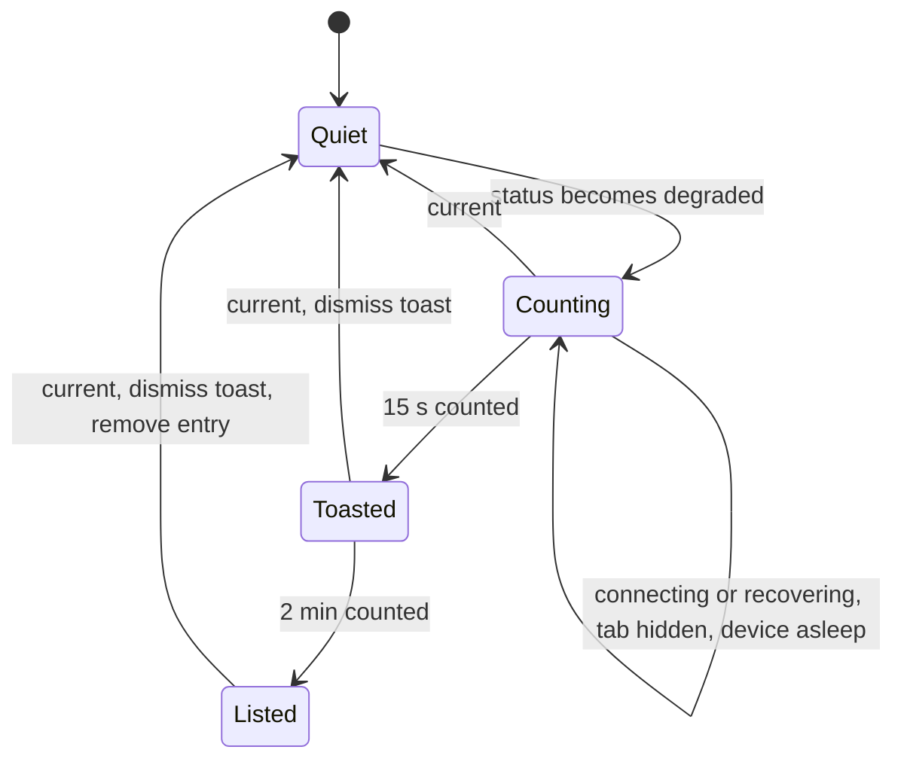
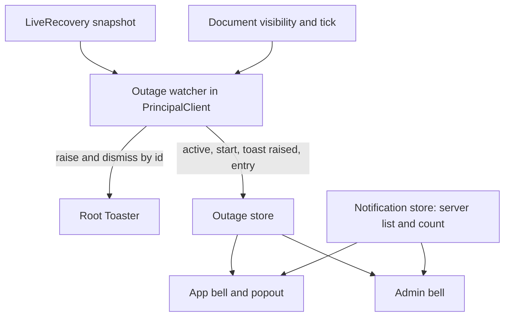

# Quiet Live-Update Status - Plan

## Goal Capsule

- **Objective:** Listeners using the web app see no live-update status during normal use and hear about live updates only when they have been broken for a while.
- **Means:** A principal-scoped outage watcher that raises a toast and a bell entry from the existing live-recovery state, replacing the top-right label (KTD1, KTD2).
- **Product authority:** This Product Contract. What the browser refreshes, when it refreshes, and how it recovers stay as `docs-book/part-2-developer-guide/architecture/live-updates.md` describes them; this work changes only what the listener sees.
- **Execution profile:** Web client and documentation only; no server, schema or protocol change.
- **Stop conditions:** Stop and ask if an outage cannot be detected or ended without changing `LiveRecovery` status transitions or coordinator scheduling (R3).
- **Open blockers:** None.

---

## Product Contract

### Summary

The web app stops showing the live-update status label in its top-right corner. A live-update outage that lasts shows a brief toast, and a longer one also adds an entry to the bell, which removes itself when updates recover.

### Problem Frame

The web shell pins a live-update status label to its top-right corner. It shows "Updating…" whenever the browser re-reads data after the server reports a change, and the server reports changes constantly. Every recorded play updates `media_activities`, whose capture trigger records changes for the `activity`, `recommendations` and `admin-metadata` families; scans and admin jobs change other families. "Connecting…" appears on every page load and reconnect, and "Updates unavailable" on every short socket drop, such as a worker reload. During ordinary listening the label keeps flickering to report routine work the listener has no reason to watch. The one case that needs attention, live updates that stay broken, looks the same as that flicker.

The label was built as a diagnostic. The operator troubleshooting guide asks for the label shown during an incident and treats an "Updating…" that stays visible as the sign of a slow or failing refresh.

### Key Decisions

- **Remove the status label rather than delay it.** Routine live-update status has no place in the shell. (session-settled: user-directed — chosen over showing "Updating…" only after a delay and over delaying all three labels: the user wants no status text in the corner.) Governs R1, R2.
- **A toast first, a bell entry only when the outage lasts.** The toast is the heads-up; the bell entry keeps a long outage visible after the toast has gone. (session-settled: user-directed — chosen over a toast alone and over a bell entry alone: both together, staged by duration.) Governs R5, R6.
- **The outage entry clears on recovery.** Once updates recover, the views have re-read their data, so nothing stale is left to report, and the server needs no change. (session-settled: user-approved — chosen over a browser-only record kept until read and over a server-recorded notification created after reconnecting: the record has no use once data is current.) Governs R8, R10.
- **The toast is brief and recovery is silent.** (session-settled: user-approved — chosen over a toast that stays until recovery and over an extra "Live updates restored" toast: the bell entry already carries a long outage.) Governs R5, R9.
- **Thresholds of 15 seconds and 2 minutes.** 15 seconds matches the live health deadline and is meant to let a short socket drop recover without a notice; see Dependencies / Assumptions. Governs R5, R6.
- **Count only visible, awake time.** A hidden tab cannot finish its refresh until it is shown, so counting hidden time would turn every background blip into a bell entry. (session-settled: user-approved — chosen over counting wall-clock time including hidden and sleeping time: a background blip would otherwise produce an entry.) Governs R15.
- **The admin bell shows the outage entry too.** A long outage stays visible while the listener works in the admin area. Governs R16.

### Requirements

**Status display**

- R1. The live-update status label, with its "Connecting…", "Updating…" and "Updates unavailable" texts, no longer appears in the web shell. Unrelated uses of the same words, such as a playback destination shown as "Connecting…", are unaffected.
- R2. Connecting, reconnecting and routine refreshes after server changes produce no visible signal until they become an outage that reaches the thresholds in R5 and R6.
- R3. Live-update freshness behaviour stays unchanged: which queries refresh, when they refresh, recovery, and retry timing.

**Outage notices**

- R4. A live-update outage starts when live updates become unavailable (today's "Updates unavailable" state: delivery lost or not established within its deadline, recovery failing, a required refresh failing, or the server reporting degraded health) and ends only when the browser's live data is current again. Refresh activity in between does not end it, and connecting within the deadline does not start one.
- R5. When an outage reaches 15 seconds of counted time, the web app shows one toast saying live updates are unavailable, for the app's standard toast duration.
- R6. When the same outage reaches 2 minutes of counted time, the web app adds one outage entry to the bell, counted in the unread badge.
- R7. One outage produces at most one toast and one outage entry; a later outage starts both thresholds again.
- R8. When the outage ends, the outage entry leaves the bell and the unread badge, and a toast still on screen closes.
- R9. The end of an outage shows no message of its own.
- R15. Only time while the tab is visible and the device awake counts toward the thresholds in R5 and R6; an outage in a background tab shows nothing until the listener returns.

**Outage entry**

- R10. The outage entry exists only in the browser tab that detected the outage; it is never sent to or stored on the server.
- R11. Selecting the outage entry, or marking all notifications read, marks it read in this tab and removes it from the unread badge; it stays listed until the outage ends.
- R12. Server notifications keep their current loading, refresh and read behaviour. Refreshing the server's list or unread count neither removes a listed outage entry nor drops its contribution to the unread badge.
- R13. Logging out or switching account removes the outage entry with the rest of the account's bell state.
- R16. The admin area's bell lists and counts the outage entry the same way as the app's bell.

**Documentation**

- R14. The operator troubleshooting guide and the live-updates architecture page describe the toast and the outage entry in place of the status label, and state that a refresh which is slow but never fails no longer shows a signal.

### Acceptance Examples

- AE1. Covers R2.
  - **Given** a listener on a page showing recent plays,
  - **When** a play is recorded and the activity queries refresh,
  - **Then** nothing appears in the corner, as a toast or in the bell.
- AE2. Covers R4, R5.
  - **Given** the socket drops during a worker reload,
  - **When** live data is current again 6 seconds later,
  - **Then** no toast and no outage entry appear.
- AE3. Covers R5, R6, R8, R9.
  - **Given** the server becomes unreachable,
  - **When** the outage reaches 15 seconds, then 2 minutes, then the server returns and live data is current again,
  - **Then** a toast appears at 15 seconds and closes after the standard duration; an outage entry appears in the bell at 2 minutes and the unread badge rises by one; on recovery the entry and its badge count disappear and no message appears.
- AE4. Covers R4, R7.
  - **Given** an outage that has lasted 10 seconds,
  - **When** the server reports a change and the browser starts refreshing, but live data is not yet current,
  - **Then** the outage continues and the toast still appears at 15 seconds, once.
- AE5. Covers R12.
  - **Given** an unread outage entry and two unread server notifications,
  - **When** the server's notification list and unread count refresh while the server reports degraded health,
  - **Then** the badge shows 3 and the outage entry stays listed beside the server notifications.
- AE6. Covers R11.
  - **Given** the state at the end of AE5,
  - **When** the listener opens the outage entry,
  - **Then** the badge shows 2 and the entry stays listed until the outage ends.
- AE7. Covers R15.
  - **Given** the socket drops while the tab is hidden and the server recovers a minute later,
  - **When** the listener returns to the tab after 5 minutes and its live data is current 2 seconds later,
  - **Then** no toast and no outage entry appear.
- AE8. Covers R15.
  - **Given** an outage has counted 10 seconds when the device sleeps for an hour,
  - **When** the device wakes and live data is current 3 seconds later,
  - **Then** no toast appears.
- AE9. Covers R16.
  - **Given** an unread outage entry is listed,
  - **When** the listener opens the admin area,
  - **Then** the admin bell's badge includes the entry and its list shows it.

### Scope Boundaries

- No signal for a refresh that is slow but never fails; the documentation says so per R14.
- A failure that recovers between refreshes and then fails again starts a new outage each time and can stay silent; accepted per R4 and R7.
- No server-side record of outages, no cross-device outage history, and no admin alert for live-update health.
- `ui/rn` is out of scope. The desktop app uses the web shell and is covered.

### Dependencies / Assumptions

- The 15-second and 2-minute thresholds are a default the user accepted at scope confirmation. Reconnect backoff after a dropped socket is `1 + random × (3 × previous − 1)` seconds (`ui/web/src/shared/live/transport.ts`), so two failed reconnects can take about 11 seconds and three about 35; a worker reload that needs three attempts shows the toast.
- Each tab tracks its own outage, read state included, so two open tabs may each show a toast, and reloading a tab during an outage restarts its count.

### Sources / Research

- `ui/web/src/shared/live/provider.tsx` — `LiveConnectionStatus`, its three labels and its "current" condition; `PrincipalClient`, keyed by principal, owns `LiveRecovery` and the coordinator.
- `ui/web/src/features/layout/components/AppShell.tsx` — top-right placement of the label; the only `Toaster` mount today.
- `ui/web/src/shared/live/recovery.ts` — status transitions: `live.changed` sets `recovering`, socket loss and failed recovery set `degraded`, the 30-second fallback, `resourceReadFailed`, and `fence`, which runs `purgeMirrors` on `live.reset`, fingerprint change and 401/403.
- `ui/web/src/shared/live/query-coordinator.ts` — `completeRecovery` from `flush()` once no refresh reads remain pending; `flush()` returns early while the tab is hidden.
- `migrations/Version20261030210000.php` — the `media_activities` capture trigger for the `activity`, `recommendations` and `admin-metadata` families.
- `ui/web/src/features/notification/hooks/use-notifications.ts`, `ui/web/src/features/notification/hooks/use-notification-actions.ts`, `ui/web/src/features/notification/stores/notification-store.ts` — the bell list and its unread count are loaded and replaced from the server; read marking goes through the API and writes the count back into the query cache.
- `ui/web/src/features/admin/components/layout/AdminNotificationBell.tsx`, `ui/web/src/features/admin/components/layout/AdminShell.tsx` — the admin bell and the admin shell, a sibling route of `AppShell` with no `Toaster`.
- `docs-book/part-1-operator-guide/operations/troubleshooting.md` ("Live views stop updating") and `docs-book/part-2-developer-guide/architecture/live-updates.md` — current descriptions of the label.
- `docs/solutions/best-practices/a-browser-gate-that-passes-by-where-a-server-tick-falls-proves-nothing.md` and `docs/solutions/best-practices/browser-font-checks-that-pass-without-proving-anything.md` — browser gates must assert state, and absence checks need a positive control.

---

## Planning Contract

**Product Contract preservation:** changed: R5, R6 (count visible, awake time), R10, R11 (tab rather than browser; "selecting"); added R15, R16 and AE7-AE9; removed the Outstanding Questions, now answered by R15, KTD8 and KTD9. Planning research found that a hidden tab cannot reach `current` and that the admin bell was undefined; the user confirmed both at plan scoping.

### Key Technical Decisions

- KTD1. **A principal-scoped outage watcher in `shared/live`.** `PrincipalClient` creates and starts it inside its existing effect when a principal is present, and its cleanup stops it. Creating it in the `useState` initializer would leak a subscription under StrictMode. A watcher in `AppShell` would reset its clock on every admin round-trip, because `AppShell` and `AdminShell` are sibling routes; the principal scope survives route changes and ends on logout or account switch (R13).
- KTD2. **A module-level outage store, outside `resetMirrors`.** The store holds only what consumers render: whether an outage is active, its start time, whether the toast was raised, and the outage entry with its read flag. `fence` calls `resetMirrors` mid-session, so state cleared there would vanish during an outage and R7 would stop it returning. The time accumulator and timers stay inside the watcher, so a tick never notifies subscribers. A module store is also readable from browser tests through `page.evaluate(import(...))`, as the recovery fixtures already do for the transport.
- KTD3. **Outage boundaries come from the recovery snapshot.** An outage starts when the status becomes `degraded` and ends only when the label's existing "current" condition holds. That condition is extracted into a shared helper before the label is deleted. The helper takes `freshnessEnabled`, not the coordinator's presence: `PrincipalClient` always constructs a coordinator, while the label read the context value, which is null without freshness. Every other status, including `connecting` after a reopen and `recovering` after a change, continues an outage that has started (R4).
- KTD4. **Counted time accrues in a capped one-second tick.** While the document is visible, each tick credits the elapsed time up to one tick interval. A hidden tab credits nothing, and an OS sleep or page freeze produces one overdue tick credited at most one interval (R15). A wall-clock delta or a long `setTimeout` would fire on wake, a second before recovery clears it.
- KTD5. **The toast is `toast.warning` with a fixed id and test id.** It uses sonner's standard duration and the "degraded but continuing" severity that `ProfileSelector` already uses. The watcher dismisses it by id when the outage ends and when the watcher stops, so sonner cannot replay it into the next principal's shell. The text is literal English, like adjacent toasts.
- KTD6. **One `Toaster` at the app root.** It moves from `AppShell` to `App.tsx`, above `RouterProvider` and inside `ThemeProvider`, replacing the "do NOT add a second one" comment. Today a toast raised on an admin page or on `/device` or `/oauth/authorize` waits until `AppShell` mounts again; this placement fixes that for existing admin toasts too.
- KTD7. **The bells derive their display from server state plus the outage entry.** The notification store's server fields stay as they are (R12). The app bell and its popout read a selector that combines the server unread count with an unread outage entry. The admin bell keeps its own count (admin unread, falling back to the store's count as today) and adds the unread outage entry to it. In both popouts the outage entry renders above the loading, error and empty branches and suppresses the empty message ("No notifications", "No admin notifications") while present. In both, "Mark all read" shows whenever the combined count is above zero, marks the entry read locally first, and calls that bell's server endpoint only when its server unread count is above zero (R11, R16).
- KTD8. **A dedicated outage item.** It is built on the `Button` primitive (`ui/DESIGN.md`) rather than the raw `styled.button` exception in `NotificationItem`, and uses the `--color-warning` token, documented as "Warning status" and unused by the four server categories. It is pinned first, titled "Live updates unavailable", and timed from the outage start with the relative-time formatting `NotificationItem` already uses, exported rather than copied. Both bells render this same item. Selecting it marks it read and keeps either popout open; when it unmounts on recovery while focused, focus moves to the popout content.
- KTD9. **Browser tests read the outage store instead of the label.** Gates that waited for the label wait for the store's active flag, and gates for its disappearance wait for the flag to clear. Each absence check is paired with a positive control in the same scenario. The projection-stall scenario also asserts the toast once by its test id after 15 seconds of stall.

### High-Level Technical Design

The outage lifecycle the watcher runs (R4-R9, R15):

How state flows from the live layer to the listener (KTD1, KTD2, KTD7):

### Sequencing

U1 first. U2 depends on U1's extracted "current" helper. U3 is independent. U4 depends on U1's store. U5 depends on U1 and U2. U6 comes last so the documentation describes the shipped behaviour.

### Deferred Implementation Notes

- Exact module, selector and action names follow adjacent conventions at implementation time.
- Whether `App` renders in a DOM test cheaply enough to prove U3, or U3's proof moves to U5's browser spec, depends on what rendering `App` requires.

---

## Implementation Units

### U1. Outage watcher and outage store

**Goal:** Detect live-update outages for the signed-in principal, count visible time, raise and dismiss the toast, and publish outage state.

**Requirements:** R3, R4, R5, R6, R7, R8, R9, R13, R15; KTD1-KTD5.

**Dependencies:** None.

**Files:**
- Create: `ui/web/src/shared/live/outage-store.ts`, `ui/web/src/shared/live/outage-watcher.ts`
- Modify: `ui/web/src/shared/live/provider.tsx` (extract the "current" helper; start and stop the watcher in `PrincipalClient`'s effect)
- Test: `ui/web/tests/live-updates/outage-notices.test.ts` (new), `ui/web/tests/live-updates/client-lifecycle.test.tsx`

**Approach:**
1. Extract the label's "current" condition into an exported helper per KTD3, before U2 deletes the label.
2. Add the outage store per KTD2: typed state, named transition actions, wrapped in `withStoreDebug` and `withNoopGuard` like the notification store.
3. Build the watcher per KTD3-KTD5: subscribe to the recovery snapshot, read it once after subscribing, run the capped tick while an outage is active, and stop the tick when none is.
4. Start the watcher in `PrincipalClient`'s effect only when a principal is present; its cleanup clears timers, the visibility listener and the subscription, dismisses the toast and clears the store.

**Patterns to follow:** `ui/web/tests/live-updates/recovery-scheduling.test.ts` (`controlledTransport()`, `vi.useFakeTimers`, `vi.advanceTimersByTimeAsync`, the hidden-document spy); toast ids in `ui/web/src/features/player/stores/player-playback-runtime.ts`; store shape in `ui/web/src/features/notification/stores/notification-store.ts`.

**Test scenarios:**
- Covers AE2. A socket close followed by `current` 6 seconds later raises no toast and leaves no entry.
- Covers AE3. An outage held 15 seconds raises one warning toast with the fixed id; held 2 minutes, it adds an unread entry; `current` then dismisses the toast by id and clears the entry.
- Covers AE4. A `live.changed` 10 seconds into an outage moves the status to `recovering` without ending the outage; the toast still fires at 15 seconds, once.
- A socket reopen mid-outage (`connecting`) continues the outage.
- Connecting at page load that reaches `current` within the ready deadline starts no outage.
- After an outage ends, a new outage counts from zero and raises its own toast.
- Covers AE7. A drop while the document is hidden for 5 minutes, then shown and current 2 seconds later, raises nothing.
- Covers AE8. A clock jump of an hour after 10 counted seconds credits at most one interval; `current` 3 seconds after waking raises nothing.
- A `live.reset` fence mid-outage leaves the store's outage and entry intact.
- Stopping the watcher (principal unmount) mid-outage clears pending timers, dismisses the toast and clears the store; nothing fires afterwards.
- Under StrictMode, the provider test drives `live.ready` and a degraded period and observes one toast call, not two.
- Without `freshnessEnabled`, the "current" helper treats ready authority with current health as current.

**Verification:** The watcher tests pass with sonner mocked (`warning`, `dismiss`) and the store reset between tests; existing live-update tests pass unchanged.

### U2. Remove the status label

**Goal:** Delete the top-right label and its wrapper.

**Requirements:** R1, R2.

**Dependencies:** U1.

**Files:**
- Modify: `ui/web/src/shared/live/provider.tsx` (remove `LiveConnectionStatus` and its component), `ui/web/src/features/layout/components/AppShell.tsx` (remove the `ConnectionStatus` wrapper and import)
- Test: `ui/web/tests/live-updates/client-lifecycle.test.tsx`

**Approach:** Delete the component and the wrapper. `StatusDot` stays; admin pages still use it.

**Patterns to follow:** The provider-level StrictMode test in `ui/web/tests/live-updates/client-lifecycle.test.tsx`.

**Test scenarios:**
- Covers AE1. With the provider mounted, `live.ready` followed by `live.changed` frames and their refetches produce no status text and no `role="status"` element.

**Verification:** No source outside tests references the removed component; typecheck and lint pass.

### U3. One toast host at the app root

**Goal:** Make toasts visible on every route, including admin and OAuth pages.

**Requirements:** R5 (the toast shows wherever the listener is); KTD6.

**Dependencies:** None.

**Files:**
- Modify: `ui/web/src/App.tsx`, `ui/web/src/features/layout/components/AppShell.tsx`
- Test: `ui/web/tests/features/layout/toast-host.test.tsx` (new)

**Approach:** Move the `Toaster` into `App.tsx` per KTD6, remove it from `AppShell`, and replace the old comment with one stating that the root hosts the only `Toaster`.

**Patterns to follow:** `ui/web/src/shared/components/ui/sonner.tsx` stays as is; route structure in `ui/web/src/features/layout/routes.tsx`.

**Test scenarios:**
- A toast raised while the router shows an admin route is visible without returning to the app shell.
- A toast raised on the app shell is still visible, and only one toast region exists.

**Verification:** The toast-host test passes, or its proof moves to U5 per the deferred note; existing tests that mock sonner are unaffected.

### U4. Outage entry in the bells

**Goal:** Show the outage entry in the app bell and the admin bell with local read handling, without disturbing server notifications.

**Requirements:** R6, R8, R10, R11, R12, R16; KTD7, KTD8.

**Dependencies:** U1.

**Files:**
- Create: `ui/web/src/features/notification/components/LiveOutageItem.tsx`
- Modify: `ui/web/src/features/notification/components/NotificationBell.tsx`, `ui/web/src/features/notification/components/NotificationPopout.tsx`, `ui/web/src/features/admin/components/layout/AdminNotificationBell.tsx`, and a selector next to `ui/web/src/features/notification/stores/notification-store.ts`
- Test: `ui/web/src/features/layout/components/__tests__/sidebar-notifications.test.tsx`, `ui/web/src/features/notification/components/__tests__/LiveOutageItem.test.tsx` (new), `ui/web/src/features/admin/components/layout/__tests__/AdminNotificationBell.test.tsx` (new)

**Approach:**
1. Add the combined unread selector per KTD7 and switch the app bell's badge and accessible name to it.
2. Render `LiveOutageItem` per KTD8 above the popout's branches, and apply KTD7's "Mark all read" rules.
3. Apply KTD7's admin-bell rules: add the unread outage entry to the admin bell's displayed count, render the shared item at the top of its popout, and apply the same empty-message and "Mark all read" rules.

**Patterns to follow:** `sidebar-notifications.test.tsx` (accessible-name assertions such as "1 unread notifications", keyboard "Mark all read", the principal switch); `ui/web/src/features/notification/hooks/__tests__/use-notifications.test.tsx` for the mocked API.

**Test scenarios:**
- Covers AE5. With an unread outage entry and two unread server notifications, refetching the list and count keeps the badge at 3 and the entry listed.
- Covers AE6. Selecting the outage entry drops the badge to 2, keeps it listed, keeps the popout open and sends no server request.
- "Mark all read" with only the outage entry unread is shown, marks it read locally and sends no request.
- "Mark all read" with server notifications unread marks the entry read locally and sends the server request; a failed request leaves the entry read.
- While the server list is loading or has failed, the outage entry still renders, and "No notifications" is not shown with the entry present.
- When the outage ends while the entry has focus, the entry disappears and focus moves to the popout content.
- A fence that runs `resetForPrincipal` leaves the outage entry and its badge contribution in place.
- Covers AE9. The admin bell's badge and accessible name include an unread outage entry, and its list shows the item; selecting it marks it read and keeps the admin popout open.
- With no admin notifications, the admin popout shows the outage entry without "No admin notifications", and "Mark all read" marks it read without a request.

**Verification:** The DOM tests pass; the bells show the server count alone when no outage is active.

### U5. Browser recovery tests

**Goal:** Prove outage start and end, and the toast, in a real browser after the label is gone.

**Requirements:** R4, R5, R8; KTD9.

**Dependencies:** U1, U2.

**Files:**
- Modify: `ui/web/tests/e2e/live-updates/recovery-fixtures.ts`, `ui/web/tests/e2e/live-updates/recovery.spec.ts`

**Approach:**
1. Replace `interruptDelivery`'s label gate with a wait for the outage store's active flag, read through `page.evaluate(import(...))` as the fixture already does for the transport.
2. In the projection-stall scenario, wait for the active flag instead of the label, then hold the stall until the toast's test id is visible.
3. Replace the label-absence check after the projector release with a wait for the flag to clear, preceded in the same scenario by its positive control: the flag set during the stall.
4. The frozen-page scenario never starts an outage: the freeze is shorter than the delivery deadline, so the status passes through `recovering` only. After the renamed heading is visible, its existing positive control, assert that the outage flag is false and that no outage toast exists.

**Execution note:** Run the spec serially with the other lifecycle specs on the preview, in Chromium; the frozen-page scenario uses a Chromium-only CDP session, and the Playwright config defines no other browser.

**Test scenarios:**
- Covers AE3. During the projection stall the outage becomes active and, after 15 seconds, the toast is visible; after release the outage clears.
- A frozen page that wakes shows its change with no outage flag and no toast.
- Delivery interruptions used by the other scenarios still gate on the outage starting.

**Verification:** `recovery.spec.ts` passes on the preview with `--retries=0`.

### U6. Documentation

**Goal:** Describe the outage notices where the docs described the label.

**Requirements:** R14.

**Dependencies:** U1-U5.

**Files:**
- Modify: `docs-book/part-1-operator-guide/operations/troubleshooting.md`, `docs-book/part-2-developer-guide/architecture/live-updates.md`, `docs-book/part-2-developer-guide/testing/live-updates.md`

**Approach:**
1. Troubleshooting: ask for the toast and bell state instead of the label, and state that a slow refresh that never fails shows nothing, so the network results in step 4 are the evidence.
2. Architecture: replace the indicator paragraph with the outage definition (R4), the visible-time thresholds (R15) and the notices, and note that a reconnect from `current` starts an outage only when the ready deadline expires.
3. Testing: describe the outage-store gates that replace the label checks.

**Test expectation:** none — documentation; `prose-fix` runs on the changed prose.

**Verification:** `make docs` builds; no page still names the three labels as an indicator.

---

## Verification Contract

| Gate | Command | Applies to |
|---|---|---|
| Web unit and DOM tests | `yarn --cwd ui/web test` | U1-U4 |
| Typecheck | `yarn --cwd ui/web typecheck` | U1-U4 |
| Lint | `yarn --cwd ui/web lint` | U1-U4 |
| Build | `yarn --cwd ui/web build` | U1-U4 |
| Browser recovery spec | `make preview-up`, then `E2E_BASE_URL="$(make preview-url)" yarn --cwd ui/web e2e:headless tests/e2e/live-updates/recovery.spec.ts --retries=0`, serially with the other lifecycle specs | U5, and U3 if its proof moves there |
| Documentation build | `make docs` | U6 |
| Whitespace | `git diff --check` | All |

## Definition of Done

- Every unit's test scenarios exist and pass, and the gates above pass; any gate that could not run is reported with the reason.
- No source references `LiveConnectionStatus`, and the label texts appear only in unrelated uses (R1).
- The documentation pages in U6 match the shipped behaviour, and `prose-fix` has run on them.
- `ROADMAP.md` records the delivered item with its verification checkpoint (suite counts, static gates).
- No code, comment or test cites plan IDs.
- Abandoned-attempt code and debugging aids are removed from the diff.
