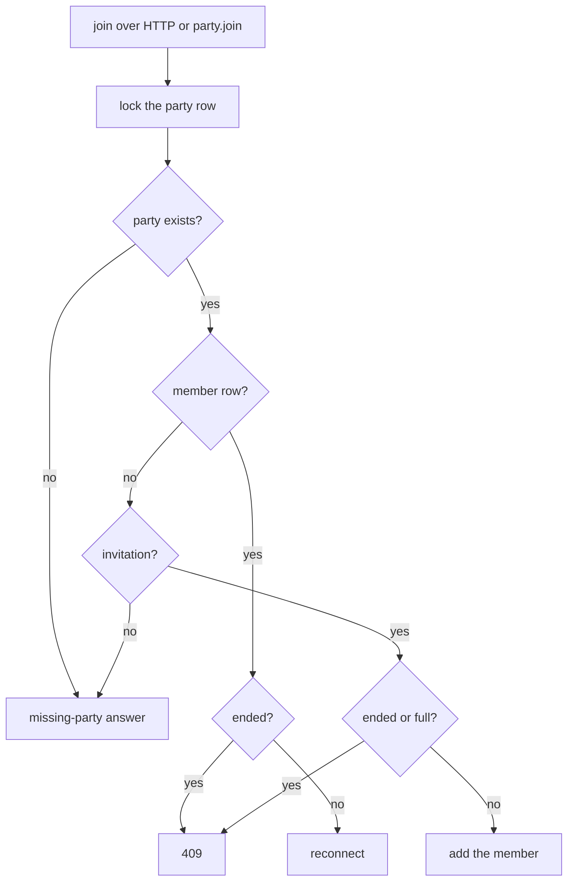
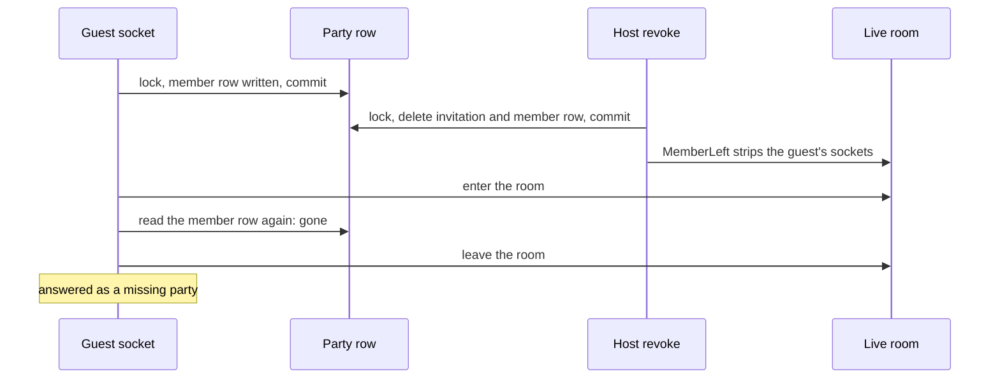

# Party Invitations - Plan

## Goal Capsule

- **Objective:** Only the users a watch party's host has invited can join it, the host can take a user out again, and a signed-in user who is not a member learns nothing from a party's public ID: every party route and socket message answers them as it answers for a party that does not exist.
- **Means:** Host-managed invitation rows, a join gate inside the join handler, and membership changes serialised on the party's row (KTD1 to KTD7).
- **Product authority:** This plan and its Key Decisions. Watch parties are server-side groundwork with no client yet; keep them correct and never remove them (`AGENTS.md`, standing decisions).
- **Execution profile:** PHP application code in `src/Party/`, plus the WebSocket controller and identity lookup in `src/Shared/`. One forward migration and `config/services.yaml`. The committed `openapi.json`, the generated web client and tests. Documentation in `docs-book/`, `src/Party/README.md` and `CONCEPTS.md`.
- **Finish:** `ce-work` on a branch named after this plan, units as local commits; the user has authorized merging and pushing, and publishing the site once the docs change.
- **Stop conditions:** Stop and ask if the party's row cannot be locked through `TransactionPortInterface`, if hiding a party from non-members needs a WebSocket message or error text that does not exist today, or if an invitation turns out to need the invitee's library access.
- **Open blockers:** None.

---

## Product Contract

### Summary

Add host-managed invitations to watch parties. The host invites a user by public ID, revokes an invitation, which also removes the user from the party, and lists the invitations. Joining over HTTP or the WebSocket requires an invitation. Every other party route and message answers a non-member exactly as it answers for a missing party. The defects found beside the join path are fixed in the same work.

### Problem Frame

Since the 0817 plan of 2026-11-17 only members read a party, but anyone signed in who holds the public ID can still join. The ID is a bearer credential that cannot be withdrawn: the host cannot choose who joins and cannot remove anyone.

Sibling routes still tell a non-member that a party exists. `POST /leave` answers `200` and broadcasts a leave that carries the outsider's public ID. `DELETE /{publicId}` answers `200` and changes nothing. `POST /sync` answers `403`. `POST /members/transfer-host` answers `403` or `500`, and resolves the target user before it checks anything about the caller. `party.playback` answers malformed input differently for a real party than for a missing one.

Join itself answers `500` for an ended or full party. Nothing serialises joins, leaves and host changes: the bus has no transaction middleware and every `save()` flushes alone. Two members leaving at once can hand the host role to the one who is leaving (`ROADMAP.md`, residual risks), and a host who transfers the role to themself loses their own host role while the session still names them.

### Key Decisions

- **The host invites specific users; the public ID alone admits no one.** (session-settled: user-directed — chosen over a secret rotatable invite link, and over both combined: the user picked per-user invitations so the host names who may join and can withdraw one user.) Governs R1, R2, R3, R8. It supersedes the Key Decision "The party's public ID works as the invite" and the joining clause of R12 in `docs/plans/2026-11-17-0817-fix-docs-rewrite-follow-ups-plan.md`.

### Requirements

**Invitations**

- R1. A party's host invites a user by the user's public ID with `PUT /api/party/sessions/{publicId}/invitations/{userPublicId}`; the answer is `204`, and repeating the request changes nothing.
- R2. The host revokes with `DELETE` on the same path and gets `204` for a known user whether or not an invitation existed. A revoked user who had joined stops being a member: their member row is gone, their sockets are out of the party's room, and the remaining members see them leave.
- R3. The host lists the party's invitations with `GET /api/party/sessions/{publicId}/invitations/`; each entry carries the user's public ID and the time of the invitation, oldest first.
- R4. Only the current host manages invitations. After the host role moves, the new host manages every invitation of the party.
- R5. The host cannot invite or revoke themself (`422`), and an unknown user public ID answers `404` `User not found.`; only the host can reach either answer.
- R6. An invitation lasts until the host revokes it or until its party or its user is deleted; joining and leaving do not consume it.
- R7. A party's creator holds an invitation from the party's creation.

**Joining**

- R8. A user joins a party, over `POST /api/party/sessions/{publicId}/join` or `party.join`, only as an existing member or with an invitation.
- R9. A join by a user who has neither gets exactly the answer a missing party gets on that transport, whether the party is active, ended or full.
- R10. A member or invited user gets `409` from joining an ended party, and an invited user gets `409` from joining a full one; a member returning to a full party is let in. Over the WebSocket both refusals push `Party operation refused`.
- R11. A revoke holds against a concurrent join: once the revoke has answered, the user has no member row and no socket in the party's room.

**Members only**

- R12. For a signed-in user without a member row, every party route and WebSocket message that names a party, except join (R8 to R10), answers exactly as it does for a missing party, and changes and broadcasts nothing.
- R13. A party message with a malformed payload gets the same answer whether or not the party exists.
- R14. Ending a party changes no membership: its members still read and leave it, and its invitation routes keep working.

**Outcomes for members**

- R15. A member who is not the host gets `403` from ending the party and from transferring the host role. For the host, a transfer to an unknown user answers `404` `User not found.`, and a transfer to a known user who is not a member, or to the host themself, answers `422`. No party route answers `500` for a refusal.
- R16. A party's host always holds a member row: concurrent leaves, a transfer and a revoke cannot leave the host role with a user who is no longer a member.
- R17. The room hears a leave only when a member row was removed.

**Contracts and documentation**

- R18. `openapi.json` and the generated web client describe the invitation routes and the changed answers.
- R19. The operator guide, the developer guide, `src/Party/README.md` and `CONCEPTS.md` describe invitations, and no document says the public ID admits a user.

### Acceptance Examples

AE1. Answers by caller. Covers R1 to R5, R9, R10, R12, R15. "Missing" is the body `{"error":{"message":"Resource not found.","code":404}}` over HTTP and the quoted error text over the WebSocket. A caller who is not signed in gets `401` from every HTTP route, as today.

| Route or message | Missing party | Signed-in non-member | Member, not host | Host |
|---|---|---|---|---|
| `GET /{id}`, `GET /{id}/members/`, `PATCH /{id}/members/me` | `404` | the same `404` | `200` | `200` |
| `POST /{id}/join` | `404` | uninvited: the same `404`. Invited: `200`, or `409` when ended or full | `200`, or `409` when ended | `200`, or `409` when ended |
| `POST /{id}/leave` | `404` | the same `404`, no broadcast | `200` | `200` |
| `POST /{id}/sync` | `404` | the same `404` | `200` | `200` |
| `DELETE /{id}` | `404` | the same `404` | `403` | `200` |
| `POST /{id}/members/transfer-host` | `404` | the same `404` | `403` | `200`; `404` unknown user; `422` non-member target or self |
| `PUT`, `DELETE /{id}/invitations/{user}` | `404` | the same `404` | `403` | `204`; `404` unknown user; `422` self |
| `GET /{id}/invitations/` | `404` | the same `404` | `403` | `200` |
| `party.join` | `Invalid public identity` | uninvited: the same text. Invited: `party.joined`, or `Party operation refused` when ended or full | `party.joined`, or `Party operation refused` when ended | `party.joined`, or `Party operation refused` when ended |
| `party.leave` | `Invalid public identity` | the same text, no broadcast | leaves | leaves |
| `party.playback` | `Invalid sessionId or action` | the same text | no reply, as today | applied and broadcast |
| `party.sync` | `Invalid sessionId format` | the same text | synced | synced |

AE2. Covers R6, R7. A user is invited, joins, leaves and joins again without a second invitation. The creator hands the host role to a member, leaves, and joins again.

AE3. Covers R2, R4. The creator hands the host role to a member; the new host revokes the creator, who is then answered as a non-member on every row of AE1.

### Scope Boundaries

**Outside this work**

- A secret invite link, which the user rejected.
- Any web or desktop client for watch parties.
- Console commands: Party has no admin routes, so the admin and console parity rule does not apply (`.agents/rules/admin-cli-parity.md`).

**Considered and not built**

- A check that the invitee can reach the party's video. Streams are already authorised per viewer (`src/Transcode/Infrastructure/Auth/AuthorizedPlayback.php`), and join has no such check today. A client that shows invitees parties they cannot play would change this.
- A way for an invitee to see or decline their invitations. The host shares the party's public ID out of band, as a playlist owner does. A client would change this.
- A message telling a revoked socket it was removed. It stops receiving party events, exactly as a member who left over HTTP does today. A client would change this.
- A cap on invitations per party. `max_members` (at most 50) bounds who is present. Abuse of the list route would change this.
- Domain events for invitations: nothing would consume them, and each would write an outbox row.
- A column naming who issued an invitation: invitations belong to the party and follow its host.
- A reply to a non-host member's `party.playback`: it stays silent, as the 0817 plan's R4 left it.
- A strip of the user's sockets on every revoke, so that repeating a revoke clears a strip a dead worker missed. The trigger is a worker dying between a revoke's commit and its dispatch, which no caller can force, and the user cannot re-enter either way (Risks). A report of a revoked socket still receiving party events would change this.

### Deferred to Follow-Up Work

- Deleting the user who is a party's host deletes the party by cascade without `PartySessionEnded` and without closing its room (`src/Party/Infrastructure/Doctrine/PartyForeignKeys.php`). The fix is separate work: it lives in the user-deletion path of the Auth context, where `src/Auth/Application/CommandHandler/User/DeleteUserHandler.php` only deletes the user row and no unit here reaches, and it needs a decision on whether the party ends or passes to another member. U7 records it as open in `ROADMAP.md`.
- Nothing prunes the rows of ended parties, and no retention rule says when they should go. U7 records it as open.

### Sources / Research

- Join today: `src/Party/Application/CommandHandler/JoinPartySessionHandler.php`; `handlePartyJoin`, `handlePartyLeave`, `handlePartyPlayback` and `handlePartySync` in `src/Shared/Interface/Controller/WebSocketController.php`.
- Membership rule for reads: `src/Party/Interface/Controller/PartyMembershipTrait.php`.
- Refusal rendering: `src/Shared/Infrastructure/EventListener/ExceptionSubscriber.php` (`respondWithOutcome`), `ApiResponsesTrait::notFound()`.
- Transaction port and its after-commit precedent: `src/Shared/Application/Port/TransactionPortInterface.php`, `src/Auth/Application/CommandHandler/User/DisableUserHandler.php`.
- Row-lock precedents: `src/Catalog/Infrastructure/ArtistMergeService.php`, `src/Catalog/Infrastructure/Doctrine/Repository/AlbumRepository.php`.
- Route shape to mirror: the collaborator routes in `src/Playlist/Interface/Controller/PlaylistController.php`. Do not copy the check order of `RemoveCollaboratorHandler`, which resolves the user first.
- Table template: `party_members` in `migrations/Version20261017000000.php`; migration style in `migrations/Version20261115090000.php`.
- Learnings: `docs/solutions/runtime-errors/doctrine-cannot-update-a-loaded-entity-keyed-by-its-association-under-the-strict-uuid-type.md` and `docs/solutions/runtime-errors/doctrine-refuses-a-flush-after-the-database-cascaded-a-delete-under-managed-children.md`.

---

## Planning Contract

### Key Technical Decisions

- KTD1. **Invitations get their own table and model, in the `PartyMember` shape.** `party_invitations` has a surrogate uuid key, a unique constraint on user and session, and both foreign keys cascading; the model is `PartyInvitation` with its state, repository, Doctrine entity and application port. A member row keeps meaning "is in the party", so no existing read can leak to an invitee. The repository rule requires an entity for a new table and rules out the existing DBAL stores as precedent (`.agents/rules/ddd-repositories.md`). (session-settled: user-directed — chosen over a secret rotatable invite link: per-user invitations need one row per invited user.) Implements R1, R2, R3, R8.
- KTD2. **Membership changes are serialised on the party's row.** Join, invite, revoke, leave and transfer-host each run in `TransactionPortInterface::run` and start with a locking read of the `party_sessions` row. A route has usually loaded the session entity in the same EntityManager before it dispatches, so the locking read must overwrite that managed entity with the row as read under the lock, whatever statement takes the lock. The handler then sees the host and the active flag as they are after the lock; a plain `EntityManager::find` would answer from the identity map. Membership and invitation are decided by existence queries made after the lock. The handler's decision under the lock is the authority; the lookups of KTD4 only shape the answer a non-member gets. The lock's strength and statement form are the postgres specialist's call. Implements R11, R16.
- KTD3. **Party events leave the handler after the commit.** The transaction returns what changed, and the handler then dispatches `MemberJoined`, `MemberLeft` and `PartySessionEnded`: `MemberLeft` only when a member row was deleted, and before `PartySessionEnded`. `LivePartyRoomListener` keeps stripping the room. Dispatched inside the transaction, the listener would strip sockets before the delete is visible, and a socket joining meanwhile would stay. Outbox capture stays outside the transaction, as it is today, where each `save()` commits before the dispatch. Implements R2, R11, R17.
- KTD4. **A non-member takes the missing-party path by construction.** Over HTTP, a route resolves the party and applies `PartyMembershipTrait::belongsTo` before it dispatches, and answers with `notFound()`. Over the WebSocket, `party.leave`, `party.playback` and `party.sync` resolve the party through a member-scoped lookup on `WebSocketIdentityLookupInterface` that returns nothing for a non-member, so the existing missing-party branch pushes its text. Each message validates its whole payload before that lookup. A lookup that cannot tell a non-member from a missing party cannot leak the difference. Implements R12, R13.
- KTD5. **Join decides in the handler and each transport renders the refusal.** The join handler throws one not-found outcome with the message `Resource not found.`, which is not translatable, so `ExceptionSubscriber` renders the body `notFound()` returns in every language. `handlePartyJoin` unwraps it with `HandlerFailure::cause` and pushes `Invalid public identity`. Ended and full throw `ConflictException`. The decision needs the lock of KTD2, so it cannot move in front of the dispatch. After entering the room, `handlePartyJoin` reads the member row again and, when it is gone, leaves the room and answers as for a missing party. Implements R8, R9, R10, R11.
- KTD6. **Invitation writes go through the unit of work under the lock.** Invite inserts only when no invitation exists; revoke deletes the invitation and the member row. The row lock already orders two invites of one party, so no `ON CONFLICT` statement is needed, and the repository rule keeps a statement in SQL only when the unit of work cannot give the same result. Implements R1, R2.
- KTD7. **Refusals use the shared outcomes.** Handlers throw `NotFoundException`, `ConflictException` and `InvalidInputException`, and Symfony's `AccessDeniedException` for `403` as `TransferHostHandler` does; none throws `RuntimeException` (`.agents/rules/admin-cli-parity.md`). Implements R10, R15.

### High-Level Technical Design

The join gate (KTD2, KTD5). Ended and full are checked only after the invitation check, so an uninvited caller gets the missing-party answer whatever the party's state.

A revoke that lands between a WebSocket join's commit and its room entry (KTD3, KTD5). With the other order, room entry first, the strip removes the socket directly.

### Assumptions

These are planning bets the user has not confirmed.

- Revoking an invitation also removes a user who already joined (R2). The alternative, a revoke that only blocks future joins, would leave the host with no way to remove anyone.
- Joining does not consume an invitation, so a member who leaves can come back (R6).
- The creator gets an invitation row (R7). Every member then holds one, a creator who handed the role over and left can come back, and a later host can revoke the creator.
- No library check on invite or join (Scope Boundaries).
- The list shows the user's public ID and the invitation time, with no "joined" flag; the host compares it with the member list (R3).
- A member or invitee joining an ended party gets `409`, and invitation routes do not distinguish an ended party (R10, R14). Such an invitation admits nobody.
- The WebSocket error texts stay as they are, and a full party keeps `Party operation refused` (R10).

### Risks

- A worker that dies between the commit and the dispatch leaves the revoked user's sockets on other workers in the room until they close. Leave has the same exposure today; the member row is gone either way, so the user cannot re-enter.
- A handler can meet a party entity that was loaded before the lock: every HTTP route's lookup before dispatch loads the session, and a long-lived WebSocket worker can hold entities from an earlier message. KTD2's refreshing locking read and existence queries keep a handler from deciding on them; U1's test with the session preloaded and U3's revoke test after an EntityManager clear guard it.

### Sequencing

U1, then U2, U3, U4, U5, U6 and U7, in that order. U4 and U5 both edit `WebSocketController.php`, so they do not run in parallel. Each unit that changes a route's attributes regenerates `openapi.json` and the web client in the same commit, so the drift checks pass at every commit.

---

## Implementation Units

### U1. Serialise leave and host transfer, and fix their refusals

- **Goal:** Leave and transfer-host run under the party's row lock, and leave, transfer-host and end answer with the outcomes of R15 to R17.
- **Requirements:** R15, R16, R17; KTD2, KTD3, KTD7.
- **Dependencies:** None.
- **Files:**
  - The locking read: `src/Party/Domain/Repository/SyncedPartySessionRepositoryInterface.php`, `src/Party/Infrastructure/Doctrine/Repository/SyncedPartySessionRepository.php`, `src/Party/Application/Port/PartySessionPortInterface.php`, `src/Party/Infrastructure/PartySessionService.php`.
  - Removal reports whether a row was deleted: `src/Party/Application/Port/PartyMemberPortInterface.php`, `src/Party/Infrastructure/PartyMemberService.php`.
  - Handlers in `src/Party/Application/CommandHandler/`: `LeavePartySessionHandler.php`, `TransferHostHandler.php`, `EndPartySessionHandler.php`.
  - The transfer target travels as a public ID: `src/Party/Application/Command/TransferHostCommand.php`, `src/Party/Interface/Controller/PartyMemberController.php`.
  - Tests in `tests/Unit/Party/Application/CommandHandler/`: `LeavePartySessionHandlerTest.php`, `TransferHostHandlerTest.php`, `EndPartySessionHandlerTest.php`.
  - Test: `tests/Unit/Party/Interface/Controller/PartyMemberControllerTest.php`.
  - New test: `tests/Integration/PartyMembershipSerializationTest.php`.
- **Approach:**
  1. Add the locking read with the postgres specialist profile, following the postgres-remediation skill.
  2. Leave: lock, delete the member row, promote or end inside the transaction, then dispatch per KTD3.
  3. Transfer-host: the command carries the target's public ID, and the handler locks, then refuses in this order. A missing party is the not-found outcome. A caller who is not the host gets `403`. An unknown target gets `404` `User not found.`. A target who is the caller or not a member gets `422`.
  4. End: a caller who is not the host gets `403` instead of a silent return.
- **Execution note:** Write the self-transfer test first and watch it fail: today the host's member row is demoted while the session still names them.
- **Test scenarios:**
  - A leave by a user with no member row deletes nothing and dispatches no `MemberLeft`.
  - A member's leave dispatches `MemberLeft` once, after the member row is gone.
  - The host leaves with members remaining: the earliest-joined member is the session's host and holds the host role, and `MemberLeft` precedes any `PartySessionEnded`.
  - The host leaves as the last member: the session ends and `PartySessionEnded` follows `MemberLeft`.
  - Transfer to self answers `422` and leaves the host's member row in the host role.
  - Transfer to a user who is not a member answers `422`; transfer by a member who is not the host answers `403`.
  - A member who is not the host and names an unknown user gets `403`; the host naming an unknown user gets `404` `User not found.`.
  - End by a member who is not the host answers `403` and the session stays active.
  - Integration: while a second connection holds the party's row lock, a leave and a transfer-host with a short lock timeout fail on the lock and change nothing.
  - Integration: in a party of three with the session already loaded through the EntityManager, a second connection commits a host transfer to a member; that member's leave then makes the earliest-joined remaining member the session's host, holding the host role.
- **Verification:** The unit and integration tests pass; no handler in `src/Party/Application/CommandHandler/` that this unit touches throws `RuntimeException`.

### U2. Add the invitation table and model

- **Goal:** `party_invitations` exists with its entity, model, repository and port, and passes the schema gates.
- **Requirements:** R6; KTD1.
- **Dependencies:** None.
- **Files:** New migration after `Version20261115120000`; new `src/Party/Infrastructure/Doctrine/Entity/PartyInvitationEntity.php`, `src/Party/Domain/Model/PartyInvitation.php`, `PartyInvitationState.php`, `src/Party/Domain/Repository/PartyInvitationRepositoryInterface.php`, `src/Party/Infrastructure/Doctrine/Repository/PartyInvitationRepository.php`, `src/Party/Application/Port/PartyInvitationPortInterface.php`, `src/Party/Infrastructure/PartyInvitationService.php`. Modify `src/Party/Infrastructure/Doctrine/PartyForeignKeys.php`, `config/services.yaml` (explicit aliases), `tests/Fixtures/LiveUpdates/capture-sources.json`. Tests: new `tests/Unit/Party/Domain/Model/PartyInvitationTest.php`; `tests/Integration/PartyOwnershipPersistenceTest.php`, `tests/Integration/ReferentialIntegrityTest.php`.
- **Approach:**
  1. Give this unit to the postgres specialist profile; it follows the postgres-remediation skill and the database naming page.
  2. Columns: `id` uuid primary key, `session_id`, `user_id`, `created_at` timestamptz. Names: `uniq_party_invitations_user_id_session_id`, `idx_party_invitations_session_id`, `fk_party_invitations_session_id` and `fk_party_invitations_user_id`, both `ON DELETE CASCADE`. No PGroonga index.
  3. Map `user_id` as a scalar uuid declared in `PartyForeignKeys`, and the session as an association, as `PartyMemberEntity` does.
  4. Classify the table `excluded` in `capture-sources.json` and add its two `parent_cascades` rows, following `party_members`.
  5. The migration is new and forward; `down()` is irreversible, as in `Version20261115090000`.
- **Patterns to follow:** `PartyMember`, `PartyMemberState`, `PartyMemberEntity`, `PartyMemberRepository`, `PartyMemberService`.
- **Test scenarios:**
  - A new invitation carries its session, user and creation time, and reconstitutes to the same state.
  - An invitation saved, then found by user and session after the EntityManager is cleared, deletes without error.
  - Deleting the user removes their invitations; deleting the session removes its invitations.
  - The schema comparison is clean, every foreign key has an index that leads with its column, and the naming convention test passes with the new names.
- **Verification:** The schema, naming, referential-integrity and capture-coverage tests pass on a fresh install.

### U3. Let the host invite, revoke and list

- **Goal:** The three invitation routes work for the host, and a party's creator holds an invitation.
- **Requirements:** R1, R2, R3, R4, R5, R6, R7, R11, R14; KTD2, KTD3, KTD4, KTD6, KTD7.
- **Dependencies:** U1, U2.
- **Files:**
  - New commands and handlers: `src/Party/Application/Command/InvitePartyMemberCommand.php` and `RevokePartyInvitationCommand.php`, with their handlers in `src/Party/Application/CommandHandler/`.
  - New interface classes: `src/Party/Interface/Controller/PartyInvitationController.php`, `src/Party/Interface/Resource/PartyInvitationResource.php`, `src/Party/Application/DTO/PartyInvitationView.php`.
  - The list's public IDs: `src/Party/Application/Port/PartyPublicIdentityPortInterface.php`, `src/Party/Infrastructure/PartyPublicIdentity.php`.
  - Modify `src/Party/Application/CommandHandler/CreatePartySessionHandler.php`, `tests/Unit/Shared/Infrastructure/Security/MutationRouteInventoryTest.php`, `openapi.json`, `ui/web/src/shared/api-client/gen/`.
  - Unit tests: new handler tests under `tests/Unit/Party/Application/CommandHandler/`, and `CreatePartySessionHandlerTest.php` there.
  - Functional and integration tests: new `tests/Functional/Controller/PartyInvitationTest.php`, `tests/Functional/Party/PartyLiveRoomWiringTest.php`, `tests/Integration/PartyMembershipSerializationTest.php`.
- **Approach:**
  1. The controller resolves the party and the caller's member row first (KTD4), then dispatches with the invitee's public ID.
  2. Both handlers check in this order under the lock: the caller is the host, the user public ID resolves, the user is not the caller, then the write.
  3. Revoke returns whether a member row was deleted and dispatches `MemberLeft` per KTD3.
  4. The list reads through the port after the same member and host checks, ordered by creation time then ID, and resolves all user public IDs in one lookup.
  5. Create writes the session, the host's member row and the creator's invitation in one transaction, and dispatches its events after it.
  6. The controller repeats the Party OpenAPI tag description exactly, and its `404` descriptions state the hiding rule.
- **Patterns to follow:** The collaborator routes in `PlaylistController` for route shape and status codes; `PartyMemberController` for OpenAPI attributes.
- **Test scenarios:**
  - Covers AE1. The host invites a user: `204`, and a second `PUT` answers `204` and leaves one invitation with its original time.
  - Covers AE1. A member who is not the host gets `403` from `PUT`, `DELETE` and `GET`; a signed-in non-member gets the missing-party body from all three, for a real party and for an unknown ID.
  - The host names an unknown user: `404` `User not found.`. A non-host member naming the same unknown user still gets `403`.
  - The host invites or revokes themself: `422`.
  - Revoking a user who was never invited answers `204` and broadcasts nothing.
  - Revoking an invited user who has not joined answers `204`, removes the invitation, and broadcasts nothing.
  - Covers AE3. Revoking a joined member removes the invitation and the member row, takes the user's socket out of the party's room, and the remaining sockets receive the leave.
  - The list returns the creator's and the invited users' public IDs, oldest first, and no internal UUID.
  - After a host transfer the new host invites and revokes, and the former host gets `403`.
  - Creating a party gives the creator an invitation.
  - Invite, revoke and list answer the host of an ended party as they do for an active one.
  - Integration: while a second connection holds the party's row lock, an invite and a revoke with a short lock timeout fail on the lock and change nothing.
- **Verification:** The functional and unit tests pass; the mutation route inventory names the two new mutation routes; the OpenAPI and client drift checks pass.

### U4. Require an invitation to join

- **Goal:** Join admits members and invited users only, over both transports, and refuses with the outcomes of R9 and R10.
- **Requirements:** R8, R9, R10, R11; KTD2, KTD3, KTD5, KTD7.
- **Dependencies:** U3.
- **Files:** Modify `src/Party/Application/CommandHandler/JoinPartySessionHandler.php`, `src/Party/Interface/Controller/PartySessionController.php` (the join route's description and responses, and the list route's description), `src/Shared/Application/Port/WebSocketIdentityLookupInterface.php` and `src/Shared/Infrastructure/Swoole/WebSocketIdentityLookup.php` (the member-scoped lookup), `src/Shared/Interface/Controller/WebSocketController.php` (`handlePartyJoin`), `openapi.json`, `ui/web/src/shared/api-client/gen/`. Tests: `tests/Unit/Party/Application/CommandHandler/JoinPartySessionHandlerTest.php`, `tests/Unit/Shared/Interface/Controller/WebSocketControllerTest.php`, `tests/Functional/Controller/PartySessionAccessTest.php`, `tests/Functional/Party/PartyLiveRoomWiringTest.php`, `tests/Functional/Shared/Infrastructure/Messenger/ResultStampWiringTest.php`, `tests/Integration/PartyMembershipSerializationTest.php`, new `tests/Integration/WebSocketIdentityLookupTest.php`.
- **Approach:**
  1. The handler follows the gate in High-Level Technical Design, under the lock.
  2. `handlePartyJoin` unwraps the not-found outcome before its generic handler-failure branch, and reads the member row again after entering the room (KTD5).
  3. The three functional tests that join without an invitation invite their guest first; `PartySessionAccessTest` inverts its open-join test and corrects its class docblock.
  4. The list route's description loses the sentence that the public ID works as the invite, and says the host invites the users who may join.
- **Test scenarios:**
  - Covers AE1. An uninvited user's `POST /join` returns a body byte-identical to an unknown party's, for an active, an ended and a full party, with `Accept-Language: da` as well as the default.
  - Covers AE1. An uninvited `party.join` pushes `Invalid public identity`, and the socket is not in the party's room.
  - An invited user joins, reads the party and its members, and appears in their own session list.
  - Covers AE2. An invited member leaves and joins again; the creator hands the role over, leaves and joins again.
  - A member reconnects to a full party; an invited user joining a full party gets `409`, and `Party operation refused` over the WebSocket.
  - A member and an invited user joining an ended party get `409`.
  - A revoked user's `POST /join` and `party.join` get the missing-party answer.
  - `handlePartyJoin`: when the member row is gone after the room entry, the socket leaves the room and gets `Invalid public identity`.
  - Integration: while a second connection holds the party's row lock, a join with a short lock timeout fails on the lock and adds no member.
  - Integration: against the database, the member-scoped lookup returns the session for the host and for a member, and nothing for an invited user who has not joined, an uninvited user, a revoked user and an unknown public ID.
- **Verification:** The unit, functional and integration tests pass; `JoinPartySessionHandler` throws no `RuntimeException`.

### U5. Answer non-members as a missing party everywhere else

- **Goal:** Every remaining party route and message matches AE1 for a non-member, and malformed input reveals nothing.
- **Requirements:** R12, R13, R14, R15; KTD4.
- **Dependencies:** U1, U4.
- **Files:** Modify `src/Party/Interface/Controller/PartySessionController.php` (`leave`, `sync`, `end`), `src/Party/Interface/Controller/PartyMemberController.php` (`transferHost`), `src/Shared/Interface/Controller/WebSocketController.php` (`handlePartyLeave`, `handlePartyPlayback`, `handlePartySync`), `openapi.json`, `ui/web/src/shared/api-client/gen/`. Tests: `tests/Functional/Controller/PartySessionAccessTest.php`, `tests/Unit/Party/Interface/Controller/PartySessionControllerTest.php`, `PartyMemberControllerTest.php`, `tests/Unit/Shared/Interface/Controller/WebSocketControllerTest.php`.
- **Approach:**
  1. The four HTTP routes apply the membership check before any other lookup; `transferHost` already leaves the target user to the handler (U1).
  2. The three WebSocket handlers switch to the member-scoped lookup from U4.
  3. `handlePartyPlayback` validates `action` and `position` before the lookup, so an unknown action, a `join` or `leave` action and a non-numeric position each get `Invalid sessionId or action`.
  4. The OpenAPI `404` descriptions of the changed routes state the hiding rule.
- **Test scenarios:**
  - Covers AE1. For each of `leave`, `sync`, `end` and `transfer-host`, a signed-in non-member's response is byte-identical to the response for an unknown party.
  - A non-member's `POST /leave` reaches no socket in the party's room.
  - `transfer-host` by a non-member naming an unknown user gets the missing-party body, not `User not found.`.
  - Covers AE1. `party.leave`, `party.playback` and `party.sync` from a non-member push the same text as for an unknown party, and the room receives nothing.
  - `party.playback` with an unknown action, with `join` as the action, and with a string position pushes `Invalid sessionId or action` for a real party and for an unknown one.
  - A member of an ended party still reads it, and leaves it.
- **Verification:** Every row of AE1 has a passing test; the OpenAPI and client drift checks pass.

### U6. Update the documentation and the glossary

- **Goal:** The documents describe invitations and the members-only answers, and none says the public ID admits a user.
- **Requirements:** R19.
- **Dependencies:** U3, U4, U5.
- **Files:** `docs-book/part-1-operator-guide/media/watch-parties.md`, `docs-book/part-2-developer-guide/contexts/party.md`, `docs-book/part-2-developer-guide/architecture/real-time-patterns.md`, `src/Party/README.md`, `CONCEPTS.md`.
- **Approach:**
  1. Operator guide: replace the four statements that the ID is the invite, and add an invitations section with the three routes.
  2. Developer guide and README: the commands, ports, endpoints and entities tables, the command count, and the serialisation rule of KTD2.
  3. `real-time-patterns.md`: the `party:{sessionUuid}` room row and the `party.join` row state the refusal and the re-check.
  4. `CONCEPTS.md`: check the "Watch parties" entries against the shipped behaviour.
  5. Run `prose-fix` on the changed prose, with its audit script against a baseline copy.
- **Test scenarios:** Test expectation: none -- documentation only; the site build, the browser tests and the link check are the gates.
- **Verification:** A search of the tracked documents, `openapi.json` and the OpenAPI attributes under `src/Party/Interface/` finds no statement that the public ID lets a user join; the site builds and its tests pass.

### U7. Record the delivery

- **Goal:** `ROADMAP.md` records what shipped, its verification, and what stays open.
- **Requirements:** R19.
- **Dependencies:** U1 to U6.
- **Files:** `ROADMAP.md`.
- **Approach:** Add a record with the suite counts and static gates and the tree each result came from. Mark "Joining with the public ID stays open" in the docs-book follow-ups record as superseded. Move the concurrent-leave residual risk from open to fixed. Add the two items under Deferred to Follow-Up Work as open.
- **Test scenarios:** Test expectation: none -- a record.
- **Verification:** The record cites this plan and states its evidence inline.

---

## Verification Contract

| Gate | Command | Applies to |
|---|---|---|
| Unit tests | `php -d memory_limit=2G vendor/bin/phpunit <touched tests under tests/Unit>` | U1 to U5 |
| Functional and integration tests | `BAANDER_TEST_IMAGE=<ci image> bash scripts/test-functional-container.sh <test files>`, per the testing guide | U1 to U5 |
| PHPStan | `BAANDER_TEST_IMAGE=<ci image> make phpstan` | U1 to U5 |
| Deptrac | `php scripts/check-backend-container.php --image <ci image> -- php ./vendor/bin/deptrac analyse --no-progress` | U1 to U5 |
| OpenAPI drift | `php -d memory_limit=2G bin/console app:export-openapi-spec --format=json --output=openapi.json`, then the same with `--check` | U3, U4, U5 |
| Generated client drift | `corepack yarn generate`, then `corepack yarn generate:check`, in `ui/web` | U3, U4, U5 |
| Docs | `make website-build`; `corepack yarn test:browser --retries=0` and `node --test scripts/*.test.mjs` in `ui/site` | U6 |
| Prose audit | `php .agents/skills/prose-fix/scripts/audit_rewrite.php <baseline> <edited>` per changed page | U6 |
| Whitespace | `git diff --check` | All |

## Definition of Done

- Every unit's tests exist and pass, and the gates above pass; any gate that could not run is reported with the reason.
- Every row of AE1 is asserted for each column, and the non-member column of each row is compared with the missing-party answer.
- `ROADMAP.md` records the delivery with its checkpoint, and `CONCEPTS.md` defines the party terms.
- No code, comment or test cites plan IDs; fixtures use `baander.app` addresses.
- The site is republished when docs-book pages changed, as the user authorized.
- Abandoned attempts and debugging aids are out of the diff.
