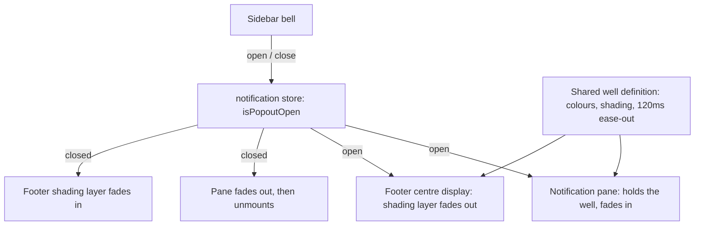

# Notification Pane Well - Plan

## Goal Capsule

- **Objective:** When someone opens the notification history from the sidebar bell, the pane is the one surface on screen with depth, so attention goes to it. The footer player gives up its depth while the pane is open and gets it back when the pane closes.
- **Means:** One shared well definition whose shading fades on a single layer, driven by the pane's open state (KTD1, KTD2, KTD4).
- **Authority:** The request and R1–R7 govern behaviour. KTD1–KTD7 govern mechanism. `ui/DESIGN.md` applies as it stands except where R1–R5 change it; U4 brings the document in line.
- **Execution profile:** Lightweight. Four units on one branch named after this plan, with browser checks against the worktree preview.
- **Stop conditions:** Stop and ask when the footer display at rest cannot paint the pixels it paints today once its shading sits on a layer, or when pane text cannot reach 4.5:1 painted contrast over the well in a mood without changing colours outside the well definition.
- **Finishing:** `ce-work` lands the units as local commits, runs `ce-simplify-code` and `ce-code-review`, and records the delivery in `ROADMAP.md`. Nothing is pushed unless the user asks.

## Product Contract

### Summary

The notification pane takes the well while it is open: gradient shading, inset upper edge and lower lip. The footer player's centre display goes flat for that time. The pane fading in, the footer well fading out and the footer well fading back in all take the same 120ms.

### Problem Frame

The well is the recessed treatment of the music footer's centre display (`TrackDisplay` in `ui/web/src/features/player/components/NowPlayingBar.tsx`). `ui/DESIGN.md` makes it the only surface with material depth, so it is where the eye rests. The notification pane (`ui/web/src/features/notification/components/NotificationPopout.tsx`) is a flat popover that appears without animation above the sidebar bell. While it is open, the footer still holds the only depth cue on screen and competes with the pane the user just asked for.

### Requirements

**Well on the pane**

- R1. While the notification pane is open it shows the well in every mood: shading that darkens toward its upper edge, an inset upper edge and a lower lip.
- R2. Pane text and controls stay readable over the well: at least 4.5:1 painted contrast for text.

**Footer yields**

- R3. While the pane is open, the footer player's centre display shows no well. Its face is flat `--color-muted`; its content, layout and controls do not change.
- R4. When the pane closes, the centre display's well returns.
- R5. Once a handoff has settled, at most one surface shows the well.

**Motion**

- R6. The pane's well appearing, the footer's well disappearing and the footer's well returning each take 120ms with `ease-out`, from one shared definition. With reduced motion requested the changes are immediate.

**Unchanged behaviour**

- R7. Opening and closing the pane by pointer and keyboard, focus return to the bell, and the pane's content behave as before. With the pane closed, the footer renders as it does today.

**Documentation**

- R8. `ui/DESIGN.md` describes the well as a treatment one surface holds at a time and lists the handoff in its Motion table. `CONCEPTS.md` defines the well.

### Scope Boundaries

- The admin bell (`ui/web/src/features/admin/components/layout/AdminNotificationBell.tsx`) is unchanged. The admin shell renders no footer player, so there is no well to hand over.
- The radio player bar stays flat, as it is today.
- No other overlay takes the well: dialogs, menus, the context panel and the playback destination selector keep their rules.
- `ui/rn` is not touched.
- Considered and not built: blocking pointer input on the pane during its 120ms exit. Dialogs and menus here do not block it either, and a click in that window does what the same click did a moment earlier.
- Considered and not built: a duration token in `ui/design-tokens` for the handoff. One web constant serves both surfaces; a token is worth adding when a second platform adopts the well.

## Planning Contract

### Key Technical Decisions

- KTD1. **One shared well definition.** The colour variables, the shading, the secondary text colour and the handoff timing move from `TrackDisplay` into one module under `ui/web/src/shared/theme/`, parameterised by the surface colour. The footer display and the pane both use it, which makes the equal duration in R6 true by construction.
- KTD2. **The shading is one layer and only its opacity changes.** A `background-image` gradient and unregistered custom properties do not interpolate, so a transition on the host fades the inset edge while the gradient snaps. On the footer display the gradient, inset edge and lip sit on one layer between the flat face and the content, and that layer's opacity carries the handoff. Registering the three colours with `@property` was the alternative; it adds global registrations and per-mood overrides for the same visual result.
- KTD3. **The pane paints the well on itself and fades as a whole.** The pane mounts and unmounts, so its enter and exit are keyframe animations keyed on Radix `data-state`, as `ui/web/src/shared/components/ui/tooltip.tsx` does with `fadeIn` and `fadeOut`. Radix keeps closed content mounted only while a CSS animation runs; a transition would not hold it. The pane clips its children with `overflow: hidden`, which would cut a lip painted by a child layer, so the shading goes on the pane element.
- KTD4. **The footer reads the pane's open state from the notification store.** `isPopoutOpen` in `ui/web/src/features/notification/stores/notification-store.ts` already controls the popover. The "Now playing" group exposes whether it holds the well as a data attribute, and the layer's opacity follows that attribute. `AppShell` renders `Sidebar` (which always renders `SidebarPinnedFooter`) and `NowPlayingBar` together, so the popover root is mounted whenever the footer is on screen.
- KTD5. **120ms, `ease-out`.** The Motion rules in `ui/DESIGN.md` allow `ease-out` only and at most 120ms, the value the context panel uses. `--duration-fast` is 150ms and does not fit.
- KTD6. **The pane keeps its face, border, radius and size; its muted text takes the well's secondary colour.** Its face stays `--color-popover` and the shade derives from that colour. It gains no drop shadow. Computed from `ui/design-tokens/build/web/theme.css`, `--color-muted-foreground` drops from 4.83:1 on the warm mood's flat popover to 4.43:1 on its shade, below R2. The footer display already answers this with `--player-secondary-text`, 85% muted foreground and 15% foreground, which computes to 4.98:1 on the same shade. That colour moves into the shared well definition and the pane's muted text uses it.
- KTD7. **Escape in the pane still ends with focus on the bell.** While the closed pane stays mounted for its exit animation, its Escape keydown bubbles through the portal to the Escape handler on the sidebar (`ui/web/src/features/layout/components/Sidebar.tsx`), which focuses the navigation toggle. Radix counts that focus move as an outside interaction and then does not return focus to the bell. The pane keeps its Escape from having that effect. Stopping the key at the pane, as `ui/web/src/features/layout/components/ContextPanel.tsx` does for its own Escape, is the expected way, provided the navigation's state after Escape matches today's; U2 checks that first.

### Assumptions

The user saw these four calls before planning and has not yet answered them.

- The pane also fades out over 120ms on close, so the two wells cross-fade in both directions. The request describes only the footer side of the close.
- The footer display keeps its flat face while it yields; only shading, inset edge and lip fade.
- The admin bell is out of scope.
- `ui/DESIGN.md` changes from "the footer well never animates and is the only surface with depth" to "one surface holds the well at a time".

### High-Level Technical Design

### Risks

- **Exit animation under jsdom.** `sidebar-notifications.test.tsx` asserts the pane is gone right after Escape, an outside click and a principal change. Declare the pane's enter and exit with the `animation` shorthand, as `tooltip.tsx` does. jsdom 30.1.3 reports `animation-name: none` for the shorthand, so Radix unmounts the pane at once; for a longhand `animation-name` it reports the name, and Radix waits for an `animationend` that jsdom never fires. The Vitest suite therefore does not show that the exit animation exists; the browser spec does.
- **Rest-state drift.** Moving the footer shading to a layer must not change a pixel at rest. `ui/web/tests/e2e/styling/footer-material.spec.ts` asserts thresholds and compares no captures, so it cannot show this. The before-and-after sample comparison in U1 is the proof.
- **Theme changes.** `html.theme-transitioning *::before` in `ui/web/src/shared/theme/GlobalStyles.tsx` replaces the transitioned properties for 120ms after a theme change, so a handoff in that window is immediate. Accepted.

### Sources

- `docs/solutions/best-practices/browser-font-checks-that-pass-without-proving-anything.md`: break the thing a browser check guards and confirm the check fails before trusting it.
- `ui/web/tests/e2e/playback-destinations/sidebar-notifications.spec.ts`: route mocks for the notification list and unread count.
- `ui/web/tests/e2e/styling/fixtures.ts`: `populatedCatalog` gives an active footer player from catalog fixtures and a silent WAV.

## Implementation Units

### U1. Shared well definition with the footer shading on a layer

- **Goal:** One definition of the well in the shared theme, used by the footer display, with no visible change.
- **Requirements:** R7; prepares R1, R3, R6.
- **Dependencies:** none.
- **Files:** `ui/web/src/shared/theme/well.ts` (new), `ui/web/src/shared/theme/index.ts`, `ui/web/src/features/player/components/NowPlayingBar.tsx`.
- **Approach:** Per KTD1 and KTD2. The module exports the well's colour variables with the dark-mood override, the shading declarations, the secondary text colour that `TrackDisplay` defines today as `--player-secondary-text`, and the handoff duration and easing. `TrackDisplay` keeps its flat `--color-muted` face and paints the shading on a layer behind its content. Define the colour variables on the host, not inside the layer block, so the mood override selector resolves against the component.
- **Execution note:** Before editing `TrackDisplay`, record the centre display's painted pixels in its empty right padding column, from the row above its upper edge through the lip row, in all four moods at 1280px with a track loaded and paused. After the change the same samples must be identical. A difference is the first stop condition.
- **Patterns to follow:** mixins in `ui/web/src/shared/theme/mixins.ts`.
- **Test scenarios:** Test expectation: none -- rendering-preserving refactor, shown by the comparison in the execution note. `footer-material.spec.ts` and `ui/web/src/features/player/components/__tests__/NowPlayingBar.test.tsx` pass unchanged.
- **Verification:** The before-and-after samples are identical in all four moods, and the footer material spec passes at 390, 768 and 1280px.

### U2. The pane takes the well and fades in and out

- **Goal:** The notification pane shows the well and animates on open and close.
- **Requirements:** R1, R2, R6, R7.
- **Dependencies:** U1.
- **Files:** `ui/web/src/features/notification/components/NotificationPopout.tsx`, `ui/web/src/features/notification/components/NotificationItem.tsx`, `ui/web/src/features/notification/components/LiveOutageItem.tsx`, `ui/web/src/features/layout/components/__tests__/sidebar-notifications.test.tsx`, `ui/web/tests/e2e/styling/well-handoff.spec.ts` (new), `ui/web/tests/e2e/styling/helpers.ts`, `ui/web/tests/e2e/playback-destinations/sidebar-notifications.spec.ts`.
- **Approach:**
  1. Per KTD3, apply the shared well with `--color-popover` as the surface and add the enter and exit animations with the shared timing, written with the `animation` shorthand.
  2. Per KTD6, the pane's muted text takes the well's secondary colour: the header label, "Mark all read", timestamps, and the empty, loading and error messages. `LiveOutageItem` is also rendered by the admin bell, where it keeps its current colour.
  3. Per KTD7, keep the pane's Escape from moving focus to the navigation toggle.
  4. Move `paintedContrast` from `footer-material.spec.ts` into `styling/helpers.ts` when the new spec needs it, adapting its sampling column to the pane's layout.
- **Execution note:** Before adding the exit animation, record what Escape in the open pane does today at 390px with the navigation expanded: where focus lands and whether the navigation collapses. The result after the change must match on both points.
- **Patterns to follow:** `data-state` animations in `ui/web/src/shared/components/ui/tooltip.tsx`; notification route mocks in `ui/web/tests/e2e/playback-destinations/sidebar-notifications.spec.ts`.
- **Test scenarios:**
  - Existing Vitest cases pass unchanged: the pane is removed after Escape, after an outside click and after a principal change, and focus returns to the bell.
  - Browser, 390 and 1280px, all four moods: with the pane open and settled, its painted upper edge is darker than its face at mid-height, and the row below the pane shows the lip, not clipped.
  - Browser, all four moods: every text label in the pane reaches 4.5:1 painted contrast, including the header label and "Mark all read" at the upper edge, the notification title and its timestamp on an unread row.
  - Browser: the pane's computed animation duration is 120ms with `ease-out` on open and on close.
  - Browser, 390px, navigation collapsed and expanded: Escape with focus inside the pane closes it and leaves focus on the bell, and the navigation's expanded state is what it was before this change.
  - Browser: the admin bell's outage entry keeps its current text colour.
  - Browser: `ui/web/tests/e2e/playback-destinations/sidebar-notifications.spec.ts` passes, including containment at 390px.
- **Verification:** The pane opens and closes with a fade, shows the well in all four moods, keeps Escape's focus return, and every existing notification test passes.

### U3. The footer yields the well while the pane is open

- **Goal:** The footer display goes flat while the pane is open and takes the well back on close, with the same timing as the pane.
- **Requirements:** R3, R4, R5, R6.
- **Dependencies:** U1, U2.
- **Files:** `ui/web/src/features/player/components/NowPlayingBar.tsx`, `ui/web/src/features/player/components/__tests__/NowPlayingBar.test.tsx`, `ui/web/tests/e2e/styling/well-handoff.spec.ts`.
- **Approach:** Per KTD4. The music bar selects `isPopoutOpen`, marks the "Now playing" group, and the shading layer's opacity transitions with the shared timing.
- **Execution note:** After the browser spec passes, remove the yield and confirm the spec fails, then restore it.
- **Test scenarios:**
  - Vitest: with `isPopoutOpen` true the "Now playing" group reports that it has yielded the well; setting it false reports that it holds the well again.
  - Vitest: the radio player bar renders unchanged when `isPopoutOpen` is true.
  - Browser, 390 and 1280px, dark and balanced moods, a track loaded and paused: opening the bell leaves the footer display's painted face one colour from top to bottom with no lip below it.
  - Browser: closing the pane with Escape brings back the darker upper edge and the lip on the footer display, and removes the pane.
  - Browser: the footer layer's computed transition duration and easing equal the pane's animation duration and easing, and the layer's running transition after a toggle is on `opacity` only.
  - Browser: labels and sliders in the footer display keep their minimum painted contrast while it is flat (4.5:1 for text, 3:1 for controls).
  - Browser, reduced motion emulated: both surfaces report a duration of at most 0.01ms.
  - `ui/web/src/features/player/stores/__tests__/player-performance.test.tsx` passes with unchanged render counts.
- **Verification:** With a track loaded, opening the bell flattens the footer display as the pane fades in, and closing it restores the well, at both widths and in both moods.

### U4. Describe the well and its handoff

- **Goal:** The design contract, the glossary and the testing guide match the delivered behaviour.
- **Requirements:** R8.
- **Dependencies:** U2, U3.
- **Files:** `ui/DESIGN.md`, `CONCEPTS.md`, `docs-book/part-2-developer-guide/testing/frontend-and-browser.md`.
- **Approach:**
  1. `ui/DESIGN.md`, Philosophy: name the notification pane as the second application of the material treatment.
  2. Footer player: the treatment is static at rest with no pointer-driven lighting; replace "the only surface on screen" with the one-well rule and say the display goes flat on `--color-muted` while the pane holds the well.
  3. Add a short notification pane passage under Layout: it holds the well while open and keeps its `--color-popover` face, border and 16px radius, with no drop shadow.
  4. Surfaces and the two anti-pattern rows: the gradient and shadow exception names the well, not only the footer.
  5. Motion table: add "Well handoff (notification pane open/close) | 120ms | ease-out".
  6. `CONCEPTS.md`: confirm the "Well" entry matches what was built.
  7. Testing guide: name `tests/e2e/styling/well-handoff.spec.ts` beside the footer material check and say what it samples.
  8. Run `prose-fix` on the changed prose.
- **Test scenarios:** Test expectation: none -- documentation.
- **Verification:** No passage in `ui/DESIGN.md` still says the footer display is the only surface with depth or that the treatment never animates.

## Verification Contract

| Check | Command | Applies to |
|---|---|---|
| Types | `yarn --cwd ui/web typecheck` | U1–U3 |
| Lint | `yarn --cwd ui/web lint` | U1–U3 |
| Unit and DOM tests | `yarn --cwd ui/web test` | U1–U3 |
| Build | `yarn --cwd ui/web build` | U1–U3 |
| Preview | `make preview-up`, then `make preview-url` | U1–U3 |
| Browser | `E2E_BASE_URL="$(make preview-url)" yarn --cwd ui/web e2e:headless tests/e2e/styling/well-handoff.spec.ts tests/e2e/styling/footer-material.spec.ts tests/e2e/styling/browsing-playback.spec.ts tests/e2e/playback-destinations/sidebar-notifications.spec.ts` | U1–U3 |

The browser specs sign in through the real login flow of the worktree preview and mock only catalog and notification reads.

## Definition of Done

- R1–R7 hold, each shown by the scenarios of the unit that cites it. R8 holds by the verification line of U4.
- The U1 before-and-after samples of the footer display were identical in all four moods.
- Every check in the Verification Contract passes, and the report names any check that did not run.
- The U3 guard check was done: the handoff spec failed with the yield removed.
- No code from an abandoned attempt remains in the diff.
- `ROADMAP.md` records the delivery with its commits and verification checkpoint: Vitest counts, the browser specs run with widths and moods, typecheck, lint and build.
