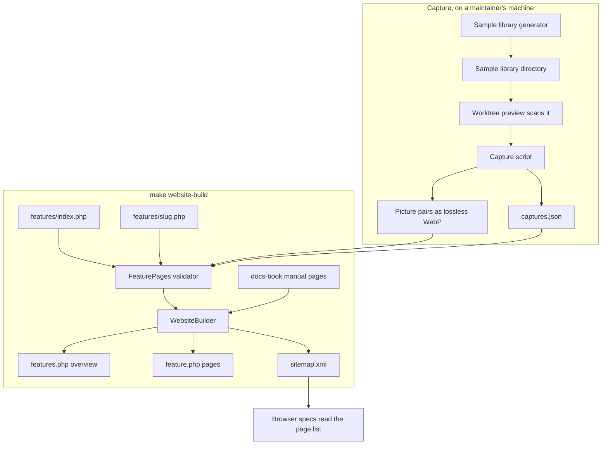

# Website Feature Pages - Plan

## Goal Capsule

- **Objective:** A visitor to `baander.app` can open a page about one Bånder feature, see it in real pictures, learn how to use it in a few steps and know its limits, and nothing they read or see is untrue of the shipped application.
- **Means:** A features overview and ten feature pages built from validated data files, illustrated by pictures captured from the running application with a fictional sample library (KTD1, KTD6, KTD7).
- **Product authority:** This Product Contract. The prose-fix rules in `.agents/skills/prose-fix/SKILL.md` ("Present a feature") and `references/jobs.md` govern the copy wherever this contract does not say more.
- **Execution profile:** Website tooling under `packages/baander-tooling/src/Website/`, templates, styles, data and scripts under `ui/site/`, and documentation. No application code, schema or API change.
- **Finish:** `ce-work` on branch `feat/site-feature-pages`, units as local commits. Push and publication happen only when the user asks.
- **Stop conditions:** Stop and ask when a picture other than the playback destinations pair cannot be produced without staging data in the browser (R10), when a page cannot be made inviting without a claim its sources do not support (R5), or when closing a gap would need a change to the application.
- **Open blockers:** None.

---

## Product Contract

### Summary

The site gains a features overview at `/features/` and ten feature pages for listeners, operators and developers. Each page opens in the Jobs register, shows the feature in pictures taken from the real application, walks through a short guide and states the feature's documented limits. The work also corrects the published statements that the application does not bear out.

### Problem Frame

The site has a homepage, the Bånder Audio Core page, a typography page and the manual. A visitor who wants to know what the equalizer does, how playlists are shared or what an operator sees while a library scans has the homepage's four sections or the operator manual, and nothing between them. Developers get a guide but no page that says why they would open it.

The pictures the site does show are out of date and show a private collection. Six of them were captured on 2026-10-31 from the user's own music library. `ui/site/assets/screenshots/playlists.webp` shows an "Updating..." label the application removed on 2026-11-16 and "Unknown artist" on every row, which the scan fix of 2026-11-14 corrected. No capture script was ever committed, so nobody can retake them the same way.

Some published statements are false. The homepage says smart playlists select music by rules (`ui/site/templates/home.php:139-140`) and so does `README.md:69-70`; `docs-book/part-2-developer-guide/contexts/playlist.md:3` states that no code evaluates the rules, and the code agrees (`src/Playlist/` stores `smartRules` and never reads them back to fill a playlist). `README.md` also overstates file watching, Discogs and Last.fm enrichment and worker resource limits against the operator guide. Feature pages written from those sentences would repeat them.

### Key Decisions

- **A first round of ten pages, chosen by evidence.** A feature gets a page when a maintained document states it is available and the web application has a screen to photograph. Governs R1, R2, R7.
- **Pictures show a fictional collection.** The user's library holds commercial releases; the approved playback destinations picture already uses invented names. Governs R10.
- **Claims are checked for the whole page, not only its opening.** The user asked for no deceptive statements anywhere on the page. Governs R5, R6.
- **Corrections land before the pages.** A page may cite only a sentence that is true. Governs R9.

### Requirements

**Pages**

- R1. The site publishes an overview at `/features/` that groups the feature pages for listeners, operators and developers, and lists under "More in Bånder" the shipped features that have no page yet, each with the qualifier its documentation states and a link to the manual page that states it.
- R2. The first round publishes ten pages: for listeners the music library, the player, the equalizer, lyrics, playlists and playback destinations; for operators libraries and scanning, administration and the console; for developers one page.
- R3. Every feature page has an opening (feature name, headline, lead), a hero figure, a tour of two to four sections, a "Try it" guide, a labeled limits section, and links to the previous page, the next page and the overview. The guide first says what the reader needs; on listener and operator pages that line states that Bånder is pre-release and installs by building from source, and links to the installation guide. Links to manual pages appear when a manual page suits the reader.
- R4. Copy is short and plain: one idea per tour section, a headline of a few words, paragraphs of one to three sentences, and each picture shows what the text beside it describes.

**Truthfulness**

- R5. Every claim on a feature page and on the overview is supported by `README.md`, the operator guide or the developer guide, with code as corroboration, and each page's claim ledger is recorded in the commit that adds the page.
- R6. A claim that is false without its qualifier keeps the qualifier beside it: off by default, administrator only, needs operator setup, signed-in browsers only. Planned features read as planned. Every other documented limit appears in the page's limits section.
- R7. The pages do not present as available what the documentation or the application does not bear out: rule-driven smart playlists, a watch-party screen, a browser push subscription, catalog import through file watching.
- R8. Openings are written in the Jobs register, name no competing product and show no ce-noslop findings beyond that skill's false-positive floor.
- R9. The homepage and `README.md` no longer state what R7 excludes or what the operator guide contradicts, and shipped web behaviour that a page presents but no maintained document describes is documented first.

**Pictures**

- R10. Every application picture is captured from the running application showing a generated sample library, with nothing replaced or injected in the browser. No picture shows the name of a real artist or act, a real release (an album or track title under the artist who released it), third-party artwork, or a real person's name or address. One exception is allowed: if the multi-device retake of playback destinations fails, the approved pair of 2026-11-04 stays, and its caption and capture record state that its names and covers were substituted in the browser.
- R11. Every application picture exists as a dark and a light variant of the same view in the same state, with equal dimensions. For a view the application draws only during playback, the same state means the same view, track and controls; the playback clock and live readouts may differ.
- R12. Pictures are legible where they are shown. On a page with application pictures the hero is a full application window displayed at its captured size on a desktop, and tour pictures are detail crops displayed no larger than captured. On the console and developer pages the hero is a manual block that fits the content column without scrolling sideways.
- R13. Any maintainer can retake the pictures: the sample library generator and the capture script are tracked, and each picture has a tracked capture record.
- R14. A capture run sends no sample name to an external service and refuses to run when the catalog is not exactly the sample library.
- R15. Code and diagrams on the console and developer pages are the manual's own rendered blocks, not copies.

**Site integration**

- R16. The pages are reachable from the header, the footer and the matching homepage sections, are listed in the sitemap, and describe themselves with a canonical URL, a "Features" breadcrumb and a title of the form "Name — Features — Bånder".
- R17. The pages keep the site's existing guarantees: readable without JavaScript, contained at 390 px and 1440 px, correct in light and dark, no layout shift after first paint, text rendered from bundled fonts, no request to another origin.
- R18. The build fails, names the data file and reports every error in one run when a picture is missing, exists in one theme only, differs in size between themes, has no capture record or exceeds the size ceiling; when a required part is missing or a key is unknown; when a title or description is too long or repeated; when the page order and the data files disagree; and when a manual link or manual block reference does not resolve.
- R19. The homepage's six pictures from 2026-10-31 are replaced by captures of the same views from the sample library.
- R20. The site README describes how to add a page and retake pictures, the prose-fix house style maps the new copy to its registers, and `CONCEPTS.md` and `ROADMAP.md` record the new terms and the delivery.

### Acceptance Examples

- AE1. **Covers R6.** **Given** fetching lyrics from LRCLIB is an administrator action and automatic fetching is off by default, **when** the lyrics page describes where lyrics come from, **then** `.lrc` files beside the tracks are presented without a qualifier, and the LRCLIB sentence says an administrator fetches them or switches automatic fetching on.
- AE2. **Covers R6, R7, R9.** **Given** playlist rules are stored and never evaluated, and the create form has a "Smart playlist" switch, **when** the playlists page and the homepage playlists section are read, **then** the homepage section and the page's opening, tour and guide mention neither smart playlists nor rules, the homepage heading no longer reads "Or set the rules.", and the page's limits section says that the switch stores rules Bånder does not evaluate.
- AE3. **Covers R6.** **Given** casting to AirPlay, Chromecast and DLNA is planned, **when** the playback destinations page describes moving playback, **then** it names only browsers signed in to Bånder, and casting appears in a note labeled planned.
- AE4. **Covers R11, R18.** **Given** a data file names a picture whose light variant is missing, **when** the site is built, **then** the build fails before rendering and the message names the data file, the picture and the missing variant.
- AE5. **Covers R14.** **Given** a preview whose catalog holds an album the generator did not make, **when** the capture script starts, **then** it stops before taking a picture and names the unexpected album.
- AE6. **Covers R15, R18.** **Given** the developer page borrows a diagram from a manual page, **when** an edit to that manual page removes the text the reference matches, **then** the build fails and names the data file, the manual page and the reference.

### Success Criteria

- The user judges each page inviting and easy to read, in the manner of the Mac OS X feature pages: relevant, not flashy.
- A reader who knows nothing about Bånder can say after one page what the feature does and how to try it.
- The user has looked through every new picture and approved it before the site is published.

### Scope Boundaries

**Deferred to follow-up work**

- Feature pages for internet radio, movies, transcoding, accounts and passkeys, notifications, and metadata matching. Each has an entry under "More in Bånder" in this round. Radio needs an operator's station sync and shows real station names; a passkey picture needs a virtual authenticator; a match dialog cannot show a fictional album; the notification pane is being redesigned in parallel work (`docs/plans/2026-11-17-1705-feat-notification-pane-well-plan.md`).
- The operator guide contradicts itself on `app:watch-files` without `--path` (`media/library-management.md:98` against `commands/app-watch-files.md:30,58-61`). Recorded as an open item.

**Outside this work**

- Publishing or deploying the site, and pushing the branch.
- Any change to the application, its API or `ui/rn`.
- A hosted demo instance.
- Adding the feature pages to the manual's search index. The search box lives on the manual and searches the manual.
- A CI job that retakes pictures. Capturing needs a running application with workers.

**Considered and not built**

- Narrowing the homepage's sitemap sources to its own pictures. Any new picture moves the homepage's last-modified date; a date that is too recent harms nothing. Revisit if the picture directory is split.
- Loading the diagram explorer script on feature pages. It inserts a hint after first paint, and the pages allow no layout shift. Borrowed diagrams stay static and link to the manual page.
- A machine-checked link from each claim to its source. The prose-fix skill already records the ledger in the commit; a second record would drift from it.
- An allowlist of elements in prose fields. Maintainers write the data files and reviewers read them; the validator checks only that a field is well-formed and stays on the site. Revisit if a page ships with markup that should not be there.
- A build rule that caps a borrowed diagram's size. One page borrows one diagram in this round, and a browser test on that page checks its fit.

### Sources / Research

- Site build: `packages/baander-tooling/src/Website/WebsiteBuilder.php` (public pages at `:125-145`, link and fragment validation at `:539-591`, asset copy at `:525-537`), `Command.php:15` (`SITE_SOURCES`) and `:58-97` (public page descriptors), `SearchMetadata.php:76-121` (page metadata, trail and title).
- Templates and styles to follow: `ui/site/templates/home.php` (hero, `.experience-feature`, `.wide-feature`, `.feature-note`, `.process-list`), `templates/screenshot.php`, `assets/site.css:47-63` (theme picture pairs), `:65-68` (heading cap that keeps fallback-font wrapping stable).
- Tests that pin the site: `ui/site/tests/website.spec.ts:20-33` (containment), `:62` (header "How it works" link), `:135-170` (sitemap, descriptions under 160 characters, no duplicate titles), `:515-525` (bundled fonts); `experience.spec.ts:126-146` (390 px pictures), `:166-202` (theme pairs); `stability.spec.ts:48` (page list).
- Existing pictures and their history: `ui/site/README.md:105-133`; commits `5c1492cbc`, `33156c1d3`, `18ffbc35d`. The destinations pair is 2272 × 1420, captured at 1136 × 710 and device scale 2 with the violet accent; its artist, album and song names are the sample library's vocabulary.
- Feature evidence and limits, by page:
  - Library: `README.md:13-15,27-30`; `docs-book/part-1-operator-guide/media/library-management.md:104-118`.
  - Player: `README.md:54-56`; `docs-book/part-2-developer-guide/contexts/user-preference.md:17`; no gapless claim (`testing/frontend-and-browser.md:153-154`).
  - Equalizer: `README.md:58-61`; `contexts/user-preference.md:15,18`; analyser limit `testing/frontend-and-browser.md:191-193`.
  - Lyrics: `README.md:43-46`; `contexts/lyrics.md:3,24,30,36,63-66`; `media/external-apis.md:17,26,39`; `configuration/server-settings.md:38`.
  - Playlists: `README.md:69-72` (minus smart playlists); `contexts/playlist.md:67-109`; `maintenance/security.md:303`.
  - Playback destinations: `contexts/session.md:3,57-66`; `development/api-reference.md:52`; casting planned in `architecture/communication-map.md:93-97` and `ROADMAP.md:180-198`.
  - Libraries and scanning: `media/library-management.md:3,19-21,43-53,70-76,133-145`; `media/external-apis.md:9-17,63-79`.
  - Administration: `operations/README.md:37-69`; `operations/job-monitoring.md:7-13`; `administration/user-management.md:54-79`; `configuration/server-settings.md:33-47`; `operations/health-and-metrics.md:9-15`.
  - Console: `commands/README.md` (153 commands in 14 families).
  - Developers: `architecture/overview.md:11-35,68-110`; `development/api-reference.md:3,9`; `development/frontend-development.md:164-179`; `architecture/real-time-patterns.md:3,107`; `getting-started/development-environment.md`; `testing/README.md`; `contributing/contributing.md`.
- Web screens to capture: routes in `ui/web/src/features/layout/routes.tsx`; equalizer panels in `ui/web/src/features/equalizer/components/`; lyrics in `ui/web/src/features/layout/components/LyricsTab.tsx`; search overlay in `SpotlightOverlay.tsx`; admin tabs in `ui/web/src/features/admin/pages/`.
- Preview and accounts: `docs-book/part-2-developer-guide/getting-started/development-environment.md` (worktree preview, `dev.local.json` library mounts, lifecycle commands retain data); `src/Auth/Interface/Console/CreateUsersCommand.php:32-41` (seeded development accounts, which must not appear in a picture).
- Learnings: `docs/solutions/best-practices/browser-font-checks-that-pass-without-proving-anything.md` (break the guarded thing and confirm the test fails), `docs/solutions/performance-issues/overlapping-unicode-range-fonts-download-unused-slices.md`.

---

## Planning Contract

### Key Technical Decisions

- KTD1. **One data file per page and one index.** `ui/site/features/<slug>.php` returns the page's content; `ui/site/features/index.php` returns the audience groups in order, each group's page slugs in order, and the "More in Bånder" entries. Two templates render them: `feature.php` for a page and `features.php` for the overview. The overview, previous and next links, sitemap entries and tests all read the index, so a page cannot be listed in one place and missing in another. Governs R1, R3, R16.
- KTD2. **Validation in the tooling, in two stages.** A `FeaturePages` class loads the index and data files and checks everything that needs only the files before the build starts: structure, unknown keys, lengths, duplicates, pictures and their records. The builder checks manual links and manual block references after it has discovered the manual and before it renders blocks. Both stages collect every error and throw once. Governs R18.
- KTD3. **Prose fields hold inline HTML.** Lead, tour, guide and limits text is written as `home.php` is, with links, `code`, `kbd`, `strong`, `em` and line breaks. The validator requires each field to be well-formed and rejects a link that leaves the site; the existing artifact check resolves every link. Names, alternative text and the search description are plain text that the template escapes.
- KTD4. **Two picture kinds.** A screenshot pair (R10, R11) or a manual block (R15). Console output and code samples are never stored as separate text: when a page needs an example the manual lacks, the example is added to the manual page first.
- KTD5. **Picture sizes follow the slots that show them.** A hero is a 1136 × 710 window at device scale 2 in a full-width figure, the size of the site's 1136 px content column. A tour picture is a crop at device scale 2, at most 536 CSS px wide in a two-column section and 1136 in a full-width section, shown at half its pixel size and never enlarged. A hero manual block fits the 1136 px column and stands no taller than a hero picture. Every template takes picture dimensions from the files, the homepage included, so `home.php` stops hard-coding them. Governs R12.
- KTD6. **The sample library is generated and scanned for real.** A tracked script writes FLAC files with embedded generated covers, tags and `.lrc` files into an untracked directory, and the worktree preview mounts that directory through its own `dev.local.json`. The audio is synthesized tones, so the analyser and synced lyrics move; tracks keep album-length durations, and one track carries a steady multi-tone signal for pictures that include the analyser. Artist, album and song names extend the vocabulary of the approved destinations picture. FLAC is used because the tag readers cover it and M4A tags are not read. Governs R10, R13.
- KTD7. **The capture script drives the real interface.** It uses the Playwright already in `ui/site`, signs in through the login page as sample accounts created with console commands (a listener, a second listener for sharing, an administrator), and performs the same steps the page's "Try it" guide lists, so a renamed control fails the capture. It takes the dark picture, switches the account's theme and takes the light picture from the same state, with the accent left at the default violet. That state is paused where the view allows it. The application clears the analyser when playback pauses (`ui/web/src/features/equalizer/components/EqualizerAnalyzer.tsx:323-327`), so pictures that include it are taken while the steady track plays. Scenes are repeatable: each finds or creates by name what it needs, so a second run photographs the same state. Chromium runs with audio muted. Pictures are encoded as lossless WebP and compared pixel for pixel with the capture. Governs R10, R11, R13.
- KTD8. **Capture preconditions are asserted, never arranged by reset.** Before the first picture the script requires that the catalog's artists and albums equal the generator's manifest, that the only library is the sample library, that the accounts are exactly the three sample accounts, that `metadata.auto_sync` and `lyrics.auto_fetch` are off, that every cover has loaded and that no scan or background job is pending. It opens no screen that looks names up at a provider: no match dialog, no metadata search, no lyrics search. It never resets the database or deletes data. Removing the two development accounts a new preview seeds is a documented preparation step the maintainer runs with `app:user:delete`. Governs R14.
- KTD9. **A tracked capture record, checked by the build.** `ui/site/assets/screenshots/captures.json` holds, per picture, the scene that took it, the application commit, the date and the SHA-256 of both files. The build fails when a picture a feature page references has no record or a hash differs, which catches a pair retaken in one theme only and a file edited by hand. The record replaces per-picture paragraphs in the README. A pair kept under R10's exception carries a note in its record saying what was substituted. Governs R13, R18.
- KTD10. **Manual blocks are resolved inside the builder.** A data file names a manual page and a text the block's source must contain; exactly one block of that page must match. The builder resolves the reference after block rendering and passes the rendered HTML to the template, which wraps it in an element carrying the `manual-article` class so the manual's code and diagram styles apply unchanged. A borrowed diagram must carry `accTitle` and `accDescr`, which become its caption and alternative text. Governs R15.
- KTD11. **Name and headline are separate.** `name` is the feature's short name: it appears in navigation, cards, the breadcrumb, the title and as the eyebrow above the headline. `headline` is the page's `<h1>`. Public page descriptors gain an optional trail so a feature page's breadcrumb data and title carry "Features". Governs R16.
- KTD12. **"Features" replaces "How it works" in the header.** The header already wraps close to its limit at 390 px; a sixth link would add a row. The homepage hero keeps its "How Bånder works" link to the same section. The footer gains a "Features" link.
- KTD13. **Browser specs take the page list from the built sitemap.** The specs cannot read PHP data. They read the `/features/` URLs from `var/website/sitemap.xml` when they load, and one test asserts that the overview links to exactly those pages, so a dropped page fails instead of shrinking the matrix. Governs R17.
- KTD14. **Registers by part.** The opening of each page and of the overview is Jobs. Tour sections and the guide are Chen: the situation first, then what happens in order. The claim rules of "Present a feature" apply to every sentence on the page (R5), and each page's ledger covers the whole page.
- KTD15. **No movies page in this round.** `README.md:76-80` and the operator guide document movie browsing and playback, and the homepage hero names movies. `AGENTS.md` treats the movie code as groundwork, `ROADMAP.md:898-904` lists Safari, DASH browser playback and subtitles as unqualified, and a picture would need a transcoded sample film. Movies get a "More in Bånder" entry that says what the documentation says, with its qualifier about encoders and browsers.
- KTD16. **Corrections and the homepage recapture are separate commits.** The user can review, keep or drop each without touching the pages.

### High-Level Technical Design



A feature data file carries, in this shape:

```text
slug, audience group (from the index)
name, headline, lead, search description
hero:      picture or manual block
tour[2-4]: heading, text, picture or manual block, layout (two-column | wide)
guide:     needs (what the reader must have), steps[]
planned[]: notes labeled as planned (optional)
limits[]:  documented limits
manual[]:  manual page links (optional)

picture:      name, alt, caption, scene
manual block: manual page path, text the block must contain
```

### Output Structure

```text
ui/site/
  features/
    index.php                 groups, page order, "More in Bånder"
    library.php  player.php  equalizer.php  lyrics.php  playlists.php  destinations.php
    libraries.php  administration.php  console.php
    developers.php
  templates/
    features.php              overview
    feature.php               one page
    feature-figure.php        picture or manual block
  assets/
    features.css
    screenshots/
      captures.json           capture record
      <name>.webp  <name>-light.webp
  scripts/
    capture/
      sample-library.mjs      generator
      library-manifest.mjs    artists, albums, tracks, lyrics
      capture.mjs             driver: preconditions, themes, encoding, record
      scenes/<page>.mjs       steps and pictures per page
    sample-library.test.mjs
packages/baander-tooling/src/Website/
  FeaturePages.php            load and validate
scripts/tests/php/Website/
  FeaturePagesTest.php
```

### Assumptions

- The page set of R2 is the right first round, and the pages left for later are acceptable as "More in Bånder" entries.
- Replacing the homepage's six approved pictures is wanted, because they are stale and show a private collection. KTD16 keeps that change separable.
- Retaking the approved playback destinations pair of 2026-11-04 is wanted, because its names and covers were substituted in the browser (`ui/site/README.md:126-128`) and the sample library makes that unnecessary. R10 keeps it as the fallback.
- The limits section is titled "Good to know".
- Sample accounts are named Maja Lind (listener), Jonas Lind (second listener) and Signe Holm (administrator), with addresses under `baander.app`.
- The user reviews pictures on the locally built site, helped by a contact sheet the capture run writes under `var/`.
- The violet default accent is used for every new picture, as in the destinations pair.

### Sequencing

Phase 1 (U1, U2) makes the cited sources true. Phase 2 (U3, U4) builds the page machinery and proves it with the overview and the equalizer page, using the existing equalizer pictures. Phase 3 (U5, U6) builds the sample library and the capture pipeline. U5 does not depend on Phase 2 and can run beside it; U6 follows U3, U4 and U5. Phase 4 (U7 to U9) writes and illustrates the pages. Phase 5 (U10 to U12) completes the overview and homepage links, retakes the homepage pictures and writes the documentation.

After U6 the equalizer page is complete with retaken pictures. Show the user that page and the capture run's contact sheet then, as the first sample of the format, the register and the sample library's look. When no user is present the run reports the checkpoint and continues: page composition lives in the two templates, so a later change of format does not mean rewriting pages.

### Risks

- **A wording that wraps differently in the fallback font fails the stability check.** Each page has its own headings. Run the stability spec on every page and change the wording, not the CSS.
- **Live views differ between the dark and light capture.** The analyser draws only during playback, so its two pictures show different instants of one steady signal (R11). Lyrics and the playback position are captured paused. No view is frozen by injected style.
- **The multi-device capture may raise the application's preference-conflict dialog.** Several sessions of one account can trigger it, and the earlier capture suppressed it by intercepting a request, which R10 forbids. Sign the sessions in one after another and answer the dialog through its own buttons. The login limit of 20 attempts in 300 seconds bounds retries. If the capture still needs an intercepted request, R10's exception applies.
- **A recorded play may need more listening time than a capture step gives.** The library and home pictures need recent listening. If plays do not register, the scene plays tracks for as long as the application requires, muted.
- **Invented names may match real artists.** Check each new name with a web search before the generator is committed, and replace any that match.
- **The other session's notification pane change may alter the sidebar footer.** Pictures show the application at the commit recorded in `captures.json`; retake after that work merges if the footer changes.

---

## Implementation Units

| Unit | Title | Key files | Depends on |
|---|---|---|---|
| U1 | Correct the published claims | `README.md`, `ui/site/templates/home.php`, `docs-book/part-1-operator-guide/administration/notifications.md` | — |
| U2 | Document shipped behaviour the pages present | `README.md` | U1 |
| U3 | Feature data, validation and builder support | `packages/baander-tooling/src/Website/` | — |
| U4 | Templates, styles, navigation and the first page | `ui/site/templates/`, `ui/site/assets/`, `ui/site/features/` | U3 |
| U5 | Sample library generator | `ui/site/scripts/capture/` | — |
| U6 | Capture pipeline and capture record | `ui/site/scripts/capture/`, `FeaturePages.php`, `ui/site/features/equalizer.php` | U3, U4, U5 |
| U7 | Listener pages | `ui/site/features/`, `ui/site/assets/screenshots/` | U2, U4, U6 |
| U8 | Operator pages | same | U1, U4, U6 |
| U9 | Developer page | same, `docs-book/` | U4 |
| U10 | Overview entries, homepage links and whole-set tests | `ui/site/features/index.php`, `home.php`, `ui/site/tests/` | U7, U8, U9 |
| U11 | Retake the homepage pictures | `ui/site/assets/screenshots/`, `home.php`, tests | U6, U7 |
| U12 | Documentation and records | `ui/site/README.md`, house style, `CONCEPTS.md`, `ROADMAP.md` | U10, U11 |

### U1. Correct the published claims

- **Goal:** The homepage and `README.md` state nothing R7 excludes or the operator guide contradicts.
- **Requirements:** R7, R9, AE2.
- **Dependencies:** None.
- **Files:** Modify `README.md`, `ui/site/templates/home.php`, `docs-book/part-1-operator-guide/administration/notifications.md`. Existing coverage: `ui/site/tests/experience.spec.ts`, `ui/site/tests/stability.spec.ts`.
- **Approach:**
  1. Homepage playlists section: rewrite the heading and first paragraph so they describe choosing songs and sharing, with no smart playlist or rule (`home.php:139-140`).
  2. `README.md:69-70`: remove the smart playlist clause.
  3. `README.md:93-95` and `administration/notifications.md:16,42`: say that push delivery reaches clients that subscribe through the API and that the web application has no way to subscribe. The generated `usePostPushSubscribe` hook has no caller and `ui/web/src` never uses `PushManager`.
  4. `README.md:24-25`: say what `app:watch-files` does per `media/library-management.md:70-76`: it prints filesystem events and imports nothing.
  5. `README.md:38-40`: state Discogs and Last.fm as `media/external-apis.md:13-14,36,83,101` does; cover art comes from the Cover Art Archive (`:12,57`).
  6. `README.md:112-113`: remove the CPU and memory budgets; the pair runs without such limits (`workers/worker-deployment.md:19-21`).
  7. Run prose-fix (Chen) on the changed passages with a baseline and the preservation audit.
- **Test scenarios:**
  - The homepage playlists heading and paragraph keep equal block heights in the fallback font and in Geist at 1440 px and 390 px.
  - The homepage contains neither "smart" nor "rules" in the playlists section.
- **Verification:** Each changed sentence is quoted in the commit message beside the guide line and code path that supports it.

### U2. Document shipped behaviour the pages present

- **Goal:** `README.md` describes the web behaviour the listener pages show and no maintained document mentions.
- **Requirements:** R5, R9.
- **Dependencies:** U1.
- **Files:** Modify `README.md`.
- **Approach:**
  1. Add one sentence each to "Listen in the web player" or "Explore and organize your collection" for: comparing two sets of equalizer settings as A and B (`ui/web/src/features/equalizer/components/ComparePanel.tsx`), the search overlay opened with Ctrl or Cmd and K (`ui/web/src/features/layout/components/SpotlightOverlay.tsx`), and the lyrics panel that follows a song with synced lyrics (`ui/web/src/features/layout/components/LyricsTab.tsx`).
  2. Read each component and its tests before writing, and write only what they show.
  3. Any other behaviour a page in U7 wants to present and no document covers is added here by the same rule, or left off the page.
- **Execution note:** U6's capture exercises each of these in the running application; a sentence whose behaviour the capture cannot reproduce is removed again.
- **Test expectation:** none. Documentation prose; U6 and U7 exercise the behaviour.
- **Verification:** Each added sentence names its component and test in the commit message.

### U3. Feature data, validation and builder support

- **Goal:** The tooling loads feature data, rejects invalid data with complete messages and hands valid pages to the builder.
- **Requirements:** R1, R3, R11, R15, R16, R18, AE4, AE6.
- **Dependencies:** None.
- **Files:** Create `packages/baander-tooling/src/Website/FeaturePages.php`, `scripts/tests/php/Website/FeaturePagesTest.php`, small WebP fixtures under `scripts/tests/php/Fixtures/`. Modify `packages/baander-tooling/src/Website/WebsiteBuilder.php`, `Command.php`, `SearchMetadata.php` only if the trail needs it, `scripts/tests/php/Website/WebsiteBuilderTest.php`, `scripts/tests/php/Website/BuilderBlockRenderingTest.php`.
- **Approach:**
  1. `FeaturePages` reads `ui/site/features/index.php` and each data file in the shape of the High-Level Technical Design and returns public page descriptors plus the overview's data (KTD1).
  2. First-stage checks (KTD2): required parts, unknown keys, two to four tour sections, a hero figure of either kind, index and files in agreement both ways, well-formed prose fields without off-site links (KTD3), a description of at most 155 characters, a composed title of at most 60, no repeated title or description, alternative text present and unique within a page, both picture variants present with equal and even dimensions, and a size ceiling of 500 kB per file.
  3. The builder accepts an optional trail per public page and passes it to `SearchMetadata::page` (KTD11).
  4. The builder resolves manual links and manual block references after discovery and reports all failures together: page missing, fragment missing, no matching block, several matching blocks, a diagram without `accTitle` or `accDescr` (KTD10).
  5. The builder exposes picture dimensions to every template, so `screenshot.php` reads them and no template states them (KTD5).
  6. `Command` adds `ui/site/features` to `SITE_SOURCES`; each page's sitemap sources are its data file, the two templates, its pictures and the manual pages it borrows from.
  7. Run `.php-cs-fixer.tooling.php` on touched files.
- **Patterns to follow:** `AacEvidence.php` for load-and-validate with messages that name the offending row; `WebsiteBuilder::transformLinks` for collecting errors; `BuilderBlockRenderingTest` for a stub block renderer.
- **Test scenarios:**
  - A valid index and data file produce a descriptor with the URL `/features/<slug>/`, the trail "Features" and the title "Name — Features — Bånder".
  - Covers AE4. A picture missing its light variant fails with the data file, picture name and variant in the message.
  - A pair with unequal dimensions fails; a file over the ceiling fails.
  - A data file with an unknown key fails and names the key; a file with five tour sections fails.
  - A data file absent from the index fails; an index slug without a file fails.
  - Two errors in two files are reported in one exception.
  - A description of 156 characters fails; a composed title of 61 fails; two pages with one description fail.
  - A lead with an unclosed tag fails; a lead with an `https://` link fails.
  - A page whose hero is a manual block and a page whose hero is a picture both validate.
  - Covers AE6. A manual block reference with no match fails and names data file, manual page and text; a reference matching two blocks fails.
  - A borrowed diagram without `accTitle` fails.
  - A manual link to a missing fragment fails before block rendering.
  - A resolved manual block reaches the template as the same HTML the manual page renders.
  - The sitemap lists each feature page with the newest commit date among its sources.
- **Verification:** The tooling tests under `scripts/tests/php/Website` pass, with static analysis and the format check clean.

### U4. Templates, styles, navigation and the first page

- **Goal:** The overview and one complete page render from data and hold the site's guarantees.
- **Requirements:** R1, R3, R12, R16, R17.
- **Dependencies:** U3.
- **Files:** Create `ui/site/templates/features.php`, `feature.php`, `feature-figure.php`, `ui/site/assets/features.css`, `ui/site/features/index.php`, `ui/site/features/equalizer.php`, `ui/site/tests/features.spec.ts`. Modify `ui/site/templates/header.php`, `footer.php`, `screenshot.php`, `home.php` (dimensions only), `ui/site/tests/website.spec.ts`, `stability.spec.ts`, `experience.spec.ts`.
- **Approach:**
  1. `feature.php`: name as eyebrow, headline as `<h1>`, lead, hero in a full-width figure; tour sections alternating text and picture; "Try it" with the needs line and numbered steps written as text; planned notes in the existing `.feature-note` pattern; "Good to know"; manual links; previous, next and overview links, with the first and last page linking to the overview instead of wrapping.
  2. `feature-figure.php`: a screenshot pair through `screenshot.php` with eager loading for the hero and lazy loading elsewhere, or a manual block in its wrapper (KTD10). A crop never renders wider than half its pixel width (KTD5).
  3. `features.php`: opening, three groups with text cards (name, one line, arrow), then "More in Bånder". A group with one card must look intended.
  4. Reuse the homepage's classes for the hero, sections, notes and step list; add to `features.css` only what they lack. No gradients or shadows, per `ui/DESIGN.md` "Static public website".
  5. Header: "Features" in place of "How it works", current on every `/features/` URL; footer: add "Features" (KTD12). Update the header test to reach the operating model through the hero link.
  6. The equalizer page uses the three existing 1600 × 1000 pairs until U6 retakes them: the graphic view as hero, the parametric view and the profiles view as tour sections. The processing section arrives with U6, because the existing processing crop is 652 × 517 and fails the even-dimension check. The page's copy follows U7's rules and its ledger goes in the commit message.
  7. Specs read the page list from the built sitemap (KTD13).
- **Patterns to follow:** `home.php`, `bac.php`, `assets/site.css`; `website.spec.ts:456-477` for a public page's metadata test.
- **Test scenarios:**
  - The header "Features" link opens `/features/` and is marked current there and on a feature page.
  - The overview links to exactly the feature pages the sitemap lists.
  - A feature page's canonical URL, Open Graph URL, title and breadcrumb data name `/features/<slug>/` and "Features".
  - With JavaScript disabled, every section, picture and step of a feature page is readable.
  - At 390 px and 1440 px in light and dark, the overview and a feature page have no horizontal overflow.
  - Exactly one picture of each pair is exposed, and it follows a theme switch.
  - A crop's rendered width never exceeds half its file width.
  - Under the slow-load checks, the overview and the feature page record no layout shift, and every heading keeps its height between the fallback font and Geist.
  - Every character of the overview and the feature page renders from a bundled face.
  - The first page links back to the overview where a previous link would be; the last does so for next.
- **Verification:** `make website-build` succeeds, and the site browser suite passes with the new spec.

### U5. Sample library generator

- **Goal:** One command writes a fictional music library that the application scans into a believable collection.
- **Requirements:** R10, R13.
- **Dependencies:** None.
- **Files:** Create `ui/site/scripts/capture/sample-library.mjs`, `ui/site/scripts/capture/library-manifest.mjs`, `ui/site/scripts/sample-library.test.mjs`.
- **Approach:**
  1. The manifest lists about a dozen artists, fifteen albums across six genres and release years, and their tracks with durations, extending the names in the approved destinations picture (KTD6).
  2. The generator renders each cover as flat geometric artwork, synthesizes each track's audio with `ffmpeg`, and writes FLAC files with tags and embedded cover in an artist and album directory layout. One track carries the steady multi-tone signal of KTD6. A few albums get `.lrc` files with original lyric lines timed across the track; a few tracks are left without lyrics.
  3. Output goes to a directory given on the command line; the script refuses to write into a directory that holds anything it did not create.
  4. The same manifest always yields the same names, durations and covers.
- **Execution note:** Before committing, check every invented artist name, and every album and track title together with its invented artist, against R10's wording with a web search, and replace any that match.
- **Test scenarios:**
  - The manifest has no duplicate artist, album or track path, and every track has a positive duration and a genre.
  - Every `.lrc` text parses as timestamped lines within its track's duration.
  - Two runs of the manifest builder produce identical data.
  - The names from the destinations picture (for example "Glass Harbour" by "Mira Solberg") are present.
- **Verification:** After a scan in the worktree preview, the application lists exactly the manifest's artists and albums, each album with its cover and each track with its duration.

### U6. Capture pipeline and capture record

- **Goal:** One command retakes every picture from the worktree preview and records what it took.
- **Requirements:** R10, R11, R13, R14, R18, AE5.
- **Dependencies:** U3, U4, U5.
- **Files:** Create `ui/site/scripts/capture/capture.mjs`, `ui/site/scripts/capture/scenes/equalizer.mjs` as the first scene, `ui/site/assets/screenshots/captures.json`. Modify `packages/baander-tooling/src/Website/FeaturePages.php`, `scripts/tests/php/Website/FeaturePagesTest.php`, `ui/site/features/equalizer.php`.
- **Approach:**
  1. The driver takes the preview URL, creates the sample accounts through console commands when they are missing, and checks the preconditions of KTD8 before any picture.
  2. A scene is a named list of steps and pictures for one page. Each picture names its size kind (window or crop region) and file name; the driver takes the dark and light variants from one state, and a scene finds or creates by name what it needs (KTD7).
  3. The driver encodes lossless WebP, verifies the decoded pixels equal the capture, and writes `captures.json` (KTD9). It also writes a contact sheet of all pairs under `var/` for review.
  4. `FeaturePages` checks every picture a feature page references against `captures.json`. The homepage's pictures come under the same check when U11 points the homepage at captured pairs.
  5. The equalizer scene retakes the four equalizer views, the analyser views during playback of the steady track; the equalizer page then points at them and gains its processing section.
- **Test scenarios:**
  - Covers AE5. Against a catalog with an extra album, the driver exits before the first picture and names the album.
  - With `lyrics.auto_fetch` on, the driver exits and names the setting.
  - With a fourth account present, the driver exits and names the account.
  - A second full run finds the first run's playlists and profiles and creates no duplicates.
  - A referenced picture without a record fails the build; a record whose hash differs from the file fails the build.
  - A picture pair recorded and unchanged passes.
- **Execution note:** The driver's own checks are proved by running it against the worktree preview; the precondition failures are exercised by hand once and noted in the commit message, since CI has no running application.
- **Verification:** A full run against the worktree preview writes the equalizer pairs and their records, a second run changes no dimensions, and the built site shows the new pictures in both themes.

### U7. Listener pages

- **Goal:** Six pages a listener can read in a minute each, every claim sourced and every picture real.
- **Requirements:** R2, R3, R4, R5, R6, R7, R8, R10, R11, R12, AE1, AE2, AE3.
- **Dependencies:** U2, U4, U6.
- **Files:** Create `ui/site/features/library.php`, `player.php`, `lyrics.php`, `playlists.php`, `destinations.php`; modify `equalizer.php`. Create a scene per page under `ui/site/scripts/capture/scenes/`. Add pictures and records under `ui/site/assets/screenshots/`.
- **Approach:**
  1. Write each page from the sources listed under Sources / Research, drafting the opening with prose-fix in the Jobs register (KTD14) and keeping a claim ledger for the whole page.
  2. Planned content per page:
     - Library: home with recent listening, albums, an album's tracks, browsing by artist, genre and song, search.
     - Player: the queue, shuffle and repeat, crossfade, playing on while browsing. No gapless claim.
     - Equalizer: presets and the ten-band view with the analyser, the parametric view, processing, A and B comparison with device profiles.
     - Lyrics: the panel following a song, `.lrc` files beside tracks, fetching by an administrator (AE1).
     - Playlists: making one, adding songs, sharing and collaborators. The limits section carries the smart playlist entry of AE2, sourced to `docs-book/part-2-developer-guide/contexts/playlist.md:3`, and the scene leaves the "Smart playlist" switch off in every picture.
     - Playback destinations: moving playback between signed-in browsers, controlling it from the first, the planned casting note (AE3). The scene retakes the hero from the sample library with four browser contexts signed in as the listener under device names; R10 states the fallback.
  3. Each scene performs its page's "Try it" steps (KTD7); each "Try it" starts with the needs line of R3.
  4. Alternative text describes the view, not the sample content. Captions read "Captured in Bånder with sample music".
  5. Run ce-noslop detect on each page's copy, and the stability spec on each page before settling a headline.
- **Test scenarios:**
  - Every listener page passes the containment, theme, font and font-arrival checks of U4 through the sitemap-driven list.
  - Covers AE2. On the playlists page "smart" and "rules" appear only inside the limits section.
  - Every listener page's needs line names the pre-release status and links to the installation guide.
  - Covers AE3. The destinations page shows a note labeled planned that names AirPlay, Chromecast and DLNA, and no other sentence names them.
  - Covers AE1. On the lyrics page the sentence naming LRCLIB also names the administrator.
- **Verification:** Each page's commit message carries its claim ledger; the user has looked through the pages and pictures.

### U8. Operator pages

- **Goal:** Three pages that show an operator what running Bånder looks like.
- **Requirements:** R2, R3, R4, R5, R6, R7, R8, R10, R11, R12, R15.
- **Dependencies:** U1, U4, U6.
- **Files:** Create `ui/site/features/libraries.php`, `administration.php`, `console.php`, their scenes, pictures and records. Modify manual pages under `docs-book/part-1-operator-guide/commands/` only to add an example the console page needs (KTD4).
- **Approach:**
  1. Libraries and scanning: adding a library, a scan and what it discovers, covers from embedded artwork, optional enrichment with its settings off by default. State that registering a library imports nothing until a scan (`media/library-management.md:3`) and that file watching imports nothing (R7).
  2. Administration: the dashboard, the job monitor, users and library access, server settings. State that transcodes have no job monitor record (`operations/job-monitoring.md:7-13`) and that health alerts are in-app only.
  3. Console: 153 commands in 14 families, shown through manual blocks from command pages, with a guide that runs one command in the application container.
  4. Pictures are taken as the administrator account. KTD8's account and library checks keep the seeded development accounts out of every list; no picture shows the preview's hostname.
  5. The preview registers the sample library at startup from `dev.local.json`, so the libraries scene photographs the add-library form without submitting it and the scanned library's own pages. A scan in progress is photographed only if a rescan lasts long enough; otherwise the picture shows the finished scan and the copy says so.
  6. Claim ledgers, the needs line of R3, ce-noslop and the stability spec as in U7.
- **Test scenarios:**
  - Every operator page passes the checks of U4 through the sitemap-driven list.
  - The console page's blocks render with the manual's code styles in both themes and scroll inside their own box at 390 px.
  - No operator picture's alternative text or caption names an address ending in `baander.test`.
- **Verification:** As U7.

### U9. Developer page

- **Goal:** One page that tells a developer how Bånder is built and where to start.
- **Requirements:** R2, R3, R4, R5, R8, R15.
- **Dependencies:** U4.
- **Files:** Create `ui/site/features/developers.php`. Modify `docs-book/part-2-developer-guide/architecture/overview.md` to add the hero diagram, and another developer-guide page only to add a missing example (KTD4, KTD10).
- **Approach:**
  1. Sections: 21 bounded contexts and a Shared kernel in four layers; the REST API with its OpenAPI description and the generated TypeScript client; live updates over one WebSocket connection; worktree previews and the test suites.
  2. The hero is a compact diagram of the four layers and the Shared kernel, added to `architecture/overview.md` with `accTitle` and `accDescr` and drawn from that page's own text. The communication map builds 707 × 2895 px, so the page links to it instead of embedding it. Tour figures are code examples from the developer guide.
  3. The guide's steps follow `getting-started/quick-start.md`. State that the Swagger UI route is disabled (`development/api-reference.md:9`) and that the environment supports Linux only.
  4. Link to the Bånder Audio Core page and the contribution guide.
- **Test scenarios:**
  - The page passes the checks of U4 through the sitemap-driven list.
  - The borrowed diagram shows its light image in the light theme and its dark image in the dark theme, with alternative text from the manual block.
  - At 1440 px the hero diagram fits its column without a horizontal scrollbar and stands no taller than 710 px.
- **Verification:** As U7, without pictures to review.

### U10. Overview entries, homepage links and whole-set tests

- **Goal:** The overview is complete and the homepage leads into the pages.
- **Requirements:** R1, R6, R16, R17.
- **Dependencies:** U7, U8, U9.
- **Files:** Modify `ui/site/features/index.php`, `ui/site/templates/home.php`, `ui/site/tests/features.spec.ts`, `stability.spec.ts`.
- **Approach:**
  1. Write the overview's opening in the Jobs register and the one-line card texts.
  2. Write "More in Bånder" entries for internet radio, movies, transcoding, accounts and passkeys, notifications, and metadata matching, each with its qualifier beside the claim and a link to the manual page that states it (R1, KTD15). The notifications entry names in-app, email and webhook delivery and leaves browser push out.
  3. Add a link from the homepage's equalizer, playlists and destinations sections and from the hero's picture caption area to the matching feature page; the equalizer link sits outside the carousel slides.
  4. Put every feature page in the font-arrival check and one page per picture kind in the slow first-paint check.
- **Test scenarios:**
  - Each homepage section link opens its feature page.
  - Each "More in Bånder" entry links to a manual page that returns 200.
  - The equalizer carousel still shows one slide with JavaScript and four without, with the new link visible in both.
  - All eleven new pages pass the font-arrival check at both viewports.
- **Verification:** The full site browser suite passes; the overview's ledger is in the commit message.

### U11. Retake the homepage pictures

- **Goal:** The homepage shows the current application and the sample library.
- **Requirements:** R19, R10, R11.
- **Dependencies:** U6, U7.
- **Files:** Replace `ui/site/assets/screenshots/music*.webp`, `playlists*.webp` and the four `equalizer*` pairs, or point `home.php` at the pictures U7 took and delete the old files. Modify `ui/site/templates/home.php`, `ui/site/tests/experience.spec.ts`, `ui/site/tests/website.spec.ts`.
- **Approach:**
  1. Reuse U7's captures of the same views where they exist: the library home for the hero, the playlist view, the four equalizer views.
  2. Update alternative text and the file-name and alternative-text assertions in the two specs.
  3. `ui/site/scripts/social-card.mjs` renders from the destinations picture. When U7 retook that pair, render the card again and check its headline and description still fit.
  4. One commit, separate from every other unit (KTD16).
- **Test scenarios:**
  - The hero exposes one picture and swaps to its light variant on a theme switch, as today.
  - The 390 px test finds the hero, the four carousel pictures, the playlists picture and the destinations picture by their new alternative text.
  - No file under `ui/site/assets/screenshots/` is left without a reference from a template or data file.
- **Verification:** The homepage shows no "Updating..." label, no "Unknown artist" row and no real release in either theme.

### U12. Documentation and records

- **Goal:** A maintainer can add a page or retake pictures from the documentation alone, and the delivery is recorded.
- **Requirements:** R20.
- **Dependencies:** U10, U11.
- **Files:** Modify `ui/site/README.md`, `.agents/skills/prose-fix/references/project-house-style.md`, `ui/DESIGN.md` ("Static public website"), `CONCEPTS.md`, `ROADMAP.md`.
- **Approach:**
  1. `ui/site/README.md`: where feature text lives, how to add a page, the capture procedure from an empty worktree preview (own `dev.local.json`, generate, scan, capture, review the contact sheet), and the capture record in place of the per-picture provenance paragraphs.
  2. House style: add the feature data files and the overview to the Jobs row for openings, and name Chen for tour sections and guides (KTD14).
  3. `ui/DESIGN.md`: one sentence that feature pages follow the homepage's composition.
  4. `CONCEPTS.md`: feature page, sample library, capture record.
  5. `ROADMAP.md`: the delivered item with suite counts and static gates, the commits, the pictures' application commit, and the open items from Scope Boundaries.
  6. Run prose-fix on every documentation passage written or changed.
- **Test expectation:** none. Documentation only.
- **Verification:** Following the README's capture procedure from a clean worktree reproduces a picture pair; every roadmap figure is stated with its command.

---

## Verification Contract

| Gate | Command | Applies to |
|---|---|---|
| Website build | `make website-build` | U1, U3 to U12 |
| Tooling tests | `php vendor/bin/phpunit --configuration phpunit-tooling.xml.dist scripts/tests/php/Website` | U3, U6 |
| Tooling static analysis | `composer analyse:tooling` | U3, U6 |
| Tooling format | `composer check:tooling-format` | U3, U6 |
| Site script tests | `node --test scripts/*.test.mjs` in `ui/site/` | U5 |
| Site browser suite | `corepack yarn test:browser` in `ui/site/` | U1, U4, U7 to U11 |
| Capture run | `node ui/site/scripts/capture/capture.mjs` against the URL from `make preview-url` | U6, U7, U8, U11 |
| Preservation audit | `php .agents/skills/prose-fix/scripts/audit_rewrite.php <baseline> <edited>` | U1, U2, U12 |
| Writing check | ce-noslop detect on page copy | U4, U7 to U10 |
| Whitespace | `git diff --check` | All |

The stability spec's font test is timing-sensitive on a busy host; rerun it alone before reading a failure as a regression. The full tooling suite runs in the CI image and is not required locally.

## Definition of Done

- Every unit's verification holds and the gates above pass; a gate that could not run is reported with the reason.
- Each page's claim ledger is in its commit message, and every claim in it cites a maintained document.
- Every referenced picture has a dark and a light file and a capture record, and the user has reviewed the pictures.
- `ce-code-review` has run and its justified findings are applied.
- `ROADMAP.md` records the delivery with its verification checkpoint and the open items.
- No source, test or comment cites a plan identifier.
- The worktree's `dev.local.json`, the sample library directory, contact sheets and abandoned drafts are out of the diff.
