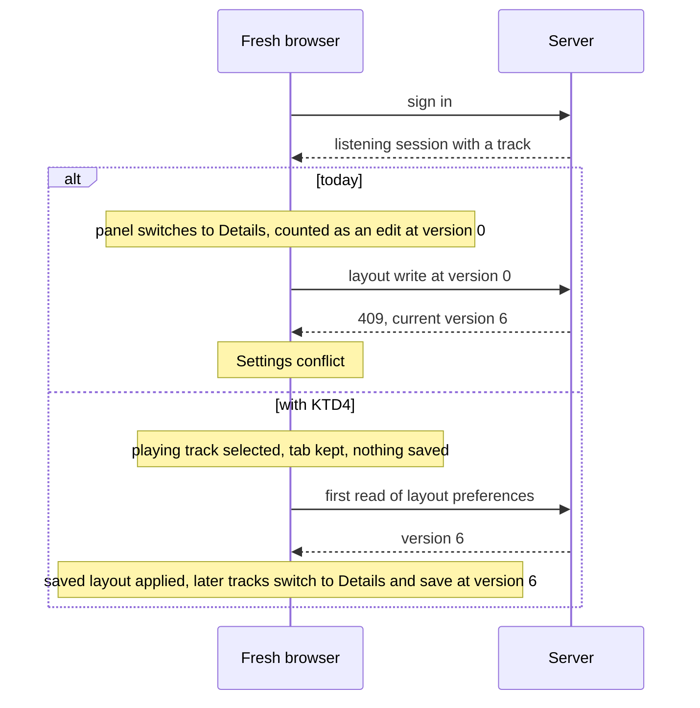

# Styling Specs and Login Settings Conflict - Plan

## Goal Capsule

- **Objective:** The browser specs that guard the web interface's styling run to a meaningful result on a worktree preview whatever state its admin account is in, and a user who signs in on a fresh browser no longer gets a "Settings conflict" dialog because the playing track was shown before their layout settings were read.
- **Means:** The styling fixtures sign in as the server fixture's admin user and play that fixture's songs (KTD1, KTD2); until a preference family's first read has finished, the session's track and volume are shown without being saved as edits (KTD4, KTD7).
- **Authority:** The user's selection on 2026-11-17 ("Repair playback specs", "Close the test gaps"), the user's decisions on 2026-11-18 (fix the volume path in this branch; run the sidebar notification spec as a fixture user), and R1–R10 govern scope. KTD1–KTD8 govern mechanism. `ui/DESIGN.md` and `.agents/rules/frontend.md` apply unchanged.
- **Execution profile:** Standard. Seven units on one branch named after this plan; browser checks against the worktree preview, one Playwright run at a time, without retries.
- **Stop conditions:** Stop and ask when the conflict fix needs an existing preference-conflict test to change; when the layout reproduction in U1 passes before the fix; or when a failing styling assertion turns out to be a product regression whose fix is a product decision.
- **Finishing:** `ce-work` lands the units as local commits, runs `ce-simplify-code` and `ce-code-review`, and records the delivery in `ROADMAP.md`. Nothing is pushed unless the user asks.

---

## Product Contract

### Summary

The styling suite's catalog fixtures move off the preview's admin account onto the server fixture's admin user and onto songs the server knows, so `browsing-playback.spec.ts` can start playback again. Until a preference family's first read has finished, the listening session's track and volume are shown without being saved as edits, which removes a self-inflicted "Settings conflict" dialog at sign-in. A browser test covers the admin bell's outage entry colour, and the handoff spec is tried in Firefox and WebKit.

### Problem Frame

Two things keep the styling specs from saying anything on a used preview, and one of them is a defect users can hit.

The listening session accepts only songs the server knows. The styling suite's catalog fixtures use invented song IDs, and the session answers 422 to a load of one, so every case that needs an active player fails: 11 or 12 of the 20 tests in `ui/web/tests/e2e/styling/browsing-playback.spec.ts` on the worktree preview on 2026-11-17, with and without the notification pane well. The same fixtures sign in as the preview's admin account, whose leftover listening session and saved preferences break further cases, some at the login step. Two runs of the four other specs that share the fixtures on 2026-11-18 failed three tests both times and four more in one run only.

The second problem is in the application. `use-context-panel-selection.ts` selects the playing track in the context panel, which switches the panel to its Details tab, and `use-preference-bootstrap.tsx` pushes every change of the panel's mode or tab to the layout preference. Usually the layout preference's first read comes first, and the automatic switch to Details is then saved on top of it. On a fresh browser the listening session's track can arrive before that read. The switch then counts as a local edit made at version 0, and the read, which returns the account's real version, raises "Settings conflict"; if the edit's save goes out first, the server refuses the version-0 write with 409 and the same dialog appears. A trace of the preview's admin sign-in on 2026-11-18 showed the layout row at version 6, the number in the dialog. In that sign-in the read came before the track and no dialog appeared, which fits a race.

### Requirements

**Sign-in**

- R1. A user who signs in on a fresh browser, while their account has a listening session with a track and saved layout preferences, sees no "Settings conflict" dialog caused by the playing track being shown.
- R2. The rules for real conflicts do not change: a setting the user edits before the first read, or one changed on another device, still raises the dialog as it does today. The volume is the exception R4 states.
- R3. When the layout preference's first read comes first, the result is the same as today: the playing track's details are shown and the Details tab is saved. When the track comes first, it is selected on the panel's current tab, and the saved layout is then applied.
- R4. A user who signs in on a fresh browser while their listening session plays at a volume other than their saved one sees no "Settings conflict" dialog. Until the saved player settings have been read, a volume change is shown but not saved; the read then applies the saved volume. Every volume change reaches the store as the session reports it, so a change the user makes in that window is not saved either. A reload of an album page is reproduced and its result reported.

**Styling specs**

- R5. `ui/web/tests/e2e/styling/browsing-playback.spec.ts` passes on the worktree preview whatever state the preview's admin account is in, and its playback cases play a track.
- R6. No assertion in a repaired spec is loosened to make it pass. A changed expectation states which change in the product or the fixture made the old one wrong.
- R7. The other specs that use the styling catalog fixtures do at least as well as before the change: `tests/e2e/layout/layout.spec.ts`, `tests/e2e/styling/forms-admin.spec.ts`, `tests/e2e/styling/visualizer-calibration.spec.ts` and `tests/e2e/characterization/visual-baseline.spec.ts`.
- R8. `ui/web/tests/e2e/playback-destinations/sidebar-notifications.spec.ts` passes on the worktree preview, signed in as a fixture user.

**Test gaps from the notification pane well**

- R9. A browser test shows that the outage entry in the admin bell keeps `--color-muted-foreground` for its timestamp, and the test fails when that fallback is removed. The result of `ui/web/tests/e2e/styling/well-handoff.spec.ts` in Firefox and in WebKit is recorded: passed, failed with the cause, or could not launch with the error.

**Documentation**

- R10. The browser-testing guide describes how the styling fixtures get their user and songs, and `ROADMAP.md` records the delivery and closes or restates the open items of the notification pane well that this work touches.

### Key Decisions

- **The conflict gets a fix, not only a diagnosis.** The user asked to look into the dialog; the cause is a defect in the application, shown by the trace above. Governs R1, R2, R3.
- **Only the playing track's selection keeps the tab.** It is the one selection that arrives after sign-in without a user action. Clicks, keyboard shortcuts and the album or artist in the page's address are the user's navigation and stay edits, as today. U1 shows that a reload on an album page does not race. Governs R1, R3.
- **The volume path is fixed in this branch.** (session-settled: user-directed — chosen over recording it as open and over never saving an observed session volume: same rule as the tab, a session volume applied before the saved player settings are read is shown but not saved.) Governs R4.
- **The sidebar notification spec signs in as a fixture user.** (session-settled: user-directed — chosen over stopping the panel's automatic opening on narrow screens and over leaving the spec on the admin account: the overlay that opens when a late session track arrives is recorded as an open product question.) Governs R8.

### Scope Boundaries

- On a narrow screen, a playing track that arrives after sign-in opens the context panel as an overlay, which takes focus and closes an open popover. This is older than this work and is recorded as an open product question, not changed.
- A container route that runs preview-backed specs in WebKit is out of scope. If WebKit cannot launch on the host, R9 records that.
- No CI job is added for `tests/e2e/styling`.
- `ui/rn` is not touched.
- Considered and not built: not saving the automatic Details tab. Every preference save is followed by a re-read of every preference family, and a read replaces the panel's tab, so the playing track's Details would snap back to the saved tab whenever the user changed the volume. It would also change what is saved.
- Built and replaced: selecting the playing track only after the layout read had finished. When the read came late, the deferred selection opened the panel after the user had closed it, closing the notification pane in `sidebar-notifications.spec.ts` at 390px.
- Considered and not built: holding every preference push until the first read has answered. It changes the rule the existing conflict tests pin.
- Considered and not built: treating a local edit equal to the server's value as no conflict. It covers only accounts whose saved tab is already Details.

---

## Planning Contract

### Key Technical Decisions

- KTD1. **The styling fixtures sign in as the server fixture's admin user.** `tests/Fixtures/LiveUpdates/capacity-fixture.php` creates 32 ordinary users and one admin, the manifest's `observer`, all with access to one library. A fresh user has no listening session and no saved preferences, so the preview admin account's state stops mattering. `forms-admin.spec.ts` needs an admin.
- KTD2. **Catalog fixtures keep their mocked titles on real song IDs.** Probed on the preview on 2026-11-18: with the catalog GET mocks keyed on a fixture song's real ID, the session accepted the load, and the footer, the context panel and the queue showed the mocked long title. The footer's duration came from the real audio (1:00 for the fixture's original 60-second song), so the styling songs must be fixture songs of 30 seconds. The fixture's `catalog` operation creates them with `durations: [30]`. Its receipt returns counts today; it gains the identities of the songs it created, which the browser fixture reads before signing in. Album and playlist IDs stay invented, because only songs reach the session.
- KTD3. **The specs keep their imports.** `catalogSong`, `thaiSong` and `burmeseSong` stay exported as templates for display fields; the fixture builds each test's resources from them with the real IDs. The stream route keeps answering for the template IDs, which the radio case uses as a station stream.
- KTD4. **Before the layout preference's first read has finished, the playing track keeps the panel's tab.** The sync reports when a family's first read has finished, whether it applied saved settings, found none, or failed; the report is additive and the conflict rules in `use-preference-sync.ts` do not change. The context panel store holds the layout family's report as a flag, which resets when the preference session ends. Until it is set, the selection hook selects the playing track and opens the panel without switching to the Details tab, so nothing is saved; the read then applies the saved layout. Afterwards, a new playing track switches to Details and saves it, as today.
- KTD7. **Before the player preference's first read has finished, a volume change is not saved.** The preference session keeps the player family's report in a ref and skips a push whose only changes are the volume and mute. Other player settings changed in that window are still saved as edits.
- KTD8. **The playing track's selection follows the track's ID.** A session's track arrives as a placeholder and is replaced when its details load. The selection effect ran on each new track object, so the second one reopened a panel the user had closed; a unit test shows it on the unchanged hook. Found while tracing the 390px failure; it is in the hook U2 changes.
- KTD5. **The reproduction orders the race on purpose.** A second browser context of the same fixture user signs in with the layout preference's first read held for a few seconds, so the track always arrives first. Neither context stubs preference writes: with the read held past the 500 ms save delay, the dialog comes from the server refusing the second context's version-0 write, and a stubbed write would hide it.
- KTD6. **The admin bell check lists the outage entry through the app's own store.** A real outage needs 120 counted seconds before its entry is listed. The claim under test is a CSS fallback, so the test starts a real interruption with `interruptDelivery` from `tests/e2e/live-updates/recovery-fixtures.ts` and calls the store's `listEntry()`, resolving the store module's URL from the resources the page loaded.

### High-Level Technical Design

### Risks

- **Fixture cost.** Each styling test creates and removes a server fixture run. The footer specs already do this at about ten seconds a test; twenty more tests add minutes.
- **The volume drag.** Two cases expect a dragged volume between 35 and 65 and read 75 and 100 on the admin account. That may be the leftover session refusing the change or a regression in the slider. It is classified with the fixture user before any expectation moves.
- **Module identity in the page.** A bare-path import of an app module can return a second instance on a preview whose dev server has re-versioned modules; `nativeAudio` in `session-tabs.ts` reported "paused" for a playing footer that way on 2026-11-17. U5 resolves the module URL from the page's loaded resources.
- **A first read that never comes.** With KTD4 and KTD7 nothing waits; until a family's first read finishes, the session's track keeps the tab and its volume is not saved. A failed read counts as finished.

### Sources

- `ui/web/src/features/layout/hooks/use-context-panel-selection.ts`; `ui/web/src/features/layout/stores/context-panel-store.ts` (`setSelectedItem` sets the Details tab; `restorePreferences` sets the saved tab); `ui/web/src/features/settings/hooks/use-preference-bootstrap.tsx` (the layout subscription); `ui/web/src/features/settings/hooks/use-preference-sync.ts` (`readFromServer` raises the conflict when the state is dirty and the read's version is newer; its results are `applied`, `absent`, `deferred` and `failed`).
- `ui/web/src/features/settings/__tests__/preference-conflict-lifecycle.test.ts` and `ui/web/tests/live-updates/preferences-consumers.test.tsx` pin the conflict rules R2 keeps. `ui/web/src/features/settings/__tests__/preference-store-subscriptions.test.tsx` mounts the provider on the real stores.
- `ui/web/tests/e2e/playback-destinations/session-tabs.ts`: `openSessionTab` stubs preference writes so two contexts of one account do not conflict. U1 needs real writes in both contexts.
- `ui/web/tests/e2e/styling/footer-playback.ts`: the `pausedFooter` fixture, a fixture user with a playing track.
- `docs/solutions/best-practices/browser-font-checks-that-pass-without-proving-anything.md`: break the guarded thing and confirm the check fails.
- `docs/solutions/developer-experience/local-gate-images-and-webkit-harness-runs.md`: WebKit lacked system libraries on this host; its container recipe covers self-contained harnesses only.

---

## Implementation Units

### U1. Reproduce the settings conflict at sign-in

- **Goal:** A browser test that fails today because the dialog appears, with the race ordered deterministically, and two measured neighbouring cases.
- **Requirements:** R1, R4.
- **Dependencies:** none.
- **Files:** `ui/web/tests/e2e/settings/sign-in-conflict.spec.ts` (new).
- **Approach:** Per KTD5, with one fixture user and real preference writes in every context.
  1. Layout case: the first context plays the fixture song and waits until a layout preference write has been answered 200. A second, fresh context signs in with `GET /api/user/layout-preferences/` held for three seconds.
  2. Volume case: the first context sets a volume other than 75 while playing and waits for the player preference write. A second context signs in with the player preference read held.
  3. Reload case: on a context whose layout preference is saved, open an album page and reload it.
- **Execution note:** Run the layout case before U2 and record the failure. If it passes before the fix, stop: the trace was misread. Record the reload case's result before and after U2.
- **Patterns to follow:** `openSessionTab` (without its write stub) and `fixtureSongRow` in `ui/web/tests/e2e/playback-destinations/session-tabs.ts`; `FixtureClient` in `ui/web/tests/e2e/live-updates/capacity-fixtures.ts`.
- **Test scenarios:**
  - Layout case: no "Settings conflict" dialog appears while the read is held or after it answers; the panel shows the playing track's details and the Details tab is saved.
  - Volume case: no "Settings conflict" dialog appears while the player read is held or after it answers.
  - Reload case: no dialog after the reload.
- **Verification:** The layout and volume cases fail on the unchanged source with the dialog visible and pass after U2; the reload case passes either way.

### U2. Keep the session's track and volume out of the preference edits until the first read

- **Goal:** Showing the session's track and volume can no longer race the preferences' first reads.
- **Requirements:** R1, R2, R3, R4.
- **Dependencies:** U1.
- **Files:** `ui/web/src/features/settings/hooks/use-preference-sync.ts`, `ui/web/src/features/settings/hooks/use-layout-preferences.ts`, `ui/web/src/features/settings/hooks/use-player-preferences.ts`, `ui/web/src/features/settings/hooks/use-preference-bootstrap.tsx`, `ui/web/src/features/layout/stores/context-panel-store.ts`, `ui/web/src/features/layout/hooks/use-context-panel-selection.ts`, `ui/web/tests/features/layout/stores/context-panel-store.test.ts`, `ui/web/src/features/settings/__tests__/preference-store-subscriptions.test.tsx`, `ui/web/src/features/settings/__tests__/use-preference-bootstrap.test.tsx` (its store mock gains the new action), `ui/web/src/features/layout/hooks/__tests__/use-context-panel-selection.test.tsx` (new).
- **Approach:** Per KTD4, KTD7 and KTD8.
- **Execution note:** The conflict tests named under Sources pass unmodified. If one needs editing, stop.
- **Test scenarios:**
  - Vitest: the layout read finishing as applied, as absent and as failed is each reported.
  - Vitest: the report resets when the preference session ends.
  - Vitest: a track before the layout read is selected on the current tab with nothing saved, and the read's saved layout is then applied without a conflict.
  - Vitest: a track after the layout read switches to Details and saves it at the read's version.
  - Vitest: a user's own selection before the read still switches to Details and counts as an edit, as today.
  - Vitest: a session volume before the player read is shown and not saved; one after it is saved at the read's version; another player setting before it is still saved as an edit.
  - Vitest: the same track gaining its details keeps a closed panel closed; the next track opens it.
  - Browser: U1's three cases pass.
- **Verification:** U1's cases are green, the preference conflict suites pass unchanged, and the full unit suite passes.

### U3. Move the styling fixtures to the fixture admin and real songs

- **Goal:** `emptyCatalog` and `populatedCatalog` no longer depend on the preview's admin account, and a load of a styling song is accepted.
- **Requirements:** R5, R7, R8.
- **Dependencies:** none.
- **Files:** `ui/web/tests/e2e/styling/fixtures.ts`, `ui/web/tests/e2e/playback-destinations/sidebar-notifications.spec.ts`, `tests/Fixtures/LiveUpdates/capacity-fixture.php`, `tests/Integration/LiveUpdates/CapacityFixtureTest.php`, `ui/web/tests/e2e/live-updates/capacity-fixtures.ts` (only if a helper must be exported).
- **Approach:** Per KTD1–KTD3. The fixtures start a fixture run, create three 30-second songs for the populated state, read their identities from the receipt, install the catalog routes with those IDs, sign the fixture admin in, and remove the run afterwards. `pausedFooter` stays as it is. `sidebar-notifications.spec.ts` signs in as a fixture user too (R8).
- **Test scenarios:**
  - A load of the mocked album's song is answered 200, and the footer shows the mocked title and a duration of 0:30.
  - The four dependent specs, compared per test with the baseline below: no test that passed in both baseline runs fails after the switch.
- **Verification:** The per-test results before and after the switch are recorded. Baseline on 2026-11-18, two runs each on the unchanged source: `layout.spec.ts` "sidebar search navigates to search page" failed both times and "keyboard shortcuts help opens with ? key" once; both `visualizer-calibration.spec.ts` tests failed both times; `forms-admin.spec.ts` "administration form stays usable at 1280px" failed once; `visual-baseline.spec.ts` "artists" in dark and warm failed once. The other 26 passed both times.

### U4. Bring the browsing and playback spec back to green

- **Goal:** All 20 tests of `browsing-playback.spec.ts` pass on the preview.
- **Requirements:** R5, R6.
- **Dependencies:** U3.
- **Files:** `ui/web/tests/e2e/styling/browsing-playback.spec.ts`; application files only if a failure is a product regression.
- **Approach:** Classify each remaining failure as drift in the spec or a change in the product before touching an expectation. `getByRole('complementary')` now matches the sidebar as well as the context panel, which is drift. The volume drag is unclassified (see Risks).
- **Test scenarios:**
  - Each of the 20 tests passes on its first attempt in two consecutive runs.
  - For every changed expectation or locator, the commit states what made the old one wrong.
- **Verification:** Two consecutive full runs of the spec without retries pass.

### U5. Check the admin bell's outage entry colour

- **Goal:** A browser test for the fallback that the notification pane well left unchecked.
- **Requirements:** R9.
- **Dependencies:** U3.
- **Files:** `ui/web/tests/e2e/styling/well-handoff.spec.ts`; `ui/web/src/features/notification/components/LiveOutageItem.tsx` (edited only for the failing check, then restored); `ui/web/tests/e2e/live-updates/recovery-fixtures.ts` (only if a helper must be exported).
- **Approach:** Per KTD6. The fixture admin signs in and opens `/admin`; the test interrupts delivery, lists the entry, opens the bell and compares the timestamp's colour with a probe element set to `var(--color-muted-foreground)`.
- **Execution note:** Remove the fallback from `LiveOutageItem.tsx` once and confirm the test fails, then restore it.
- **Test scenarios:**
  - Admin bell: the outage entry's timestamp colour equals `--color-muted-foreground`.
- **Verification:** The test passes, and fails with the fallback removed.

### U6. Try the handoff spec in Firefox and WebKit

- **Goal:** A recorded result per engine.
- **Requirements:** R9.
- **Dependencies:** U5.
- **Files:** `ui/web/tests/e2e/styling/well-handoff.spec.ts` and `ui/web/tests/e2e/styling/footer-playback.ts`, only for an engine difference in the test itself.
- **Approach:** Run the spec with the `--browser` flag for each engine. Report a failure of the playback fixture separately from a failure of the well. Painted-pixel thresholds that differ by engine are recorded, not tuned, unless the difference is in how the test samples.
- **Test scenarios:** Test expectation: none -- recorded attempts on other engines, not gates.
- **Verification:** Each engine has a result with its evidence: counts, the failing assertion, or the launch error.

### U7. Update the testing guide and the roadmap

- **Goal:** The documents match the repaired suite.
- **Requirements:** R10.
- **Dependencies:** U2, U4, U5, U6.
- **Files:** `docs-book/part-2-developer-guide/testing/frontend-and-browser.md`, `ROADMAP.md`.
- **Approach:** The guide says how the styling fixtures get their user and songs and drops the sentence that the playback cases fail. The roadmap records this delivery and rewrites the open items of the notification pane well that are now closed or changed. Run `prose-fix` on the changed prose.
- **Test scenarios:** Test expectation: none -- documentation.
- **Verification:** No sentence in the guide or the roadmap still describes a state this work changed.

---

## Verification Contract

| Check | Command | Applies to |
|---|---|---|
| Types | `yarn --cwd ui/web typecheck` | U1–U6 |
| Lint | `yarn --cwd ui/web lint` | U1–U6 |
| Unit and DOM tests | `yarn --cwd ui/web test` | U2 |
| Build | `yarn --cwd ui/web build` | U2 |
| Fixture | `php -l tests/Fixtures/LiveUpdates/capacity-fixture.php`, then `bash scripts/test-functional-container.sh tests/Integration/LiveUpdates/CapacityFixtureTest.php` with `BAANDER_TEST_IMAGE` set | U3 |
| Sign-in conflict | `E2E_BASE_URL="$(make preview-url)" yarn --cwd ui/web e2e:headless tests/e2e/settings/sign-in-conflict.spec.ts tests/e2e/playback-destinations/sidebar-notifications.spec.ts --retries=0` | U1, U2 |
| Styling | `E2E_BASE_URL="$(make preview-url)" yarn --cwd ui/web e2e:headless tests/e2e/styling tests/e2e/layout/layout.spec.ts tests/e2e/characterization/visual-baseline.spec.ts --retries=0` | U3–U5 |
| Other engines | the handoff spec with `--browser=firefox` and `--browser=webkit` | U6 |

Browser runs use the worktree preview and one Playwright run at a time, because the server fixture's executor holds a lifecycle lock. A test that passes only on a retry counts as failed.

---

## Definition of Done

- R1–R9 hold, each shown by the scenarios of the unit that cites it. R10 holds by the verification line of U7.
- Every check in the Verification Contract ran, and the report names any that did not pass and why.
- U1's layout case was seen failing before U2, and the U5 test was seen failing with the fallback removed.
- No assertion was loosened without a stated reason.
- No code from an abandoned attempt remains in the diff.
- `ROADMAP.md` records the delivery with its commits and its verification checkpoint.
