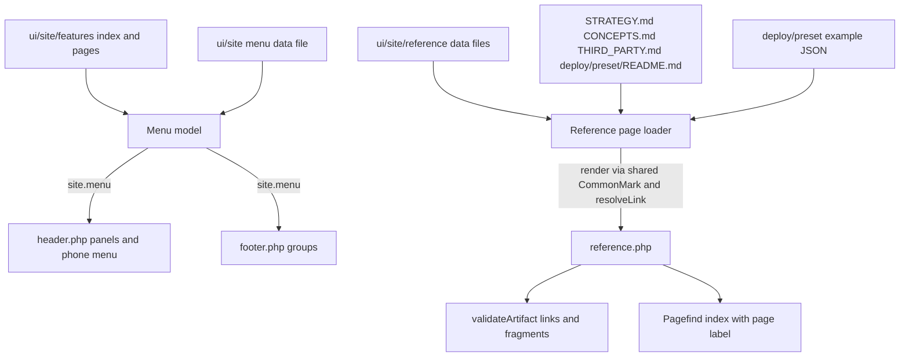

# Website Reference Pages and Fold-out Menu - Plan

## Goal Capsule

- **Objective:** A visitor to baander.app can reach the project's strategy, vocabulary, third-party licensing and deployment preset from a grouped top menu whose entries say what each page holds.
- **Means:** Four reference pages rendered at build time from their tracked files, and a header menu built from native disclosure panels fed by one shared menu source (KTD1, KTD3, KTD4).
- **Product authority:** The Product Contract below. The dialogue of 2026-11-18 settled the menu grouping and the content framing, and removed the package inventory page from this work.
- **Execution profile:** One branch named after this plan, delivered as a single pull request when the user asks for one; units land as local commits in the order U1 to U5.
- **Stop conditions:** Stop and ask if a source file cannot render without editing its content beyond fixing a broken link, or if the closed menu cannot keep the header's current geometry with and without JavaScript.
- **Finishing:** `ce-work` implements, runs the Verification Contract, and records the delivered item and its checkpoint in `ROADMAP.md`. Push only when asked.
- **Open blockers:** None.

---

## Product Contract

### Summary

The flat top menu becomes two fold-out panels, Product and Resources, plus the Source link, and every entry carries a one-line description. Four new pages join the site: Strategy, Concepts, Third-party licensing and Deploy preset. Each is built from its tracked file and opens with a short website introduction.

### Problem Frame

STRATEGY.md, CONCEPTS.md, THIRD_PARTY.md and the `deploy/preset/` guide exist only as repository files, so a website visitor cannot find them. The top menu is a row of five flat links (Features, Manual, Audio Core, Typography, Source) with no room for more entries and no explanation of what sits behind each one.

### Key Decisions

- **Two wide panels, Product and Resources.** (session-settled: user-directed — chosen over grouping by content kind (Product / Docs / Open source) or by audience (Listen / Run / Build / About), after seeing all three sketched.) Governs R1, R2, R3.
- **Build the pages from the tracked files, with a website opening kept in ui/site.** (session-settled: user-directed — chosen over rendering the files with no framing and over separately written web summaries: one source of truth, plus a sentence or two that tells a visitor what the document is and who it is for.) Governs R9, R10.
- **No package inventory page in this work.** (session-settled: user-directed — chosen over a license breakdown and package lookup built from a committed per-package snapshot, after review showed the snapshot is already stale and many declared Debian license values are copyright prose.)
- **Links to the published files land on their new pages.** (session-settled: user-approved — chosen over sending every repository link to the source repository, so readers stay on the site for pages it serves.) Governs R13.

### Requirements

**Top menu**

- R1. The top menu holds two fold-out panels, Product and Resources, plus the Source link and the theme toggle.
- R2. Product lists Features with the feature pages grouped by audience, then Audio Core and Strategy.
- R3. Resources has three labelled columns: Run it (Operator manual, Deploy preset), Build on it (Developer guide, Concepts, Typography) and Open source (Third-party licensing).
- R4. Every panel entry shows a title and a one-line description of what the page holds.
- R5. A panel opens on click or from the keyboard, and closes with Escape, an outside click or focus leaving it.
- R6. The menu marks the current page and the panel that contains it.
- R7. At phone width the panels collapse into one menu that stacks both groups, with no horizontal page scroll.
- R8. The footer navigation follows the same grouping.

**Document pages**

- R9. Strategy, Concepts, Third-party licensing and Deploy preset are each built from their tracked source file at build time, so an edit to the file changes the page on the next build.
- R10. Each of those pages opens with a short website opening, kept in ui/site, that says what the document is and who it is for.
- R11. The Concepts page lets a reader jump to a section and link to a single term.
- R12. The Deploy preset page adds a table comparing the six example presets (4, 8 and 16 GB, each remux and transcode) by their size settings.
- R13. A link in the site to one of the four published files opens its new page, a link to a manual page opens that manual page, and a link to any other repository path opens it in the source repository.

**Site integration**

- R14. The four new pages join site search and the sitemap.

### Acceptance Examples

- AE1. **Covers R5, R7.** **When** a keyboard user tabs to Resources and presses Enter, the panel opens with focus on its first entry; Escape closes it and returns focus to Resources. At phone width the same entries appear in one stacked menu.
- AE2. **Covers R9.** **When** someone edits a term in CONCEPTS.md and the site is rebuilt, the Concepts page shows the edit with no change in ui/site.
- AE3. **Covers R13.** **When** the Third-party licensing page links to the application review record under `third_party/inventory/`, the link opens that file in the source repository.
- AE4. **Covers R13.** **When** a manual page links to `CONCEPTS.md#selected-video-endpoint`, the link opens `/concepts/#selected-video-endpoint`, and a renamed term fails the build.
- AE5. **Covers R6.** **When** a reader is on a developer-guide page, the Resources panel trigger and its Developer guide entry are marked current.

### Scope Boundaries

- **Deferred for later:** a package inventory page for `third_party/inventory/`. It needs a per-package snapshot that is refreshed with the shipped images, and a rule for declared Debian license values that are copyright text rather than license names. Until then, the Third-party licensing page links to the review record in the repository (R13).
- No rewritten web copy of the four documents beyond the website opening.
- No search box on the new pages; they are searchable from the manual's search, as other public pages would be.
- Panels do not open on hover, and the menu has no arrow-key navigation: click and Tab cover R5, and hover makes touch devices flicker.

### Dependencies / Assumptions

- The six presets share `webWorkers`, `databaseSlots`, `ordinaryConsumers`, `sharedBuffersMiB` and `workMemMiB`. Transcode presets add `videoSlots` and `audioSlots`, and remux presets add `copySlots` instead. No preset file states its memory size; only the file name does.
- Site search indexes only elements carrying the Pagefind body marker, which only the manual page template has today.

### Sources / Research

- `ui/site/templates/header.php`, `ui/site/templates/footer.php`: current flat menu and footer.
- `ui/site/templates/page.php` lines 14-46: the manual sidebar's `
` chapter fold-outs, the site's existing fold-out pattern.
- `packages/baander-tooling/src/Website/WebsiteBuilder.php`: CommonMark environment (lines 90-99), `resolveLink` (437-475, docs-book-relative base at 452), public pages always given empty `html` and `headings` (165), `template()` variables (596-617), `validateArtifact` link and fragment checks (662-714).
- `packages/baander-tooling/src/Website/Command.php`: `SITE_SOURCES` (line 15), public page registration (83-96), the search bundle and Pagefind run (72-79).
- `ui/site/features/index.php` lines 13-32: the audience groups (listeners, operators, developers) with titles and leads; each feature file has `name` and `summary`.
- `ui/site/src/search.ts` lines 51 and 83-85: search status copy and the result label that calls every non-operator result "Developer guide".
- `ui/DESIGN.md` lines 17-31: native disclosure elements, no shadows or gradients on the site; breakpoints 860px and 640px in `ui/site/assets/site.css`.
- `docs/solutions/best-practices/browser-font-checks-that-pass-without-proving-anything.md` and `docs/solutions/performance-issues/overlapping-unicode-range-fonts-download-unused-slices.md`: new indexed and menu text changes per-page and search font subsets.
- `docs/solutions/best-practices/a-browser-gate-that-passes-by-where-a-server-tick-falls-proves-nothing.md`: assert disclosure state, not timed waits.
- `docs/plans/2026-11-17-1757-feat-site-feature-pages-plan.md`: the previous website plan, for data-file and validation conventions.

Product Contract preservation: changed R13 — links to the four published files now open their new pages instead of the source repository; the user approved this at the plan's scoping checkpoint. AE4 and AE5 added; the Outstanding Questions are resolved by KTD2, KTD3, KTD4, KTD6 and the hover line in Scope Boundaries, and removed.

---

## Planning Contract

### Key Technical Decisions

- KTD1. **Panels are native `
` elements with a small script for closing.** The closed header must keep the same geometry with and without JavaScript (`ui/site/tests/experience.spec.ts:70-91`) and cause no layout shift (`ui/site/tests/stability.spec.ts`), and `ui/DESIGN.md` names native disclosure as the site's pattern. The two panels share one `name` attribute so opening one closes the other. A plain IIFE script in `ui/site/assets/` adds Escape, outside click, focus leaving and focus on the first entry; without it a panel still opens, closes and exposes every link. The open panel is positioned over the content, so opening it moves nothing, and its height is capped to the viewport below the header with scrolling inside the panel. At 860px and below the Resources columns stack and the panel width is capped to the viewport minus the page gutter. Covers R1, R5.
- KTD2. **The phone menu is a separate disclosure holding both groups.** At 640px and below, CSS hides the two panels and the Source link and shows one "Menu" disclosure in the header's first row beside the theme toggle; the Source link becomes the last entry inside that menu, below Resources. Above 640px the reverse. The entries appear twice in the markup, generated from the same menu source (KTD3), so they cannot drift. Covers R7.
- KTD3. **One menu source feeds header and footer.** A builder-side menu model holds the Product and Resources groups, entry titles, descriptions, URLs and current-page rules. Feature entries and their audience groups come from `ui/site/features/` (`index.php` groups, each page's `name` and `summary`); the other entries' descriptions live in one data file in `ui/site/`. The model reaches templates through `$site`, because header and footer are included from every template. Covers R2, R3, R4, R6, R8.
- KTD4. **Reference pages are public pages with rendered Markdown.** Each has a data file in `ui/site/reference/` naming its source file, URL, title, description and website opening. The builder renders the source through the shared CommonMark environment, so heading ids, permalinks and tables match the manual, and passes the HTML and headings to a `reference` template. The source's own H1 stays the page's single `h1`; the opening follows it as a lede with no heading, before the first body section. URLs: `/strategy/`, `/concepts/`, `/licensing/`, `/deploy/`. Covers R9, R10, R11.
- KTD5. **`resolveLink` resolves against the linking file's own directory, anywhere in the repository.** Today it assumes a docs-book source. Generalized, it keeps the manual mapping and fragment checks, maps the four published files to their pages with fragment checks against their headings, and sends every other path to the source repository. `build()` receives the reference sources and URLs through their public page descriptors and parses them alongside `discover()`, before any `transformLinks()` run, so manual links can check reference headings and reference links can check manual pages. Covers R13.
- KTD6. **The preset table reads the six example files strictly.** Memory size comes from the `example-<N>gb-<capability>.json` name, and the builder fails on an unknown or missing key, an unexpected file, or a capability that disagrees with the name. One table: presets as columns (remux 4/8/16, transcode 4/8/16), shared settings as rows first, then slot rows, with a dash and visually hidden "not used" text where a preset lacks a setting. Setting names are row headers and preset names column headers. The table sits after the README body and scrolls inside a labelled, keyboard-focusable region on phones. Covers R12.
- KTD7. **Search labels results by page meta.** Each indexed page carries a `data-pagefind-meta` label (Operator guide, Developer guide, Strategy, Concepts, Third-party licensing, Deploy preset); `search.ts` reads it instead of the URL prefix, and the status copy names the manuals and reference pages. Covers R14.
- KTD8. **A missing or empty source file, a source without an H1, or a broken link fails the build with the file named.** This matches how `FeaturePages` and `resolveLink` already fail; there is no fallback page.

### High-Level Technical Design

### Assumptions

- The four source files keep one H1 each; CONCEPTS.md's 167 heading slugs are unique today, so every term anchor is its H3 id.

---

## Implementation Units

### U1. Repository-relative Markdown rendering and link resolution

**Goal:** The builder can render any tracked Markdown file in the repository, with links resolved from that file's directory.

**Requirements:** R9, R13; KTD5, KTD8.

**Dependencies:** None.

**Files:**
- `packages/baander-tooling/src/Website/WebsiteBuilder.php`
- `scripts/tests/php/Website/WebsiteBuilderTest.php`

**Approach:**
1. Make `resolveLink` take a repo-relative source path and resolve relative links from its directory; manual sources keep their current behaviour.
2. Let `build()` take reference sources from public page descriptors that name a source file, and parse them next to `discover()` so their headings and the source-to-URL mapping exist before links are transformed.
3. Map the four published source files to their page URLs, checking fragments against their headings as `manualLinkProblem` does for manual pages.
4. Run `transformLinks()` and `renderBlocks()` over the reference documents like manual documents, and fill the descriptor's HTML and headings in the public-page loop.

**Patterns to follow:** `resolveLink`, `checkedSource`, `manualLinkProblem` and `headings()` in `WebsiteBuilder.php`; error collection that throws once with the file named.

**Test scenarios:**
- A root-level fixture file linking `packages/x/LICENSE` resolves to the repository blob URL.
- A file under `deploy/preset/` linking `../../docs-book/.../page.md#heading` resolves to the manual page URL with the fragment.
- Covers AE4. A manual page linking `CONCEPTS.md#term` resolves to `/concepts/#term`; a link to a term that does not exist fails the build naming the manual page.
- A link to a missing repository path from a root-level file fails with "Missing or escaping repository target" and the file named.
- Existing manual link cases keep passing unchanged.

**Verification:** The tooling PHP suite passes, and a manual page's existing links render unchanged except the five manual links to CONCEPTS.md, which now open `/concepts/`, and the two manual links to `deploy/preset/README.md`, which now open `/deploy/`.

### U2. Reference pages and the preset table

**Goal:** `/strategy/`, `/concepts/`, `/licensing/` and `/deploy/` are built from their tracked files with a website opening, a section jump on Concepts and the preset comparison on Deploy.

**Requirements:** R9, R10, R11, R12, R14; KTD4, KTD6, KTD8; AE2, AE3.

**Dependencies:** U1.

**Files:**
- `packages/baander-tooling/src/Website/ReferencePages.php` (new)
- `packages/baander-tooling/src/Website/Command.php`
- `ui/site/reference/strategy.php`, `concepts.php`, `licensing.php`, `deploy.php` (new)
- `ui/site/templates/reference.php` (new)
- `ui/site/assets/site.css`
- `.github/workflows/website.yaml`
- `scripts/tests/php/Website/ReferencePagesTest.php` (new)
- `scripts/tests/php/Website/WebsiteBuilderTest.php`

**Approach:**
1. Load and validate each reference data file (source, url, title, description, opening) with the strictness of `FeaturePages::PAGE_SHAPE`.
2. Register the pages as public page descriptors in `Command.php`, with `sources` listing the data file, template and source file so sitemap dates follow them; add the four sources and `ui/site/reference` to `SITE_SOURCES`.
3. Read the six preset files into table rows for the Deploy page's data.
4. Render through `reference.php`: the source H1 then the opening lede, inside the article with `data-pagefind-body` and a page label meta, a section jump listing level-2 headings in the existing `section-navigation` disclosure, and the preset table on Deploy.
5. Add the four source files and `deploy/preset/**` to both path lists in `website.yaml`.
6. Write the four openings and run `prose-fix` on them.

**Patterns to follow:** `FeaturePages.php` loading and validation; the typography descriptor in `Command.php`; `page.php` section navigation and `.manual-article` styles for tables.

**Test scenarios:**
- Covers AE2. Rebuilding a fixture after editing a term in the fixture CONCEPTS.md changes the rendered page; the data file is untouched.
- Each page renders its source H1 as the only `h1`, with the opening directly after it.
- The Concepts section jump lists every level-2 heading, and each term heading carries its slug id.
- Covers AE3. The licensing page's link to `third_party/inventory/application-review.md` points to the source repository URL.
- The preset table has six columns in remux then transcode order, shared rows first, and a dash with hidden "not used" text for `copySlots` on transcode presets; at 320px the table region takes keyboard focus and scrolls.
- A missing source file, an empty source, a source without an H1, a data file with an unknown key, a seventh preset file, a preset with an unknown size key, and a capability that disagrees with the file name each fail the build naming the file.
- The sitemap lists the four URLs with lastmod from their sources.

**Verification:** `make website-build` succeeds and `var/website/` holds the four pages; artifact link validation passes.

### U3. Menu model, header panels, phone menu and footer

**Goal:** Every page shows the Product and Resources panels, the phone menu below 641px and the grouped footer, all from one menu source.

**Requirements:** R1–R8; KTD1, KTD2, KTD3; AE1, AE5.

**Dependencies:** U2 (reference URLs exist).

**Files:**
- `packages/baander-tooling/src/Website/SiteMenu.php` (new)
- `packages/baander-tooling/src/Website/Command.php`, `WebsiteBuilder.php`
- `ui/site/menu.php` (new; titles and descriptions for non-feature entries)
- `ui/site/templates/header.php`, `footer.php`, `head.php`
- `ui/site/assets/site-menu.js` (new), `ui/site/assets/site.css`
- `scripts/tests/php/Website/SiteMenuTest.php` (new)
- `ui/site/tests/menu.spec.ts` (new)
- `ui/site/tests/features.spec.ts`, `bac.spec.ts`, `website.spec.ts`, `experience.spec.ts`, `stability.spec.ts`

**Approach:**
1. Build the menu model from the features overview groups and `ui/site/menu.php`, including the current-page rules: the entry whose URL equals the page gets `aria-current="page"`; every other entry whose section prefix (`/features/`, `/docs/operator-guide/`, `/docs/developer-guide/`) matches, and the panel trigger holding any marked entry, get `aria-current="true"`.
2. Pass the model to templates through `$site`.
3. Render the desktop panels as two `
` sharing a `name`, the phone `
` menu, and the footer groups from the same model.
4. Write `site-menu.js` following `appearance.js`: Escape closes and refocuses the trigger, outside click and focus leaving close, opening focuses the first entry. Load it on every page.
5. Style panels with borders and existing radius tokens, no shadow; position them over the content; reduced-motion safe.
6. Add a shared test helper that opens the right panel, and rewrite the five specs that click today's flat header links.

**Patterns to follow:** `.chapter-fold` summary chevron and label styles in `site.css`; document-level event delegation in `appearance.js`; the JSON-dump template pattern in `WebsiteBuilderTest.php` for asserting template data.

**Test scenarios:**
- The menu model lists Product as Features with the listener, operator and developer groups, then Audio Core and Strategy, and Resources in the three named columns, each entry with a non-empty description.
- Covers AE1. With JavaScript, Enter on Resources opens it with focus on Operator manual; Escape closes it and focus returns to Resources.
- Tabbing past the last entry closes the panel; clicking outside closes it; opening Product closes Resources.
- Without JavaScript, both panels open and close by click and every entry link is reachable.
- Covers AE5. On a developer-guide page the Resources trigger has `aria-current="true"` and Developer guide is marked current; on `/features/player/` the Product trigger and Player entry are marked.
- At 390px and 320px only the Menu disclosure shows, it lists both groups with Source last, and the page has no horizontal scroll.
- At 760px the Resources panel opens fully visible with stacked columns and no horizontal scroll.
- At 390x500 the last entry of the open Menu can be scrolled into view and activated.
- The closed header keeps equal height and nav position with and without JavaScript at 1440px and 390px; opening a panel records no layout shift.
- The footer lists the same groups and entries as the menu model.

**Execution note:** Assert `open` and `aria-expanded`-equivalent state and visibility, not timed waits; break the Escape handler once and confirm the test fails.

**Verification:** The browser suite passes with the rewritten specs and `menu.spec.ts`; the tooling PHP suite passes.

### U4. Search labels and copy

**Goal:** Search results from the new pages carry their page label, and the search prompt names the manuals and reference pages.

**Requirements:** R14; KTD7.

**Dependencies:** U2.

**Files:**
- `ui/site/src/search.ts`
- `ui/site/templates/page.php`
- `ui/site/tests/website.spec.ts`

**Approach:** Read the result's page label from Pagefind meta; set the label meta on manual pages and reference pages; update the status copy in `page.php` and `search.ts`.

**Patterns to follow:** The existing `data-pagefind-meta="guide"` span in `page.php`.

**Test scenarios:**
- Searching "Selected video endpoint" returns a Concepts result labelled Concepts that opens `/concepts/#selected-video-endpoint`.
- Operator and developer guide results keep their labels.
- The status text names the manuals and reference pages.
- The existing search-result font check passes with the reference pages indexed.

**Verification:** `yarn typecheck` and the browser search tests pass.

### U5. Documentation and roadmap

**Goal:** The website docs, design guide and glossary describe the reference pages and the menu.

**Requirements:** R1–R14 (documentation of delivered behaviour).

**Dependencies:** U1–U4.

**Files:**
- `ui/site/README.md`
- `ui/DESIGN.md`
- `CONCEPTS.md`
- `ROADMAP.md`

**Approach:**
1. `ui/site/README.md`: what the site publishes, sitemap sources and lastmod rules, where reference openings and menu descriptions live, search scope.
2. `ui/DESIGN.md` static website section: the menu panels and phone menu.
3. `CONCEPTS.md` Public website: add "Reference page" (a website page rendered from a tracked repository document with a website opening).
4. `ROADMAP.md`: record the item with its verification checkpoint.
5. Run `prose-fix` on changed prose.

**Test expectation:** none -- documentation only.

**Verification:** Links in the changed docs resolve; prose-fix reports no remaining issues.

---

## Verification Contract

| Check | Command | Applies to |
|---|---|---|
| Tooling PHP tests | `php -d memory_limit=2G vendor/bin/phpunit -c phpunit-tooling.xml.dist --filter Website` | U1, U2, U3 |
| Tooling code style | `.php-cs-fixer.tooling.php` on touched `packages/baander-tooling` and `scripts` files | U1–U3 |
| Site typecheck | `(cd ui/site && corepack yarn typecheck)` | U4 |
| Rendering fixtures | `(cd ui/site && node --test scripts/*.test.mjs)` | U1, U2 |
| Site build and link validation | `make website-build` | U1–U4 |
| Browser suite | `(cd ui/site && corepack yarn test:browser)` after the build, in the Playwright image when the host cannot launch the browser | U2–U4 |
| Whitespace | `git diff --check` | all |

## Definition of Done

- R1–R14 hold on the built site, and AE1–AE5 are each covered by a passing test.
- Every check in the Verification Contract passes, with suite counts recorded in `ROADMAP.md`.
- The five rewritten specs and the new menu spec assert disclosure state directly, and one was seen failing against a deliberately broken handler.
- No code, test, comment or docblock cites plan IDs.
- Abandoned-attempt code and unused assets are removed from the diff.
