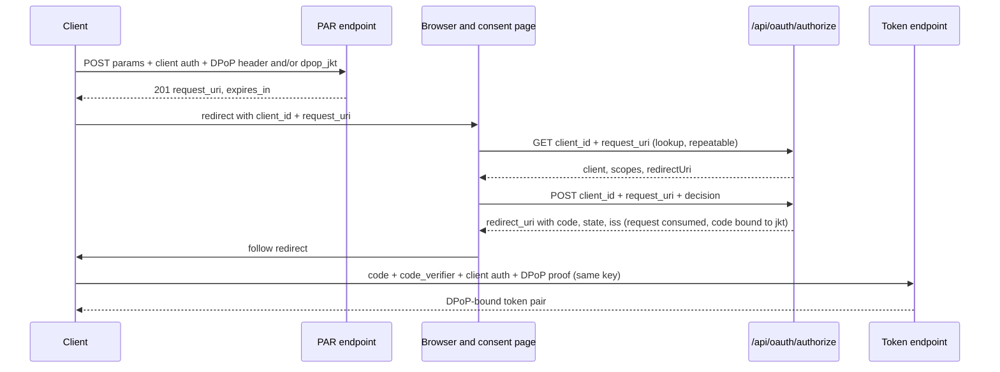
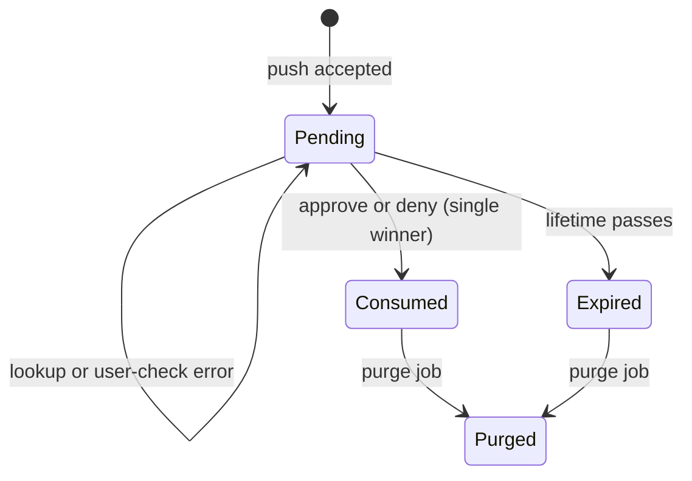
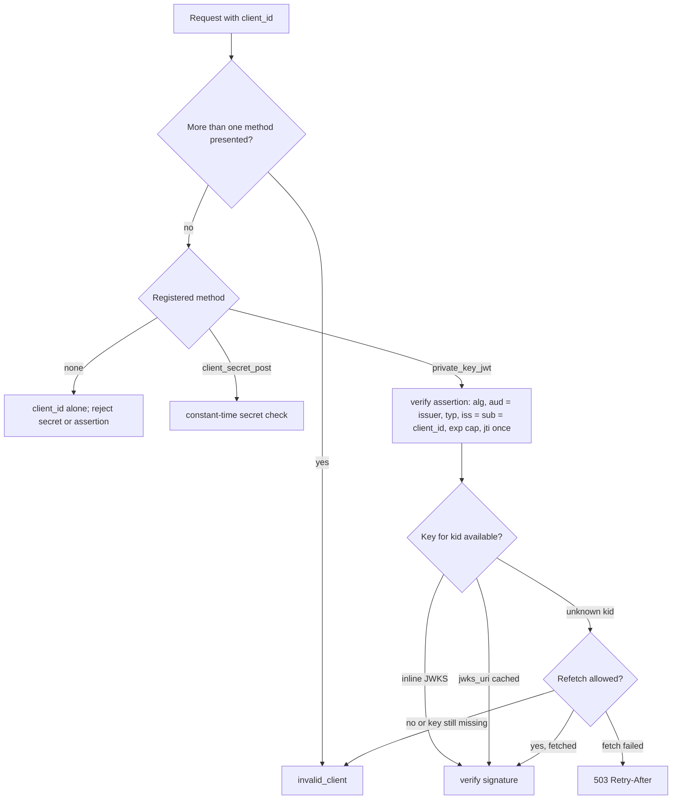

# OAuth Pushed Authorization Requests and private_key_jwt - Plan

## Goal Capsule

- **Objective:** A third-party client can get a user's authorization only through a request it pushed and authenticated on the back channel. The resulting authorization code works only with the DPoP key bound to that request. Confidential clients can authenticate with their own signing keys instead of a shared secret.
- **Means:** A PostgreSQL-backed pushed-request store behind a new PAR endpoint, a consent page that works only from `request_uri`, and a per-client authentication method with RFC 10070 client assertions (KTD1, KTD7, KTD9).
- **Product authority:** The Product Contract below. Key Decisions record which choices the user settled in the session. Planning Contract KTDs decide mechanism within those constraints. The device authorization grant and password, passkey and refresh login are not in scope.
- **Execution profile:** One pull request, built with `ce-work` on a branch named after this plan. Schema and migration work (U1, U6) goes to the postgres specialist (`.agents/agents/postgres.md`). Units land as local commits. Push only when the user asks.
- **Stop conditions:** Stop and ask if a settled decision proves infeasible in code, if the live-update capture or naming gates require a schema shape this plan rules out, or if `PublicHttpClient` cannot be configured for client-chosen hosts without weakening its address policy.
- **Open blockers:** None.

---

## Product Contract

Product Contract preservation: changed R3, R10, F1, AE7 and the DPoP Key Decision; added R21, R22, AE13, AE14 and the code-lifetime Key Decision. During planning the user chose RFC 9449 section 10.1 conformance (the DPoP header or `dpop_jkt`) over a mandatory proof header, and lowered the authorization-code lifetime to the FAPI 2.0 bound. Outstanding Questions were resolved into KTDs.

### Summary

Every authorization-code request goes through Pushed Authorization Requests (RFC 9126). The client pushes the request with a DPoP key binding and gets a short-lived `request_uri`, and the browser carries only `client_id` and that `request_uri` to the consent page. Confidential clients gain `private_key_jwt` authentication, following RFC 7523 as updated by RFC 10070, with keys registered as an inline JWKS or a `jwks_uri`.

### Problem Frame

Baander's authorization endpoint is the web consent page at `APP_URL/oauth/authorize`. It reads the whole authorization request from the browser query string and forwards it unchanged to `GET` and `POST /api/oauth/authorize`. Anything on the browser's path can read or change those parameters before the server has authenticated the client. The client authenticates later, at the token endpoint.

The authorization code is bound only by PKCE. The DPoP key is bound at the token endpoint, which is too late to tie the code to the client instance that started the flow.

Confidential clients authenticate only with `client_secret_post`. That is a shared secret, which the server has to store and the client has to send on every request.

No first-party code uses the authorization-code flow. The web and desktop apps use password and passkey login. The flow is groundwork for planned third-party clients such as TV apps, native players and server integrations. Under the pre-release policy it can therefore become strict now without breaking any client.

### Actors

- A1. Client: a registered OAuth client of type Public, Confidential, PersonalAccess or FirstParty that uses the authorization-code grant. Device clients are excluded, as they are today.
- A2. User: the signed-in Baander user who approves or denies the request on the consent page.
- A3. Admin: registers clients and manages their credentials through the admin web UI, the admin API or the console.

### Key Decisions

- **PAR is required for every authorization-code request; plain query-parameter requests are removed.** Governs R6, R7, R11. (session-settled: user-directed — chosen over requiring PAR per client and over optional PAR that only Baander's own clients adopt: no client uses the flow yet, and the pre-release policy favors the intended design over compatibility.)
- **Every pushed request carries a key binding, through the DPoP proof header, the `dpop_jkt` parameter, or both, and the code is bound to that key.** Governs R3, R10. (session-settled: user-directed — chosen over a mandatory DPoP proof header, an optional binding and deferring the binding: RFC 9449 section 10.1 requires a server with PAR and DPoP to accept both mechanisms, and every code still ends up bound to a key.)
- **A `request_uri` lives 5 minutes by default, is configurable, and is used up by one decision.** Governs R4. (session-settled: user-directed — chosen over 90 seconds and over 10 minutes: it allows for a sign-in with TOTP or a passkey before consent while keeping the window short.)
- **Authorization codes live 60 seconds by default.** Governs R21. (session-settled: user-directed — chosen over keeping 600 seconds: FAPI 2.0 caps codes at 60 seconds, and under PAR the code is created after consent, so it only has to survive the redirect and token request.)
- **`private_key_jwt` is added for confidential clients now, following RFC 10070.** Governs R12–R15. (session-settled: user-directed — chosen over keeping only `client_secret_post` and over removing `client_secret_post`: it removes the shared secret for clients that can sign, and RFC 10070 fixes the audience rules for assertions at the PAR endpoint.)
- **Each client chooses its key source: an inline JWKS or a `jwks_uri`.** Governs R16, R17. (session-settled: user-directed — chosen over inline JWKS only and over `jwks_uri` only: admins can register keys by hand, and clients that rotate their own keys can publish them.)
- **Each confidential client has one authentication method, fixed at registration.** Switching between a secret and keys means registering a new client. This mirrors how a client's type is fixed today. Governs R12, R18.
- **Revocation is unchanged.** `/api/oauth/revoke` authenticates the signed-in user, not the client, so client assertions do not apply there. Governs R14.

### Requirements

**Pushing a request**

- R1. Baander has a pushed authorization request endpoint. A client sends it the full authorization request (`response_type`, `client_id`, `redirect_uri`, `scope`, `state`, `code_challenge`, `code_challenge_method`) and gets back a `request_uri` and `expires_in`, as RFC 9126 section 2 defines.
- R2. The endpoint validates everything the current authorize checks validate that does not depend on the user: client, redirect URI, response type, mandatory S256 PKCE, the scope allowlist and the device-client exclusion. Errors return in the response to the client.
- R3. The endpoint authenticates the client by its registered method (R12) and requires a key binding: a valid DPoP proof header, a `dpop_jkt` parameter, or both with the same thumbprint (RFC 9449 section 10.1). It records the thumbprint with the pushed request.
- R4. A `request_uri` is unguessable and bound to the client that pushed it. It expires after a configurable lifetime, 300 seconds by default. Looking it up does not use it up; the user's approve or deny decision does.
- R5. Expired pushed requests do not accumulate in storage.

**Authorizing**

- R6. The authorization endpoint accepts only `client_id` and `request_uri`. A request without a `request_uri` is rejected.
- R7. Only the pushed parameters govern the authorization. Any other parameter in the browser URL is ignored.
- R8. The consent page shows the client and scopes from the pushed request. The checks that depend on the user still run when the page looks up the request and when the user decides: a disabled account, and a personal access client serving only its owner.
- R9. The consent page shows an error and does not redirect to the client when the `request_uri` is unknown, expired, already used, or was pushed by a client other than the `client_id` in the URL.
- R10. Approval issues an authorization code bound to the pushed request's key thumbprint as well as to PKCE. The token endpoint refuses to exchange that code unless the token request's DPoP proof uses the same key.
- R11. Authorization server metadata advertises `pushed_authorization_request_endpoint` and `require_pushed_authorization_requests: true`.
- R21. An authorization code lives 60 seconds by default, configurable as today.

**Client authentication**

- R12. Each confidential client has exactly one authentication method, chosen at registration: `client_secret_post` or `private_key_jwt`. Public clients keep authenticating with `client_id` alone.
- R13. A `private_key_jwt` assertion follows RFC 7523 as updated by RFC 10070. Its `aud` must be the issuer identifier as the sole value, and the server rejects any other audience, including the token or PAR endpoint URL. `iss` and `sub` are the `client_id`, and the assertion must carry `exp` and `jti`.
- R14. Assertions are accepted at the PAR endpoint and the token endpoint. A `jti` is accepted only once while the assertion is valid.
- R15. The server accepts the explicit type `client-authentication+jwt` and does not reject an assertion that leaves it out (RFC 10070 section 4). Metadata lists `private_key_jwt` and the accepted signing algorithms.
- R22. Every PAR and token request names its `client_id`, and an assertion's `iss` and `sub` must equal it.

**Client keys**

- R16. A `private_key_jwt` client registers its public keys as an inline JWKS or as an https `jwks_uri`, chosen per client.
- R17. For a `jwks_uri` client, Baander fetches the key set itself, refuses non-public addresses, caches what it fetches, and fetches again when an assertion names an unknown `kid`. A client can then rotate keys without an admin.
- R18. An admin can replace a client's inline JWKS or change its `jwks_uri`, in the same way as rotating a secret today.
- R19. The admin web UI, the admin API and the console offer the same registration and key-management actions.

**Documentation**

- R20. The operator and developer guides describe the PAR flow, the key binding at PAR, the `request_uri` and code lifetime settings, `private_key_jwt` with both key sources, and the removal of plain authorization requests.

### Key Flows

- F1. Authorization with a pushed request
  - **Trigger:** A client wants a user's authorization.
  - **Actors:** A1, A2
  - **Steps:** The client sends the request to the PAR endpoint with its client authentication and a key binding (DPoP header, `dpop_jkt`, or both), and receives `request_uri` and `expires_in`. It sends the browser to the consent page with `client_id` and `request_uri`. The user signs in if needed. The page looks up the pushed request and shows the client and scopes. The user approves or denies, which uses up the `request_uri`. The page navigates to the client's redirect URI with `code`, `state` and `iss`, or with `error`. The client exchanges the code at the token endpoint with the `code_verifier` and a DPoP proof from the bound key.
  - **Outcome:** The client holds a DPoP-bound token pair. No authorization parameter other than `client_id` and `request_uri` travelled in the browser.
  - **Covered by:** R1–R4, R6–R10, R22

- F2. Rotating keys for a `jwks_uri` client
  - **Trigger:** The client publishes a new key at its `jwks_uri` and signs an assertion with it.
  - **Actors:** A1
  - **Steps:** The server does not know the assertion's `kid`, fetches the key set again, finds the key and verifies the assertion.
  - **Outcome:** The assertion is accepted without any admin action.
  - **Covered by:** R16, R17

### Acceptance Examples

- AE1. **Covers R6.** **Given** a registered public client, **when** the browser opens the consent page with `response_type`, `client_id`, `redirect_uri` and `code_challenge` but no `request_uri`, **then** the page shows an error and no code is issued.
- AE2. **Covers R4, R9.** **Given** a request pushed 6 minutes ago with the default lifetime, **when** the user finishes signing in and the page looks it up, **then** the page shows an expiry error and does not redirect.
- AE3. **Covers R4, R9.** **Given** a request the user has already approved, **when** the same `request_uri` is opened again, **then** the page shows an error and no second code is issued.
- AE4. **Covers R4.** **Given** a pushed request within its lifetime, **when** the page looks it up twice (for example after a reload) and the user then approves, **then** the code is issued once.
- AE5. **Covers R7.** **Given** a pushed request with redirect URI A, **when** the browser URL also carries `redirect_uri=B`, **then** the decision redirects to A.
- AE6. **Covers R9.** **Given** a request pushed by client X, **when** the browser URL carries client Y's `client_id` with that `request_uri`, **then** the page shows an error.
- AE7. **Covers R3.** **Given** a valid client, **when** it pushes a request with neither a DPoP header nor `dpop_jkt`, **then** the PAR endpoint rejects the request.
- AE8. **Covers R10.** **Given** a code issued for a request pushed with key K1, **when** the token request carries a valid proof from key K2 and the correct `code_verifier`, **then** the exchange fails.
- AE9. **Covers R13.** **Given** a `private_key_jwt` client, **when** its assertion's `aud` is the token endpoint URL, or lists the issuer together with another value, **then** authentication fails.
- AE10. **Covers R14.** **Given** a valid assertion already accepted once, **when** the same assertion is sent again before it expires, **then** authentication fails.
- AE11. **Covers R15.** **Given** a valid assertion without a `typ` header, **when** the client sends it to the PAR endpoint, **then** it is accepted.
- AE12. **Covers R12.** **Given** a confidential client registered for `private_key_jwt`, **when** it sends `client_secret` instead of an assertion, **then** authentication fails.
- AE13. **Covers R3.** **Given** a DPoP header whose key thumbprint differs from the `dpop_jkt` in the same pushed request, **when** the client pushes it, **then** the PAR endpoint rejects the request.
- AE14. **Covers R3, R10.** **Given** a request pushed with only `dpop_jkt` for key K1, **when** the client later exchanges the code with a proof from K1, **then** the exchange succeeds.

### Scope Boundaries

- The device authorization grant is unchanged; PAR does not apply to it.
- Password, passkey and refresh login for Baander's own apps are unchanged.
- Revocation keeps authenticating the signed-in user (see Key Decisions).
- Deferred for later: signed request objects (JAR, RFC 9101) and the `request` parameter at PAR, `client_secret_jwt`, mTLS client authentication (`tls_client_auth`), dynamic client registration, and JWT-secured authorization responses (JARM).
- Considered and not built: consuming the `request_uri` when a user-dependent check sends the user back to the client with an error (KTD14). The pushed request expires within 5 minutes anyway, and a reload only repeats the same error redirect. A report of clients replaying such redirects would change the call.
- Considered and not built: keeping a stale cached JWKS after a fetch failure. A fetch failure answers "temporarily unavailable" instead (KTD11). Evidence that client key servers are flaky in practice would change the call.

### Dependencies / Assumptions

- No client uses the authorization-code flow today: nothing first-party calls `/api/oauth/authorize` except the consent page itself, and `ui/electron` has no OAuth code. Removing plain requests therefore needs no migration path.
- The `jwks_uri` fetch builds on the guarded outbound client `src/Shared/Infrastructure/Http/PublicHttpClient.php` with `PublicDestinationPolicy.php`, which already allows a per-request host allowlist (KTD11).

### Sources / Research

- RFC 9126 (OAuth 2.0 Pushed Authorization Requests); RFC 9449 sections 10 and 10.1 (DPoP with PAR, both binding mechanisms); RFC 7523 (JWT client authentication); RFC 10070, November 2026, which requires the issuer as the sole `aud` for client assertions, including at the PAR endpoint, and defines the `client-authentication+jwt` type; OpenID Connect Core section 9 (`jti` single use) and section 10.1.1 (refetch on unknown `kid`); OpenID Connect Registration section 2 (`jwks` and `jwks_uri` mutually exclusive, public keys only); FAPI 2.0 Security Profile section 5.3.2.1 (60-second codes, code binding to the DPoP key); draft-ietf-oauth-client-id-metadata-document-03 sections 6.1, 6.2, 10.7 and 10.11 (no redirects, caching, special-use addresses, size caps for server-side fetches).
- Authorize path: `src/Auth/Interface/Controller/OAuth/OAuthController.php` (`authorize`, `authorizeDecision`, `token`, `revoke`), `src/Auth/Application/Service/AuthorizationRequestValidator.php`, `src/Auth/Application/CommandHandler/OAuth/CreateAuthorizationCodeHandler.php`.
- DPoP: `src/Auth/Infrastructure/Security/OAuth/TokenEndpointDpopListener.php`, which checks only the `oauth_token` route; `DpopTokenRequestVerifier.php`; `DpopProofValidator.php`.
- Client authentication: `src/Auth/Application/Service/OAuthClientAuthenticator.php`; client model `src/Auth/Domain/Model/OAuth/Client.php` and `ClientState.php`.
- Metadata: `src/Auth/Interface/Controller/OAuth/AuthorizationServerMetadataController.php` and `tests/Unit/Auth/Interface/Controller/OAuth/AuthorizationServerMetadataTest.php`.
- Consent page: `ui/web/src/features/auth/pages/OAuthConsentPage.tsx`, `ui/web/src/features/auth/components/OAuthConsent.tsx`, `ui/web/src/features/auth/api/oauth-authorize-api.ts`.
- Client administration: `ui/web/src/features/admin/pages/OAuthClientsPage.tsx`, `src/Auth/Interface/Controller/AdminOAuthClientController.php`, `src/Auth/Interface/Console/OAuthClient*Command.php`.
- Learnings: `docs/solutions/runtime-errors/doctrine-refuses-a-flush-after-the-database-cascaded-a-delete-under-managed-children.md` and `docs/solutions/runtime-errors/doctrine-cannot-update-a-loaded-entity-keyed-by-its-association-under-the-strict-uuid-type.md` shape the persistence and purge approach in U1.

---

## Planning Contract

### Key Technical Decisions

- KTD1. **Pushed requests live in a new PostgreSQL table, `oauth_pushed_authorization_requests`, not in Redis.** Single use is security state, and the auth-code table already shows the pattern: a domain aggregate with a state object, a repository with an atomic conditional `UPDATE`, and a bulk purge. The row holds the client (foreign key, `ON DELETE CASCADE`), the pushed parameters including `state`, the key thumbprint (`NOT NULL`), `expires_at` and `consumed_at`. It has no user column; the user exists only at decision time. The existing `app:oauth:purge-codes` job deletes expired rows as its third count, which satisfies R5 without a new schedule.
- KTD2. **`request_uri` is `urn:ietf:params:oauth:request_uri:` followed by a `TokenId`.** `TokenId::generate()` already yields 80 unguessable characters and is what authorization codes use. The table stores the `TokenId` under a unique constraint; lookup parses the URN prefix and fails as unknown on any other shape.
- KTD3. **The decision uses the request up and creates the code in one transaction.** Inside `TransactionPortInterface::run()`, a conditional `UPDATE` sets `consumed_at` only where the row is unconsumed, unexpired by `clock_timestamp()` and owned by the client. It must affect exactly one row, and then the code is saved. Two tabs deciding at once get one winner (AE3). The lookup path checks the same predicates read-only (AE4). `AuthCodeRepository::redeem()` is the template; `ApproveDeviceCodeHandler` has no conditional guard and is not.
- KTD4. **`AuthorizationRequestValidator` splits into a user-free check and a user check.** The push validates client, redirect URI, response type, device exclusion, PKCE and scopes (R2). Lookup and decision rebuild the validated request from the stored pushed row plus the signed-in user, and run the personal-access-owner and disabled-user checks (R8). `ValidatedAuthorizationRequest` keeps requiring a `User`; the push gets its own validated type without one.
- KTD5. **The DPoP listener covers the PAR route, where the header is optional.** `TokenEndpointDpopListener` takes a route list. On `oauth_par`, a request without a `DPoP` header passes through without a `VerifiedDpopProof`. A request with one gets the full check, including the `use_dpop_nonce` challenge, exactly as on the token route. The push handler then derives the binding (governs R3):
  1. A verified proof only: its `jkt`.
  2. `dpop_jkt` only: the parameter, which must be a 43-character base64url SHA-256 thumbprint or the push fails with `invalid_request`.
  3. Both: they must be equal under `hash_equals`, or the push fails with `invalid_dpop_proof` (AE13).
  4. Neither: `invalid_request` (AE7).

  During a Redis outage every push answers 503 with `Retry-After`, whichever binding it carries, because the PAR rate limiters fail closed before the DPoP listener runs. (session-settled: user-directed — chosen over a mandatory DPoP proof header: RFC 9449 section 10.1 requires accepting both mechanisms.)
- KTD6. **Authorization codes carry the key thumbprint.** `oauth_auth_codes` gains `dpop_jkt text NOT NULL` (no backfill under the pre-release policy). `ExchangeAuthorizationCodeHandler` compares it with the token request's proof `jkt` after the PKCE check, using a domain method with `hash_equals`, and answers `invalid_grant` on mismatch (R10, AE8). The default `auth.auth_code.ttl` becomes 60 (R21).
- KTD7. **The authentication method is its own client dimension.** A new enum `ClientAuthMethod` (`none`, `client_secret_post`, `private_key_jwt`) is stored as `oauth_clients.token_endpoint_auth_method text NOT NULL`, named after the RFC 7591 field. New columns `jwks jsonb` and `jwks_uri text` hold the key source. Check constraints replace `chk_oauth_clients_confidential_secret_hash`:
  - a secret hash exists exactly when the method is `client_secret_post`;
  - exactly one key source exists exactly when the method is `private_key_jwt`;
  - a client is confidential exactly when the method is not `none`.

  `ClientType` stays derived from the flags; a confidential client defaults to `client_secret_post` at registration.
- KTD8. **Client credentials travel as one value object.** `ClientCredentials` carries `client_id`, an optional secret, and an optional assertion with its `client_assertion_type`. `OAuthClientAuthenticator` resolves the client and verifies by its registered method (R12). A request that presents more than one method, or a method other than the registered one, gets `invalid_client` (AE12, RFC 6749 section 2.3). `client_id` is required, and an assertion's `iss` and `sub` must equal it (R22). The PAR endpoint and all three token grants pass this object.
- KTD9. **Assertion verification sits behind an Application port, implemented with lcobucci/jwt.** `ClientAssertionVerifierInterface` lives in `src/Auth/Application/Port/`. The Infrastructure implementation reuses the JWK-to-key conversion, which is extracted from `DpopProofValidator` into a shared helper that both use. The rules (governs R13, R15):
  - **Algorithms:** the asymmetric list DPoP accepts, held in one constant and advertised as `token_endpoint_auth_signing_alg_values_supported`. `none` and `HS*` are rejected.
  - **`aud`:** exactly the configured `auth.oauth.issuer` string, either as a plain string or as a one-element array. Nothing is normalized; a trailing-slash difference fails.
  - **`typ`:** absent or `client-authentication+jwt`, with an optional `application/` prefix compared case-insensitively. Any other value is rejected.
  - **Time:** `exp` is required, and `exp - now` may not exceed `auth.client_assertion.max_lifetime` (300 seconds by default) plus clock skew. When `iat` is present, it may not lie more than clock skew in the future, and `exp - iat` may not exceed the maximum lifetime either. `nbf` is honored. Clock skew reuses `auth.dpop.clock_skew`.
  - **Dependency:** `lcobucci/jwt` becomes a direct `composer.json` requirement, since `src/` uses it directly.
- KTD10. **Assertion `jti` replay goes to Redis behind its own port.** The key is `oauth:assertion-jti:` followed by the SHA-256 of `client_id` and `jti`, so it stays apart from DPoP proof jtis and is scoped per client. The TTL is the assertion's remaining lifetime plus skew. An unavailable store throws the existing store-unavailable exception, and the endpoint answers 503 with `Retry-After`, as DPoP does today. The DPoP listener runs before the controller, so a `use_dpop_nonce` retry does not consume the assertion; a retry after a 503 may have consumed it, and the client signs a new one.
- KTD11. **Keys come from one provider port with two sources.** An inline JWKS is read from the client row. A `jwks_uri` is fetched through `PublicHttpClient`:
  - The allowlist is the URI's own host. The URI must be https on port 443, with no redirects, a 3-second budget, and a body cap of 64 KB enforced while reading. The set may hold at most 10 keys, all public and asymmetric.
  - The result is cached in `cache.app` for `auth.client_jwks.cache_ttl`, 3600 seconds by default. The cache key includes the client's `updated_at`, so a key replacement makes older entries unreachable, and a fetch that was already running when the keys were replaced cannot bring old keys back.
  - An unknown `kid` triggers at most one refetch per client per `auth.client_jwks.refetch_interval`, 60 seconds by default, through a Redis lock, which also allows only one fetch in flight per client.
  - A transport failure, timeout or non-200 answer gives 503 with `Retry-After`; nothing is cached. A malformed set, or a set without the assertion's key after the refetch, gives `invalid_client`. When Redis is unavailable, the endpoint answers 503 and does not fetch uncached.
- KTD12. **Registration and key replacement share Application commands across the three surfaces.** `RegisterClientCommand` gains the auth method and key source. A new `ReplaceClientKeysCommand` mirrors `RotateClientSecretCommand`; it may switch a client between an inline JWKS and a `jwks_uri`, since the method stays `private_key_jwt`. The admin route `POST /api/admin/oauth/clients/{clientId}/keys` requires `ROLE_SUPER_ADMIN` and carries `#[CliCounterpart('app:oauth:client:replace-keys')]`. The console gains `--auth-method`, `--jwks-file` and `--jwks-uri` on create and a `replace-keys` command. The client-management handlers move from `ClientManagementException` to the shared `NotFoundException`, `ConflictException` and `InvalidInputException`, as `.agents/rules/admin-cli-parity.md` requires. The handlers change anyway, and new code may not copy the old pattern.
- KTD13. **The PAR endpoint mirrors the token endpoint's edges.** `POST /api/oauth/par` (route `oauth_par`) is public in `security.yaml` and has the same CORS entry. It gets per-IP and per-client limiters with the token endpoint's defaults, so a public client cannot fill the table. The response is 201 with `request_uri` and `expires_in`, `Cache-Control: no-store`, and `DPoP-Nonce` whenever a proof was verified. A pushed `request_uri` parameter is rejected with `invalid_request` (RFC 9126 section 2.1), and a `request` parameter with `request_not_supported`.
- KTD14. **Authorize lookup and decision read only `client_id`, `request_uri` and `decision`.** Unknown, malformed, expired, consumed or client-mismatched requests raise an `invalid_request_uri` protocol error with no redirect URI (R9). User-dependent errors redirect to the pushed redirect URI with the pushed `state` and `iss`, and they leave the request unconsumed.
- KTD15. **The consent page sends only `client_id` and `request_uri`, and takes the redirect target from the server.** `OAuthConsent` stops reading `redirect_uri` from the browser URL. `checkedClientRedirect` compares the decision's answer against the `redirectUri` the lookup returned (AE5).
- KTD16. **Live-update capture classifies the new schema.** In `tests/Fixtures/LiveUpdates/capture-sources.json`, the pushed-request table is `excluded`, like `oauth_auth_codes`. The new `oauth_clients` columns are classified, with `jwks` excluded like `secret_hash` and the method and `jwks_uri` relevant. The client→pushed-request cascade gets an entry. The `oauth_clients` capture triggers are recreated in the client migration to name the relevant new columns.

### High-Level Technical Design

The pushed flow, from push to token:

The pushed request's lifecycle:

Client authentication at the PAR and token endpoints:

### Assumptions

- A Redis outage already answers 503 at the token endpoint today, because the DPoP nonce and jti stores live there; assertion jtis add no new failure mode.
- `NativeDnsResolver` blocks the worker during the `jwks_uri` lookup; the 3-second budget and the one-hour cache keep that rare.

### Sequencing

U1 → U2 → U3 → U4 and U5 carry the PAR half. U6 carries the client schema and can start alongside U1; U7 waits for U2 and U6, and U8 follows U7. U9 needs U6, U7 and U8. U10 closes the documentation once the behavior is fixed.

---

## Implementation Units

### U1. Pushed-request persistence and code key binding

- **Goal:** Store pushed requests with single-use semantics, bind codes to a key thumbprint, and purge expired requests.
- **Requirements:** R4, R5, R10 (storage side), R21; KTD1, KTD2, KTD3, KTD6, KTD16.
- **Dependencies:** None.
- **Files:**
  - `src/Auth/Domain/Model/OAuth/PushedAuthorizationRequest.php`, `PushedAuthorizationRequestState.php` (new)
  - `src/Auth/Domain/Repository/OAuth/PushedAuthorizationRequestRepositoryInterface.php` (new)
  - `src/Auth/Infrastructure/Doctrine/Entity/OAuth/PushedAuthorizationRequestEntity.php`, `src/Auth/Infrastructure/Repository/OAuth/PushedAuthorizationRequestRepository.php` (new)
  - `src/Auth/Domain/Model/OAuth/AuthCode.php`, `AuthCodeState.php`, `src/Auth/Infrastructure/Doctrine/Entity/OAuth/AuthCodeEntity.php`, `src/Auth/Infrastructure/Repository/OAuth/AuthCodeRepository.php`
  - `src/Auth/Application/CommandHandler/OAuth/PurgeExpiredOAuthCodesHandler.php`, `src/Auth/Application/DTO/PurgedOAuthCodesDTO.php`, `src/Auth/Interface/Console/PurgeOAuthCodesCommand.php`
  - `migrations/Version<timestamp>.php` (new), `config/packages/auth.yaml`, `config/services.yaml`
  - `tests/Fixtures/LiveUpdates/capture-sources.json`
  - Tests: `tests/Unit/Auth/Domain/Model/OAuth/PushedAuthorizationRequestTest.php`, `tests/Unit/Auth/Domain/Model/OAuth/AuthCodeTest.php`, `tests/Integration/OAuthPushedAuthorizationRequestPersistenceTest.php` (new), `tests/Integration/AuthCodePkceMigrationTest.php`, `tests/Unit/Auth/Application/CommandHandler/OAuth/PurgeExpiredOAuthCodesHandlerTest.php`
- **Approach:**
  1. Model the aggregate after `AuthCode`: `create()` validates inputs, `reconstitute()`, `isExpired()`, getters, and a `requestUri()` that renders the URN.
  2. Map the entity as a plain class with named `idx_`, `uniq_` and `fk_` names per `docs-book/part-2-developer-guide/development/database-naming.md`. Persist through DBAL statements where the learnings warn about association-keyed updates.
  3. Add `consume(clientId)` to the repository as the single conditional `UPDATE` from KTD3, and `deleteExpiredBefore()` as a bulk `DELETE`.
  4. Write one migration: create the table, delete existing authorization codes (they live 60 seconds and cannot carry a thumbprint), then add `oauth_auth_codes.dpop_jkt text NOT NULL`. Follow `migrations/Version20261117130000.php` for `lock_timeout`, comments and the irreversible `down()`.
  5. Add `auth.par.request_uri_ttl: 300` and set `auth.auth_code.ttl: 60`, with comments in the file's style.
- **Patterns to follow:** `AuthCode`, `AuthCodeRepository::redeem()`, `PasswordResetTokenRepository` (DBAL), the device-code consumed check in the baseline migration.
- **Test scenarios:**
  - A request created with a 300-second lifetime reports not expired at 299 seconds and expired at 301.
  - `requestUri()` renders `urn:ietf:params:oauth:request_uri:` plus the token id.
  - Covers AE3. Consuming twice on a second connection: the first returns true, the second false.
  - Consuming an expired row returns false and leaves `consumed_at` null.
  - Consuming with another client's id returns false.
  - Two concurrent consumers on separate connections produce exactly one winner.
  - Deleting a client cascades to its pushed requests without a Doctrine flush error while children are loaded.
  - The purge deletes requests expired more than an hour ago, keeps newer ones, and reports the third count.
  - An authorization code created with a thumbprint round-trips it through the repository.
  - The naming-convention and capture-coverage tests pass with the new table and column.
- **Verification:** Integration tests prove single use and purge against PostgreSQL. The schema comparison is clean.

### U2. PAR endpoint with key binding

- **Goal:** Accept pushed requests from authenticated clients with a key binding and return a `request_uri`.
- **Requirements:** R1, R2, R3, R11, R22 (body `client_id`); F1; AE7, AE13; KTD4, KTD5, KTD13.
- **Dependencies:** U1.
- **Files:**
  - `src/Auth/Application/Command/OAuth/PushAuthorizationRequestCommand.php`, `src/Auth/Application/CommandHandler/OAuth/PushAuthorizationRequestHandler.php`, `src/Auth/Application/DTO/PushedAuthorizationRequestDTO.php` (new)
  - `src/Auth/Application/Service/AuthorizationRequestValidator.php`, `src/Auth/Application/Exception/OAuthProtocolException.php`
  - `src/Auth/Interface/Controller/OAuth/OAuthController.php`, `src/Auth/Interface/Controller/OAuth/AuthorizationServerMetadataController.php`
  - `src/Auth/Infrastructure/Security/OAuth/TokenEndpointDpopListener.php`, `src/Auth/Infrastructure/Security/RateLimitListener.php`
  - `config/packages/security.yaml`, `config/packages/nelmio_cors.yaml`, `config/packages/framework.yaml`, `config/packages/auth.yaml`
  - `openapi.json`, `ui/web/src/shared/api-client/gen/`
  - Tests: `tests/Unit/Auth/Application/CommandHandler/OAuth/PushAuthorizationRequestHandlerTest.php` (new), `tests/Unit/Auth/Infrastructure/Security/OAuth/TokenEndpointDpopListenerTest.php`, `tests/Unit/Auth/Infrastructure/Security/RateLimitListenerTest.php`, `tests/Unit/Auth/Interface/Controller/OAuth/AuthorizationServerMetadataTest.php`, `tests/Integration/CorsConfigurationTest.php`, `tests/Functional/Auth/PushedAuthorizationRequestEndpointTest.php` (new), `tests/Functional/Auth/NonTokenRouteDpopNonceTest.php`
- **Approach:**
  1. Split the validator per KTD4. The push path never touches a user.
  2. The handler authenticates the client with the existing secret check; U7 swaps in `ClientCredentials`. It derives the binding per KTD5, then saves the row.
  3. The controller copies `token()`'s shape: protocol errors as JSON with their status, unexpected failures as 503 with `Retry-After`, `DPoP-Nonce` when a proof was verified.
  4. Make the listener's route a list and let the PAR route pass without a header.
  5. Add the metadata fields from R11 and regenerate `openapi.json` and the web client.
- **Patterns to follow:** `OAuthController::token()` and `grantCommand()`, the token limiter definitions in `config/packages/auth.yaml`, the metadata pin test.
- **Test scenarios:**
  - A public client pushing valid parameters with a valid DPoP header gets 201, a URN `request_uri`, `expires_in: 300` and a `DPoP-Nonce` header.
  - A push with only a valid `dpop_jkt` gets 201 and stores that thumbprint.
  - Covers AE7. A push with neither header nor `dpop_jkt` gets 400 `invalid_request`.
  - Covers AE13. A header and a different `dpop_jkt` get 400 `invalid_dpop_proof`.
  - A malformed `dpop_jkt` (wrong length or characters) gets 400 `invalid_request`.
  - A header proof without a nonce gets `use_dpop_nonce` with a fresh nonce, and the retry with it succeeds.
  - A confidential client with a wrong secret gets 401 `invalid_client`.
  - A device client gets `unauthorized_client`; a `plain` PKCE method, a missing challenge and an unregistered redirect URI each get their current error codes.
  - A push carrying `request_uri` gets `invalid_request`; one carrying `request` gets `request_not_supported`.
  - A push without `client_id` gets `invalid_request`.
  - The per-client limiter answers 429 after the configured number of pushes.
  - With Redis unavailable, a push answers 503 with `Retry-After`, with a DPoP header and with only `dpop_jkt`.
  - Metadata advertises the PAR endpoint URL and `require_pushed_authorization_requests: true`.
  - CORS allows the `DPoP` header and exposes `DPoP-Nonce` on the PAR path.
- **Verification:** The functional test drives the endpoint through the kernel with PostgreSQL and Redis; the OpenAPI check reports no drift.

### U3. Authorization endpoint on pushed requests

- **Goal:** Make lookup and decision work only from a pushed request, with the decision using it up atomically and issuing a key-bound code.
- **Requirements:** R6, R7, R8, R9, R10 (issuance); F1; AE1–AE6; KTD3, KTD4, KTD14.
- **Dependencies:** U1, U2.
- **Files:**
  - `src/Auth/Application/Query/OAuth/GetAuthorizationRequestQuery.php` and its handler, `src/Auth/Application/Command/OAuth/CreateAuthorizationCodeCommand.php`, `src/Auth/Application/CommandHandler/OAuth/CreateAuthorizationCodeHandler.php`
  - `src/Auth/Interface/Controller/OAuth/OAuthController.php`, `src/Auth/Interface/Request/OAuth/AuthorizationDecisionRequest.php`
  - `openapi.json`, `ui/web/src/shared/api-client/gen/`
  - Tests: `tests/Unit/Auth/Application/CommandHandler/OAuth/AuthorizationCodeGrantTest.php`, `tests/Functional/Auth/AuthorizationEndpointPushedRequestTest.php` (new), `tests/Functional/Auth/DisabledUserAccessTest.php`, `tests/Functional/Auth/AuthEndpointRateLimitTest.php`
- **Approach:**
  1. Both commands take `client_id`, `request_uri` and the user. They load the pushed row, check it per KTD14, and rebuild the validated request from the row.
  2. The decision handler runs KTD3's transaction, then builds the redirect with the pushed `state` and `iss`.
  3. The controller reads `state` from the pushed request, never from the URL. The OpenAPI attributes shrink to `client_id`, `request_uri` and `decision`.
- **Patterns to follow:** `TokenPairIssuer`'s use of `TransactionPortInterface`; `authorizationError()` for redirect-or-display.
- **Test scenarios:**
  - Covers AE1. GET without `request_uri` gets 400 with no `redirect_uri`.
  - Covers AE2. A request past its lifetime gets `invalid_request_uri` with no `redirect_uri`.
  - Covers AE3. A second approval of the same request gets `invalid_request_uri` and no code is created.
  - Covers AE4. Two lookups, then one approval, produce exactly one code.
  - Covers AE5. A URL carrying `redirect_uri`, `scope` or `state` alongside `request_uri` has no effect: the answer uses the pushed values.
  - Covers AE6. Another client's `client_id` with the `request_uri` gets `invalid_request_uri`.
  - Denial consumes the request and redirects with `access_denied`, the pushed `state` and `iss`.
  - A disabled user gets a redirect with `access_denied`; the request stays pending.
  - A personal access client opened by a user other than its owner gets `unauthorized_client` with a redirect.
  - The issued code carries the pushed thumbprint and a 60-second lifetime.
  - A malformed `request_uri` (wrong prefix) gets `invalid_request_uri`.
- **Verification:** Functional tests cover every lookup and decision outcome against PostgreSQL.

### U4. Key binding at the token endpoint and the end-to-end grant path

- **Goal:** Refuse code exchanges from any key other than the bound one, and prove the whole pushed flow end to end.
- **Requirements:** R10, R21; F1; AE8, AE14; KTD6.
- **Dependencies:** U3.
- **Files:**
  - `src/Auth/Application/CommandHandler/OAuth/ExchangeAuthorizationCodeHandler.php`, `src/Auth/Domain/Model/OAuth/AuthCode.php`
  - Tests: `tests/Unit/Auth/Application/CommandHandler/OAuth/AuthorizationCodeGrantTest.php`, `tests/Integration/OAuthGrantPathAcceptanceTest.php`, `tests/Fixtures/Auth/GrantPathOAuthKernel.php`
- **Approach:**
  1. Add the thumbprint comparison right after the PKCE check.
  2. Rewrite the acceptance test's authorize helpers to push first, using the same key for push and exchange. The current test exchanges with a different key, which this change forbids.
- **Patterns to follow:** `AuthCode::isIssuedFor()` for the constant-time domain check.
- **Test scenarios:**
  - Covers AE8. A proof from K2 against a code bound to K1 gets `invalid_grant`, and the code stays unredeemed.
  - Covers AE14. Push with only `dpop_jkt` for K1, approve, exchange with a K1 proof: tokens issued with `cnf.jkt` equal to K1's thumbprint.
  - The full path with a DPoP header at push, consent, decision and exchange issues a token pair, and a second exchange gets `invalid_grant`.
  - A code exchanged 61 seconds after issue gets `invalid_grant`.
- **Verification:** The acceptance test passes over the real HTTP stack for both binding mechanisms.

### U5. Consent page on pushed requests

- **Goal:** Make the web consent page forward only `client_id` and `request_uri` and trust the server's redirect URI.
- **Requirements:** R6, R7, R9; AE5; KTD15.
- **Dependencies:** U3 (regenerated client and API shape).
- **Files:**
  - `ui/web/src/features/auth/api/oauth-authorize-api.ts`, `ui/web/src/features/auth/components/OAuthConsent.tsx`, `ui/web/src/features/auth/pages/OAuthConsentPage.tsx`, `ui/web/src/features/auth/lib/client-redirect.ts`
  - Tests: `ui/web/src/features/auth/api/__tests__/oauth-authorize-api.test.ts`, `ui/web/src/features/auth/pages/__tests__/OAuthConsentPage.test.tsx`, `ui/web/src/features/auth/components/__tests__/ProtectedRoute.test.tsx`
- **Approach:** Build lookup params and the decision body from `client_id` and `request_uri` only. Compare the decision's target against the lookup's `redirectUri`. Map `invalid_request_uri` to the existing rejected view, with copy that tells the user to start again from the app. Update the page docblock to the pushed flow. Read `.agents/rules/frontend.md` and `ui/DESIGN.md` first.
- **Patterns to follow:** The existing views in `OAuthConsent.tsx`; the hand-written Axios calls already in `oauth-authorize-api.ts`.
- **Test scenarios:**
  - Lookup sends exactly `client_id` and `request_uri` even when the URL carries more parameters.
  - The decision body carries `client_id`, `request_uri` and `decision` only.
  - Covers AE5. A URL `redirect_uri` that differs from the server's does not produce the unsafe-redirect view, and navigation goes to the server's target.
  - An `invalid_request_uri` answer shows the rejected view and does not navigate.
  - The sign-in guard keeps `client_id` and `request_uri` through login.
- **Verification:** `yarn --cwd ui/web test` passes for the auth feature.

### U6. Client authentication method and key source

- **Goal:** Give every client a stored authentication method and let `private_key_jwt` clients hold an inline JWKS or a `jwks_uri`.
- **Requirements:** R12, R16 (model and validation); KTD7, KTD16.
- **Dependencies:** None.
- **Files:**
  - `src/Auth/Domain/Model/OAuth/ClientAuthMethod.php`, `src/Auth/Domain/Model/OAuth/ValueObject/ClientKeySource.php` (new)
  - `src/Auth/Domain/Model/OAuth/Client.php`, `ClientState.php`, `ClientType.php`
  - `src/Auth/Infrastructure/Doctrine/Entity/OAuth/ClientEntity.php`
  - The six `ClientState` builders: `src/Auth/Infrastructure/Repository/OAuth/ClientRepository.php`, `AuthCodeRepository.php`, `DeviceCodeRepository.php`, `AccessTokenRepository.php`, `RefreshTokenRepository.php`, and `Client.php`
  - `migrations/Version<timestamp>.php` (new), `tests/Fixtures/LiveUpdates/capture-sources.json`
  - Tests: `tests/Unit/Auth/Domain/Model/OAuth/ClientTest.php`, `tests/Unit/Auth/Domain/Model/OAuth/ValueObject/ClientKeySourceTest.php` (new), `tests/Integration/OAuthClientPersistenceTest.php`, `tests/Integration/OAuthSecretHashAndCodePurgeTest.php`
- **Approach:**
  1. Add a `registerConfidentialWithKeys()` factory beside `registerConfidential()`, and `replaceKeys()` modeled on `rotateSecret()`; both set `updatedAt`.
  2. `ClientKeySource` validates on construction: https on port 443 for a URI; for a JWKS, public asymmetric keys only (no `d`, `p`, `q`, `dp`, `dq`, `qi`, no `oct`), at most 10 keys, unique `kid` values when there is more than one, and at most 64 KB.
  3. Thread the new fields through all six builders and `syncToEntity()`.
  4. The migration adds the columns, backfills `token_endpoint_auth_method` for existing rows (`client_secret_post` where a secret hash exists, otherwise `none`) before setting `NOT NULL`, replaces the check constraint per KTD7, and recreates the `oauth_clients` capture triggers.
- **Patterns to follow:** `ClientSecret` for a validating value object; `Client::rotateSecret()`; the trigger definitions in `migrations/Version20261030210000.php`.
- **Test scenarios:**
  - A JWKS with a private RSA member is rejected; one with an `oct` key is rejected; eleven keys are rejected; two keys sharing a `kid` are rejected.
  - An `http` or port-8443 `jwks_uri` is rejected.
  - A key client round-trips its method and key source through every repository that rebuilds a client (codes, device codes, tokens).
  - The database refuses a `private_key_jwt` row with a secret hash, one with both `jwks` and `jwks_uri`, and a `client_secret_post` row without a secret.
  - `replaceKeys()` on a secret client or a revoked client throws.
  - Capture coverage and naming-convention tests pass.
- **Verification:** Persistence tests and the constraint tests pass against PostgreSQL.

### U7. Client assertion authentication

- **Goal:** Authenticate clients by their registered method at the PAR and token endpoints, including RFC 10070 assertions.
- **Requirements:** R12, R13, R14, R15, R22; AE9–AE12; KTD8, KTD9, KTD10.
- **Dependencies:** U2, U6.
- **Files:**
  - `src/Auth/Application/DTO/ClientCredentials.php`, `src/Auth/Application/Port/ClientAssertionVerifierInterface.php`, `src/Auth/Application/Port/ClientAssertionJtiStoreInterface.php`, `src/Auth/Application/Port/ClientKeySetProviderInterface.php`, `src/Auth/Infrastructure/Security/OAuth/ClientKeySetProvider.php` (new)
  - `src/Auth/Application/Service/OAuthClientAuthenticator.php`, and the handlers for push and the three grants (`ExchangeAuthorizationCodeHandler.php`, `ExchangeDeviceCodeHandler.php`, `ExchangeRefreshTokenHandler.php`)
  - `src/Auth/Infrastructure/Security/OAuth/ClientAssertionVerifier.php`, `src/Auth/Infrastructure/Security/OAuth/JwkPublicKeyConverter.php` (new, extracted from `DpopProofValidator.php`), `src/Auth/Infrastructure/Cache/RedisClientAssertionJtiStore.php` (new)
  - `src/Auth/Interface/Controller/OAuth/OAuthController.php`, `AuthorizationServerMetadataController.php`, `composer.json`, `composer.lock`, `config/services.yaml`, `config/packages/auth.yaml`
  - Tests: `tests/Unit/Auth/Infrastructure/Security/OAuth/ClientAssertionVerifierTest.php` (new), `tests/Unit/Auth/Application/Service/OAuthClientAuthenticatorTest.php` (new), `tests/Unit/Auth/Infrastructure/Cache/RedisClientAssertionJtiStoreTest.php` (new), `tests/Unit/Auth/Infrastructure/Security/OAuth/DpopProofValidatorTest.php`, `tests/Fixtures/Auth/SignedClientAssertion.php` (new), `tests/Functional/Auth/ClientAssertionAuthenticationTest.php` (new)
- **Approach:**
  1. Extract the JWK conversion first, keeping `DpopProofValidatorTest` green.
  2. Build the verifier per KTD9. Define `ClientKeySetProviderInterface` here with an implementation that serves inline JWKS; U8 adds the `jwks_uri` source behind the same port.
  3. Replace the `(clientId, secret)` pair with `ClientCredentials` across the authenticator and its callers.
  4. The controller reads `client_assertion` and `client_assertion_type` from the body for push and token.
  5. Add `private_key_jwt` and the signing algorithms to the metadata, pinned by the existing test pattern.
- **Execution note:** Write the verifier's claim-rule tests first; they encode RFC 10070 and are easy to get subtly wrong.
- **Patterns to follow:** `DpopProofValidator`'s claim checks and errors; `RedisDpopJtiCache`; `SignedDpopProof` for the assertion fixture.
- **Test scenarios:**
  - A valid ES256 assertion with `aud` equal to the issuer string authenticates at the PAR and token endpoints.
  - `aud` as a one-element array holding the issuer authenticates.
  - Covers AE9. `aud` equal to the token endpoint URL fails; `aud` holding the issuer and another value fails; the issuer with an added trailing slash fails.
  - Covers AE10. The same assertion sent twice within its lifetime fails the second time.
  - Covers AE11. An assertion without `typ` authenticates; `typ: client-authentication+jwt` and `application/client-authentication+jwt` authenticate; `typ: dpop+jwt` fails.
  - Covers AE12. A key client sending `client_secret` fails; sending both a secret and an assertion fails.
  - An assertion whose `iss` or `sub` differs from the body `client_id` fails.
  - `alg: HS256` and `alg: none` fail.
  - An assertion with `exp` 301 seconds after `iat` fails; one expired beyond skew fails; one with a future `nbf` fails.
  - An assertion with `iat` an hour in the future and `exp` 200 seconds after it fails, as does one without `iat` whose `exp` lies more than 300 seconds plus skew ahead.
  - A secret client and a public client still authenticate as before, at all three grants.
  - With Redis unavailable, an assertion request answers 503 with `Retry-After`.
  - A `use_dpop_nonce` challenge followed by a retry with the same assertion succeeds.
- **Verification:** Unit tests cover every claim rule; the functional test proves PAR plus token exchange with `private_key_jwt`.

### U8. Fetched client key sets

- **Goal:** Resolve a `jwks_uri` client's keys safely, with caching and rate-limited refetch on unknown `kid`.
- **Requirements:** R16, R17; F2; KTD11.
- **Dependencies:** U7.
- **Files:**
  - `src/Auth/Infrastructure/Security/OAuth/ClientKeySetProvider.php` (extended with the fetched source), `config/services.yaml`, `config/packages/auth.yaml`
  - Tests: `tests/Unit/Auth/Infrastructure/Security/OAuth/ClientKeySetProviderTest.php` (new), `tests/Functional/Auth/ClientAssertionAuthenticationTest.php`
- **Approach:**
  1. Call `PublicHttpClient` with the URI's host as the allowlist and the 3-second budget.
  2. Read the body under the 64 KB cap and parse it through `ClientKeySource`'s validation.
  3. Cache under a key that includes the client's `updated_at`. Take the Redis lock before any refetch.
- **Patterns to follow:** `PushTransport`'s host-derived allowlist; `PublicHttpClientTest` with a mocked resolver; `*.baander.app` hosts in fixtures, and literal-IP cases kept.
- **Test scenarios:**
  - Covers F2. An assertion with an unknown `kid` triggers one refetch, finds the new key and authenticates.
  - A second unknown `kid` within the refetch interval does not fetch and gets `invalid_client`.
  - A cached set is used without a fetch inside its TTL.
  - A key replacement changes the cache key, so the next assertion fetches fresh keys.
  - A fetch that times out, gets a 500 or a 302 answers 503 with `Retry-After` and caches nothing.
  - A body over 64 KB is cut off and treated as a failed fetch.
  - A host resolving to a private or loopback address is refused.
  - A set containing a private key member gives `invalid_client`.
  - With Redis unavailable, the endpoint answers 503 without fetching.
- **Verification:** Unit tests run against `MockHttpClient` with a stubbed resolver; the functional test covers rotation.

### U9. Client registration and key management on every surface

- **Goal:** Let admins register key clients and replace keys through the admin API, the console and the web admin, with the same rules everywhere.
- **Requirements:** R12, R16, R18, R19; KTD12.
- **Dependencies:** U6, U7, U8.
- **Files:**
  - `src/Auth/Application/Command/OAuth/RegisterClientCommand.php`, `src/Auth/Application/CommandHandler/OAuth/RegisterClientHandler.php`, `src/Auth/Application/Command/OAuth/ReplaceClientKeysCommand.php` and handler (new), the other client-management handlers
  - `src/Auth/Interface/Controller/AdminOAuthClientController.php`, `src/Auth/Interface/Request/Admin/AdminCreateOAuthClientRequest.php`, a new key-replacement request DTO, `src/Auth/Interface/Resource/AdminOAuthClientResource.php`
  - `src/Auth/Interface/Console/OAuthClientCreateCommand.php`, `src/Auth/Interface/Console/OAuthClientReplaceKeysCommand.php` (new), `src/Auth/Interface/Console/OAuthClientMessageDispatcher.php`
  - `docs-book/part-1-operator-guide/commands/app-oauth-client-replace-keys.md` (new), `app-oauth-client-create.md`, `commands/README.md`
  - `ui/web/src/features/admin/components/oauth-clients/CreateOAuthClientDialog.tsx`, `ReplaceKeysDialog.tsx` (new), `ui/web/src/features/admin/pages/OAuthClientsPage.tsx`, `ui/web/src/features/admin/hooks/use-oauth-clients.ts`
  - `openapi.json`, `ui/web/src/shared/api-client/gen/`
  - Tests: `tests/Unit/Auth/Application/CommandHandler/OAuth/ClientManagementHandlersTest.php`, `tests/Unit/Auth/Interface/Console/OAuthClientCommandsTest.php`, `tests/Functional/Auth/AdminOAuthClientTest.php`, `tests/Integration/AdminCliParityTest.php`, `ui/web/src/features/admin/pages/__tests__/OAuthClientsPage.test.tsx`
- **Approach:**
  1. Move the client-management handlers to the shared exceptions, and drop `ClientManagementException` and the per-controller mapping.
  2. Registration takes `authMethod` (default `client_secret_post` for confidential clients) and exactly one key source for `private_key_jwt`.
  3. Key replacement mirrors rotate-secret, including `noStore` and the live invalidation of the list.
  4. The list resource exposes `authMethod` and `jwksUri`. The page offers "Replace keys" only for active key clients and "Rotate secret" only for secret clients.
  5. Read `.agents/rules/frontend.md` and `ui/DESIGN.md` before the dialogs.
- **Patterns to follow:** `RotateSecretDialog.tsx`, `OAuthClientRotateSecretCommand.php`, `redirect-uri-rules.ts` for client-side checks.
- **Test scenarios:**
  - Registering a `private_key_jwt` client with an inline JWKS through the API returns it without a secret; the same through the console with `--jwks-file` gives identical `--json` output.
  - Registering with a `jwks_uri` through the web dialog sends the URI, and the list shows the method.
  - Registering `private_key_jwt` with both or neither key source gets 422 and console exit code 2.
  - Replacing keys on a secret client gets 409 and exit code 1; on an unknown client, 404 and exit code 1.
  - Replacing an inline-JWKS client's keys with a `jwks_uri` switches its key source, and the next assertion is checked against the fetched set.
  - Rotating a secret on a key client gets 409.
  - The parity test finds the counterpart and the operator page for the new route.
  - The admin page hides "Rotate secret" for key clients and "Replace keys" for secret and revoked clients.
- **Verification:** Functional, console and web tests pass, and `AdminCliParityTest` and `CommandDocsCoverageTest` stay green.

### U10. Documentation

- **Goal:** Describe the pushed flow, key binding, client keys and the new settings in the operator and developer guides.
- **Requirements:** R20.
- **Dependencies:** U1–U9.
- **Files:**
  - `docs-book/part-2-developer-guide/development/api-authentication.md`, `docs-book/part-2-developer-guide/contexts/auth.md`, `docs-book/part-1-operator-guide/administration/user-management.md`, `docs-book/part-1-operator-guide/configuration/authentication-and-limits.md`, `docs-book/part-1-operator-guide/commands/app-oauth-purge-codes.md`, `config/packages/auth.yaml` comments, `CONCEPTS.md`
- **Approach:** Replace the query-string flow with the pushed flow and its example requests, using `baander.app` hosts. Document both binding mechanisms, the assertion rules with an example that sets `aud` to the issuer (not the token endpoint, as OIDC Core still suggests), both key sources, the new settings with defaults, and the 60-second code lifetime. Run `prose-fix` on every changed page.
- **Test expectation:** none -- documentation only; the command docs coverage test already runs in U9.
- **Verification:** The pages describe only the shipped behavior, and `prose-fix` has run on them.

---

## Verification Contract

| Gate | Command | Proves |
|---|---|---|
| Backend unit suites | `bash scripts/test-backend-container.sh --testsuite Unit,StaticAnalysisRules` | Domain, handler, verifier and listener rules |
| Functional and integration files | `bash scripts/test-functional-container.sh <file>` for each new or changed file in U1–U9 | Endpoints, persistence, concurrency and parity against PostgreSQL and Redis |
| Full backend and static gates | `make ci` | Composer validation, PHPStan, Deptrac (layering of the new ports) and all backend suites |
| OpenAPI drift | `php bin/console app:export-openapi-spec --env=test --no-debug --check` | The spec matches the controllers |
| Generated client | `yarn --cwd ui/web generate:check` | The web client matches `openapi.json` |
| Web tests | `yarn --cwd ui/web test` | Consent page and admin page behavior |

Run expensive suites one at a time; the backend runner tars the checkout when it starts.

---

## Definition of Done

- Every unit's verification holds, and every acceptance example AE1–AE14 has a passing test that names it.
- All gates in the Verification Contract pass on the final commit.
- No route, test or document still describes an authorization request sent as browser query parameters.
- Abandoned or experimental code from approaches that did not pan out is removed from the diff.
- `ROADMAP.md` records the delivered items and the verification checkpoint (suite counts and static gates).
