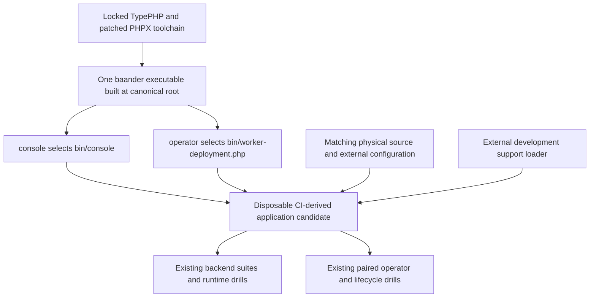

# TypePHP application packaging - Plan

## Goal Capsule

- Objective: developers can build and evaluate a packaged executable of the Baander PHP application.
- Means: one TypePHP CLI executable containing application PHP bytecode executed by ZendVM, with explicit console and operator selectors (KTD1, KTD3).
- Authority: the Product Contract owns behavior; technical decisions own the build mechanism; units implement those decisions.
- Execution profile: one branch, `feat/typephp-setup`, with local commits in a separate worktree; no push or deployment.
- Stop conditions: report compiler, runtime or dependency failures with reproducible evidence; do not claim application acceptance from compiler installation or a toy program.
- Ownership: the lead owns setup, candidate-image integration and authoritative verification. Continue through runtime qualification in this worktree; production replacement remains outside scope.

## Product Contract

### Summary

Set up a pinned TypePHP compiler and application packaging configurations, then exercise the available build path.
One `baander` executable selects the console used by the HTTP server and workers with `console`, or the independent worker deployment operator with `operator`.

### Problem Frame

Baander currently starts PHP scripts through its container PHP runtime.
The requested executable must preserve Symfony boot, Doctrine entities, Swoole coroutine isolation and worker behavior.
TypePHP supports both native PHP translation and bytecode embedding, but these paths have different compatibility limits.

### Requirements

**Application behavior**

- R1. Package the whole main PHP application's runtime dependency closure into one executable rather than a demonstration class or separate application binaries.
- R2. `baander console ...` preserves `bin/console` arguments for administration commands, `app:serve` and `app:worker`; `baander operator ...` selects the independent `bin/worker-deployment.php` composition root. Both routes use the same executable.
- R3. Retain ZendVM execution where application or dependency semantics require it.

**Build and isolation**

- R4. Pin the compiler and its Composer dependencies independently of the application Composer graph.
- R5. Keep generated files and dependencies in the separate worktree, and keep the persistent instance and its data intact.
- R6. Keep secrets, writable state and development dependencies out of embedded resources.
- R7. Record setup evidence separately from package-build and application-runtime acceptance.

### Key Decisions

Use a packaged executable with ZendVM rather than require all PHP to become native machine code.
Governs R1 and R3.
(session-settled: user-directed — chosen over full native compilation after generator and Doctrine lazy-object incompatibilities were explained.)

Deliver one application binary with an argument selecting its console or operator entry.
Governs R1 and R2.
(session-settled: user-directed, 2026-11-19 — supersedes the initial separate console and operator artifacts; their independent composition roots remain.)

### Scope Boundaries

The main PHP application and its local runtime packages are included.
Browser assets and native media programs remain ordinary runtime resources.
The separate relay keeps its SQLite/rqlite architecture; this setup does not replace its release process.
`ui/rn`, Essentia, production deployment, database reset and unrelated application refactors remain outside this work.

### Acceptance Examples

- AE1. A fresh worktree installs the locked compiler without changing root `composer.json` or `composer.lock` (R4, R5).
- AE2. Packaging either produces the requested executable or returns the underlying build failure; the report distinguishes those outcomes (R1, R7).
- AE3. A qualified package runs the existing console, HTTP server, workers and operator with the existing runtime isolation contracts (R2, R3).
- AE4. Embedded resources contain no `.env.local`, `config/secrets`, private key, database or `var/` tree (R6).
- AE5. One build produces `var/typephp/baander`; `baander console list --raw` boots Symfony and `baander operator --help` uses the operator entry without booting Symfony. Both selectors retain the remaining arguments and identify the same ELF (R1, R2).

## Planning Contract

### Key Technical Decisions

- KTD1. Use `mode: bin`, `sapi: cli` and one PHP selector entry, with application classes in `embedded-files` and no application AOT sources. The entry selects the existing console or operator script, removes only the selector from argv, updates global and `$_SERVER` argv/argc, sets `SCRIPT_FILENAME` and `PHP_SELF` to the selected script, and returns its require result. Setting `SCRIPT_FILENAME` makes Symfony Runtime re-enter `bin/console` directly rather than consuming the selector again. Set `sources` to the same PHP entry: the compiler removes it from AOT inputs and embeds it. An empty source list instead triggers recursive discovery. This preserves Doctrine lazy-object and generator semantics (R1–R3). Upstream documents CLI entry embedding in `src/Build/SourcePipelineTrait.php` and [embedding](https://github.com/swoole/typephp/blob/41d91fe69d2f7ec99dffe252a95244793000c6d2/docs/en/EMBEDDED_FILES.md).
- KTD2. Install TypePHP commit `41d91fe69d2f7ec99dffe252a95244793000c6d2` in `tools/typephp` with a generated and committed tool-only Composer lock (R4). Source installation runs under PHP 8.5; upstream Unix binaries require ZTS while the host CLI is NTS. No global install is needed. Provide an optional `docker/typephp/Dockerfile` using the verified `php:8.5.12-zts-trixie@sha256:2ffa2b7471a9826f8a28f722ff21f83bc560367c0135372d88697f6c0666b5eb` base, compiler build prerequisites and pinned Composer; package in an ephemeral container with that matching ZTS toolchain.
- KTD3. Use one complete project configuration and one `baander` output containing both existing entry scripts (R1, R2). `console` and `operator` select separate composition roots within that artifact. The operator route must not boot Symfony or gain authority inside an application container; deployment authority remains with its existing entry and environment. Remove the obsolete second project, build target and application artifact.
- KTD4. Use explicit embedded paths for application PHP and production vendor files; retain the physical application/resource tree during initial qualification (R1, R6). TypePHP does not provide general directory enumeration over embedded files, and Baander's coroutine container inspects PHP source through reflection. Embedding all `config` is unsafe because it includes runtime secrets.
- KTD5. Treat the PHP runtime as a separate qualification gate (R7). Use TypePHP's private PHP builder and the complete application extension set including FFI. The builder image uses PHP 8.5.12 ZTS; the language setting remains `8.5`. KTD10 resolves the private runtime's exact PHP and PECL source selection through the verified runtime lock. Verify that the generated runtime matches PHP 8.5.12 and its ABI before publication or application qualification. The production image uses ZTS; an NTS host build cannot establish production compatibility.
- KTD6. Keep setup as Make adapters and declarative compiler configuration; add no application orchestration abstraction (R4, R5). Follow the current Makefile's thin command pattern and keep root Composer unchanged.
- KTD7. Build the package at `/var/www/html`, the canonical root in `packages/baander-tooling/resources/application-layout.json`, and retain the matching physical source/resource tree there. The CI-derived candidate stores the sole application executable at `/usr/local/lib/typephp/baander`, outside that tree, and symlinks `/usr/local/bin/php` to it. Existing console/operator script arguments pass through unchanged; both scripts are explicitly embedded. Remove the candidate-only binary-selection shell dispatcher and the retained diagnostic PHP copy; ordinary baseline comparisons use the separate CI image. `PHP_BINARY` children identify the same ELF and use the patched native CLI dispatch (R2, R3, R5).
- KTD8. Patch the locked PHPX CLI adapter to recognize existing regular script files before prepending the default entry, while reserving exact first arguments `console` and `operator` for the application router. Those selectors take precedence over same-named files in the current directory; `./console`, `./operator` and explicit `-f` keep interpreter script semantics. Preserve native interpreter options and redirected stdin. Leading PHP options retain native script parsing; invoke the application router as a script, for example with `-f`, when using them. No second PHP option parser is added. Apply the patch only in the optional toolchain. `typephp_sapi.cc` is a project object, so use a fresh unified project build directory and relink the executable without changing the unrelated private runtime archive cache (R2, R3).
- KTD9. Keep development dependencies outside embedded resources. Before replacing ordinary PHP in the candidate, generate the CI development autoload mappings and bootstrap-file metadata into `/usr/local/lib/typephp/test-autoload.php`, outside embedded paths. An external `auto_prepend_file` initializes the packaged production loader through `vendor/composer/autoload_real.php` and its generated initializer, then extends that existing loader with development/test mappings and guarded development bootstrap files. Supplement Composer's installed-version inventory only with missing development package records, preserving production versions and root metadata. Leave `vendor/autoload.php` un-included: Symfony Runtime uses its first `require_once` result to decide whether to execute the console closure. Do not initialize a second Composer loader with the same generated class name. Verify its behavior in nested test processes before claiming backend coverage. The candidate uses an isolated external INI with FFI enabled and the documented memory settings; it must not scan the CI image's shared-extension INI directory (R3, R6).
- KTD10. Inventory extension versions and enabled features against the existing application runtime before qualification. Add the missing build flags and extensions needed to preserve application behavior, rather than treating `extension_loaded` as parity. Add a tool-owned runtime lock for PHP 8.5.12, the selected PECL source versions and SHA-256 checksums, and required GD/Redis/Swoole configure flags. A narrow patch makes the private builder consume that lock instead of dynamic stable metadata and includes its hash in the derived cache identity. No distribution is authorized (R2, R3, R7).
- KTD11. Keep embedded bytecode's decoded class names and callable AST caches in process memory without allocating map-pointer offsets that can overlap OPcache's shared reservations. Remove the two optional class-name cache allocations in the pinned PHP 8.5 decoder and initialize its deferred callable cache to a direct null pointer. Zend retains its ordinary class-table lookup and direct callable-cache paths. Leave native physical-file OPcache, its shared allocator and the existing CLI settings unchanged. Rebuild the decoder project object and application ELF; no private PHP rebuild or serialized-format change is required (R2, R3, R7).

### Evidence and compatibility boundaries

`docker/general/start-web.sh` and `start-worker.sh` launch the console; `start-operator.sh` launches the independent operator.
`packages/swoole-bundle/src/Bridge/Symfony/Kernel/CoroutinesSupportingKernel.php` initializes ZEngine before its coroutine branch, and its container modifier generates and loads PHP at runtime.
`ContextualErrorHandler.php` redefines built-in error-handler functions through ZEngine.
A packaged CLI must prove that these mechanisms still work.

The fully native alternative conflicts with `AudioRenditionCache::follow(): Generator` and Doctrine's `ReflectionClass::newLazyGhost` use.
[TypePHP's incompatibility list](https://github.com/swoole/typephp/blob/41d91fe69d2f7ec99dffe252a95244793000c6d2/docs/en/INCOMPATIBLE_PHP_FEATURES.md) and [generator contract](https://github.com/swoole/typephp/blob/41d91fe69d2f7ec99dffe252a95244793000c6d2/docs/en/YIELD_GENERATOR.md) establish those limits.
PHP 8.5 pipes are supported and are not a known blocker.

The runtime lessons in `docs/solutions/runtime-errors/swoole-callbacks-outside-the-bundle-leak-pooled-services.md` and `swoole-sigterm-waits-for-master-timers-and-closes-connections-before-workers-stop.md` govern runtime qualification.
`docs/solutions/developer-experience/local-gate-images-and-webkit-harness-runs.md` distinguishes local checks from authoritative image checks.

### Qualification design

The runtime qualification follows these boundaries; the diagram shows responsibility rather than prescribing class structure.

The current setup's successful package builds and console listing are recorded in `tools/typephp/README.md` and `ROADMAP.md`; they do not establish runtime acceptance. `packages/baander-tooling/src/Backend/Runtime.php` invokes literal `php` and requires the canonical root, while `scripts/backend-test-runner.php` starts PHPUnit and ParaTest through `PHP_BINARY`. The web and worker fixtures also launch scripts through ordinary PHP command shapes. Therefore a candidate image tag alone does not prove that these tests execute the generated artifact.

### Open Questions and Execution Gates

- Setup can proceed independently of runtime qualification. The matching build image is part of setup; a known host NTS mismatch alone does not complete the package attempt.
- Package generation must verify the selected PHP/PHPX prerequisites and production dependency tree before running; `--dry` also provisions runtime dependencies and is not a syntax-only check.
- Runtime qualification proceeds through U4–U7 using disposable services only. Application acceptance remains blocked until the generated executable proves ZEngine, source reflection, extensions, path resolution and subprocess behavior. Failures must be recorded with the failing command and diagnostic, then resolved within the packaging design or brought back as a concrete design decision.
- A distributable runtime must use verified PHP 8.5.12 ZTS and extension versions matching the application. The builder image alone does not pin the private PHP runtime; KTD10 supplies exact PHP and PECL source selection. Verify the generated runtime against that lock before publication.

## Implementation Units

### U1. Install the isolated compiler

- Goal: provide a repeatable compiler installation (R4, R5; AE1; KTD2).
- Files: `tools/typephp/composer.json`, `tools/typephp/composer.lock`, `tools/typephp/.gitignore`, `docker/typephp/Dockerfile`, `Makefile`.
- Approach: disable Composer plugins/scripts, install production compiler dependencies, and expose setup/version commands without changing application dependencies. Add a `typephp-toolchain` image target and the matching build environment described by KTD2; leave the application runtime Dockerfile intact.
- Verification: Composer validation, locked reinstall, compiler version/help and a clean root-manifest diff.
- Test expectation: no unit test for declarative dependency setup; exercise the actual Composer and compiler commands.

### U2. Configure whole-application packaging

- Goal: provide one explicit whole-application build configuration and attempt package generation (R1–R3, R6, R7; AE2–AE4; KTD1, KTD3–KTD6).
- Files: `tools/typephp/application.yml`, `tools/typephp/application-entry.php`, `tools/typephp/php-builder-object-directories.patch`, `tools/typephp/php-builder-swoole-sources.patch`, `Makefile`.
- Approach: preserve the existing entry scripts through the PHP selector adapter, keep output under ignored `var/typephp`, and select production application paths explicitly. Install the existing locked application dependencies with `--no-dev --no-scripts`, keeping its existing Composer plugins enabled for patches and the runtime loader. Run packaging in the ephemeral toolchain container. Apply the narrow object-directory patch to the pinned private PHP builder only in the optional toolchain image: create the object target directories named by its generated Makefile before `make`. The real build exposed missing nested igbinary object directories in the separate PHP build tree; the patch leaves application code intact. Apply the Swoole source-path patch in that image as well: replace the copied extension configure fallback with `$abs_srcdir/ext/swoole`, require exactly one replacement, and change the derived source-cache fingerprint to regenerate configure. The initial Swoole 6.2.6 build otherwise resolved its relative fallback from the separate build directory, omitted extension sources and failed linking its module entry and coroutine symbols. Fail clearly for missing application dependencies. Do not invoke the operator or start services as a build check.
- Verification: parse every YAML, resolve each path, inspect embedding scope for secrets, rerun the compiler's real build command with the matching ZTS toolchain after applying the object-directory patch, confirm it passes the previously failing igbinary compilation and Swoole linking steps with both builder patches, and retain the first prerequisite or compiler failure verbatim in maintained documentation if it blocks generation.
- Acceptance checkpoint: an installed compiler and valid YAML are setup evidence only; AE3 requires the runtime gates below.

### U3. Document the setup and remaining acceptance

- Goal: make the setup reproducible and its limits explicit (R7).
- Files: `tools/typephp/README.md`, `ROADMAP.md`.
- Approach: document prerequisites, install/build commands, physical resource requirements, versions, observed results and unresolved runtime acceptance. Apply `prose-fix` and a focused code review before local delivery.
- Verification: run each documented command that is available, check links and paths, and record the exact verification checkpoint in the roadmap.

### U4. Preserve ordinary PHP CLI dispatch and rebuild at the application root

- Goal: preserve the existing console, script and subprocess invocation contracts under the packaged runtime (R1–R3; AE3; KTD7, KTD8).
- Files: `tools/typephp/phpx-cli-script-dispatch.patch`, `docker/typephp/Dockerfile`, `Makefile`, focused CLI regression fixtures under `tools/typephp/tests/`.
- Approach: patch the pinned PHPX adapter before its private-runtime build, invalidate derived caches as needed, and build the single artifact with the application mounted at `/var/www/html`. Recognize script inputs before applying the default entry; preserve argument boundaries and exit statuses without introducing a shell wrapper that `PHP_BINARY` children bypass.
- Test scenarios: the unified binary handles `console list --raw`, an explicit console script and a small readable script with arguments; `-r`, `-d`, `-f` and `--` retain interpreter behavior; an unknown application command still fails through Symfony rather than becoming a filename. A child launched through `PHP_BINARY` executes the requested script once with its original arguments. Verify the `operator` selector and direct operator script similarly without invoking a real Docker socket.
- Verification: run the focused scenarios against the rebuilt executable, inspect embedded path identity, and record the source revisions and artifact hashes. These tests cover interpreter dispatch; U7 also verifies the application selector router.
- Verified stdin defect: PHPUnit's isolated children invoke `PHP_BINARY` without arguments and pipe their PHP program to stdin. The earlier packaged adapter instead selected the default console entry; a direct probe printed Symfony help instead of the supplied marker, and two heap-limit cases terminate before any assertion. Recognize piped or redirected script input when there are no arguments, while retaining the default entry for terminal or `/dev/null` input. Add a no-argument stdin regression alongside the explicit `--` case.

### U5. Compose isolated runtime candidates and qualify prerequisites

- Goal: give existing verification runners the unified runtime for application and operator paths with their required physical resources and development support (R2, R3, R5, R6; AE3; KTD7–KTD10).
- Files: `docker/typephp/Dockerfile`, `docker/typephp/qualification.Dockerfile`, `tools/typephp/qualification.ini`, `tools/typephp/test-support.php`, `tools/typephp/dump-test-support.php`, `tools/typephp/tests/entrypoints.php`, `tools/typephp/tests/source-streams.php`, `tools/typephp/phpx-source-stream.patch`, `tools/typephp/application.yml`, `tools/typephp/runtime-lock.json`, `tools/typephp/php-builder-runtime-lock.patch`, `Makefile`.
- Approach: derive the shared application/operator qualification image from the existing CI image at the same source revision. Keep the single executable under `/usr/local/lib/typephp`, outside the canonical application tree, and expose it through the symlink described by KTD7. Preserve fixture script arguments, including leading interpreter settings and explicit `-f`, without another argument parser. Isolate the INI scan path and externalize writable state and secrets. Generate the external support metadata with the ordinary CI PHP and the matching locked vendor tree before selecting the candidate executable. Extend the packaged production loader as described by KTD9, without replacing production autoload mappings or embedding development dependencies.
- Prerequisites: compare the current runtime's PHP/ZTS/FFI, Swoole, Redis and GD versions and capabilities with the generated runtime, plus the complete enabled-extension inventory. The measured CI baseline is PHP 8.5.12 ZTS, Swoole 6.2.4, Redis 6.3.0 and GD with FreeType, JPEG, XPM and WebP; `Dockerfile` records the additional extension and configure requirements. Resolve missing application-required options and extensions in the private builder and rebuild from the verified runtime lock. Check downloaded source hashes before use, and make lock changes invalidate derived runtime caches; pre-seeding PECL caches alone does not prevent upstream stable-version resolution. Do not load the CI image's shared extension binaries into the private runtime or disable required behavior to obtain a passing check.
- Test scenarios: prove literal `php`, absolute `/usr/local/bin/php` and `PHP_BINARY` children use the selected artifact; verify explicit selectors enter the intended composition root and all fixture script forms execute the same ELF with preserved arguments and exit status; the canonical physical tree supports source reflection and generated container loading; PHPUnit, ParaTest and test bootstrap classes load through the external support tree while production classes resolve to the intended application graph. Verify effective INI settings in parent and child processes. In a disposable copied tree, make a physical fixture differ from its embedded counterpart and demonstrate which one executes, so a matching path or image label cannot substitute for artifact coverage. The operator route remains independent of Symfony boot.
- Verification: record executable identities, effective INI/extension manifests, dependency resolution and artifact-to-source identity. Run console listing, kernel boot and cache warmup through the candidate against disposable services before full suites. `BAANDER_TEST_CHECKOUT_IN_IMAGE=1` keeps the verified image checkout; do not let a runner replace its application/vendor tree with an unrelated checkout.
- Historical dispatch defect: `WorkerLifecycle.php` supplies `-d auto_prepend_file=...` before the operator script. The initial two-binary dispatcher selected the wrong executable. The unified design removes that dispatcher; retain leading-option coverage and prove the operator script executes in the sole artifact.
- Verified build defect: Redis's bundled LZF include path resolves from the PHP source root when its extension is compiled into the private runtime. `tools/typephp/php-builder-redis-lzf.patch` corrects that path only in the copied extension configuration and invalidates derived source identity. Preserve the existing LZF feature and verify the build passes the observed `lzf.h: No such file or directory` failure.
- Verified link defect: the static native PDO PostgreSQL driver and Swoole's hooked copy export 26 identical symbols; the hooked SQLite copy has two corresponding collisions when native PDO SQLite is enabled. `tools/typephp/php-builder-swoole-pdo-symbols.patch` applies a forced alias header only to Swoole's translation units and changes derived source identity. Native PDO symbols and public PHP method names remain unchanged. Verify symbol separation, synchronous and coroutine database queries, available PostgreSQL COPY/LOB/PID/notification methods and coroutine yielding through `tools/typephp/tests/pdo.php` against disposable services. The current CI runtime returns `PDO`, not `Pdo\Pgsql`, from `PDO::connect` under Swoole and exposes no legacy notice callback method; adding that modern API is separate extension work, not a packaging requirement.
- Verified COPY defect: after symbol separation, the Swoole PostgreSQL result helper repeatedly drains `PGRES_COPY_IN` before its caller can send data; the fixture hangs with PostgreSQL waiting for COPY input while the existing CI runtime passes that operation. `tools/typephp/php-builder-swoole-copy-result.patch` returns COPY direction statuses to the caller immediately, preserving the caller's final result checks and ordinary error draining. Retain both synchronous and coroutine COPY round trips as regression coverage and invalidate derived source identity.
- Verified test-loader defect: the candidate can autoload development classes while its embedded `Composer\InstalledVersions` still reports those packages absent; console boot fails when the web profiler requests its package version. Supplement the external test metadata with development package records and merge only missing records marked as development requirements into the embedded production inventory. Preserve production versions and root metadata, and verify console boot and development test discovery against the candidate.

- Verified eval-loader defect: PHP's `-r` path skips `auto_prepend_file`, so child programs requiring the embedded production autoloader cannot resolve test fixtures. Add a qualification-only hook to the generated CLI adapter, enabled by `BAANDER_TYPEPHP_QUALIFICATION=1`, which executes the effective prepend file before direct code evaluation. Keep the supplied code, arguments and actual `PHP_BINARY` unchanged; honor `-n`, explicit prepend overrides and bootstrap failures. Execute an explicitly configured prepend even under `-n`, preserve its deliberate exit status and stop direct evaluation when the prepend exits or fails. Without the marker, retain upstream interpreter behavior. Development code and metadata stay outside the executable.
- Verified INI mismatch: the candidate enabled `register_argc_argv`, while the CI image disables it. PHP 8.5 emits a deprecation before handling local CLI-server requests, corrupting readiness responses and sending status 200 before redirect headers. Match the baseline setting and rerun the affected HTTP fixture tests without suppressing errors or changing their assertions.
- Verified filesystem mismatch: after a child process removes a physical file, ordinary PHP reports it absent but the packaged runtime can reuse a positive stat result. PHPX's replacement file wrapper bypasses PHP's native access-check path, affecting existence and permission checks. The focused regression also reports denied physical paths accessible outside `open_basedir`; ordinary PHP rejects those checks. Preserve fresh physical-path access checks, `open_basedir` enforcement and embedded-resource detection in the runtime; retain delegation for other stream wrappers. `tools/typephp/phpx-file-access.patch` proxies the physical access checks while preserving embedded and custom-wrapper delegation. Verify external removal and creation, permission changes, changed working directories, symlinks, argument coercion, custom wrappers, Swoole file-hook transitions and `open_basedir` through `tools/typephp/tests/filesystem.php`. TypePHP compiles the changed opcode-table source as a project object; rebuild the package rather than invalidating the unrelated private PHPX archive. Do not hide this runtime difference by clearing the cache only in the failing socket-cleanup test.
- Verified source-scanner mismatch: the operator fixture's unchanged `composer dump-autoload --dev --optimize --no-interaction --no-scripts --no-plugins` succeeds under ordinary CI but fails under the unified runtime. For the same 383-byte `SortDirection.php` source, `file_get_contents` and token parsing agree across runtimes, while `php_strip_whitespace` returns 124 bytes on ordinary PHP and zero on the candidate. Disabling the external prepend does not change the failure. PHPX's `stream_open` supplies an empty synthetic handle for archived PHP even though raw source is available. Add `phpx-source-stream.patch`: send archived raw files through the existing memory-backed file wrapper, preserving bytecode lookup in `embedded_compile_file` and the synthetic fallback for opcode-only entries. No global wrapper swapping or private-runtime cache change is needed; the changed source is a project object. Verify stripping, highlighting and token fidelity for archived PHP and extensionless scripts, including with physical copies removed; retain embedded execution proof. Rerun the exact Composer command with the qualification prepend enabled and disabled, then rebuild and qualify the single artifact. Keep the existing operator fixture command unchanged. The rebuilt artifact passes that Composer command in both prepend modes, 40 source-stream checks and 76 checks with physical copies poisoned and removed, plus the interpreter checks, 11 bootstrap cases, 142 filesystem checks and 106 entry-point assertions. File scanners skip the initial shebang; string APIs do not, so the fixture accounts for only that native difference. Physical mutations use external commands because archived streams remain read-only.

- Verified class-cache collision: the unified executable with shared CLI OPcache enabled fails the web shutdown drill during authenticated request initialization. A generated proxy's physical source correctly extends `Symfony\Bridge\Doctrine\ContainerAwareEventManager`, but the runtime reports that it extends the unrelated `OpenTelemetry\SDK\Common\Attribute\AttributesInterface`. Native tracing proves the mechanism: the parent process reserves shared cache slot `259409` for the Symfony class; a child with a lower local allocation counter assigns the same slot to the embedded interface. The later Symfony lookup reads and returns that interface from the shared name's slot. Ordinary PHP using the same checkout passes the complete drill in 178.4 seconds. Apply KTD11 through `tools/typephp/phpx-process-cache.patch` in the optional toolchain. Preserve serialized layout, validation and native interpreter settings. Use the unchanged full shutdown drill as the observed failing regression; direct, coroutine and sibling-process probes alone have stayed green and do not establish a narrower reproduction. Add focused embedded class/type and deferred callable-constant checks, using a disposable fixture artifact where embedding is required to exercise the decoder. Verify global-function and static-method callables repeatedly and across fork, correct parent/interface identity, and native shared caching of physical files. Rebuild the application and repeat focused native fixtures, production boot without the test loader, the full backend gate and all live runtime drills on the final artifact. Do not weaken existing assertions or treat diagnostic binaries as application qualification.

- Verified stream-cancellation delay: after the class-cache correction, application ELF `d2808c88f825d17df67f1b76efe8cef788071a044df24dfa5908d0327ef01505` passes the earlier request initialization but still exceeds the unchanged stalled-stream shutdown deadline. Native tracing shows a cancellation of the sender blocked in `Swoole\Http\Response::write()` taking 5.638 seconds; a later cancellation returns in about 185 microseconds. The sender resumes the progressive audio generator, which reads chunks of up to 64 KiB and repeats runtime lookup and path validation until EOF before reaching `Async::sleep()`. The output-buffer callback discards payloads after a failed write but does not stop that producer. Ordinary PHP on the same checkout passes the complete shutdown drill in 178.4 seconds. A process-mode Swoole probe with the unchanged stream processor, a representative generator and a temporary helper confirms the cancellation boundary: without the checkpoint, both runtimes consume 981 additional chunks after reset begins; with it, both consume zero, release the generator and request state, and emit no payload to process stdout or stderr. This probe does not exercise `AudioRenditionCache` itself. Add `Async::throwIfCanceled()` and call it immediately after each yield in `AudioRenditionCache::follow()`, before the next lookup or read. Reuse `CoroutineCanceledException`, keep the helper inert outside a coroutine, and let the generator's existing `finally` close its file. Do not throw from the output-buffer callback: the attempted variant leaked the current payload to process stdout even with an outer discard buffer. Preserve the existing connection-reset/end order, drain deadlines and partial-transfer behavior; do not add database logic or change output buffering to hide the delay.

### U6. Run application qualification and record its actual coverage

- Goal: prove the existing application behavior through the generated executable and record any remaining blocker separately from setup/build success (R1–R3, R7; AE3; KTD7–KTD10).
- Files: `Makefile` for thin qualification command adapters if needed, `packages/baander-tooling/src/Fixtures/Worker/Command.php`, `tests/Functional/Controller/TransportControllerTest.php`, `src/Shared/Infrastructure/Filesystem/StoragePathBoundary.php`, focused storage-boundary tests, `tools/typephp/README.md`, `ROADMAP.md`; focused runtime regression tests for verified packaging defects and fixture corrections required by these checks.
- Approach: run the existing backend suites and runtime drills with the candidate image selected, serializing shared or expensive runs. Use disposable PostgreSQL, Redis and fixture-owned Docker resources only. `OperatorProvisioning::setup` derives controller and worker images from the same application role. Use the same packaged executable for the controller's operator script and the worker's console script. Record executable identity and command arguments for both live roles; separately exercise `console` and `operator` selector behavior, so identical ELF names do not substitute for route coverage. Fix verified packaging defects within these units and rerun the affected checks.
- Test scenarios: full Unit, StaticAnalysisRules, Functional and Integration suites; native Swoole coroutine isolation and logging; database-backed HTTP and authentication flows; outbox/producer rollback and message delivery; current worker supervision; web reload/drain and shutdown; paired operator and worker lifecycle. Keep each existing runner's assertions and deadlines, and record any skips or unsupported environment prerequisites without claiming the corresponding behavior passed.
- Verification: execute the commands in the runtime matrix below. Store suite/assertion counts, runtime drill outcomes, candidate/artifact identities and applicable static gates inline in maintained documentation. Run `ce-simplify-code`, focused code review, `prose-fix` and `git diff --check` before local commits; do not push or change deployment configuration.
- Verified worker-fixture path defect: the command drill always copies the checkout to `/workspace`, even with `BAANDER_TEST_CHECKOUT_IN_IMAGE=1`. A disposable candidate probe copying the console and its Composer entry files to another directory exits 255 because the relocated loader redeclares the embedded `ComposerAutoloaderInit` class. Use the configured canonical application root for the fixture's shared volume, working directory, storage path and injected listener. Preserve both image-checkout and host-checkout modes: initialize the image mode through Docker's empty-volume population; use `volume-nocopy` and explicit staging for host mode so image files cannot contaminate the staged checkout. Keep application commands and assertions unchanged. Verify the packaged worker-command drill, relevant tooling tests and the tooling formatter; this fixture-only correction does not change the packaged application code.
- Verified retry-fixture isolation defect: the full candidate run leaves two committed `FailureTransportProbe` monitor rows after the transport controller's child-process retries. The finished row and failed row explain the job monitor's extra two unfiltered results and extra failed pagination result; a read-only database inspection confirmed their fixture origin. The retry tests delete their committed failed messages but omit the child's monitor writes. Give each committed retry envelope a fresh fixture-owned `JobIdStamp` and delete only its monitor row by that ID through the independent connection during cleanup. Preserve retry behavior and existing assertions, and assert the child's stamped monitor identity. Compare the four affected methods in deterministic transport-before-monitor order under ordinary CI and the candidate, then verify the repaired isolation and complete the remaining qualification. This correction changes test cleanup only, not application behavior or packaged application code.

- Verified storage-boundary race: the unified full run passes its ordinary, native and seven database lanes, but two audio handoff tests fail when a worker creates a partial file or renames it to the final path while the reader resolves that path. `StoragePathBoundary::canonicalPath()` can observe `realpath(false)` followed by a positive existence check and reject a newly created regular file. Deterministic probes through the actual class reproduce both creation and rename interleavings under ordinary CI and the candidate, so this is an existing application race rather than an established PHPX mismatch. When a failed resolution is followed by a positive link/existence check, clear that cursor's cached metadata and retry canonical resolution once. Accept only a successful result through the existing containment and ancestor checks; retain rejection if resolution still fails. Add isolated deterministic regression cases for creation and rename, retaining external-link, dangling-link and non-directory-ancestor rejection. Do not add sleeps, unbounded retries or weaken the existing audio assertions. Verify the storage-boundary tests and the complete audio handoff file, rebuild the application, run the live runtime drills and repeat the full backend gate on the final artifact. The eight-stack run exhausted its shared cleanup budget; ownership-record recovery removed the remaining resources. Use four workers for the next full gate; changing the backend runner cleanup budget is separate orchestration work. The implemented correction passes the new and existing boundary files in ordinary CI (135 tests, 258 assertions), the rebuilt candidate's focused boundary/direct-consumer tests (284 tests, 718 assertions), and the complete audio handoff file (six tests, 73 assertions). The isolated probe labels its deliberate filesystem mutation as impure for PHPStan; targeted level-6 analysis of the three changed PHP files passes, with no production-code change needed for that annotation.

- Stream-cancellation verification: retain the real blocked Swoole response-write regression as a failing-before/passing-after check for the checkpoint. Require prompt cancellation, generator cleanup, no payload on process stdout and the existing partial-transfer contract. The temporary ordinary/candidate probe verifies the sender is blocked in `Response::write()` and then records one reset, no terminating chunk, empty stream/request registries and generator cleanup; turn that probe into maintained coverage without weakening these assertions. Cover the uncancelled and non-coroutine helper paths and the actual audio generator, not only a synthetic yielding loop. Run the focused checks under ordinary CI and the candidate, then rebuild the application and repeat the unchanged complete shutdown drill, production boot, native focused fixtures and full backend/runtime matrix on the final single artifact. A successful diagnostic probe does not close the application gate.

### U7. Consolidate entry points into one executable

- Goal: deliver the user-selected single application binary with explicit `console` and `operator` arguments (R1, R2; AE5; KTD1, KTD3, KTD7, KTD8).
- Files: `tools/typephp/application.yml`, new `tools/typephp/application-entry.php`, `tools/typephp/phpx-cli-script-dispatch.patch`, `Makefile`, `docker/typephp/qualification.Dockerfile`, focused CLI/entry-point tests and maintained documentation. Remove `console.yml`, `operator.yml`, `console-entry.php`, `qualification-php` and the obsolete dispatcher identity test after replacing its meaningful coverage.
- Approach: consolidate the project configuration and native build directory, embed both scripts, and route only the first application argument. Missing or unknown selectors print usage and exit 2 before loading either composition root. The remaining arguments, including empty values and spaces, keep their order and values. Set the selected script metadata before require so Symfony re-entry bypasses the router. Reserve exact selector tokens before PHPX's regular-file detection; explicit file paths remain interpreter inputs. Replace the image's shell dispatcher with a direct symlink to the sole ELF. Remove the obsolete generated operator output once the unified build succeeds.
- Verification: real `console list --raw`, console version and unknown-command status; `operator --help`, invalid operator invocation and an operator path without Symfony boot; missing/unknown selectors; same-named files cannot shadow selectors, while `./` and `-f` can still execute those files. Verify argv/argc and script metadata without using fake application entry points as the sole integration evidence. Retain the existing interpreter, stdin, child `PHP_BINARY`, bootstrap, filesystem and PDO checks. Build one package, verify both script blobs are embedded, and record its exact hash and image identity.
- Verified comparison issue: the console's unknown-command log has a new timestamp and correlation ID on each invocation. Successful output remains byte-compared; error comparison removes only those two fields, retaining all other structured and human diagnostics, stdout, status and exception class/message assertions. The real unified artifact passes all 106 entry-point assertions.
- Acceptance: rerun the runtime matrix against that unified artifact. Earlier two-artifact evidence remains historical and cannot establish acceptance of the new binary. The fresh two-artifact backend run was stopped after the user's request; its ordinary and native lanes passed, while database qualification was incomplete.

## Verification Contract

Setup gates are `composer --working-dir=tools/typephp validate --strict`, a locked install, compiler version/help, YAML parsing, embedding-scope inspection and `git diff --check`.
A real package build is the integration check for the new configuration; failure is a blocker to package acceptance, not a passing build.
No backend behavior changes are planned during setup, so backend suites do not substitute for this compiler check.

For application acceptance, first establish U4 dispatch, U5 candidate-image prerequisites and U7 single-artifact selection. The commands below use `BAANDER_TEST_IMAGE` for the verified application candidate and `BAANDER_TEST_CHECKOUT_IN_IMAGE=1` where supported. The host coordinator may run through its ordinary development PHP; discovery, test workers, application processes and their children inside the candidate must use the generated executable. Do not infer artifact coverage from the image name: verify the runner's actual argv, selected executable and autoload graph.

| Check | Existing command or scope | Required evidence |
|---|---|---|
| Backend suites | `bash scripts/test-backend-container.sh --no-coverage` | All four suites through the candidate, with counts and explicit skips; retain the runner's expected/observed test-identity checks. |
| Coroutine behavior | Native lane including `ContextualDoctrineRegistryTest` and `CoroutineSafeLoggingTest` | Swoole remains enabled and the existing isolation assertions execute under the candidate. |
| HTTP and persistence | `bash scripts/test-web-runtime-container.sh` | The existing database-backed HTTP, mail, streaming, PostgreSQL reload/outage and Redis recovery assertions pass. |
| Web lifecycle | `bash scripts/test-web-shutdown-container.sh` | Existing PID-1, reload, signal, drain and descendant-cleanup assertions pass under the candidate. |
| Message behavior | `bash scripts/test-outbox-runtime-container.sh` and `bash scripts/test-producer-runtime-container.sh` | Existing acknowledgement/replay, rollback and producer recovery assertions pass. |
| Worker supervision | `bash scripts/test-worker-command-container.sh` | Current worker supervisor and lease lifecycle run through the candidate. |
| Operator and worker lifecycle | `bash scripts/test-worker-operator-container.sh` and `bash scripts/test-worker-lifecycle-container.sh` | Use the shared candidate image with the documented container-mode and host prerequisites; prove the operator and worker roles execute the same packaged ELF with the intended script arguments during the disposable drill. |

The runner contracts and detailed assertions are maintained in `docs-book/part-2-developer-guide/testing/README.md`, `backend-runners.md`, `runtime-drills.md` and `workers-and-messaging.md`. Their PostgreSQL and Redis services remain disposable; no schema redesign or persistent-instance change is included. The legacy Supervisor worker-runtime fixture does not establish current deployment behavior.

Preserve the existing application behavior if a runtime mismatch is found. Record the failing command and diagnostic, resolve a packaging or candidate-environment defect within U4–U7, and rerun the affected check. An application design change requires a concrete decision rather than weakening an assertion. Browser checks are conditional on a verified affected browser flow; use `make preview-up` and its explicit `E2E_BASE_URL` only when that flow is needed, and do not claim that an ordinary preview verifies the candidate executable.

## Definition of Done

Setup is delivered when the compiler is locked and runnable, application packaging configurations are present and checked, the real build attempt has an honest recorded outcome, and documentation and review are complete.
The whole application is packaged only when package generation succeeds.
It is qualified for application use only when the runtime matrix passes through the single candidate artifact, its extension/INI and physical-path prerequisites are verified, and maintained documentation records exact coverage and remaining limits. A successful test under ordinary PHP or a different dependency graph cannot close this acceptance gate.
Local commits record delivered units; the roadmap records evidence and remaining acceptance.
