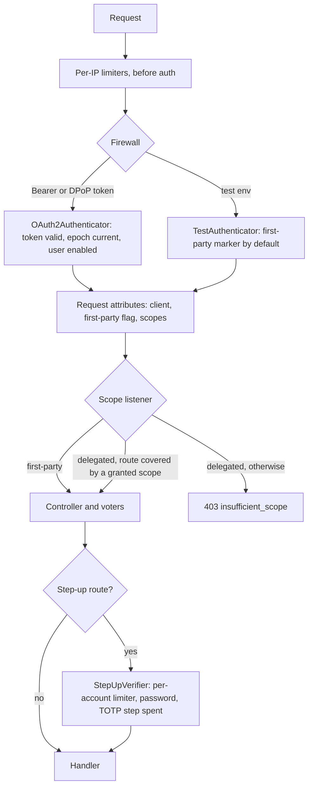
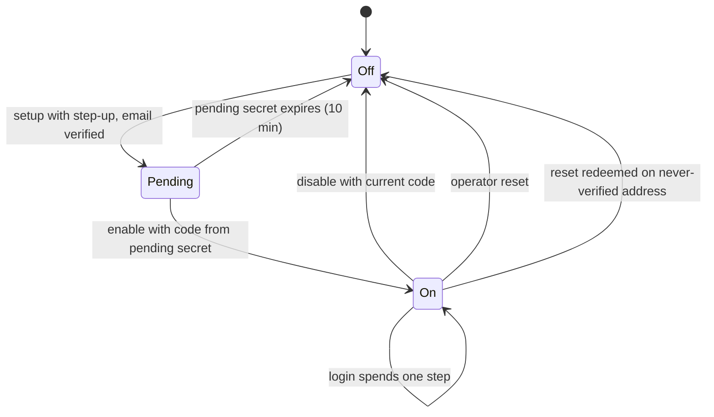

# Auth and OAuth Security Hardening - Plan

## Goal Capsule

- **Objective:** No one can take over a Baander account, act beyond what a user consented to, or reach another user's data through the sign-in, token and OAuth surfaces. That holds whether they use a third-party app's token, a stolen first-party token, a crafted redirect, guessed credentials or a misconfigured install.
- **Means:** Close every confirmed finding of the 2026-11-19 security review. Delegated tokens are limited to their scopes (KTD1–KTD3). Sensitive account changes need step-up re-authentication (KTD5). The remaining defects are fixed where they sit.
- **Product authority:** The Product Contract below. Its Key Decisions record what the user chose in the planning session. Planning Contract KTDs decide mechanism within those constraints.
- **Execution profile:** One pull request, built with `ce-work` on a branch cut from the tip of `feat/oauth-pushed-authorization-requests` (`9cf1c6499`). That OAuth branch is complete but unpublished, and these fixes change its code. The PR merges after the OAuth PR (merge order only). Schema work (U6, U8, U12, U13) goes to the postgres specialist (`.agents/agents/postgres.md`). Units land as local commits. Push only when the user asks.
- **Stop conditions:**
  - Stop and ask if scope enforcement cannot classify a route without changing what Baander's own web or desktop app can do.
  - Stop and ask if the WHATWG URL parser in PHP 8.5 is unavailable in the CI image.
  - Stop and ask if a settled decision proves infeasible in code.
- **Open blockers:** None.

---

## Product Contract

### Summary

The plan closes every finding from the five-part security review of the auth and OAuth code, and from the follow-up review of WebSocket, header and deployment surfaces. Tokens issued to third-party, device and personal access clients reach only the routes their scopes cover. Email changes, TOTP setup and passkey registration ask for the current password. The redirect matcher, login, TOTP, passkey, refresh, revocation and deployment defects are fixed in place.

### Problem Frame

Baander's API trusts any valid access token as if it were the user. The token's client and scopes are read at authentication and then discarded. A user who consents to a TV app reading their `profile` therefore hands that app everything they can do: change their email, mint more tokens, approve other apps, and use the admin API if they are an admin. Separately, the loopback redirect check accepts URLs that browsers send to another host, so an attacker can collect authorization codes. Account-security changes need no proof of the current password, so a stolen token becomes a permanent takeover.

Around those three sits a tail of weaker spots. TOTP codes can be replayed and are stored in plaintext. Login reveals which accounts exist and has no per-account throttle. A passkey challenge copy lives in worker memory. Refresh tokens are stored in plaintext and can be refreshed at the wrong endpoint. A password change can race token issuance. Revocation of access tokens silently does nothing. Production accepts committed default secrets and ships test pages that load third-party scripts.

Baander has no production deployments, so these can be fixed now without compatibility paths. Existing third-party chains are allowed to stop working.

### Key Decisions

- **Delegated tokens reach only what their scopes cover, deny by default.** `library` covers browsing, streaming, playback and playback coordination, transcode, devices, favorites, history, recommendations and radio. `playlist` covers playlists. `profile` and `email` cover reading the user's own profile. Everything else, including admin routes, account security, consent and device approval, client management, party, preferences, notifications, login sessions and WebSocket tickets, is first-party only. Governs R1–R5. (session-settled: user-directed — chosen over adding scopes for party, preferences and notifications, and over keeping `access-api` as a full-access scope: the four existing scopes cover what third-party players need, and unmapped areas stay safe by default.)
- **Playback coordination and devices belong to `library`.** Governs R2. (session-settled: user-directed — chosen over keeping them first-party only: TV and device apps must be able to act as players.)
- **The `access-api` default is dropped; a request with no grantable scope fails.** Governs R4. (session-settled: user-directed — chosen over keeping a default full-access scope.)
- **Step-up re-authentication asks for the current password, plus a TOTP code when TOTP is on, on every sensitive change.** Governs R10–R12. (session-settled: user-directed — chosen over a "signed in within the last few minutes" window.)
- **TOTP lock-out recovery is an operator reset.** Governs R15. (session-settled: user-directed — chosen over user recovery codes, which are deferred.)
- **Adding a passkey or TOTP needs a verified email address.** Governs R13. (session-settled: user-directed — chosen over leaving unverified accounts fully usable.)
- **A reset may go to a never-verified address, and redeeming it verifies the address and clears the account's other authenticators.** Governs R14. (session-settled: user-directed — chosen over "resets only to verified addresses": the strict rule let whoever registered an address first keep it from its owner for good.)
- **A self-service email change stays pending until the new address is verified.** Governs R14, R37. (session-settled: user-directed — chosen over swapping the address immediately and refusing resets to an unverified replacement: an immediate swap let any user occupy someone else's address.)
- **Operators can mark an address verified, and operator email changes count as verified.** Governs R16. (session-settled: user-directed — chosen over skipping the verification gate when no mailer is configured: installs without mail still need a way to verify.)
- **Passkey logins need user verification when the account has TOTP on.** Governs R19. (session-settled: user-directed — chosen over requiring user verification for every passkey and over asking for TOTP after a passkey without it: security keys without a PIN keep working for accounts without TOTP.)
- **Spec gaps with no known attack are fixed in this plan.** Governs R25–R29. (session-settled: user-approved — proposed in the scoping synthesis with the trade-off shown; the user confirmed the scope.)

### Requirements

**Delegated access**

- R1. An access token issued to a client other than Baander's own first-party client is a delegated token. It reaches a route only when one of its scopes covers that route. Every other route answers 403 `insufficient_scope`.
- R2. The scope-to-route coverage is the one the first Key Decision states. A route that requires an admin role is first-party only, whatever area it belongs to, and a delegated token never carries the user's admin authority on any route.
- R3. Every API route is classified as public, first-party only, or covered by named scopes, and an unclassified route fails the build.
- R4. A pushed authorization request or device authorization whose requested scopes are all ungrantable fails with `invalid_scope`, and first-party tokens carry no scope-based authority.
- R5. A delegated token reading `/api/auth/me` sees the email fields only with `email` and never sees roles.
- R6. `/api/auth/refresh` redeems only the first-party client's refresh tokens. A delegated client refreshes at `/api/oauth/token` with its own client authentication.

**Authorization-code flow**

- R7. A redirect URI matches a registered loopback URI only when a browser would send it to the same loopback host, scheme, path and query. Only the port may differ. Userinfo, fragments and backslashes are refused at registration and at matching.
- R8. A pushed request's `state` is at most 1024 bytes, and the PAR request body is bounded.
- R9. Denying a pushed request runs the same user checks as approving it. Presenting an already redeemed authorization code revokes the token chain it produced.

**Step-up and account recovery**

- R10. Changing one's own email, starting TOTP setup and starting passkey registration each require the current password, plus a current TOTP code when TOTP is enabled.
- R11. Starting TOTP setup while TOTP is enabled is refused. The user disables TOTP first, which already needs a current code.
- R12. Step-up attempts are rate limited per account. A failed attempt does not reveal whether the password or the code was wrong.
- R13. Adding a passkey or enabling TOTP requires a verified email address.
- R14. A password reset goes to the account's current address. Redeeming a reset sent to a never-verified address verifies it and removes the account's passkeys, TOTP and sessions.
- R15. An operator can clear a user's TOTP from the console and from the admin API.
- R16. An operator can mark a user's email verified from the console and from the admin API. An operator email change leaves the new address verified.
- R37. A self-service email change holds the new address as pending, and it replaces the account's address only when its verification link is used. The request answers the same whether or not the address is taken, and uniqueness is checked when the link is used.
- R17. The old address is notified when an email change takes effect. The web admin refuses to change the signed-in administrator's own email or password; the console is exempt.

**Sign-in**

- R18. A TOTP code is accepted once. The web login shows the TOTP field when the account needs a code, and a DPoP nonce retry does not spend the code.
- R19. Passkey login enforces user verification for accounts with TOTP enabled. A passkey whose signature counter stays at 0 can sign in. Passkey challenges are single-use across workers and bound to the user and ceremony that requested them.
- R20. Login takes the same time and gives the same answer for unknown, disabled and wrong-password accounts. A disabled account is reported only after a correct password.
- R21. Login attempts are throttled per account as well as per address and account pair. Registration answers the same whether or not the address is taken, and emails the existing owner instead.
- R22. TOTP secrets are encrypted at rest, and the TOTP clock-skew window works as documented.

**Tokens and sessions**

- R23. A password change ends every other session, including tokens issued concurrently with the change.
- R24. Revoking an access token at `/api/oauth/revoke` revokes its chain.
- R25. Refresh tokens are stored only as hashes, and every refresh chain has an absolute lifetime.
- R26. Access tokens carry `iss`, the `at+jwt` type and a key ID, and validation requires the issuer.
- R27. DPoP proofs are checked against the configured public origins, and the shipped proxy configuration forwards the original scheme.
- R28. A device code is approved by exactly one user, and confidential clients authenticate when requesting device authorization.

**Client authentication**

- R29. The token, PAR and device endpoints accept `client_secret_basic`, PS256 assertions and `jwks_uri` values only within the fetch policy. Assertions carrying unknown `crit` extensions are refused, OKP keys must name Ed25519, and an assertion's `jti` record outlives its acceptance window.
- R30. Per-client rate limits cannot be drained by callers who are not the client: confidential clients are charged after they authenticate, and public clients per client and caller network.

**Deployment surfaces**

- R31. Production refuses to boot with a missing, placeholder or short `APP_SECRET`, `STREAM_URL_HMAC_SECRET` or TOTP encryption key. Signed stream URLs expire at most 24 hours ahead.
- R32. Production images contain no test pages. HTML responses carry a nonce-based Content-Security-Policy with `frame-ancestors 'none'`. HTTPS deployments send HSTS. Static files carry `nosniff` and frame protection.
- R33. Public health probes return no exception text.
- R34. WebSocket frames are rate limited before decoding and capped in size, and abusive sockets are closed. Sockets of disabled accounts are closed by the reconciler.
- R35. Voters grant admin access through the role hierarchy, so a super admin passes every admin check.
- R36. Operator and developer documentation describe scopes, step-up, the new operator commands, the new settings and secrets, and the changed refresh and revocation behavior.

### Acceptance Examples

- AE1. **Covers R1, R2.** **Given** an admin who approved a client for `profile`, **when** that client calls `GET /api/admin/users`, `PUT /api/auth/me/email`, `POST /api/oauth/authorize` or `POST /api/ws/tickets`, **then** each answers 403 `insufficient_scope`.
- AE2. **Covers R1, R2.** **Given** a device client holding `library`, **when** it calls a catalog read, a stream, a `/api/session` playback route and `GET /api/admin/genres`, **then** the first three succeed and the admin route answers 403.
- AE3. **Covers R7.** **Given** a public client registered with `http://127.0.0.1/callback`, **when** a request is pushed with `http://evil.baander.app\@127.0.0.1/callback`, `http://u@127.0.0.1/callback` or `http://127.0.0.1/callback#x`, **then** each push fails with `invalid_request`, while `http://127.0.0.1:53111/callback` succeeds.
- AE4. **Covers R10, R12.** **Given** a signed-in user with TOTP on, **when** they change their email with the right password and no code, **then** the change is refused with the same answer a wrong password gets.
- AE5. **Covers R14.** **Given** an account registered by someone else under an address that was never verified, **when** the address's owner requests and redeems a reset, **then** the owner sets the password, the address becomes verified, and the earlier registrant's passkeys, TOTP and sessions are gone.
- AE6. **Covers R18.** **Given** a TOTP user signing in on the web, **when** the first attempt is answered with a DPoP nonce challenge and the client retries with the same code, **then** the login succeeds once, and a third request with that code fails.
- AE7. **Covers R23.** **Given** a login racing a password change for the same account, **when** both commit, **then** the session from the login no longer authenticates.
- AE9. **Covers R37, R14.** **Given** a signed-in user who requests a change of their email to an address another person owns but has not registered, **when** that person later registers or requests a reset, **then** they succeed, because the first user's account still holds its old address.
- AE8. **Covers R25.** **Given** a refresh chain started more than the absolute lifetime ago, **when** its latest refresh token is redeemed within its sliding window, **then** the refresh fails with `invalid_grant`.

### Scope Boundaries

- Considered and not built:
  - Binding signed stream URLs to a user or IP. They stay shareable 24-hour capabilities as documented in `docs-book/part-1-operator-guide/maintenance/security.md`; R31 caps their expiry instead. Evidence of URLs being shared outside a household would change the call.
  - Shortening the default `jwks_uri` cache lifetime. The documented remedy for a withdrawn key is replacing the client's keys (U16); reports of clients that cannot reach an admin would change the call.
  - Rotating the TOTP encryption key in place. After a key change, affected TOTP users cannot sign in until an operator resets their TOTP; an undecryptable secret never counts as TOTP off (U6). A real installation needing key rotation would change the call.
  - A second, browser-side check of the consent redirect target. The server now parses redirect URIs with the same WHATWG rules the browser uses (KTD4), so the page's existing exact comparison against the server's answer adds nothing. A redirect reaching the page without server validation would change the call.
- Outside this plan: the device authorization grant flow itself, password and passkey login for first-party apps beyond the fixes listed, and the League OAuth adapter groundwork, which is kept correct and not removed.

#### Deferred to Follow-Up Work

- TOTP recovery codes for users.
- Scoped WebSocket tickets for delegated players. Delegated players use the HTTP playback routes until a scope for live channels is designed.
- Scopes for party, preferences and notifications.

---

## Planning Contract

### Key Technical Decisions

- KTD1. **First-party means the client registered as `auth.spa_client_id`, proved by a positive marker.** `Client::isFirstParty()` is also true for personal access clients, and `access-api` is handed to every client that requests nothing, so neither can identify Baander's own apps. `OAuth2Authenticator` sets request attributes for the token's client public ID, a first-party flag and the scopes. A token is first-party only when its client has type `ClientType::FirstParty` and its public ID equals `auth.spa_client_id`; any other client, including a `FirstParty`-typed client with another ID, is delegated. For a delegated token the authenticator builds the `SecurityUser` with `ROLE_USER` only, so admin branches inside controllers and voters (`LibraryReadScopeProvider`, `TranscodeSessionController`, `PlaylistVoter`, `ActivityController`, `RecommendationController`) deny. An authenticated request without the marker is treated as delegated with no scopes, so a missing marker fails closed. `TestAuthenticator` sets the first-party marker by default and reads `X-Baander-Test-Client-Scopes` to model delegated tokens. Governs R1, R4.
- KTD2. **Scope enforcement is a route-name map checked by a kernel listener after the firewall.** It follows the `DpopBindingListener` precedent: a priority −5 `kernel.request` listener and a constant map from route name to classification, held to the compiled routes by an inventory test modeled on `DeliveryRouteInventoryTest` and `MutationRouteInventoryTest`. A controller attribute read at runtime would be new infrastructure with no precedent in `src/`. The listener answers 403 with a JSON `insufficient_scope` body and a `WWW-Authenticate` error. Routes under `^/api/auth/` are `PUBLIC_ACCESS` in `security.yaml`, so the listener classifies them explicitly instead of relying on `access_control`. Governs R1–R3.
- KTD3. **Any route with an admin-role attribute or under the admin access-control prefixes is first-party only, enforced by the inventory test.** Eleven controllers outside `/api/admin` require admin roles (genres, artists, covers, libraries, metadata sync, radio sources, transcode jobs, discovery, webhooks). The test fails when such a route is mapped to a scope. Governs R2.
- KTD4. **Loopback matching parses both URIs with PHP 8.5 `Uri\WhatWg\Url`.** It compares scheme, host, path and query and ignores only the port. Registration validation also uses it and refuses userinfo, fragments and backslashes. The browser and the server then read the same URL. Governs R7.
- KTD5. **Step-up lives in self-service Application commands, not in the shared handlers.** `ChangeEmailHandler` and `PasswordChanger` also serve the admin and console paths. The existing split between `ChangePasswordCommand` and `SetUserPasswordCommand` is the pattern: a new `ChangeOwnEmailCommand`, plus step-up fields on TOTP setup and passkey options, verified by one `StepUpVerifier` Application service. It checks the password with `PasswordHasherInterface`, then the code through `TotpVerifierInterface` (which spends the step, KTD8). It answers one `step_up_failed` error for any mismatch, behind a per-account limiter. Two-request ceremonies carry step-up on their first request only. The pending TOTP secret and the passkey challenge are bound to that user and expire within 10 minutes and 5 minutes. Governs R10–R12, R19.
- KTD6. **A self-service email change writes a pending address; operator changes write the address directly and verified.** `users.pending_email` holds the requested address, and the verification token is bound to it. Redeeming the link moves it into `email` with a uniqueness check, verifies it, and clears the pending column; a taken address at that point fails the redemption without revealing more. The account's current address and its verification state do not change until then. A reset redeemed on a never-verified address calls a domain method that verifies the address and removes passkeys, TOTP and refresh chains in the reset transaction. Governs R13, R14, R16, R37.
- KTD7. **TOTP secrets are encrypted with libsodium `secretbox` under a dedicated key, `AUTH_TOTP_ENCRYPTION_KEY`.** The only existing helper, Defuse `encryptWithPassword` in `WebhookSecretCodec`, runs PBKDF2 per call, which is too slow for login. A key separate from `APP_SECRET` keeps an `APP_SECRET` rotation from disabling TOTP. The column becomes `totp_secret_ciphertext bytea`, and no plaintext migration is needed before production. Governs R22, R31.
- KTD8. **TOTP verification finds the matched step, and spending it is a conditional database update.** otphp 11's `verify()` returns only a bool and throws for a leeway of a period or more, so the verifier checks each step from `current − window` to `current + window` with `TOTP::at()` and returns the step that matched. `users.totp_last_used_step bigint` is then updated only `WHERE totp_last_used_step IS NULL OR totp_last_used_step < :matchedStep`, as one DBAL statement. The `PasswordResetTokenRepository` pattern applies, and the learnings advise against catching unique violations after a flush. Governs R18, R22.
- KTD9. **Password login verifies DPoP before credentials and spends the TOTP step inside the issuance transaction.** `PasskeyAuthenticator` already verifies DPoP first. The step is spent through `TokenPairIssuer::issue`'s `persistWithTokens` callback, so a conditional update that affects no row rolls the token pair back and the login answers invalid credentials. A nonce challenge happens before issuance, so the web client's retry with the same code is valid once. An empty `totpCode` is treated as absent, so the TOTP prompt appears. Governs R18.
- KTD10. **Passkey challenges move to Redis only, consumed with `GETDEL` and keyed by user and ceremony.** The in-process fallback is removed because Swoole workers share no PHP state (`docs/solutions/`, the Swoole worker learning). A Redis outage answers 503. `RedisDpopJtiCache` and `RedisWebSocketTicketStore` are the patterns. Governs R19.
- KTD11. **Password changes fence issuance with a per-user credential epoch captured when the credential is verified.** A new `users.credential_epoch` integer is incremented in the password-change transaction. The epoch is captured where authority is proved and carried to issuance:
  1. the password and passkey authenticators capture it when they load the user and pass it through `IssueTokenCommand`;
  2. authorization-code creation and device-code approval store the approving token's epoch on the code row;
  3. each refresh chain stores the epoch it was issued under.

  Issuance reads the current epoch `FOR SHARE` inside its transaction and refuses when it differs from the captured one, then stamps the captured epoch on the access token and chain. `OAuth2Authenticator` and refresh rotation reject a token or chain whose epoch is behind the user's. The password-change transaction re-stamps the caller's kept access token and its chain with the new epoch, so the session that changed the password stays signed in. Reading the epoch only at issuance would stamp the new value on a login whose password check ran before the change. Governs R23.
- KTD12. **Refresh tokens are stored as SHA-256 hashes, and each chain stores an absolute expiry.** The `PasswordResetTokenRepository` hashing pattern applies. `oauth_refresh_tokens.chain_expires_at` is set at chain start from `auth.refresh.max_chain_lifetime` (90 days by default) and copied on rotation, compared on the database clock. Existing rows are deleted by the migration, which ends current sessions on development instances. Governs R25.
- KTD13. **Access-token revocation parses the presented JWT with the signing key and revokes by `jti`.** A string that is not a JWT signed by our key is answered like an unknown token. Governs R24.
- KTD14. **DPoP `htu` is checked against an allowlist of public origins.** The allowlist is `APP_URL`'s origin plus `AUTH_DPOP_EXTRA_ORIGINS`, replacing the request's own Host and scheme. LAN and alternate hostnames keep working when the operator lists them. The shipped nginx passes the upstream `X-Forwarded-Proto` instead of `$scheme`. Governs R27.
- KTD15. **Production secret checks run at kernel boot in `prod`.** They refuse unset values, the committed defaults, `replace-with-` placeholders and values under 32 bytes. `.env` keeps development defaults; the preset tooling rejects placeholders at render time. Governs R31.
- KTD16. **The SPA template emits a per-request CSP nonce.** `SecurityHeadersListener` generates it, `templates/spa.html.twig` applies it to its inline script, and the header carries `frame-ancestors 'none'`. HSTS is sent when the request is HTTPS through a trusted proxy. Static responses get `nosniff` and `X-Frame-Options` in `AdvancedStaticFilesServer`. Governs R32.
- KTD17. **Per-client limiters move to the post-authentication stage, and public clients are bucketed per network.** The PAR, token and refresh per-client buckets follow `ApiRateLimitListener`. Clients with a secret or keys are charged with their authenticated ID. Clients whose method is `none` have no credential to prove, since anyone can sign a DPoP proof, so they are charged per client ID and caller IP prefix (/24 for IPv4, /64 for IPv6). The refresh limiter keys on the hash of the presented token. The per-IP buckets stay before authentication. Governs R30.

### High-Level Technical Design

How a request reaches a controller after this plan:

Route classifications the inventory test enforces:

| Classification | Meaning | Examples |
|---|---|---|
| public | No token needed | login, register, reset, PAR, token, `.well-known` |
| first-party | Only Baander's own client | admin, account security, consent and device approval, client management, party, preferences, notifications, login sessions, WebSocket tickets |
| scope list | Delegated tokens with any listed scope | catalog reads, streams, `/api/session` playback and `/api/devices` (`library`); playlists (`playlist`); `GET /api/auth/me` (`profile`, `email`) |

Lifecycle of the TOTP factor after this plan:

### Assumptions

- `Uri\WhatWg\Url` ships with PHP 8.5 in the CI image. The OAuth reviewer exercised it on the host; U1 confirms the image.
- No first-party client holds delegated scopes. Personal access clients are delegated clients and get the scopes they request at consent.

### Sequencing

- U2 comes before U3, U4 and U5, because the scope listener and the refresh restriction read the request attributes U2 sets.
- U6 comes before U7 and U8, because step-up spends TOTP steps.
- U6, U8, U12 and U13 each add a migration and run serially in that order; U6, U8 and U13 all change `users`.
- U17 closes the documentation once behavior is fixed.
- Every other unit can run in parallel once its dependency is in.

---

## Implementation Units

| U-ID | Title | Key files | Depends on |
|---|---|---|---|
| U1 | Loopback redirect matching | `AuthorizationRequestValidator.php`, redirect URI rules | — |
| U2 | Token client and scopes on the request | `OAuth2Authenticator.php`, `TestAuthenticator`, `TokenPairIssuer.php` | — |
| U3 | Scope enforcement listener and route inventory | new `ScopeEnforcementListener`, inventory test, `/me` resource | U2 |
| U4 | Refresh restricted to first-party; limiters after auth | `AuthController.php`, `RateLimitListener.php`, `ApiRateLimitListener.php` | U2 |
| U5 | Empty-scope grants refused and consent copy | `TokenPairIssuer.php`, PAR and device handlers, `ScopeList.tsx` | U2 |
| U6 | TOTP single use, encryption and login order | `TotpService.php`, `PasswordAuthenticator.php`, `LoginController.php`, migration | — |
| U7 | Step-up re-authentication | new `StepUpVerifier`, `ChangeOwnEmailCommand`, TOTP and passkey controllers, web dialogs | U6 |
| U8 | Pending email changes, verified-email gate and operator verification | `User.php`, email change and reset handlers, migration, admin and console pairs | U6, U7 |
| U9 | Operator TOTP reset | console command, admin route, docs page | U6 |
| U10 | Login enumeration and per-account throttle | `PasswordAuthenticator.php`, `RegisterUserHandler.php`, limiter config | — |
| U11 | Passkey challenges, user verification and counters | `PasskeyService.php`, `AuthenticatePasskeyHandler.php` | — |
| U12 | PAR state cap, deny checks and code replay | PAR handler, `CreateAuthorizationCodeHandler.php`, `ExchangeAuthorizationCodeHandler.php` | — |
| U13 | Credential epoch and refresh-token hashing | `PasswordChanger.php`, `TokenPairIssuer.php`, `RefreshTokenHandler.php`, authenticators, migration | U6, U8 |
| U14 | Access-token format, revocation by jti and device approval | `JwtGenerator.php`, `RevokeTokenHandler.php`, `ApproveDeviceCodeHandler.php` | — |
| U15 | DPoP origin allowlist and proxy scheme | `DpopProofValidator.php`, `docker/prod/nginx.conf`, preset renderer | — |
| U16 | Client authentication spec gaps | `OAuthController.php`, `ClientAssertionVerifier.php`, `JwkPublicKeyConverter.php`, `ClientKeySource.php` | — |
| U18 | Production secrets, headers and probes | boot check listener, `SecurityHeadersListener.php`, `HmacStreamAuthAdapter.php`, `.dockerignore` | U6 |
| U19 | WebSocket frame limits and disabled-account sockets | `WebSocketController.php`, `AccessTokenRepository.php` | — |
| U20 | Voters through the role hierarchy | four voters | — |
| U17 | Documentation | operator and developer guides, `CONCEPTS.md` | all |

### U1. Loopback redirect matching

- **Goal:** A loopback redirect URI matches only when a browser would send it to the registered loopback endpoint.
- **Requirements:** R7; AE3; KTD4.
- **Dependencies:** None.
- **Files:**
  - `src/Auth/Application/Service/AuthorizationRequestValidator.php`
  - the redirect URI registration rules used by client registration (`src/Auth/Domain/Model/OAuth/ValueObject/` redirect URI validation)
  - Tests: `tests/Unit/Auth/Application/Service/AuthorizationRequestValidatorTest.php`, `tests/Unit/Auth/Application/CommandHandler/OAuth/PushAuthorizationRequestHandlerTest.php`
- **Approach:**
  1. Replace `parse_url` in `isSameLoopbackEndpoint` with `Uri\WhatWg\Url` and compare host, scheme, path and query, ignoring the port.
  2. Refuse a backslash anywhere, userinfo and a fragment, at registration and at matching.
- **Execution note:** Write the matcher tests first with the four reviewed bypass strings; they fail today.
- **Patterns to follow:** existing exact-match branch in the same validator.
- **Test scenarios:**
  - Covers AE3. `http://evil.baander.app\@127.0.0.1/callback` against `http://127.0.0.1/callback` is refused.
  - `http://u@127.0.0.1/callback` and `http://127.0.0.1/callback#x` are refused.
  - `http://127.0.0.1:53111/callback` matches `http://127.0.0.1/callback`.
  - `http://[::1]:8080/cb` matches `http://[::1]/cb`, and `http://localhost/cb?x=1` does not match `http://localhost/cb`.
  - Registering a redirect URI with a backslash, userinfo or fragment is refused.
- **Verification:** The PAR handler refuses every reviewed bypass string, and registered native clients still match on any port.

### U2. Token client and scopes on the request

- **Goal:** Every authenticated request carries the token's client, a first-party flag and its scopes.
- **Requirements:** R1, R4; KTD1.
- **Dependencies:** None.
- **Files:**
  - `src/Auth/Infrastructure/Security/OAuth/OAuth2Authenticator.php`
  - `tests/Functional/Security/TestAuthenticator.php`, `config/packages/test/security.yaml`
  - `src/Auth/Application/Service/TokenPairIssuer.php`, `src/Auth/Domain/Model/OAuth/ValueObject/Scope.php`, `src/Auth/Infrastructure/Security/OAuth/ScopeResolver.php`
  - Tests: `tests/Unit/Auth/Infrastructure/Security/OAuth/OAuth2AuthenticatorTest.php`, `tests/Integration/OAuthFirewallAcceptanceTest.php`
- **Approach:**
  1. Set the client public ID, the first-party flag and the scope list as request attributes beside `oauth_access_token_id`, with the attribute names in one constant holder.
  2. Compute first-party per KTD1, not from `isFirstParty()`.
  3. Build the `SecurityUser` of a delegated token with `ROLE_USER` only.
  4. Remove `Scope::defaultScopes()` and its use in `TokenPairIssuer`; first-party tokens carry an empty scope list.
  5. Remove `ScopeResolver` if nothing uses it after the change, or use it where scopes are parsed.
  6. Teach `TestAuthenticator` the first-party default and the `X-Baander-Test-Client-Scopes` header, which also drops admin roles.
- **Patterns to follow:** `oauth_access_token_id` attribute handling in the same authenticator.
- **Test scenarios:**
  - A first-party login token yields the first-party flag, an empty scope list and the user's roles.
  - A personal access client token of an admin yields first-party false, its granted scopes and `ROLE_USER` only.
  - A `FirstParty`-typed client whose public ID differs from `auth.spa_client_id` yields a delegated token with no scopes.
  - The test authenticator without the header yields first-party; with the header it yields delegated with those scopes and no admin roles.
- **Verification:** Integration tests on `ProductionOAuthKernel` observe the attributes for first-party, personal access and third-party tokens.

### U3. Scope enforcement listener and route inventory

- **Goal:** Delegated tokens reach only routes their scopes cover, and every route is classified.
- **Requirements:** R1–R3, R5; AE1, AE2; KTD2, KTD3.
- **Dependencies:** U2.
- **Files:**
  - `src/Auth/Infrastructure/Security/OAuth/ScopeEnforcementListener.php` (new) and its route map (new constant holder beside it)
  - `src/Auth/Interface/Resource/` user resource for `/api/auth/me`
  - Tests: `tests/Unit/Auth/Infrastructure/Security/OAuth/ScopeRouteInventoryTest.php` (new), `tests/Unit/Auth/Infrastructure/Security/OAuth/ScopeEnforcementListenerTest.php` (new), `tests/Integration/OAuthScopeEnforcementTest.php` (new, on `ProductionOAuthKernel`)
- **Approach:**
  1. Build the map by route name with the three classifications in the High-Level Technical Design table, covering all about 345 routes.
  2. In the inventory test, load routes without compiling the container, as `MutationRouteInventoryTest` does. Fail on an unclassified `/api/` route, a stale entry, or a scope-mapped route that carries an admin-role attribute or sits under an admin access-control prefix.
  3. The listener runs at priority −5, skips first-party requests and public routes, and answers 403 with the error body and `WWW-Authenticate: DPoP error="insufficient_scope"`.
  4. The `/me` resource omits email fields without `email` and omits roles for every delegated token.
- **Execution note:** Write the inventory test first; it is the checklist for the map.
- **Patterns to follow:** `DpopBindingListener` route constants; `DeliveryRouteInventoryTest`; `MutationRouteInventoryTest`; `AdminCliParityTest` reading `#[IsGranted]` by reflection.
- **Test scenarios:**
  - Covers AE1. A `profile` token gets 403 on `GET /api/admin/users`, `PUT /api/auth/me/email`, `POST /api/oauth/authorize`, `POST /api/oauth/device/approve`, `POST /api/oauth/clients/` and `POST /api/ws/tickets`.
  - Covers AE2. A `library` token reads an album, fetches a stream, calls a `/api/session` playback route and registers a device, and gets 403 on `GET /api/admin/genres` and on genre creation.
  - A `playlist` token creates a playlist and gets 403 on catalog reads.
  - A `profile` token reads `/api/auth/me` without email fields or roles; an `email` token sees the email fields.
  - An admin's `library` token cannot read a library the admin holds no access grant for, another user's listening history, or another user's transcode session; an admin's `playlist` token cannot read another user's private playlist.
  - A first-party token reaches an admin route when the user is an admin.
  - The inventory test fails when a new route is added without a classification, and when an admin route is mapped to `library`.
- **Verification:** The integration matrix passes for first-party, personal access and third-party tokens, and the inventory test lists every compiled route.

### U4. Refresh restricted to first-party; limiters after authentication

- **Goal:** Delegated refresh tokens rotate only at the token endpoint, and per-client buckets cannot be drained by unauthenticated callers.
- **Requirements:** R6, R30; KTD17.
- **Dependencies:** U2.
- **Files:**
  - `src/Auth/Interface/Controller/User/AuthController.php` (`refresh`)
  - `src/Auth/Infrastructure/Security/RateLimitListener.php`, `src/Auth/Infrastructure/Security/ApiRateLimitListener.php` or a new post-auth OAuth limiter listener
  - `config/packages/framework.yaml`, `config/packages/auth.yaml`
  - Tests: `tests/Functional/Auth/RefreshEndpointTest.php` (new or existing refresh test), `tests/Unit/Auth/Infrastructure/Security/RateLimitListenerTest.php`, `tests/Integration/RefreshTokenGraceTest.php`
- **Approach:**
  1. Pass the SPA client's ID into `RefreshTokenCommand` from `/api/auth/refresh`, so the existing client check in `RefreshTokenHandler` applies.
  2. Move the PAR, token and refresh per-client limiters to run after client authentication, keyed per KTD17.
  3. Key the refresh limiter on a hash of the presented refresh token instead of the raw value.
- **Patterns to follow:** `ApiRateLimitListener` (post-firewall keying).
- **Test scenarios:**
  - A personal access client's refresh token at `/api/auth/refresh` gets `invalid_grant`; the same token at `/api/oauth/token` with client authentication rotates.
  - A first-party refresh token at `/api/auth/refresh` still rotates.
  - 700 PAR requests per minute naming a public client's `client_id`, with valid self-made DPoP proofs from many networks, do not block a real user's push from another network.
  - A confidential client's bucket is charged only by requests that authenticate as that client.
  - The refresh limiter key stored in Redis contains no raw refresh token.
- **Verification:** Refresh and limiter tests pass, and the web app's refresh path is unchanged.

### U5. Empty-scope grants refused and consent copy

- **Goal:** Delegated grants carry real scopes, and the consent screen describes what they allow.
- **Requirements:** R4, R2; KTD1.
- **Dependencies:** U2.
- **Files:**
  - `src/Auth/Application/Service/TokenPairIssuer.php`, `src/Auth/Application/CommandHandler/OAuth/PushAuthorizationRequestHandler.php`, `src/Auth/Application/CommandHandler/OAuth/RequestDeviceAuthorizationHandler.php`
  - `ui/web/src/features/auth/components/ScopeList.tsx`, `ui/web/src/shared/i18n/locales/en/translation.json` (and other locales' `auth.scopes`)
  - `src/Auth/Interface/Controller/OAuth/AuthorizationServerMetadataController.php`
  - Tests: `tests/Unit/Auth/Application/CommandHandler/OAuth/PushAuthorizationRequestHandlerTest.php`, device authorization handler test, `ui/web/src/features/auth/components/__tests__/ScopeList.test.tsx`
- **Approach:**
  1. Refuse a push or device authorization whose grantable scopes are empty with `invalid_scope`; ungrantable scopes mixed with grantable ones are dropped, and consent shows only what will be granted.
  2. Drop `access-api` from `KNOWN_SCOPES` and the copy.
  3. Use these consent lines: `profile` "See your name and profile picture"; `email` "See your email address"; `library` "Browse and play your library, and control playback on your devices"; `playlist` "See, create and change your playlists".
  4. An `invalid_scope` or expired request on the consent page uses the existing rejected view with copy telling the user to start again from the app.
- **Patterns to follow:** existing `ScopeAllowlist::filter` use in the validator.
- **Test scenarios:**
  - A push with no scope, or only `admin`, gets `invalid_scope`.
  - A device authorization with no scope gets `invalid_scope`.
  - The consent list shows the new copy for each scope and nothing for unknown scopes.
- **Verification:** Metadata `scopes_supported` lists exactly the four scopes.

### U6. TOTP single use, encryption and login order

- **Goal:** TOTP codes work once, secrets are encrypted at rest, and the web login can complete with a TOTP code.
- **Requirements:** R18, R22, R11; AE6; KTD7, KTD8, KTD9.
- **Dependencies:** None.
- **Files:**
  - `src/Auth/Infrastructure/Security/Totp/TotpService.php`, `src/Auth/Infrastructure/Security/Totp/TotpVerifier.php`, `src/Auth/Application/Port/TotpVerifierInterface.php`
  - new TOTP secret cipher under `src/Auth/Infrastructure/Security/Totp/` behind an Application port
  - `src/Auth/Domain/Model/User.php`, `src/Auth/Infrastructure/Doctrine/Entity/UserEntity.php`, `src/Auth/Infrastructure/Doctrine/UserRepository.php`
  - `src/Auth/Infrastructure/Security/User/PasswordAuthenticator.php`, `src/Auth/Interface/Controller/User/LoginController.php`
  - `src/Auth/Interface/Controller/Totp/TotpController.php`, `src/Auth/Application/CommandHandler/Totp/EnableTotpHandler.php`
  - `ui/web/src/features/auth/stores/auth-store.ts`
  - `migrations/Version<timestamp>.php` (new), `tests/Fixtures/LiveUpdates/capture-sources.json`, `config/packages/auth.yaml`, `config/services.yaml`, `.env`
  - Tests: `tests/Unit/Auth/Infrastructure/Security/Totp/TotpServiceTest.php`, `tests/Functional/Controller/TotpControllerTest.php`, `tests/Integration/TotpLoginReplayTest.php` (new), `ui/web/src/features/auth/stores/__tests__/auth-store.test.ts`
- **Approach:**
  1. Migration: replace `users.totp_secret` with `totp_secret_ciphertext bytea` and add `totp_last_used_step bigint`, clearing existing TOTP enrolments. Recreate the `users` capture trigger without these columns and exclude them in `capture-sources.json`.
  2. Encrypt with `secretbox` under `AUTH_TOTP_ENCRYPTION_KEY` (32 bytes, base64), with a development default in `.env` that U18's boot check refuses in production. A ciphertext that does not decrypt fails closed: login answers a distinct `AUTH_TOTP_UNAVAILABLE` error and logs a warning for the operator, and only the operator reset (U9) clears it.
  3. Verify step by step and spend the matched step per KTD8, with `auth.totp.window` meaning periods.
  4. Reorder `PasswordAuthenticator` and `LoginController` so DPoP is verified before credentials, and spend the step inside issuance per KTD9.
  5. Treat an empty `totpCode` as absent; stop sending `''` from the web store.
  6. Refuse setup while TOTP is enabled. Store the pending secret with a real 10-minute expiry, replaced on each setup, bound to the user.
  7. Map TOTP handler failures to translated error codes instead of exception messages.
  8. Web login states, with strings in the locale files: `AUTH_TOTP_REQUIRED` shows and focuses the code field; a rejected or already-used code shows "That code was not accepted. Wait for the next code and try again." and clears the field; a throttled login shows one message with no account detail.
- **Execution note:** Start with an integration test of the full web sequence — nonce challenge, retry with the same code, success, third use refused — on `ProductionOAuthKernel`.
- **Patterns to follow:** `PasswordResetTokenRepository` conditional statements; `migrations/Version20261119130000.php` for trigger recreation and `lock_timeout`.
- **Test scenarios:**
  - Covers AE6. Nonce challenge then retry with the same code succeeds once; a third request with that code fails.
  - A code from the previous 30-second step is accepted once within the window; a code two steps old is refused.
  - A code for the next step accepted at step N is refused again at step N+1.
  - A secret encrypted under a different key makes login answer `AUTH_TOTP_UNAVAILABLE`, never a password-only session.
  - The database row holds ciphertext that decrypts to the enrolled secret, and no plaintext column remains.
  - A login with `totpCode: ''` on a TOTP account answers `AUTH_TOTP_REQUIRED`.
  - Two concurrent logins with the same valid code issue one session.
  - Setup while TOTP is enabled is refused; a second setup replaces the pending secret and enable uses the newest one.
- **Verification:** The web login with TOTP works end to end in the preview, and the capture-coverage and naming tests pass.

### U7. Step-up re-authentication

- **Goal:** Sensitive self-service changes require the current password and, when enabled, a TOTP code.
- **Requirements:** R10–R12, R17; AE4; KTD5.
- **Dependencies:** U6.
- **Files:**
  - new `src/Auth/Application/Service/StepUpVerifier.php` and a per-account step-up limiter port
  - new `src/Auth/Application/Command/User/ChangeOwnEmailCommand.php` and handler, calling the shared `ChangeEmailHandler` step
  - `src/Auth/Interface/Controller/User/AuthController.php`, `src/Auth/Interface/Controller/Totp/TotpController.php`, `src/Auth/Interface/Controller/Passkey/PasskeyController.php`, their request DTOs
  - `src/Auth/Interface/Controller/AdminUserController.php` (self-target refusal)
  - `ui/web/src/features/settings/components/AccountManagement.tsx`, `ui/web/src/features/settings/hooks/use-passkey-registration.ts`, `ui/web/src/features/settings/components/PasskeyManagement.tsx`
  - `config/packages/framework.yaml`, `config/packages/auth.yaml`, `openapi.json`, `ui/web/src/shared/api-client/gen/`
  - Tests: `tests/Unit/Auth/Application/Service/StepUpVerifierTest.php` (new), `tests/Functional/Controller/AuthControllerTest.php`, `tests/Functional/Controller/TotpControllerTest.php`, `tests/Functional/Auth/PasskeyRegistrationTest.php`, `tests/Functional/Auth/AdminUserTest.php`, `ui/web/src/features/settings/components/__tests__/AccountManagement.test.tsx`
- **Approach:**
  1. `StepUpVerifier` charges the per-account limiter, checks the password, then the TOTP code when enabled, and throws one `step_up_failed` error for any mismatch.
  2. Email change, TOTP setup and passkey options call it. TOTP enable and passkey register rely on the user-bound pending state from their first request.
  3. Notify the old address when a pending email change takes effect (U8), through the existing after-response mailer.
  4. The admin user controller refuses email and password changes whose target is the signed-in administrator.
  5. Expose a read-only `totpEnabled` on the self `/api/auth/me` resource (omitted for delegated tokens) and regenerate the client.
  6. Build one step-up prompt component, copying `ChangePasswordDialog`, used by the email-change dialog and before passkey registration: the current password always, and a code field with `autocomplete="one-time-code"` only when `totpEnabled`.
  7. Prompt states, with strings in the locale files: `step_up_failed` shows "Password or code is incorrect", keeps the dialog open and clears the fields; 429 shows "Too many attempts. Try again later." and disables submit; `email_unverified` replaces the prompt with the existing resend action from `EmailVerificationNotice`; an expired passkey challenge restarts the prompt.
- **Patterns to follow:** `ChangePasswordCommand` and `CurrentPasswordMismatchException` mapping; `DisableTotpHandler` code check; `RateLimiterPasswordResetRequestThrottle`.
- **Test scenarios:**
  - Covers AE4. With TOTP on, the right password and no code gets the same `step_up_failed` answer as a wrong password.
  - The right password and code records a pending email change.
  - The email-change dialog shows the code field only for a user with TOTP on.
  - Passkey options without step-up fields get 422; with them the ceremony completes; a challenge issued to user A is refused at user B's register call.
  - The step-up limiter answers 429 after the configured number of failures for one account across IP addresses.
  - A super admin changing their own email through the admin route gets 403; the console command still works.
  - The email-change dialog submits the password and code fields.
- **Verification:** Functional and web tests pass, and the OpenAPI check reports no drift.

### U8. Pending email changes, verified-email gate and operator verification

- **Goal:** Nobody can occupy an address they do not control, unverified accounts cannot add authenticators, resets settle address ownership, and operators can verify addresses.
- **Requirements:** R13, R14, R16, R17, R37; AE5, AE9; KTD6.
- **Dependencies:** U6, U7.
- **Files:**
  - `src/Auth/Domain/Model/User.php`, `src/Auth/Infrastructure/Doctrine/Entity/UserEntity.php`, `src/Auth/Application/CommandHandler/User/ChangeEmailHandler.php`, the self-service email change handler from U7, the email verification handlers and token repository, `src/Auth/Application/CommandHandler/User/RequestPasswordResetHandler.php`, the reset redemption handler
  - `migrations/Version<timestamp>.php` (new: `users.pending_email`, verification tokens bound to an address), the `users` capture trigger, `tests/Fixtures/LiveUpdates/capture-sources.json`
  - `ui/web/src/features/settings/components/AccountManagement.tsx` (pending address notice)
  - TOTP setup and passkey options handlers
  - new `src/Auth/Interface/Console/MarkEmailVerifiedCommand.php` (`app:user:mark-email-verified`), new admin route on `AdminUserController` with `#[CliCounterpart]`
  - `docs-book/part-1-operator-guide/commands/app-user-mark-email-verified.md` (new), `docs-book/part-1-operator-guide/commands/README.md`
  - `tests/Functional/TestCase.php` (verified user factory)
  - Tests: `tests/Unit/Auth/Domain/Model/UserTest.php`, `tests/Functional/Auth/PasswordResetTest.php`, `tests/Functional/Auth/AdminUserTest.php`, `tests/Unit/Auth/Interface/Console/` command test, `tests/Integration/AdminCliParityTest.php`
- **Approach:**
  1. Self-service email changes write `pending_email` and send the verification link to it; the request answers 202 whether or not the address is taken. Redeeming the link swaps the address per KTD6 and notifies the old address. The account settings show the pending address until then.
  2. Gate TOTP setup and passkey options on a verified address, answering `email_unverified`.
  3. On redeeming a reset to a never-verified address, verify it and remove passkeys, TOTP and refresh chains in the same transaction.
  4. Operator email changes write the address directly and verify it. Add the mark-verified pair following `app:user:disable`.
  5. Give `createTestUser()` a verified option and update tests that enroll authenticators or change email.
- **Patterns to follow:** `AdminUserController::disable` and `DisableUserCommand`; `AdminCommandSupport`.
- **Test scenarios:**
  - An unverified user starting TOTP setup or passkey registration gets `email_unverified`.
  - Covers AE5. Reset to a never-verified address verifies it and removes the earlier registrant's passkeys, TOTP and sessions.
  - Covers AE9. A pending change to an unregistered address leaves the account on its old address; the address's owner registers and resets normally.
  - Requesting a change to a taken address answers 202 like any other; redeeming the link fails and the account keeps its address.
  - Redeeming the link swaps the address, verifies it and notifies the old address.
  - `app:user:mark-email-verified --json` and the admin route produce the same outcome; the parity test finds the counterpart and the docs page.
  - An operator email change leaves the address verified.
- **Verification:** Functional, console and parity tests pass, and `CommandDocsCoverageTest` stays green.

### U9. Operator TOTP reset

- **Goal:** An operator can turn off a locked-out user's TOTP.
- **Requirements:** R15.
- **Dependencies:** U6.
- **Files:**
  - new Application command and handler to clear TOTP
  - new `src/Auth/Interface/Console/ResetUserTotpCommand.php` (`app:user:reset-totp`), new route on `AdminUserController` with `ROLE_SUPER_ADMIN` and `#[CliCounterpart]`
  - `docs-book/part-1-operator-guide/commands/app-user-reset-totp.md` (new), `commands/README.md`, `tests/Unit/Shared/Infrastructure/Security/MutationRouteInventoryTest.php`
  - Tests: handler unit test, `tests/Functional/Auth/AdminUserTest.php`, console command test with a real-process `--json` check, `tests/Integration/AdminCliParityTest.php`
- **Approach:** Clear the ciphertext and last-used step and revoke the user's sessions in one transaction, following `app:user:reset-password`.
- **Patterns to follow:** `SetUserPasswordCommand` and its console command.
- **Test scenarios:**
  - Resetting a TOTP user lets them sign in with the password alone, and their old sessions end.
  - Resetting a user without TOTP answers a conflict with exit code 1.
  - The admin route needs `ROLE_SUPER_ADMIN`.
- **Verification:** Parity, docs coverage and mutation inventory tests pass.

### U10. Login enumeration and per-account throttle

- **Goal:** Login and registration do not reveal which accounts exist, and one account cannot be guessed from many addresses.
- **Requirements:** R20, R21.
- **Dependencies:** None.
- **Files:**
  - `src/Auth/Infrastructure/Security/User/PasswordAuthenticator.php`
  - `src/Auth/Application/CommandHandler/User/RegisterUserHandler.php`, `src/Auth/Interface/Controller/User/AuthController.php` (register), a new "someone tried to register" mail
  - `src/Auth/Infrastructure/Security/RateLimitListener.php` or a login throttle port, `config/packages/framework.yaml`, `config/packages/auth.yaml`
  - Tests: `tests/Unit/Auth/Infrastructure/Security/User/PasswordAuthenticatorTest.php`, `tests/Functional/Controller/AuthControllerTest.php`, limiter tests
- **Approach:**
  1. Verify against a dummy Argon2id hash when the user is unknown.
  2. Check disabled status after the password verifies.
  3. Add an email-only login limiter with a short sliding window, charged on failed attempts only, with the compound limiter kept. The operator limits page (U17) documents that it can briefly lock out an account under attack.
  4. Registration answers 202 either way and mails the existing owner when the address is taken.
- **Patterns to follow:** `RateLimiterPasswordResetRequestThrottle`.
- **Test scenarios:**
  - Unknown, disabled-with-wrong-password and wrong-password accounts get the same response body.
  - A disabled account with the right password gets the disabled message.
  - Attempts on one email from 20 IP addresses hit the per-account limit.
  - Registering a taken address answers like a new one and mails the owner.
- **Verification:** Auth controller and authenticator tests pass; the timing check confirms a hash runs on the unknown-user path.

### U11. Passkey challenges, user verification and counters

- **Goal:** Passkey challenges are single-use everywhere, TOTP accounts need verified passkey logins, and counterless passkeys work.
- **Requirements:** R19; KTD10.
- **Dependencies:** None.
- **Files:**
  - `src/Auth/Infrastructure/Security/Passkey/PasskeyService.php` and a Redis challenge store
  - `src/Auth/Application/CommandHandler/Passkey/AuthenticatePasskeyHandler.php`, `src/Auth/Interface/Controller/Passkey/PasskeyController.php`
  - `config/packages/auth.yaml`
  - Tests: `tests/Unit/Auth/Infrastructure/Security/Passkey/PasskeyServiceTest.php`, `tests/Unit/Auth/Application/CommandHandler/Passkey/AuthenticatePasskeyHandlerTest.php`, `tests/Integration/` Redis outage test using `RedisOutageOAuthKernel`
- **Approach:**
  1. Store challenges in Redis keyed by user (or by the anonymous login ceremony ID) and ceremony type, consumed with `GETDEL`, with no in-memory fallback.
  2. When the account has TOTP enabled, require the UV flag on login assertions.
  3. Apply the counter check only when either counter is non-zero, matching the library's `CheckCounter`, in both login paths.
- **Patterns to follow:** `RedisDpopJtiCache`, `RedisWebSocketTicketStore`.
- **Test scenarios:**
  - A challenge used once is refused on reuse, including from another service instance.
  - A registration challenge issued for user A is refused for user B.
  - With Redis unavailable, options and verification answer 503.
  - A TOTP account's assertion without UV is refused; a non-TOTP account's is accepted.
  - A passkey reporting counter 0 on every use signs in repeatedly; a counter that goes backwards is refused.
- **Verification:** Unit and outage tests pass, and passkey login works in the preview.

### U12. PAR state cap, deny checks and code replay

- **Goal:** Pushed requests cannot be used to fill storage or burn other users' requests, and a replayed code ends its chain.
- **Requirements:** R8, R9.
- **Dependencies:** None.
- **Files:**
  - `src/Auth/Interface/Controller/OAuth/OAuthController.php`, `src/Auth/Application/CommandHandler/OAuth/PushAuthorizationRequestHandler.php`, `src/Auth/Domain/Model/OAuth/PushedAuthorizationRequest.php`
  - `src/Auth/Application/CommandHandler/OAuth/CreateAuthorizationCodeHandler.php`, `src/Auth/Application/CommandHandler/OAuth/ExchangeAuthorizationCodeHandler.php`, the auth-code repository
  - `migrations/Version<timestamp>.php` (CHECK on `state` length), `config/packages/framework.yaml` or the controller for the body cap
  - Tests: PAR handler test, `tests/Functional/Auth/PushedAuthorizationRequestEndpointTest.php`, `tests/Functional/Auth/AuthorizationEndpointPushedRequestTest.php`, `tests/Unit/Auth/Application/CommandHandler/OAuth/AuthorizationCodeGrantTest.php`
- **Approach:**
  1. Refuse a `state` over 1024 bytes with `invalid_request`, backed by a CHECK constraint. Refuse PAR bodies over 64 KB with 413.
  2. Run the user checks on deny before consuming the request.
  3. Record which chain a code produced, and revoke that chain when the redeemed code is presented again.
- **Patterns to follow:** existing `consume` conditional update; `RevokeTokenHandler` chain revocation.
- **Test scenarios:**
  - A 1025-byte `state` is refused, and a 1024-byte one is accepted.
  - A 100 KB PAR body gets 413.
  - Another user denying a personal access client's request gets `unauthorized_client`, and the request stays pending.
  - Exchanging a code twice returns `invalid_grant` the second time and the first exchange's tokens stop authenticating.
- **Verification:** PAR and authorization endpoint tests pass.

### U13. Credential epoch and refresh-token hashing

- **Goal:** Password changes end every other session reliably, and refresh tokens are useless if the database leaks.
- **Requirements:** R23, R25; AE7, AE8; KTD11, KTD12.
- **Dependencies:** U6, U8 (all three migrate `users`; run serially).
- **Files:**
  - `src/Auth/Application/Service/PasswordChanger.php`, `src/Auth/Application/Service/TokenPairIssuer.php`, `src/Auth/Application/CommandHandler/OAuth/RefreshTokenHandler.php`, `src/Auth/Application/Command/OAuth/IssueTokenCommand.php`, `src/Auth/Application/CommandHandler/OAuth/CreateAuthorizationCodeHandler.php`, `src/Auth/Application/CommandHandler/OAuth/ApproveDeviceCodeHandler.php`
  - `src/Auth/Infrastructure/Security/User/PasswordAuthenticator.php`, the passkey authenticator
  - `src/Auth/Infrastructure/Security/OAuth/OAuth2Authenticator.php`, `src/Auth/Infrastructure/Repository/OAuth/RefreshTokenRepository.php`, `src/Auth/Infrastructure/Repository/OAuth/AccessTokenRepository.php`, refresh token domain model and entity
  - `migrations/Version<timestamp>.php` (new), `tests/Fixtures/LiveUpdates/capture-sources.json`, `config/packages/auth.yaml`
  - Tests: `tests/Integration/PasswordChangeSessionRevocationTest.php`, a two-process race test using `tests/Fixtures/Auth/PasswordChangeOAuthKernel` and the `refresh-race.php` fixture, `tests/Integration/RefreshTokenConcurrencyTest.php`, `tests/Integration/RefreshTokenGraceTest.php`, refresh model unit tests
- **Approach:**
  1. Migration: add `users.credential_epoch integer NOT NULL DEFAULT 0`, and a `credential_epoch` column on `oauth_access_tokens`, `oauth_refresh_tokens`, `oauth_auth_codes` and `oauth_device_codes`. Store refresh `token_id` as a SHA-256 hash and add `chain_expires_at`, deleting existing refresh and access tokens. Update the capture triggers and `capture-sources.json`.
  2. Capture, compare and stamp the epoch per KTD11, carrying it through the password and passkey authenticators, `IssueTokenCommand`, authorization-code creation and device-code approval.
  3. In the password-change transaction, re-stamp the kept access token and its chain with the new epoch.
  4. Look up refresh tokens by hash. Set `chain_expires_at` from `auth.refresh.max_chain_lifetime` (7,776,000 seconds) and copy it on rotation; reject past it on the database clock.
- **Execution note:** Prove the fence with a child-process race that waits until `pg_locks` shows the waiter, as the advisory-lock learning describes; never inspect locks after a lock timeout.
- **Patterns to follow:** `PasswordResetTokenRepository` hashing; `lockActiveClientForIssuance`.
- **Test scenarios:**
  - Covers AE7. A login whose password check passed before a concurrent change commits ends with a token that does not authenticate.
  - A refresh racing a password change produces no surviving token.
  - An authorization code created before a password change and exchanged after it gets `invalid_grant`; so does a device code approved before the change and polled after it.
  - The session that changed the password keeps working, and every other session of the user stops.
  - Covers AE8. A chain past its absolute lifetime fails to refresh within its sliding window.
  - The refresh token table holds no value equal to an issued refresh token.
  - Grace-window and reuse-detection behavior is unchanged.
- **Verification:** The race and refresh integration tests pass, and the schema comparison is clean.

### U14. Access-token format, revocation by jti and device approval

- **Goal:** Access tokens are self-describing, revocable by their holder, and device codes have one approver.
- **Requirements:** R24, R26, R28; KTD13.
- **Dependencies:** None.
- **Files:**
  - `src/Auth/Infrastructure/Security/OAuth/JwtGenerator.php`, `src/Auth/Infrastructure/Security/OAuth/DpopAwareBearerTokenValidator.php`, the JWKS controller
  - `src/Auth/Application/CommandHandler/OAuth/RevokeTokenHandler.php`, `src/Auth/Interface/Controller/OAuth/OAuthController.php` (`revoke`), `AuthorizationServerMetadataController.php`
  - `src/Auth/Application/CommandHandler/OAuth/ApproveDeviceCodeHandler.php`, `src/Auth/Infrastructure/Repository/OAuth/DeviceCodeRepository.php`, `src/Auth/Application/CommandHandler/OAuth/RequestDeviceAuthorizationHandler.php`
  - Tests: `JwtGenerator` and validator unit tests, `tests/Functional/Auth/LogoutTest.php`, a device approval race test, device authorization handler test
- **Approach:**
  1. Add `iss`, header `typ: at+jwt` and `kid` (the key thumbprint, also published in the JWKS), and require `iss` in validation.
  2. Revocation parses the presented value as a JWT signed by our key and revokes by `jti`, falling back to the refresh-token hash lookup.
  3. Approve a device code with a conditional update that only succeeds while it is unapproved.
  4. Authenticate confidential clients at device authorization with `OAuthClientAuthenticator::authenticate`.
  5. Remove `revocation_endpoint` from the server metadata, since the endpoint authenticates the user, not the client.
- **Patterns to follow:** existing conditional `redeem()` in `DeviceCodeRepository`.
- **Test scenarios:**
  - Revoking with the access JWT ends its chain, and the next request with it gets 401.
  - A token without `iss` or with another issuer is refused.
  - Two users approving one device code concurrently: one succeeds, the other gets a conflict.
  - A confidential device client without its secret gets `invalid_client` at device authorization.
- **Verification:** Token, revoke and device tests pass, and the JWKS lists the `kid`.

### U15. DPoP origin allowlist and proxy scheme

- **Goal:** DPoP proofs are checked against the deployment's real public origins.
- **Requirements:** R27; KTD14.
- **Dependencies:** None.
- **Files:**
  - `src/Auth/Infrastructure/Security/OAuth/DpopProofValidator.php`, `config/packages/auth.yaml`, `config/services.yaml`, `.env`
  - `docker/prod/nginx.conf`, `packages/baander-tooling/src/Deployment/PresetRenderer.php`
  - Tests: `tests/Unit/Auth/Infrastructure/Security/OAuth/DpopProofValidatorTest.php`, preset renderer tooling test
- **Approach:** Build the expected `htu` from each allowed origin plus the request path, accept a match against any, and refuse otherwise. Pass `$http_x_forwarded_proto` upstream in the shipped configs.
- **Test scenarios:**
  - A proof for `https://baander.app/api/x` passes behind a proxy whose request reached the app as `http`.
  - A proof naming `https://evil.baander.app/api/x` fails even when the Host header says `evil.baander.app`.
  - A proof for an origin in `AUTH_DPOP_EXTRA_ORIGINS` passes.
- **Verification:** Unit tests pass, and DPoP works in the preview behind its proxy.

### U16. Client authentication spec gaps

- **Goal:** Client authentication conforms to RFC 6749, RFC 7515 and FAPI 2.0 where the review found gaps.
- **Requirements:** R29.
- **Dependencies:** None.
- **Files:**
  - `src/Auth/Interface/Controller/OAuth/OAuthController.php` (credentials extraction), `src/Auth/Application/DTO/ClientCredentials.php`, `src/Auth/Domain/Model/OAuth/ClientAuthMethod.php`
  - `src/Auth/Infrastructure/Security/OAuth/ClientAssertionVerifier.php`, `src/Auth/Infrastructure/Security/OAuth/JwkPublicKeyConverter.php`, `src/Auth/Infrastructure/Cache/RedisClientAssertionJtiStore.php` and the DPoP jti cache
  - `src/Auth/Domain/Model/OAuth/ValueObject/ClientKeySource.php`, `AuthorizationServerMetadataController.php`
  - Tests: `ClientAssertionVerifierTest.php`, `OAuthClientAuthenticatorTest.php`, `ClientKeySourceTest.php`, `tests/Functional/Auth/ClientAssertionAuthenticationTest.php`, metadata pin test
- **Approach:**
  1. Accept HTTP Basic credentials as `client_secret_basic` for secret clients, counting a Basic header plus a body secret as two methods.
  2. Add PS256 to the signing algorithms.
  3. Refuse a JWS whose `crit` header names any extension.
  4. Require `crv: Ed25519` for OKP keys.
  5. Set jti TTLs to the acceptance window plus one second, for assertions and DPoP proofs.
  6. Apply the fetch policy's syntactic checks to `jwks_uri` at registration and key replacement.
  7. Advertise `client_secret_basic` and PS256 in metadata.
- **Test scenarios:**
  - A secret client authenticating with Basic gets tokens; Basic plus `client_secret` in the body gets `invalid_client`.
  - A PS256 assertion verifies; an assertion with `crit: ["b64"]` fails.
  - An OKP key with `crv: X25519` is refused at registration.
  - `https://10.0.0.5/jwks.json`, `https://localhost/jwks` and a URI with a fragment are refused at registration with `invalid_keys`.
  - A jti stored at a fractional second is still present one second after the assertion's acceptance window ends.
- **Verification:** Client authentication tests and the metadata pin pass.

### U18. Production secrets, headers and probes

- **Goal:** A production install cannot run with public secrets, test pages or missing browser protections.
- **Requirements:** R31–R33; KTD15, KTD16.
- **Dependencies:** U6 (the TOTP key exists).
- **Files:**
  - a boot check listener under `src/Shared/Infrastructure/` (or the existing `ConfigBootCheckListener.php`), `src/Shared/Infrastructure/Health/HealthCheckService.php`
  - `src/Transcode/Infrastructure/Auth/HmacStreamAuthAdapter.php`
  - `src/Shared/Infrastructure/EventListener/SecurityHeadersListener.php`, `templates/spa.html.twig`, `packages/swoole-bundle/src/Server/RequestHandler/AdvancedStaticFilesServer.php`
  - `.dockerignore`, `public/__e2e/` (move to a test-only location such as `tests/e2e/fixtures/`), the e2e specs that load them
  - `packages/baander-tooling/src/Deployment/PresetConfiguration.php`
  - Tests: boot check unit test, `HmacStreamAuthAdapterTest.php`, `SecurityHeadersListenerTest.php`, health check tests, preset configuration tooling test
- **Approach:**
  1. Refuse boot in `prod` per KTD15.
  2. Refuse a signed URL whose `exp` lies more than 24 hours ahead.
  3. Move the e2e pages out of `public/`, pin the players they load with SRI, and exclude the test location from the image.
  4. Emit the CSP and HSTS per KTD16, and add `nosniff` and `X-Frame-Options` to static responses.
  5. Return a fixed "unavailable" string from public probes and log the exception.
- **Test scenarios:**
  - Booting `prod` with `STREAM_URL_HMAC_SECRET=dev-secret-change-me-in-production`, an unset `APP_SECRET`, or a `replace-with-` value fails with a message naming the variable.
  - A URL signed with `exp` 25 hours ahead is refused.
  - The SPA response carries a CSP whose nonce matches the inline script; a static `/assets` file carries `nosniff`.
  - `/health` during a database outage returns no exception text.
  - The preset tooling refuses a placeholder secret.
- **Verification:** The production image build contains no `__e2e` files, and the preview's responses carry the headers.

### U19. WebSocket frame limits and disabled-account sockets

- **Goal:** One user cannot exhaust a worker through WebSocket frames, and disabled accounts lose their sockets.
- **Requirements:** R34.
- **Dependencies:** None.
- **Files:**
  - `src/Shared/Interface/Controller/WebSocketController.php` (or its current location), `config/packages/swoole.yaml`
  - `src/Auth/Infrastructure/Repository/OAuth/AccessTokenRepository.php` (`findTokenIdsOfLiveChains`)
  - Tests: WebSocket controller unit test, socket reconciler integration test
- **Approach:**
  1. Check the per-socket rate before decoding.
  2. Close with 1008 after sustained over-limit traffic and with 1009 for frames above 64 KB, using Swoole's WebSocket frame size setting if it governs frames, or a length check before decoding.
  3. Join `users` and require `NOT disabled` in `findTokenIdsOfLiveChains`.
- **Test scenarios:**
  - A frame over the size cap closes the socket with 1009 before decoding.
  - 300 frames in one second close the socket with 1008.
  - A disabled user's live chain is not returned, so the reconciler closes the socket.
- **Verification:** WebSocket and reconciler tests pass.

### U20. Voters through the role hierarchy

- **Goal:** Admin checks inside voters honor `ROLE_SUPER_ADMIN`.
- **Requirements:** R35.
- **Dependencies:** None.
- **Files:** `src/Playlist/Infrastructure/Security/PlaylistVoter.php`, `src/Catalog/Infrastructure/Security/AlbumVoter.php`, `src/Library/Infrastructure/Security/LibraryVoter.php`, `src/Auth/Infrastructure/Security/Voter/SongVoter.php`, their tests
- **Approach:** Replace `getRoleNames()` checks with `AccessDecisionManagerInterface` or `Security::isGranted('ROLE_ADMIN')`, as `UserManagementVoter` does.
- **Test scenarios:**
  - A user whose stored roles are only `ROLE_SUPER_ADMIN` passes each voter's admin branch.
  - A plain user still fails it.
- **Verification:** Voter tests pass.

### U17. Documentation

- **Goal:** Operators and developers can understand and operate the changed behavior.
- **Requirements:** R36.
- **Dependencies:** U1–U16, U18–U20.
- **Files:**
  - `docs-book/part-2-developer-guide/development/api-authentication.md`, `docs-book/part-2-developer-guide/contexts/auth.md`
  - `docs-book/part-1-operator-guide/configuration/authentication-and-limits.md` (including the corrected limiter wording), `docs-book/part-1-operator-guide/maintenance/security.md`, `docs-book/part-1-operator-guide/installation.md`
  - `config/packages/auth.yaml` comments, `CONCEPTS.md`
- **Approach:** Document the scope map and `insufficient_scope`, step-up, the verified-email rules, the operator commands, the new secrets and settings with defaults, refresh hashing and the absolute chain lifetime, access-token revocation, the DPoP origin allowlist, withdrawing a `jwks_uri` key by replacing keys, and the new headers. Run `prose-fix` on every changed page.
- **Test expectation:** none -- documentation only; the command docs coverage test runs in U8 and U9.
- **Verification:** The pages describe only shipped behavior, and `prose-fix` has run on them.

---

## Verification Contract

| Gate | Command | Proves |
|---|---|---|
| Backend unit suites | `bash scripts/test-backend-container.sh --testsuite Unit,StaticAnalysisRules` | Listener, verifier, validator and domain rules, plus the route inventories |
| Functional and integration files | `bash scripts/test-functional-container.sh <file>` per new or changed file | Endpoints, races, outages and parity against PostgreSQL and Redis |
| Full backend and static gates | `make ci` | Composer validation, PHPStan, Deptrac and all backend suites |
| OpenAPI drift | `php -d memory_limit=2G bin/console app:export-openapi-spec --env=test --no-debug --check` | The spec matches the controllers |
| Generated client | `yarn --cwd ui/web generate:check` | The web client matches `openapi.json` |
| Web tests | `yarn --cwd ui/web test` | Consent, settings, login and passkey behavior |
| Tooling | `php vendor/bin/phpunit --configuration phpunit-tooling.xml.dist` for the preset tests | Placeholder refusal and gateway headers |
| Browser check | the preview (`make preview-up`, `make preview-url`) | Web TOTP login, passkey registration with step-up, email change, consent |

Run expensive suites one at a time; the backend runner tars the checkout when it starts.

---

## Definition of Done

- Every requirement has a passing test that names its behavior, and every acceptance example has a test that covers it.
- All gates in the Verification Contract pass on the final commit.
- The scope inventory test classifies every compiled route, and no admin-role route is reachable with a delegated token.
- No `.env` default secret, `public/__e2e` page or in-memory passkey challenge remains in the production path.
- Abandoned or experimental code from approaches that did not pan out is removed from the diff.
- `ROADMAP.md` records the delivered items and the verification checkpoint (suite counts and static gates).

---

## Sources

- Review findings (machine-local, best effort while the session's scratch directory exists): `/tmp/claude-1000/-home-martin-dev-baander/15f0131e-5d45-41b5-aec6-459db40fd66a/scratchpad/secreview/` and `/tmp/compound-engineering-1000/ce-plan-research/06b9d376/` (`uncovered-areas.md`, `repo-research.md`, `learnings.md`, `spec-flow.md`). Each unit above names the code it changes, so a missing scratch file is not a blocker.
- Standards: RFC 6749 §2.3 and §4.1.2, RFC 7009, RFC 7515 §4.1.11, RFC 7523 with RFC 10070, RFC 8252 §7.3, RFC 8628, RFC 9068, RFC 9126, RFC 9449, RFC 9700, FAPI 2.0 Security Profile, OWASP ASVS 5.0, NIST SP 800-63B, WebAuthn Level 3.
- Learnings: `docs/solutions/` entries on PostgreSQL advisory locks, Doctrine flush failure and cascaded deletes, and Swoole worker state shape U6, U10, U11 and U13.
