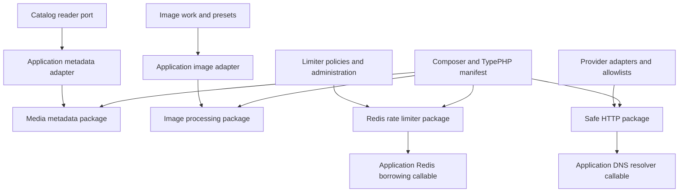

# Internal Capability Packages - Plan

## Goal Capsule

- Objective: Baander developers can reuse file metadata reading, image processing, rate limiting and safe outbound HTTP without importing the application's business workflows.
- Means: Four local Composer packages with explicit application wiring (KTD1–KTD4), followed by coherent package directories, package-owned tests and named application adapters (KTD5–KTD8).
- Authority: The user's approved extraction scope and existing observable behavior govern this refactor. Repository architecture and binary deployment contracts remain binding.
- Execution profile: One branch, `refactor/internal-capability-packages`, with locally committed units. The lead owns shared configuration, verification and integration. No push is authorized.
- Stop conditions: Do not change public API behavior, persisted formats or resource lifetime guarantees to make an extraction easier. Resolve discovered defects in the affected units before completion.

---

## Product Contract

### Summary and problem frame

Reusable mechanisms currently live beside Baander-specific orchestration in `src/`.
Moving those mechanisms behind package boundaries should reduce application coupling
without creating an extensibility framework for hypothetical consumers. The user
approved metadata readers, image processing, Redis rate limiting and safe outbound
HTTP, in that order, after reviewing the alternatives.

The initial extraction is delivered. The user then asked for better organization
and explicitly confirmed that both the package layouts and the code remaining in
`src/` need attention. The correction stays within these four capabilities; it
changes ownership and navigation while preserving their established behavior.

### Requirements

**Scope and boundaries**

- R1. Extract the four approved capabilities into local Composer packages, with no package imports from `App\`.
- R2. Keep matching, enrichment, authorization, derivative naming, provider policy and administrative entrypoints in Baander.
- R3. Preserve all existing successful results, validation, bounded failures and resource cleanup behavior.
- R4. Reuse concrete PHP, PSR, Symfony, GD and Redis types instead of adding alternate-backend abstractions.

**Deployment and verification**

- R5. The single TypePHP executable must include every new package's runtime source and resources and continue to support the current console/operator composition roots.
- R6. Package implementation must remain covered by static analysis, dependency rules and the existing behavioral tests.
- R7. Record delivered scope and actual verification results in `ROADMAP.md`, distinguishing ordinary PHP checks from packaged execution.

**Organization correction**

- R8. Organize the existing package classes by their responsibilities, keeping small coherent packages flat and keeping all runtime source beneath each package's existing `src/` root.
- R9. Place package-only tests and their neutral fixtures beside their package. Keep application-dependent tests in root `tests/`, use the existing shared runners, and preserve every behavioral assertion and discovered test case.
- R10. Give remaining application adapters names that identify their role, group application integration bindings in one imported configuration file, and let the limiter bundle own its default administration services and alias. Preserve application policy, logger channels, pool ownership and native DNS lifecycle.
- R11. Verify the corrected namespaces, test discovery and compiled wiring with focused ordinary and rebuilt TypePHP checks. Escalate to broader gates only when a concrete failure or behavioral change justifies them; unchanged algorithms do not require repeating the initial full backend gate or unrelated runtime matrix.

### Acceptance examples

- AE1. Reading the same tagged file produces the same fields, artists, identifiers and cover bytes through the existing Catalog port. Covers R1–R3.
- AE2. Image work preserves output dimensions, transparency, preset filenames and atomic publishing through the existing image port. Covers R1–R3.
- AE3. Concurrent limiter consumption, reset, expiry and Redis failure retain their current verdicts and HTTP status/header behavior. Covers R3–R4.
- AE4. A provider request still rejects forbidden destinations, pins approved DNS results, bounds reads and preserves streaming and cancellation. Covers R3–R4.
- AE5. The packaged executable resolves the extracted classes and boots the configured services; ordinary and packaged focused tests agree. Covers R5–R6.
- AE6. A developer finds metadata values under `Model`, format readers under `Reader`, binary parsers under `Parser`, and limiter storage, administration and Symfony integration in their own package directories. The small HTTP package remains flat. Covers R8.
- AE7. The shared test runner discovers every relocated package test exactly once. A before/after identity map accounts for namespace and path changes, retains all cases and assertions, and leaves application integration tests in root `tests/`. Covers R6 and R9.
- AE8. The container resolves `MetadataContentReaderAdapter` and `ImageConversionAdapter` through the existing application ports, retains metadata/media logger channels and the Redis/DNS callables, and the rebuilt executable loads all moved package classes and boots console/operator entrypoints. Covers R3, R5 and R10–R11.

### Scope boundaries

No new product endpoints, schema changes, provider behaviors, generic Shared bundle,
or runtime process topology are included. Auth, Scheduler, outbox, pagination and
provider-client packages remain separate future work. `ui/rn` and Essentia are excluded.
Native translation of application code is separate performance work, not an
acceptance requirement for this extraction. The organization correction adds no new
packages, domain concepts, backend abstractions or runtime behaviors. Removing the
deprecated application `ImageConverter` is excluded. The user's existing
`.idea/baander.iml` changes are outside agent ownership and must remain untouched.

---

## Planning Contract

### Key technical decisions

- KTD1. Use `baander/media-metadata`, `baander/image-processing`, `baander/redis-rate-limiter` and `baander/http-client`, with corresponding `Baander\MediaMetadata`, `Baander\ImageProcessing`, `Baander\RedisRateLimiter` and `Baander\HttpClient` namespaces. Plain libraries use explicit service definitions; a bundle class is justified only where it owns framework registration. This follows the local Composer precedent in `packages/baander-tooling/composer.json`. (session-settled: user-approved — chosen over packaging whole contexts: only coherent mechanisms should leave the application.) Governs R1–R4.
- KTD2. Keep application adapters where an existing port carries product meaning. Metadata values move with their parsers, while the Catalog reader adapter delegates to the package. Image presets and filenames stay in the application converter; its GD operations delegate to the package. No generic reader or image-backend interfaces are introduced. Governs R2–R4.
- KTD3. Keep Redis pool ownership and native DNS process ownership in the application. Supply narrow callable dependencies to the package where possible; translate pool exhaustion into the package's availability error. Keep limiter key names and serialized state unchanged. Explicitly preserve HTTP 503, Retry-After and no-store mapping when the limiter exception leaves the Shared application exception hierarchy. Governs R2–R4.
- KTD4. Preserve TypePHP's qualified embedded-bytecode/ZendVM mode. Add local package source paths to `tools/typephp/application.yml` and retain the physical resource tree and patched interpreter dispatch. Moving PHP files is not evidence of a runtime-speed or binary-size improvement. (session-settled: user-approved — chosen over an AOT-driven redesign: the established binary already supports these runtime mechanisms.) Governs R5.
- KTD5. For the initial delivery, tests remained in the application suites. The user-confirmed organization correction supersedes that placement: move package-only tests and neutral fixtures into each package's `tests/` tree, retaining application-dependent tests in root `tests/`. Extend the existing root discovery and analysis configuration; introduce no separate package test systems. Preserve all existing proof assertions. Governs R3, R6 and R9.
- KTD6. Group media metadata into `Model`, `Reader` and `Parser`, retaining `MetadataContentReader` and `FormatDetector` at the package root. Group the limiter into `Limiter`, `Storage`, `Administration`, `Exception` and `Bridge/Symfony`. Put the BlurHash pair under `BlurHash`, retain the concrete GD processor at root, and leave the three-class HTTP package flat. These are namespace and ownership changes, not algorithm rewrites. Governs R8.
- KTD7. Rename the application wrappers to `MetadataContentReaderAdapter` and `ImageConversionAdapter` in their current context directories. Keep `MediaFileMetadata`, derivative orchestration, Redis pool borrowing and native DNS ownership local. Group the four capabilities' application bindings in `config/services_packages.yaml`, imported by `config/services.yaml`; let the existing limiter bundle register administration defaults and its alias alongside its compiler pass, without a new extension/configuration abstraction. Application-specific loggers, provider transport and DNS/Redis callables stay in the application import. Governs R2 and R10.
- KTD8. Treat U6–U8 as an organization correction to the already qualified delivery. Run focused affected tests, discovery comparisons, complete application PHPStan/Deptrac and container lint, then rebuilt TypePHP focused tests and console/operator boot. Reuse the initial full backend and runtime results as the preceding checkpoint, not as results from the reorganized tree. Repeat a broader gate only for an identified behavioral change or unresolved failure, recording the reason. Governs R5–R7 and R11.

### High-level technical design

This sketch describes ownership; it does not prescribe individual method bodies.



The rate limiter package owns the atomic algorithm, snapshots, state codec and
Symfony factory. The application owns policy selection and transport presentation.
The HTTP package owns destination validation and safe transport options; native DNS
cleanup and coroutine behavior remain in the existing implementation.

### Output structure for the organization correction

This tree describes responsibility groups; existing classes move into the group
that owns their behavior. No new service abstraction is implied.

```text
packages/
  baander-media-metadata/src/
    MetadataContentReader.php
    FormatDetector.php
    Model/                    # ExtractedMetadata, CoverArt
    Reader/                   # Id3Reader, FlacReader, OggReader, WavReader
    Parser/                   # Id3Parser, FlacParser, OggParser, VorbisCommentFields
  baander-image-processing/src/
    GdImageConverter.php
    BlurHash/                 # BlurHash, BlurHashGenerator
  baander-redis-rate-limiter/src/
    Limiter/                  # factories and policy implementations
    Storage/                  # Redis store, snapshots and state encoding
    Administration/           # administration contract, implementation and definition
    Exception/                # unavailable, unknown and clear-failure outcomes
    Bridge/Symfony/           # bundle, compiler pass and service registration
  baander-http-client/src/     # existing three classes
  <each-capability-package>/tests/
config/services_packages.yaml
```

### Evidence and constraints

- `src/Metadata/Infrastructure/Reader/MetadataContentReader.php` currently implements the Catalog port and selects concrete format readers; `MediaFileMetadata.php` also performs matching and therefore stays local.
- `src/Media/Infrastructure/Converter/GdImageConverter.php` combines GD operations with presets used by `FlysystemStorage`; split those responsibilities without changing preset output.
- `src/Shared/Infrastructure/RateLimiter/RedisRateLimiterFactory.php` already implements Symfony's factory interface; `RedisRateLimiterStore.php` currently borrows the app Redis client.
- `src/Shared/Infrastructure/Http/PublicDestinationPolicy.php` already accepts a DNS closure. `NativeDnsResolver.php` owns subprocesses, deadlines and cancellation and stays local.
- `src/Shared/Infrastructure/EventListener/ExceptionSubscriber.php` maps service unavailability through the app exception hierarchy and adds limiter-specific response headers.
- `config/services.yaml`, `deptrac.yaml`, `phpstan.dist.neon` and `phpunit.xml.dist` currently focus discovery and analysis on `src/`; Composer autoload alone is insufficient.
- `tools/typephp/README.md` records the qualified bytecode runtime and its required physical resources. `tools/typephp/application.yml` explicitly embeds only two existing local runtime package source trees.
- `docs/solutions/runtime-errors/swoole-callbacks-outside-the-bundle-leak-pooled-services.md` requires preserving pool cleanup. `docs/solutions/runtime-errors/registry-coroutine-work-must-preserve-the-signal-reactor.md` documents why coroutine/process behavior cannot be generalized casually.

### Organization evidence

- Package-only metadata tests still sit under `tests/Unit/Metadata/Domain/Model/` and `tests/Unit/Metadata/Infrastructure/Reader/`; `tests/Unit/Media/Infrastructure/Converter/BlurHashTest.php` likewise tests a package class under an application namespace. `phpunit.xml.dist` already discovers package-owned tests for `packages/baander-phpstan-rules/tests`.
- `tests/Support/Metadata/TaggedMediaFiles.php` combines neutral tagged-file generation with `reader()`, which assembles application matching and adapters. Split those responsibilities before moving parser tests; do not import `App\Tests` into package tests.
- `tests/Unit/Media/Infrastructure/Converter/GdImageConverterTest.php` mixes package conversion assertions with application preset and filename assertions. Preserve each proof at its owning boundary when separating tests.
- `src/Metadata/Infrastructure/Reader/MetadataContentReader.php` and `src/Media/Infrastructure/Converter/GdImageConverter.php` delegate to identically named package classes, requiring import aliases. Their replacement names identify their application adapter role.
- `config/services.yaml` currently spreads metadata/image registrations, provider HTTP wiring and limiter services across separate sections. The limiter bundle currently registers its compiler pass while application configuration supplies administration defaults and the alias.
- `tools/typephp/application.yml` embeds all four package `src/` roots recursively. New subdirectories remain beneath those roots; compiled loading still needs verification after namespace changes, and the explicit embedded-file list must gain the new application service import.

### Sequencing and ownership

U1 and U2 have independent source ownership and may be prepared together. Commit
and verify U1 before U2. U3 and U4 follow, with distinct package files and
application adapters. The lead serializes all changes to root Composer files,
service configuration, static-analysis configuration, TypePHP manifests and
documentation. U5 verifies the integrated result. No worker stages or commits.

The initial U1–U5 checkpoint is retained. Execute U6 before relocating its tests
in U7, then integrate U8. Independent package edits may run in parallel with
non-overlapping ownership; the lead owns root runners, Composer/configuration,
fixture integration, authoritative checks and local commits. Coordinate fixture
interfaces before splitting neutral test support.

### Assumptions and open questions

No blocking product questions remain. Exact dependency versions follow the current
Composer lock. Implementation may refine callable signatures after tracing every
consumer, without changing R3. Existing test and build images can be reused when
their runtime and lock match; their identity must be recorded with results.

The correction's scope is user-confirmed as both packages and `src/`. Exact
responsibility groups and adapter names are technical choices within that scope.
No product behavior or new domain vocabulary is introduced. No clarification
blocks implementation planning; document review must complete before U6 starts.

---

## Implementation Units

### U1. Extract file metadata reading

- Goal: Deliver the metadata package and retain the Catalog reader port through an application adapter.
- Files: New `packages/baander-media-metadata/`; reader classes under `src/Metadata/Infrastructure/Reader/`; `ExtractedMetadata.php` and `CoverArt.php` under `src/Metadata/Domain/Model/`; actual consumers in Catalog and Metadata; corresponding tests and `tests/Support/Metadata/TaggedMediaFiles.php` imports. Lead integrates root Composer and discovery/analysis/packaging files.
- Approach: Follow KTD1, KTD2 and KTD5. Move the ten concrete reader/parser classes and two values with minimal algorithm changes; preserve metadata matching locally.
- Tests: Existing `tests/Unit/Metadata/Infrastructure/Reader/`, metadata value tests, Catalog reader consumers and cover-extraction tests. Check format detection, malformed/truncated tags, multi-artist and MusicBrainz fields, cover bytes and unsupported formats. Covers AE1.
- Execution note: This is a behavior-preserving move; existing behavioral tests supply proof, without adding mirror tests for namespace changes.

### U2. Extract image processing

- Goal: Deliver concrete GD conversion and BlurHash without application storage or authorization dependencies.
- Files: New `packages/baander-image-processing/`; `src/Media/Infrastructure/Converter/{GdImageConverter,BlurHash,BlurHashGenerator}.php`; direct consumers; `tests/Unit/Media/Infrastructure/Converter/{GdImageConverterTest,BlurHashTest}.php`; `tests/Functional/Media/ImageDerivativeWorkerTest.php`. Lead integrates shared configuration.
- Approach: Follow KTD1, KTD2 and KTD5. Preserve the old deprecated ImageConverter until separate removal is justified; move only the active implementation.
- Tests: Preserve BlurHash conformance, invalid inputs, no-upscale behavior, WebP dimensions/transparency, preset naming and atomic publication. Exercise deferred derivative work through the application adapter. Covers AE2.

### U3. Extract atomic Redis rate limiting

- Goal: Deliver the limiter implementation with a narrow connection-borrowing boundary and unchanged application policy.
- Files: New `packages/baander-redis-rate-limiter/`; `src/Shared/Infrastructure/RateLimiter/`; limiter DTOs/contracts/exceptions and their actual callers; limiter availability mapping in the exception subscriber; `src/Kernel.php`; existing limiter tests and fixtures. Lead integrates shared configuration.
- Approach: Follow KTD1, KTD3 and KTD5. Keep atomic scripts, key formats, retries and timing intact. Move tightly coupled administration data/contracts only when necessary to avoid reverse imports, while leaving commands/controllers local.
- Tests: Existing `tests/Unit/Shared/Infrastructure/RateLimiter/`, `tests/Integration/RateLimiterConcurrencyTest.php`, `tests/Integration/RateLimiterHttpAvailabilityTest.php`, relevant Auth and console functional tests. Cover pool failure, Redis failure, corrupt state, commit conflicts, reset fencing, expiry and HTTP 503 headers. Covers AE3.

### U4. Extract safe provider HTTP

- Goal: Deliver safe destination validation and HTTP requests without taking ownership of Baander's coroutine runtime.
- Files: New `packages/baander-http-client/`; reusable classes under `src/Shared/Infrastructure/Http/`; native DNS wiring and direct callers in Metadata, Radio, Notification and Auth; existing HTTP tests. Lead integrates shared configuration.
- Approach: Follow KTD1, KTD3 and KTD5. Use the existing resolver closure seam with explicit application injection; retain native resolver lifecycle and helper path. Preserve Symfony response/stream types directly.
- Tests: Existing `tests/Unit/Shared/Infrastructure/Http/` and relevant provider/webhook tests. Cover rejected schemes/hosts/IPs, DNS rebinding protection, mapped IPv4, deadlines, redirects, credential/proxy restrictions, streaming and DNS subprocess cleanup. Covers AE4.

### U5. Verify integrated packages and binary deployment

- Goal: Prove that both ordinary PHP and the shipping executable load and use all four packages.
- Files: Root Composer lock/manifests, `config/services.yaml`, `deptrac.yaml`, `phpstan.dist.neon`, `phpunit.xml.dist`, `tools/typephp/application.yml`, relevant build/test source-discovery configuration, package README files and `ROADMAP.md`.
- WebSocket fixture identity correction: the shutdown ticket request returns `insufficient_scope` because `StreamClient` creates a delegated client and ticket issuance is intentionally first-party-only. Allow the fixture to accept a concrete configured first-party client for ticket scenarios, preserve delegated streaming defaults, audit ticket callers, and verify the shutdown flow.
- Runtime fixture membership correction: after the origin fix, the stream probe returns library-scope HTTP 403 and the fixture has no `user_library_access` rows. `tests/Fixtures/web-runtime.php` must grant its generated library to an explicitly supplied listener. Pass the intended listener from both web workflow callers, preserve delegated tokens, and verify the real web and shutdown drills.
- Runtime qualification correction: `packages/baander-tooling/src/Fixtures/Web/RuntimeWorkflow.php` configures a public issuer but its clients sign loopback DPoP proofs. The web drill returns HTTP 403 under the existing explicit-origin validator. The same configuration omission exists in `packages/baander-tooling/src/Fixtures/Web/ShutdownWorkflow.php`. Add the loopback origin to both disposable fixtures' `AUTH_DPOP_EXTRA_ORIGINS`, cover their container environments in `scripts/tests/php/WebRuntimeWorkflowTest.php` and `scripts/tests/php/WebWorkflowTest.php`, and rerun the packaged web and shutdown drills. Keep production origin validation unchanged.
- Review correction: the qualification image service override and its tooling tests still referenced the old HTTP classes. Update those consumers in `packages/baander-tooling/src/Fixtures/Qualification/Images.php`, `scripts/tests/php/QualificationImagesTest.php` and `scripts/tests/php/QualificationMetadataTransportTest.php`, then run their focused tooling checks.
- Static-check corrections: update the inherited store constructor in `tests/Fixtures/RateLimiter/consume.php` to pass the borrowing closure, and remove the obsolete ImageController-to-BlurHash entry in `deptrac.baseline.yaml` now covered by the package boundary.
- Verified integration defect: `src/Shared/Infrastructure/Logging/BoundedContextLoggerPass.php` assigns channels only to `App\` classes. Bind package reader loggers to `monolog.logger.metadata` and the BlurHash logger to `monolog.logger.media` in `config/services.yaml`; verify the compiled service arguments.
- Approach: Complete KTD4–KTD5 integration. Include source/resources through their real local-package paths and avoid duplicate application compatibility aliases. Keep current dependency direction enforced rather than baselining new package violations.
- Tests: Run Composer validation/normalization, PHPStan, Deptrac and focused package/adapter tests in ordinary PHP. Rebuild TypePHP, then run the full backend coordinator once in the rebuilt qualification image with coverage disabled, plus packaged focused checks and console/operator boot. Repeat affected runtime drills when the extraction changes their wiring. Covers AE5.


### U6. Organize the four package source trees

- Goal: Make package responsibilities visible without changing public behavior, algorithms or resource ownership.
- Files: `packages/baander-media-metadata/src/`, `packages/baander-image-processing/src/`, `packages/baander-redis-rate-limiter/src/` and imports in the four capabilities' consumers. HTTP source stays flat. Lead integrates root Composer and analysis collectors.
- Approach: Follow KTD1–KTD4 and KTD6. Apply the output structure, update namespaces and every static/dynamic reference, and retain package PSR-4 roots. Keep binary parsing, GD/BlurHash algorithms, limiter scripts/key formats and HTTP safety checks unchanged. Place bundle registration and its compiler pass under `Bridge/Symfony` without duplicating registration.
- Tests: Existing focused metadata, image, limiter and HTTP tests must retain their observable results after import changes. Include malformed metadata, image dimensions/transparency, limiter failure/reset behavior and destination rejection. Check root and tooling callers, container service IDs, qualification overrides and fixture imports rather than relying on source imports alone. Covers AE1–AE6.
- Execution note: This is a move-and-rename unit. Do not add mirror tests for directory names or remove assertions to accommodate new namespaces. Run checks against the final integrated source rather than repeating a passing suite for each mechanical move.

### U7. Put package-only tests with their implementation

- Goal: Make each package's proof discoverable beside its source while retaining application integration coverage.
- Files: Four capability packages' new `tests/` directories; relevant files under `tests/Unit/Metadata/`, `tests/Unit/Media/Infrastructure/Converter/`, `tests/Unit/Shared/Infrastructure/{RateLimiter,Http}/`; `tests/Support/Metadata/TaggedMediaFiles.php`; neutral fixtures actually required by moved tests. Lead owns `composer.json`, `phpunit.xml.dist`, test discovery/lane configuration and static-analysis paths.
- Approach: Follow KTD5. Classify each test by its real dependencies, move package-only proofs and their neutral helpers, and retain app-dependent provider/configuration, pool, transport/runtime and adapter tests under root `tests/`. Separate the tagged-byte fixture from application reader/matching assembly. Separate package image conversion proofs from application preset/naming proofs without weakening either. Use package test namespaces with root development autoload and the existing shared runners; add no separate test toolchains.
- Tests: Capture discovery identities and data-provider cases before moves. Compare the resulting identity map after namespace/path changes: every original case remains discoverable once, with every original assertion retained. Record any intentional additional cases separately. Run the relocated tests plus affected root adapter/fixture tests; verify no duplicate discovery or lost lane assignment. Covers AE7 and AE1–AE4.
- Execution note: Preserve the existing proof tests' behavior. Relocation and ownership splits are explicitly authorized; assertion removal, merging away cases and test deletion are not.

### U8. Clarify application adapters and complete integration

- Goal: Make the remaining application ownership explicit and verify the organized packages in ordinary PHP and the shipping executable.
- Files: `src/Metadata/Infrastructure/Reader/{MetadataContentReader,MetadataContentReaderAdapter,MediaFileMetadata}.php`, `src/Media/Infrastructure/Converter/{GdImageConverter,ImageConversionAdapter}.php`, their callers and tests; `config/services.yaml` and new `config/services_packages.yaml`; limiter bundle-owned service registration; `config/bundles.php`; root discovery/analysis/packaging configuration, including explicit embedding of `config/services_packages.yaml`, and relevant READMEs/roadmap. Leave deprecated `ImageConverter` and user `.idea/baander.iml` untouched.
- Approach: Follow KTD2–KTD5 and KTD7–KTD8. Rename wrappers without retaining obsolete duplicate classes. Update storage's reference to application image presets and every adapter construction. Keep `MediaFileMetadata`, derivative locking, Redis store factory and native DNS implementation local. The dedicated application import has its own autowire/autoconfigure defaults and supplies metadata/media logger channels, the provider transport, DNS closure and Redis pool factory. The existing limiter bundle registers administration defaults and alias alongside its compiler pass, which fills the configured catalog; no separate extension or package configuration resource is required. Update all namespace-aware static rules and tooling overrides without broadening dependency permissions.
- Tests: Run full application PHPStan, Deptrac and container lint, plus tooling checks affected by changed imports. Inspect compiled services for both application ports, logger channels, provider transport, DNS/Redis closures, administration alias and configured limiter catalog. Run focused behavioral tests and the discovery comparison from U7. Rebuild TypePHP with the unchanged recursive package roots, verify namespace loading and explicit embedding of the new application service import, and run focused affected tests plus console/operator boot through the rebuilt executable. Covers AE5, AE7 and AE8.
- Verification scope: Do not automatically repeat the initial hour-long full backend gate or unrelated runtime drills. If a wiring failure, changed resource lifetime, altered algorithm or failed focused test exposes a behavioral change, resolve it and expand only the affected gate, documenting why. Record exact commands, counts and executable identity for the correction in `ROADMAP.md`; keep earlier results labeled as the initial delivery checkpoint.

---

## Verification Contract

The following original gates describe the initial U1–U5 delivery checkpoint. For
U6–U8, the organization-correction gates below govern; they do not require rerunning
unaffected full-suite or runtime qualification merely because files moved.

Use the CI-image runners described in `docs-book/part-2-developer-guide/testing/README.md`.
Keep logs outside tracked documentation; record commands, image identities and
counts inline in the roadmap. Existing TypePHP qualification counts are baseline
evidence only and must not be presented as results of this change.

| Gate | Scope and acceptance |
| --- | --- |
| Focused behavioral tests | Run the named Unit tests and affected functional/integration files with existing disposable runners; all must pass. |
| Composer | Validate new manifests and root lock; normalization passes for changed manifests. Resolve any touched pre-existing root ordering issue without dependency upgrades. |
| Static analysis | CI-image PHPStan and Deptrac include new package sources; no new violations or baseline additions. |
| Backend regression | After ordinary PHP focused tests and static checks pass, run the existing four-suite backend coordinator once against the rebuilt TypePHP qualification image with `--no-coverage`. Record exact counts, failures and executable identity; a second full ordinary PHP run is not required. |
| Binary | Run `make typephp-build` with production dependencies, then rebuild the qualification image from that executable. Run packaged focused behavioral checks and console/operator boot, and inspect executable source skips. Use the established physical resource tree and external writable state. |
| Runtime integration | Use relevant existing limiter concurrency/availability, provider/DNS and image-worker checks; repeat packaged runtime drills affected by changed service wiring. |
| Review and prose | Run code simplification at phase boundaries, final code review, documentation prose review and `git diff --check`. |

### Organization-correction gates

| Gate | Scope and acceptance |
| --- | --- |
| Test ownership and discovery | Before/after identity mapping accounts for every existing case exactly once, including data providers and lane assignment; existing assertions are retained. Focused relocated and affected application tests pass. |
| Static and service wiring | Full application PHPStan, Deptrac and container lint pass; affected tooling checks pass. Compiled arguments retain application ports, log channels, provider transport, callables and the limiter administration/catalog wiring. |
| Packaged execution | Rebuild TypePHP, resolve changed namespaces and the new application service import, run focused changed behavioral tests and boot console/operator through that executable. Record artifact identity and actual counts. |
| Scope and evidence | No algorithm, persisted format, runtime ownership or user IDE change. Broader verification is triggered only by a concrete change or failure, with the reason recorded. Review, prose checks and `git diff --check` pass. |

## Definition of Done

All four packages have explicit dependencies and no `App\` imports. Application
ports, policies and resource ownership remain intact. Shared discovery, analysis,
test and embedding configuration includes the new code. The verification contract
has recorded results, justified review findings are fixed, and delivered scope is
recorded in `ROADMAP.md`. All work is committed locally on the implementation branch.

Initial delivery checkpoint: U1–U5 completed on 2026-11-20.
[The roadmap](../../ROADMAP.md#internal-capability-packages) records those five
units, their verification and fixture corrections found during runtime qualification.
The user-confirmed organization correction in U6–U8 remains pending. Completion
now also requires its source layout, test ownership, explicit adapters and compiled
wiring to pass the correction's focused verification gates and be recorded in the
roadmap.
