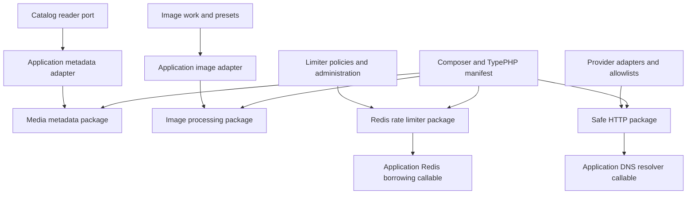

# Internal Capability Packages - Plan

## Goal Capsule

- Objective: Baander developers can reuse file metadata reading, image processing, rate limiting and safe outbound HTTP without importing the application's business workflows.
- Means: Four local Composer packages with explicit application wiring (KTD1–KTD4).
- Authority: The user's approved extraction scope and existing observable behavior govern this refactor. Repository architecture and binary deployment contracts remain binding.
- Execution profile: One branch, `refactor/internal-capability-packages`, with locally committed units. The lead owns shared configuration, verification and integration. No push is authorized.
- Stop conditions: Do not change public API behavior, persisted formats or resource lifetime guarantees to make an extraction easier. Resolve discovered defects in the affected units before completion.

---

## Product Contract

### Summary and problem frame

Reusable mechanisms currently live beside Baander-specific orchestration in `src/`.
Moving those mechanisms behind package boundaries should reduce application coupling
without creating an extensibility framework for hypothetical consumers. The user
approved metadata readers, image processing, Redis rate limiting and safe outbound
HTTP, in that order, after reviewing the alternatives.

### Requirements

**Scope and boundaries**

- R1. Extract the four approved capabilities into local Composer packages, with no package imports from `App\`.
- R2. Keep matching, enrichment, authorization, derivative naming, provider policy and administrative entrypoints in Baander.
- R3. Preserve all existing successful results, validation, bounded failures and resource cleanup behavior.
- R4. Reuse concrete PHP, PSR, Symfony, GD and Redis types instead of adding alternate-backend abstractions.

**Deployment and verification**

- R5. The single TypePHP executable must include every new package's runtime source and resources and continue to support the current console/operator composition roots.
- R6. Package implementation must remain covered by static analysis, dependency rules and the existing behavioral tests.
- R7. Record delivered scope and actual verification results in `ROADMAP.md`, distinguishing ordinary PHP checks from packaged execution.

### Acceptance examples

- AE1. Reading the same tagged file produces the same fields, artists, identifiers and cover bytes through the existing Catalog port. Covers R1–R3.
- AE2. Image work preserves output dimensions, transparency, preset filenames and atomic publishing through the existing image port. Covers R1–R3.
- AE3. Concurrent limiter consumption, reset, expiry and Redis failure retain their current verdicts and HTTP status/header behavior. Covers R3–R4.
- AE4. A provider request still rejects forbidden destinations, pins approved DNS results, bounds reads and preserves streaming and cancellation. Covers R3–R4.
- AE5. The packaged executable resolves the extracted classes and boots the configured services; ordinary and packaged focused tests agree. Covers R5–R6.

### Scope boundaries

No new product endpoints, schema changes, provider behaviors, generic Shared bundle,
or runtime process topology are included. Auth, Scheduler, outbox, pagination and
provider-client packages remain separate future work. `ui/rn` and Essentia are excluded.
Native translation of application code is separate performance work, not an
acceptance requirement for this extraction.

---

## Planning Contract

### Key technical decisions

- KTD1. Use `baander/media-metadata`, `baander/image-processing`, `baander/redis-rate-limiter` and `baander/http-client`, with corresponding `Baander\MediaMetadata`, `Baander\ImageProcessing`, `Baander\RedisRateLimiter` and `Baander\HttpClient` namespaces. Plain libraries use explicit service definitions; a bundle class is justified only where it owns framework registration. This follows the local Composer precedent in `packages/baander-tooling/composer.json`. (session-settled: user-approved — chosen over packaging whole contexts: only coherent mechanisms should leave the application.) Governs R1–R4.
- KTD2. Keep application adapters where an existing port carries product meaning. Metadata values move with their parsers, while the Catalog reader adapter delegates to the package. Image presets and filenames stay in the application converter; its GD operations delegate to the package. No generic reader or image-backend interfaces are introduced. Governs R2–R4.
- KTD3. Keep Redis pool ownership and native DNS process ownership in the application. Supply narrow callable dependencies to the package where possible; translate pool exhaustion into the package's availability error. Keep limiter key names and serialized state unchanged. Explicitly preserve HTTP 503, Retry-After and no-store mapping when the limiter exception leaves the Shared application exception hierarchy. Governs R2–R4.
- KTD4. Preserve TypePHP's qualified embedded-bytecode/ZendVM mode. Add local package source paths to `tools/typephp/application.yml` and retain the physical resource tree and patched interpreter dispatch. Moving PHP files is not evidence of a runtime-speed or binary-size improvement. (session-settled: user-approved — chosen over an AOT-driven redesign: the established binary already supports these runtime mechanisms.) Governs R5.
- KTD5. Keep current behavioral tests in the application's test suites and update imports and adapter coverage. This avoids moving application-dependent fixture factories into packages just to change test ownership. Add focused tests only for genuinely new dependency seams and package loading. Add package sources to coverage, PHPStan and Deptrac with explicit allowed dependencies. Governs R3 and R6.

### High-level technical design

This sketch describes ownership; it does not prescribe individual method bodies.

The rate limiter package owns the atomic algorithm, snapshots, state codec and
Symfony factory. The application owns policy selection and transport presentation.
The HTTP package owns destination validation and safe transport options; native DNS
cleanup and coroutine behavior remain in the existing implementation.

### Evidence and constraints

- `src/Metadata/Infrastructure/Reader/MetadataContentReader.php` currently implements the Catalog port and selects concrete format readers; `MediaFileMetadata.php` also performs matching and therefore stays local.
- `src/Media/Infrastructure/Converter/GdImageConverter.php` combines GD operations with presets used by `FlysystemStorage`; split those responsibilities without changing preset output.
- `src/Shared/Infrastructure/RateLimiter/RedisRateLimiterFactory.php` already implements Symfony's factory interface; `RedisRateLimiterStore.php` currently borrows the app Redis client.
- `src/Shared/Infrastructure/Http/PublicDestinationPolicy.php` already accepts a DNS closure. `NativeDnsResolver.php` owns subprocesses, deadlines and cancellation and stays local.
- `src/Shared/Infrastructure/EventListener/ExceptionSubscriber.php` maps service unavailability through the app exception hierarchy and adds limiter-specific response headers.
- `config/services.yaml`, `deptrac.yaml`, `phpstan.dist.neon` and `phpunit.xml.dist` currently focus discovery and analysis on `src/`; Composer autoload alone is insufficient.
- `tools/typephp/README.md` records the qualified bytecode runtime and its required physical resources. `tools/typephp/application.yml` explicitly embeds only two existing local runtime package source trees.
- `docs/solutions/runtime-errors/swoole-callbacks-outside-the-bundle-leak-pooled-services.md` requires preserving pool cleanup. `docs/solutions/runtime-errors/registry-coroutine-work-must-preserve-the-signal-reactor.md` documents why coroutine/process behavior cannot be generalized casually.

### Sequencing and ownership

U1 and U2 have independent source ownership and may be prepared together. Commit
and verify U1 before U2. U3 and U4 follow, with distinct package files and
application adapters. The lead serializes all changes to root Composer files,
service configuration, static-analysis configuration, TypePHP manifests and
documentation. U5 verifies the integrated result. No worker stages or commits.

### Assumptions and open questions

No blocking product questions remain. Exact dependency versions follow the current
Composer lock. Implementation may refine callable signatures after tracing every
consumer, without changing R3. Existing test and build images can be reused when
their runtime and lock match; their identity must be recorded with results.

---

## Implementation Units

### U1. Extract file metadata reading

- Goal: Deliver the metadata package and retain the Catalog reader port through an application adapter.
- Files: New `packages/baander-media-metadata/`; reader classes under `src/Metadata/Infrastructure/Reader/`; `ExtractedMetadata.php` and `CoverArt.php` under `src/Metadata/Domain/Model/`; actual consumers in Catalog and Metadata; corresponding tests and `tests/Support/Metadata/TaggedMediaFiles.php` imports. Lead integrates root Composer and discovery/analysis/packaging files.
- Approach: Follow KTD1, KTD2 and KTD5. Move the ten concrete reader/parser classes and two values with minimal algorithm changes; preserve metadata matching locally.
- Tests: Existing `tests/Unit/Metadata/Infrastructure/Reader/`, metadata value tests, Catalog reader consumers and cover-extraction tests. Check format detection, malformed/truncated tags, multi-artist and MusicBrainz fields, cover bytes and unsupported formats. Covers AE1.
- Execution note: This is a behavior-preserving move; existing behavioral tests supply proof, without adding mirror tests for namespace changes.

### U2. Extract image processing

- Goal: Deliver concrete GD conversion and BlurHash without application storage or authorization dependencies.
- Files: New `packages/baander-image-processing/`; `src/Media/Infrastructure/Converter/{GdImageConverter,BlurHash,BlurHashGenerator}.php`; direct consumers; `tests/Unit/Media/Infrastructure/Converter/{GdImageConverterTest,BlurHashTest}.php`; `tests/Functional/Media/ImageDerivativeWorkerTest.php`. Lead integrates shared configuration.
- Approach: Follow KTD1, KTD2 and KTD5. Preserve the old deprecated ImageConverter until separate removal is justified; move only the active implementation.
- Tests: Preserve BlurHash conformance, invalid inputs, no-upscale behavior, WebP dimensions/transparency, preset naming and atomic publication. Exercise deferred derivative work through the application adapter. Covers AE2.

### U3. Extract atomic Redis rate limiting

- Goal: Deliver the limiter implementation with a narrow connection-borrowing boundary and unchanged application policy.
- Files: New `packages/baander-redis-rate-limiter/`; `src/Shared/Infrastructure/RateLimiter/`; limiter DTOs/contracts/exceptions and their actual callers; limiter availability mapping in the exception subscriber; `src/Kernel.php`; existing limiter tests and fixtures. Lead integrates shared configuration.
- Approach: Follow KTD1, KTD3 and KTD5. Keep atomic scripts, key formats, retries and timing intact. Move tightly coupled administration data/contracts only when necessary to avoid reverse imports, while leaving commands/controllers local.
- Tests: Existing `tests/Unit/Shared/Infrastructure/RateLimiter/`, `tests/Integration/RateLimiterConcurrencyTest.php`, `tests/Integration/RateLimiterHttpAvailabilityTest.php`, relevant Auth and console functional tests. Cover pool failure, Redis failure, corrupt state, commit conflicts, reset fencing, expiry and HTTP 503 headers. Covers AE3.

### U4. Extract safe provider HTTP

- Goal: Deliver safe destination validation and HTTP requests without taking ownership of Baander's coroutine runtime.
- Files: New `packages/baander-http-client/`; reusable classes under `src/Shared/Infrastructure/Http/`; native DNS wiring and direct callers in Metadata, Radio, Notification and Auth; existing HTTP tests. Lead integrates shared configuration.
- Approach: Follow KTD1, KTD3 and KTD5. Use the existing resolver closure seam with explicit application injection; retain native resolver lifecycle and helper path. Preserve Symfony response/stream types directly.
- Tests: Existing `tests/Unit/Shared/Infrastructure/Http/` and relevant provider/webhook tests. Cover rejected schemes/hosts/IPs, DNS rebinding protection, mapped IPv4, deadlines, redirects, credential/proxy restrictions, streaming and DNS subprocess cleanup. Covers AE4.

### U5. Verify integrated packages and binary deployment

- Goal: Prove that both ordinary PHP and the shipping executable load and use all four packages.
- Files: Root Composer lock/manifests, `config/services.yaml`, `deptrac.yaml`, `phpstan.dist.neon`, `phpunit.xml.dist`, `tools/typephp/application.yml`, relevant build/test source-discovery configuration, package README files and `ROADMAP.md`.
- Approach: Complete KTD4–KTD5 integration. Include source/resources through their real local-package paths and avoid duplicate application compatibility aliases. Keep current dependency direction enforced rather than baselining new package violations.
- Tests: Run Composer validation/normalization, PHPStan, Deptrac and focused package/adapter tests in ordinary PHP. Rebuild TypePHP, then run the full backend coordinator once in the rebuilt qualification image with coverage disabled, plus packaged focused checks and console/operator boot. Repeat affected runtime drills when the extraction changes their wiring. Covers AE5.

---

## Verification Contract

Use the CI-image runners described in `docs-book/part-2-developer-guide/testing/README.md`.
Keep logs outside tracked documentation; record commands, image identities and
counts inline in the roadmap. Existing TypePHP qualification counts are baseline
evidence only and must not be presented as results of this change.

| Gate | Scope and acceptance |
| --- | --- |
| Focused behavioral tests | Run the named Unit tests and affected functional/integration files with existing disposable runners; all must pass. |
| Composer | Validate new manifests and root lock; normalization passes for changed manifests. Resolve any touched pre-existing root ordering issue without dependency upgrades. |
| Static analysis | CI-image PHPStan and Deptrac include new package sources; no new violations or baseline additions. |
| Backend regression | After ordinary PHP focused tests and static checks pass, run the existing four-suite backend coordinator once against the rebuilt TypePHP qualification image with `--no-coverage`. Record exact counts, failures and executable identity; a second full ordinary PHP run is not required. |
| Binary | Run `make typephp-build` with production dependencies, then rebuild the qualification image from that executable. Run packaged focused behavioral checks and console/operator boot, and inspect executable source skips. Use the established physical resource tree and external writable state. |
| Runtime integration | Use relevant existing limiter concurrency/availability, provider/DNS and image-worker checks; repeat packaged runtime drills affected by changed service wiring. |
| Review and prose | Run code simplification at phase boundaries, final code review, documentation prose review and `git diff --check`. |

## Definition of Done

All four packages have explicit dependencies and no `App\` imports. Application
ports, policies and resource ownership remain intact. Shared discovery, analysis,
test and embedding configuration includes the new code. The verification contract
has recorded results, justified review findings are fixed, and delivered scope is
recorded in `ROADMAP.md`. All work is committed locally on the implementation branch.
