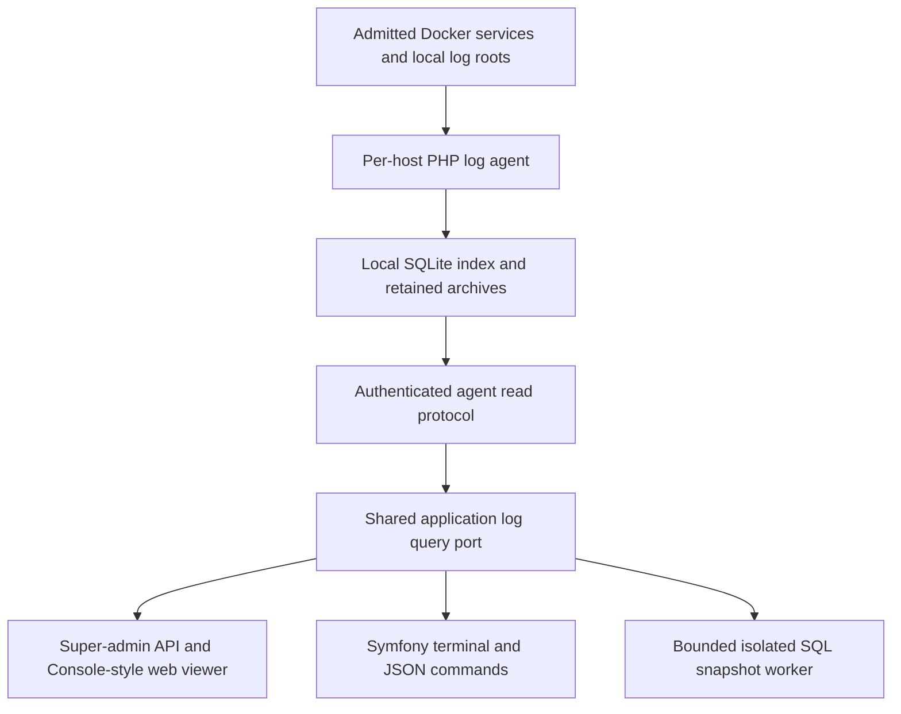
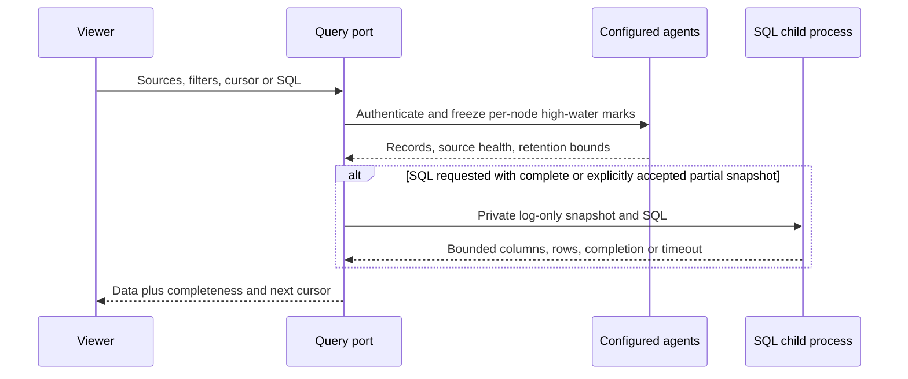
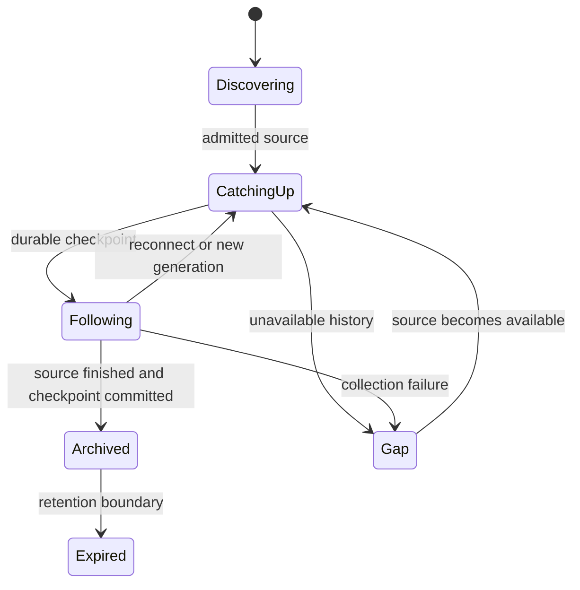
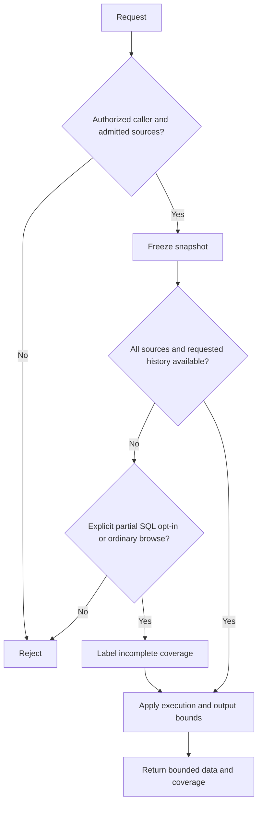

# Admin and terminal log viewers - Plan

## Goal Capsule

- **Objective:** Operators can find and investigate logs from every Baander service in the admin dashboard and terminal, including archived logs, without opening individual containers.
- **Means:** A Console-inspired web viewer and an lnav-inspired Symfony command share the application query contract described in KTD1–KTD5.
- **Authority:** The Product Contract governs behavior; the Planning Contract governs implementation. Repository architecture, design, admin/CLI parity and test rules remain binding.
- **Execution profile:** One branch and one eventual pull request, with dependency-ordered local commits. Collection, query, terminal and browser implementation can proceed independently once U1 fixes their contracts. Push only on request.
- **Completion:** The lead integrates the units, verifies the acceptance examples in the CI image and isolated preview, and records delivered scope and check results in `ROADMAP.md`.
- **Stop conditions:** Do not expose host control through a query endpoint, substitute partial results for complete results, alter the persistent instance, or claim a service is covered without an ingestion check.

---

## Product Contract

### Summary

Add a log viewer to the admin dashboard with a source sidebar, dense message table, filters, search, live follow and a selected-message inspector.
Use the interaction model of macOS Console with Baander's typography, colors, spacing and components.
Provide an interactive Symfony command with lnav-style navigation, SQL querying and archive browsing.
Collect application and infrastructure logs across container and host boundaries.

### Problem Frame

`config/packages/monolog.yaml` writes development text logs and production JSON logs, while Swoole writes another native log file.
Preview workers do not share the web container's log directory (`packages/baander-tooling/src/Development/Workers.php` and `src/Shared/Infrastructure/Worker/DeploymentContainerRecipe.php`).
Gateway, PostgreSQL, Redis, pooler and registry processes have separate logging destinations.
Registry voters can run on separate hosts (`relay/docker/voter.compose.yml`).
Reading `var/log` alone cannot satisfy the requested service coverage.

### Key Decisions

- **SQL and compressed archives belong in this delivery.** Governs R5 and R6. (session-settled: user-directed — chosen over a core viewer with SQL and archives deferred: the user requested both now.)
- **Collection covers all services.** Governs R1 and R2. (session-settled: user-directed — chosen over application files and mounted directories only: the user requested collection across containers.)

### Requirements

**Sources and collection**

- R1. Discover and display application files, rotated files and container streams for web, dynamic workers, gateway, PostgreSQL, Redis, pooler, registry API, rqlite voters and registry backup processes in the deployment's admitted inventory.
- R2. Collect on every participating Docker host and expose source health, last successful collection, retention boundary and any collection gap; unreachable hosts remain visible.
- R3. Parse Monolog JSON and line formats, preserve multiline messages and raw unrecognized records, and retain source, host, container/boot, stream, timestamp, severity, channel, correlation ID, context and extra fields when present.
- R4. Handle append, partial lines, rotation, truncation and container replacement without silently duplicating replayed records or losing source identity; distinct source copies remain distinguishable.
- R5. Browse gzip and ZIP archives as sources, including individual ZIP members, without extracting user-controlled paths into the filesystem. Unsupported, corrupt, encrypted or oversized archives have explicit source errors.

**Investigation**

- R6. Run read-only SQLite SQL over normalized log records from the chosen sources, including CTEs, grouping, joins and window functions. State the queried snapshot and its completeness beside the result.
- R7. Both viewers support source selection, literal text search, severity, channel, correlation ID and time filters, stable chronological ordering, older-page navigation, live follow and pause/resume.
- R8. A selected record exposes its complete retained message, structured fields and raw record, with safe copying. A paused view preserves its selection and scroll position while collection continues.
- R9. The browser provides a source sidebar, compact toolbar, virtualized message list and inspector using `ui/DESIGN.md`; narrow screens preserve access to every region without horizontal page overflow.
- R10. The terminal supports arrow/j/k navigation, paging, first/last, `/` search, `n`/`N` matches, filter/source prompts, `:` SQL, follow toggle, detail inspection, help and quit; resizing and interruption restore the terminal correctly.
- R11. Noninteractive commands provide plain text and `--json`; JSON stdout equals the corresponding API data payload, with diagnostics on stderr.

**Access and bounds**

- R12. Browser log access requires `ROLE_SUPER_ADMIN`; CLI retains full authority. Neither log text, file names nor SQL may grant filesystem, network, extension-loading or Docker control access.
- R13. Bound record size, decompression, storage, query execution, result size and UI memory. A bound that affects coverage is visible; it never turns an incomplete search or SQL result into a claim about all logs.
- R14. Preserve existing URL-token redaction and render log content as inert text in both viewers. Agent credentials and collector diagnostics must not appear in returned log records.

### Acceptance Examples

- AE1. A web request and worker job emit records with the same correlation ID. Searching that ID shows both sources, and inspecting either preserves its structured context. Covers R1–R3, R7–R8.
- AE2. A worker exits and is replaced. The old source remains searchable, the new boot has its own identity, and collection resumes from durable checkpoints after agent restart. Covers R2–R4.
- AE3. A registry voter host is unreachable. Healthy sources still load, while the source list and search result identify the missing host. SQL cannot silently aggregate the healthy subset as the entire selection. Covers R2, R6, R13.
- AE4. An operator selects a gzip log and a ZIP member, searches a phrase and groups records by severity with SQL. The result names the selected archives and completeness boundary. A corrupt archive reports an error without dropping unrelated sources. Covers R5–R7.
- AE5. With follow paused, newly collected records do not move the selected row. Resume returns to current records and reports a retention gap if the pause outlived retention. Covers R4, R7–R9.
- AE6. SQL containing writes, `ATTACH`, `PRAGMA`, extension loading or multiple statements is rejected. A recursive query times out and releases its process. Covers R6, R12–R13.
- AE7. A log record contains terminal escapes, HTML, formatter tags and signed URLs. Viewing and copying it cannot execute controls or reveal values covered by the existing redaction policy. Covers R8, R12, R14.
- AE8. An ordinary administrator cannot call the API or open Logs; a super administrator can. Command JSON remains parseable with real development and production log handlers enabled. Covers R11–R12.

### Scope Boundaries

The first archive formats are gzip and ZIP; tar, bzip2, xz, zstd and nested archives are separate follow-up work because the application image does not establish suitable PHP extension contracts today.
The feature is a log investigation tool, not a general SQL database browser or a Docker administration console.
It does not add metrics, traces, alert delivery or log editing/deletion controls.
`ui/rn` and Essentia remain excluded.

---

## Planning Contract

### Key Technical Decisions

- KTD1. **Shared application port.** Add `LogViewerInterface` and immutable query/result DTOs under `src/Shared/Application/LogViewer/`. HTTP and Symfony commands call this port; their presentation layers do not discover files, parse records or query storage. Follow `.agents/rules/architecture-rules.md`, `ddd-ports.md` and `admin-cli-parity.md`.
- KTD2. **Per-host agents with a durable local index.** Add a kernel-independent PHP agent entrypoint using the existing application autoloader and PHP/Swoole runtime. Each agent collects an explicit owner/daemon-scoped inventory into its own SQLite WAL database and bounded archive storage. The application queries configured agents through a narrow authenticated HTTP protocol; remote agents require TLS. Only agents receive Docker socket access. This follows R1–R2 and avoids granting Docker access to web or worker supervisors.
- KTD3. **Explicit node configuration and health.** Configure node alias, endpoint and credential-file reference through deployment-owned configuration, never request parameters. Query health and sources from every configured node with deadlines; retain configured nodes when unavailable. Include preview's separate shared gateway project and registry's per-host agents. Default deployment generators install local agents; registry topology configuration supplies remote nodes.
- KTD4. **Indexed queries and frozen cursors.** Store normalized records with stable source-generation and sequence identities, timestamp indexes and an FTS5 trigram search accelerator. Literal search means a case-sensitive substring of retained message/raw text; verify candidates with literal matching and use a bounded indexed-snapshot scan for strings the accelerator cannot represent, including one- and two-character and punctuation-only queries. Exhausted scan budgets return a continuation and incomplete coverage, never a complete empty result. See [SQLite trigram behavior](https://www.sqlite.org/fts5.html#the_trigram_tokenizer). A query snapshot contains per-node high-water marks, filter fingerprint and retention generations; cursors page that snapshot and reject changed filters or expired generations. Live follow requests a new snapshot and merges by record identity. Unknown timestamps use ingestion time while retaining the original text.
- KTD5. **Isolated SQL snapshots.** Materialize the selected bounded snapshot into a private SQLite database containing only a `logs` table, then execute SQL in a child process. Use SQLite's authorizer, read-only connection, single-statement validation and a function allowlist. The parent enforces wall-clock, memory and output limits and kills/reaps cancelled children. SQL is available through both HTTP and CLI; HTTP work uses the established CPU process pool adapter and cannot run arbitrary SQL in a Swoole request worker. [SQLite authorization](https://www.php.net/manual/en/sqlite3.setauthorizer.php) is the engine enforcement reference.
- KTD6. **Default resource policy.** Retain seven days and at most 1 GiB of indexed records per agent, configurable by the operator. Bound an individual retained record at 256 KiB with explicit truncation metadata. Archive import permits at most 1,000 ZIP members and 256 MiB expanded bytes per archive; reject nested archives and symlinks. Queries return at most 500 rows per page. SQL snapshots permit 100,000 records or 64 MiB, whichever comes first, and return at most 1,000 rows/4 MiB within five seconds. SQL refuses an incomplete snapshot by default; an explicit allow-partial choice returns its coverage metadata with every result.
- KTD7. **Durable collection, honest loss reporting.** Discover admitted containers through Docker events with periodic inventory reconciliation. Persist cursor and records in one local transaction; distinguish repeated equal-timestamp records using stream position/occurrence identity. Restart catch-up overlaps the timestamp boundary and removes only proven replay duplicates. Docker timestamps are not durable byte offsets: when driver rotation or missing overlap makes equal-timestamp occurrence identity ambiguous, retain uncertain records with replay/coverage metadata and mark the interval incomplete. Do not discard records based only on message equality. Qualify this behavior against supported Docker logging drivers. Worker retirement requests a bounded final collection checkpoint before removal; timeout preserves a recorded gap and does not block worker lifecycle indefinitely. A collector excludes itself and its query processes to prevent recursive ingestion.
- KTD8. **Full-fidelity process streams plus file archives.** Change generic application stderr logging to include all configured levels, without duplicate security/Messenger handlers. Preserve file logging and its format. Ingest Swoole native files explicitly unless verified redirection provides equivalent records. Normalize gateway and PostgreSQL destinations in each supported deployment recipe; keep source origins distinct rather than guessing duplicate messages across independent files. Expose file roots through retained per-instance log volumes: web and each dynamic worker write to separate service/boot subdirectories; the agent mounts the aggregate volume read-only. Add a dedicated logging mount contract to worker recipes rather than treating logs as media or IPC. Set the application log directory from trusted runtime configuration, keeping the default for unmanaged local CLI use. Retain subdirectories after container removal until log retention expires; include Swoole native logs and rotated archives in the same admitted roots. Registry recipes admit their local file roots separately. The stdout/stderr contract in `docs/solutions/runtime-errors/console-json-output-needs-real-logging-handlers.md` remains binding.
- KTD9. **Web layout and live reads.** Add a super-admin Logs destination and bounded workspace under the existing admin shell. Use shared primitives and typography roles, 32-pixel virtualized rows, keyboard selection and a resizable inspector; on narrow screens sources and inspector become accessible panels. Register five-second live sampling through `live-descriptors.ts` and `live-coverage.ts`; pause removes log-page sampling demand, rather than adding component timers. Distinguish historical page state from live-tail state and expose collection errors independently from empty results.
- KTD10. **Terminal adapter.** Use Symfony Console terminal/cursor facilities with owned raw-input and geometry handling, not an lnav subprocess. Signals set flags and return through the normal cleanup path; an idempotent shutdown hook restores saved terminal state as a fallback. Strip terminal controls, escape formatter markup and clip by display width. Keep JSON/plain modes independent of terminal setup.

### High-Level Technical Design

These sketches define boundaries and behavior; class decomposition remains an implementation choice.

**Agent protocol:** health/inventory, sources, records, record detail and final-checkpoint operations use fixed paths and versioned JSON envelopes. Read credentials authorize queries only; collection control uses a separate local capability. No endpoint accepts a filesystem path, Docker endpoint, SQL statement or shell command from a remote caller. The application binds opaque source IDs to configured nodes before dispatch.

**Application API:** `/api/admin/logs/sources`, `/entries`, `/entries/{id}` and `/query` expose explicit OpenAPI models and super-admin authorization. Commands are `app:log:sources`, `app:log:view` and `app:log:query`; detail is part of `view`. Every route carries `CliCounterpart`.

**Collection lifecycle:** install agent with retained volume and a restrictive credential file; verify daemon and owner scope before discovery; ingest/replay transactionally; publish health and checkpoints; stop collection cleanly; retain the volume on ordinary restart/down operations. Removing an installation's logs requires an explicit data-removal operation outside this feature.

**Browser states:** loading, ready, following, paused, incomplete, source-error and query-error are distinct. Switching filters cancels obsolete requests and resets the snapshot. Selecting a row does not change filters. Search highlighting is separate from server-side filtering. SQL results display their own column table and snapshot description.

### Assumptions and System-Wide Impact

The application's existing super-admin diagnostics boundary is appropriate for raw operational logs; ordinary administrators remain excluded.
The agent's SQLite database is disposable log indexing state, not application persistence; PostgreSQL and the registry's SQLite/rqlite architecture remain unchanged.
Declare and verify `ext-sqlite3`, zlib, ZIP and FTS5 in the application and CI images rather than relying on inherited availability.
Remote agents must be configured with authenticated TLS endpoints; the feature does not infer credentials or expose host sockets through the web server.
The initial service inventory comes from preview/preset/registry deployment recipes and worker ownership labels; unmanaged host services require explicit admission.

---

## Implementation Units

### U1. Shared contracts, normalization and indexed source storage

- **Goal:** Establish the common log model, input validation, stable source identities and query storage contract. Covers R3–R5, R7, R12–R14; KTD1, KTD4, KTD6.
- **Files:** new `src/Shared/Application/LogViewer/` DTOs and ports; new `src/Shared/Infrastructure/LogViewer/` normalizer, archive reader and SQLite index; `composer.json`, `composer.lock`, `Dockerfile`, `docker/runner/Dockerfile`; `CONCEPTS.md`; trusted log-directory support in `src/Kernel.php`.
- **Approach:** Preserve raw text and parse confidence; persist record/cursor changes atomically; keep archive traversal and bounds inside the infrastructure adapter. Record byte/time/source coverage, not a single ambiguous truncated flag.
- **Tests:** new `tests/Unit/Shared/Infrastructure/LogViewer/{LogNormalizerTest,ArchiveReaderTest,LogIndexTest}.php`. Cover JSON/text/native/multiline records, partial EOF, rotation and copy-truncate, equal-timestamp repeated records, deterministic paging, literal substrings, one/two-character searches, punctuation-only searches and metacharacters, retention expiry, malicious ZIP names, symlinks, corrupt gzip and expansion limits.
- **Verification:** focused CI-image unit tests and required extensions/FTS5 probe; PHPStan and Deptrac after integration.

### U2. Per-host collector and authenticated query agent

- **Goal:** Collect admitted sources durably and expose only bounded log reads. Covers R1–R4, R12–R14; KTD2–KTD4, KTD6–KTD8. Depends on U1.
- **Files:** new `bin/log-agent.php`; new `src/Shared/Infrastructure/LogViewer/Agent/`; `config/packages/monolog.yaml`; Swoole log configuration only if redirection is verified.
- **Approach:** Separate collection process from read workers; validate Docker daemon identity and ownership; decode framed/nonframed Docker logs; persist event discovery and catch-up; authenticate fixed agent routes with constant-time secret comparison; provide final-checkpoint capability only locally.
- **Tests:** new `tests/Unit/Shared/Infrastructure/LogViewer/Agent/` tests and `tests/Integration/LogAgentTest.php`. Exercise wrong owner/daemon, invalid credential, fragmented frames, reconnect/replay including equal-timestamp identical messages rotated during an outage, quick container exit, unavailable source, simultaneous readers and writer, excluded collector, bounded reads and shutdown.
- **Verification:** disposable Docker collector drill proves emitted web/worker/infrastructure records are queryable and unrelated containers are excluded; real development/production Monolog streams retain clean stdout.

### U3. Shared query service, isolated SQL and admin API

- **Goal:** Deliver one query behavior to browser and CLI with explicit multi-host coverage. Covers R2, R6–R8, R11–R14; KTD1, KTD3–KTD6. Depends on U1–U2 protocol.
- **Files:** new application query service and agent-client port under `src/Shared/Application/LogViewer/`; HTTP adapter and SQL child runner under `src/Shared/Infrastructure/LogViewer/`; new `src/Shared/Interface/Controller/AdminLogController.php`, request/resource DTOs; service configuration; CPU-pool handler registration.
- **Approach:** Fan out only to configured nodes; enforce all filter/cursor validation centrally; return partial browse coverage without masking failures. SQL refuses partial input unless explicitly accepted and never receives application database credentials or files.
- **Tests:** new `tests/Unit/Shared/Application/LogViewer/LogViewerTest.php`, `tests/Unit/Shared/Infrastructure/LogViewer/SqlQueryRunnerTest.php`, `tests/Functional/Controller/AdminLogControllerTest.php`. Cover auth, injection/path attempts, node timeout, snapshot expiry, filter mismatch, cross-node ordering, permitted aggregation/window/CTE, denied writes/attachments/functions, multi-statement rejection, timeout/cancellation and API error mapping.
- **Verification:** focused unit/functional suites, OpenAPI generation, `AdminCliParityTest`, PHPStan and Deptrac. A concurrent-request drill proves SQL cannot stall the Swoole request worker.

### U4. Interactive Symfony viewer and command parity

- **Goal:** Provide lnav-inspired investigation and scriptable output. Covers R6–R8, R10–R14; KTD1, KTD5–KTD6, KTD10. Depends on U1 and U3 contracts.
- **Files:** new `src/Shared/Interface/Console/Log/` commands and terminal presenter; corresponding command pages and index under `docs-book/part-1-operator-guide/commands/`.
- **Approach:** Use `AdminCommandSupport`; keep terminal controls separate from query semantics. Add discoverable help and non-TTY fallback. Signal handlers set flags instead of returning an exit code through Symfony's immediate-exit path.
- **Tests:** new `tests/Unit/Shared/Interface/Console/Log/` state/render/input tests and `tests/Functional/Command/LogCommandTest.php`; a PTY harness covers actual quit, SIGINT/SIGTERM, EOF, exception cleanup, Unicode clipping and resize.
- **Verification:** focused suites, PTY restoration checks, real-handler JSON capture and command-doc coverage.

### U5. Console-style admin workspace

- **Goal:** Build the source/message/detail interface and SQL result view. Covers R2, R5–R9, R12–R14; KTD9. Depends on U3 API contract.
- **Files:** new `ui/web/src/features/admin/pages/LogsPage.tsx`, `components/logs/`, `hooks/use-logs.ts`, `api/logs-api.ts`; admin navigation/routes; `live-descriptors.ts`, `live-coverage.ts`; generated API types.
- **Approach:** Shared design tokens and components; virtualized stable rows, explicit selection, visible source completeness, filters in URL state, cancellable queries and coordinated five-second live reads. Preserve paused state and return focus after narrow-screen panels close.
- **Tests:** new page/component Vitest suites, additions to `ui/web/tests/live-updates/admin-sampling.test.tsx`, routing/coverage tests, and `ui/web/tests/e2e/admin/logs.spec.ts`. Prove filter submission, stale response rejection, pause/resume, paging without duplicates, inspector/copy safety, SQL errors/coverage, role denial, keyboard use and narrow-screen layout.
- **Verification:** typecheck, lint, focused Vitest, build, typography gate and browser tests against the isolated preview URL; inspect desktop/mobile and light/dark rendering.

### U6. Deployment and registry collection coverage

- **Goal:** Install agents and credentials for every supported service topology. Covers R1–R2, R4, R12–R14; KTD2–KTD3, KTD7–KTD8. Depends on U2 protocol.
- **Files:** `packages/baander-tooling/src/Development/{Runtime,Gateway,Workers}.php`, `src/Shared/Infrastructure/Worker/DeploymentContainerRecipe.php`, worker retirement integration; `packages/baander-tooling/src/Deployment/{PresetRenderer,PresetConfiguration,Preset,WorkerLifecycle}.php`; `relay/docker/` compose/configuration; supported root compose logging destinations; deployment/operator documentation.
- **Approach:** Retained per-agent volumes, immutable image use, socket only on collectors, ownership-scoped source manifests, remote registry endpoint configuration and credential distribution. Include shared gateway attribution without exposing another preview's request logs. Worker removal performs the bounded checkpoint protocol and records failure explicitly.
- **Tests:** extend `scripts/tests/php/{PresetDeploymentTest,DevelopmentRuntimeTest,DevelopmentWorkersTest,WorkerLifecycleTest,WorkerLifecycleManifestTest,RegistryContainerWorkflowTest,RegistryInventoryTest}.php` and focused worker lifecycle tests. Verify service inventory, daemon mapping, no web/supervisor socket, no invented capacity ceilings, credential isolation, retained log-volume subdirectories and checkpoint timeout behavior. Read a worker-produced file, rotated gzip and Swoole file after that worker container has been removed.
- **Verification:** tooling tests/static gates, tooling formatter, disposable preview/preset/registry collector drills with one emitted marker per service class and disconnected-node recovery.

### U7. Integrated acceptance and operating documentation

- **Goal:** Establish end-to-end evidence and document the exact shipped boundaries. Covers AE1–AE8 and R1–R14. Depends on U1–U6.
- **Files:** operator log-viewer guide and command pages; development/test guide updates; `CONCEPTS.md`; `ROADMAP.md`; focused integration/browser fixtures as needed.
- **Approach:** Document source admission, node credentials/TLS, archive limits, SQL schema/examples, retention, partial coverage and recovery. Apply `prose-fix`; record actual suite counts and static gates inline in the roadmap.
- **Tests:** replay the acceptance examples with disposable agents, container services and archive fixtures. Include collector restart, expired cursor, agent outage, SQL cancellation, worker retirement and terminal cleanup.
- **Verification:** authoritative CI-image gates, isolated preview browser checks, focused code review with findings applied, phase-boundary simplification and clean whitespace diff. Remove abandoned implementation attempts before completion.

---

## Verification Contract

Follow `docs-book/part-2-developer-guide/testing/README.md` and the existing test runners; never point fixtures at persistent data.
Use `baander.app` names in fixtures and mock HTTP/DNS except disposable agent endpoints.
Agent lifecycle uses `make preview-up` and `make preview-url`; pass that URL explicitly as `E2E_BASE_URL`.

| Gate | Evidence required |
|---|---|
| Backend unit/functional/integration runners | New parser/index/agent/SQL/command/controller suites pass in the application CI image; affected parity, command-doc and logging suites pass. |
| `make ci` static gates | Composer validation/normalization, PHPStan and Deptrac pass without new baselines. |
| Tooling tests and analysis | Changed deployment and lifecycle suites pass; tooling PHPStan/architecture and `.php-cs-fixer.tooling.php` pass. |
| Web | Yarn typecheck/lint/build, focused Vitest/live-coverage/typography suites and new Playwright log-viewer checks pass. |
| Runtime | Real Monolog JSON stdout capture, concurrent Swoole responsiveness, SQL process cancellation, agent restart/replay and PTY cleanup checks pass. |
| Service coverage | Disposable inventory records one verified ingestion marker for each service class in R1, including remote registry node and short-lived worker. |

---

## Definition of Done

All requirements and acceptance examples are implemented and checked; no service or archive is presented as covered merely because it was configured.
Both viewers share query semantics and show source failures and incomplete snapshots explicitly.
The browser follows the design system and the CLI restores terminal state on every tested exit path.
Deployment installs and retains the agents' state without granting web or supervisors Docker access.
Code review findings are resolved, abandoned code is removed, documentation describes shipped limits, and `ROADMAP.md` contains actual verification checkpoints.
Changes are committed locally on the plan branch; pushing remains a separate user instruction.
