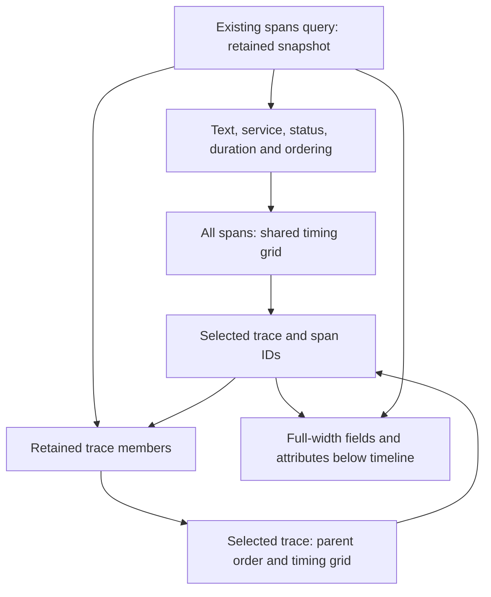

# Search and inspect admin spans

## Goal Capsule

- Objective: Developers and operators can find a recorded request and inspect its timing, status and diagnostic attributes in the admin panel.
- Means: Extend the diagnostics span section with search, filters, a full-width span timeline and details below it (KTD1, KTD4).
- Authority: The user requested span inspection and search for development, performance investigation and operator debugging. Repository design and workflow rules apply.
- Execution profile: One feature branch, local commits, no push. The lead integrates, verifies and records acceptance in `ROADMAP.md`.
- Stop conditions: Do not claim distributed tracing or historical retention that the current capture does not provide.

---

## Product Contract

### Summary

Show retained spans on a timing grid as soon as the diagnostics section opens. Search and filters narrow that timeline; selecting a span opens its complete details below it. An explicit Selected trace view shows retained parent relationships using the existing server payload.

### Problem Frame

`SpansSection.tsx` already searches a snapshot of up to 500 spans and opens diagnostic details after selection. However, its default results have no timing bars. The selected trace uses a two-pixel underline in `SpanResults.tsx`, and a 360px side inspector narrows the result area. This does not provide the requested timeline overview.
The API supplies IDs, parent IDs, start times, service, kind, status, attributes and optional source locations; this revision changes their presentation without adding collection.

### Requirements

| ID | Behavior |
| --- | --- |
| R1 | Search the retained span snapshot by operation, service, trace/span IDs and attribute keys or values. Combine text with service, error-status and minimum/maximum duration filters; allow newest and slowest ordering. |
| R2 | Selecting a timeline row or duration bar opens full-width details below the timeline: operation, IDs, parent, service, kind, start time, duration, HTTP status, telemetry status/message, attributes and available source location. Keep timeline width unchanged on selection. Render diagnostic values as text. |
| R3 | Default to All spans: render each filtered retained span immediately on one shared timing axis, preserving independent trace identity and newest/slowest ordering. Offer an explicit Selected trace view from a selected span; it shows all retained members of that trace in parent-aware order using the unfiltered snapshot. Missing parents and incomplete retention must not hide spans or imply a complete trace. |
| R4 | Preserve loading, error/retry, empty and clear-error behavior. Provide explicit refresh. Keep selected identity across refreshed data, explain eviction, and dismiss cleared details after successful clear; failed clear preserves them. |
| R5 | Use a fixed operation/service column beside an aligned timing column with labeled relative-time ticks, vertical gridlines, substantial clickable duration bars and readable duration labels. Support keyboard navigation, theme typography, horizontal timeline scrolling on narrow screens and bounded horizontal zoom. Virtualize either timeline view above 50 rows. |

### Scope Boundaries

The existing admin-only API and capture policy remain the authority for data access and collection.
This work adds no new telemetry producer, persistence service or external tracing dependency.
Those would change what data exists, while this request concerns finding and inspecting recorded spans.

### Acceptance Examples

- AE1. Search for a route attribute and set a minimum duration: only retained spans satisfying both constraints appear; selecting a result shows its complete returned attribute map.
- AE2. Select a span with retained siblings and a missing parent: the waterfall shows all retained trace members, identifies the missing parent and keeps the selected span inspectable.
- AE3. Refresh after the selected span is evicted: show that it is no longer retained, without silently selecting a different span. A failed refresh exposes its error.
- AE4. Clear fails: the error is visible and existing details remain. Clear succeeds: previous details are dismissed, even if the clear request itself produces a new span.
- AE5. Open diagnostics with multiple independent root requests: All spans already shows bars aligned to one labeled relative-time axis. Each row retains trace identity; no synthetic root, nesting or trace-wide duration combines unrelated requests. Search and sort change the displayed rows without requiring selection.
- AE6. Select a bar: details appear below the timeline and its width stays unchanged. Switch to Selected trace: the unfiltered retained trace members appear in parent-aware order. Return to All spans: the search, filters and ordering remain.
- AE7. At a narrow viewport, scroll the timing area horizontally while operation/service labels remain visible and aligned with their rows. Zoom from Fit through 2×, 4× and 8×: bar positions, axis ticks and gridlines stay aligned; return to Fit restores the full time window. A zero-duration or very short span retains a selectable marker and an accurate duration label.

---

## Planning Contract

### Key Technical Decisions

- KTD1. Use the existing `useSpans(500)` query and `useClearSpans()` mutation. `SpanDebugController`, `ServerDiagnostics::spans()` and `SpanBridge` already support this bounded snapshot. Client filtering covers the entire returned ring, not a page of server search results. No API contract or CLI capability changes.
- KTD2. Derive filters and trace layout in small pure helpers beside the diagnostics components. Store filter inputs, selected trace/span identity, the active timeline view and bounded zoom in React state; derive rows, timing domains and geometry from the snapshot and those inputs. Build the waterfall from the unfiltered snapshot so searching for one child never hides its retained ancestors or siblings. Terminate malformed cycles and show disconnected spans once.
- KTD3. Preserve the existing demand-driven ten-second sampling in `ui/web/src/features/admin/live-descriptors.ts` and add explicit refresh without another timer. Diagnostics requests can themselves consume the ring. Keep existing query cancellation and mutation invalidation; report stale refresh errors visibly.
- KTD4. Use one full-width timeline above the detail section. All spans is the default view and Selected trace is an explicit view available only with a retained selection. Selection never creates a side pane or reduces timeline width. Use stable keys, labeled controls, shared buttons, text status and bounded scroll areas. Long identifiers and attributes wrap or scroll within their panel. (session-settled: user-directed; rejected alternative: a narrow result list with a trace underline and side inspector.)
- KTD5. All spans computes its origin from the earliest start and its end from the latest completion among filtered results; changing only sort preserves that domain. Display relative milliseconds on a shared axis and state the origin as an absolute timestamp. Every row shows a trace identifier and a timing bar positioned by start offset and actual duration. Selected trace uses the existing full-trace timing and parent model, independent of search filters. A shared axis compares capture times; it does not establish trace membership.
- KTD6. Keep the operation/service column fixed while the timing column scrolls horizontally. The labeled axis and vertical gridlines share the same origin and scale as every row. Use duration bars at least 12px high inside row click targets at least 44px high; a minimal visible marker may expand a tiny span without changing its numeric duration. Place readable duration text inside or beside bars without clipping at the right edge. Use a fixed header and identical column geometry for virtualized and non-virtualized rows.
- KTD7. Offer Fit, 2×, 4× and 8× horizontal scale controls using the same data domain, with the timing canvas growing by that factor and horizontal scrolling exposing the rest. Zoom does not filter, change selection, or alter actual duration labels. Reset zoom and horizontal scroll on view changes or a changed timing domain; changing selection within the same view keeps the current scale. This bounds rendering work and lets operators inspect close timing without a chart dependency.

### Assumptions

The requested search concerns the current instance's retained diagnostics. `SpanBridge` keeps at most 500 completed spans in volatile shared memory; restarts and newer traffic remove older data.
`HttpServerSpanSubscriber` currently records independent HTTP root spans, deliberately without inherited context. The waterfall supports the parent IDs in the existing data contract, but normal traffic currently produces one-span traces.
Events, logs, SQL children and distributed propagation are not present in the returned payload and cannot be reconstructed by this UI.

### High-Level Technical Design

This sketch describes responsibilities; component names may change during implementation.

### Evidence and Risks

`ui/web/src/features/admin/components/diagnostics/SpansSection.tsx` currently adds a side column on selection; `SpanResults.tsx` only renders its 2px `Track` when passed a selected trace. `SpanInspector.tsx` uses `buildTraceWaterfall()` from `span-inspector.ts`, which already resolves parents, missing parents and cycles. Preserve that model while replacing the presentation.
`ui/web/tests/e2e/admin/spans.spec.ts` currently checks selection color, page overflow, screenshots and lifecycle; it does not assert that a timeline appears before selection or that bars, ticks and columns align. Add geometry assertions so screenshots cannot be the only visual acceptance evidence.
`ui/web/src/features/admin/api/debug-api.ts` defines the existing span payload; `hooks/use-debug-stats.ts` supplies cancellable reads and clear invalidation.
`src/Shared/Infrastructure/OpenTelemetry/HttpServerSpanSubscriber.php` captures route, method and response status without headers, URLs or query strings.
`docs/solutions/runtime-errors/swoole-table-default-conflict-proportion-drops-keys.md` documents why the ring's capacity and byte guards must be preserved.
`ui/DESIGN.md` requires shared primitives, typography roles and virtualization above 50 items.
`config/packages/security.yaml` protects the existing debug routes; this work does not alter them.

---

## Implementation Units

### U1. Search and timeline layout model

- Requirements: R1, R3, R5.
- Files: existing `ui/web/src/features/admin/components/diagnostics/span-inspector.ts` and `span-inspector.test.ts`.
- Approach: Preserve typed search, status classification and deterministic trace ordering helpers over the current `Span` type. Add `buildSpanTimeline()` as a shared timing-domain/layout helper for filtered All spans and the retained Selected trace model; sort must not change the domain. Guard empty or zero-length domains and keep every timestamp finite. Scale percentages against the same domain for the axis and bars; zoom expands canvas width rather than changing recorded values. Keep microseconds in calculations and convert duration filter inputs from milliseconds once. Validate negative, non-finite and reversed filter ranges visibly at the UI boundary.
- Test scenarios: Combined filters; nested attribute text and IDs; HTTP errors versus telemetry status; zero-duration spans; slowest/newest order; child-before-parent input; missing parents; disconnected and cyclic parents; all members included once; relative timings based on the whole retained trace; independent roots compared without fabricated hierarchy; sort-invariant domains; filtered domains; zero-duration domains. Zoom remains component state and is verified through browser geometry and label assertions.
- Verification: Focused Vitest suite and TypeScript checks.

### U2. Full-width timeline and details UI

- Requirements: R1-R5; AE1-AE7. Depends on U1.
- Files: `SpansSection.tsx`, `SpanInspector.tsx`, `SpanFilters.tsx`, `span-inspector-styles.ts`; new `SpanTimeline.tsx` replacing `SpanResults.tsx` and focused component tests in the diagnostics directory; `ui/web/src/features/admin/pages/__tests__/ServerDiagnosticsPage.test.tsx` where integration expectations change; `ui/web/tests/e2e/admin/spans.spec.ts`. Component boundaries may be consolidated if this removes duplication.
- Approach: Request all 500 retained spans; preserve labeled search/filter/sort controls, explicit refresh and clear. Replace the separate result list and underline waterfall with `SpanTimeline`, accepting the existing trace row shape, a label and selection callback; `SpansSection` owns explicit All spans / Selected trace mode, retaining keyboard behavior and virtualization. Add the shared axis, gridlines, substantial clickable bars, duration labels, fixed operation/service column and bounded zoom. Place details below the timeline. Preserve selected identity on refresh and show retention limits and missing-data states. Reuse existing primitives and mutation tools.
- Test scenarios: Search-to-details interaction; filters compose and reset; invalid duration inputs; waterfall selection; keyboard activation; load/retry; no spans versus no matches; refresh with retained/evicted selection; clear success/failure; large lists; hostile-looking attribute text stays inert; long values and mobile layout; initial independent-root timing overview; explicit trace-view transitions preserving filters; zoom and horizontal scroll with axis alignment; identical timeline width before and after selection; duration labels and small-span markers.
- Selection must use the current `--color-highlight` theme token; the removed `--color-accent` alias cannot provide a visible selection background. Browser checks cover selection in light and dark themes.
- Filter, metadata, action and detail layouts must use the prescribed spacing scale; use `--space-md` for their gaps. Browser checks cover the resulting desktop and narrow layouts.
- Verification: Focused component and existing diagnostics page tests; web typecheck, lint and production build; browser checks at desktop and narrow widths against the isolated preview.

### U3. Operator guidance and acceptance record

- Requirements: R1-R4. Depends on U2.
- Files: `docs-book/part-1-operator-guide/commands/app-server-spans.md`, `ROADMAP.md`.
- Approach: Explain where to search and inspect, the All spans and Selected trace views, relative axis origin, zoom, explicit refresh, retention and current root-only capture. Preserve existing capture/export distinctions and CLI documentation. Record delivered scope and actual check results inline.
- Test expectation: Documentation-only; verify links and prose against the implemented behavior and run `git diff --check`.

---

## Verification Contract

Run focused Vitest tests with `yarn --cwd ui/web test` and explicit inspector/diagnostics test paths.
Include `tests/live-updates/admin-sampling.test.tsx`, `admin-routing.test.ts`, `coverage.test.ts` and `tests/typography/census.test.ts` in the focused gate.
Run `yarn --cwd ui/web typecheck`, `yarn --cwd ui/web lint` and `yarn --cwd ui/web build`.
Use `make preview-up` and pass the URL from `make preview-url` explicitly as `E2E_BASE_URL` for Playwright checks. Mock diagnostic fixture traffic; never target the persistent instance.
Verify desktop and narrow layouts, search-to-detail, trace navigation, errors and long data. Use independent-root fixtures for the default view, a separate multi-member trace fixture for hierarchy, and 500-row fixtures for virtualization in both views.
Browser assertions must verify visible bars and axis before selection; equal timing-column starts and tick/gridline alignment across rows; at least 12px bar height and 44px row targets; proportional offsets and durations for fixture timestamps within pixel-rounding tolerance; timeline width unchanged after selection and details positioned below; an explicit trace switch that excludes other traces but includes filtered-out members of the selected trace. Check Fit/2×/4×/8× bounds, changed bar geometry and aligned ticks after zoom, unchanged numeric durations, and Fit reset.
At 390px and desktop widths, assert the page itself does not overflow, the timing region can scroll horizontally, and fixed labels remain visible at the same horizontal coordinate while bars and axis move together. Check both light and dark selection states, long names/IDs, readable duration labels, keyboard selection across virtualized boundaries and view changes. Inspect resulting screenshots as supporting evidence after geometry assertions pass.
Record unavailable infrastructure and distinguish host checks from authoritative CI-image gates.
Run simplification and independent code review, apply justified findings, then record the final checks in `ROADMAP.md`.

## Definition of Done

Operators see retained spans on a full-width timeline immediately, search or filter them, and select a row or bar to inspect all returned diagnostic fields below it. All spans preserves independent trace identity; Selected trace shows retained parent relationships. Axis, gridlines, bars and labels remain aligned through zoom, scrolling, selection and virtualization.
Meaningful tests cover filtering, hierarchy and selection lifecycle; required checks pass or concrete infrastructure blockers are recorded.
Documentation states the actual retention and capture boundaries. Changes are committed locally on the feature branch; nothing is pushed.
