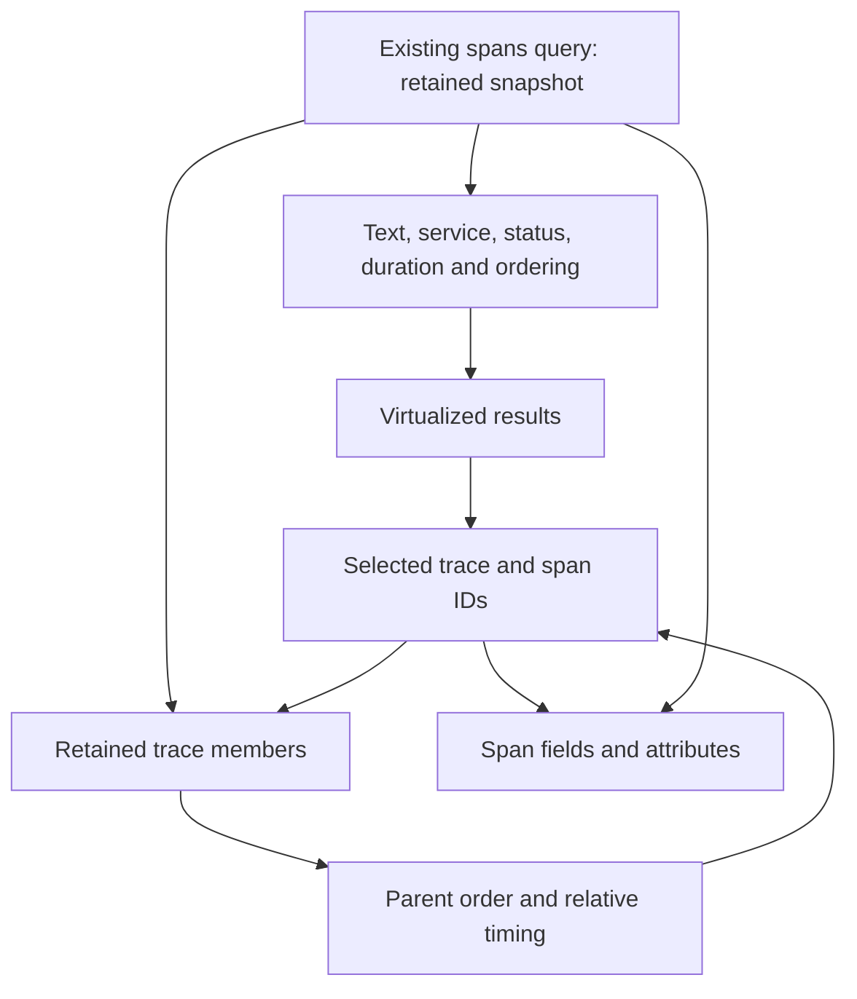

# Search and inspect admin spans

## Goal Capsule

- Objective: Developers and operators can find a recorded request and inspect its timing, status and diagnostic attributes in the admin panel.
- Means: Extend the diagnostics span section with search, filters, a retained-trace waterfall and span details (KTD1).
- Authority: The user requested span inspection and search for development, performance investigation and operator debugging. Repository design and workflow rules apply.
- Execution profile: One feature branch, local commits, no push. The lead integrates, verifies and records acceptance in `ROADMAP.md`.
- Stop conditions: Do not claim distributed tracing or historical retention that the current capture does not provide.

---

## Product Contract

### Summary

Add search and inspection to the existing admin span list, using the diagnostic data already returned by the server.

### Problem Frame

`SpansSection.tsx` shows only an operation name, HTTP status and duration for the latest 30 spans.
The API already supplies IDs, parent IDs, start times, service, kind, status, attributes and optional source locations, but operators cannot inspect them through the panel.

### Requirements

| ID | Behavior |
| --- | --- |
| R1 | Search the retained span snapshot by operation, service, trace/span IDs and attribute keys or values. Combine text with service, error-status and minimum/maximum duration filters; allow newest and slowest ordering. |
| R2 | Select a result to inspect its operation, IDs, parent, service, kind, start time, duration, HTTP status, telemetry status/message, attributes and available source location. Render diagnostic values as text. |
| R3 | Show retained spans sharing the selected trace ID in a parent-aware waterfall with relative timing. Selecting a waterfall row changes the inspected span. Missing parents and incomplete retention must not hide spans or imply a complete trace. |
| R4 | Preserve loading, error/retry, empty and clear-error behavior. Provide explicit refresh. Keep selected identity across refreshed data, explain eviction, and dismiss cleared details after successful clear; failed clear preserves them. |
| R5 | Support keyboard operation and narrow screens using shared controls and theme typography. Virtualize result and waterfall collections larger than 50 items. |

### Scope Boundaries

The existing admin-only API and capture policy remain the authority for data access and collection.
This work adds no new telemetry producer, persistence service or external tracing dependency.
Those would change what data exists, while this request concerns finding and inspecting recorded spans.

### Acceptance Examples

- AE1. Search for a route attribute and set a minimum duration: only retained spans satisfying both constraints appear; selecting a result shows its complete returned attribute map.
- AE2. Select a span with retained siblings and a missing parent: the waterfall shows all retained trace members, identifies the missing parent and keeps the selected span inspectable.
- AE3. Refresh after the selected span is evicted: show that it is no longer retained, without silently selecting a different span. A failed refresh exposes its error.
- AE4. Clear fails: the error is visible and existing details remain. Clear succeeds: previous details are dismissed, even if the clear request itself produces a new span.

---

## Planning Contract

### Key Technical Decisions

- KTD1. Use the existing `useSpans(500)` query and `useClearSpans()` mutation. `SpanDebugController`, `ServerDiagnostics::spans()` and `SpanBridge` already support this bounded snapshot. Client filtering covers the entire returned ring, not a page of server search results. No API contract or CLI capability changes.
- KTD2. Derive filters and trace layout in small pure helpers beside the diagnostics components. Store only filter inputs and selected trace/span identity in React state. Build the waterfall from the unfiltered snapshot so searching for one child never hides its retained ancestors or siblings. Terminate malformed cycles and show disconnected spans once.
- KTD3. Preserve the existing demand-driven ten-second sampling in `ui/web/src/features/admin/live-descriptors.ts` and add explicit refresh without another timer. Diagnostics requests can themselves consume the ring. Keep existing query cancellation and mutation invalidation; report stale refresh errors visibly.
- KTD4. Use a result list, trace timeline and detail pane within the diagnostics section. Use stable keys, labeled controls, shared buttons and bounded scroll areas. Show status with text as well as color. Long identifiers and attributes wrap or scroll within their panel.

### Assumptions

The requested search concerns the current instance's retained diagnostics. `SpanBridge` keeps at most 500 completed spans in volatile shared memory; restarts and newer traffic remove older data.
`HttpServerSpanSubscriber` currently records independent HTTP root spans, deliberately without inherited context. The waterfall supports the parent IDs in the existing data contract, but normal traffic currently produces one-span traces.
Events, logs, SQL children and distributed propagation are not present in the returned payload and cannot be reconstructed by this UI.

### High-Level Technical Design

This sketch describes responsibilities; component names may change during implementation.

### Evidence and Risks

`ui/web/src/features/admin/api/debug-api.ts` defines the existing span payload; `hooks/use-debug-stats.ts` supplies cancellable reads and clear invalidation.
`src/Shared/Infrastructure/OpenTelemetry/HttpServerSpanSubscriber.php` captures route, method and response status without headers, URLs or query strings.
`docs/solutions/runtime-errors/swoole-table-default-conflict-proportion-drops-keys.md` documents why the ring's capacity and byte guards must be preserved.
`ui/DESIGN.md` requires shared primitives, typography roles and virtualization above 50 items.
`config/packages/security.yaml` protects the existing debug routes; this work does not alter them.

---

## Implementation Units

### U1. Search and trace layout model

- Requirements: R1, R3.
- Files: new `ui/web/src/features/admin/components/diagnostics/span-inspector.ts` and `span-inspector.test.ts`.
- Approach: Implement typed search, status classification and deterministic trace ordering/timing helpers over the current `Span` type. Keep microseconds in calculations and convert duration filter inputs from milliseconds once. Validate negative, non-finite and reversed filter ranges visibly at the UI boundary.
- Test scenarios: Combined filters; nested attribute text and IDs; HTTP errors versus telemetry status; zero-duration spans; slowest/newest order; child-before-parent input; missing parents; disconnected and cyclic parents; all members included once; relative timings based on the whole retained trace.
- Verification: Focused Vitest suite and TypeScript checks.

### U2. Search, waterfall and details UI

- Requirements: R1-R5; AE1-AE4. Depends on U1.
- Files: `SpansSection.tsx`; new `SpanInspector.tsx`, `SpanResults.tsx`, `SpanFilters.tsx` and focused component tests in the diagnostics directory; `ui/web/src/features/admin/pages/__tests__/ServerDiagnosticsPage.test.tsx` where integration expectations change; new `ui/web/tests/e2e/admin/spans.spec.ts`. Component boundaries may be consolidated if this removes duplication.
- Approach: Request all 500 retained spans; add labeled search/filter/sort controls, explicit refresh and clear, virtualized rows, waterfall navigation and readable details. Preserve selected identity on refresh and show retention limits and missing-data states. Reuse existing primitives and mutation tools.
- Test scenarios: Search-to-details interaction; filters compose and reset; invalid duration inputs; waterfall selection; keyboard activation; load/retry; no spans versus no matches; refresh with retained/evicted selection; clear success/failure; large lists; hostile-looking attribute text stays inert; long values and mobile layout.
- Verification: Focused component and existing diagnostics page tests; web typecheck, lint and production build; browser checks at desktop and narrow widths against the isolated preview.

### U3. Operator guidance and acceptance record

- Requirements: R1-R4. Depends on U2.
- Files: `docs-book/part-1-operator-guide/commands/app-server-spans.md`, `ROADMAP.md`.
- Approach: Explain where to search and inspect, explicit refresh, retention and current root-only capture. Preserve existing capture/export distinctions and CLI documentation. Record delivered scope and actual check results inline.
- Test expectation: Documentation-only; verify links and prose against the implemented behavior and run `git diff --check`.

---

## Verification Contract

Run focused Vitest tests with `yarn --cwd ui/web test` and explicit inspector/diagnostics test paths.
Include `tests/live-updates/admin-sampling.test.tsx`, `admin-routing.test.ts`, `coverage.test.ts` and `tests/typography/census.test.ts` in the focused gate.
Run `yarn --cwd ui/web typecheck`, `yarn --cwd ui/web lint` and `yarn --cwd ui/web build`.
Use `make preview-up` and pass the URL from `make preview-url` explicitly as `E2E_BASE_URL` for Playwright checks. Mock diagnostic fixture traffic; never target the persistent instance.
Verify desktop and narrow layouts, search-to-detail, waterfall navigation, errors and long data.
Record unavailable infrastructure and distinguish host checks from authoritative CI-image gates.
Run simplification and independent code review, apply justified findings, then record the final checks in `ROADMAP.md`.

## Definition of Done

Operators can search retained spans, select one and inspect all returned diagnostic fields and retained trace timing.
Meaningful tests cover filtering, hierarchy and selection lifecycle; required checks pass or concrete infrastructure blockers are recorded.
Documentation states the actual retention and capture boundaries. Changes are committed locally on the feature branch; nothing is pushed.
