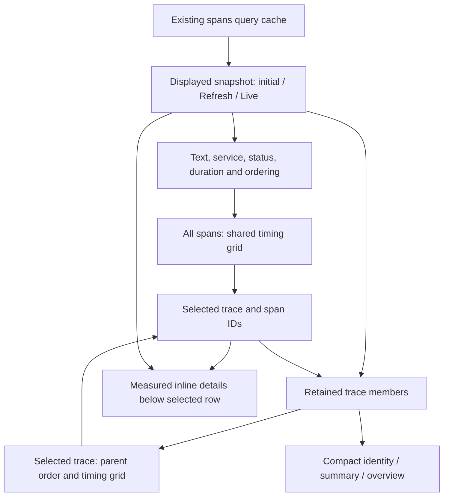

# Search and inspect admin spans

## Goal Capsule

- Objective: Developers and operators can find a recorded request and inspect its timing, status and diagnostic attributes in the admin panel.
- Means: Extend the diagnostics span section with search, filters, a stable span snapshot and focused trace timeline with inline details (KTD1, KTD4).
- Authority: The user requested span inspection and search for development, performance investigation and operator debugging. Repository design and workflow rules apply.
- Execution profile: One feature branch, local commits, no push. The lead integrates, verifies and records acceptance in `ROADMAP.md`.
- Stop conditions: Do not claim distributed tracing or historical retention that the current capture does not provide.

---

## Product Contract

### Summary

Show a stable retained snapshot for search, then open a focused trace workspace with a compact header, summary, overview minimap and dense hierarchical timing grid. Selecting a span expands its details directly beneath that row. Background sampling must not add rows while the operator scrolls; Refresh updates the displayed snapshot and Live is an explicit opt-in.

### Problem Frame

`SpansSection.tsx` now renders a full-width timeline, but still displays the large global filter form and a separate inspector below the entire timeline. `SpanTimeline.tsx` uses fixed 48px rows, and the shared ten-second spans query feeds its rows directly. Background query updates can therefore replace or reorder rows during inspection.
The user's three Jaeger screenshots establish the revised layout: compact trace identity, summary strip, overview minimap, Service & Operation tree, service-colored bars and details expanded inline beneath the selected row. The existing payload remains the source of data; the screenshots do not authorize synthetic children, events or logs.

### Requirements

| ID | Behavior |
| --- | --- |
| R1 | Search the retained span snapshot by operation, service, trace/span IDs and attribute keys or values. Combine text with service, error-status and minimum/maximum duration filters; allow newest and slowest ordering. |
| R2 | In the focused trace, selecting a row or duration bar expands its details immediately beneath that row within the tree/timing grid: operation, IDs, parent, service, kind, start time, duration, HTTP status, telemetry status/message, attributes and available source location. Keep timeline width unchanged. Close/Escape collapses the details and returns focus to that row. Render diagnostic values as text. |
| R3 | All spans remains the search entry and preserves independent trace identity and newest/slowest ordering. Opening a selected trace shows all its retained members from the unfiltered displayed snapshot, with a compact service/root-operation/trace-ID header, start/duration/services/depth/total-spans summary, overview minimap and collapsible Service & Operation tree. Hide the global filter form in this focus area. Back to results restores its search/filter/sort state. Missing parents and incomplete retention must not hide spans or imply a complete trace. |
| R4 | Freeze the displayed snapshot after initial load, independently of background query updates. Refresh explicitly replaces it; Live opt-in accepts later snapshots and Pause freezes the currently displayed one. Background updates preserve scroll, zoom, expanded parents and selected identity. Preserve load/retry, stale errors, empty and clear-error behavior. If an accepted manual/live snapshot evicts selection, explain eviction, dismiss its details and explicitly return to results; never retain a latent trace mode. Successful clear dismisses details and resets the displayed snapshot; failed clear preserves them. |
| R5 | Use a fixed Service & Operation column beside an aligned timing column with labeled relative-time ticks and vertical gridlines. Trace rows are 32px high when collapsed, with matching service-colored markers and bars and duration text beside each bar, falling back to its left near the right edge. Support keyboard row/collapse/detail actions, theme typography, mobile horizontal scrolling and bounded zoom. Virtualize above 50 visible span rows with measured variable heights for inline details. |

### Scope Boundaries

The existing admin-only API and capture policy remain the authority for data access and collection.
This work adds no new telemetry producer, persistence service or external tracing dependency.
Those would change what data exists, while this request concerns finding and inspecting recorded spans.

### Acceptance Examples

- AE1. Search for a route attribute and set a minimum duration: only retained spans satisfying both constraints appear; selecting a result shows its complete returned attribute map.
- AE2. Select a span with retained siblings and a missing parent: the waterfall shows all retained trace members, identifies the missing parent and keeps the selected span inspectable.
- AE3. Refresh or accept a Live snapshot after the selected span is evicted: explain that it is no longer retained, close inline details and return explicitly to results. No latent trace mode reopens on later selection. A failed refresh exposes its error and keeps the displayed snapshot.
- AE4. Clear fails: the error is visible and existing details remain. Clear succeeds: previous details are dismissed, even if the clear request itself produces a new span.
- AE5. Open diagnostics with multiple independent root requests: All spans already shows bars aligned to one labeled relative-time axis. Each row retains trace identity; no synthetic root, nesting or trace-wide duration combines unrelated requests. Search and sort change the displayed rows without requiring selection.
- AE6. Open Selected trace: the compact header, summary and overview precede the unfiltered retained parent tree; the global filter form is hidden. Select a bar: its details expand between that span row and the following visible row, with unchanged column width. Close details or press Escape: the row keeps focus. Back to results restores search, filters and ordering.
- AE7. At a narrow viewport, scroll the timing area horizontally while operation/service labels remain visible and aligned with their rows. Zoom from Fit through 2×, 4× and 8×: bar positions, axis ticks and gridlines stay aligned; return to Fit restores the full time window. A zero-duration or very short span retains a selectable marker and an accurate duration label. Labels at the right edge move to the left of the bar.
- AE8. Scroll and zoom a frozen snapshot while the shared query receives newer rows: displayed count, row order, selection, expansion, zoom and scroll position remain unchanged. Refresh adopts the new snapshot. Enable Live to accept later snapshots; Pause immediately freezes the current displayed data and later background arrivals remain hidden.
- AE9. Collapse a parent: only descendants are hidden; summary counts and minimap still describe the full retained trace. Expand it to restore children. Open a large attribute map inline within a virtualized trace: subsequent rows move by the measured detail height without overlap, gaps or keyboard navigation loss.

---

## Planning Contract

### Key Technical Decisions

- KTD1. Use the existing `useSpans(500)` query and `useClearSpans()` mutation. `SpanDebugController`, `ServerDiagnostics::spans()` and `SpanBridge` already support this bounded snapshot. Client filtering covers the entire returned ring, not a page of server search results. No API contract or CLI capability changes.
- KTD2. Derive filters and trace layout in small pure helpers beside the diagnostics components. Keep a displayed snapshot separate from the query cache, plus filter inputs, selected trace/span identity, active view, collapsed parents, inline expansion, Live flag and bounded zoom. Derive trace rows, summaries, timing domains and geometry from that displayed snapshot and view state. Build the waterfall from the unfiltered snapshot so searching for one child never hides its retained ancestors or siblings. Terminate malformed cycles and show disconnected spans once.
- KTD3. Preserve shared demand-driven ten-second sampling in `ui/web/src/features/admin/live-descriptors.ts`, query cancellation and mutation invalidation; add no timer. Initialize displayed data once from the first successful query snapshot. While Live is off, later cache changes do not alter displayed rows or their domain. Refresh adopts its successful response explicitly; failure keeps the current display. Live accepts subsequent successful cache snapshots; Pause freezes the current display. Gate pending refresh responses around successful clear so pre-clear data cannot reappear. Clear success empties displayed data, closes details and returns to results, even if the clear request itself generates a span. Diagnostics requests can themselves consume the ring; show stale read errors visibly.
- KTD4. All spans is the search entry; Selected trace is a focused workspace within the section, without requiring a route. It contains a compact identity header, summary strip, overview and hierarchical timeline, with the global filter form hidden. Place span details inline immediately beneath the selected row inside the tree/timing grid, preserving the service marker/tree context and timing-column alignment. Back to results keeps filter state. Use stable keys, shared controls, text status and bounded scroll areas. (session-settled: user-directed, updated by the supplied Jaeger screenshots; rejected alternatives: side inspector and one detail section below the whole timeline.)
- KTD5. All spans computes its origin from the earliest start and its end from the latest completion among filtered results; changing only sort preserves that domain. Display relative milliseconds on a shared axis and state the origin as an absolute timestamp. Every row shows a trace identifier and a timing bar positioned by start offset and actual duration. Selected trace uses the existing full-trace timing and parent model, independent of search filters. A shared axis compares capture times; it does not establish trace membership.
- KTD6. Keep the operation/service column fixed while the timing column scrolls horizontally. The labeled axis and vertical gridlines share the same origin and scale as every row. Use dense 32px collapsed trace rows with bars at least 12px high; this user-directed density replaces the earlier 44px row target. Keep keyboard focus visible and provide explicit collapse/detail controls with accessible names. Assign services stable theme-compatible colors shared by tree markers, bars and overview; status also has text/icon cues. A minimal visible marker may expand a tiny span without changing its numeric duration. Put duration labels beside bars, moving them to the left when right-side space is insufficient. Use a fixed header and identical column geometry for measured virtualized and ordinary rows.
- KTD7. Offer Fit, 2×, 4× and 8× horizontal scale controls using the same data domain, with the timing canvas growing by that factor and horizontal scrolling exposing the rest. Zoom does not filter, change selection, or alter actual duration labels. Reset zoom only on an explicit view change or Fit action. Background query updates must not reset zoom or scroll. When Live accepts data, preserve the visible row anchor and scroll offsets where that row remains retained, alongside selected identity and collapsed parent state; manual Refresh follows the same preservation where possible. Evicted selection explicitly resets trace mode to results with a notice. This bounds rendering work and lets operators inspect close timing without a chart dependency.

- KTD8. Derive trace start and duration from the full retained trace domain, unique service count from retained service names, depth from the existing cycle-safe parent layout (roots count as depth one), and total spans from all retained members. Label these as retained-trace values because missing parents can understate depth and duration. Use the retained root service/operation for the compact header; when the root is missing, identify the selected operation and state that the root is unavailable. The overview minimap shows the full retained trace with service colors, independent of collapsed rows or zoom; brushing is not required.
- KTD9. Collapse only real descendants from the existing parent model, keeping missing-parent and disconnected spans visible. Use stable span keys for virtualized row groups containing a 32px span header and optional inline detail content. Measure each rendered group after expansion, content changes and width changes using the virtualizer measurement API/ResizeObserver; do not position later rows with a fixed 32px estimate after details open. Keyboard navigation addresses visible span headers, and closing details restores their header focus. Collapsing an ancestor containing the selected span closes its details and moves selection/focus to that ancestor, without changing trace membership or summary counts.

### Assumptions

The requested search concerns the current instance's retained diagnostics. `SpanBridge` keeps at most 500 completed spans in volatile shared memory; restarts and newer traffic remove older data.
`HttpServerSpanSubscriber` currently records independent HTTP root spans, deliberately without inherited context. The waterfall supports the parent IDs in the existing data contract, but normal traffic currently produces one-span traces.
Events, logs, SQL children and distributed propagation are not present in the returned payload and cannot be reconstructed by this UI.

### High-Level Technical Design

This sketch describes responsibilities; component names may change during implementation.

### Evidence and Risks

`ui/web/src/features/admin/components/diagnostics/SpansSection.tsx` currently derives rows directly from `useSpans(500)`, renders global filters in both modes and puts `SpanInspector` after the entire timeline. Its `activeTrace` fallback does not reset the stored trace mode after selection eviction. `SpanTimeline.tsx` currently fixes every row at 48px. `span-inspector.ts` already resolves parents, missing parents and cycles; preserve that model.
The user supplied `/tmp/codex-clipboard-Lh1PzQ.png` (dense tree and service bars), `/tmp/codex-clipboard-vCTANU.png` (compact header, summary and overview) and `/tmp/codex-clipboard-YKTg0D.png` (selected row expanded inline). These local reference images define the requested composition; their example children and logs are not Bånder data. Browser acceptance compares the implemented composition to these references while using the existing theme and API boundaries.
`ui/web/src/features/admin/live-descriptors.ts` samples spans every ten seconds; isolate the displayed snapshot rather than changing global sampling. `ui/web/tests/e2e/admin/spans.spec.ts` owns browser lifecycle and geometry checks and must now cover background arrivals, inline expansion, collapse and focused trace composition.
`ui/web/src/features/admin/api/debug-api.ts` defines the existing span payload; `hooks/use-debug-stats.ts` supplies cancellable reads and clear invalidation.
`src/Shared/Infrastructure/OpenTelemetry/HttpServerSpanSubscriber.php` captures route, method and response status without headers, URLs or query strings.
`docs/solutions/runtime-errors/swoole-table-default-conflict-proportion-drops-keys.md` documents why the ring's capacity and byte guards must be preserved.
`ui/DESIGN.md` requires shared primitives, typography roles and virtualization above 50 items.
`config/packages/security.yaml` protects the existing debug routes; this work does not alter them.

---

## Implementation Units

### U1. Search and timeline layout model

- Requirements: R1, R3, R5.
- Files: existing `ui/web/src/features/admin/components/diagnostics/span-inspector.ts` and `span-inspector.test.ts`.
- Approach: Preserve typed search, status classification and deterministic trace ordering helpers over the current `Span` type. Preserve `buildSpanTimeline()` as a shared timing-domain/layout helper for filtered All spans and the retained Selected trace model; sort must not change the domain. Guard empty or zero-length domains and keep every timestamp finite. Scale percentages against the same domain for the axis and bars; zoom expands canvas width rather than changing recorded values. Keep microseconds in calculations and convert duration filter inputs from milliseconds once. Validate negative, non-finite and reversed filter ranges visibly at the UI boundary.
- Test scenarios: Combined filters; nested attribute text and IDs; HTTP errors versus telemetry status; zero-duration spans; slowest/newest order; child-before-parent input; missing parents; disconnected and cyclic parents; all members included once; relative timings based on the whole retained trace; independent roots compared without fabricated hierarchy; sort-invariant domains; filtered domains; zero-duration domains; retained summary values; collapse/expand of real descendants; disconnected/missing-root header fallback. Zoom remains component state and is verified through browser geometry and label assertions.
- Verification: Focused Vitest suite and TypeScript checks.

### U2. Full-width timeline and details UI

- Requirements: R1-R5; AE1-AE9. Depends on U1.
- Files: `SpansSection.tsx`, `SpanInspector.tsx`, `SpanFilters.tsx`, `span-inspector-styles.ts`; `SpanTimeline.tsx` and focused component tests in the diagnostics directory; `ui/web/src/features/admin/pages/__tests__/ServerDiagnosticsPage.test.tsx` where integration expectations change; `ui/web/tests/e2e/admin/spans.spec.ts`. Component boundaries may be consolidated if this removes duplication.
- Approach: Separate displayed snapshot acceptance from background query data; provide explicit Refresh and Live/Pause. Keep All spans search/filter controls as the entry. Build Selected trace as the focused workspace with Back to results, compact identity header, retained summary and overview minimap; hide the global form while focused. Reuse the parent/timing model, adding collapsed branches, service colors and duration-label edge fallback. Integrate `SpanInspector` inline under its row and measure expanded groups for variable-height virtualization. Preserve selection, zoom and visible row anchor during accepted updates where possible; reset trace mode explicitly when selection is evicted. Keep clear/error handling and query tools.
- Test scenarios: Existing filtering, errors, hostile text and clear lifecycle; frozen display under background cache arrivals; explicit Refresh adoption/failure; Live/Pause; stale response after clear; selected eviction resets view; Back retains search; header/retained summary/minimap for one-span and multi-service traces; missing root; collapsed descendants; inline detail placement/close/focus; long attribute height remeasurement; keyboard movement across collapsed and virtualized groups; stable scroll and zoom; right-edge duration labels.

- Selection must use the current `--color-highlight` theme token; the removed `--color-accent` alias cannot provide a visible selection background. Browser checks cover selection in light and dark themes.
- Filter, metadata, action and detail layouts must use the prescribed spacing scale; use `--space-md` for their gaps. Browser checks cover the resulting desktop and narrow layouts.
- Verification: Focused component and existing diagnostics page tests; web typecheck, lint and production build; browser checks at desktop and narrow widths against the isolated preview.

### U3. Operator guidance and acceptance record

- Requirements: R1-R4. Depends on U2.
- Files: `docs-book/part-1-operator-guide/commands/app-server-spans.md`, `ROADMAP.md`.
- Approach: Explain where to search and inspect, the search entry and focused trace, inline details, collapse controls, retained summary/overview, relative axis origin, zoom, frozen default, explicit Refresh and Live/Pause, retention and current root-only capture. Preserve existing capture/export distinctions and CLI documentation. Record delivered scope and actual check results inline.
- Test expectation: Documentation-only; verify links and prose against the implemented behavior and run `git diff --check`.

---

## Verification Contract

Run focused Vitest tests with `yarn --cwd ui/web test` and explicit inspector/diagnostics test paths.
Include `tests/live-updates/admin-sampling.test.tsx`, `admin-routing.test.ts`, `coverage.test.ts` and `tests/typography/census.test.ts` in the focused gate.
Run `yarn --cwd ui/web typecheck`, `yarn --cwd ui/web lint` and `yarn --cwd ui/web build`.
Use `make preview-up` and pass the URL from `make preview-url` explicitly as `E2E_BASE_URL` for Playwright checks. Mock diagnostic fixture traffic; never target the persistent instance.
Verify desktop and narrow layouts, search-to-detail, trace navigation, errors and long data. Use independent-root fixtures for the default view, a separate multi-member trace fixture for hierarchy, and 500-row fixtures for virtualization in both views.
Browser assertions must verify visible bars and axis before selection; equal timing-column starts and tick/gridline alignment across rows; at least 12px bar height and dense 32px collapsed trace rows; proportional offsets and durations for fixture timestamps within pixel-rounding tolerance; timeline width unchanged after selection and inline details positioned directly between the selected header and its following visible row; an explicit trace switch that excludes other traces but includes filtered-out members of the selected trace. Assert compact header, accurate retained summary, service-colored overview and tree bars, collapsible descendants, hidden global filters and Back restoring search. Expand long details in a 500-row trace and assert subsequent row geometry uses the measured height with no overlaps or excess gaps. Check Fit/2×/4×/8× bounds, changed bar geometry and aligned ticks after zoom, unchanged numeric durations, and Fit reset.
At 390px and desktop widths, assert the page itself does not overflow, the timing region can scroll horizontally, and fixed labels remain visible at the same horizontal coordinate while bars and axis move together. Check both light and dark selection states, long names/IDs, readable duration labels, keyboard selection across virtualized boundaries and view changes. Use mocked background cache arrivals while scrolled/zoomed/selected: frozen display stays unchanged until Refresh; Live accepts later arrivals while retaining the row anchor and scale, and Pause freezes the accepted snapshot. Verify eviction returns to results explicitly. Inspect desktop trace screenshots against the three supplied Jaeger references for hierarchy, density, compact framing, minimap and inline placement after geometry assertions pass.
Record unavailable infrastructure and distinguish host checks from authoritative CI-image gates.
Run simplification and independent code review, apply justified findings, then record the final checks in `ROADMAP.md`.

## Definition of Done

Operators search a stable retained snapshot and open a focused trace with compact identity, retained summary, overview and dense collapsible timing tree. Span details expand inline under the selected row. Background arrivals do not alter frozen inspection; explicit Refresh and Live/Pause control adoption. All spans preserves independent trace identity. Axis, gridlines, service bars and duration labels remain aligned through zoom, scrolling, collapse, measured inline expansion and virtualization.
Meaningful tests cover filtering, hierarchy and selection lifecycle; required checks pass or concrete infrastructure blockers are recorded.
Documentation states the actual retention and capture boundaries. Changes are committed locally on the feature branch; nothing is pushed.
