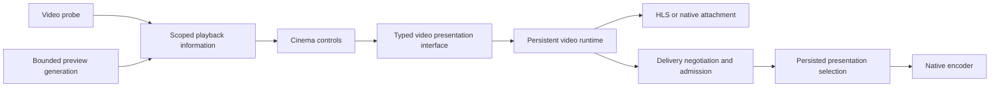
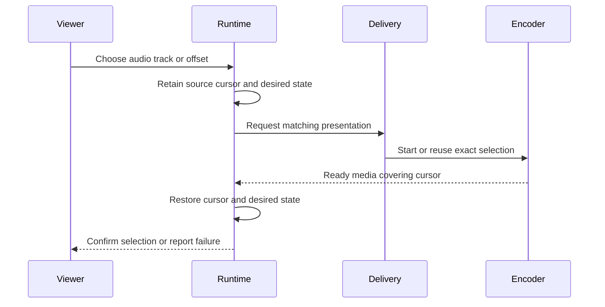
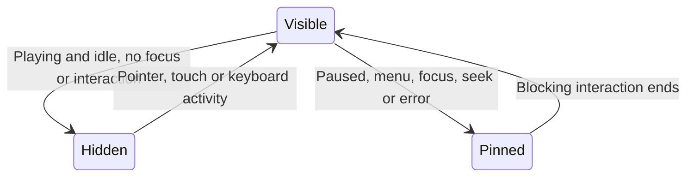
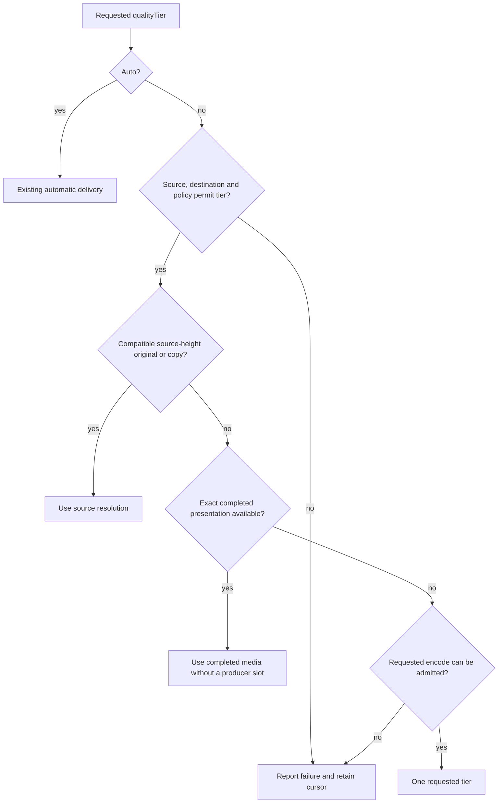
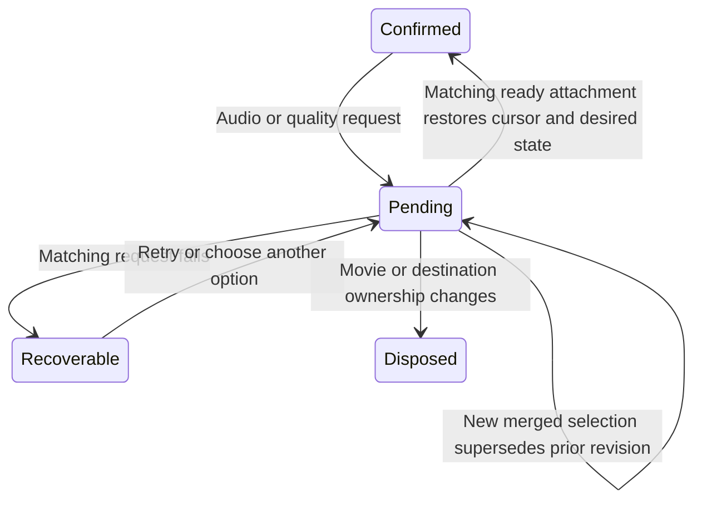

# Cinema Video Player - Plan

## Goal Capsule

**Objective:** Viewers can comfortably watch, navigate and correct the timing of their movies through a player that belongs in Baander.

**Means:** A quiet cinema layout with NowPlaying-inspired controls and functional media choices.

**Execution profile:** Extend the existing feature branch in local implementation units; the lead owns integration, checks and commits. No push is authorized.

**Authority:** The user's requested features and scope additions govern product behavior; `ui/DESIGN.md` and project rules govern implementation. No product blockers remain. Backend and transcoder additions required for these features are included.

---

## Product Contract

### Summary

Replace the basic movie overlay with a cinema player. Keep transport controls easy to reach, reveal detailed choices on demand, and supply the backend media capabilities those choices require.

### Problem Frame

The current movie overlay exposes transport, volume and seeking but lacks the track and navigation controls needed to watch varied video sources. Its persistent playback runtime is already responsible for local and remote playback; the redesign must preserve that ownership.

### Requirements

#### Viewing and interaction

- R1. Use a quiet cinema layout with Baander's theme, typography and shared controls, taking visual cues from NowPlaying.
- R2. Hide controls during uninterrupted playback and reveal them on interaction; retain controls while paused, focused, showing a menu, seeking or reporting an error.
- R3. Provide play/pause, stop, skip backward/forward, mute, bounded volume, source-time seeking, elapsed/remaining time and fullscreen.
- R4. Make every control keyboard accessible with visible focus, labels and discoverable shortcuts; closing returns focus to the launching control.
- R5. Preserve playback destinations, transfer and recovery behavior, connection-loss feedback and destination-scoped close semantics.

#### Media choices and navigation

- R6. Offer automatic and available manual video quality choices with truthful selected/current quality feedback.
- R7. Offer available audio tracks with understandable language/title labels and preserve position and play/pause state when switching.
- R8. Offer supported subtitle tracks and Off, preserving the choice through seeks and delivery renewal.
- R9. Show source chapters on the timeline and in a navigable list, with the current chapter identified.
- R10. Show a timestamp and actual video preview when hovering or scrubbing the timeline; absent or pending previews must not block seeking.
- R11. Build missing backend and transcoder support for R6–R10, including authorized media metadata and preview delivery.

#### Timing correction

- R12. Let viewers move audio earlier or later independently of video, show the signed offset and reset it to zero.
- R13. Let viewers move subtitles earlier or later independently of audio, show the signed offset and reset it to zero.
- R14. Retain timing adjustments across seeks, quality changes, track changes and delivery renewal for the current movie; reset them when a different movie is selected.
- R15. Explain unsupported controls and failed changes without falsely indicating success or losing the useful playback cursor.

#### Manual quality across delivery modes

- R16. Manual quality selection works from original-file, copy, encoded and native-browser playback whenever a supported resolution is available.
- R17. Offer source-qualified resolution tiers without upscaling, subject to destination support and quality policy; Auto retains ordinary automatic delivery selection.
- R18. A quality change preserves source position, desired play/pause state, selected audio language, audio offset, subtitle choice and subtitle offset for the current movie.
- R19. Distinguish requested, pending and confirmed quality; a failed or superseded change retains recoverable playback and cannot replace a newer choice or another destination's playback.

**Product Contract preservation:** R1–R15 remain unchanged. R16–R19 clarify the user's follow-up, “we should support manual quality selection,” across delivery modes.

### Key Decisions

- Quiet cinema layout governs R1–R4. (session-settled: user-directed — chosen over always-visible controls and a persistent information panel: the user selected controls that recede during watching.)
- Missing backend/transcoder capabilities and both timing offsets are part of the delivery, as explicitly requested by the user.
- Positive timing offsets mean later playback/display; negative offsets mean earlier. Labels use both words and milliseconds to remove ambiguity.
- Keep picture-in-picture disabled under the existing coordinated-playback policy; fullscreen is included.

### Acceptance Examples

- AE1. **Covers R1–R5.** A viewer starts a movie, lets controls fade, then presses a transport shortcut or tabs into controls. Controls return, focus remains visible, and the existing playback session stays in charge.
- AE2. **Covers R6–R8, R14–R15.** A paused movie at 20 minutes changes quality, language or subtitles without resetting its cursor or beginning playback. Manual quality choices reflect source and quality-policy eligibility, filtered by destination capabilities; admission checks availability when selected. Audio and subtitle choices remain limited to supported tracks.
- AE3. **Covers R9–R11.** Hovering over the timeline reveals the corresponding preview and chapter; choosing a chapter seeks to its source position. A movie without chapters still has a useful seek control.
- AE4. **Covers R12–R14.** A viewer delays audio by 250 ms and advances subtitles by 500 ms. The corrections remain after a seek, and each Reset restores only its own offset.
- AE5. **Covers R4, R15.** At a narrow viewport and with a long title, all actions remain reachable by touch and keyboard. A failed track change reports the error and retains recoverable playback state.
- AE6. **Covers R6, R14–R19.** A paused 720p original or copy presentation at 20 minutes changes to 480p and then 360p, with the decoded video at the selected resolution. Returning to Auto restores ordinary delivery selection while retaining the cursor and media settings.
- AE7. **Covers R17, R19.** A source below the smallest supported tier offers Auto with an explanation; a denied or failed quality request does not claim success or discard the useful playback position.

### Scope Boundaries

Web movie playback and its required backend/transcoder paths are in scope. React Native, Essentia, unrelated catalog redesign, picture-in-picture, subtitle editing and general watch-party redesign are outside this work.

### Sources

- `ui/web/src/features/catalog/components/MoviePlayerOverlay.tsx`: current controls and scoped close.
- `ui/web/src/features/catalog/components/VideoPlaybackRuntime.tsx`: persistent media ownership.
- `ui/web/src/features/player/components/NowPlayingBar.tsx` and `ui/DESIGN.md`: design reference.
- `ui/web/src/features/catalog/hooks/hls-playback.ts` and `subtitle-selection.ts`: existing attachment and subtitle behavior.
- `src/Transcode/Infrastructure/Auth/AuthorizedPlayback.php`: rendition admission.
- `src/Transcode/Domain/ValueObject/VideoProbeResult.php`: current probe and default audio selection.

---

## Planning Contract

### Key Technical Decisions

- KTD1. Keep `VideoPlaybackRuntime` and `useBaanderPlayer` as media owners; publish typed presentation choices and commands through `video-presentation-store`. The overlay consumes this interface rather than creating a second player. Implements R1–R8 and R14.
- KTD2. Extend the existing HLS attachment to expose current rendition information and native text tracks. Manual quality uses delivery negotiation under KTD10–KTD13, including native HLS and original-file attachments. Retain subtitle choice by source key across attachments. Implements R6, R8, R15–R19.
- KTD3. Add selected absolute audio stream index and signed `audioOffsetMs` to delivery negotiation, admission and persisted presentation selection. Include both in presentation identity and force encoding for a nonzero audio offset. Derive audio ordinal, profile and manifest language from the selected stream. Implements R7, R11, R12.
- KTD4. Express audio correction on the source clock in `SegmentEncoder`, reading sufficient preceding audio for positive delay and retaining selected-video endpoint padding/trimming. Preserve cursor, paused state and chosen settings when replacing a delivery. Implements R7, R12, R14–R15.
- KTD5. Apply subtitle correction in a separate cue-timing adapter using immutable original cue times; reconcile late cues and restore original times during disposal. Do not replace the existing stale-cue repair. Implements R8, R13–R14.
- KTD6. Accept finite integer timing offsets from −10000 to +10000 milliseconds, with 100 ms Earlier/Later controls and independent Reset. Settings belong to the current mounted movie and survive attachment replacement. Implements R12–R14.
- KTD7. Add chapter extraction to existing video probing and persist it in the existing probe document. Expose source-normalized chapters and audio/subtitle metadata through a scoped playback-information API. Existing records lacking the chapter field are eligible for reprobe. Implements R7–R9, R11.
- KTD8. Generate bounded thumbnail contact sheets using the existing native-execution lifecycle, cache by source identity, and publish atomically. Authorized metadata supplies source timestamps and image crop coordinates; authorized binary delivery checks the same library scope as the video. The information endpoint requests preparation through a deduplicated command routed to an admitted media consumer; that worker owns native execution, cancellation and publication. HTTP handlers only request work or read its result. Generation is bounded and never launched per hover. Implements R10–R11.
- KTD9. Session transport commands remain on `requestPlayback`. Presentation controls apply only to a matching local media owner; remote destinations show an explanatory unavailable state until their protocol supports those presentation commands. Existing destination controls remain usable. Implements R5, R15.

- KTD10. Add optional `qualityTier` to delivery negotiation and stream signing/admission, using existing `QualityTier` identifiers: `360p`, `480p`, `720p`, `1080p`, `1440p`, `4K`. Absent or null means Auto; the UI labels `4K` as `2160p / 4K`. Normalize existing aliases through `QualityTier`, reject invalid values, and carry the accepted tier through audio changes, seeks, signed URL refresh and expired-delivery restarts. Reuse existing tier identity and profile filtering rather than introducing another resolution model. Implements R16–R18.
- KTD11. For manual admission, require the requested tier to fit the known source dimensions, destination capabilities and applicable quality policy. Original/copy can satisfy a source-height match when otherwise compatible; completed artifacts must match the requested tier and presentation selection exactly. Otherwise admit only the requested encode tier. Check reusable completed media before requiring a producer slot; capacity or policy failure remains an explicit failure rather than a fallback to another tier. Auto retains its existing direct/copy/ABR admission behavior. Implements R16–R17, R19.
- KTD12. Extend scoped playback information with `qualityChoices`, containing canonical tier id, display label and nominal dimensions. A Media application port supplies source/QoL eligibility using existing profiles and policy; Catalog does not import Transcode domain types. The runtime filters those choices against destination capabilities. Execution and completed-media availability are rechecked at admission; transient slot occupancy does not determine metadata choices. Unknown source dimensions or a source below all supported tiers yield no manual choices and an explanatory unavailable state. Published HLS levels report current output, not the complete choice catalog. Implements R6, R16–R17, R19.
- KTD13. Make quality selection asynchronous and use one merged audio/quality presentation selection with a shared transition revision. Confirm only a ready replacement that still owns the movie and destination; retain the previous confirmed selection until then. Reuse the audio replacement cursor/pause restoration and fence every completion, failure and cleanup against newer transitions. Keep requested quality separate from decoded current quality, with pending state exposed to the settings control. Implements R14–R19.

### High-Level Technical Design

These sketches describe responsibility and ordering; exact helper boundaries follow the source during implementation.

Manual admission follows the existing delivery modes with an explicit requested tier:

### Sources and rationale for manual quality

- `src/Media/Application/Service/DeliveryCompatibility.php` and `src/Media/Application/DTO/DeliveryDestination.php` currently treat maximum dimensions as ceilings. They do not express exact quality intent, so an explicit tier is required to prevent original-file bypass and smaller-artifact substitution.
- `src/Transcode/Domain/Service/QualityLadder.php` already defines six tiers, including 480p. `src/Transcode/Infrastructure/Auth/AuthorizedPlayback.php` currently admits only 360p, 720p and 1080p in its automatic ladder. Manual admission reuses the canonical tiers without broadening Auto.
- `ui/web/src/features/catalog/hooks/hls-playback.ts` and `native-playback.ts` publish attachment capabilities. `ui/web/src/features/catalog/hooks/useBaanderPlayer.ts` currently implements quality as a local HLS level change. These paths cannot negotiate a new resolution for original/copy or native HLS playback.
- `src/Catalog/Infrastructure/VideoPlaybackInformationService.php` already supplies authorized tracks, chapters and previews. Adding source-qualified quality choices there keeps the existing scoped information path.

### Assumptions and Risks

- Chapter and thumbnail availability depends on a reachable source; missing data leaves ordinary seeking usable.
- Audio correction can require preparation of a new presentation. The UI must distinguish pending and accepted settings and fence stale responses.
- Existing source-end restore, completed HLS delivery, capability renewal and multi-destination fencing remain regression boundaries.
- Manual quality adds no PostgreSQL columns or migration. Existing owned-job tier identity remains authoritative.
- A quality option can become unavailable between discovery and admission; the failure path preserves the prior confirmed selection and useful source cursor under R19.
- No new PostgreSQL columns are expected. Changes to existing selection serialization require round-trip and identity tests; any necessary SQL or mapping change receives PostgreSQL specialist review.
- Thumbnail limits must bound dimensions, total image count, execution duration and retained cache data. The implementation chooses concrete limits against existing helper capacity and records them in tests and developer documentation.

---

## Implementation Units

### U1. Scoped video information and timeline previews

**Requirements:** R7–R11; KTD7–KTD8.

**Owned area:** Catalog video information API, chapter probe support, preview helper/cache and binary delivery, associated backend tests. Coordinate shared probe value object changes with U2 before editing.

**Approach:** Extend `FFprobeArguments`, `VideoProbeResult` and discovery refresh rules for chapters. Add an application port and scoped controller/resource for playback information. Reuse source metadata authorization and native helper execution for bounded contact-sheet preparation and safe image delivery; no source paths enter the response.

**Test scenarios:** Chapters normalize nonzero source timestamps and ignore invalid ranges; no chapters is valid. Unauthorized video/image access fails. Concurrent requests share generation, partial files are never served, source identity changes invalidate previews, and failed generation leaves seeking available.

### U2. Audio-language selection and source-time correction

**Requirements:** R7, R11–R12, R14–R15; KTD3–KTD4, KTD6.

**Owned area:** Media delivery request/decision, transcode signing/admission/commands, presentation identity/selection, subscriber and encoder audio mapping, associated backend/native tests. U1 owns chapter parsing; coordinate any shared value-object edits.

**Approach:** Carry source index and offset through all admission and restore paths. Validate the requested index against discovered audio streams. Use persisted selection for encoding, profile selection and manifest labels. Preserve the same source-time correction for initial playback and seeks.

**Test scenarios:** Invalid/absent audio index, no-audio source, exact identity reuse, distinct identities for changed track/offset, positive/negative offsets at zero and nonzero seek, selected-language manifest, duration endpoint, and serialization round trips. Measure generated media timing in the native suite rather than relying on argv assertions alone.

### U3. Typed runtime controls and subtitle timing

**Requirements:** R6–R8, R12–R15; KTD1–KTD6, KTD9.

**Owned area:** `useBaanderPlayer`, HLS/native attachment helpers, subtitle helpers, `VideoPlaybackRuntime`, presentation store and their tests.

**Dependencies:** Agree request/resource shape with U1/U2; lead owns generated API client regeneration.

**Approach:** Publish choices, active selections, pending state and scoped commands. Preserve settings across attachment renewal, replace audio delivery with source position and pause state retained, and reject stale callbacks. Add independent subtitle cue offsets without cumulative drift.

**Test scenarios:** Manual/Auto quality, disappearing renditions, subtitle Off/source keys, asynchronous cue arrival, positive/negative timing, seek and renewal retention, movie reset, failed/superseded audio change, unmount cleanup, remote ownership changes and existing completed-source restore.

### U4. Cinema controls and accessible navigation

**Requirements:** R1–R10, R12–R15; KTD1, KTD6, KTD9.

**Owned area:** `MoviePlayerOverlay`, new cinema control/settings/timeline components and component tests. Consume the U3 interface; do not edit its media lifecycle.

**Approach:** Build a responsive flat themed console using shared Button, Slider, Tooltip, Dialog and menu primitives. Add chapter marks/list, authenticated preview loading, timing controls, keyboard shortcuts, fullscreen, fade/pin behavior and focus restoration. Preserve existing gesture cancellation and close semantics.

**Test scenarios:** Pointer/keyboard seek commits once, cancellation commits nothing, controls never hide with focus/menu/error, keyboard shortcuts ignore editable/menu targets, fullscreen failure is reported, unavailable features are explained, narrow/long-title layout works, offsets reset independently, and close restores focus only after the scoped stop succeeds.

### U5. Integrated verification and documentation

**Requirements:** R1–R15, AE1–AE5.

**Owned area:** Generated OpenAPI/client output, relevant developer guide, `CONCEPTS.md`, `ROADMAP.md`, browser fixtures/specs and integration corrections.

**Approach:** Integrate units, simplify each completed phase, run the authoritative gates and real-browser scenarios, apply justified code-review findings, and record delivered scope with exact evidence in the roadmap. Local commits only; no push is authorized.

**Test scenarios:** Real movie with multiple audio tracks, subtitles, chapters and visible timing markers; paused seek after offset changes; quality switch and signed URL renewal; absent metadata; disconnected/remote destination; desktop and narrow viewports; keyboard-only operation.

**Verified integration defects:** Register playback-information queries with a five-second sampled live policy so filesystem preview completion refreshes the UI; expire thumbnail queue claims before checking capacity and preserve the state of existing claims when the queue is full; generate the authorized preview client with binary response handling. The associated descriptor, queue and generated-client tests verify these corrections. The fullscreen browser assertion checks the document element, which contains the dialog and its portaled menus. Keep the movie detail page mounted behind the player so its launching button remains available for focus restoration after close. Browser checks verify the native source cursor after paused seeks.

### U6. Exact quality admission and scoped choices

**Goal:** Make a canonical manual tier an enforceable delivery choice across original, copy, cached and encoded media.

**Requirements:** R6, R11, R16–R19; KTD10–KTD12.

**Dependencies:** Existing U1–U5 contracts; U6 owns the added API field and quality-choice shape.

**Files:** `src/Media/Interface/Request/DeliveryRequest.php`, `src/Media/Application/DTO/DeliveryDestination.php`, `src/Media/Application/Service/DeliveryCompatibility.php`, affected Media negotiation handlers and ports, `src/Transcode/Interface/Controller/StreamSigningController.php`, `src/Transcode/Application/Port/PlaybackPortInterface.php`, `src/Transcode/Infrastructure/Auth/AuthorizedPlayback.php`, `src/Catalog/Infrastructure/VideoPlaybackInformationService.php`, `src/Catalog/Interface/Resource/VideoPlaybackInformationResource.php`; tests in `tests/Unit/Media/DeliveryCompatibilityTest.php`, `tests/Unit/Transcode/Infrastructure/Auth/AuthorizedPlaybackTest.php`, `tests/Unit/Transcode/Interface/Controller/StreamSigningSecurityTest.php` and `tests/Unit/Catalog/Infrastructure/VideoPlaybackInformationServiceTest.php`.

**Approach:** Extend existing request mapping and ports under KTD10, then reuse tier/profile filtering and completed-presentation compatibility under KTD11. Add the Media-owned choice provider and expose its scalar DTO through playback information under KTD12. Keep quality policy enforced at admission as well as discovery.

**Test scenarios:**

- A compatible 720p source requested at 480p cannot return the original or a 360p artifact; the matching encode admits only 480p.
- A source-height 720p request retains compatible original/copy delivery, while audio changes and offsets still select the required presentation.
- Eligible 480p, 1440p and 4K sources expose/admit their canonical tiers; unknown/subminimum dimensions and oversized tiers never upscale.
- Exact completed media remains usable without an encoder slot; absent matching media on a remux-only deployment fails clearly.
- Invalid tokens, destination limits and QoL denial fail without substituting a different quality; Auto preserves its prior behavior.
- Signing, refresh and restart retain the accepted tier and existing authorization, client ownership and presentation selection.
- Scoped information excludes unauthorized sources and supplies policy-filtered choices independently of currently published renditions.

**Verification:** Run affected Media/Catalog/Transcode suites in the CI image, PHPStan, Deptrac and relevant coding-style gates. Regenerate OpenAPI/client contracts before U7 integration.

### U7. Runtime quality transitions and settings feedback

**Goal:** Apply manual quality through the persistent runtime while retaining the viewer's playback state.

**Requirements:** R6, R14–R19; AE2, AE6–AE7; KTD10, KTD12–KTD13.

**Dependencies:** U6 owns API contracts; generated client integration belongs to the lead.

**Files:** `ui/web/src/features/catalog/hooks/useBaanderPlayer.ts`, `hls-playback.ts`, `native-playback.ts`, `ui/web/src/features/catalog/components/VideoPlaybackRuntime.tsx`, `CinemaSettings.tsx`, `ui/web/src/features/catalog/stores/video-presentation-store.ts`; existing runtime/store tests and `ui/web/src/features/catalog/hooks/__tests__/useBaanderPlayer.test.ts`, `ui/web/tests/features/catalog/hooks/useBaanderPlayer.test.ts` and `ui/web/src/features/catalog/components/__tests__/MoviePlayerOverlay.test.tsx`.

**Approach:** Replace attachment-only selection with KTD13's shared presentation transition. Feed the menu from scoped quality choices under KTD12, show Auto/manual accepted selection separately from pending/current output, and catch asynchronous failures in the existing feedback surface. Recheck local ownership before starting and after completing the operation.

**Test scenarios:**

- Covers AE2/AE6. Switching a paused original or copy from 720p to 480p retains source cursor, pause, selected language, both offsets and subtitle choice; Auto uses ordinary negotiation again.
- Native HLS negotiates a selected tier without relying on browser HLS-level control; HLS.js reports decoded current quality separately from the accepted request.
- Overlapping audio and quality changes merge settings, and the latest revision wins when responses finish out of order.
- Seek, URL renewal and expired-delivery restart retain manual tier; selecting another movie resets it.
- Covers AE7. Failed preparation preserves recoverable cursor and confirmed settings; unknown/subminimum sources show Auto and an explanation.
- Movie close, remote destination transfer and local ownership loss prevent stale completions or cleanup from mutating another owner's playback.

**Verification:** Run affected Vitest runtime/settings/store suites, typecheck, lint and web production build.

### U8. Real resolution proof and delivery record

**Goal:** Verify that manual selection changes decoded media across delivery modes and record the delivered scope.

**Requirements:** R6, R14–R19; AE2, AE6–AE7.

**Dependencies:** U6–U7; lead owns fixtures, generated contracts, shared integration checks and documentation.

**Files:** `tests/Fixtures/Playback/video-fixture.php`, `ui/web/tests/e2e/playback-destinations/cinema-player.spec.ts`, `ui/web/tests/e2e/playback-destinations/video-delivery.spec.ts`; generated API client/OpenAPI artifacts; `ROADMAP.md`, existing player developer documentation and `CONCEPTS.md` only if an existing definition requires refinement.

**Approach:** Add an optional 1280×720 owned-video fixture while preserving existing small fixtures. Exercise original and copy transitions through real admission, then use the cinema scenario to verify selected media settings. Apply phase simplification and final code review, and record exact completed gates in the roadmap.

**Test scenarios:**

- Covers AE6. For both original and copy 720p delivery, pause after a nonzero seek, select 480p then 360p, and assert request tier, decoded `videoHeight`, source cursor and pause. Auto returns to the ordinary 720p source path.
- Covers AE2. The cinema fixture retains selected audio, audio offset, subtitle choice and subtitle offset through quality replacement and renewal.
- Covers AE5/AE7. Keyboard focus remains usable during pending/error feedback, and a failed change preserves recovery state.

**Verification:** Run browser checks against the explicit isolated preview URL after refreshing workers, affected authoritative suites/static gates, and `git diff --check`. Record new evidence separately from the U1–U5 receipt below; do not treat historical counts as verification of U6–U8.

---

## Verification Contract

- Frontend: targeted Vitest runtime/overlay suites, web typecheck, lint and production build, using the repository's Yarn tooling.
- Backend: affected Catalog, Media and Transcode unit/integration suites in the CI image; relevant architecture/static gates and coding-style checks.
- Native media: generated fixtures prove selected audio and measured positive/negative offsets after startup and nonzero seek, plus bounded thumbnail output and chapter timestamps.
- Browser: start the isolated preview through the development guide, pass its URL explicitly as `E2E_BASE_URL`, refresh workers after worker changes, and exercise the real movie endpoint flow. Existing source-end and destination ownership scenarios remain required.
- Contracts: regenerate OpenAPI/client output using the repository process and verify schema/request agreement.
- Documentation: apply `prose-fix`, check the diff and record evidence inline in tracked documents. Unavailable checks remain explicitly open and cannot be represented as passing.

---

## Definition of Done

All requested controls operate on real available media capabilities. Backend/transcoder gaps required by the UI are implemented. Timing corrections remain correct through seeks and attachment changes. Focus, keyboard, narrow-screen and error behavior satisfy the acceptance examples. Relevant checks pass, independent review findings are resolved, and `ROADMAP.md` records delivered items with verification evidence. Work is committed locally on the plan's feature branch without a push.

## Implementation evidence

U1–U5 are implemented and verified. The CI image passes 146 audio/delivery tests with 8,128
assertions and 172 metadata/preview tests with 881 assertions; the final preview
queue rerun passes six tests with 35 assertions. PHPStan and Deptrac report no
errors or violations. The full web suite passes 3,757 tests in 309 files, with two
additional page-focus regressions passing separately. Typecheck, lint and the
production build pass; lint retains 12 existing warnings.

The real cinema browser scenario verifies selected audio, quality and subtitles,
preview JPEG decoding, actual cue timing, paused native-source seeks, independent
resets, fullscreen, narrow layout and returned focus. Review findings for queue
expiry, binary client handling, live preview refresh and launcher lifetime are
fixed and covered by regression tests. The completed full review and both focused
follow-ups have no unresolved findings. The final browser regression run passes
all three original/copy delivery and destination-transfer checks. Delivery is
recorded in `ROADMAP.md`; the implementation and formatting rules are saved as
local commits on `feat/cinema-video-player`, with no push.
